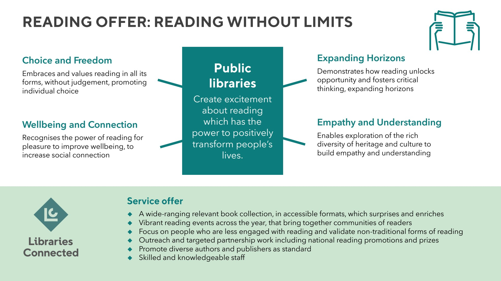
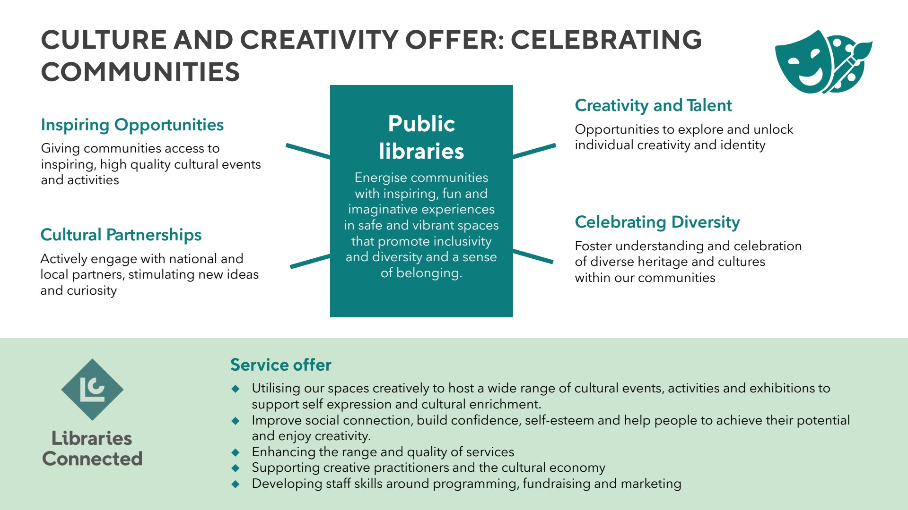
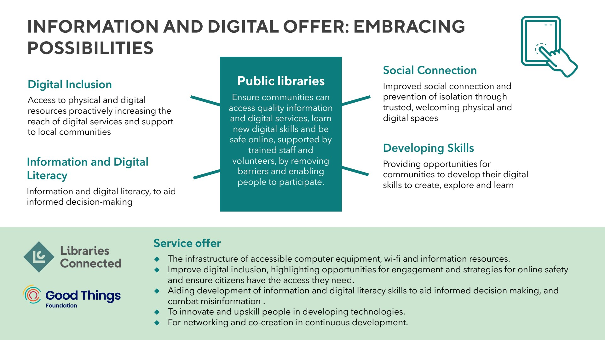
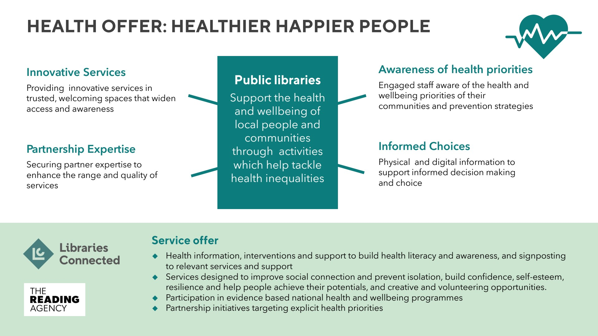

<!-- PAGE: 1 -->

# Universal Library Offers

## A national strategic framework for public libraries

**Libraries Connected**

Our Universal Library Offers are the essential things that libraries do. Developed with library leaders, frontline workers and users, they provide a framework for a high quality library service and demonstrate the power of libraries to enrich lives. The Universal Library Offers help to build a consistent library service across the country but are flexible enough that local libraries can respond to the needs of their communities.

There are currently four Universal Library Offers:
1. **Culture and Creativity:** Enabling local communities to enjoy high-quality arts and cultural experiences through libraries.
2. **Health and Wellbeing:** Supporting the health and wellbeing of communities through services that inform, engage and connect.
3. **Information and Digital:** Ensuring communities can access quality information and digital services, learn new digital skills and feel safe online.
4. **Reading:** Building a literate and confident society by developing, delivering and promoting creative reading activities in libraries.

Each offer is underpinned by the **Vision and Print Impaired People’s Promise**, developed by Share the Vision, and **The Children’s Promise**, developed by The Association of Senior Children’s and Education Librarians (ASCEL).

---

## 1. Reading Offer: Reading Without Limits

### Core Purpose
Public libraries create excitement about reading which has the power to positively transform people’s lives.

### Key Pillars
- **Choice and Freedom:** Embraces and values reading in all its forms, without judgement, promoting individual choice.
- **Expanding Horizons:** Demonstrates how reading unlocks opportunity and fosters critical thinking, expanding horizons.
- **Wellbeing and Connection:** Recognises the power of reading for pleasure to improve wellbeing, to increase social connection.
- **Empathy and Understanding:** Enables exploration of the rich diversity of heritage and culture to build empathy and understanding.

### Service Offer
- A wide-ranging relevant book collection, in accessible formats, which surprises and enriches.
- Vibrant reading events across the year, that bring together communities of readers.
- Focus on people who are less engaged with reading and validate non-traditional forms of reading.
- Outreach and targeted partnership work including national reading promotions and prizes.
- Promote diverse authors and publishers as standard.
- Skilled and knowledgeable staff.

<!-- PAGE: 2 -->

## 2. Culture and Creativity Offer: Celebrating Communities

### Core Purpose
Public libraries energise communities with inspiring, fun and imaginative experiences in safe and vibrant spaces that promote inclusivity and diversity and a sense of belonging.

### Key Pillars
- **Inspiring Opportunities:** Giving communities access to inspiring, high quality cultural events and activities.
- **Creativity and Talent:** Opportunities to explore and unlock individual creativity and identity within our communities.
- **Cultural Partnerships:** Actively engage with national and local partners, stimulating new ideas and curiosity.
- **Celebrating Diversity:** Foster understanding and celebration of diverse heritage and cultures.

### Service Offer
- Utilising our spaces creatively to host a wide range of cultural events, activities and exhibitions to support self expression and cultural enrichment.
- Improve social connection, build confidence, self-esteem and help people to achieve their potential and enjoy creativity.
- Enhancing the range and quality of services.
- Supporting creative practitioners and the cultural economy.
- Developing staff skills around programming, fundraising and marketing.

<!-- PAGE: 3 -->

## 3. Information and Digital Offer: Embracing Possibilities

### Core Purpose
Public libraries ensure communities can access quality information and digital services, learn new digital skills and be safe online, supported by trained staff and volunteers, by removing barriers and enabling people to participate.

### Key Pillars
- **Digital Inclusion:** Access to physical and digital resources proactively increasing the reach of digital services and support to local communities.
- **Social Connection:** Improved social connection and prevention of isolation through trusted, welcoming physical and digital spaces.
- **Developing Skills:** Providing opportunities for communities to develop their digital skills to create, explore and learn.
- **Information and Digital Literacy:** Information and digital literacy, to aid informed decision-making.

### Service Offer
- The infrastructure of accessible computer equipment, Wi-Fi and information resources.
- Improve digital inclusion, highlighting opportunities for engagement and strategies for online safety and ensure citizens have the access they need.
- Aiding development of information and digital literacy skills to aid informed decision making, and combat misinformation.
- To innovate and upskill people in developing technologies.
- For networking and co-creation in continuous development.

<!-- PAGE: 4 -->

## 4. Health Offer: Healthier Happier People

### Core Purpose
Public libraries support the health and wellbeing of local people and communities through activities which help tackle health inequalities.

### Key Pillars
- **Innovative Services:** Providing innovative services in trusted, welcoming spaces that widen access and awareness.
- **Awareness of Health Priorities:** Engaged staff aware of the health and wellbeing priorities of their communities and prevention strategies.
- **Partnership Expertise:** Securing partner expertise to enhance the range and quality of services.
- **Informed Choices:** Physical and digital information to support informed decision making and choice.

### Service Offer
- Health information, interventions and support to build health literacy and awareness, and signposting to relevant services and support.
- Services designed to improve social connection and prevent isolation, build confidence, self-esteem, resilience and help people achieve their potentials, and creative and volunteering opportunities.
- Participation in evidence based national health and wellbeing programmes.
- Partnership initiatives targeting explicit health priorities.
