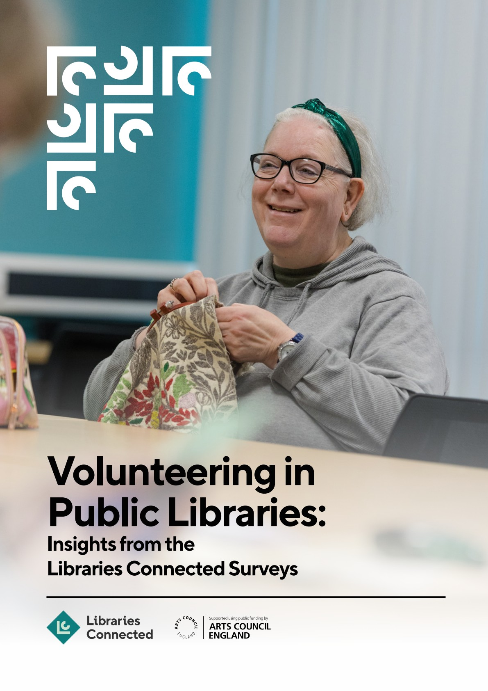
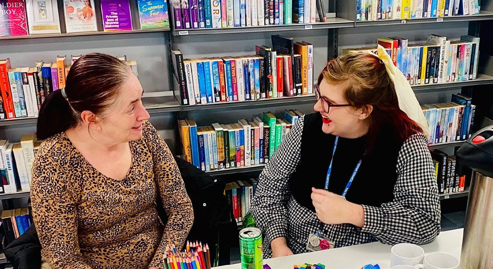
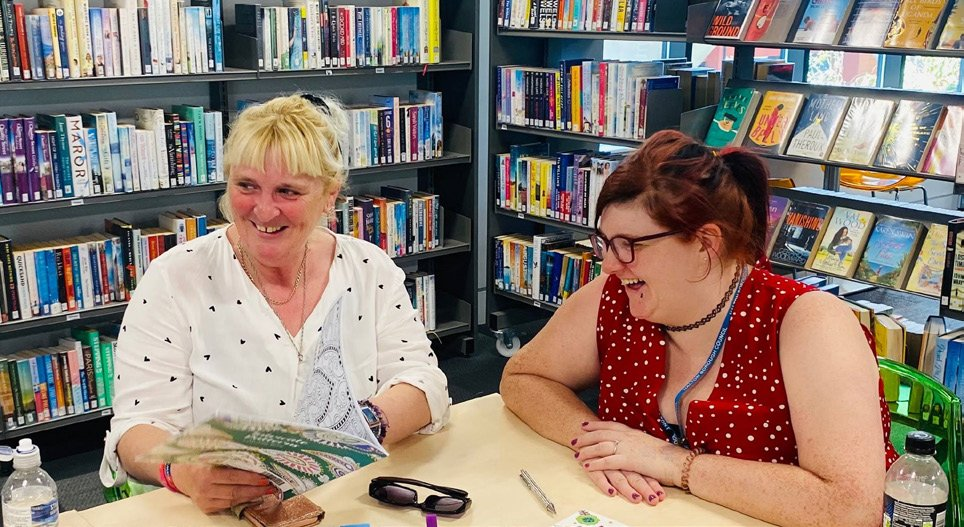
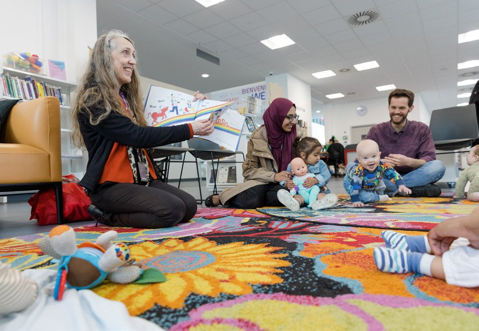
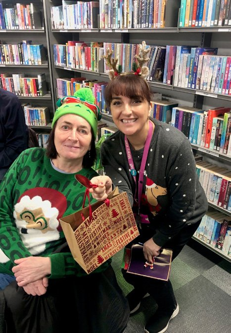
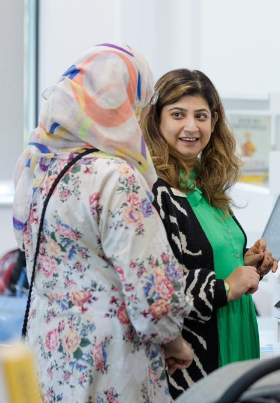
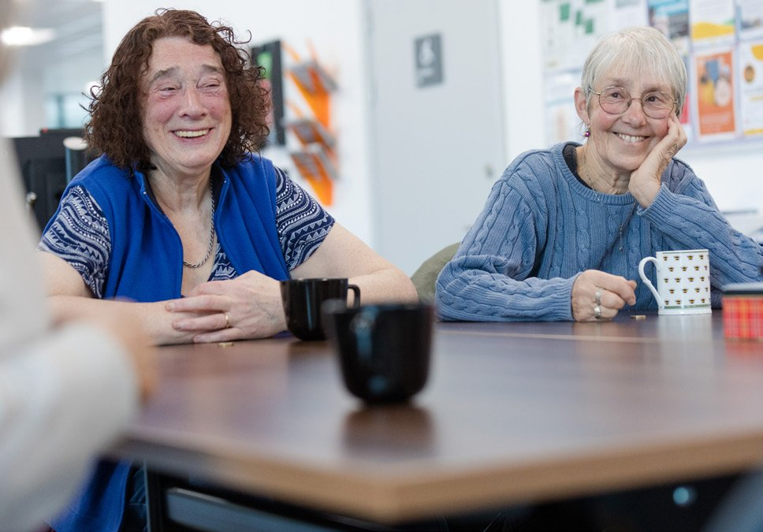

<!-- PAGE: 1 -->

# Volunteering in Public Libraries

## Insights from the Libraries Connected Surveys

**Libraries Connected**  
*February 2026*

<!-- PAGE: 2 -->

<!-- PAGE: 3 -->

## Contents

* **Background** (Page 1)
* **Executive summary** (Page 2)
* **Case study: Tina** (Page 5)
* **Volunteer Diversity Survey findings** (Page 6)
* **Case study: Mick** (Page 19)
* **Member survey findings** (Page 20)
* **Case study: Glenda** (Page 26)
* **National initiatives** (Page 27)
* **Recommendations** (Page 29)
* **Appendix: Survey design** (Page 31)

<!-- PAGE: 4 -->

## Background

Libraries Connected is developing a Volunteering Management Strategy informed by key learnings from the Know Your Neighbourhood (KYN) programme, a Department for Digital, Culture, Media & Sport-funded initiative, administered by Arts Council England. The KYN project works with people at risk of social isolation in high-deprivation areas, testing innovative approaches to volunteering and community participation.

To ensure the strategy reflects realities on the ground, Libraries Connected conducted two comprehensive surveys between September and November 2025:

1. **Volunteer Diversity Survey:** Gathered demographic data, motivations, barriers, and feedback from 1,496 active volunteers across 25 public library services in England.
2. **Member Survey:** Explored volunteering strategies, capacity, management models, and partnership working across 67 library services.

Together, these surveys provide the most detailed picture of volunteering in English public libraries in over a decade.

<!-- PAGE: 5 -->

## Executive Summary

### Volunteer engagement and commitment

Library volunteers are highly committed, with half having volunteered for more than two years and most giving time weekly. Many are long-standing library users, with 71% holding a library card before they began volunteering. Motivations are strongly community-oriented: helping others, giving back to the community, and supporting the library service are the most common reasons for getting involved.

### Profile of volunteers

Volunteers are predominantly female (74%) and heavily skewed towards older age groups: 62% are aged 65 and over, with only 8% aged under 25. While 86% identify as White British or White other, this varies widely by region. Notably, 24% of respondents reported a disability or long-term health condition, highlighting libraries' role as accessible, inclusive environments for volunteers.

### Value and impact

An overwhelming 92% of volunteers feel valued by library staff and their communities. Volunteering provides significant personal benefits: 84% reported improved mental wellbeing, 79% made new friends, and 68% felt more connected to their local neighbourhood. For younger volunteers, gaining skills and experience for employment was a primary motivator.

<!-- PAGE: 6 -->

### Recruitment and retention

Word of mouth, in-library promotion, and existing user relationships remain the most effective recruitment routes. However, services face challenges in recruiting younger and more diverse volunteers, managing administrative burdens, and providing flexible or micro-volunteering opportunities.

### Strategic management

While 82% of library services engage volunteers, approaches to volunteer management vary widely. Only 44% have a dedicated volunteer coordinator, with management responsibilities often decentralized to branch staff. Key priorities for library services include developing inclusive recruitment practices, streamlining onboarding processes, and expanding digital volunteering roles.

<!-- PAGE: 7 -->

<!-- PAGE: 8 -->

## Case Study: Tina

### Digital Skills & Community Volunteer

Tina had been a regular library user for over twenty years before becoming a digital skills volunteer in 2021 following her retirement from administrative work.

> "When I retired, I missed the daily interaction with people. I'd always loved the library and saw a poster asking for Digital Champions to help people with tablets and smartphones. I was a bit nervous at first – I'm no computer genius – but the training was wonderful, and the library staff were so supportive."

Tina spends four hours every Thursday morning running a drop-in digital help desk at her local branch library. She assists residents with everything from NHS App navigation and online council tax payments to setting up video calls with overseas family.

> "You see people come in completely overwhelmed by modern technology. When you sit down with them patiently, with a cup of tea, and show them how to do what they need, the relief on their faces is immense. Volunteering here has given my retirement real purpose. It's not just about computers; it's about connecting human beings."

<!-- PAGE: 9 -->

## Volunteer Diversity Survey Findings

A total of 1,496 responses were received across 25 participating public library authorities. The sample encompasses a wide geographic distribution across London, urban metropolitan boroughs, and rural county authorities.

### Demographic Profile

* **Gender:** 74% Female, 22% Male, 1% Non-binary, 3% Prefer not to say.
* **Age Distribution:**
  * Under 18: 3%
  * 18–24: 5%
  * 25–44: 11%
  * 45–64: 19%
  * 65–74: 41%
  * 75+: 21%
* **Disability:** 24% identify as having a disability or long-term limiting illness.
* **Ethnicity:** 86% White (British/Irish/Other), 6% Asian/Asian British, 4% Black/African/Caribbean/Black British, 2% Mixed/Multiple ethnic groups, 2% Other ethnic group.

<!-- PAGE: 10 -->

### Frequency and Length of Service

Volunteering patterns demonstrate high loyalty and regular involvement:

* **Length of Service:**
  * Less than 6 months: 14%
  * 6–12 months: 16%
  * 1–2 years: 20%
  * 2–5 years: 28%
  * More than 5 years: 22%
* **Time Commitment:**
  * Weekly: 64%
  * Fortnightly: 16%
  * Monthly: 12%
  * Ad-hoc / seasonal (e.g. Summer Reading Challenge): 8%

<!-- PAGE: 11 -->

### Volunteer Roles

Volunteers undertake a wide variety of activities across branch and mobile library services:

| Role Category | Percentage of Volunteers |
|:---|:---:|
| Home Library Service / Delivery | 28% |
| Event and Activity Support (Rhymetimes, Crafts) | 26% |
| Digital Champions / IT Support | 22% |
| Shelving, Stock Support and Tidying | 19% |
| Local History & Heritage | 14% |
| Reading Groups & Shared Reading | 12% |
| Summer Reading Challenge (SRC) Support | 11% |
| English Conversation / ESOL | 8% |
| Code Clubs / STEM Activities | 6% |

<!-- PAGE: 12 -->

### Prior Connection to Libraries

* **71%** were regular library users prior to volunteering.
* **18%** were occasional visitors.
* **11%** had no prior connection or used the service rarely.

This strong user-to-volunteer pathway underscores the importance of the library's physical presence and community visibility as the primary engine of volunteer engagement.

<!-- PAGE: 13 -->

### Motivations for Volunteering

Volunteers were asked to select all factors that motivated them to offer their time:

* To give something back to my local community: **78%**
* Passion for books, reading, and learning: **72%**
* To meet people and make new friends: **61%**
* To stay mentally active and use my skills: **58%**
* To help people who need support (e.g. digital, homebound): **54%**
* To gain work experience and develop new skills: **16%** (rises to 72% among respondents aged under 25)

<!-- PAGE: 14 -->

### Personal Wellbeing and Social Impact

The survey revealed profound personal benefits derived from volunteering:

* **84%** reported that volunteering had a positive impact on their mental health and wellbeing.
* **79%** had made new social connections or friendships through their role.
* **74%** reported feeling less lonely or isolated as a direct result of volunteering.
* **68%** felt a stronger sense of belonging to their local community.

<!-- PAGE: 15 -->

### Experience of Support and Recognition

* **92%** feel valued by the library staff they work with.
* **88%** feel their contribution makes a tangible difference to their community.
* **81%** were satisfied with the induction and initial training received.
* **73%** felt there were adequate opportunities to provide feedback or suggest improvements.

<!-- PAGE: 16 -->

### Areas for Improvement Identified by Volunteers

While overall satisfaction is very high (91% overall satisfaction score), volunteers highlighted several areas for operational enhancement:

* **Communication:** Desired more regular sector updates, newsletters, and opportunities to meet volunteers from other branches.
* **Process and Bureaucracy:** Concerns over complex onboarding, protracted DBS checks, and inflexible paperwork.
* **Training:** Requests for refresher training, especially on digital platforms and safeguarding.
* **Expenses:** Greater clarity on expense reimbursement policies (e.g. mileage for Home Library delivery).

<!-- PAGE: 17 -->

### Overcoming Barriers to Inclusivity

Feedback from underrepresented groups highlighted key barriers:

* Rigid schedules that clash with employment or caring duties.
* Lack of publicity outside library buildings, meaning non-users rarely know volunteer opportunities exist.
* Digital-only application procedures that present barriers to digitally excluded individuals.
* Perceptions that volunteering is exclusively for older or retired individuals.

<!-- PAGE: 18 -->

### Socioeconomic and Geographical Diversity

Volunteers come from a range of socioeconomic backgrounds, though representation from the most deprived indices remains lower than the wider population:

* 18% reside in the most deprived 20% of neighbourhoods (IMD Deciles 1–2).
* 34% reside in average deprivation areas (Deciles 3–6).
* 48% reside in the least deprived 40% of neighbourhoods (Deciles 7–10).

Targeted recruitment through family hubs, job centres, and community anchor organisations is identified as critical to diversifying socioeconomic intake.

<!-- PAGE: 19 -->

## Member Survey Findings: Library Services

Alongside the volunteer survey, 67 public library authorities responded to the Member Survey on strategic volunteer deployment and management.

### Service Overview and Capacity

* **82%** of responding library services involve volunteers.
* The median number of active volunteers per library authority is **145** (ranging from 12 in smaller unitaries to over 800 in large county services).
* **44%** have a dedicated volunteer coordinator or officer post.
* **56%** distribute volunteer management across branch managers or service development librarians.

<!-- PAGE: 20 -->

### Strategic Roles of Volunteers

Library authorities emphasized that volunteers enhance and extend library provision rather than replace paid staff:

> "Volunteers add enormous value to our service. They allow us to run extensive Home Library delivery, host one-to-one digital sessions, and run weekend clubs that would simply not be viable otherwise. They bring enthusiasm, community intelligence, and life experience that enrich everything we do."  
> — *Head of Service, North West*

<!-- PAGE: 21 -->

<!-- PAGE: 22 -->

## Case Study: Mick

### Home Library Service Volunteer Driver

Mick has been delivering books and talking books to housebound residents across a rural county for six years.

> "For many of the folks I visit on my fortnightly route, I'm the only person they see that day, or even that week. It's not just dropping off a bag of books. It's having a chat, checking they're warm, making sure they're doing okay, and listening to their stories."

Mick delivers to eleven customers every other Tuesday, using his own car with fuel expenses reimbursed by the council.

> "The library staff pick the books based on the reader profiles we build together. Seeing someone's face light up when you bring the next historical thriller in a series they love is priceless. It's the most rewarding thing I've ever done."

<!-- PAGE: 23 -->

### Service Priorities and Management Models

* **Recruitment Channels:** 91% use library posters/leaflets, 78% use council volunteer websites, 64% use social media, 42% use local volunteer centres (CVS).
* **Training Provision:** 89% provide mandatory safeguarding training, 84% offer customer service induction, 62% provide health and safety and equality training.
* **Reward and Recognition:** 76% host annual celebration events (e.g. during Volunteers' Week), 58% issue certificates of appreciation, 41% provide long-service pins or vouchers.

<!-- PAGE: 24 -->

### Challenges Faced by Library Services

1. **Staff Capacity:** Time required to supervise, coordinate, and support volunteers effectively amidst reduced staffing levels.
2. **Onboarding Delays:** Backlogs in local authority HR systems, corporate volunteer portals, and DBS processing.
3. **Diversity Deficits:** Difficulty attracting young people (16–24) outside short-term school holiday programmes.
4. **Retention:** Managing turnover among younger volunteers who transition into paid employment or higher education.

<!-- PAGE: 25 -->

### Digital Volunteering and Micro-Volunteering

Services are increasingly experimenting with novel formats:

* **Remote Digital Volunteers:** Assisting with online genealogy queries, digital catalogue transcription, and social media content creation.
* **Micro-volunteering:** Short, task-based opportunities (e.g. reviewing books for the website, 1-hour conversation café hosting).
* **Young Volunteers Schemes:** Dedicated youth councils and teenage advisory panels shaping library stock and programming.

<!-- PAGE: 26 -->

### Policy and Trade Union Protocols

* **88%** of library services operate with formal volunteer policies.
* **69%** have written agreements or partnership compacts with recognised trade unions (such as Unison) defining the boundaries between staff duties and volunteer roles.
* Services noted that clear protocols are essential for maintaining staff morale and avoiding concerns around staff substitution.

<!-- PAGE: 27 -->

### Partnership Working

Library services collaborate with a wide array of local and national partners to deliver volunteering programmes:

* Age UK and local older people's charities (Home Library delivery)
* Good Things Foundation (Digital Inclusion Champions)
* The Reading Agency (Reading Hack and Summer Reading Challenge)
* Local schools, colleges, and Duke of Edinburgh (DofE) providers
* Voluntary and Community Sector (VCSE) infrastructure bodies

<!-- PAGE: 28 -->

### Impact of the Know Your Neighbourhood (KYN) Programme

Authorities participating in the KYN programme reported transformative outcomes:

* Dedicated funding enabled high-intensity volunteer recruitment in left-behind wards.
* Innovative training modules focusing on trauma-informed practice, empathy, and mental health first aid.
* Development of peer-support networks among volunteers, reducing isolation among the volunteers themselves.

<!-- PAGE: 29 -->

## Case Study: Glenda

### Local Heritage & Digital Genealogy Volunteer

Glenda has volunteered in a city central library local studies department for four years, helping community members research their family histories.

> "Family history can be very emotional. People come in wanting to find out where their ancestors came from, or tracing relatives lost in the World Wars. Helping someone locate a census record or a marriage certificate from 1880 that unlocks a whole branch of their family tree is pure joy."

Glenda also works with the library archive team to digitize local photographic collections, making hundreds of historic borough images freely available online.

> "Volunteering keeps my brain sharp and allows me to share my passion for history. The library is a community treasure house, and being part of preserving that history is an honour."

<!-- PAGE: 30 -->

## National Initiatives and Sector Support

Libraries Connected plays a pivotal role in supporting volunteer excellence across the public library network:

### Universal Library Offers Alignment

Volunteering underpins delivery across all Universal Library Offers:

* **Reading:** Supporting Bookstart, rhyme times, reading hack, and reading groups.
* **Health and Wellbeing:** Reducing loneliness, combatting isolation, running memory cafes.
* **Digital and Information:** Digital championing, tech buddies, basic IT skills training.
* **Culture and Creativity:** Assisting exhibitions, creative writing groups, craft clubs.

<!-- PAGE: 31 -->

### Digital Toolkits and Best Practice Sharing

* **National Volunteer Management Toolkit:** Providing template role descriptions, volunteer agreements, and risk assessment matrices.
* **Peer Learning Networks:** Regular webinars connecting volunteer coordinators to share successful engagement techniques.
* **Inclusivity Frameworks:** Guidance on removing barriers for volunteers with learning disabilities, neurodiversity, and English as an additional language.

<!-- PAGE: 32 -->

## Recommendations

The report sets out five strategic recommendations for public library services, local authorities, and national partners:

### Recommendation 1: Diversify the Volunteer Base

Proactively recruit from underrepresented groups, including young people, ethnically diverse communities, and neurodivergent individuals, by offering flexible, micro-volunteering roles and advertising through non-traditional channels.

### Recommendation 2: Streamline Onboarding and Reduce Bureaucracy

Review and simplify volunteer application, vetting, and DBS processes. Work with council HR teams to eliminate unnecessary friction and delays that cause applicant drop-off.

### Recommendation 3: Invest in Volunteer Coordination

Recognise volunteer management as a professional discipline requiring dedicated resource. Secure dedicated coordinator capacity wherever possible, or provide structured training for branch staff leading volunteer teams.

<!-- PAGE: 33 -->

### Recommendation 4: Strengthen Volunteer Voice and Feedback

Establish formal mechanisms for regular volunteer dialogue, including bi-annual surveys, focus groups, and volunteer advisory panels. Ensure volunteers see how their insights shape service improvements.

### Recommendation 5: Secure Long-Term Investment in Community Participation

National funders and local government should continue investing in programmes like Know Your Neighbourhood, recognizing that volunteer infrastructure requires sustained core investment to deliver high-yield social and economic returns.

<!-- PAGE: 34 -->

## Appendix: Survey Design & Methodology

### Volunteer Diversity Survey

* **Fieldwork Period:** 15 September – 10 November 2025.
* **Target Audience:** All current adult and young volunteers active in participating library authorities.
* **Distribution:** Dual online (SurveyMonkey) and accessible large-print paper formats returned via prepaid envelopes.
* **Total Sample:** 1,496 completed responses across 25 library authorities in England.
* **Data Protection:** Fully anonymous; questions aligned with national Census and Cabinet Office demographic categories.

### Member Survey

* **Fieldwork Period:** 1 October – 15 November 2025.
* **Target Audience:** Heads of Library Services, Service Managers, and Volunteer Coordinators.
* **Distribution:** Online questionnaire via Libraries Connected regional networks.
* **Total Sample:** 67 public library authorities (44% response rate across English library authorities).

<!-- PAGE: 35 -->

<!-- PAGE: 36 -->

## About Libraries Connected

Libraries Connected is an independent charity that represents, supports and develops public libraries in England, Wales, Northern Ireland and the Crown Dependencies.

### Contact Details

**Libraries Connected**  
3rd Floor, Islington Central Library  
2 Fieldway Crescent, Highbury East  
London N5 1PF  

* Email: `info@librariesconnected.org.uk`  
* Website: `www.librariesconnected.org.uk`  
* Charity Registration Number: 1176482  
* Company Registration Number: 07559747  
