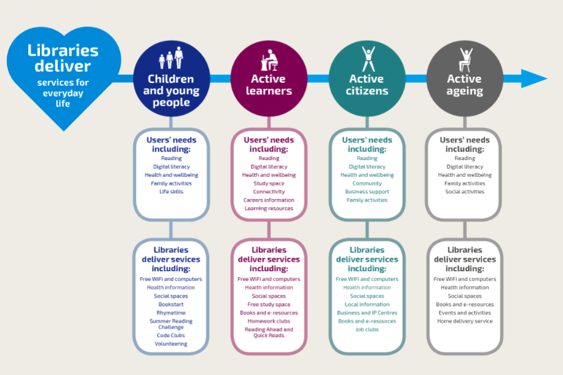
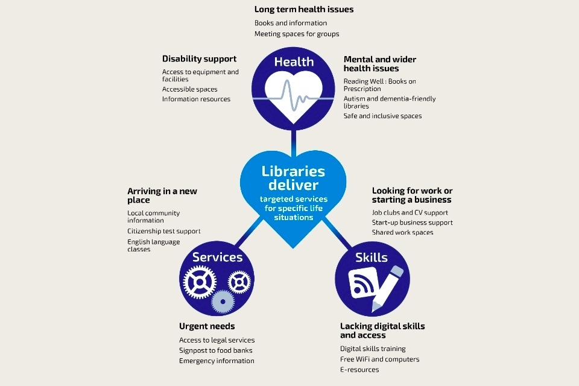
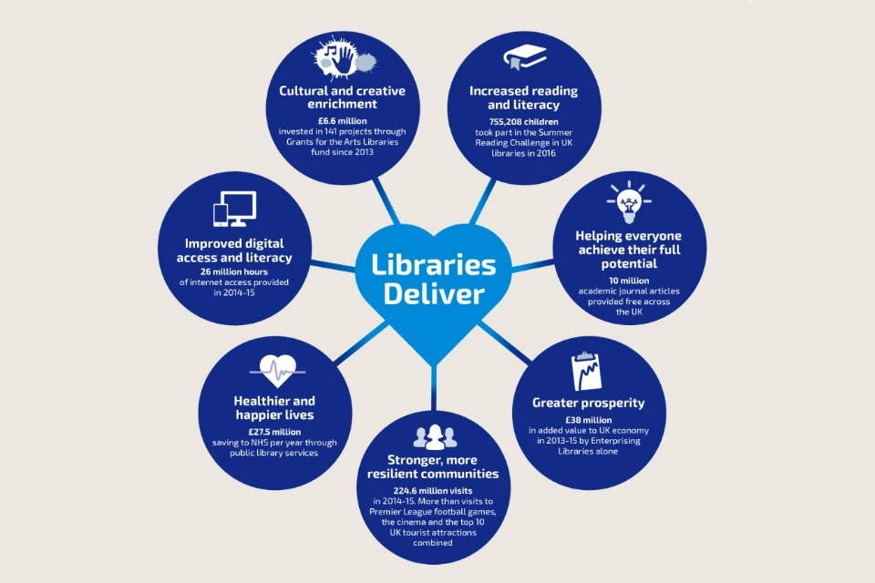

<!-- PAGE: 1 -->

# Libraries Deliver: Ambition for Public Libraries in England 2016–2021

**LIBRARIES TASKFORCE**

Libraries Deliver: Reading, Learning, Culture, Wellbeing, Communities, Digital, Prosperity.

<!-- PAGE: 2 -->

Libraries Deliver: Ambition for Public Libraries in England 2016–2021.

<!-- PAGE: 3 -->

## 1. Foreword

Libraries change lives for the better. They not only provide access to books and other literature but also help people to help themselves and improve their opportunities, bring people together, and provide practical support and guidance. As a locally accountable service, they are well-placed to respond to local needs and issues.

Libraries can have a critical role in helping people to realise their potential, and especially those from disadvantaged backgrounds. DCMS and the Taskforce are setting up a £4 million Libraries: Opportunities for Everyone innovation fund to pilot library service projects that provide people with opportunities that they might not have otherwise. We will see from these pilots which approaches are most successful, then encourage wider adoption and investment in them.

These are challenging times for councils and the library services they run. The way people use libraries and their expectations of public services are changing. Financial and demographic challenges are increasing. Standing still is not an option.

Strong local leadership of libraries, focused on meeting community needs, is vital. We will support this through nationally co-ordinated initiatives where these add value, for example by exploring whether a shared national digital platform would improve library users’ online experience, and by co-ordinating work to make the case for libraries and publicise what they do to have more impact through working together and sharing resources.

This report challenges both central and local government to think and act differently to transform library services. Libraries should be integral to all public service strategies. They must demonstrate their value to service commissioners - promoting themselves as an asset not a cost. In turn, we are urging commissioners to consider a ‘libraries first’ approach when planning services for their communities.

Protecting frontline library services requires radical thinking. Many councils are already working in new and different ways. DCMS will accelerate this - providing advice and support to councils that want to find more effective ways to run their library service - to complement existing sector-led transformation and improvement initiatives led by the LGA.  However where DCMS receives complaints and where local authorities do not appear to be meeting their statutory duties DCMS will investigate and, if necessary, take action under the 1964 Act.

We want libraries to be more resilient and better equipped to weather future challenges - to thrive, not just survive. This document provides a blueprint to do this, building on extensive consultation with the sector and beyond. We welcome this document and fully support and endorse what it proposes.

Rob Wilson MP                                             

Minister for Civil Society

Cllr Ian Stephens               

Chair, Culture, Tourism and Sport Board     

Local Government Association

  
  
**Cllr Ian Stephens**  
Chair, Culture, Tourism and Sport Board  
Local Government Association.  

  
  
**Rob Wilson MP**  
Minister for Civil Society.

<!-- PAGE: 4 -->

## Contents

- 1.0 Foreword (p. 3)
- 2.0 Executive summary - what this report covers (p. 5)
- 3.0 Context (p. 11)
- 4.0 Our vision for public library services in England (p. 17)
- 5.0 The Outcomes libraries deliver for their communities (p. 20)
- 6.0 How we’ll achieve this (p. 31)
  - 6.1 Encouraging common design principles (p. 32)
  - 6.2 Planning public library services to meet local needs (p. 34)
  - 6.3 Considering different models for local service delivery (p. 36)
  - 6.4 Funding library services in varied and sustainable ways (p. 39)
  - 6.5 Defining what an excellent library service looks like (p. 42)
  - 6.6 Helping libraries use better evidence to support decision-making (p. 43)
  - 6.7 Stronger co-ordination and partnership working (p. 45)
  - 6.8 Developing the library workforce, now and for the future (p. 49)
- 7.0 Making the case for libraries (p. 51)
  - 7.1 Championing libraries to decision-makers (p. 52)
  - 7.2 Creating wider public awareness of what libraries have to offer (p. 52)
  - 7.3 Promoting positive messages about libraries in the media (p. 54)
- 8.0 How we’ll take this forward (p. 56)
- Annex 1: The 7 Outcomes the public library network supports (p. 59)
- Annex 2: Action plan (p. 74)
- Annex 3: Summary of the consultation and responses (p. 75)
- Annex 4: Role and remit of Taskforce member organisations (p. 81)
- Annex 5: Image credits and references (p. 83)

<!-- PAGE: 5 -->

> “There is no institution I value more in this country than libraries.”  
> — Michael Palin.

<!-- PAGE: 6 -->

## 2. Executive summary - what this report covers

The [Libraries Taskforce’s](https://www.gov.uk/government/groups/libraries-taskforce) role is to provide leadership and help to reinvigorate the public library sector in England, as well as showcasing and promoting the excellent work already happening in libraries across the country. We were asked by Department for Culture, Media and Sport (DCMS) and the Local Government Association (LGA) to develop this vision for the future of public libraries in England.

### 2.1 The context

When assessing the future of public libraries, it is vital to consider the context in which they operate and the current situation on the ground. Nearly 60% of the population holds a current library card; in the financial year 2014 to 2015, libraries in England received 224.6 million physical visits, more than visits to [Premier League football games](http://www.espnfc.com/barclays-premier-league/23/statistics/performance?season=2015), the [cinema](http://www.cinemauk.org.uk/the-industry/facts-and-figures/uk-cinema-admissions-and-box-office/admissions-by-region/), and the [top 10 UK tourist attractions](http://www.alva.org.uk/details.cfm?p=423) combined. Libraries also received 96 million website visits in 2014 to 2015 - more than three every second. This is a strong base on which to build.

We describe how local libraries provide a unique ‘cradle-to-grave’ service. They offer significant reach into local communities and a cost-effective way of ensuring that people are connected to services they need when they need them - through their buildings, outreach activities and online.

Under the [Public Libraries and Museums Act 1964](http://www.legislation.gov.uk/ukpga/1964/75/crossheading/the-public-library-service), local councils in England have a statutory duty to provide a ‘comprehensive and efficient’ library service for all people working, living or studying full-time in the area who want to make use of it. Local government in England spent [£762 million (net) on libraries](https://www.gov.uk/government/statistical-data-sets/local-authority-revenue-expenditure-and-financing-england-2014-to-2015-individual-local-authority-data-outturn) in the financial year 2014 to 2015 - just over 27 pence a week per person (under 1% of England’s local government net expenditure).

However, in common with all other parts of the public sector, local government faces financial challenges. It needs to adapt and think beyond previous efficiency approaches, to take a more transformational approach to delivering services locally. So library leaders need to think innovatively - about how library services can help meet strategic objectives, how their library service can best be organised, and how their libraries can be financed.

### 2.2 Our vision for public library services in England

Libraries are vital community hubs - bringing people together, and giving them access to the services and support they need to help them live better. Our ambition is for everyone to:

- choose to use libraries, because they see clear benefits and positive outcomes from doing so
<!-- PAGE: 7 -->

- understand what library services offer, and how they can make the most of what’s available to them
- be introduced to new ideas and opportunities, then given confidence and quick and easy access to tools, skills and information they need to improve their quality of life
- receive trusted guidance through the evolving information landscape and build the skills needed to thrive in a changing world

We also outline specific ambitions for communities, public services and other partners, and library services.

To achieve these ambitions, library services contribute to 7 Outcomes that are critical to the individuals and communities in their areas:

- cultural and creative enrichment
- increased reading and literacy
- improved digital access and literacy
- helping everyone achieve their full potential
- healthier and happier lives
- greater prosperity
- stronger, more resilient communities

We have stated what we’d like to see achieved in the next 5 years in each of these 7 areas.

### 2.3 How we’ll achieve this

Making the Vision and the 7 Outcomes described above a reality requires further development of library services.

#### [Encouraging common design principles](#design-principles)

We suggest councils develop library services using 7 common design principles so they:

- meet legal requirements
- are shaped by local needs
- focus on public benefit and deliver a high-quality user experience
- make decisions informed by evidence, building on success
- support delivery of consistent England-wide core offers
- promote partnership working, innovation and enterprise
- use public funds effectively and efficiently

Nationally co-ordinated action can complement strong local leadership and decision-making. The Taskforce will encourage and help the library sector to work together more <!-- PAGE: 8 --> effectively - both by learning from established good practice and by adopting innovative approaches to delivery, funding and service provision.

#### [Planning public library services to meet local needs](#planning-to-meet-local-needs)

At local level, councils need to take a strategic, long-term approach to transforming their library service to strengthen its organisational and financial resilience. Decisions should be made based on assessment of need, and actively managed with the community and library professionals, not carried out in an ad-hoc or reactive way. We encourage councils to provide DCMS with advance notice of proposals to change library service provision to assist the Libraries Minister in carrying out their statutory superintendence role - ensuring that councils are fulfilling their legal duties.

#### [Considering different models for local service delivery](#different-models)

Once councils have a clear view of their communities’ needs, they need to plan how to meet them. There is a range of different delivery models already being used across England. We are working to ensure that councils have robust evidence available to help in this decision making, through our toolkits and research into the sustainability of models such as community managed libraries.

During 2016 to 2017 DCMS will provide dedicated support for library services to explore and, where it is right for them, spin out into a public service mutual model. It will build on the experience of trailblazing library services, and previous government support programmes.

Longer term, DCMS will also discuss with the sector the benefits of establishing a more permanent support body for public sector mutuals across all sectors at national level to assist shifts to new ways of working; for example, franchising support services to enable economies of scale and speedier spin-out.

 [Funding library services in varied and sustainable ways](#funding)

Councils have historically been the primary funding source for public libraries. But libraries increasingly need to diversify their funding: generating additional income streams to help support existing services and to develop new ones.

Building on the success of the £2.6 million WiFi in Libraries Programme, DCMS and the Taskforce are setting up a £4 million Libraries: Opportunities for Everyone fund to pilot innovative activities in public libraries that will support all parts of society. Funded projects will tackle local needs and priorities, but could particularly support schemes in disadvantaged areas.

We will pilot new ways for libraries to generate income from national government initiatives.  For example Ministry of Justice has already established commuter hubs in some London libraries and is looking to extend these to more areas. From January 2017 we’ll explore ways libraries can be used in relation to the [National Citizen Service](http://www.ncsyes.co.uk/what-is-ncs) programme <!-- PAGE: 9 -->, providing venues for them to work within and supporting young people to participate.

#### [Defining what an excellent library service looks like](#excellent-service)

We will support all libraries and library services in developing and maintaining a culture of continuous improvement. Led by the sector itself, we’ll establish a benchmarking framework that councils can choose to use to support self-assessment, planning and improvement. We will ensure that the process does not preclude local flexibility and thus discourage innovation.

#### [Helping libraries use better evidence to support decision-making](#better-evidence)

We want to gather, analyse and share data across the public library network and train the library workforce to make best use of it. It could be used to help make strategic decisions, demonstrate the impact of libraries, meet user needs better, and improve day-to-day operation.

We’ll be publishing a basic dataset showing the number of static libraries in England and the models under which they operate. We’ll extend it and look at more and better ways to gather and use libraries data in the future following consultation with the sector. We’ll also identify where we need research to evidence the impact library services have on the lives of individuals and communities, and commission it on an England-wide basis where that is most effective.

#### [Stronger co-ordination and partnership working](#stronger-co-ordination)

Public library services can be enhanced when libraries work as a network with national support. The sector can achieve more impact by combining expertise and sharing improvement ideas and insight. Joint working can also reduce costs and make it easier for national partners to work with libraries. To support this, the Taskforce will:

- continue to investigate new approaches to procurement, and work with suppliers to identify innovative approaches to providing library services
- explore whether and how libraries’ digital presence could be improved through a single national digital platform that all library services could use and tailor to their needs
- support DCMS and the book industry to identify and implement ways to remunerate authors for remote e-lending
- support the expansion of innovative initiatives such as makerspaces and BFI Mediatheques
- identify further ways to add value and share good practice, and regularly review whether any changes are required in capacity and capability at the national level

<!-- PAGE: 10 -->

#### [Developing the library workforce, now and for the future](#developing-the-workforce)

Skilled and knowledgeable staff are vital in providing an excellent library service. We will produce a Public Library Skills Strategy to equip people working in libraries to deliver the 7 Outcomes successfully and give them the confidence, skills and knowledge they need to lead and succeed in a changing environment.

We want to attract the best new talent, from diverse backgrounds, to work in library services and retain talented and well-trained staff. Our strategy will cover leadership at every level of the workforce, customer service and continuing professional development and training for library staff. We’ll broaden and deepen skills in areas like marketing, data analysis, commercial, digital, and how to harness the commitment and expertise of volunteers.

#### [Making the case for libraries](#making-the-case)

We need to significantly refresh the image of public libraries and raise awareness of the wide range of services libraries provide and benefits they bring - with the public, service commissioners and decision-makers. We’ll do this by:

- transforming public awareness of what libraries do, creating positive but realistic views of the library ‘brand’
- developing positive messages about libraries and the outcomes they support, reflecting these consistently across all library communications channels
- highlighting how libraries can help achieve the objectives of central and local government and other partners
- urging all public service commissioners to think ‘libraries first’ whenever they need to deliver a service direct to communities

### 2.4 How we’ll take this forward

We want this report to reform through action. Our [action plan](https://www.gov.uk/government/uploads/system/uploads/attachment_data/file/603108/Ambition_Action_Plan_December_2016.pdf) says what the Taskforce will do. We are also challenging central and local government to act to make these ambitions a reality. We’ll be reviewing this document annually and reporting on progress every 6 months.

I’m delighted that our Vision is endorsed and supported by central government and by the LGA on behalf of local government. We already have some of the best libraries in the world; if we learn from them and deliver the shared ambitions we set out here then we will have a vibrant, thriving and world-class public library network in England.

Dr Paul Blantern       

Chair, Leadership for Libraries Taskforce

  
  
**Dr Paul Blantern**  
Chair, Leadership for Libraries Taskforce.

<!-- PAGE: 11 -->

> “I started with a book, and that led me to a library, and that led me everywhere.”  
> — Sir Terry Pratchett.

<!-- PAGE: 12 -->

## 3. Context

### 3.1 What libraries have to offer

Public libraries are a unique and valued public service. A [2015 online poll](http://www.moneysavingexpert.com/poll/05-04-2016/will-you-miss-your-local-library-if-its-shut-down) showed 90% of respondents felt their library service should be protected, whether or not they themselves were a regular user.

Libraries reach and support the whole community regardless of age, gender, socioeconomic status or educational attainment. Nearly 60% of the population holds a current library card; in the financial year 2014 to 2015, libraries in England received 224.6 million physical visits, more in total than visits to [Premier League football games](http://www.espnfc.com/barclays-premier-league/23/statistics/performance?season=2015), the [cinema](http://www.cinemauk.org.uk/the-industry/facts-and-figures/uk-cinema-admissions-and-box-office/admissions-by-region/), and the [top 10 UK tourist attractions](http://www.alva.org.uk/details.cfm?p=423) combined. Libraries also received 96 million website visits in 2014 to 2015, more than three every second.

Libraries and the people working in them change lives through:

- promoting enjoyment in reading and other cultural and creative activities
- raising aspirations and building skills so people can achieve their full potential, regardless of background
- actively sharing information, encouraging people to engage with, co-create and learn from each other
- providing trusted and practical support and advice to those who need it

Libraries and their staff don’t sit in isolation; they support other public services that are vital for local and national prosperity and wellbeing. They not only encourage a love of reading, but also provide business support, build digital skills, organise cultural activities, host community events, offer a quiet space to study, and much, much more. All this builds on one of the most important strengths of libraries: the trust people have in them to provide objective and accurate information and guidance in a confidential and even-handed way.

Local libraries provide a ‘cradle-to-grave’ service. They offer significant reach into local communities and a cost-effective way of ensuring that people are connected to the services they need when they need them This helps local councils achieve their strategic objectives and boosts communities’ resilience and independence. Figures 1 and 2 (below) provide examples of the services that libraries and their staff provide to meet individual and community needs.

<!-- PAGE: 13 -->

*Diagram that illustrates how libraries are for everyone, throughout their life. These include children and young people, active learners, active citizens and active ageing.*

[Note: citations can be found in Annex 5: Image credits and references, and the full graphic can be found on [flickr](https://www.flickr.com/photos/135302410@N02/31301047716/)]

<!-- PAGE: 14 -->

*Figure 2: Examples of targeted services which libraries provide for specific life situations*

[Note: citations can be found in Annex 5: Image credits and references, and the full graphic can be found on [flickr](https://www.flickr.com/photos/135302410@N02/31222154051/)]

<!-- PAGE: 15 -->

People often think of libraries as buildings - a community focal point and an important public shared space. But library services are more than bricks and mortar or even the people, stock and resources sitting within a building. Libraries provide services through outreach - with skilled people taking services out into communities - and virtually - allowing access to a wide range of online resources and online spaces for people to meet, debate and learn from each other.

Almost every aspect of modern life is changing rapidly. Shopping, learning, leisure and entertainment have changed radically from a decade ago; all expect to evolve further over the next few years. Libraries face the same challenges. They’re already adapting and developing their offer to respond to changing needs and circumstances, and will need to do so even more in the future.

### 3.2 The legal position

Under the [Public Libraries and Museums Act 1964](http://www.legislation.gov.uk/ukpga/1964/75/crossheading/the-public-library-service), local councils in England have a statutory duty to provide a ‘comprehensive and efficient’ library service for all people working, living or studying full-time in the area who want to make use of it. Councils have the power to offer wider library services beyond the statutory service to other user groups, and the Act allows for joint working between library authorities.

In providing this service, councils must, among other things:

- have regard to encouraging both adults and children to make full use of the library service
- lend books and other printed material free of charge for those who live, work or study in the area

There are currently 151 separate library authorities in England who use a range of different operating models to provide their library services.

At a national level, the Secretary of State for Culture, Media and Sport has a statutory duty to:

- superintend and promote the improvement of the public library service provided by local authorities in England
- secure the proper discharge by local authorities of the functions in relation to libraries conferred on them as library authorities

More information on the legislative framework can be found in the guidance note [Libraries as a statutory service](https://www.gov.uk/government/publications/guidance-on-libraries-as-a-statutory-service/libraries-as-a-statutory-service).

<!-- PAGE: 16 -->

### 3.3 Funding for library services

Local government in England spent [£762 million (net) on libraries](https://www.gov.uk/government/statistical-data-sets/local-authority-revenue-expenditure-and-financing-england-2014-to-2015-individual-local-authority-data-outturn) in the financial year 2014 to 2015 - just over 27 pence a week per person. This equates to under 1% of England’s local government net expenditure - a small spend given the impact libraries have on their communities and the outcomes they help deliver.

In common with all other parts of the public sector, local government funding is under pressure. Councils need to adapt and look at transformational approaches and more fundamental service reform to respond to this. Changes to the basis of future funding means that, by 2020, councils will fund local services like libraries from local revenues including Council Tax, Business Rates and the New Homes Bonus. Demographic changes mean that councils face significant demands on adult social care. Councils will need to take these - and many other issues - into account when restructuring budgets to meet strategic priorities.

This means library leaders need to think innovatively - about how library services can help deliver other strategic objectives, how their library service can best be organised, and how libraries are funded or financed in future. Options for these are considered in sections 6.3 and 6.4.

<!-- PAGE: 17 -->

> “When in doubt, go to the library.”  
> — J.K. Rowling, *Harry Potter and the Chamber of Secrets*.

<!-- PAGE: 18 -->

## 4. Our vision for public library services in England

  

“What do libraries do for us? Well, they introduce many into the world of literacy and learning and help to make it a lifelong habit; they equalise; they teach empathy and help us to learn about each other; they preserve our cultural heritage; they protect our right to know and to learn; they build communities; they strengthen and advance us as a nation; they empower us as individuals.”

  

Malorie Blackman, Children’s Laureate 2013 to 2015

### 4.1 Our ambition is for

Everyone to:

- choose to use libraries because they see clear benefits and positive outcomes from doing so
- understand what library services offer and how they can make the most of what’s available to them
- be introduced to new ideas and opportunities, then given confidence and quick and easy access to tools, skills and information they need to improve their quality of life
- receive trusted guidance through the evolving information landscape and build the skills needed to thrive in a changing world

Communities to have:

- a library service that helps different groups come together, co-designed with local people to meet local needs and strengthen the local community
- local services available through well-designed and well-regarded ‘community hubs’, bringing together different partners’ offerings in a seamless way
- safe, welcoming and accessible physical and virtual environments freely open to all, which encourage participation, creativity and mutual learning and support

Public services and other partners to:

- understand what libraries have to offer them, and how, by working together, they can achieve better outcomes in a more efficient way
- regard libraries as their natural first choice to provide information and services within local communities

<!-- PAGE: 19 -->

Library services to:

- be valued for the positive impact and outcomes they achieve for individuals, communities and partners
- develop an evidence base (qualitative as well as quantitative) so they are recognised as a strategic national and local resource, and achieve more investment and financial resilience as a result
- actively adapt their funding and delivery models and services to meet new circumstances and changing user needs
- work together as a vibrant network, sharing knowledge, resources and insights, building on a consistent core offer and improving the way they work with partners and suppliers
- continue to provide core services free for users, but develop and use commercial skills to generate income so they can offer new services while maintaining neutrality
- help build and maintain communities, supporting everyone in them to flourish and grow
- be digital leaders in their communities, sparking innovation and building capability

Library services work to a set of values based on the [Ethical principles of librarianship](http://www.cilip.org.uk/about/ethics/ethical-principles), maintained on behalf of the profession by the Chartered Institute of Library and Information Professionals (CILIP). These cover:

- considering the public good, including respect for diversity, equal opportunities and human rights
- equitable treatment of all information users
- impartiality and avoidance of inappropriate bias in acquiring and evaluating information and in mediating it to other information users
- promoting straightforward, impartial and objective access to information
- providing the best possible customer service within available resources
- respecting users’ confidentiality and privacy
- providing users with inclusive, safe and welcoming places, online and offline
- working with other individuals, groups and organisations to achieve better outcomes for users
- maintaining and improving personal professional knowledge, skills and competences
- conserving, preserving and sharing information in all formats, respecting its integrity and the intellectual efforts of its creators

<!-- PAGE: 20 -->

> “A free library system is one of the trademarks of a civilised society.”  
> — Terry Jones.

<!-- PAGE: 21 -->

## 5. The outcomes libraries deliver for their communities

The public library network can achieve this Vision by focusing on 7 Outcomes:

- cultural and creative enrichment
- increased reading and literacy
- improved digital access and literacy
- helping everyone achieve their full potential
- healthier and happier lives
- greater prosperity
- stronger, more resilient communities

The following section summarises the role of the public library network in supporting each of these Outcomes. [Annex 1](#Annex-1) contains more detailed information on what each Outcome covers, including:

- the challenges we’re responding to
- examples of existing good practice
- what we think success would look like in 2021
- initial ideas on progress indicators

The indicators need more work. We’ll establish current baselines, agree specific progress indicators for all 7 Outcomes, and publish them by April 2017. We’ll then monitor achievements against these regularly.

The Society of Chief Librarians’ (SCL) Universal Offers provide a framework that helps libraries deliver the 7 Outcomes. They currently cover 5 topics: [Health](http://goscl.com/universal-offers/health-offer/), [Reading](http://goscl.com/universal-offers/reading-offer/), [Digital](http://goscl.com/universal-offers/digital-offer/), [Information](http://goscl.com/universal-offers/information-offer/), and [Learning](http://goscl.com/universal-offers/learning-offer/). A new Culture Offer is being developed and will be launched in early 2017. Each is underpinned by the [Children’s Promise](http://goscl.com/best-practice/childrens-promise/) and [Six Steps](http://goscl.com/best-practice/six-steps-for-blind-and-partially-sighted-people/) initiatives. The Universal Offers are a national framework of partnerships, programmes and messages that can be flexibly delivered at a local level. They’ve been developed in partnership with The Reading Agency (joint owner of the Health and Reading Offers), Arts Council England, the [Association of Senior Children’s and Education Librarians](http://www.ascel.org.uk/) (ASCEL) and [Share the Vision](http://www.share-the-vision.org.uk/).

Most library services are signed up to the Universal Offers. We’d like to see all library services using them and working with partners to achieve the aspirations we outline for each Outcome.

<!-- PAGE: 22 -->

*Figure 3: Library services deliver against 7 Outcomes*

[Note: citations can be found in Annex 5: Image credits and references, and the full graphic can be found on [flickr](https://www.flickr.com/photos/135302410@N02/31222154201/)]

<!-- PAGE: 23 -->

### 5.1 Outcome 1: Cultural and creative enrichment

Cultural and creative opportunities enrich lives. They are important in developing local quality of life, sense of place and individual wellbeing. They also support social cohesion, build skills and reduce social isolation by encouraging participation in shared activities.

The [Warwick Commission](http://www2.warwick.ac.uk/research/warwickcommission/futureculture/finalreport/warwick_commission_report_2015.pdf) in 2015 highlighted the need to guarantee equal access for everyone to a rich cultural education and the opportunity to live a creative life, in the interest of business and wider society. Their study found the 2 groups most highly engaged in cultural activities accounted for only 15% of the general population and tended to be of higher socioeconomic status. This means that many people’s voices, experiences and talents are not being expressed, represented or developed.

Libraries are well placed to extend cultural engagement because of their use by all social groups and their role as inclusive cultural hubs within communities. The Arts Council supports libraries to develop this role by investing, developing and advocating. Libraries also point people to wider cultural activities, objects, knowledge and sites, and encourage individuals to explore different cultural experiences and to create things themselves.

  

> ### Case Study: [St Helens cultural hubs](https://www.gov.uk/government/case-studies/the-art-of-the-possible-libraries-as-creative-hubs)
> 
> Award winning project that helps St Helens council deliver its objectives, which includes engaging with the needs of local young people, and supporting neighbourhood development and community cohesion, through creative use of the arts across St. Helens’ libraries.

We’ll encourage libraries to establish themselves as a focal point for community cultural life, hosting and running a range of activities in partnership with amateur and professional groups. As a result, we’d expect to  see increasing attendance and active participation in creative arts by people of all ages and backgrounds.

<!-- PAGE: 24 -->

### 5.2 Outcome 2: Increased reading and literacy

Reading and literacy are two of the most fundamental skills in life. Libraries give everyone free access to books and literature regardless of age, disability, wealth or education. They are also extending the range of online reading material available. This access makes libraries a catalyst for improved reading and literacy skills.

Reading for pleasure is important. [Research suggests](https://readingagency.org.uk/news/The%20Impact%20of%20Reading%20for%20Pleasure%20and%20Empowerment.pdf) that both children and adults who do this are healthier, happier and more confident than those who don’t. Libraries contribute to this by running reading programmes, hosting book clubs, and by providing advice and guidance to help people extend and develop their reading choices. And adult education in literacy has been shown to [reduce depression levels](http://onlinelibrary.wiley.com/doi/10.1111/j.1525-1497.2006.00531.x/full).

Increasing literacy is vital to increase people’s chances in the job market, reducing dependence on benefits and improving quality of life. And a more skilled workforce contributes to increased local and national productivity and growth. However, an [Organisation for Economic Co-operation and Development (OECD) report in 2016](http://www.oecd.org/unitedkingdom/building-skills-for-all-review-of-england.pdf) found that an estimated 9 million working-age adults in England (more than a quarter of adults aged 16-65) had low literacy or numeracy skills, or both. This lack of basic skills reduces productivity and employability, and therefore profoundly affects social exclusion.

  

> ### Case Study: [Summer Reading Challenge](https://www.gov.uk/government/case-studies/summer-reading-challenge-a-national-scheme-supporting-literacy)
> 
> Three quarters of a million children take part each year, and teachers judged that more children who had undertaken the challenge either maintained or improved their reading performance than those who had not, and far fewer dipped in attainment after the summer.

We‘ll encourage libraries to expand the reading programmes they run, to stimulate reading for pleasure and to provide support to less confident readers. By doing this, we’ll aim to increase literacy levels across our communities.

<!-- PAGE: 25 -->

### 5.3 Outcome 3: Improved digital access and literacy

Public libraries provide a trusted network of accessible locations with free WiFi, computers, and other technology. As the world becomes more digital, access to technology and the ability to operate confidently and safely online are ever more important. A [2014 BT report](https://www.btplc.com/Purposefulbusiness/Connectivity/Beingonlineisgoodforsociety/Valuing-Digital-Inclusion.pdf) estimated the value of digital inclusion to a new user at around £1,064 a year; and in 2015, around [11% of the UK population still lacked household internet access](http://www.ons.gov.uk/peoplepopulationandcommunity/householdcharacteristics/homeinternetandsocialmediausage/bulletins/internetaccesshouseholdsandindividuals/2016). Digital gives people the opportunity to access services more easily, to learn, and to interact with others. Digital skills also boost their employability, and the productivity and prosperity of the organisations they work for.

Trained library staff, supported by volunteers, help local people use online services covering areas like benefits, business, health and wellbeing. They can also provide the training and support individuals need to become independent users of digital services. And they don’t only help communities at a basic level - increasingly they offer ways for people to develop and use more advanced digital skills, through activities such as code clubs and facilities like makerspaces and Fablabs.

  

> ### Case Study: [Tinder Foundation (now renamed Good Things Foundation) digital inclusion pilot](https://librariestaskforce.blog.gov.uk/2016/07/15/supporting-libraries-in-the-digital-age/)
> 
> Funded 16 library services across England to deliver innovative and sustainable digital inclusion projects, targeting vulnerable or isolated people to help them improve their basic digital skills.

We’ll encourage all library services to become the ‘go-to’ provider of digital access, training and support, to help more people use online services confidently and safely. We want libraries to provide seamless physical and virtual access to their resources and activities, and to increase people’s access to higher-end technology and skills so people come together to co-create and make things digitally.

<!-- PAGE: 26 -->

### 5.4 Outcome 4: Helping everyone achieve their full potential

Libraries raise people’s aspirations and promote lifelong learning, supplementing formal education provided through schools, colleges and adult education. This is increasingly important given the accelerated pace of change in the workplace and the world more generally, meaning that skills and knowledge need more frequent updating. The [2013 Office for National Statistics (ONS) Employer Skills Survey](https://www.gov.uk/government/uploads/system/uploads/attachment_data/file/327492/evidence-report-81-ukces-employer-skills-survey-13-full-report-final.pdf) reported that 71% of employers expected their skills requirements for employees to change in the following 12 months, while also reporting decreased investment in training and reduced individualised training time overall.

Libraries offer free resources for study and learning, including online courses and information sources, and quiet spaces for study and reflection that people may not have at home. They also provide opportunities for people to develop core skills such as the ability to handle and assess information confidently.

Lifelong learning through libraries underpins local authority priorities such as wellbeing, economic growth and productivity, and social cohesion and mobility.

  

> ### Case Study: [Idea Stores, Tower Hamlets](https://www.gov.uk/government/case-studies/idea-stores-service-integration-with-libraries-and-learning)
> 
> “Capturing the best traditions of the library movement and education sector but presenting them in an exciting way”. An innovation that turned a failing library service into a thriving one.

We’ll encourage library services to strengthen partnerships with formal learning organisations to complement each other’s work to support learners, extending access to a wider range of online materials and courses, and providing spaces and facilities for more traditional study. We also want them to strengthen people’s ability to handle and interpret information confidently and safely.

<!-- PAGE: 27 -->

### 5.5 Outcome 5: Healthier and happier lives

Councils have a responsibility for their communities’ social wellbeing and for public health. They increasingly focus on preventative work, helping people manage their own health to reduce both the burden on the NHS and health inequalities. By extending joint working and sharing resources with health providers, public libraries will become increasingly important partners, leading to users having healthier and happier lives.

Libraries offer a wide range of health information, both online and through quality-assured reading lists dealing with the more common health conditions. In their role as community hubs, libraries also offer non-clinical spaces in localities where health and wellbeing groups can work with the community in a trusted and non-threatening venue. This helps support people in [self-care and in self-management](https://www.england.nhs.uk/ourwork/patients/patient-participation/self-care/) of long-term conditions (LTCs). People with LTCs spend less than 1% of their time in contact with healthcare professionals and rely on community support to help them for the rest of the time.

Libraries play an important role in boosting health literacy: a person’s skills, knowledge and understanding about how to find and use information so they can act to support and improve their own health and well-being. Research shows that currently [43% of working age adults don’t understand health information given to them](https://www.england.nhs.uk/ourwork/patients/patient-participation/health-decisions/) (up to 61% where this includes statistics). The NHS England [Five Year Forward View](https://www.england.nhs.uk/wp-content/uploads/2014/10/5yfv-web.pdf) stresses the need for people to manage their own health to help prevent illness; libraries help achieve this, closing health equality gaps through empowering more people in this way.

They’re also places where people can come to meet others. Reducing social isolation is an important issue. In a [2013 study](http://www.campaigntoendloneliness.org/loneliness-research/), 59% of adults aged over 52 who reported poor health said they felt lonely some of the time or often, compared to 21% of those who said they were in excellent health. [Research suggests](http://www.artscouncil.org.uk/sites/default/files/download-file/Evidence_review_economic_contribution_libraries_2014.pdf) there are significant associations between frequent library use and reported wellbeing, and also between improved access to health information through libraries and reduced calls on services such as GPs.

  

<!-- PAGE: 28 -->

> ### Case Study: [Norfolk healthy libraries](https://www.gov.uk/government/case-studies/norfolks-healthy-libraries)
> 
> In a countywide drive to promote health and wellbeing, staff in Norfolk’s libraries are being trained in understanding health improvement and mental health first aid. This is so they can offer information, advice and healthy activities, as well as signposting customers to find further help.

We’ll encourage health and wellbeing service commissioners and providers (including council Public Health departments, NHS providers, clinical commissioning groups; and through Local Sustainability and Transformation Plans) to work more closely with libraries to deliver improved health outcomes in communities and to reduce health inequalities. We’ll make a wider range of quality-assured health literacy resources and information available through libraries. Then people can make better-informed lifestyle choices, to self-manage or prevent health conditions, participate in shared decision making with health care professionals, and be better equipped to lead healthier and happier lives.

<!-- PAGE: 29 -->

### 5.6 Outcome 6: Greater prosperity

The prosperity of an area is crucial for residents’ wellbeing and quality of life. We want everyone to have the opportunity to participate in and benefit from this.

Libraries support businesses to start up and grow by providing information and working with local economic development organisations to signpost businesses to sources of support and advice. They can also help attract businesses into an area and keep them there, by contributing to ‘placemaking’ and overall quality of life.

As well as supporting businesses and increasing their productivity, libraries help individuals into work. They run job clubs, back to work programmes and facilitated sessions with partner agencies such as Adult Learning and Skills, Jobcentre Plus and local organisations. They also provide training and support for digital skills and lifelong learning to prepare people for successful and productive careers. A [2013 survey by the UK Commission for Employment and Skills](https://www.gov.uk/government/publications/ukces-employer-skills-survey-2013) showed that 3 in 10 job vacancies were hard to fill because of shortages in suitable skilled, qualified and/or experienced workers.

Increasingly knowledge is becoming a driver of productivity and economic growth. Library information and knowledge management professionals help people understand and become part of the knowledge economy, to boost business competitiveness locally and nationally.

  

> ### Case Study: [British Library Business and IP Centres](https://www.gov.uk/government/case-studies/enterprising-libraries)
> 
> Located in 10 city centre libraries, supporting aspiring entrepreneurs to take advantage of business information resources, including market research and intellectual property databases.

We’ll encourage library services to expand the support they offer to businesses and those seeking work. We want decision makers to recognise their important role in achieving local strategic outcomes related to economic growth, prosperity and productivity.

<!-- PAGE: 30 -->

### 5.7 Outcome 7: Stronger, more resilient communities

Libraries are open to everyone. Their staff understand their community’s needs and are trusted to provide reliable guidance and support on a wide range of issues when people need help. So they’re vital to help public services reach out into communities. Libraries bring people together in welcoming community hubs which host local events and provide a shared sense of place for their users - ever more important in an increasingly digital age.

They’re uniquely placed to help local government and its partners deliver their strategic objectives, whether linked to community cohesion, health and wellbeing, economic growth, promoting independent living or increasing life chances. They also have an important role in reducing social inequalities; [35.8% of people living in the most disadvantaged areas visit their library](https://www.gov.uk/government/uploads/system/uploads/attachment_data/file/539312/Taking_Part_2015-16_Quarter_4_Report_-_FINAL.pdf).

  

> ### Case Study: [Foleshill Community library, Coventry](https://www.gov.uk/government/case-studies/foleshill-library-serving-a-diverse-community)
> 
> Foleshill Festival Celebration Days and contributions to the Positive Images Festival reflect the area’s diversity. From Cook and Eat Well sessions, to health checks, meditation, careers advice, Antakshri and much more, you’ll find it all at this library

We’ll expect councils to integrate library strategies more closely into their broader strategic planning; and consider how partnerships with other public services (such as voluntary, community and social enterprise organisations, NHS Trusts and Sustainability and Transformation Boards and Clinical Commissioning Groups) can work better for citizens in the trusted setting of a local library. We’ll encourage people who commission central and local government services to regard libraries as one of their natural first choices to deliver services to local communities. We’d expect to see increased use by local people as a result.

<!-- PAGE: 31 -->

> “At the moment that we persuade a child, any child, to cross that threshold, that magic threshold into a library, we change their lives forever, for the better.”  
> — Barack Obama, President of the United States of America.

<!-- PAGE: 32 -->

## 6. How we’ll achieve this

Making the Vision and 7 Outcomes described above a reality requires further development of library services.

Strong local leadership can:

- strengthen libraries’ organisational and financial resilience through effective strategic planning, using a common set of design principles
- equip library services to continue to innovate and adapt to meet users’ changing needs

The Taskforce can support and enhance this local leadership at a national level, by helping library services work together as a network on issues like:

- establishing a sector-led benchmarking framework that councils can choose to use to support self-assessment, planning and improvement
- establishing a core dataset to support decision making
- strengthening co-ordination and partnership working
- promoting good practice on assessing and adopting different delivery models
- exploring ways for libraries to develop revenue streams so they can then use new finance approaches such as social investment
- developing a public libraries skills strategy

Locally and nationally we’ll achieve the Vision and Outcomes by:

### 6.1 Encouraging common design principles

Providing a comprehensive and efficient public library service isn’t just about numbers of library service points. Local decision makers need to consider service:

- accessibility (physical, virtual and outreach)
- quality (mapped to local needs)
- availability (including opening hours)
- sustainability

Locally-led decisions on libraries can be made and carried out in a way that will help library services work together better. Libraries can then provide certain services consistently across the country, run them more effectively and efficiently, and share good practice. We’d like to see all library services across England designed in line with 7 principles (endorsed as good practice by the library sector).

<!-- PAGE: 33 -->

Library services should:

#### Meet legal requirements

The public library network in England must comply with the Public Libraries and Museums Act 1964. This includes the retention of an explicit connection between national superintendence and local leadership. Councils must also comply with other legal obligations including the Equality Act and Public Sector Equality Duty.

#### Be shaped by local needs

Libraries should co-design and co-create their services with the active support, engagement and participation of their communities so services are accessible and available to all who need them. Library Friends groups (or similar) can help with these conversations. Public services should think ‘libraries first’ when considering how to deliver information and/or services into communities in an effective and value for money way.

####  Focus on public benefit and deliver a high-quality user experience

Library services should be designed to provide a high-quality user experience, based on explicit statements about the public benefit, outcomes and impact that they deliver.

#### Make decisions informed by evidence, building on success

Library service leaders should base decisions on evidence, data and analysis of good practice from the UK and overseas. They should evaluate the impact and outcomes of programmes and projects they run and share learning widely across the sector.

#### Support delivery of consistent England-wide core offers

Library services could benefit from signing up to SCL’s [Universal Offers](http://goscl.com/universal-offers/) which underpin the 7 Outcomes. Most already do. Not every library will deliver every Offer: local needs and circumstances may differ.

#### Promote partnership working, innovation and enterprise

Library leaders should empower and support their workforce to innovate and develop new services; and encourage them to be entrepreneurial and creative in building new service models and strengthening partnerships with public and private sector, voluntary and community organisations.

#### Use public funds effectively and efficiently

Councils should regularly review how they provide library services so they remain effective and efficient. In line with broader public sector reform, councils should actively examine alternative delivery models and revenue streams that could unlock additional investment.

<!-- PAGE: 34 -->

### 6.2  Planning public library services to meet local needs

Councils have a duty to ensure the economic, social and environmental wellbeing of their area; their strategic plans set out how they’ll achieve this. Fully integrating library services into these will help councils fulfil these duties more effectively and efficiently.

Library authorities need to think long-term as they plan and transform their library service, and do this in consultation with their communities. Councils need to be clear how what they propose fits in with their overall strategy and vision for the future. They should be looking at how the library service can help meet their wider objectives, taking into account other local service provision both within the area and across council boundaries. Choosing to undertake this sort of review will take time and resources, but we believe this up-front investment will pay dividends longer-term.

  

> ### Case Study: [Hampshire library service transformation strategy](https://www.gov.uk/government/case-studies/hampshire-county-council-strategic-library-plan)
> 
> In April 2016, Hampshire County Council published a new strategy that set out a transformation programme to provide a comprehensive and affordable library service through innovation, modern thinking and business leadership. Around 9,500 people and organisations participated in a public consultation exercise that helped inform the strategy.

The existing public library estate shouldn’t be preserved in aspic. Many public libraries were built decades ago. Since then, there may have been dramatic changes in population, transport, technology and patterns of use. The location or layout of some library buildings are no longer suitable for the things local councils and communities want their library services to do. But any decisions, including where and how it is provided, should be made based on robust evidence including a comprehensive assessment of local needs, and actively managed with the community and library professionals, rather than in being made an ad-hoc or reactive way.

Councils should explore opportunities to integrate and co-locate libraries with other government and partner services, particularly as part of the [One Public Estate](https://www.gov.uk/government/publications/libraries-shaping-the-future-good-practice-toolkit/libraries-shaping-the-future-good-practice-toolkit#smarter-services) programme. This can help join up services for users, allow buildings to be opened for longer, and enable costs to be shared. Many libraries are already co-located with local colleges, job centres, post offices, Citizens Advice Bureaux, tourist information, health centres and many other services. They also provide access points for things like IT and language training, and government face to face services. Use of technology to [extend access to library buildings](https://www.gov.uk/government/case-studies/bibliotheca-open-in-peterborough) outside staffed hours is also growing.

  

<!-- PAGE: 35 -->

> ### Case Study: [Ashburton library - Co-location with a Post Office](https://www.gov.uk/government/case-studies/ashburton-library-co-location-with-a-post-office)
> 
> Ashburton library service worked with 13 communities to explore different ways of delivering its services. Its co-location emerged from the collaboration and partnership between the community, Devon Libraries and a local business (the Post Office).

Some people can’t visit libraries (for example due to a disability or because the opening hours don’t fit their working pattern) or would prefer to use digital means. Councils should plan how to meet these needs through digital and outreach provision.

We want councils considering changing their library service to inform the DCMS Libraries Team about their proposals prior to public engagement to assist the Secretary of State in their superintendence role. Councils should be able to demonstrate:

- plans to consult with local communities alongside an assessment of their needs;
- consideration of a range of options (including alternative financing, governance or delivery models) to sustain library service provision in their area
- a rigorous analysis and assessment of the potential impact of their proposals

Further details on this can be found in the guidance note [Libraries as a statutory service](https://www.gov.uk/government/publications/guidance-on-libraries-as-a-statutory-service/libraries-as-a-statutory-service).

> **The Taskforce will:**
>
> - publish a toolkit on how to carry out evidence-based long-term and sustainable planning, based on established sector good practice, case studies and the 7 design principles (Action 10)
> - continue to identify and promote examples of good practice on service integration and physical co-location through our [Libraries shaping the future](https://www.gov.uk/government/publications/libraries-shaping-the-future-good-practice-toolkit/libraries-shaping-the-future-good-practice-toolkit#smarter-services) toolkit (part of Action 18)

<!-- PAGE: 36 -->

> **We’re challenging local government and library services to:**
>
> - plan their public library services (including consideration of cross-boundary issues) using the toolkits provided by the Taskforce (Challenge LG3)
> - inform DCMS Libraries Team about any proposals to make changes to their library service prior to public engagement, having made plans to consult their communities, considered a range of options and assessed the potential impact of their proposals (Challenge LG9)

### 6.3 Considering different models for local service delivery

Once councils have a clear view of their communities’ needs, they then need to plan how to meet them. There is a range of different delivery models already being used across England which are described in our [Libraries shaping the future toolkit](https://www.gov.uk/government/publications/libraries-shaping-the-future-good-practice-toolkit/libraries-shaping-the-future-good-practice-toolkit), including:

- local authority run
- commissioned libraries: local authority outsourced or commissioned to a third-party organisation
- local authority outsourced to another local authority (shared services, either as a whole service or for certain functions )
- community run with local authority support: for example the council provides IT equipment and book stock; some funding; and some input from paid staff who visit (but on a limited basis), liaise and provide professional input

Our [toolkit](https://www.gov.uk/government/publications/libraries-shaping-the-future-good-practice-toolkit/libraries-shaping-the-future-good-practice-toolkit#governance-delivery-models) describes the issues to consider in choosing which model is right for a local area - it’s a complex process that needs to be carried out with community needs and priorities at the forefront. Each model has pros and cons. Some, such as mutuals, allow for formal ‘ownership’ of the service by the local community and the library workforce. This can help with staff retention and motivation as well as enhancing local growth. However, in-house delivery can make it easier to integrate library and other council services. DCMS and the Taskforce will commission research and share evidence on the long term financial sustainability and service quality of different delivery models to better inform local decision making - DCMS funded research into community managed libraries has recently been commissioned.

  

<!-- PAGE: 37 -->

> ### Case Study: [CIC: Northamptonshire](https://www.gov.uk/government/case-studies/northamptonshire-library-and-information-service-cic)
> 
> Northamptonshire Library and Information Service, LibraryPlus, moved into a Wellbeing Community Interest Company (CIC) that is majority owned by Northamptonshire County Council (NCC) (51%) and part owned by the NHS (Northamptonshire Health Foundation Trust) and the University of Northampton.

The government has a manifesto commitment to guarantee a ‘right to mutualise’ within the public sector.  It is committed to encouraging and supporting the growth of public service mutuals - organisations that have spun out of the public sector, continue to deliver public services and where employee control plays a significant part in their operation (for example staff share ownership or representation on the board). They can assume a range of legal structures including charities, co-operatives and community interest companies (CICs). A number of library services have already adopted these models, including [York](https://www.exploreyork.org.uk/) (Explore) and [Devon](https://librariesunlimited.org.uk/) (Libraries Unlimited).

  

> ### Case Study: [York Explore](https://www.gov.uk/government/case-studies/explore-york-libraries-and-archives)
> 
> Explore is an Industrial and Provident Society that is one third owned by staff and two thirds by community members. Their strapline is “knowledge and ideas for everyone”.

Government continues to build awareness, understanding and interest in exploring and developing public service mutuals. It’s developing its strategy for scaling up the public service mutuals sector (due for publication in early 2017). This is expected to result in a £3 million, 3 year programme.

During the 2016 to 2017 financial year DCMS will provide dedicated support for library services to explore and, where it is right for them, spin out into a public service mutual model. It’ll build on the experience of trailblazing library services using innovative delivery models, and previous support programmes such as the Cabinet Office Mutuals Support Programme. The learning from this will inform the government’s wider strategy.

Any library service seeking support and funding from the programme should be able to demonstrate that they are following the good practice set out in this document; for example, planning service provision to meet local communities’ needs.

Through this programme, we’ll explore the potential for collaborative working to enable greater scale and returns in this sector - either by bringing library services together to work as a consortium across geographical boundaries to form a mutual, or helping library services join up with other services in their area (including those outside council control such as leisure, academic institutions and health).

Longer term, DCMS will also discuss with the Taskforce and libraries sector the benefits of establishing a more permanent cross-sector support body for public sector mutuals at national level to assist this shift to new ways of working; for example, by franchising support services to mutuals to enable economies of scale and speedier spin-out. This could form part of wider support for the public mutuals sector which will be defined by the strategy to be published in early 2017.

Changing to a different model is rarely a ‘quick fix’ for budgetary issues - transitioning takes time and support. A business case for transition to new governance and delivery arrangements should cover:

- how this fits with the council’s strategic assessment of local needs
- any risks identified with the proposals
- the transition plan for establishing and supporting the new model
- how service quality will be monitored and maintained
- contingency plans for intervention and improvement should services fall below expectations

Even where councils and library services decide that an alternative delivery model such as a mutual is not the right solution for their situation, they should explore the potential for other ways to share services or costs to improve efficiency and effectiveness for local people.

  

<!-- PAGE: 38 -->

> ### Case Study: [LibrariesWest](https://www.gov.uk/government/case-studies/librarieswest)
> 
> A partnership of 7 public library authorities in the south west of England, which, through sharing of staff and other resources, provides better value for money and financial savings.

This potential for sharing services - as well as sharing experiences and learning - is also particularly important for community managed libraries, where resources are usually very limited and volunteers often have low levels of knowledge on establishing and running a library. Supported financially by [The Power to Change Trust](http://www.thepowertochange.org.uk/), the Taskforce, Society of Chief Librarians, Locality and Upper Norwood Library Trust will be developing a [peer network](http://libraries.communityknowledgehub.org.uk/content/community-knowledge-hub) for community managed libraries to support the sharing of good practice, and to ensure the development of sustainable community managed library business models.

> **The Taskforce will:**
>
> - continue to gather and share information on alternative delivery models adopted across the country through our toolkits and blog, and work with the Office for Civil Society and Innovation in DCMS to provide enhanced advice and support for library services considering whether to spin out into an alternative delivery model (part of Action 18)
> - undertake an assessment of the long term financial sustainability and service quality of different delivery models - including DCMS funded research into community managed libraries (Action 11)

> **We’re challenging central government to:**
>
> - provide and fund enhanced advice and support to encourage library services to explore and, where right for them, spin out their service as a public service mutual (Challenge CG5)

> **We’re challenging local government and library services to:**
>
> - explore alternative forms of delivery and financing before making any reductions in library services, and exploit opportunities for joint working with other councils and/or partners to maintain and enhance service delivery (Challenge LG11)

<!-- PAGE: 39 -->

### 6.4 Funding library services in varied and sustainable ways

Councils have historically been the primary funding source for public libraries. Their new ability to develop 4 year spending plans, once changes in local government finance arrangements are in place, offers opportunities to plan ahead with more certainty and supports the longer-term strategic planning we’re advocating. But libraries increasingly need to [diversify their funding](http://www.publicsectorexecutive.com/public-sector-news/libraries-must-become-more-risk-taking-fundraisers-says-report): generating additional income streams to help support existing services and to develop new ones.

<!-- PAGE: 40 -->

Library leaders need to make a compelling case to local and national decision makers, articulating benefits, impact and cost savings, to show how funding public libraries constitutes an effective investment towards achieving strategic priorities. Delivering critical services direct to the community through libraries can lead to better outcomes for the public, and savings in other services’ budgets. Measured return on investment in libraries generally is high: international Arts Council [research](http://www.artscouncil.org.uk/sites/default/files/download-file/Evidence_review_economic_contribution_libraries_2014.pdf) describes a 5 to 1 benefit-cost ratio.

Library services need to do this alongside exploring other sources of financing over time, such as:

- philanthropy and fundraising
- community share issues (into local projects that benefit the community)
- social impact bonds (to support initiatives in areas such as digital inclusion, literacy or business growth)
- private sector partnerships
- providing discretionary services to local businesses or residents
- wider grants and blended funds where relevant

Using alternative finance models depends on libraries creating a revenue stream, so this should be a clear priority for local commissioners and libraries if they choose to take this approach.

  

> ### Case Study: [Manchester Central Library Development Trust](https://www.gov.uk/government/case-studies/manchester-central-library-development-trust)
> 
> Between 2012 and 2014 the Trust raised almost £1 million, mainly from grants, to fund additional capital items for the library’s transformation.

A number of councils have already developed new financing approaches to maintain and enhance existing library services and develop new ones. We believe this can go further and that more councils can benefit from:

- taking a strategic view on how libraries will contribute to achieving the council’s and partners’ overall corporate objectives
- marshalling evidence of benefits from using public libraries for use with commissioners within the council and external public service partners
<!-- PAGE: 41 -->

- identifying opportunities for joint working with other library and local authority services and partners to reduce costs, such as shared purchasing, shared services and co-location and/or integration of services
- seeking support-in-kind (for example from private sector partners) and other income generation sources, whilst maintaining neutrality
- considering innovative forms of financing, such as those listed above

We’re looking to pilot various ways for libraries to generate income from national government initiatives. For example Ministry of Justice has already established [commuter hubs](https://civilservice.blog.gov.uk/tag/tw3/) within some London libraries; and, from January 2017, we’ll explore ways in which libraries can be used and funded to recruit young people to the [National Citizen Service](http://www.ncsyes.co.uk/what-is-ncs) programme and provide venues for them to work within and support them to participate.

Our [Libraries shaping the future](https://www.gov.uk/government/publications/libraries-shaping-the-future-good-practice-toolkit/libraries-shaping-the-future-good-practice-toolkit#smarter-services) toolkit has more information on different income generation approaches. We’ll work with Office for Civil Society and Innovation to explore how libraries can go about building new income streams, and share this learning and experience widely to support library services. The Taskforce and OCSI will host masterclasses to help library services find out more about alternative funding models and to explore which will work in library services as well as identify areas for further action.

DCMS and the Taskforce are setting up a £4 million Libraries: Opportunities for Everyone fund (administered by Arts Council England) to pilot innovative activities in public libraries in England to support all parts of society, including the most deprived. As [35.8% of people living in the most disadvantaged areas visit their library](https://www.gov.uk/government/uploads/system/uploads/attachment_data/file/539312/Taking_Part_2015-16_Quarter_4_Report_-_FINAL.pdf), libraries can play a big role helping everyone with opportunities they might not otherwise have access to.

Projects will be shaped based on proposals to tackle local needs and priorities, but the Fund could help support schemes in disadvantaged areas. We’ll support pilot projects where libraries can show sustained commitment and investment (either financial or in kind) and how they support the achievement of wider outcomes; and we’ll rigorously evaluate them to build an evidence base that can be used to capture learning, encourage wider adoption of successful approaches, and secure further investment.

Arts Council England, the development agency for libraries in England, also provides additional grant funding for specific projects. Through its Grants for the Arts and Strategic Touring programmes, it invests around £2 million of National Lottery money each year in projects delivered by public libraries or working in partnership with artists and cultural organisations across all art forms. It puts a further £684,000 each year into library development funding, used to support programmes like the formulation of Universal Offers, the British Library’s Enterprising Libraries programme and Living Knowledge Network, The Reading Agency’s work in libraries, and research on libraries’ impact and outcomes.

Following consultation with its sectors, Arts Council England has made some changes to its [investment approach for 2018-22](http://www.artscouncil.org.uk/how-we-invest-public-money/our-investment-2018-22). For the first time, libraries will be eligible to apply for all of its funding programmes, wherever the proposals meet published aims.This means that, in addition to being eligible for its open access [Grants for the Arts (GftA) fund](http://www.artscouncil.org.uk/funding/grants-arts), libraries will now be able to apply for longer term investment as National Portfolio Organisations (NPOs) for museums and libraries activity, and will be eligible for all strategic funds.

> **The Taskforce will:**
>
> - work alongside the Office for Civil Society and Innovation in DCMS to continue to develop and share best practice on approaches to library service funding, including running masterclasses from early 2017 to explore social investment and alternative funding methods (part of Action 18)
> - continue to seek opportunities for national funding, partnerships and/or support in kind for existing and new major programmes (Action 5)
> - ensure that the projects delivered through the £4 million Libraries: Opportunities for Everyone innovation fund:
>
>
> - support those people living in the most disadvantaged areas, providing them with opportunities they might not otherwise have access to
> - are rigorously evaluated to build an evidence base that can be used to capture learning, encourage wider adoption of successful approaches, and secure further investment (Action 12)

> **We’re challenging local government and library services to:**
>
> - actively explore how they can generate and use alternative forms of funding and financing in addition to using any national funding schemes that are available (Challenge LG12)

<!-- PAGE: 42 -->

### 6.5 Defining what an excellent library service looks like

Many councils in England have worked hard to promote excellence in their public library services. We’ll support all libraries and library services to develop and maintain a culture of continuous improvement.

We’ll develop and promote a sector-led benchmarking framework that library services can choose to use to support self-assessment, promotion, planning and improvement. Using outcome-focused descriptions, it will set out what an excellent library or library service could look like. We’ll learn from existing models and best practice in other sectors to ensure the process isn’t too resource-hungry and doesn’t inhibit innovation by precluding local flexibility.

  

> ### Case Study: [Archive Service Accreditation scheme operated by The National Archives](https://www.gov.uk/government/case-studies/archive-service-accreditation-defining-what-an-excellent-service-looks-like)
> 
> Benchmarking schemes and frameworks help archives to manage and improve their efficiency and effectiveness through external validation, and by identifying good practice.

Once this framework is in place, we’ll consider whether a voluntary sector-led accreditation scheme (similar to ones already in use in museums and archives) would add value. If established, this would provide participating councils with an external assessment of how they match up to the benchmarks.

> **The Taskforce will:**
>
> - develop and promote a sector-led benchmarking framework that libraries can choose to use to support self-assessment, planning and improvement (Action 13)
> - consider whether a voluntary sector-led accreditation scheme would add value (Action 14)

> **We’re challenging local government and library services to:**
>
> - use the sector-led benchmarking framework for self-assessment, planning and improvement (Challenge LG5)

<!-- PAGE: 43 -->

### 6.6 Helping libraries use better evidence to support decision-making

We want to actively gather, analyse and share data across the public library network and train the library workforce to make best use of this. We believe libraries need a core set of data that can be consistently and regularly collected (automated where possible), and openly published. Libraries can then use this to:

- identify, understand and meet user needs better
- support strategic planning
- develop information they can use to help secure future investment and encourage increased usage
<!-- PAGE: 44 -->

- identify areas for improvement
- manage day to day operations in a more effective and timely way

We’ll be publishing a basic dataset showing the number of static libraries in England and the models under which they operate. We’ll extend it and look at more and better ways to gather and use libraries data in the future following consultation with the sector.

  

> ### Case Study: [London Borough of Sutton](https://www.gov.uk/government/case-studies/sutton-libraries-public-consultation)
> 
> The consultation on changes to Sutton libraries was backed by research mapping demographic trends and needs analysis across the borough. This was so staff had a clear view of the communities the libraries serve.

We want to strengthen the evidence base we have about the impact library services have on the lives of individuals and communities. Establishing what outcomes have been achieved often requires qualitative data that can only be provided through sound, survey-based research. This can be resource intensive and time consuming to collect at a local level, so we’ll look to commission research on an England-wide basis where possible.

> **The Taskforce will:**
>
> - define and publish a core dataset, creating a transparent and automated (where possible) process to gather and share it (Action 2)
> - identify and commission any further research work needed to measure the 7 Outcomes to be used as a shared evidence base by all, connecting to other research frameworks or other sectors where relevant (Action 4)
> - identify and promote examples of good practice and research from the UK and overseas through the Taskforce toolkits as well as through Taskforce member activity, blogs, networking and training (Action 18)

> **We’re challenging local government and library services to:**
>
> - adopt, collect and share data as defined in the core dataset by the Taskforce (Challenge LG4)
> - identify and share examples of good practice and research in their area with peers and the Taskforce Team for showcasing (such as use in blogs and speeches) and for incorporation into its toolkits; and consider adopting examples from elsewhere (Challenge LG6)

<!-- PAGE: 45 -->

### 6.7 Stronger co-ordination and partnership working

Strong local leadership of public library services can be enhanced when libraries work as a network with national support. The Taskforce provides national co-ordination for the public library network in England, and liaises with the devolved administrations in Scotland, Wales and Northern Ireland on areas of shared interest. We bring together organisations involved in providing leadership and support for local libraries and library services (roles and remits are outlined in Annex 4). Individual Taskforce member organisations lead on specific activities. For example, SCL, in collaboration with partners such as The Reading Agency, develops and delivers the Universal Offers.

Over and above this, the sector can achieve more impact by combining expertise and sharing improvement ideas and insight. Joint working can reduce costs and make it easier for national partners to work with libraries. Libraries can also benefit from increased partnership working with local public, private, voluntary and community organisations.

While it’s vital that front-line library services are co-created with local communities, library services can achieve significant benefits through working together where this makes sense locally. For example:

- by merging back-office functions to reduce costs and free up funding for front-line activities
- by exploring even greater integration through alternative delivery models such as setting up consortia-based public service mutuals
- by combining to deliver national programmes
- sharing procurement of book stock or library management systems to reduce costs (for example the Digital Library, a framework with suppliers for online resources administered by [Jisc](https://www.jisc.ac.uk/content/library) on SCL’s behalf, has yielded savings of £1.6 million for an investment of £30,000 a year).

We’ll continue to share new approaches to procurement and we’ll work with suppliers to identify innovative approaches to providing library services. New combined authorities are emerging in parts of the country to manage economic growth, infrastructure and public services across a broad geographic area. We’ll look at how these might benefit library services in their area; for example possibly exploring their potential to stimulate wider shared service provision, or support structural integration of library services on a regional basis through setting up consortia based alternative delivery models.

  

<!-- PAGE: 46 -->

> ### Case Study: [London Libraries Consortium](https://www.gov.uk/government/case-studies/london-libraries-consortium-partnership-working)
> 
> Formed to deliver cost effective and efficient services by sharing computer technology across the partners - there are currently 18 members. Customers have access to over 6 million items from across London and books can be borrowed from over 170 branch libraries.

Developing a compelling virtual presence, integrating seamlessly with physical library provision, is increasingly important as more people communicate, use services and engage digitally. An improved digital presence can, in turn, stimulate and increase physical visits. Compared with other cultural organisations, such as museums and galleries, libraries have fallen behind. Libraries’ online presence through council websites tends be transactional (for example reserving a book), rather than designed to attract people to explore, discover and engage with library activities and assets online. As local resources are limited, we’re looking on a [national level at how libraries’ digital presence can be improved](https://www.gov.uk/government/publications/single-library-digital-presence-steering-group-terms-of-reference/single-library-digital-presence-steering-group-terms-of-reference), by building on the initial report by [Bibliocommons](http://goscl.com/wp-content/uploads/151130-DigitalPlatformFinalReport.pdf), commissioned by SCL.

Library services’ digital offer can also be enhanced by increased provision of e-books, e-magazines and e-newspapers, allowing people who prefer to read using digital devices or can’t easily visit the library to access a wider range of material. Remote e-lending (downloads of books from outside library premises) is not currently covered by [Public Lending Right](https://www.plr.uk.com/) (PLR) - the right of authors and other rights holders to receive compensatory payment for the loans of books from public libraries in the UK. The Taskforce will support DCMS and the book industry to identify and implement ways to remunerate authors for remote e-lending.

Low-cost and accessible technologies are fuelling a new wave of creativity, problem solving and entrepreneurialism. People now have the potential to invent, prototype, and implement solutions to problems in ways that weren’t imaginable 5 years ago. Makerspaces have emerged as a response to that opportunity. They vary from a simple space with work benches to a fully equipped lab with a wide range of digital and manual tools.

  

<!-- PAGE: 47 -->

> ### Case Study: [Makerspaces](https://www.gov.uk/government/case-studies/fab-lab-devon)
> 
> A makerspace is a physical location where people gather to co-create, sharing resources and knowledge, work on projects, network, and build. A small number of larger public libraries already have successful makerspaces, including Exeter’s FabLab.

Creating makerspaces in libraries to democratise access to the means of production, connecting inventors to knowledge and support, and providing educational programmes that help people learn about digital making, is a natural extension to libraries’ original goal in democratising access to knowledge. One of the things the Taskforce can do is bring together people from across sectors to collaborate on programmes to support library services. We’ll be using this convening power to support the expansion of makerspaces in public libraries in England.

We’ll also work with the British Film Institute (BFI) to overcome the economic and technical barriers to rolling out their [Mediatheque offer](http://www.bfi.org.uk/archive-collections/introduction-bfi-collections/bfi-mediatheques) to more public libraries across England. Mediatheque currently gives digital access to film and TV archive material in nine UK locations, including the central libraries in Manchester, Birmingham and Cambridge via a provision which permits access to archive materials on BFI designated premises. Technological advances will allow expansion of this provision. This will help fulfil our ambition to create creative and digital community hubs and the BFI’s goals of providing more public access to the UK’s national film and TV collections and improving their use as an educational resource.

Taskforce members and their organisations will continue to engage with library services to identify ways to add value and share good practice. In doing so, they’ll consider whether this highlights any changes needed in capacity and capability at the national level. This will take into account the need for succession planning for the Taskforce (whose funding runs to March 2020) and wider implications for Taskforce member organisations following other organisational reviews such as the DCMS [Tailored Review of Arts Council England](https://www.gov.uk/government/uploads/system/uploads/attachment_data/file/544738/Terms_of_Reference_-_Arts_Council_Review.pdf). Part of this review is looking at the Arts Council’s form and functions, including its role as a development agency supporting public libraries in England.

<!-- PAGE: 48 -->

> **The Taskforce will:**
>
> - help library services to exploit opportunities for joint working with other councils and/or partners, as well as tackling barriers to doing this (Action 15)
> - work with local councils to investigate new approaches to procurement including considering where national frameworks can promote consistency and reduce costs and overheads (Action 16)
> - discuss with suppliers current and future needs in library services to encourage the development of innovative approaches to provision of services (Action 17)
> explore the feasibility of a shared national digital platform for public libraries in England (Single Library Digital Presence) and then identify ways to develop, operate and fund it (Action 20)
> - support the extension of partnership projects such as the BFI Mediatheques and makerspaces (Action 21)

> **Taskforce members and their organisations will:**
>
> - identify further ways to add value and share good practice, and regularly review whether any changes are required in capacity and capability at the national level (Action 25)

> **We’re challenging central government departments to:**
>
> - support remote access to e-books without charge and with appropriate compensation for authors (Challenge CG3)
> - in conjunction with the Taskforce, support the extension of partnership projects such as BFI Mediatheques and makerspaces (Action 21 and Challenge CG4)

> **We’re challenging local government and library services to:**
>
> - identify any barriers to adoption of new or more efficient ways of working where national support may help to break them down, and share these with the Taskforce Team (Challenge LG7)
> - exploit opportunities for joint working with other councils and/or partners (Challenge LG8)

<!-- PAGE: 49 -->

### 6.8 Developing the library workforce, now and for the future

  

“Google can bring you back 100,000 answers, a librarian can bring you back the right one.”
Neil Gaiman

To transform public library services across England, we need to harness the talent and creativity of the people who work in them - library staff and volunteers. Developing staff and their skills needs resourcing, but equipping people in libraries to deliver the 7 Outcomes successfully is a vital investment. It’s important we develop people already working in public libraries to give them the confidence, skills and knowledge they need to lead and succeed in a changing environment.

  

> ### Case Study: [SCL digital training scheme](http://goscl.com/80-of-public-library-staff-in-england-have-improved-digital-skills-thanks-to-scl-e-learning-programme/)
> 
> The Society of Chief Librarians, working with Learning Pool, have trained 14,000 public library staff (80% of the workforce), via an e-learning programme designed to improve their digital skills and confidence.

There are other staffing challenges. [Research undertaken by CILIP](http://www.cilip.org.uk/sites/default/files/documents/executive_summary_nov_2015-5_a4web.pdf) in 2014 to 2015 showed most of the overall information workforce was aged between 45 and 55 - over 55% were over 45, compared with just over 40% for the UK as a whole. This holds broadly true for the public library workforce. This means we need to think ahead and consider succession planning. The research also showed a far higher proportion of females and white people in this workforce than the national profile. As library services recruit, they need to attract and retain talented new people who can provide different perspectives and increase workforce diversity in line with changes in the wider community.

<!-- PAGE: 50 -->

We’ll produce a Public Library Skills Strategy that will address:

- promoting leadership at every level of the workforce
- delivering outstanding customer service
- continuing professional development and training for library staff, broadening and deepening skills in areas like marketing, data analysis, commercial, choosing and using alternative finance models, digital, and how to harness the commitment and expertise of volunteers
- attracting the best new talent, from diverse backgrounds, to work in library services
- retaining talented and well-trained staff in the library sector
- learning and development needs of councillors, commissioners, senior council officers and board members of new library delivery bodies (such as mutuals and trusts)
- learning and development needs of volunteers

We’ll link with other broader library skills strategies and work in partnership with other skills providers as we do this. For example, the LGA, in partnership with Arts Council England, will continue to support local leaders to develop their leadership skills and communicate the benefits of cultural activity across a wide range of service areas

As well as defining what skills and knowledge we need to develop, we’ll identify the best ways to provide training, learning from best practice elsewhere.

> **The Taskforce will:**
>
> - work through CILIP and SCL to produce a Public Library Skills Strategy (Action 19)

> **We’re challenging local government and library services to:**
>
> - use the Public Library Skills Strategy to inform the learning and development offer they provide to their councillors and senior officers, library workforce and volunteers (Challenge LG10)

<!-- PAGE: 51 -->

> “These things are normally quite expensive if you were to go to a professional but the library offer these services for free. You’re on a shoestring when you’re starting out and that’s why I went to the Business & IP Centre.”  
> — Rowena Johnson, inventor of Bugbrush, a new children’s toothbrush.

<!-- PAGE: 52 -->

## 7. Making the case for libraries

We need to significantly improve the image of public libraries and people’s awareness of the wide range of services libraries provide and benefits they bring. We’ll do this at 2 levels:

- nationally - by challenging perceptions, combatting stereotypes, and promoting what libraries can offer
- regionally and locally through the library network - by presenting local activities in a way that’s consistent with the messages promoted nationally, to encourage people to use libraries and see for themselves

Library services set themselves challenging targets to reach out to non-users in their communities and encourage new generations of users. We want to support them in achieving this.

We’ll do this by:

### 7.1 Championing libraries to decision-makers

Libraries deliver services that change people’s lives for the better. We need to make the case for this in a compelling way, highlighting how they can contribute to achieving the objectives of central and local government as well as a range of other partners, rather than talking about libraries in isolation.

We have 4 connected priorities:

- developing influence with local councillors and decision-makers to secure local support and funding, promoting ‘libraries first’ approaches whenever new service developments are planned
- using data and evidence to make decision-makers aware of what public library services have to offer and how libraries can help achieve their wider strategic goals
- ensuring that future policy and regulation at a national level supports public libraries
- promoting achievements where local leaders have supported and worked through their public library service

### 7.2 Creating wider public awareness of what libraries have to offer

Millions of people use libraries. However, some people have never had contact with the library service or have lost touch.

We need to raise people’s awareness of what libraries can do for them. We want to reinforce positive but realistic views of the library ‘brand’ at the national level. Locally, <!-- PAGE: 53 --> we’d expect this to translate into increased library visits and usage, and ultimately measurable progress in meeting our aspirations against each of our 7 Outcomes. Raising the level of interest in libraries and awareness of the impact they have should also encourage new people to consider a future career in public libraries.

This work will include:

- initiatives to combat stereotypes and promote what today’s libraries have to offer
- developing a joined-up and consistent approach to participation in existing national library events such as National Libraries Week and the Summer Reading Challenge, and building new partnerships and involvement with national events led by others that are relevant to libraries such as Get Online Week, Volunteers Week, Black History Month and LGBT History Month
- using initiatives such as [Libraries Change Lives](http://www.cilip.org.uk/cilip/cilip-libraries-change-lives-award) and the [Carnegie and Kate Greenaway awards](http://www.carnegiegreenaway.org.uk/carnegie/) to highlight and celebrate the transformative work public library staff do every day

To achieve the impact needed, the whole library sector needs to get behind a long term, sustained programme of activity. Work done nationally must be supported by active participation and repetition of the core messages locally, using all channels available.

  

> ### Case Study: [Leeds Libraries’ #whatsyourstory](https://librariestaskforce.blog.gov.uk/2016/03/09/whatsyourstory-leeds-libraries-innovative-marketing-campaign/)
> 
> Innovative and award-winning marketing campaign run by Leeds libraries which features people telling their personal stories about the positive impact Leeds Libraries has had on their lives.

High-profile library champions can help to get messages out, but all who work in or have a connection to a library are potential ambassadors. They can talk about local initiatives they’re undertaking to meet local needs, and the positive impacts and outcomes that result. We want to empower the library workforce to promote their activities effectively, for example through use of social media.

<!-- PAGE: 54 -->

### 7.3 Promoting positive messages about libraries in the media

Making the case for libraries  and consistent co-ordinated publicity will be undermined if we don’t pay specific attention to the media.

They play an important role in shaping perceptions and raising awareness about public libraries and services they provide. Current media attention mainly focuses on stories about changes to library service provision, library closures and the perceived diminishing role of public libraries due to the internet. It would be wrong to deny changes are occurring in the sector, but we need to ensure these stories are balanced with reports of library openings and service improvements and how lives of individuals and communities have been improved through interaction with library services.

We’ll develop positive messages about libraries and the outcomes they support, and reflect these consistently throughout interviews, placed editorial and other media, including online channels. We’ll share materials to enable others to spread core messages locally too. This should start to build a more consistent narrative and raise general levels of awareness so people choose to use their local library.

> **The Taskforce will:**
>
> - ensure that the ‘libraries first’ approach is promoted to central government, local councils and partners (part of Action 1)
> - develop a programme aimed at supporting library staff to work better with, and influence, decision-makers to secure local support and funding (part of Action 1)
> - work with others (including the devolved administrations where relevant) to develop a joined-up programme of promotional activity based on commonly agreed messages, to promote public awareness of what public libraries can do for them, and increase engagement with them (Action 6)
> - develop a set of communications messages and resources (case studies, factsheets, images, etc) that everyone speaking for or promoting libraries can use - this will support championing libraries to decision-makers and broader publicity (Action 7)
> - identify and break down any barriers to innovation that stop library staff promoting their work effectively, through guidance and sharing common materials and good practice (Action 9)

> **Relevant Taskforce partners will:**
>
> - reflect commonly agreed messages about library services consistently throughout interviews, placed editorial and other media - including online coverage - using nationally-produced communication assets to promote public awareness of what libraries can do for them and to increase usage (Action 8)

<!-- PAGE: 55 -->

> **We’re challenging central government departments to:**
>
> - acknowledge the role that public libraries can play in achieving the 7 Outcomes and to reflect this in their policy and other strategic documents (where relevant) (Challenge CG1)
> - look first at whether the public library network would provide an effective, value-for-money delivery mechanism for services where public engagement within communities is needed to achieve policy outcomes; and, if it does, to ensure resources are provided to support this activity (Challenge CG2)

> **We’re challenging local government and library services to:**
>
> - adopt a ‘libraries first’ approach when considering how to deliver information and services into local communities, and promote this approach to local partners; and where the public library network is chosen as an effective and efficient method, ensure resources are provided to support this activity (Challenge LG1)
> - reflect commonly agreed positive messages about library services consistently throughout interviews, placed editorial and other media (including online coverage), using nationally-produced communication assets to promote public awareness of what libraries can do for them and to increase usage (Challenge LG2)

<!-- PAGE: 56 -->

> Dr Who: “You want weapons? We’re in a library. Books are the best weapon in the world. This room’s the greatest arsenal we could have. Arm yourself!”  
> — Russell T Davies, *Doctor Who*, ‘Tooth and Claw’, Series 2.

<!-- PAGE: 57 -->

## 8. How we’ll take this forward

Our [action plan](https://www.gov.uk/government/uploads/system/uploads/attachment_data/file/603108/Ambition_Action_Plan_December_2016.pdf) (Annex 2) says how we’ll achieve the ambitions outlined here. (We’ve highlighted the actions and challenges in this document and cross-referenced them to the action plan). The plan says who’ll be leading on each action and expected timescales. It also covers the challenges that we’re making to central and local government.

We’ll review and update Libraries Deliver: Ambition for Public Libraries in England 2016 to 2021 and its action plan every year to make sure it still reflects the challenges facing library services and their ambitions.

We’ll [continue to report](https://www.gov.uk/government/collections/progress-reports) every 6 months on the progress we’ve made.

The Taskforce will:

- establish current baselines and agree progress indicators for all 7 Outcomes and publish them (Action 3)
- review progress against the actions in this document at every Taskforce meeting (Action 22)
- produce a high level, narrative progress update (including updates on the Outcome progress indicators) to ministers and the LGA’s Culture, Tourism and Sport Board every 6 months (currently April and October) and publish it on GOV.UK (Action 23)
- review and update Libraries Deliver: Ambition for Public Libraries in England 2016 to 2021 and its action plan every year to make sure it still reflects the challenges facing library services and their ambitions (Action 24)

<!-- PAGE: 58 -->

# Annexes.

<!-- PAGE: 59 -->

## 9. Annex 1: The 7 Outcomes the public library network supports

### 9.1 Outcome 1: Cultural and creative enrichment

  

“Libraries store the energy that fuels the imagination. They open up windows to the world and inspire us to explore and achieve, and contribute to improving our quality of life.”

  

Sidney Sheldon, writer and producer

#### Libraries deliver:

- spaces and opportunities for people to do, dream and create
- enrichment to the lives of individuals and communities
- art and culture as part of local ‘placemaking’
- contributions to the social and economic role of arts and culture
- vibrant local creative economies

#### Success in 2021 will look like:

- more people (children and adults) having access to cultural experiences and events through libraries (especially from disadvantaged backgrounds)
- people see libraries as local creative hubs where exploration, experimentation, pursuing of cultural interests, and making are encouraged
- libraries are seen as active partners with professional and amateur cultural and arts organisations to provide cultural experiences and activities within libraries

#### To measure progress against these ambitions, we’ll look at things like:

- what people say about the role their library plays in enriching their lives and increasing their happiness and wellbeing through developing its cultural offering
- how libraries have extended or enhanced their partnerships with arts and cultural organisations to increase people’s access to, and participation in, a wider range of cultural events and experiences

<!-- PAGE: 60 -->

Libraries are an important part of the cultural sector and contribute to achieving the aims of the government’s [Culture White Paper](https://www.gov.uk/government/uploads/system/uploads/attachment_data/file/510798/DCMS_The_Culture_White_Paper__3_.pdf). These include increasing participation and access to culture regardless of background, culture contributing to community transformation, and to improved health and wellbeing.
They are cultural hubs within communities - places for enjoyment, inspiration, research, creativity, education, and economic prosperity. They help people gain a sense of place and take pride in their neighbourhoods and communities through local studies work and projects. By bringing the community together to explore and celebrate local people’s shared and differing culture and heritage, they are a powerful force for social cohesion and integration. And increasing participation in cultural activities contributes to health and wellbeing by reducing social isolation.

Libraries provide access and signposting to wider cultural activities, objects, knowledge and sites to spur inspiration. They encourage individuals’ creativity through activities and promotion: for example through play and rhyme sessions, by running writers’ groups, by promoting local authors and adding self-published authors’ works to the national bibliographic record, hosting [musical activities](http://goscl.com/digital-music-making/), or supporting music groups by lending out performance sets.

The 2015 [“Find Your Voice”](https://www.oxfordshire.gov.uk/cms/content/find-your-voice) initiative led by Oxfordshire libraries, inspired by the 800th anniversary of Magna Carta, shows the value that exposure to the arts and culture can offer. The project was designed to inspire young people to invest in where they live, create art, enable them to be the catalyst for change, and support their active involvement in decision making. Young people were invited to create and take part in music, film and theatre workshops, make artwork for touring exhibitions, contribute to a book and visit the Houses of Parliament.

Many libraries work in partnership with museums, archives, art galleries and other cultural destinations to deliver a vibrant local programme of events and activities. Libraries can also make a valuable contribution as part of wider arts initiatives such as a regional festival or activity bringing together lots of local artists. They often support local creative businesses or organisations by hosting activities or by displaying work, whether physically or virtually. We want to see this work expanded so people’s access to culture increases and they benefit from the positive community and individual outcomes this offers. We also want to see libraries become well-regarded partners for cultural organisations, amateur and professional.

The Arts Council, along with other members of the Taskforce such as The Reading Agency, the British Library and the BBC will step up their work with libraries to encourage and enable this to happen.

<!-- PAGE: 61 -->

### 9.2 Outcome 2: Increased reading and literacy

  

“A public library is the most democratic thing in the world…If you read, you can learn to think for yourself.”

  

Doris Lessing, novelist, poet, playwright, and librettist

#### Libraries deliver:

- access to a range of books and reading materials and expert staff
- electronic resources, including e-magazines and e-books
- activities designed to get and keep people reading
- improved literacy, skills and attainment for all ages

#### Success in 2021 will look like:

- improvement in England’s international literacy rankings
- all library services offering a range of reading/literacy programmes and activities with an increase in the number of children, young people, adults and families participating (both as readers and volunteers) and, as a result, increased reading for pleasure
- stronger partnerships between public libraries and local schools

#### To measure progress against these ambitions, we’ll look at things like:

- what people say about the role their library plays in encouraging them to develop their reading, whether to increase literacy skills or their reading for pleasure
- the extent to which libraries are seen by schools as valued partners in developing reading skills

Literacy and reading are two of the most fundamental skills in life. Department for Education [research](https://www.gov.uk/government/uploads/system/uploads/attachment_data/file/284286/reading_for_pleasure.pdf) shows that reading for pleasure grows self-confidence, strengthens community participation and improves knowledge and understanding of other cultures. The Reading Agency has undertaken research that showed it also contributes to [general wellbeing, empathy and emotional health](https://readingagency.org.uk/news/media/reading-for-pleasure-builds-empathy-and-improves-wellbeing-research-from-the-reading-agency-finds.html).

Reading can also be a springboard for communal activities, through [reading-based events and reading groups](https://librariestaskforce.blog.gov.uk/2016/06/14/how-are-library-services-developing-their-work-with-reading-groups/). These heighten enjoyment in reading and also bring people together into a mutually supportive group, stimulating their interest in literature and also social interaction. We’d like to see support for and participation in these increasing.

<!-- PAGE: 62 -->

The Reading Agency is doing research across the UK (with the Arts Council, SCL, ASCEL, CILIP, Scottish Libraries and Information Council, BookTrust, National Literacy Trust and a wide range of education and European partners) to create an [outcomes framework](https://readingagency.org.uk/news/Outcomes%20Framework%20Toolkit_FINAL.pdf) designed to measure the impact of reading for pleasure and wellbeing programmes. We’ll promote this to library services to use to gather evidence of outcomes for service planning and to make the case for using and supporting libraries.

Libraries provide vital support to families in developing children’s language and reading skills and confidence from early years onwards. Libraries can also support and develop children as independent readers. The DCMS [Taking Part survey](https://www.gov.uk/government/uploads/system/uploads/attachment_data/file/519675/Libraries_short_story_-_FINAL.pdf) showed adults who live with children were significantly more likely to have used public library services than those who don’t. In addition, adults who went to the library themselves when they were growing up were also more likely to go to the library as adults. We want to see active membership growing for both children and adults, particularly in areas of deprivation.

Libraries ensure everyone has free access to books and literature regardless of age, disability, wealth or education. People need access to reading material to read more frequently, boost skills in the process and be inspired to read more. And reading isn’t just done in hard copy. Many people like to use their e-readers. We’ll work with authors, publishers and other interested groups to increase the number and range of e-books and other online reading resources available to use through libraries.

A 2016 Organisation for Economic Co-operation and Development (OECD) report [highlighted literacy challenges in England](http://www.oecd.org/unitedkingdom/building-skills-for-all-review-of-england.pdf). One in 10 graduates leave university with low levels of numeracy and literacy, and over 40% of unemployed people have low basic literacy skills. Libraries play a crucial role in improving and supporting literacy, partnering with other education and skills providers. [PIRLS](http://timssandpirls.bc.edu/) is an assessment of reading comprehension that has been monitoring trends in student achievement at five-year intervals in countries around the world since 2001. We want to see an improvement between the 2016 and 2021 scores for England, resulting in England leading in Europe. Progress against this will be tracked by the Department for Education.

Initiatives such as the BookTrust’s [Bookstart ](http://www.bookstart.org.uk/)programme, The Reading Agency’s [Summer Reading Challenge](http://summerreadingchallenge.org.uk/), [Reading Hack](https://readingagency.org.uk/young-people/004-get-involved/readinghack-project/), [Reading Ahead](https://readingagency.org.uk/adults/quick-guides/reading-ahead/) and the National Literacy Trust’s [Literacy Hubs](http://www.literacytrust.org.uk/communities/literacy_hubs) support and deliver improvements in both children and adults’ literacy. We want to see their reach extended and participation in them increased.

<!-- PAGE: 63 -->

### 9.3 Outcome 3: Increased digital access and literacy

  

“Being digitally capable can make a significant difference to individuals and organisations day to day. For individuals, this can mean cutting household bills, finding a job, or maintaining contact with distant friends and relatives. For organisations, going online can provide ways to reach more customers and reduce operating costs. The internet also provides broader benefits, by helping to address wider social and economic issues like reducing isolation and supporting economic growth.”

  

[Government Digital Inclusion Strategy](https://www.gov.uk/government/publications/government-digital-inclusion-strategy)

#### Libraries deliver:

- improved digital skills
- reduced digital exclusion
- increased usage of public services online
- access to the internet

#### Success in 2021 will look like:

- improved levels of digital literacy in England
- people can get online easily and are supported (where necessary) to complete online activities of their choice, through all library services providing internet access, training and support, in conjunction with partners
- users understand and make more informed decisions about their safety and security, and use of their personal data online as a result of library activities
- people perceive public libraries as being places they can go to co-create and share expertise using cutting edge technology, for example, through makerspaces
- high quality 24/7 online access, seamlessly integrated with physical aspects of public library services, available through a Single Library Digital Presence (SLDP)

#### To measure progress against these ambitions, we’ll look at things like:

- what people say about the role their library plays in supporting their access to digital services and resources, whether through technology provision or training
- how people are developing and using higher-level digital skills acquired through using their library

[<!-- PAGE: 64 -->

Digital access and literacy is increasingly critical](https://ec.europa.eu/digital-single-market/en/skills-jobs) to central and local government strategies around economic development, channel-shift, reducing social isolation and creating community cohesion. Libraries can be digital leaders in their communities; showcasing the potential of new technology and giving the community the opportunity to learn, test and explore its possibilities and use it creatively.

Digital increases the ability of libraries to reach out and provide services to the wider community, not just those who visit library buildings. For example, as part of [pilots run with the Tinder Foundation (now renamed Good Things Foundation)](https://www.goodthingsfoundation.org/projects/libraries-digital-inclusion-fund-project), Cumbria Libraries are taking mobile devices out into the community and work directly with local disability groups through two local branch libraries. Libraries also provide assistive technology, and use digital extensively to support SCL and [Share the Vision’s](http://www.share-the-vision.org.uk/) [Six Steps Promise](http://goscl.com/best-practice/six-steps-for-blind-and-partially-sighted-people/) to support access to library services by blind and partially sighted people.

Increased digital inclusion provides a range of benefits:

- the value of digital inclusion for a new user is an estimated £1,064 per annum - [Just Economics for BT, 2014](https://www.btplc.com/Purposefulbusiness/Connectivity/Beingonlineisgoodforsociety/Valuing-Digital-Inclusion.pdf)
- people with good IT skills earn 3-10% more than those without; and 72% of employers would not interview entry level candidates who did not have IT skills - [Tinder Foundation, 2014](https://www.goodthingsfoundation.org/news-and-blogs/blog/video-leading-digital-nation-2020-report-launch)

Public libraries are at the forefront of developing digital literacy skills, working in partnership with organisations like the [Tinder Foundation (now renamed Good Things Foundation)](http://www.tinderfoundation.org/) and [TeenTech](http://www.teentech.com/) and private sector partners such as Halifax, BT, and Barclays. Libraries provide basic digital skills training, and advice and guidance on things like online privacy and security. Doing training through a supported, safe and sustained learning environment that excludes no-one, helps engage more vulnerable and less confident people so they are not left behind. In 2014-15, 192,000 people were supported by almost half a million digital skills sessions across the library network. We want to see libraries training and supporting even more people to become confident and independent online citizens. Through an amendment to the Digital Economy Bill, [the government is planning to introduce a legal entitlement to free, basic publicly-funded digital skills training](https://www.gov.uk/government/news/government-plans-to-make-the-uk-one-of-the-most-digitally-skilled-nations) for everyone in England aged 19 and above who do not have these skills.

[SCL](http://goscl.com/80-of-public-library-staff-in-england-have-improved-digital-skills-thanks-to-scl-e-learning-programme/) delivered digital skills training to over 14,000 library staff during the year 2014 to 2015. Public libraries now support a wider range of digital initiatives, including rolling out transformative and creative initiatives like code clubs, [Code Green](https://librariestaskforce.blog.gov.uk/2016/03/14/code-green-cracking-the-code/) and the innovative [Make It Digital](http://www.bbc.co.uk/makeitdigital) in partnership with the BBC. Makerspaces - physical places people gather in to share resources and knowledge, work on projects, network, and build - help intermediate and advanced users develop their skills and creativity, particularly inspiring younger generations to engage with the STEM agenda (Science, Technology, Engineering and Mathematics). This promotes development of high-end technology skills needed for prosperity and social mobility. We’d like to see more public libraries in England setting up makerspaces.

The increasing volume of online resources means libraries have a growing role in curating and promoting digital information and channels, and in developing users’ critical thinking in dealing with online information. We‘ll explore the development of a shared national digital platform - a [Single Library Digital Presence](https://www.gov.uk/government/publications/single-library-digital-presence-steering-group-terms-of-reference/single-library-digital-presence-steering-group-terms-of-reference) - for public libraries in England to improve users’ experience with online public library resources, and provide a seamless transition between physical and digital collections, including e-books and e-magazines. This will build on the recommendations of the [Bibliocommons report](http://goscl.com/wp-content/uploads/151130-DigitalPlatformFinalReport.pdf) commissioned by SCL.

[Eleven per cent of households don’t have internet access](http://www.ons.gov.uk/peoplepopulationandcommunity/householdcharacteristics/homeinternetandsocialmediausage/bulletins/internetaccesshouseholdsandindividuals/2016) but can still share the benefits of being online through libraries. Through the DCMS-funded roll out of high-quality WiFi in public libraries, they can either access the internet through library-owned devices or their own. We’d like all libraries to offer a basic level of infrastructure including free WiFi and computers so people can use the full range of library services as well as the internet. We’d also like to see loans of devices increased where there is a local need.

### 9.4 Outcome 4: Helping everyone achieve their full potential

  

“There is nowhere quiet to study at home with my whole family sharing 3 rooms. This is the only place I can come to really focus.”

  

<!-- PAGE: 65 -->

“Where do you look when you don’t even know what you want to do or what you are relevant for any more? I feel the library is full of options that I wouldn’t think were possible.”

  

Respondents in Taskforce user research interviews, 2015

#### Libraries deliver:

- improved life chances
- citizens who are better-informed
- improved skills for employment

#### Success in 2021 will look like:

- people recognise the role libraries have played in helping them to achieve their goals
- people would recommend the library as a beneficial place to go to for lifelong learning support and access to resources and materials
<!-- PAGE: 66 -->

- education providers, such as schools and adult education organisations, want to partner with library services to provide extended support (such as homework clubs, ESOL support, class visits, etc)
- through library support, people have more positive perceptions of their ability to participate in, engage with, and function in, today’s information society

#### To measure progress against these ambitions, we’ll look at things like:

- what people say about the role their library plays in supporting them to achieve their learning goals, formal or informal, and their ability to handle information competently, confidently and safely
- the extent to which education providers such as schools and adult education services regard, and work with, libraries as valued partners in supporting the formal learning they lead on

Libraries support lifelong learning, self-improvement and social mobility. They play an important role supplementing formal learning through activities like book groups, homework and code clubs, discussion groups and events for children and families. Libraries are places where communities and individuals can develop, share ideas and learn together. We’d like to see these learning activities increased in number and rated highly by their users.

They also offer spaces for study and reflection - either quiet study areas or areas suitable for group learning - that people may not have at home. We’d like to see these facilities increased and promoted.

Libraries offer free resources for study and learning - online resources and courses, textbooks and reference books, and other media. They provide opportunities for adult learning at all stages and levels, giving everyone opportunities to learn new skills and explore a range of subjects, either independently or by complementing more formal learning. Digital learning provides new and increased opportunities – we want to see use and availability of free or low cost online learning resources through libraries increased (such as the [Access to Research](http://www.accesstoresearch.org.uk/) database which provides free access to over 10 million academic research papers through local libraries) and boosted attendance on online courses such as MOOCs (Massive Online Open Courses).

Knowledge is increasingly recognised as [a driver of productivity and economic growth](http://www.theworkfoundation.com/assets/docs/publications/290_plan%20for%20growth%20in%20the%20knowledge%20economy.pdf), with a new focus on the role of information, technology and learning in economic performance. Library staff help point users towards the best sources of information, and help them understand how to assess and handle it. This includes educating the public about things like information security and privacy, increasingly important in the digital world. To create greater transparency and confidence in the use of data across the economy, we’ll support the work of the Information Commissioner’s Office (ICO) to help people and organisations understand their data rights and responsibilities.

<!-- PAGE: 67 -->

### 9.5 Outcome 5: Healthier and happier lives

  

“Many of our service users experience extreme and debilitating levels of social isolation and exclusion. In this context libraries become places of warmth, welcome, safety, access to information and support, and crucially gateways to much needed human interaction.”

  

[Beatrice Fraenkel, Chairman of Mersey Care NHS Trust](https://www.bma.org.uk/connecting-doctors/bmaspace/f/21/t/1493)

#### Libraries deliver:

- better-informed people, able to manage their own health more effectively, and fully participate in shared decision-making with healthcare professionals
- reduced social isolation
- support to the NHS, by helping to close equality, health and financial gaps facing it
- extended reach for public health programmes

#### Success in 2021 will look like:

- libraries are perceived as important partners for achieving improved health outcomes in communities by Public Health England, NHS providers, local health bodies, clinical commissioning groups, Sustainability and Transformation Plan Committees, and other health and wellbeing commissioners and providers
- people perceive themselves to have improved wellbeing/to be happier as a result of participating in library activities
- people who are housebound, or who have dementia or autism, and their carers feel more connected and supported to manage in the community, and maintain their independence and wellbeing as a result of their contact with libraries
- library users are enabled to self-care and self-manage their health, participate in shared decision-making with healthcare professionals, and are more health literate

#### To measure progress against these ambitions, we’ll look at things like:

- what people say about the role their library plays in helping them manage their health independently through providing trusted and quality-assured information, support and guidance
- where libraries work with healthcare partners such as NHS and public health providers, clinical commissioning groups and Sustainability and Transformation Plan committees, improved measures of health outcomes for patients and efficiency and efficacy savings for health bodies

<!-- PAGE: 68 -->

A study commissioned by the Arts Council found that using the library has [a positive association with general health](http://www.artscouncil.org.uk/sites/default/files/download-file/The%20health%20and%20wellbeing%20benefits%20of%20public%20libraries.pdf). The predicted medical cost savings associated with library use is £1.32 per person per year, based on reductions in GP visits caused by improved access to health information, saving the NHS an estimated £27.5 million a year across the library-using population as a whole. This study did not explore all the other ways in which libraries support public health, including access to free reading materials, support for bibliotherapy and the provision of a free shared community space; or libraries’ contribution to the wider determinants of health, for example by supporting employability. This suggests there is untapped potential to understand and develop these areas further.

Libraries can help support delivery of the NHS [Five Year Forward View](https://www.england.nhs.uk/ourwork/futurenhs/). Chapter 2 of this stresses the need to empower and engage people in managing their own health to help prevent illness or reduce its effects, and libraries provide an offer that can help achieve this, alongside helping close health equality gaps by empowering more people in this way. Libraries provide and signpost users to health and social care information and specialist agencies. Increasing digital literacy can help users make better lifestyle choices and prevent health problems: for example enabling and encouraging those wanting non-urgent medical advice to look at trusted and tested sites like NHS Choices, or Public Health England approved apps on healthy eating.

Some libraries offer schemes where people borrow health-related devices, such as blood pressure monitors, to help people monitor and manage their health themselves. Libraries also offer local non-clinical community spaces where health and wellbeing groups work with the community, and some run programmes to support things like healthy eating and smoking cessation. The [Chelmsley Wood and Hobs Moat Health Hubs](https://solihull.mylifeportal.co.uk/healthylibraries/) in Solihull offer health screenings and checks, information on local issues and support, health specialist advice, self-management and personal health goal training, all available under one non-clinical roof. We want to see commissioning of this sort of work increase.

[Reading Well: Books on Prescription](https://readingagency.org.uk/adults/quick-guides/reading-well/) (an SCL/The Reading Agency joint programme) offers self-help resources for common mental health conditions (anxiety, depression, phobias and some eating disorders) and dementia to the 6 million people with recognised medical conditions. GPs and mental health professionals can use it to prescribe patients cognitive behavioural therapy through a visit to the library. We want to see this scheme (or ones like it) extended to cover all the most common health conditions.

Reading also helps boost [general wellbeing, empathy and emotional health](https://readingagency.org.uk/news/media/reading-for-pleasure-builds-empathy-and-improves-wellbeing-research-from-the-reading-agency-finds.html). [Some library services offer bibliotherapy](http://www.cilip.org.uk/blog/does-bibliotherapy-work) - the use of fiction and poetry to support and improve positive outcomes for people with mental health and wellbeing issues. Analysis of [Understanding Society](https://www.understandingsociety.ac.uk/) data found a significant association between frequent library use and reported wellbeing (life satisfaction). Using libraries frequently was valued at £1,359 per person per year for library users, or £113 per person per month.

<!-- PAGE: 69 -->

There are also health benefits to be derived from having a free, supportive and accessible community space to spend time in; for example, increased opportunities for interaction with other users helps reduce social isolation, a major and growing concern for health professionals. Schemes such as library-created community [toy libraries](http://www.trafford.gov.uk/residents/leisure-and-lifestyle/libraries/toy-libraries.aspx) can encourage and stimulate early years and special needs children, young people, and vulnerable adults in early learning, development and adaptive play.

Norfolk librarians received [Dementia Friends training](http://www.seapn.org.uk/uploads/files/Norfolk-Dementia-best-practice-in-Norfolk-libraries-2.pdf) through the Alzheimer’s Society, and training in providing Shared Reading courses for people with dementia and their carers. ASCEL has developed free [autism training materials](http://www.ascel.org.uk/news/autism-friendly-libraries) for use by libraries’ staff, funded by the Arts Council. We’d like to see this training extended to staff across all library services.

### 9.6 Outcome 6: Greater prosperity

  

“At the beginning, I accessed as much information as I could as the library was a full jug and I was an empty glass. I used the information in the library to fill my knowledge in terms of the market, how to go about taking things to market, but mostly for making contacts with people through Manchester Inventors Group. I was looking for anything and everything depending on what I needed at the time; marketing, market research, books on manufacturing, trade magazines on PR’s, literally anything I could get my hands on. The Business & IP Centre saved me thousands.”

  

[Russell Clifton, founder of Ruk-Bug](https://www.gov.uk/government/case-studies/bipc-supporting-small-businesses-ruk-bug) (an all-terrain pushchair)

#### Libraries deliver:

- advice and support to help people start businesses and create jobs
- support for sustainable economic growth in the local community
- support to job seekers and career development support

#### Success in 2021 will look like:

- people recognise that libraries can provide high-quality advice to help them to start up a business
- businesses recognise that libraries can provide high-quality advice to help them to grow
- people recognise that libraries can provide high-quality advice on access to employment, budgeting skills, and job seeking support
<!-- PAGE: 70 -->

- people recognise the benefits of building skills through volunteering opportunities in the library

#### To measure progress against these ambitions, we’ll look at things like:

- what people say about the role their library plays in supporting them to set up or grow a business
- the success of people getting into work through skills development, advice or support provided by library services and their partners

[Arts Council research in 2014](http://www.artscouncil.org.uk/sites/default/files/download-file/Evidence_review_economic_contribution_libraries_2014.pdf) showed that libraries contribute to economic growth by placemaking (by increasing footfall and spend in the neighbourhood, or by enhancing the profile and image of the area) or through their own spending (as an employer and purchaser of goods and services in the local economy). Libraries can be a catalyst for regeneration and contribute to vibrant high streets; for example, [refurbished libraries in Camden](http://www.designinglibraries.org.uk/index.asp?PageID=659), or [The Word](http://theworduk.org/), South Tyneside Council’s new state-of-the-art cultural venue that forms the centrepiece of the £100 million regeneration of South Shields Town Centre.

Libraries can help businesses start and grow, creating new jobs, and providing access to start-up spaces, advice and resources. The 10 Business and IP (BIPC) centres set up by the British Library throughout England already support business owners, entrepreneurs and inventors with free access to a comprehensive collection of databases and publications. A [2015 analysis of this programme](https://www.gov.uk/government/case-studies/enterprising-libraries) showed how these helped to create 1,692 new businesses and 4,178 jobs between April 2013 and March 2015, with a very diverse user base (47% of network users were women, 26% black, Asian and minority ethnic and 25% were unemployed or had been made redundant). They provided a payback of £4.50 for every £1 of public money (estimated to grow to £25 payback for every £1 invested by 2018). It’s planned to extend this network to help create essential knowledge-based businesses and jobs in cities across England at relatively low cost.

Libraries also provide information and signpost government support for education and employment. We want to see libraries integrated into all Local Economic Partnerships’ economic development strategies.

Libraries can help remote workers and small businesses by renting out space for meetings or other work, generating income in the process. [Wimbletech](http://www.wimbletech.com/), located in Wimbledon library, rents out business spaces for start-ups and co-workers, helping them connect with other local businesses in the process, as does the [Workary](http://www.theworkary.com/) (covering a number of libraries elsewhere). We want to see all library services investigating the potential for establishing enterprise hubs / business start-up spaces in conjunction with other local economic development agencies.

Libraries help develop the skills people need in the world of work. They do this through digital skills training, formal and informal accreditations gained through learning offers, <!-- PAGE: 71 --> and through volunteering schemes designed to [develop workplace skills](http://timebank.org.uk/). They also help people into work through job clubs, back to work programmes and facilitated sessions with partner agencies such as Adult Learning and Skills, Jobcentre Plus and local organisations. We’d like to see these types of initiatives provided by all library services.

### 9.7 Outcome 7: Stronger, more resilient communities

  

“A library in the middle of a community is a cross between an emergency exit, a life-raft and a festival. They are cathedrals of the mind; hospitals of the soul; theme parks of the imagination. On a cold rainy island, they are the only sheltered public spaces where you are not a consumer, but a citizen instead.”
Caitlin Moran, journalist, author and broadcaster at The Times

#### Libraries deliver:

- stronger communities
- enhanced sense of place
- thriving neighbourhoods
- reduced social exclusion, disadvantage and isolation
- access to a range of public information and services
- opportunities to ‘give back’ and share skills

#### Success in 2021 will look like:

- libraries are acknowledged and celebrated as a vital part of community life, promoting independence and resilience
- the profile of local library users reflects the makeup of their community
- libraries are recognised for leading and supporting activities that help to build understanding between different generations and cultures within the local community
- local people are aware of the information and services available via the library and are choosing to use them
- libraries are being chosen by councils and other commissioners as the first choice channel to provide access to a range of public information and services

To measure progress against these ambitions, we’ll look at things like:

- <!-- PAGE: 72 -->

what people say about the role their library plays in meeting their needs and those of their community
- whether our ‘libraries first’ approach is being adopted by central and local government

Public libraries sit within communities and it’s vital that they meet community needs. Library services should work with local people to define, develop, plan and deliver the right mix of services to meet local needs and priorities; no two places will have the same mix. For example, rural and urban areas will need different ways of delivering services. Doing this will reinforce the library’s role as a focal point for local community activity.

Libraries are trusted to provide sound information and assistance, treating all the people that come to them in a helpful and fair way. Through providing free access to government information and digital services, employment assistance, learning and more, libraries play an invaluable role in community members’ lives. By giving people the skills and knowledge they need to succeed, they reduce dependence and make individuals and communities more resilient.

This makes libraries a logical place to develop as community hubs, where local people are happy to come for help in accessing local services. For example, Essex County Council’s library staff provide [Braintree District Council](https://www.braintree.gov.uk/) residents with a front office service covering a range of services from waste and recycling to parking and council tax advice. We want local councils and other public services to adopt a ‘libraries first’ approach when looking at options to deliver information or services to local communities, with appropriate recompense to cover libraries’ costs where the public library network is chosen as an effective and efficient method.

Public libraries contribute directly to community cohesion by creating a sense of place for their users. Local studies work brings communities together by exploring and celebrating local people’s differing and shared culture and heritage. Libraries also provide a valuable introduction into a community for newcomers, through assistance with specific needs (such as language training and citizenship support for recent immigrants where required) and, more generally, by using their knowledge to marshal a wealth of information on the local area, services and community.

Libraries can also play a major role in work to combat disadvantage. [35.8%of people living in the most disadvantaged areas visit their library](http://www.cilip.org.uk/blog/who-uses-public-libraries). DCMS has announced a £4 million Libraries: Opportunities for Everyone innovation fund to pilot library service projects that provide people with opportunities that they might not have otherwise. We’ll evaluate the funded projects to see which approaches are most successful, then encourage wider adoption of and investment in them.

<!-- PAGE: 73 -->

Libraries also provide an inclusive, free and safe space for all, both physical and virtual, making local people equally welcome irrespective of their age or background. They are one of the few remaining places where people from different backgrounds or generations can come together to learn from and appreciate each other (for example, through reminiscence sessions helping with local history understanding, or by younger age groups helping older people with digital learning). Innovations like [‘human libraries’](http://humanlibraryuk.org/) challenge prejudices and stereotypes by stimulating social interactions that people might be unlikely to experience otherwise. We want to see libraries developing these inter-community and inter-generational activities to increase understanding and draw communities closer together.

Volunteering plays an increasing part in supporting many activities in libraries. It offers benefits both to those who give their time and to those they support. It can build skills, self-esteem and self-confidence, offer a sense of achievement, and also enhance career prospects. Libraries should look at ways in which people from the local community can support and enhance the library offer.

<!-- PAGE: 74 -->

## 10. Annex 2: Action plan

Our [action plan](https://www.gov.uk/government/uploads/system/uploads/attachment_data/file/603108/Ambition_Action_Plan_December_2016.pdf) says how we’ll achieve the ambitions outlined here. It sets out all of the actions highlighted throughout the document and says who will be leading on them and the expected timescales. It also covers the challenges that we’re making to central and local government.

It’s published as a separate document that we’ll review continually and update every year.
Alongside this, we’ll also continue to [report every 6 months](https://www.gov.uk/government/collections/progress-reports) on the progress we’ve made.

<!-- PAGE: 75 -->

## 11. Annex 3: Summary of the consultation and responses

### 11.1 The consultation process

The [public consultation on the draft Libraries Deliver: Ambition for Public Libraries in England 2016 to 2021](https://www.gov.uk/government/consultations/libraries-deliver-ambition-for-public-libraries-in-england-2016-2021) ran for just over 10 weeks, from 23 March until 3 June 2016. It canvassed views from a wide cross-section of people to inform the development of this document. We also drew on previous reports such as the [Independent Library Report for England](https://www.gov.uk/government/publications/independent-library-report-for-england) and [Envisioning the library of the future](http://www.artscouncil.org.uk/sector-resilience/envisioning-library-future).

### 11.2 Range of respondents

People could share their views on the consultation by:

- an online questionnaire
- email or post
- consultation workshops run across England, including an LGA-hosted session specifically for councillors
- tailored sessions run at major sector events (such as SCL Annual Conference) and meetings (such as LGA Culture, Tourism and Sport Board)

A variety of individuals and organisations responded to the consultation. These included councillors, officials in central and local government, library services, friends groups, library partners and suppliers, campaign groups, library users and non-users. Further details on how we undertook the consultation can be found on the [Taskforce blog](https://librariestaskforce.blog.gov.uk/2016/06/06/ambition-consultation-complete-what-happened-and-whats-next/).

### 11.3 Overview of responses

Respondents welcomed the concept of the document. They strongly advocated the wide range of benefits that libraries offered to individuals and society as a whole. These included social and community benefits, health and wellbeing, economic growth and enjoyment.

Whilst not exhaustive, the main themes are summarised below:

#### Public Libraries and Museums Act 1964

A frequently raised issue was whether changes to the 1964 Act would be beneficial. However there is nothing in this document which is prohibited by the current legal framework. Some felt that reopening the debate on the Act might potentially dilute it rather than strengthen it. Others confirmed they felt the Act offered sufficient flexibility at a local level for them to deliver a library service which met local needs so it didn’t need changing.

<!-- PAGE: 76 -->

A number of people felt that the document should define in more detail what was meant by a ‘comprehensive and efficient’ library service. Others felt that if the good practice guidance on what strategic planning of services should cover was clear enough, with an emphasis on co-creation of services to meet local needs, then this could cover the issue.

#### Vision

There was general support for the Vision stated in the document, although a considerable number of people raised concerns that it would not be achievable within the current environment of financial constraints. There was another body of opinion that felt that the Vision should be more ambitious, and that the document as a whole was stating only what a well-run library service was doing at present. Respondents recognised that library services were at different stages of development and that specific service targets needed to be set locally through engagement with the community.

Feedback that certain issues should be picked up more strongly across the document (such as the importance of library spaces, both physical and virtual, and a stronger emphasis on diversity) has been incorporated into the redraft. The importance of focussing more on the outcomes libraries deliver was a recurring theme. The wording of the Vision has been amended in light of this feedback, particularly emphasising what ‘success’ could look like for different audiences (the public, partners, etc).

#### Purposes (now renamed ‘Outcomes’)

The strong messages coming out about the importance of focussing on outcomes have also influenced the presentation of this section. The 7 Purposes have now been renamed as ‘Outcomes,’ and rephrased to bring out our ambition for each more strongly.

The grouping of library activities into the 7 Purposes put forward in the consultation document was generally supported. A few suggestions for alternatives were put forward, most notably information (how libraries provide it and to reflect the Universal Offer) and local studies work. Rather than setting up additional Outcomes, we have specifically recognised the important role of information provision and local studies in underpinning a number of the 7 Outcomes. Information literacy features primarily within the Learning Outcome (now renamed ‘Helping people to achieve their full potential’) and the local studies theme is primarily included within the Communities Outcome (now renamed ‘Stronger, more resilient communities’). Suggestions that there needed to be a stronger focus on families have also been picked up in the sections on reading and literacy and learning.

Views were sought on Outcome ambitions for 2021 and indicators to measure the achievement against each Outcome. On the ambition statements, it was suggested that, as in the Vision section, we outline what ‘success’ would look like by 2021. Also that we make them more generic - for example by removing references to particular <!-- PAGE: 77 --> providers’ programmes (for example The Reading Agency’s Summer Reading Challenge) to make it clear that an equivalent could also be valid.

Whilst there was a very strong view that more outcome-focused measures should be established (the original list was criticised as being predominantly input-based), there were only a few alternative progress indicators suggested. We’ll therefore do further work on defining the right progress indicators and establishing baselines before we publish them. We recognise that a better qualitative evidence base will be needed if we want to measure the impact of library services. We’ll identify areas where further qualitative research might be undertaken on a national basis that could then be reliably extrapolated for use at regional or local levels.

#### How we can make this happen (now renamed ‘How we’ll achieve this’)

Most responses supported the concept of the design principles and the need for strategic, evidence-based, mapping and planning. Many stressed the urgency in providing guidance on this as councils are already making decisions about their library provision. They also emphasised the need for planning to consider cross-boundary issues as well as activity in other libraries (for example in academic and school libraries). Some suggestions were made on detailed wording of the design principles which have been captured in the revised text.

There was strong support for an Expectation Set (now renamed as a benchmarking framework), a sector-led benchmarking self-assessment tool to support planning and improvement, based on clear definitions of what constituted an excellent library service. The benefits of a voluntary accreditation scheme drew a more mixed response. There were concerns that both schemes would have less impact if they were voluntary and too onerous on resources.

A relatively high number of responses called for the reinstatement of library standards or the prescription of certain elements through the document like the Design Principles and Expectation Set. People felt this would enable them to better hold their council to account for delivery of library services.

The Taskforce does not have the power to prescribe standards for local government. Central government has a focus on localism and devolution and wants decisions made by those closest to the public, in consultation with the community. Central government does not see nationally-set prescriptive standards as helpful in achieving this. Instead, this document’s emphasis is on getting the right service mix for a specific area. A number of respondents said they wanted libraries to be involved in devolution discussions and for this to be more explicit in the document.

The need to make decisions based on evidence, built on a model dataset, was heavily endorsed. Most respondents wanted to be able to show the impact of library use through outcome and qualitative data, but made the point that they don’t currently have <!-- PAGE: 78 --> the means to collect this data. We’ll look at how we can identify and provide qualitative research data at a national level that could then be reliably extrapolated and used at a local level.

Respondents agreed that a more joined up approach to procurement would help improve services and outcomes for individuals and communities. Whilst this was already happening in some areas, people felt wider sharing of case studies on successful joint procurement and savings made would be helpful. There was strong support for national frameworks to help libraries access products and services more easily and cheaply.

There was general consensus that the quality and delivery of digital services through libraries was disparate across England, and that a nationally-led approach to create a single library digital presence would improve this. Barriers to improving digital provision were identified that would need to be addressed. Respondents were keen to emphasise that, where technology is used to extend access to library buildings outside staffed hours, councils need to take into account equality of access for all community members (for example children under 16) as well as health and safety issues.

The consultation emphasised that any co-location needs to be carefully designed so that selected services are complementary to each other, library services aren’t overwhelmed by other services, and issues such as child protection are identified and managed.

There was a general view that more support was needed to pursue alternative delivery models and understand the benefits they may bring. This sat alongside an appetite to consider more opportunities for cross-boundary co-operation and planning. There was strong support for libraries to see themselves as organisations to be commissioned to deliver services, as well as organisations that might themselves commission services.

Many respondents were concerned about the financial sustainability of libraries. Some respondents wanted funding for libraries to be ring fenced - whilst libraries are a statutory service, there is no requirement on councils to spend any specific amount per person. Prescribing a specific amount would contravene the current focus on localism and devolution of decision making.

Many respondents acknowledged that generating additional or alternative funding streams would be vital for the continued sustainability of libraries and their ability to achieve the Outcomes covered within the document. Conversely, others were concerned over the impact this might have on libraries’ neutrality, and felt that libraries should be solely publicly funded with no commercial involvement. There were some new suggestions on how libraries could secure additional income and also a desire to understand the impact of existing income generation work.

Many respondents thought that the document didn’t fully reflect uncertainty over the sustainability of community libraries and the current number of volunteers. Government will undertake assessments of the long term financial sustainability and service quality of <!-- PAGE: 79 --> different library governance models, including community libraries. These are included in our action plan.

Respondents strongly endorsed the creation of a skills strategy, and wanted this to cover how staff could be incentivised and supported to learn new skills (for example through creating a supporting environment for innovation or mentoring), as well as plans to attract and retain new staff. They recognised the wider skill set that the library workforce, including volunteers, needed in future, but expressed concerns about releasing people to undertake learning and development due to resource pressures.

There was strong support to review what functions would be required at a national level in future and to ensure sufficient capacity and capability is in place to deliver this, particularly recognising that the Taskforce is a time-limited body.

#### Marketing and communications (now renamed ‘Making the case for libraries’)

Comments broadly grouped into two areas: advocacy and publicity. As a result, this section has been renamed and substantially re-written to reflect this, and a broad action plan has evolved. There was wide support for the suggestions made in the draft around marketing. Many people commented on the need to combat stereotypes and promote the diverse range of activities now available in libraries. They also emphasised the need to promote library services to decision makers, which endorses our decision to prioritise communications to ministers, councillors and officials in both local and central government.

There was strong support for the idea of a national campaign, though people recognised that that would need to be balanced by local promotions. There was a lot of nuance to the debate though. People recognised that success would be more likely if activities were sustained over a longer term, rather than putting a lot of effort into a single one-off, time-limited, campaign. People also recognised the difficulties in any national picture not consistently reflecting realities on the ground in specific places. In light of the above, and as there are limited funds for any immediate large scale campaign, our proposal in the short-term is to focus on co-ordination and consistency of messaging, and work to ensure that all library services are equipped to contribute to the overall programme. We’ll assess the effectiveness of this to inform future awareness raising activities.

There was a clear demand for case studies which clustered around 2 types: those that illustrate how individuals had benefited from library activities, and those that aggregated data about the impact of specific interventions. These will be valuable both to make the case for libraries and for publicity, so we’ll prioritise work to commission and promote these.

<!-- PAGE: 80 -->

#### Action plan

We asked people to state the things they would most like to see in the action plan. The top 4 actions, in aggregate, focused on work relating to:

1. making the case for libraries
2. workforce development
3. funding
4. data

These are reflected in our action plan priorities and our challenges to central and local
government.

<!-- PAGE: 81 -->

## 12. Annex 4: Role and remit of Taskforce member organisations

#### Chair and Chief Executive

Dr Paul Blantern is the Chair of the Taskforce as well as being the Chief Executive of Northamptonshire County Council where he is responsible for a wide portfolio of customer facing services including libraries.

Kathy Settle became the Chief Executive for the Taskforce in April 2015. She was previously the Director for Digital Policy and Departmental Engagement at the Government Digital Service, Cabinet Office.

#### Taskforce member organisations

[Arts Council England](http://www.artscouncil.org.uk/what-we-do/supporting-libraries/) is the development agency for libraries in England, and builds on the vision and priorities set out in [Envisioning the library of the future](http://www.artscouncil.org.uk/sector-resilience/envisioning-library-future). It has invested over £10.5 million in library services and offers its expertise for the benefit of the sector (including Taskforce members) to enable the delivery of sector objectives. Across the country it convenes single cultural conversations connecting the arts, museums and libraries with senior council and university leaders.

The [BBC](http://www.bbc.co.uk/) has welcomed being invited to contribute where appropriate to the deliberations of the Taskforce. It shares the ambition to ensure libraries remain a vital part of public life. It continues to support libraries by building on its various activities to encourage reading, literacy and digital enablement. Within the Taskforce, it recognises the role that digital technology can play in transforming public libraries and is helping to explore what digital capability and infrastructures would most benefit libraries and how these can be rolled out over time.

The [British Library](http://www.bl.uk/) is the national library of the UK, underpinning research, innovation and enterprise in the UK’s knowledge economy. It has built, and is expanding on, various partnerships with public libraries, particularly including the Business and IP Centre network, administration of the Public Lending Right and a new “Living Knowledge” network to support its mission to make our intellectual heritage accessible to everyone, for research, inspiration and enjoyment.

The [Chartered Institute for Library and Information Professionals](http://www.cilip.org.uk/) (CILIP) is the professional body representing library and information workers across the UK. It provides leadership and advocacy for the profession, investing in the development of skills and competencies to meet the current and future needs of communities and businesses. As a member of the Taskforce, CILIP supports the development <!-- PAGE: 82 --> of a fresh vision for the public library network in England, promoting enterprise, information literacy and equality of access to knowledge and information.

The [Chief Cultural & Leisure Officers Association](http://www.londoncouncils.gov.uk/our-key-themes/culture-sport-and-tourism/arts-and-culture/networks/arts-and-culture-forum/sport-an-1) represents senior strategic leaders managing public sector cultural, tourism and sport services. It seeks to influence the development of national policies and to lobby for positive change in the cultural and leisure sectors. Members are often the Senior Strategic Leader for Libraries amongst a wide portfolio of other services

Chief executives from nominated local authorities - representing local councils’ interests and accountability.

The [Department for Culture, Media and Sport](https://www.gov.uk/government/organisations/department-for-culture-media-sport) is the joint accountable body for the Taskforce and has responsibility for central government policy relating to public libraries in England.

The [Local Government Association](http://www.local.gov.uk/libraries-archives-and-heritage) is the joint accountable body for the Taskforce and the national voice for local government.

[Public Health England](https://www.gov.uk/government/organisations/public-health-england) leads on protecting and improving the nation’s health and wellbeing and reducing health inequalities. It does this through world class science, knowledge and intelligence, advocacy, partnerships and delivery of specialist public health services. Many of these programmes are delivered through or linked with public libraries.

The [Society of Chief Librarians](http://goscl.com/) (SCL) leads and manages public libraries in England, Wales and Northern Ireland. It is made up of the head of service of every library authority, and advocates for continuous improvement of the public library service on behalf of local people. SCL’s work plan is driven by the Universal Offers (Reading, Information, Health, Digital and Learning). It has developed these with partners including The Reading Agency to ensure library customers and local communities can benefit from shared national programmes which have the flexibility for local delivery.

The [Reading Agency](https://readingagency.org.uk/about/partners/) is a charity whose mission is to create and deliver innovative reading opportunities designed to inspire more people to read more, encourage them to share their enjoyment of reading with others and celebrate the difference being able to read makes to all our lives. The Reading Agency is an Arts Council England National Portfolio Organisation which accounts for 17% of its funding and has a strong partnership with SCL. Together they develop and deliver 2 of the Universal Offers: Reading and Health. In addition to working with public libraries and school library services, it also works with publishers, the BBC, schools, colleges, workplaces, and prisons. Over 1.5 million people from across the whole of the UK take part on its reading programmes every year.

<!-- PAGE: 83 -->

## 13. Annex 5: Image credits and references

Figure 1 and Figure 2: created by Stephen Jones, [Kobalt](http://www.kobaltdesign.co.uk/), based on an initial draft done by CILIP and research done by Cassie Robinson.

Figure 3: created by Stephen Jones, [Kobalt](http://www.kobaltdesign.co.uk/), based on an initial draft done by CILIP. Citations for the statistics used, clockwise from top left :

1. Cultural and creative enrichment: figures provided by Arts Council England
2. Increased reading and literacy: 755,208 children took part in the Summer Reading Challenge in UK libraries in 2016 Source: [The Reading Agency](https://readingagency.org.uk/news/media/summer-reading-challenge-2017-theme-revealed.html).
3. Helping everyone achieve their full potential: 10 million academic journal articles provided free across UK Source: [Access to Research](http://www.accesstoresearch.org.uk/about)
4. Greater prosperity: £38 million in added value to UK economy in 2013 to 2015 by Enterprising libraries Source: [British Library](http://www.bl.uk/britishlibrary/~/media/bl/global/business%20and%20ip%20centre/documents/270-001%20british%20library%20enterprising%20libraries%20infographic-with%20trims.pdf)
5. Stronger, more resilient communities: 224.6 million visits in 2014 to 2015. Source: “Number of physical visits for library purposes” - Table M Library Users. The Chartered Institute of Public Finance and Accountancy, (2015). Public library statistics 2015 to 2016 estimates and 2014 to 2015 actuals. CIPFA. [actual number is 224,636 million] More than visits to Premier League football games, the cinema and the top 10 UK tourist attractions combined. Sources:
    

- [Premier League: 27.5 million](http://www.worldfootball.net/attendance/eng-premier-league-2014-2015/3/)
- [UK cinema audience: 151.3 million](http://www.cinemauk.org.uk/the-industry/facts-and-figures/uk-cinema-admissions-and-box-office/annual-admissions/)
- [combined top 10 attractions visits for 2015: 42,782,803](http://www.alva.org.uk/details.cfm?p=423)
6. Healthier and happier lives: £27.5 million saving to NHS through public library services. Source: [Arts Council England](http://www.artscouncil.org.uk/sites/default/files/download-file/The%20health%20and%20wellbeing%20benefits%20of%20public%20libraries.pdf)
7. Improved digital access and literacy: 26 million hours of internet access provided in 2014 to 2015. Source: The Chartered Institute of Public Finance and Accountancy, (2015). Public library statistics 2015 to 2016 estimates and 2014 to 2015 actuals.

<!-- PAGE: 84 -->

### Photo credits for cover diagram, clockwise from top left:

- **Culture**: Theatre group in a library. Photo credit: © Arts Council England/Alan Fletcher
- **Reading**: Adult/woman reading to a small child. Photo credit: Society of Chief Librarians
- **Learning**: Library staff helping a visitor in Broadstone library, Poole. Photo credit: Lynsey Welstead
- **Prosperity**: Business & IP centre, Sheffield library. Photo credit: Julia Chandler/Libraries Taskforce
- **Communities**: Ladies craft group in Wick Road library, Bristol. Photo credit: Society of Chief Librarians
- **Wellbeing**: Women reading Books on Prescription material. Photo credit: Dale Cherry/The Reading Agency
- **Digital**: Aerial view of bank of computers in Exeter library. Photo credit: Society of Chief Librarians

### Photo credits for main document:

*Note: Most of the photos used to illustrate case studies are taken from the full case study as it appears on our website, which contains photo credit. Where new photos have been sourced, credits appear below.*

- Page 5: Society of Chief Librarians
- Page 11: Society of Chief Librarians
- Page 17: Society of Chief Librarians
- Page 20: Lynsey Welstead
- Page 25: Good Things Foundation
- Page 31: Society of Chief Librarians
- Page 37: Julia Chandler/Libraries Taskforce
- Page 38: Julia Chandler/Libraries Taskforce
- Page 40: Julia Chandler/Libraries Taskforce
- Page 43: Julia Chandler/Libraries Taskforce
- Page 44: Flickr user: Graham Dash (shared under cc licence)
- Page 46: Bexley libraries
- Page 47: Fablab Devon
- Page 49: Society of Chief Librarians
- Page 51: Julia Chandler/Libraries Taskforce
- Page 56: Arts Council England/Alan Fletcher

<!-- PAGE: 85 -->

## Footnotes

*The original publication contains 167 numbered endnotes spanning pages 85 to 91. In this digital edition, all endnote definitions are consolidated at the end of the report.*

<!-- PAGE: 86 -->

<!-- PAGE: 87 -->

<!-- PAGE: 88 -->

<!-- PAGE: 89 -->

<!-- PAGE: 90 -->

<!-- PAGE: 91 -->

<!-- PAGE: 92 -->

© Copyright 2016.  
This publication is licensed under the terms of the Open Government Licence v3.0 except where otherwise stated.  
To view this licence, either:

- visit www.nationalarchives.gov.uk/doc/open-government-licence/version/3
- write to the Information Policy Team, The National Archives, Kew, London TW9 4DU
- e-mail: psi@nationalarchives.gsi.gov.uk

Where we have identified any third party copyright information, you will need to obtain permission from the copyright holders concerned.

Contact the Libraries Taskforce team:  
Email: librariestaskforce@culture.gov.uk  
Follow our progress via:  
Our website: https://www.gov.uk/government/groups/libraries-taskforce  
Our blog: https://librariestaskforce.blog.gov.uk  
Twitter: @LibTaskforce

This publication is available at www.gov.uk/government/publications.  
Any enquiries regarding this publication should be sent to librariestaskforce@culture.gov.uk.

## Footnotes

[^1]: https://www.gov.uk/government/groups/libraries-taskforce
[^2]: http://www.espnfc.com/barclays-premier-league/23/statistics/performance?season=2015
[^3]: http://www.cinemauk.org.uk/the-industry/facts-and-figures/uk-cinema-admissions-and-box-office/admissions-by-region/
[^4]: http://www.alva.org.uk/details.cfm?p=423
[^5]: http://www.legislation.gov.uk/ukpga/1964/75/crossheading/the-public-library-service
[^6]: https://www.gov.uk/government/statistical-data-sets/local-authority-revenue-expenditure-and-financing-england-2014-to-2015-individual-local-authority-data-outturn
[^7]: http://www.ncsyes.co.uk/what-is-ncs
[^8]: http://www.moneysavingexpert.com/poll/05-04-2016/will-you-miss-your-local-library-if-its-shut-down
[^9]: http://www.espnfc.com/barclays-premier-league/23/statistics/performance?season=2015
[^10]: http://www.cinemauk.org.uk/the-industry/facts-and-figures/uk-cinema-admissions-and-box-office/admissions-by-region/
[^11]: http://www.alva.org.uk/details.cfm?p=423
[^12]: http://www.legislation.gov.uk/ukpga/1964/75/crossheading/the-public-library-service
[^13]: https://www.gov.uk/government/publications/guidance-on-libraries-as-a-statutory-service/libraries-as-a-statutory-service
[^14]: https://www.gov.uk/government/statistical-data-sets/local-authority-revenue-expenditure-and-financing-england-2014-to-2015-individual-local-authority-data-outturn
[^15]: http://www.cilip.org.uk/about/ethics/ethical-principles
[^16]: http://goscl.com/universal-offers/health-offer/
[^17]: http://goscl.com/universal-offers/reading-offer/
[^18]: http://goscl.com/universal-offers/digital-offer/
[^19]: http://goscl.com/universal-offers/information-offer/
[^20]: http://goscl.com/universal-offers/learning-offer/
[^21]: http://goscl.com/best-practice/childrens-promise/
[^22]: http://goscl.com/best-practice/six-steps-for-blind-and-partially-sighted-people/
[^23]: http://www.ascel.org.uk/
[^24]: http://www.share-the-vision.org.uk/
[^25]: http://www2.warwick.ac.uk/research/warwickcommission/futureculture/finalreport/warwick_commission_report_2015.pdf
[^26]: https://www.gov.uk/government/case-studies/the-art-of-the-possible-libraries-as-creative-hubs
[^27]: https://readingagency.org.uk/news/The%20Impact%20of%20Reading%20for%20Pleasure%20and%20Empowerment.pdf
[^28]: http://onlinelibrary.wiley.com/doi/10.1111/j.1525-1497.2006.00531.x/full
[^29]: http://www.oecd.org/unitedkingdom/building-skills-for-all-review-of-england.pdf
[^30]: https://www.gov.uk/government/case-studies/summer-reading-challenge-a-national-scheme-supporting-literacy
[^31]: https://www.btplc.com/Purposefulbusiness/Connectivity/Beingonlineisgoodforsociety/Valuing-Digital-Inclusion.pdf
[^32]: http://www.ons.gov.uk/peoplepopulationandcommunity/householdcharacteristics/homeinternetandsocialmediausage/bulletins/internetaccesshouseholdsandindividuals/2016
[^33]: https://librariestaskforce.blog.gov.uk/2016/07/15/supporting-libraries-in-the-digital-age/
[^34]: https://www.gov.uk/government/uploads/system/uploads/attachment_data/file/327492/evidence-report-81-ukces-employer-skills-survey-13-full-report-final.pdf
[^35]: https://www.gov.uk/government/case-studies/idea-stores-service-integration-with-libraries-and-learning
[^36]: https://www.england.nhs.uk/ourwork/patients/patient-participation/self-care/
[^37]: https://www.england.nhs.uk/ourwork/patients/patient-participation/health-decisions/
[^38]: https://www.england.nhs.uk/wp-content/uploads/2014/10/5yfv-web.pdf
[^39]: http://www.campaigntoendloneliness.org/loneliness-research/
[^40]: http://www.artscouncil.org.uk/sites/default/files/download-file/Evidence_review_economic_contribution_libraries_2014.pdf
[^41]: https://www.gov.uk/government/case-studies/norfolks-healthy-libraries
[^42]: https://www.gov.uk/government/publications/ukces-employer-skills-survey-2013
[^43]: https://www.gov.uk/government/case-studies/enterprising-libraries
[^44]: https://www.gov.uk/government/uploads/system/uploads/attachment_data/file/495586/Taking_Part_2015-16_Quarter_2_Report_2.pdf
[^45]: https://www.gov.uk/government/case-studies/foleshill-library-serving-a-diverse-community
[^46]: http://goscl.com/universal-offers/health-offer/
[^47]: https://www.gov.uk/government/case-studies/hampshire-county-council-strategic-library-plan
[^48]: https://www.gov.uk/government/publications/libraries-shaping-the-future-good-practice-toolkit/libraries-shaping-the-future-good-practice-toolkit
[^49]: https://www.gov.uk/government/case-studies/bibliotheca-open-in-peterborough
[^50]: https://www.gov.uk/government/case-studies/ashburton-library-co-location-with-a-post-office
[^51]: https://www.gov.uk/government/publications/guidance-on-libraries-as-a-statutory-service/libraries-as-a-statutory-service
[^52]: https://www.gov.uk/government/publications/libraries-shaping-the-future-good-practice-toolkit/libraries-shaping-the-future-good-practice-toolkit
[^53]: https://www.gov.uk/government/publications/libraries-shaping-the-future-good-practice-toolkit/libraries-shaping-the-future-good-practice-toolkit
[^54]: https://www.gov.uk/government/publications/libraries-shaping-the-future-good-practice-toolkit/libraries-shaping-the-future-good-practice-toolkit
[^55]: https://www.gov.uk/government/case-studies/northamptonshire-library-and-information-service-cic
[^56]: https://www.exploreyork.org.uk/
[^57]: https://librariesunlimited.org.uk/
[^58]: https://www.gov.uk/government/case-studies/explore-york-libraries-and-archives
[^59]: https://www.gov.uk/government/case-studies/librarieswest
[^60]: http://www.thepowertochange.org.uk/
[^61]: http://libraries.communityknowledgehub.org.uk/content/community-knowledge-hub
[^62]: http://www.publicsectorexecutive.com/News/libraries-must-become-more-risk-taking-fundraisers-says-report/108282
[^63]: http://www.artscouncil.org.uk/sites/default/files/download-file/Evidence_review_economic_contribution_libraries_2014.pdf
[^64]: https://www.gov.uk/government/case-studies/manchester-central-library-development-trust
[^65]: https://civilservice.blog.gov.uk/tag/tw3/
[^66]: http://www.ncsyes.co.uk/what-is-ncs
[^67]: https://www.gov.uk/government/publications/libraries-shaping-the-future-good-practice-toolkit/libraries-shaping-the-future-good-practice-toolkit
[^68]: http://www.artscouncil.org.uk/how-we-invest-public-money/our-investment-2018-22
[^69]: http://www.artscouncil.org.uk/funding/grants-arts
[^70]: https://www.gov.uk/government/case-studies/archive-service-accreditation-defining-what-an-excellent-service-looks-like
[^71]: https://www.gov.uk/government/case-studies/sutton-libraries-public-consultation
[^72]: https://www.jisc.ac.uk/content/library
[^73]: https://www.gov.uk/government/case-studies/london-libraries-consortium-partnership-working
[^74]: https://www.gov.uk/government/publications/single-library-digital-presence-steering-group-terms-of-reference/single-library-digital-presence-steering-group-terms-of-reference
[^75]: http://goscl.com/wp-content/uploads/151130-DigitalPlatformFinalReport.pdf
[^76]: https://www.plr.uk.com/
[^77]: https://www.gov.uk/government/case-studies/fab-lab-devon
[^78]: http://www.bfi.org.uk/archive-collections/introduction-bfi-collections/bfi-mediatheques
[^79]: https://www.gov.uk/government/uploads/system/uploads/attachment_data/file/544738/Terms_of_Reference_-_Arts_Council_Review.pdf
[^80]: http://goscl.com/80-of-public-library-staff-in-england-have-improved-digital-skills-thanks-to-scl-e-learning-programme/
[^81]: http://www.cilip.org.uk/sites/default/files/documents/executive_summary_nov_2015-5_a4web.pdf
[^82]: http://www.cilip.org.uk/cilip/cilip-libraries-change-lives-award
[^83]: http://www.carnegiegreenaway.org.uk/carnegie/
[^84]: https://librariestaskforce.blog.gov.uk/2016/03/09/whatsyourstory-leeds-libraries-innovative-marketing-campaign/
[^85]: https://www.gov.uk/government/uploads/system/uploads/attachment_data/file/573313/Ambition_action_plan_December_2016.pdf
[^86]: https://www.gov.uk/government/collections/progress-reports
[^87]: https://www.gov.uk/government/uploads/system/uploads/attachment_data/file/510798/DCMS_The_Culture_White_Paper__3_.pdf
[^88]: http://goscl.com/digital-music-making/
[^89]: https://www.oxfordshire.gov.uk/cms/content/find-your-voice
[^90]: https://www.gov.uk/government/uploads/system/uploads/attachment_data/file/284286/reading_for_pleasure.pdf
[^91]: https://readingagency.org.uk/news/media/reading-for-pleasure-builds-empathy-and-improves-wellbeing-research-from-the-reading-agency-finds.html
[^92]: https://librariestaskforce.blog.gov.uk/2016/06/14/how-are-library-services-developing-their-work-with-reading-groups/
[^93]: https://readingagency.org.uk/news/Outcomes%20Framework%20Toolkit_FINAL.pdf
[^94]: https://www.gov.uk/government/uploads/system/uploads/attachment_data/file/519675/Libraries_short_story_-_FINAL.pdf
[^95]: http://www.oecd.org/unitedkingdom/building-skills-for-all-review-of-england.pdf
[^96]: http://timssandpirls.bc.edu/
[^97]: http://www.bookstart.org.uk/
[^98]: http://summerreadingchallenge.org.uk/
[^99]: https://readingagency.org.uk/young-people/004-get-involved/readinghack-project/
[^100]: https://readingagency.org.uk/adults/quick-guides/reading-ahead/
[^101]: http://www.literacytrust.org.uk/communities/literacy_hubs
[^102]: https://www.gov.uk/government/publications/government-digital-inclusion-strategy
[^103]: https://ec.europa.eu/digital-single-market/en/skills-jobs
[^104]: https://www.goodthingsfoundation.org/projects/libraries-digital-inclusion-fund-project
[^105]: http://www.share-the-vision.org.uk/
[^106]: http://goscl.com/best-practice/six-steps-for-blind-and-partially-sighted-people/
[^107]: https://www.btplc.com/Purposefulbusiness/Connectivity/Beingonlineisgoodforsociety/Valuing-Digital-Inclusion.pdf
[^108]: https://www.goodthingsfoundation.org/news-and-blogs/blog/video-leading-digital-nation-2020-report-launch
[^109]: https://www.goodthingsfoundation.org/projects/libraries-digital-inclusion-fund-project
[^110]: http://www.teentech.com/
[^111]: https://www.gov.uk/government/news/government-plans-to-make-the-uk-one-of-the-most-digitally-skilled-nations
[^112]: http://goscl.com/80-of-public-library-staff-in-england-have-improved-digital-skills-thanks-to-scl-e-learning-programme/
[^113]: https://librariestaskforce.blog.gov.uk/2016/03/14/code-green-cracking-the-code/
[^114]: http://www.bbc.co.uk/makeitdigital
[^115]: https://www.gov.uk/government/publications/single-library-digital-presence-steering-group-terms-of-reference/single-library-digital-presence-steering-group-terms-of-reference
[^116]: http://goscl.com/wp-content/uploads/151130-DigitalPlatformFinalReport.pdf
[^117]: http://www.ons.gov.uk/peoplepopulationandcommunity/householdcharacteristics/homeinternetandsocialmediausage/bulletins/internetaccesshouseholdsandindividuals/2016
[^118]: http://www.accesstoresearch.org.uk/
[^119]: http://www.theworkfoundation.com/assets/docs/publications/290_plan%20for%20growth%20in%20the%20knowledge%20economy.pdf
[^120]: https://www.bma.org.uk/connecting-doctors/bmaspace/f/21/t/1493
[^121]: http://www.artscouncil.org.uk/sites/default/files/download-file/The%20health%20and%20wellbeing%20benefits%20of%20public%20libraries.pdf
[^122]: https://www.england.nhs.uk/ourwork/futurenhs/
[^123]: https://solihull.mylifeportal.co.uk/healthylibraries/
[^124]: https://readingagency.org.uk/adults/quick-guides/reading-well/
[^125]: https://readingagency.org.uk/news/media/reading-for-pleasure-builds-empathy-and-improves-wellbeing-research-from-the-reading-agency-finds.html
[^126]: http://www.cilip.org.uk/blog/does-bibliotherapy-work
[^127]: https://www.understandingsociety.ac.uk/
[^128]: http://www.trafford.gov.uk/residents/leisure-and-lifestyle/libraries/toy-libraries.aspx
[^129]: http://www.seapn.org.uk/uploads/files/Norfolk-Dementia-best-practice-in-Norfolk-libraries-2.pdf
[^130]: http://www.ascel.org.uk/news/autism-friendly-libraries
[^131]: https://www.gov.uk/government/case-studies/bipc-supporting-small-businesses-ruk-bug
[^132]: http://www.artscouncil.org.uk/sites/default/files/download-file/Evidence_review_economic_contribution_libraries_2014.pdf
[^133]: http://www.designinglibraries.org.uk/index.asp?PageID=659
[^134]: http://theworduk.org/
[^135]: https://www.gov.uk/government/case-studies/enterprising-libraries
[^136]: http://www.wimbletech.com/
[^137]: http://www.theworkary.com/
[^138]: http://timebank.org.uk/
[^139]: https://www.braintree.gov.uk/
[^140]: http://www.cilip.org.uk/blog/who-uses-public-libraries
[^141]: http://humanlibraryuk.org/
[^142]: https://www.gov.uk/government/uploads/system/uploads/attachment_data/file/573313/Ambition_action_plan_December_2016.pdf
[^143]: https://www.gov.uk/government/collections/progress-reports
[^144]: https://www.gov.uk/government/consultations/libraries-deliver-ambition-for-public-libraries-in-england-2016-2021
[^145]: https://www.gov.uk/government/publications/independent-library-report-for-england
[^146]: http://www.artscouncil.org.uk/sector-resilience/envisioning-library-future
[^147]: https://librariestaskforce.blog.gov.uk/2016/06/06/ambition-consultation-complete-what-happened-and-whats-next/
[^148]: http://www.artscouncil.org.uk/what-we-do/supporting-libraries/
[^149]: http://www.artscouncil.org.uk/sector-resilience/envisioning-library-future
[^150]: http://www.bbc.co.uk/
[^151]: http://www.bl.uk/
[^152]: http://www.cilip.org.uk/
[^153]: http://www.londoncouncils.gov.uk/our-key-themes/culture-sport-and-tourism/arts-and-culture/networks/arts-and-culture-forum/sport-an-1
[^154]: https://www.gov.uk/government/organisations/department-for-culture-media-sport
[^155]: http://www.local.gov.uk/libraries-archives-and-heritage
[^156]: https://www.gov.uk/government/organisations/public-health-england
[^157]: http://goscl.com/
[^158]: https://readingagency.org.uk/about/partners/
[^159]: http://www.kobaltdesign.co.uk/
[^160]: http://www.kobaltdesign.co.uk/
[^161]: https://readingagency.org.uk/news/media/summer-reading-challenge-2017-theme-revealed.html
[^162]: http://www.accesstoresearch.org.uk/about
[^163]: http://www.bl.uk/britishlibrary/~/media/bl/global/business%20and%20ip%20centre/documents/270-001%20british%20library%20enterprising%20libraries%20infographic-with%20trims.pdf
[^164]: http://www.worldfootball.net/attendance/eng-premier-league-2014-2015/3/
[^165]: http://www.cinemauk.org.uk/the-industry/facts-and-figures/uk-cinema-admissions-and-box-office/annual-admissions/
[^166]: http://www.alva.org.uk/details.cfm?p=423
[^167]: http://www.artscouncil.org.uk/sites/default/files/download-file/The%20health%20and%20wellbeing%20benefits%20of%20public%20libraries.pdf
