<!-- PAGE: 1 -->

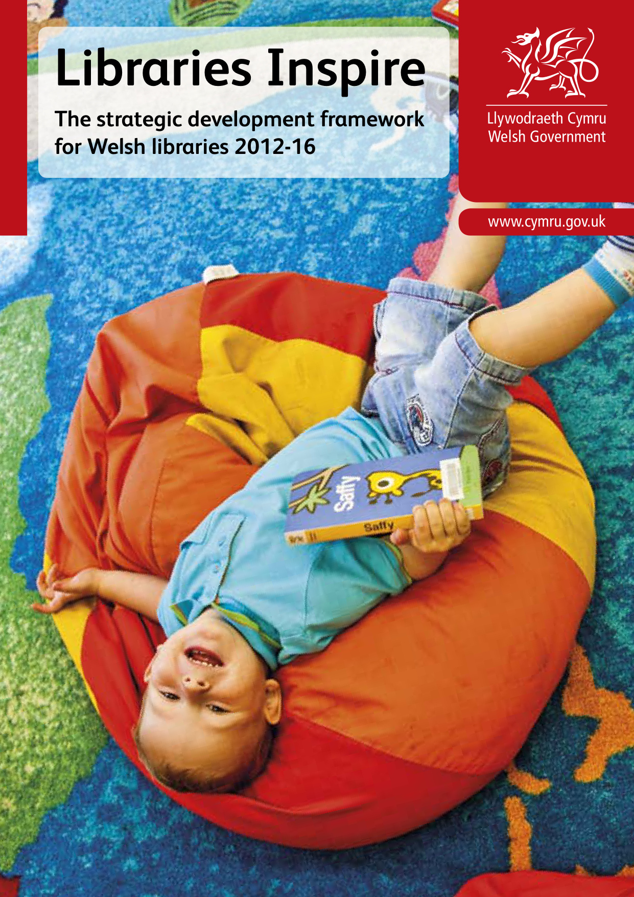

# Libraries Inspire

## The Strategic Development Framework for Welsh Libraries 2012–16

**CyMAL: Museums Archives and Libraries Wales**  
**Welsh Government**

<!-- PAGE: 2 -->

© Crown Copyright November 2011  
ISBN 978 0 7504 6749 0  
WG13215  

CyMAL: Museums Archives and Libraries Wales would like to thank the libraries, their parent bodies and the public for participating in creating a photo bank to provide photographs for this document. The participating libraries were The National Library of Wales, Glyndŵr University, Swansea Metropolitan University, Coleg Gwent, Yale College Wrexham, Bargoed, Treorchy, Maerdy, Swansea Central, Gowerton, Fairwater, Cathays, Llandudno, Ruabon, Cefn Mawr, Gwersyllt, Wrexham and Wrexham Mobile Library Service.

### Further information and related documents

Large print, Braille and alternate language versions of this document are available on request.

**Contact details:**  
Libraries Development Team  
CyMAL: Museums Archives and Libraries Wales  
Welsh Government  
Rhodfa Padarn  
Llanbadarn Fawr  
Aberystwyth  
SY23 3UR  

- **E-mail**: cymal@wales.gsi.gov.uk  
- **Telephone**: 0300 062 2112  
- **Web address**: [www.wales.gov.uk/cymal](http://www.wales.gov.uk/cymal)  

The paper is Revive Pure Silk 100% recycled and the inks use bases formulated from sustainable raw materials.

<!-- PAGE: 3 -->

## Contents

- [Foreword by the Minister for Housing, Regeneration and Heritage](#foreword-by-the-minister-for-housing-regeneration-and-heritage) (p. 5)
- [1. Introduction](#1-introduction) (p. 7)
- [2. Sustainable Models of Service Delivery](#2-sustainable-models-of-service-delivery) (p. 13)
- [3. Resources for All](#3-resources-for-all) (p. 19)
- [4. Space for All](#4-space-for-all) (p. 25)
- [5. Skills for Life](#5-skills-for-life) (p. 29)
- [6. Investing in People](#6-investing-in-people) (p. 35)
- [7. Attracting the Audience](#7-attracting-the-audience) (p. 39)
- [8. Delivering a Quality Service](#8-delivering-a-quality-service) (p. 43)
- [9. Libraries Inspire Delivery Plan](#9-libraries-inspire-delivery-plan) (p. 47)
- [Appendix: Bibliography](#appendix-bibliography) (p. 48)

> “The library is fab and the staff are great and we get to do great things.”  
> *(Blaenau Gwent library user, aged 11–15)*[^1]

<!-- PAGE: 4 -->

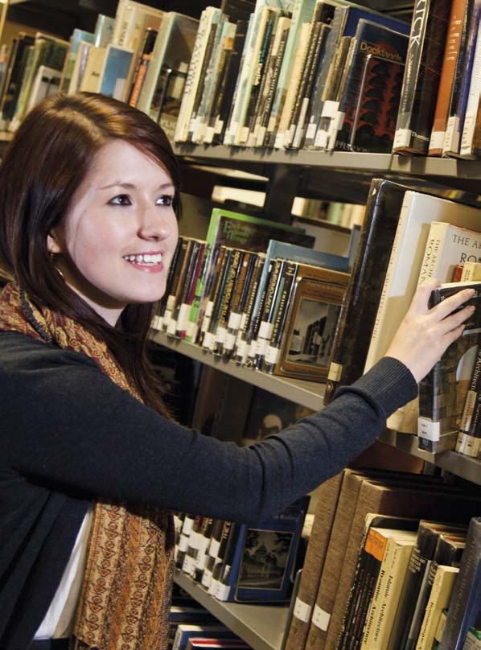

<!-- PAGE: 5 -->

## Foreword by the Minister for Housing, Regeneration and Heritage

I have always valued the role that libraries played in my life, from my childhood visits to Merthyr library to my university days. Libraries all over Wales inspire people of all ages to make a real difference to their lives. During my visits to libraries across Wales I have been impressed by the wide range of activities provided by libraries. From free book loans, helping people to use computers for the first time, the chance to learn new skills, a quiet spot to study, access to millions of online resources, community events, introducing children to picture books and stories, all this and more is happening in our libraries every day.

Through sustained Welsh Government investment in our libraries and the commitment of library staff, Wales is at the forefront of many innovative library developments in the UK and farther afield. Welsh success in raising the number of users of our public library services has been firmly rooted in our partnership with local authorities. Libraries Inspire will help deliver priorities outlined in the Welsh Government’s Programme for Government such as literacy and other key skills, accessible digital opportunities, promoting our culture and helping to reduce inequalities.

Libraries Inspire supports effective and efficient service delivery at national, regional and local levels: through working in partnership libraries will continue to play a significant role in realising the aspirations of individuals and communities alike. Libraries are needed now as much as ever and I am grateful to everyone who has contributed to the development of this Framework. Libraries inspire people, and I am delighted to be able to present this dynamic and forward looking strategy for Welsh libraries.

**Huw Lewis AM**  
Minister for Housing, Regeneration and Heritage.

<!-- PAGE: 6 -->

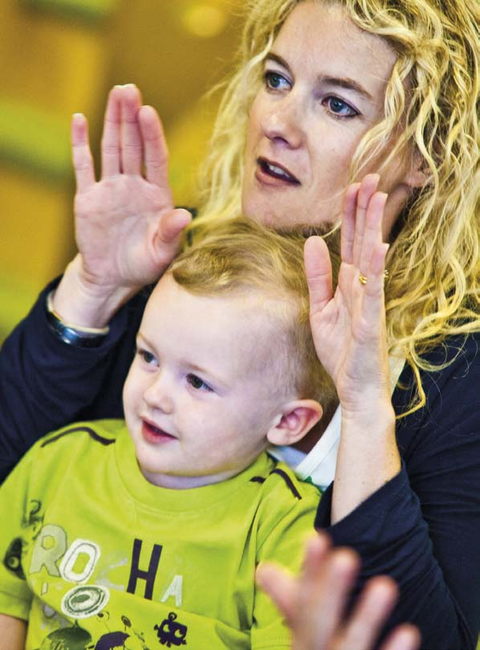

<!-- PAGE: 7 -->

## 1. Introduction

### 1.1 Shared vision

Libraries will inspire the people of Wales to enjoy reading, enhance their knowledge and skills, enrich their quality of life, empower them as citizens and create a learning community.

This Framework sets out how libraries in Wales will deliver this vision over the next four years, across public, higher education, further education, health and workplace libraries.

### 1.2 Policy context

*Libraries Inspire* builds upon the success of the previous Welsh library strategy *Libraries for Life* (2008–2011). The strategy is aligned directly with the Welsh Government's *Programme for Government*, contributing to key national priorities:

- **Growth and sustainable jobs**: Enhancing digital literacy, supporting jobseekers and developing workforce skills;
- **Education**: Supporting early years literacy, family reading and academic study from schools through to higher education;
- **21st century healthcare**: Promoting health literacy, healthy living and the Book Prescription Wales scheme;
- **Welsh language and culture**: Celebrating Welsh heritage and expanding bilingual resources;
- **Tackling poverty and disadvantage**: Providing free, barrier-free access to knowledge, information and community spaces.

### 1.3 Delivering through partnership

No single library service can meet the complex and diverse needs of modern users alone. Partnership working across sectors – between public libraries, university libraries (WHELF), college libraries, the National Library of Wales, health libraries and regional consortia – is fundamental to the delivery of this framework.

<!-- PAGE: 8 -->

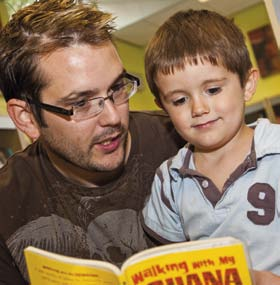

### 1.4 Moving forward together

In order to sustain and develop library services, there is a need to ensure that all types of libraries collaborate effectively, sharing resources, procurement, technical systems and expertise.

The evaluation of *Libraries for Life* demonstrated that national investment yielded significant public benefits, increasing public library visits and active borrowing across Wales.[^2] [^3] Between 2008 and 2011, over £10 million of capital funding through the Community Libraries Development Programme transformed dozens of libraries across Wales into vibrant community learning hubs.

### 1.5 The Welsh language

Libraries in Wales have a statutory and cultural duty to promote and facilitate the Welsh language. Libraries will ensure that Welsh language materials, digital resources and frontline services are available and actively promoted across all sectors, supporting the Welsh Government's vision of a truly bilingual Wales.

<!-- PAGE: 9 -->

### 1.6 Libraries in Wales will:

- Be open to all members of their communities;
- Be free to join and free to borrow books;
- Provide friendly, trained and knowledgeable staff;
- Offer free access to computers and the internet;
- Provide safe, welcoming and accessible physical and virtual spaces;
- Deliver high quality resources in Welsh, English and other community languages;
- Support literacy, learning and research for all ages;
- Celebrate Welsh heritage, culture and local identity.

### 1.7 Key strategic themes

*Libraries Inspire* is structured around seven interrelated strategic themes:

- **1.7.1 Sustainable models of service delivery**: Exploring regional collaboration, shared services and resource efficiency;
- **1.7.2 Resources for all**: Providing rich physical, digital and heritage collections across all sectors;
- **1.7.3 Space for all**: Developing inspiring, colocated and accessible spaces;

<!-- PAGE: 10 -->

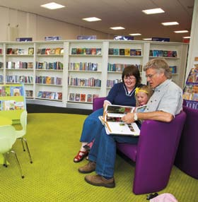

- **1.7.4 Skills for life**: Fostering literacy, basic skills, information literacy and digital inclusion;
- **1.7.5 Investing in people**: Developing staff skills, leadership and customer service excellence;
- **1.7.6 Attracting the audience**: Proactive marketing, audience development and removing barriers to access;
- **1.7.7 Delivering a quality service**: Implementing the Welsh Public Library Standards (WPLS) and continuous quality improvement.

<!-- PAGE: 11 -->

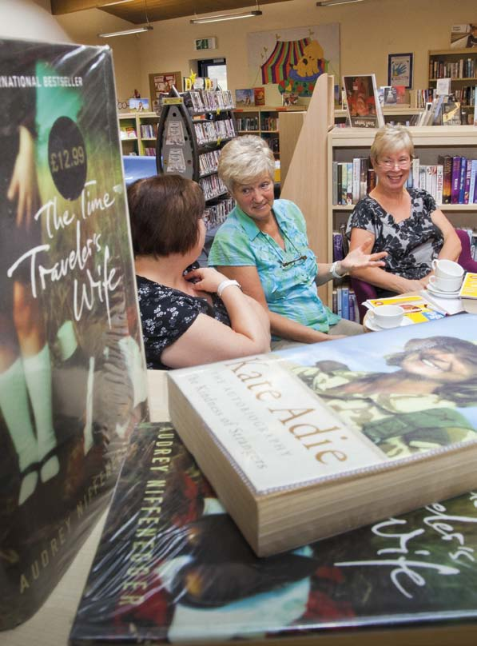

<!-- PAGE: 12 -->

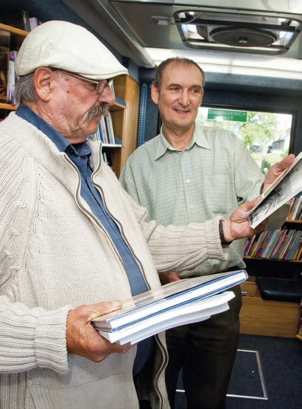

<!-- PAGE: 13 -->

## 2. Sustainable Models of Service Delivery

### 2.1 Reviewing service delivery

In challenging financial times, managers and parent bodies face difficult decisions regarding funding, staffing and service structures. The Simpson Review (*Local, Regional, National: What services are best delivered where?*) highlighted that public services must explore greater regional and national collaboration to protect frontline services.[^6]

Libraries must examine their operational models, evaluating whether services are best organized locally, regionally or nationally.

Public libraries will work with local authority partners, higher education institutions, FE colleges and community groups to develop sustainable models, including:

- Shared management and administrative structures across authorities;
- Colocation of services with other public and community facilities;
- Community-supported and volunteer-supported library partnerships where appropriate;
- Consortium procurement and shared technical platforms.

<!-- PAGE: 14 -->

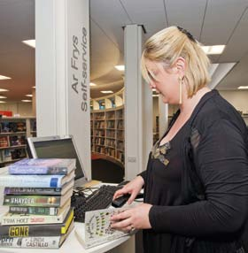

### 2.2 Contributing towards a sustainable future

Sustainability is a central policy objective for the Welsh Government. Libraries contribute directly to sustainable development and the low-carbon agenda:

- Providing a shared community asset where books, resources and equipment are borrowed and reused rather than purchased individually;
- Promoting energy efficiency in library design, refurbishment and operation;
- Utilizing mobile libraries and outreach services to reduce travel requirements for rural residents;
- Delivering digital and online services that reduce the need for physical journeys;
- Disseminating environmental information and supporting community carbon-reduction initiatives.

<!-- PAGE: 15 -->

### 2.3 Promoting well-being

Libraries provide a neutral, safe location for local communities which delivers benefits far beyond traditional book lending. Libraries are community anchor institutions that foster social cohesion, reduce loneliness and promote mental and physical wellbeing.

The *Book Prescription Wales* scheme, operated by public libraries in partnership with NHS Wales, allows GPs and mental health professionals to prescribe clinically approved self-help books for mild to moderate psychological conditions. Over 90% of participating patients report improvements in their mental health and wellbeing.

### 2.4 Collaboration across sectors

Wales has led the UK in cross-sector library collaboration. The Wales Higher Education Libraries Forum (WHELF), the Society of Chief Librarians Wales (SCL Wales), the Welsh Government (CyMAL) and the National Library of Wales have established collaborative procurement for online reference resources, joint LMS initiatives and cross-sector reciprocal access schemes.

<!-- PAGE: 16 -->

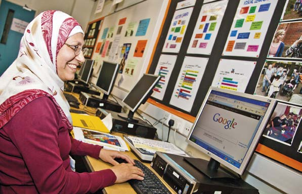

### 2.5 What we will do

The library sector will:

- CyMAL and the Welsh Local Government Association (WLGA) will engage with public library stakeholders on reviewing models of service delivery, establishing shared service pilots where appropriate;
- Explore options for shared Library Management Systems (LMS) and procurement consortia across Welsh public and academic libraries;
- Implement collaborative regional delivery mechanisms for specialist services, local studies and digital preservation;
- Expand the Book Prescription Wales scheme and develop targeted health literacy partnerships with Local Health Boards.

<!-- PAGE: 17 -->

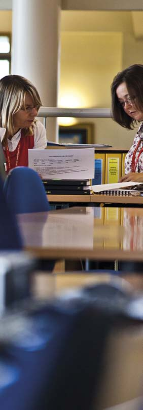

Collaborative arrangements between HE libraries (WHELF), public libraries and the National Library of Wales will continue to expand, ensuring seamless resource discovery and document delivery for all citizens across Wales.[^9]

<!-- PAGE: 18 -->

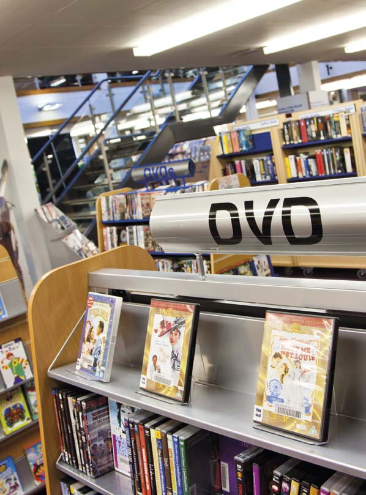

<!-- PAGE: 19 -->

## 3. Resources for All

### 3.1 Why people use libraries

Books and reading remain at the core of what people value most about libraries. Over 70% of library users cite borrowing printed books as their primary reason for visiting.[^10] Libraries must continue to maintain dynamic, attractive and up-to-date collections of printed fiction, non-fiction, children's literature, large print and audiobooks in both Welsh and English.

### 3.2 Digital resources and e-lending

The demand for digital resources is expanding rapidly. Libraries in Wales provide free access to a comprehensive suite of online reference databases, academic journals, family history records and commercial news archives.

During the lifetime of this Framework, Welsh public libraries will introduce a national e-book and e-audiobook lending service, allowing registered members to borrow digital titles remotely across all devices free of charge.

<!-- PAGE: 20 -->

### 3.3 The virtual world

Libraries are actively embracing the virtual world, developing responsive mobile apps, social media channels and web portals that enable users to search catalogues, renew items, book computers and consult enquiry services 24 hours a day, 7 days a week.[^11]

<!-- PAGE: 21 -->

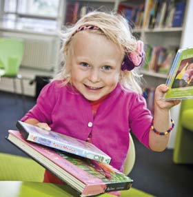

### 3.4 Creating new Welsh digital resources

Libraries across Wales hold irreplaceable collections relating to Welsh history, literature, music and community life. In partnership with the National Library of Wales and the *People’s Collection Wales* project, libraries will digitise local history photographs, oral histories, maps and manuscripts, making Wales' rich heritage freely accessible worldwide.[^12] [^13]

<!-- PAGE: 22 -->

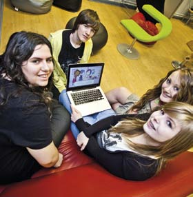

### 3.5 Embracing new technologies

Libraries will explore new technologies, including Wi-Fi provision, mobile learning, self-service RFID kiosks and tablet lending, removing physical and technological barriers to service access.[^14]

<!-- PAGE: 23 -->

### 3.6 What we will do

The library sector will:

- Procure and launch a national bilingual e-book lending service for public libraries across Wales;
- Continue national collective licensing for core online reference resources, maximizing purchasing power and access;
- Partner with the National Library of Wales and People’s Collection Wales to digitise local heritage assets;
- Expand 24/7 online catalogue access and mobile device compatibility across all Welsh library authorities.

<!-- PAGE: 24 -->

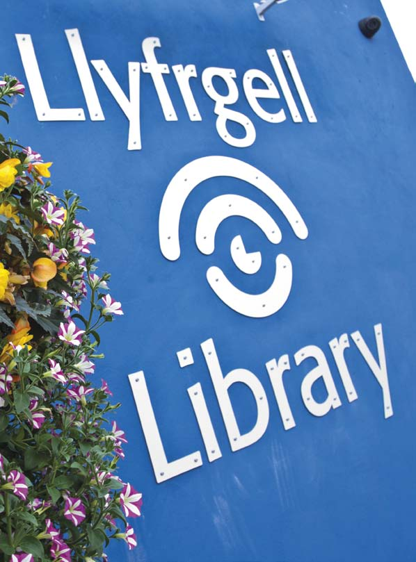

<!-- PAGE: 25 -->

## 4. Space for All

### 4.1 Creating inspirational spaces

The physical space of the library has been transformed in recent years. Modern libraries are vibrant, welcoming and flexible spaces designed to accommodate quiet contemplation, collaborative group work, children's activities, digital learning, civic meetings and social connection.

> “Walking through the library is like entering a haven of calm, tranquil décor, modern comfy seating and an abundance of resources.”  
> *(Rhondda Cynon Taf library user)*

Capital investment through the Welsh Government’s Community Libraries Development Programme has demonstrated that modernizing library buildings produces dramatic and sustained increases in visits, issues and community participation.

### 4.2 Colocation and community hubs

Libraries are increasingly colocated with other public and community services – including council customer contact centres, health clinics, leisure centres, schools and adult education facilities. Colocation creates vibrant civic focal points, reduces overheads and enables seamless multi-agency service delivery.

<!-- PAGE: 26 -->

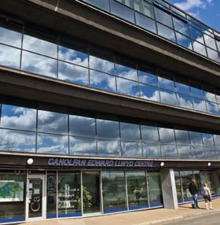

### 4.3 Mobile and outreach services

In a nation with dispersed rural communities and valleys, physical branches cannot reach every citizen. Mobile libraries, home library services and deposit collections in village halls, residential homes and day centres provide vital lifelines for housebound, disabled and rural residents.

Mobile libraries in Wales will be modernized with satellite broadband connectivity, self-service equipment and flexible community programming, ensuring equitable access across all geographic areas.

<!-- PAGE: 27 -->

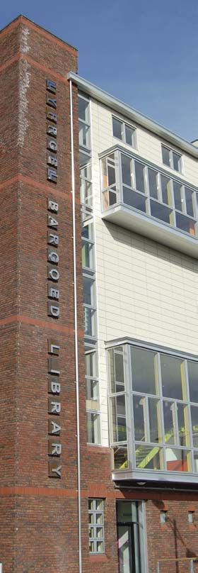

### 4.4 What we will do

The library sector will:

- Continue to prioritize capital investment in library modernisation and colocation through the Welsh Government Capital Grants Scheme;
- Ensure library buildings are fully accessible, energy-efficient and compliant with DDA standards;
- Modernize mobile library fleets, integrating satellite communications and mobile IT suites;
- Develop flexible library spaces that adapt to community events, makerspaces and collaborative learning.

<!-- PAGE: 28 -->

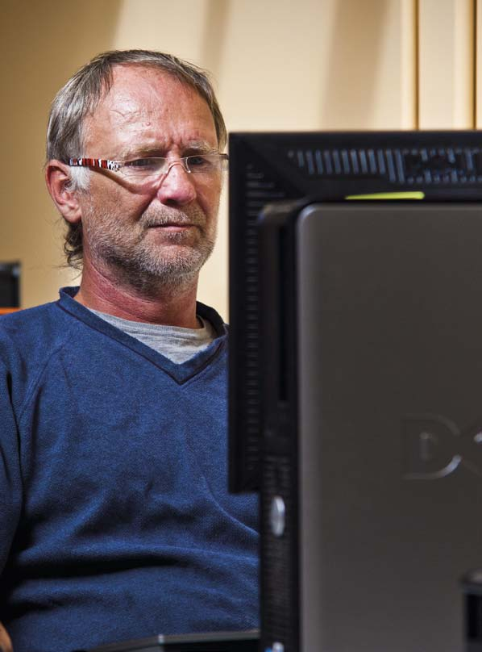

<!-- PAGE: 29 -->

## 5. Skills for Life

### 5.1 Literacy and basic skills

Libraries play a key role in developing people’s skills at all levels and at all ages: helping young children to take their first steps to literacy; supporting primary school pupils with reading schemes; helping teenagers develop study habits; and supporting adults with basic literacy and numeracy needs.

Libraries contribute directly to the Welsh Government’s *National Literacy Programme*.[^16] Early years initiatives such as *Bookstart* give free book packs to every baby and toddler in Wales, while *Rhythm and Rhyme* sessions build language foundations.

The annual *Summer Reading Challenge* engages over 40,000 children across Wales, supported by teachers, parents and library staff.[^17]

For adults with reading difficulties or learning English/Welsh as an additional language, libraries provide specialized *Quick Reads*, literacy packs and guided adult reading groups.

<!-- PAGE: 30 -->

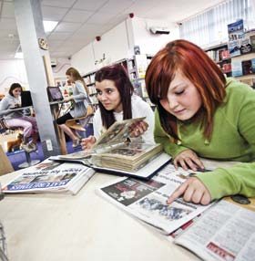

### 5.2 Information literacy

In an era of information overload, the ability to find, evaluate and effectively use information is a vital life skill. Academic, college, health and public libraries provide structured information literacy training, teaching students and citizens how to assess source credibility, identify disinformation and cite research ethically.[^18]

The Welsh *Information Literacy Framework* provides a common structure for developing research and critical thinking skills from primary education through to lifelong learning.

<!-- PAGE: 31 -->

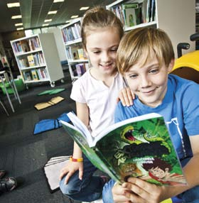

### 5.3 Digital inclusion

> “Digital inclusion is about ensuring that people, both as citizens and consumers, benefit from the rapid pace of technological change.”  
> *(Welsh Government Digital Inclusion Strategy)*

Over 30% of Welsh households lack home internet access, with the highest rates of exclusion among elderly, low-income and disabled citizens. Public libraries are the primary provider of free public internet access and supported ICT learning in Wales.

Libraries offer one-to-one digital support, computer classes and *IT Buddy* schemes, helping thousands of citizens apply for jobs online, claim public benefits, manage personal finances and connect with family.

<!-- PAGE: 32 -->

### 5.4 Lifelong learning and employability

Libraries are informal learning environments that encourage curiosity and personal growth. They partner with colleges, universities and voluntary bodies to deliver adult learning classes, language exchanges, family history courses and creative workshops.[^20]

Libraries also support jobseekers with dedicated job clubs, CV workshops, interview practice and access to national employment databases, contributing directly to regional economic recovery.

### 5.5 What we will do

The library sector will:

- Implement the *National Literacy Programme* through expanded Bookstart, reading challenges and school partnership agreements;
- Deliver national digital inclusion programs, participating in the BBC First Click and digital champion initiatives;
- Promote the Welsh *Information Literacy Framework* across public, school and academic libraries;
- Partner with Careers Wales and Jobcentre Plus to provide targeted employability support in local libraries.

<!-- PAGE: 33 -->

<!-- PAGE: 34 -->

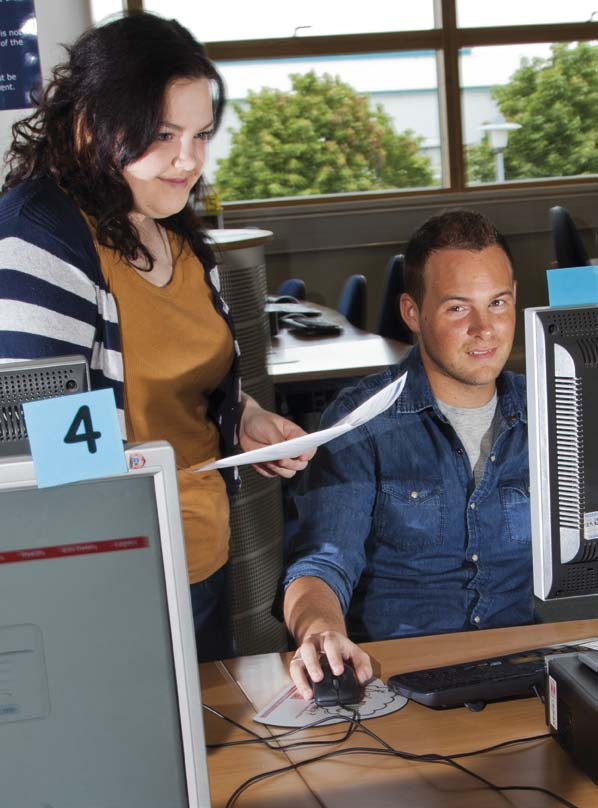

<!-- PAGE: 35 -->

## 6. Investing in People

### 6.1 Knowledgeable staff

> “My local library has helped me on many occasions with research. The staff are always friendly, polite and extraordinarily well informed.”  
> *(Cardiff library user)*

Library staff are the public face of the service and its greatest asset. Mystery shopping evaluations conducted across Welsh libraries consistently report high levels of customer satisfaction with staff helpfulness, welcoming manner and professional competence.[^21]

As the scope of library services expands to encompass digital coaching, health signposting, community engagement and event facilitation, staff require continuous professional development.

<!-- PAGE: 36 -->

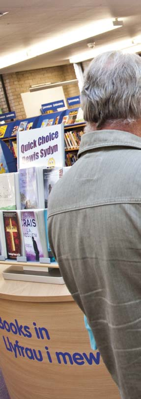

### 6.2 Leadership and workforce development

To navigate rapid structural and technological change, library services require visionary, flexible and resilient leadership. CyMAL and sector partners will invest in leadership training, middle management development and professional qualification bursaries.

### 6.3 What we will do

The library sector will:

- CyMAL will work with employers to provide funding to assist staff to obtain professional and vocational library qualifications;
- Deliver national training programs in digital coaching, customer service excellence and safeguarding;
- Support leadership development through cross-sector mentoring and succession planning;
- Promote volunteering opportunities in libraries that provide pathways to employment and skill development among users (e.g. IT Buddies).

<!-- PAGE: 37 -->

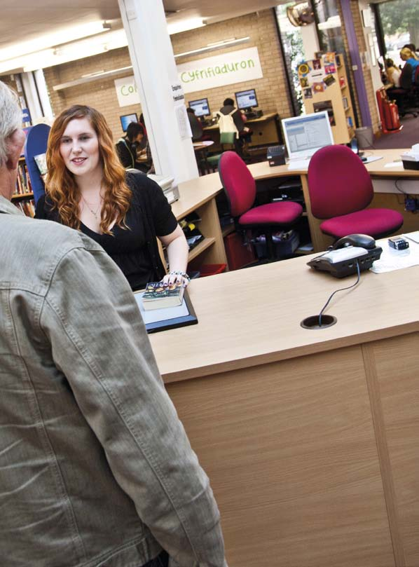

<!-- PAGE: 38 -->

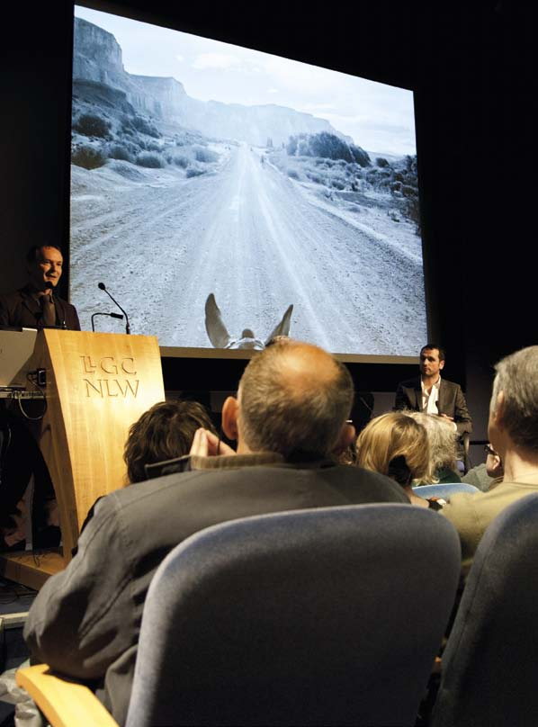

<!-- PAGE: 39 -->

## 7. Attracting the Audience

### 7.1 Audience development and marketing

In order to justify the continued public investment in our libraries it is essential that the maximum number of citizens are aware of and use the services available.[^22] National marketing campaigns, such as the *Welsh Libraries – Discover More* brand, have successfully raised public awareness of library services.

Libraries will implement targeted audience development strategies, focusing on under-represented demographic groups:

- Young men and teenagers;
- Disadvantaged and low-income families;
- Older people living in isolated rural communities;
- Minority ethnic and migrant communities;
- People with disabilities and learning difficulties.

<!-- PAGE: 40 -->

### 7.2 Removing barriers to access

Libraries must identify and dismantle barriers to participation – whether physical, financial, sensory or perceptual. This includes reviewing opening hours to suit working adults, eliminating overdue fines for children, providing accessible formats (large print, audiobooks, RNIB collections) and offering warm, non-judgmental customer environments.

### 7.3 What we will do

The library sector will:

- Deliver cohesive national marketing campaigns under the *Welsh Libraries* brand;
- Implement targeted audience development initiatives for under-represented groups;
- Review library opening hours and membership procedures to maximize accessibility;
- Utilize social media and digital marketing to engage young adults and new audiences.

<!-- PAGE: 41 -->

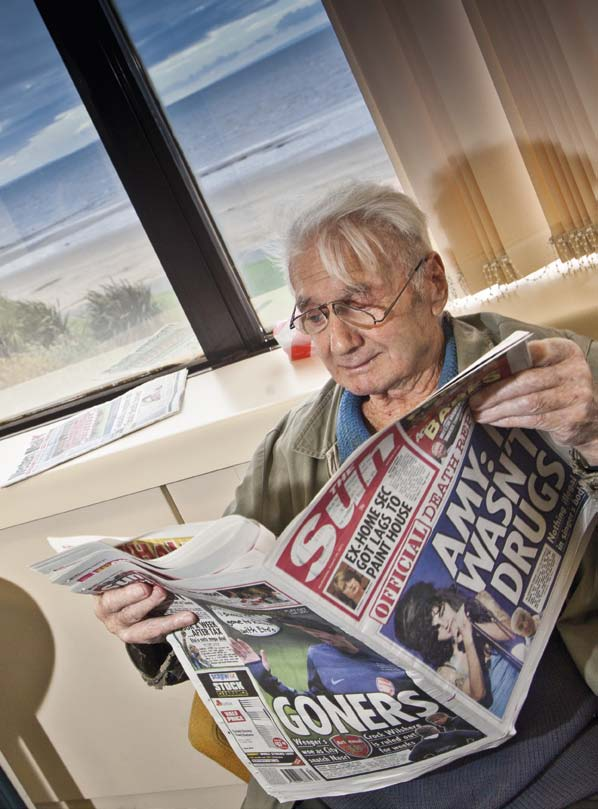

<!-- PAGE: 42 -->

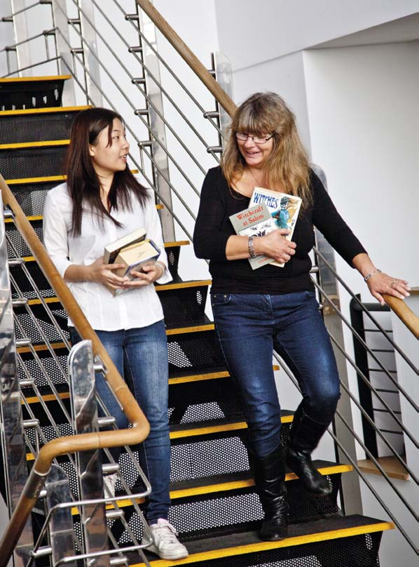

<!-- PAGE: 43 -->

## 8. Delivering a Quality Service

### 8.1 Welsh Public Library Standards (WPLS)

Wales has an established statutory framework for assessing and improving public library performance. Under the Public Libraries and Museums Act 1964, the Welsh Government has a duty to superintend public library provision.

The Welsh Public Library Standards (WPLS) provide an objective, transparent framework against which every local library authority is assessed annually.[^23]

The third WPLS Framework (*Maintaining a Valued Service*, 2008–2011) drove significant improvements in book expenditure, opening hours, ICT provision and user satisfaction across Wales.[^24]

<!-- PAGE: 44 -->

In common with previous WPLS Frameworks, the fourth Framework will be implemented over a three-year timescale. It is recognised that, during a period of sustained public expenditure reductions, the Standards must evolve to emphasize efficiency, customer outcomes and community impact, alongside traditional input measures.

### 8.2 What we will do

The library sector will:

- The Welsh Government (CyMAL) will develop and publish the fourth framework of Welsh Public Library Standards in 2011/12, in consultation with local authorities and sector bodies;
- Conduct annual performance assessments and publish independent comparative reports for the National Assembly for Wales;
- Assist library authorities in utilizing customer surveys and performance data to drive continuous service improvement;
- Update standards and indicators to reflect emerging digital services (e.g. e-book lending, Wi-Fi usage and digital engagement).

<!-- PAGE: 45 -->

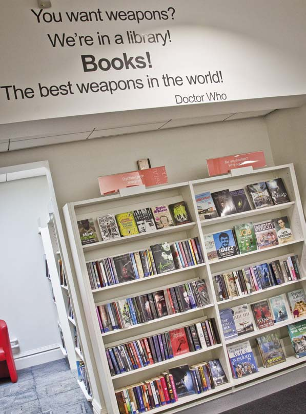

<!-- PAGE: 46 -->

<!-- PAGE: 47 -->

## 9. Libraries Inspire Delivery Plan

An annual Delivery Plan will be published by CyMAL to accompany this Framework, setting out specific milestones, key performance indicators, lead partners and resource allocations for each year of the strategy.

Governance and implementation will be overseen by the Libraries Development Team within CyMAL, working in partnership with:

- **Society of Chief Librarians Wales (SCL Wales)**;
- **Welsh Local Government Association (WLGA)**;
- **Wales Higher Education Libraries Forum (WHELF)**;
- **The National Library of Wales**;
- **CILIP Cymru Wales**;
- **Local Health Boards and NHS Wales**.

Progress will be reported annually to the Minister for Housing, Regeneration and Heritage.

> “The library has given me a new lease of life. It’s warm, friendly, full of books and wonderful people.”  
> *(Flintshire library user, aged 65+)*

<!-- PAGE: 48 -->

## Appendix: Bibliography

- Cardiff University, *Information Literacy Framework for Wales* (Cardiff: Cardiff University, 2011).
- Danish Agency for Libraries and Media, *Nordic Public Libraries in the Knowledge Society* (Copenhagen: Danish Agency for Libraries and Media, 2010).
- Estyn, *Best practice in the reading and writing of pupils aged 7 to 14 years* (Cardiff: Estyn, 2009).
- JISC, *Mobile learning: A report on emerging practice and infrastructure in UK education* (Bristol: JISC, 2010).
- The National Library of Wales, *Theatre of Memory: Strategic Plan 2011–2016* (Aberystwyth: NLW, 2011).
- Scotinform, *Evaluation of Libraries for Life mid term report* (Edinburgh: Scotinform, 2010).
- Scotinform, *Evaluation of Libraries for Life Final Report* (Edinburgh: Scotinform, 2011).
- Swansea University, *Library & Information Services Survey 2010* (Swansea: Swansea University, 2010).
- Twelfth Man, *Welsh Library Service Mystery Shopping Report* (Cardiff: Twelfth Man, 2009).
- Wales Higher Education Libraries Forum (WHELF), *Annual Report 2009–10* (Cardiff: WHELF, 2010).
- Welsh Government, *Getting on Together: A Community Cohesion Strategy for Wales* (Cardiff: Welsh Government, 2009).
- Welsh Government, *Maintaining a Valued Service – The Third Framework of Welsh Public Library Standards 2008–2011* (Aberystwyth: CyMAL, 2008).
- Welsh Government, *Skills Framework for 3 to 19-year-olds in Wales* (Cardiff: Welsh Government, 2008).
- Welsh Government, *Local, Regional, National: What services are best delivered where? (The Simpson Review)* (Cardiff: Welsh Government, 2011).
- Welsh Government, *Programme for Government 2011–2016* (Cardiff: Welsh Government, 2011).
- Welsh Government, *The National Literacy Programme* (Cardiff: Welsh Government, 2011).

---

## Notes

[^1]: All library user quotes in this document are taken from the *Happy Days* public library story bank, collected by CyMAL and Welsh public library authorities, 2010–2011.
[^2]: Scotinform, *Evaluation of Libraries for Life mid term report* (Edinburgh: Scotinform, 2010).
[^3]: Scotinform, *Evaluation of Libraries for Life Final Report* (Edinburgh: Scotinform, 2011).
[^6]: Welsh Government, *Local, Regional, National: What services are best delivered where?* (The Simpson Review), Cardiff, 2011.
[^8]: Ibid.
[^9]: Wales Higher Education Libraries Forum (WHELF), *Annual Report 2009–10* (2010).
[^10]: Scotinform, *Evaluation of Libraries for Life Final Report* (2011).
[^11]: Swansea University, *Library & Information Services Survey 2010* (Swansea, 2010).
[^12]: People’s Collection Wales: [www.peoplescollectionwales.com](http://www.peoplescollectionwales.com).
[^13]: The National Library of Wales, *Theatre of Memory: Strategic Plan 2011–2016* (Aberystwyth, 2011).
[^14]: JISC, *Mobile learning: Emerging practice in education* (Bristol, 2010).
[^16]: Welsh Government, *The National Literacy Programme* (Cardiff: Welsh Government, 2011).
[^17]: Estyn, *Best practice in the reading and writing of pupils aged 7 to 14 years* (Cardiff: Estyn, 2009).
[^18]: Welsh Government, *Skills Framework for 3 to 19-year-olds in Wales* (Cardiff, 2008).
[^20]: Welsh Government, *Getting on Together: A Community Cohesion Strategy for Wales* (Cardiff, 2009).
[^21]: Twelfth Man, *Welsh Library Service Mystery Shopping Report* (Cardiff, 2009).
[^22]: Scotinform, *Evaluation of Libraries for Life Final Report* (2011).
[^23]: CyMAL: Museums Archives and Libraries Wales, Public Library Standards statutory guidance (Aberystwyth, 2011).
[^24]: Welsh Government, *Maintaining a Valued Service – The Third Framework of Welsh Public Library Standards 2008–2011* (Aberystwyth: CyMAL, 2008).
