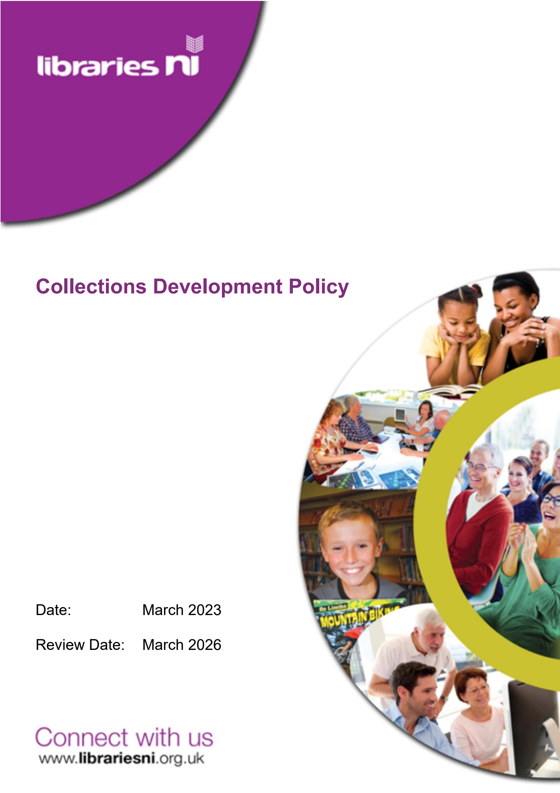

<!-- PAGE: 1 -->

# Collections Development Policy

**Date:** March 2023  
**Review Date:** March 2026  

<!-- PAGE: 2 -->

## Policy Information

| Field | Detail |
| :--- | :--- |
| **Policy Title** | Collections Development Policy |
| **Policy Number** | POL_083 |
| **Version** | Version 1 (May 2024) |
| **Policy Sponsor** | The Deputy Head of Service with responsibility for Collections |
| **Policy Owner** | The Service Development Manager with responsibility for Collections |
| **Committee and date recommended for approval** | Services Committee, 16 May 2024 |
| **Date approved by the Board** | 27 June 2024 |
| **Equality Screening Status** | Screened: 9 January 2024 |
| **Rural Needs Impact Assessment Status** | Assessed: 9 January 2024 |
| **Date Set For Review** | May 2027 |

### Related Policies and Guidelines

- Children and Young People’s Services Policy
- Community Information Policy
- Customer Feedback Policy
- Data Protection Policy
- Digital Inclusion Policy
- Engaging with Culture and Creativity Policy
- Filming Policy
- Information and Learning Services Policy
- Media Handling Policy
- Partnership Policy
- Procurement Policy
- Room Hire Policy
- Safe and Welcoming Libraries Policy
- Social Media Policy

### Procedures

- Community Information Guidelines for Staff
- Customer Feedback Procedures
- Loan and Use of Heritage and other Assets Guidelines
- Procedures for Managing Filming Requests
- Safe and Welcoming Libraries Staff Guidelines
- Staff Guidelines for Room Hire
- Staff Guidelines for Use of Social Media
- Stock Complaints Procedure
- Stock Reservation Procedures

<!-- PAGE: 3 -->

# Libraries NI
## Collections Development Policy

### 1. Introduction

**1.1** In the context of this policy, ‘Collections’ is a generic term which describes all the resources available to Libraries NI customers including heritage assets, physical bookstock, resources in electronic format and materials held in our Cultural Heritage libraries e.g. maps and microfilm.

**1.2** The Collections Development Policy builds on the legislative requirement under the Libraries Act (Northern Ireland) 2008, to provide a comprehensive and efficient library service, that facilities are available for the borrowing of, or reference to, library materials sufficient in number, range and quality to meet the general requirements of adults and children encouraging both adults and children to make full use of the library service.

**1.3** Libraries NI is a visible, accessible, and inclusive library service at the heart of communities, enhancing lives and valued by all. Our mission is in connecting people with information, ideas, and experiences to foster lifelong learning, inspire curiosity, provide enjoyment and strengthen communities.

**1.4** Libraries NI Collections underpin all of Libraries NI’s customer-facing corporate goals and are at the heart of how Libraries NI supports local needs and contributes to Departmental and Community Planning objectives. Libraries NI collections are also core to how Libraries NI delivers against national outcomes and strategies.

**1.5** Libraries NI Collections contribute to:
- fostering a more equal society
- supporting the health and wellbeing of individuals
- ensuring we give our children and young people the best start in life
- developing a shared society that respects diversity
- supporting an innovative, creative society where people can fulfil their potential
- preserving and understanding our shared history.

**1.6** In the context of the Libraries Act (Northern Ireland) 2008, Libraries NI Collections:
- provide an opportunity for individuals to encounter, experience and celebrate culture (local, international and multi-cultural)
- promote literacy and lifelong learning
- provide an opportunity for individuals to access a collection of library resources relevant to the cultural heritage of Northern Ireland.

**1.7** The changing nature of publishing across a range of resources e.g. books, digital and newspapers requires Libraries NI to be flexible and adaptable in relation to its approach to the collection, access and storage of resources.

<!-- PAGE: 4 -->

### 2. Objective

**2.1** The purpose of the Collections Development Policy is to provide a framework for how the resources held by Libraries NI are selected, curated, developed, preserved and managed to meet the needs of communities and individuals in Northern Ireland. The policy applies to all resources including electronic and physical formats.

### 3. Policy

**3.1** The Libraries NI Collections Development Policy is to provide, within the resources available, a collection of library materials that meets the requirements of the adult and child population of Northern Ireland for informational, educational, cultural and recreational purposes.

**3.2** The collection should be of a quality, range and depth to support the core purposes of the service.

### 4. Principles of Selection and Maintenance of the Collections

**4.1** Libraries NI aims to select materials which support its core functions and customer needs.

**4.2** Factors to be considered in the selection of materials will include:
- popular demand and anticipated interest
- literary, artistic or social value
- authoritativeness and accuracy of content
- value for money and price
- suitability of format and durability
- relation to the existing collection
- representation of diverse viewpoints
- availability of the material elsewhere.

**4.3** Selection of material for the collection will be undertaken by designated professional staff.

**4.4** Stock selection will be conducted in an objective manner, independent of the personal views and biases of staff.

**4.5** Libraries NI recognises that censorship is not an appropriate method for managing library collections. No title will be excluded solely on the basis of controversial content, provided that it does not infringe the law.

<!-- PAGE: 5 -->

**4.6** Libraries NI will consider adding items to its Collections which are available without cost, providing the items meet the criteria as outlined in 4.2.

**4.7** Development of the Collections within Libraries NI is not confined to the addition of material and items. Development of Collections also relates to usage of the Collections. Libraries NI will proactively increase engagement with, visibility of, and awareness of resources held in our Collections.

**4.8** Information contained within the material held by Libraries NI reflect the views and opinions of the author or content creator and does not represent the views of Libraries NI.

### 5. Reservations

**5.1** Suggestions for the purchase of titles by library customers will be considered in line with the following criteria:
- criteria as set out in 4.2
- available stock fund.

**5.2** Requests for items to be borrowed through Inter Library Loan will be considered taking into account resources held by Libraries NI and available stock fund.

**5.3** The physical condition, unique nature of the content or high value of the item may mean that restrictions may be employed in relation to the use of borrowing of items within the collection.

### 6. Donations

**6.1** Donations from individuals and organisations will be considered when they meet a service need and on the understanding that all donated items become the property of Libraries NI.

**6.2** Libraries NI reserves the right to make donations available for consultation or loan and/or to use or dispose of donations as appropriate.

### 7. Retention and Disposal of Material

**7.1** Libraries NI is not a repository library and items within the Collections are intended for public use across all library locations.

**7.2** Consideration will be given to the preservation of significant historical material and other resources relating to Northern Ireland which are in damaged or worn condition, are of significant and/or intrinsic value and the item/resource is not available digitally.

**7.3** Libraries NI monitors the use of resources and endeavours to maximise use of each item within the overall Collections. However, items may be withdrawn because the information or item is no longer relevant or current, due to lack of use or the item is in poor physical condition.

<!-- PAGE: 6 -->

**7.4** Approaches to the disposal of unwanted material will consider cost and efficiency. Libraries NI will employ an environmentally friendly approach to the disposal of withdrawn items.

**7.5** Physical copies may be removed if the item is available digitally.

**7.6** Libraries NI will normally seek to generate funds from items with residual value which have been withdrawn because the information or item is no longer relevant or current, due to lack of use or the item is in poor physical condition.

**7.7** Enhanced storage options will be considered for items of high value.

### 8. Environmental Impact

**8.1** Libraries NI will endeavour to minimise the environmental impact of additions to and management of Libraries NI Collections. To this end, Libraries NI:
- will include measures within its book procurement contracts to minimise the environmental impact of purchases
- will dispose of unwanted material in an environmentally friendly way
- may utilise up to 1% of the physical book stock expenditure on carbon offsetting measures.

### 9. Authority

- **Policy Sponsor:** The Deputy Head of Service with responsibility for Collections is the Policy Sponsor.
- **Policy Owner:** The Service Development Manager with responsibility for Collections is the Policy Owner.
- **Policy Contact:** The Senior Service Managers for Stock and Cultural Heritage are the Policy Contacts.

### 10. Related Documents

#### Policies and Guidelines
- Children and Young People’s Services Policy
- Community Information Policy
- Customer Feedback Policy
- Data Protection Policy
- Digital Inclusion Policy
- Engaging with Culture and Creativity Policy
- Filming Policy
- Information and Learning Services Policy
- Media Handling Policy
- Partnership Policy
- Procurement Policy

<!-- PAGE: 7 -->

- Room Hire Policy
- Safe and Welcoming Libraries Policy
- Social Media Policy

#### Procedures
- Community Information Guidelines for Staff
- Customer Feedback Procedures
- Loan and Use of Heritage and other Assets Guidelines
- Procedures for Managing Film Requests
- Safe and Welcoming Libraries Staff Guidelines
- Staff Guidelines for Room Hire
- Staff Guidelines for Use of Social Media
- Stock Complaints Procedure
- Stock Reservation Procedures
