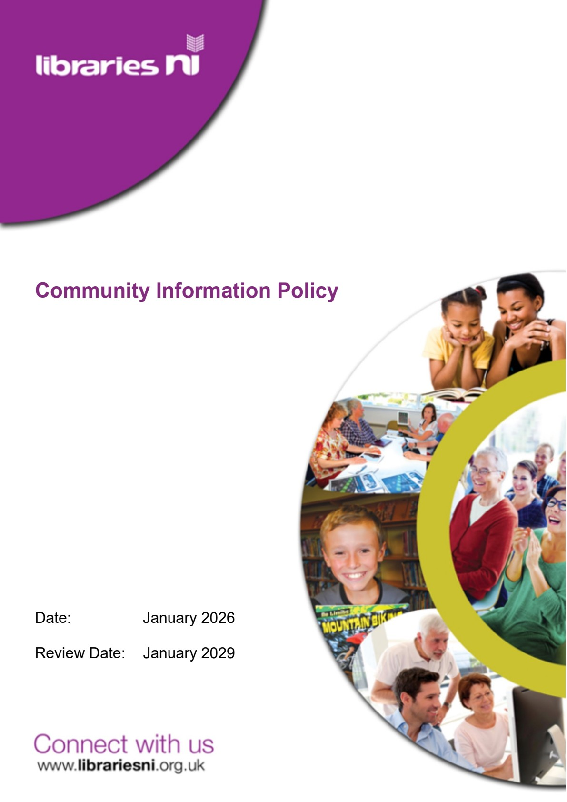

<!-- PAGE: 1 -->

# Community Information Policy

**Libraries NI**

- **Date:** January 2026
- **Review Date:** January 2029

<!-- PAGE: 2 -->

## Policy Information

| Field | Detail |
| :--- | :--- |
| **Policy Title** | Community Information Policy |
| **Policy Number** | POL013 |
| **Version** | Version 5 (January 2026) |
| **Policy Sponsor** | The Head of Service with responsibility for Collections |
| **Policy Owner** | The Deputy Head of Service with responsibility for Collections |
| **Committee and date recommended for approval** | Services Committee, 15 January 2026 |
| **Date approved by the Board** | 12 February 2026 |
| **Equality Screening Status** | Screened: 12 May 2011 Reviewed: 1 February 2016 Reviewed: 7 January 2019 Reviewed: 29 November 2021 Reviewed: 26 February 2026 |
| **Rural Needs Impact Assessment Status** | Assessed: 7 January 2019 Reviewed: 29 November 2021 Reviewed: 26 February 2026 |
| **Date Set For Review** | January 2029 |

### Related Policies

- Customer Feedback Policy
- Data Protection Policy
- Freedom of Information Policy
- Libraries NI Byelaws
- Libraries NI Equality Scheme
- Partnership Policy
- Collections Development Policy
- Safe and Welcoming Libraries Policy
- Safeguarding Policy
- Use and Hire of Library Premises Policy

<!-- PAGE: 3 -->

## Community Information Policy

### 1. Introduction

**1.1** The primary duty of Libraries NI, as set out in the Libraries Act (Northern Ireland) 2008, is to provide a comprehensive and efficient public library service for persons living, working or studying in Northern Ireland.

**1.2** Community information is an umbrella term for information produced by a wide range of organisations, including those in the statutory, community and voluntary sectors, designed to be of interest to members of the local community. Typically, it provides information about local services, organisations and events and may be in an electronic format or paper based including posters and flyers as well as more substantial printed formats.

**1.3** Libraries NI draws a distinction between community information and information that concerns promotion or advocacy whether that be political, religious, protest campaigns, advocacy groups, or lobby groups. Information promoting sectional interests, including those referred to above does not fall within the scope of this policy and will not be considered as community information.

**1.4** Community information is encompassed in the wider information function of Libraries NI to provide a comprehensive and efficient public library service for people living, working or studying in Northern Ireland and to connect people and communities with culture, heritage, information, ideas and experiences. We want to amplify the role, impact and contribution of our libraries in the lives of people and communities and to societal wellbeing.

### 2. Purpose

**2.1** The purpose of this policy is to ensure a consistent approach to the signposting, display of and facilitating access to community information and in doing so to ensure that Libraries NI complies with its legal requirements while meeting information needs of customers.

**2.2** The policy applies to resources in all formats including digital and physical.

### 3. Policy

**3.1** Libraries NI will only signpost, display and facilitate access to community information resources which comply with current legislation relevant to Northern Ireland.

**3.2** Libraries NI will not signpost, display or facilitate access to community information resources in any format that contravenes legislation or where the content may be deemed to be obscene, blasphemous or to incite religious or political hatred.

<!-- PAGE: 4 -->

**3.3** Libraries NI will:

- not signpost, display or facilitate access to community information, in any format which might compromise the perception of the library service as a welcoming, inclusive and neutral space
- not accept material relating to the promotion of a particular viewpoint, for example political, religious, advocacy groups, lobby groups, protest campaigns or other campaigns
- not accept material advertising or promoting commercial or business interests, including goods and services
- signpost, display or facilitate access to community information but will not offer advice on the content, format, presentation or validity of such information
- ensure a professional and equitable approach to the display of physical community information
- ensure that we conform to relevant legal requirements
- require high standards are met in terms of physical appearance of information presented
- refer enquiries to other organisations when necessary
- develop mutually beneficial partnerships with other organisations where that provides a valuable community information service
- not accept responsibility for the accuracy or otherwise of the information posted by other organisations
- not allow collection boxes and charitable products to be displayed, or material containing a direct appeal for funding and or monetary donations. Any exceptions will require approval from the Senior Management Team
- not facilitate petitions, lobbying, campaigns or the promotion of sectional interests. Any exceptions will require approval from the Senior Management Team.

**3.4** Organisations or people seeking to display hard copy community information must show the proposed information for display and make clear the purpose of displaying it.

**3.5** Libraries NI makes no commitment and reserves the right to refuse to display and/or hold any/all community information submitted to it.

**3.6** Libraries NI is committed to the conservation of natural resources and will seek to minimise the use of paper where appropriate.

### 4. Authority

- **Policy Sponsor:** The Head of Service with responsibility for Collections is the Policy Sponsor.
- **Policy Owner:** The Deputy Head of Service with responsibility for Collections is the Policy Owner.
- **Policy Contact:** The Service Development Manager with responsibility for Collections is the Policy Contact.

<!-- PAGE: 5 -->

### 5. Related Documents

#### Policies
- Customer Feedback Policy
- Data Protection Policy
- Freedom of Information Policy
- Libraries NI Byelaws
- Libraries NI Equality Scheme
- Partnership Policy
- Collections Development Policy
- Safe and Welcoming Libraries Policy
- Safeguarding Policy
- Use and Hire of Library Premises Policy
- Community Information Guidelines and Procedures
