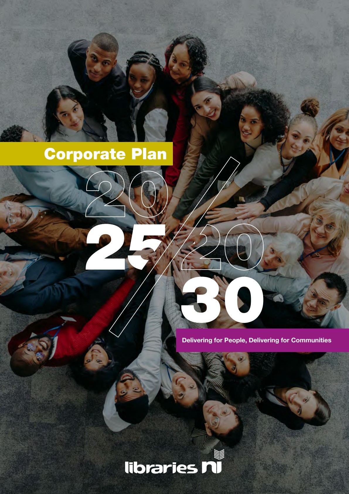
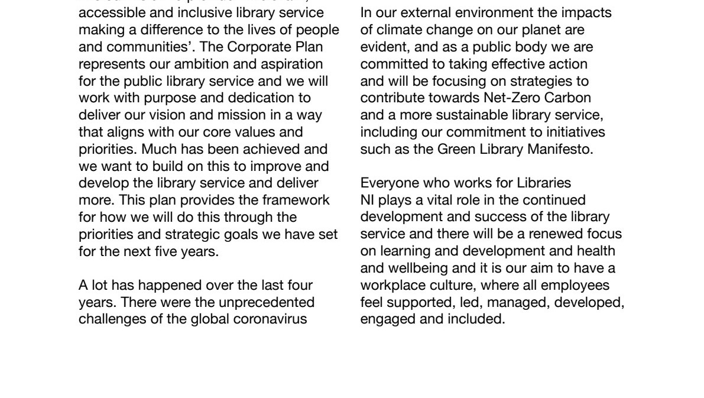
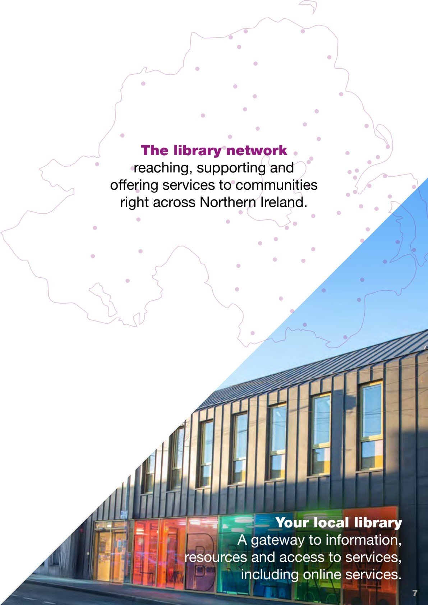
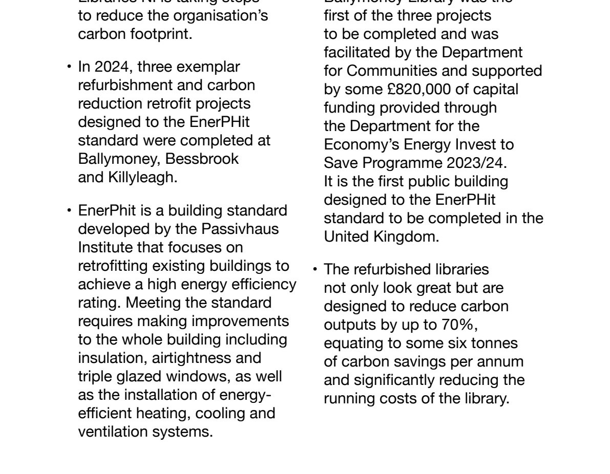
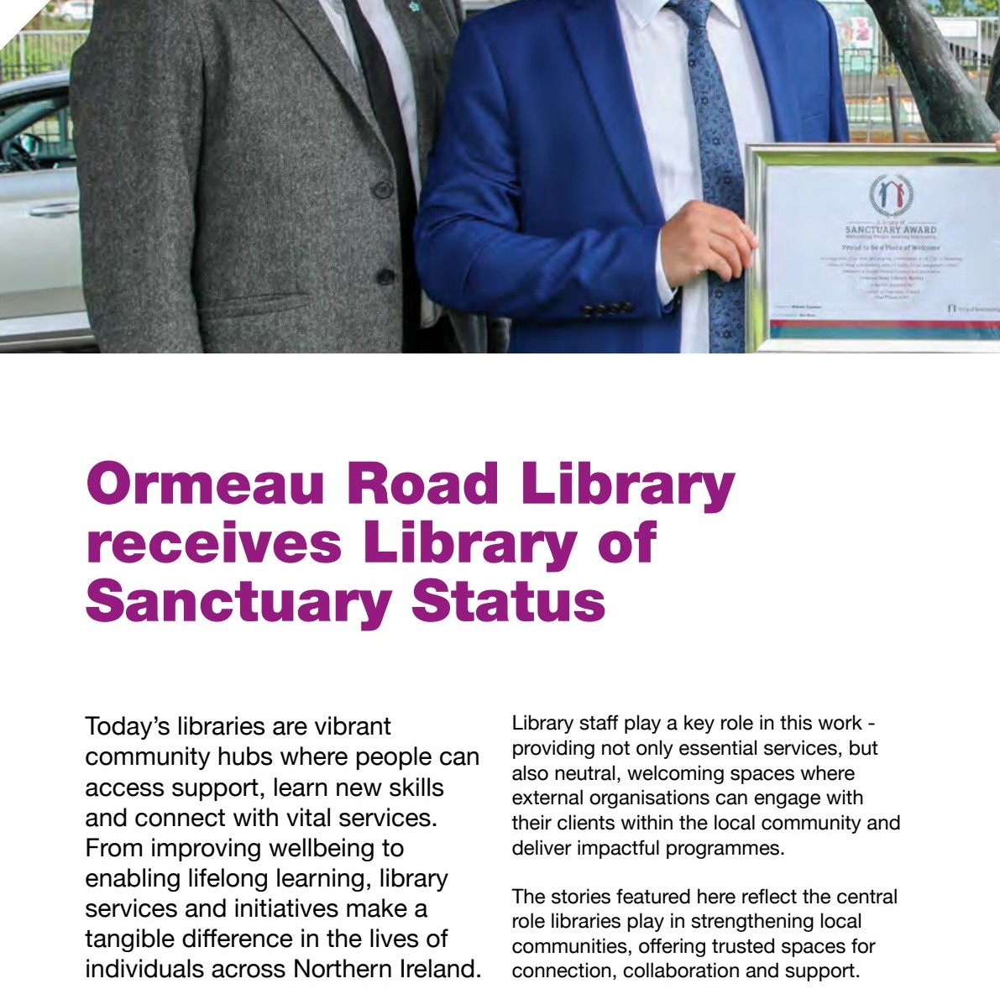
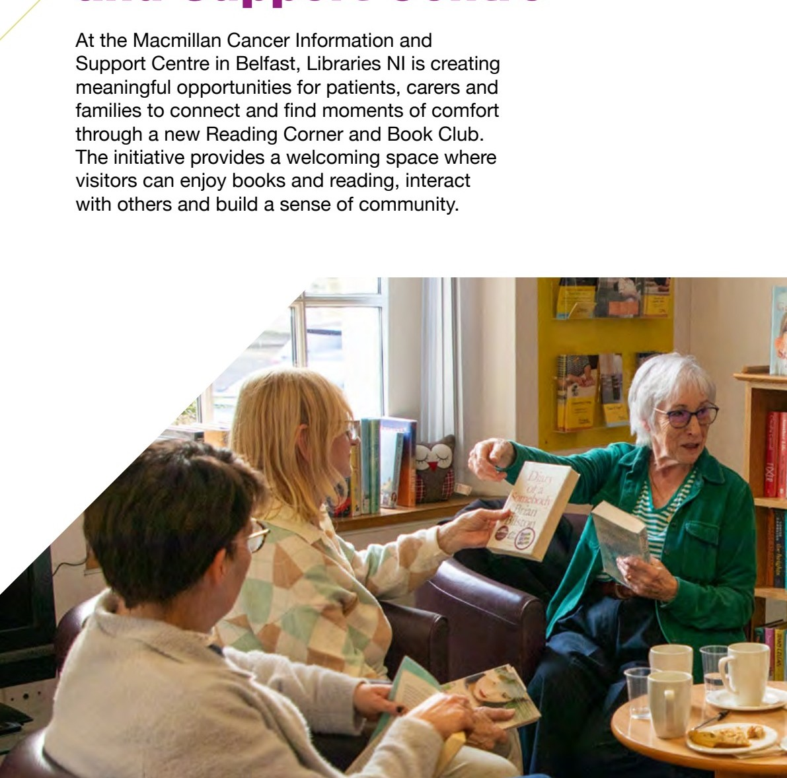
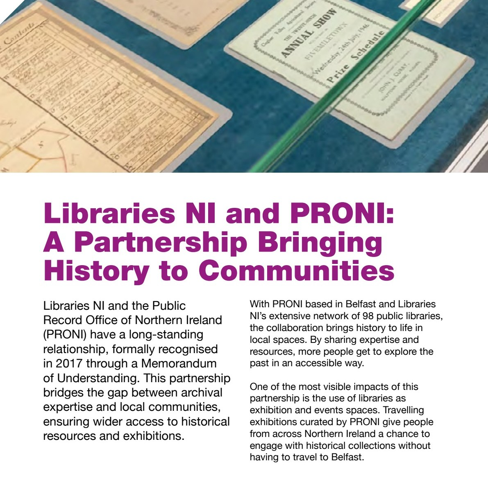
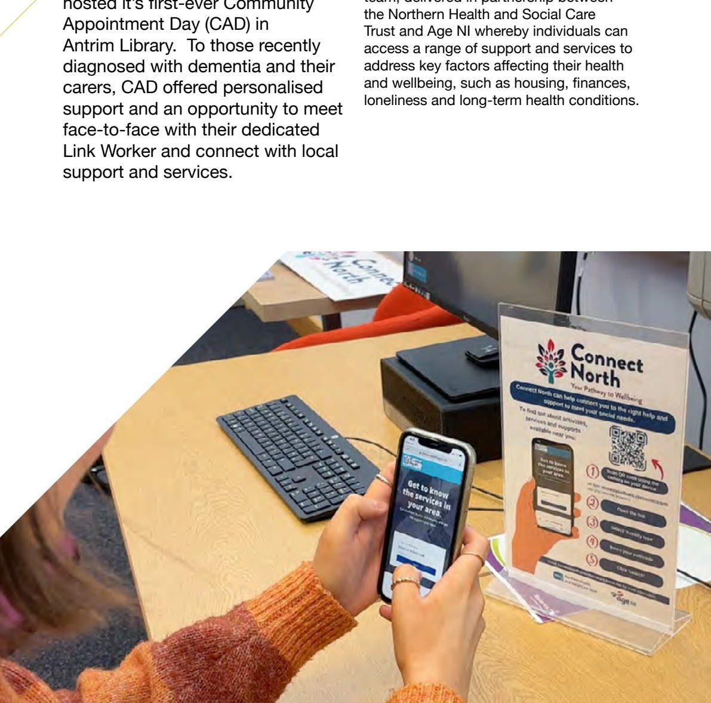

# Libraries NI Corporate Plan 2025–2030

## Delivering for People, Delivering for Communities.

<!-- PAGE: 1 -->

**Corporate Plan**

Delivering for People, Delivering for Communities.

Libraries NI.

<!-- PAGE: 2 -->

*(Page left intentionally blank)*.

<!-- PAGE: 3 -->

## Contents

- Foreword by Chairperson and Chief Executive (Page 4)
- Libraries NI - Your Library Service (Page 6)
- Our Vision, Mission and Values (Page 8)
- Our Impact - Libraries Deliver (Page 12)
- Our Strategic Context (Page 18)
  - Legislation, Policy Landscape and Government Priorities (Page 20)
  - Economic and Financial Outlook (Page 22)
  - Digitalisation (Page 22)
  - Our Customers (Page 23)
  - Partnership Working (Page 24)
  - Community Planning (Page 25)
- Our Focus - Priorities and Strategic Goals: 2025 – 2030 (Page 26)
  - Promote reading, inspire, support and connect people through all stages of life (Page 30)
  - Contribute to inclusive cohesive communities and societal wellbeing (Page 30)
  - Deliver a high performing library service, valued by society (Page 30)
- Delivering Our Corporate Plan - Enablers For Success (Page 38)
- Making a Difference - Measuring Performance (Page 44)
- Making a Difference - Stories (Page 48)
  - Ormeau Road Library receives Library of Sanctuary Status (Page 48)
  - New Reading Corner at the Macmillan Cancer Information and Support Centre (Page 50)
  - Libraries NI and PRONI: A Partnership Bringing History to Communities (Page 52)
  - Libraries Providing a Welcoming Space for Community Support (Page 54)

<!-- PAGE: 4 -->

## Foreword by Chairperson and Chief Executive

This Corporate Plan 2025 – 2030 articulates our vision, values and priorities over the next five years. It captures who we are, what we do and how the public library service will make a positive impact for people and communities throughout Northern Ireland. It reflects our commitment to uphold the highest standards of service delivery in the provision of a public library service and sets out how our people, facilities, infrastructure and resources will be deployed to deliver our priorities, goals and objectives.

It is our vision to provide ‘A relevant, accessible and inclusive library service making a difference to the lives of people and communities’. The Corporate Plan represents our ambition and aspiration for the public library service and we will work with purpose and dedication to deliver our vision and mission in a way that aligns with our core values and priorities. Much has been achieved and we want to build on this to improve and develop the library service and deliver more. This plan provides the framework for how we will do this through the priorities and strategic goals we have set for the next five years.

A lot has happened over the last four years. There were the unprecedented challenges of the global coronavirus pandemic which caused widespread disruption to our normal operations, the provision of library services and society generally. Thanks to the efforts of our dedicated staff, we were able to adapt and respond in ways that ensured library services continued to be provided and we know this was greatly appreciated by the people and communities we serve.

There have also been opportunities in adversity as we saw online library services grow, other new services and approaches develop and new information and communications technology and infrastructure implemented.

In our external environment the impacts of climate change on our planet are evident, and as a public body we are committed to taking effective action and will be focusing on strategies to contribute towards Net-Zero Carbon and a more sustainable library service, including our commitment to initiatives such as the Green Library Manifesto.

Everyone who works for Libraries NI plays a vital role in the continued development and success of the library service and there will be a renewed focus on learning and development and health and wellbeing and it is our aim to have a workplace culture, where all employees feel supported, led, managed, developed, engaged and included.

<!-- PAGE: 5 -->

The public sector landscape is both challenging and changing and we are determined to move forward with confidence, and with a spirit of partnership and collaboration to deliver an efficient, effective and value for money library service for all communities in Northern Ireland. Rising costs and the challenge of delivering services within constrained budgets will require careful planning and resource management to find innovative and creative solutions, as well as opportunities to optimise procedures and processes. We will continue to embrace an ethos of efficiency and continuous improvement while making the case for an appropriate level of investment to meet our statutory obligations to provide a comprehensive and efficient public library service to the people of Northern Ireland.

Libraries are trusted places in the heart of communities supporting people from different backgrounds and demographics, encouraging a love of reading and providing opportunities for people to learn and to connect with information, technology and services. As we look to the future we will continue to work closely with officials from the Department for Communities, other government departments and partners to deliver for people whilst building upon our unique position as a trusted and valued community resource.

**Libraries NI Chairperson**

**Libraries NI Chief Executive**

<!-- PAGE: 6 -->

## Libraries NI – Your Library Service

We are the Northern Ireland Library Authority, more commonly known as Libraries NI, and we are responsible for the provision and delivery of a public library service in Northern Ireland. Our primary duty, as set down in the Libraries Act (Northern Ireland) 2008, is to provide a comprehensive and efficient public library service for persons living, working or studying in Northern Ireland.

A wide range of free library services are delivered through a network of:

- 98 branch libraries
- Heritage libraries
- Mobile libraries
- Homecall service

Library services can also be accessed online from home.

<!-- PAGE: 7 -->

### The Library Network

Reaching, supporting and offering services to communities right across Northern Ireland.

### Your Local Library

A gateway to information, resources and access to services, including online services.

<!-- PAGE: 8 -->

*(Section title page)*.

<!-- PAGE: 9 -->

## Our Vision, Mission and Values

<!-- PAGE: 10 -->

### Our Vision

> **A relevant, accessible and inclusive library service making a difference to the lives of people and communities.**

### Our Mission

> **To provide a comprehensive and efficient public library service for people living, working or studying in Northern Ireland.**

We are passionate about libraries and as we deliver against our mission we will strive to encourage reading, creativity and lifelong learning, to enrich lives, and to connect people and communities with culture, heritage, information, ideas and experiences. We want to amplify the role, impact and contribution of our libraries in the lives of people and communities and to societal wellbeing.

### Our Values

- **Caring**: We care about our customers, the communities we serve, the colleagues we work with and the services we provide. We will provide a safe, friendly and welcoming environment, we will promote a culture of openness and transparency, respect diversity and treat our customers, staff and partners fairly.
- **Accountable**: We are accountable, we will act with honesty and integrity and maintain high standards of governance, responsible leadership and efficient operations.
- **Progressive**: We are a progressive, forward-looking, learning organisation, responsive to our customers, open to new ideas and better ways to serve people and communities. We have a focus on quality, are creative and flexible and will continue to explore innovative ways of working to ensure that services are vibrant, effective and relevant to the changing needs of our customers.

<!-- PAGE: 11 -->

### Libraries NI by Numbers

- **98** Libraries
- **267,000** Active Library Members[^1]
- **5,799,350** Book loans – issues and renewals[^1]
- **Over 2,000,000** eResources Loans[^1]
- **FREE** access to computers, Wi-Fi and the Internet in every Library
- **91.7%** of the Northern Ireland population live 5 miles or less from a local library
- **22%** of Northern Ireland population used the public library service
- **344,476** Instances of participation in core programmes
- **96%** Customer satisfaction (satisfied/very satisfied) with the library service
- **600** Staff working in Libraries NI

<!-- PAGE: 12 -->

*(Section title page)*.

<!-- PAGE: 13 -->

## Our Impact: Libraries Deliver

<!-- PAGE: 14 -->

Our previous corporate priorities centred around three outcome areas and 11 strategic actions which are set out in the 2020 – 24 Corporate Plan. Our work in support of delivering against the three outcome areas is reported in detail in our published Annual Report and Accounts but highlights and successes include:

### A Shared, Inclusive Public Library Service Supporting Communities and Societal Wellbeing

- Providing welcoming, locally accessible and stigma-free, inclusive environments and spaces for our diverse range of customers, delivering events and activities, combatting loneliness and social isolation.
- Offering places and spaces to meet and connect, including for parents and carers, children, students, retired and older people.
- Playing an important part in the response to wider societal challenges, including recovery from the impacts of the COVID-19 pandemic, the cost of living crisis and supporting delivery of other free services.
- Our dedicated and professional staff delivering high standards of service, help and support to assist people using libraries, no matter what their background or circumstances.
- Providing local access points to information, services and resources, including access to a wide range of services through partners in the statutory, community and voluntary sectors.
- Delivering services and programmes which matter to people, communities and government, including mental health programmes, parenting activities, literacy, education, digital inclusion, promotion of health literacy and trusted information, positive ageing, and much more, as well as access to online resources, eBooks and eMagazines.
- Engaging with Community Planning across all eleven district council areas.

<!-- PAGE: 15 -->

### Inspired, Informed and Literate Children and Adults

- Provision of early intervention activities and resources to support reading and emotional development and improve life opportunities and educational outcomes for children and young people.
- Promotion of reading for pleasure and activities associated with reading, poetry, storytelling, and local authors.
- Delivering programmes and events supporting children and adults to develop their literacy, language, creative and artistic skills.
- Enabling people to explore culture, local studies, history and heritage resources, events and exhibitions.
- Provision of free Wi-Fi / Broadband infrastructure to help get people connected online.
- Assisting people to access government, health, education, consumer and community information and services.
- Free access to computers, printers and internet along with support and programmes like Get Online, and Scam Awareness.
- Delivering programmes to improve people's digital skills, digital confidence and cyber safety.

<!-- PAGE: 16 -->

## Libraries Leading the Way: Exemplar EnerPHit Projects

Libraries NI is taking steps to reduce the organisation's carbon footprint:

- In 2024, three exemplar refurbishment and carbon reduction retrofit projects were completed to the rigorous EnerPHit standard at Ballymoney Library, Whiterock Library and Richhill Library.
- Ballymoney Library was the first of the three projects to be completed and was facilitated by the Department for Communities and supported by the Northern Ireland Executive's Central Energy Efficiency Fund (CEEF).
- Whiterock Library in West Belfast and Richhill Library in County Armagh followed shortly after, each undergoing deep energy retrofits that drastically cut energy consumption, improve insulation, provide modern mechanical ventilation with heat recovery, and deliver superior comfort and indoor air quality for customers and staff alike.
- These landmark schemes demonstrate how historic and community public buildings can be successfully decarbonised while preserving their distinctive civic presence.

<!-- PAGE: 17 -->

The EnerPHit standard delivers substantial reductions in operational carbon emissions and heating energy demand, providing a sustainable template for future capital investment across the public library estate in Northern Ireland.

<!-- PAGE: 18 -->

*(Section title page)*.

<!-- PAGE: 19 -->

## Our Strategic Context

The world we operate in has changed and we need to evolve, adapt and respond to a changed and changing environment. As we go into the next five years it is important to consider the strategic factors that influence, shape and impact on libraries, library use and the public sector context in which we operate.

<!-- PAGE: 20 -->

### Legislation, Policy Landscape and Government Priorities

In developing this Corporate Plan we have taken account of our statutory responsibility, set out in the Libraries Act (Northern Ireland) 2008, to deliver a comprehensive and efficient public library service and this requires us to provide a service that meets the needs of people living, working and studying in Northern Ireland.

We are also mindful of the broader strategic policy context, including the draft Programme for Government, the draft Culture, Arts and Heritage Strategy, and relevant ministerial and executive priorities.

<!-- PAGE: 21 -->

Libraries form a vital part of the public sector ecosystem, providing information and impacting positively across a wide number of domains and indicators of Wellbeing highlighted within the Programme for Government.

Libraries NI has a network of libraries providing an infrastructure of comfortable, safe, neutral and welcoming spaces at the heart of local communities. Libraries can act as a gateway for people to access information and many other government and public services from premises situated in the heart of local communities.

<!-- PAGE: 22 -->

### Economic and Financial Outlook

The public sector financial landscape is challenging and constrained and in setting out our strategic direction we will work closely with the Minister and officials from the Department for Communities to secure the necessary levels of investment to maintain and develop our service. We must ensure maximum efficiency and value for money while delivering high quality outcomes.

### Digitalisation

The pace of technological change continues to accelerate. As society becomes increasingly digital-by-default, the risk of digital exclusion grows. Public libraries provide essential digital infrastructure—high-speed broadband, computers, Wi-Fi, scanning, assistive technology—alongside trusted, patient staff support to ensure no one is left behind.

<!-- PAGE: 23 -->

### Our Customers

Libraries are all about people and in the 21st century have evolved as multi-faceted, multi-channel delivery organisations serving communities. Library customers are at the heart of what we do as an organisation, they reflect a wide and diverse demographic, and engage with the library for a variety of services and in a variety of ways. It is important that we are responsive to customer needs and expectations and we have developed a Customer First Strategy which provides a frame of reference to create a unique customer experience, promote brand loyalty, increase and retain the customer base, widen access to library spaces, facilities, resources and collections, and increase participation in programmes, activities and events. We recognise children, families and older people as key customer groups and we will continue to use customer feedback and information from customer surveys and the Continuous Household Survey to gauge customer expectations and requirements about services that we provide, assess how well we are doing and to inform how we develop and deliver responsive and relevant future services.

> **A service valued by our customers:**
>
> *"Amazing service – busy class at Rhythm and Rhyme. Great social opportunity for mums and dads. Staff are so great with the kids, and we had so much fun."*
>
> *"Safe environment, welcomed and surrounded by books."*
>
> *"Libraries are an integral part of the community and provide so much for people – Wi-Fi, computer access, computer courses, newspapers, etc."*
>
> *"Reading keeps my mind sharp – stimulating my imagination."*
>
> *"Knit and Natter is the highlight of my week. The laughter and social interaction are so valuable to me… staff look after us so well. The library is the ideal environment for us all to meet, chat and to benefit our mental health."*
>
> *"I would be lost without the library."*

<!-- PAGE: 24 -->

### Partnership Working

We create and add value right across Northern Ireland through the work we do with others in libraries.

Our libraries offer a wide range of programmes which contribute to social and economic wellbeing and many of these programmes are enhanced through delivering in partnership with other public, community and voluntary sector organisations.

<!-- PAGE: 25 -->

### Community Planning

Libraries NI actively engages with Community Planning Partnerships across all 11 district councils in Northern Ireland. Public libraries act as vital local delivery hubs, aligning our services and resources with local community plans to address deprivation, support educational attainment, promote health and wellbeing, and foster community cohesion.

<!-- PAGE: 26 -->

*(Section title page)*.

<!-- PAGE: 27 -->

## Our Focus: Priorities and Strategic Goals (2025–2030)

<!-- PAGE: 28 -->

*(Page left intentionally blank)*.

<!-- PAGE: 29 -->

Public libraries are there for everyone at the heart of our communities and as we set out our priorities and strategic goals in support of delivering our mission we want to amplify the impact, role and contribution of the library service.

Libraries naturally contribute across multiple areas of public policy and community life, providing a platform for lifelong learning, social connection, and cultural enrichment.

<!-- PAGE: 30 -->

### Programme for Government Alignment

The three core priorities of Libraries NI align directly with the strategic missions of the Northern Ireland Programme for Government:

| Programme for Government Missions | Libraries NI Priority Areas |
| :--- | :--- |
| **People** | **Priority 1**: Promote reading, inspire, support and connect people through all stages of life. |
| **Peace & Planet** | **Priority 2**: Contribute to inclusive, cohesive communities and societal wellbeing. |
| **Prosperity** | **Priority 3**: Deliver a high performing library service, valued by society. |

<!-- PAGE: 31 -->

### Strategic Priorities and Goals Overview

#### Priority 1: Promote reading, inspire, support and connect people through all stages of life
We will:
- **1.** Promote reading, literacy and learning for pleasure and personal growth.
- **2.** Provide free, open and supported access to digital technologies, services and information.
- **3.** Foster creativity, heritage and cultural engagement.

#### Priority 2: Contribute to inclusive cohesive communities and societal wellbeing
We will:
- **4.** Provide a relevant, accessible, inclusive and welcoming public space.
- **5.** Support health, mental wellbeing and combat loneliness and isolation.
- **6.** Partner with community and public bodies to deliver shared community goals.

#### Priority 3: Deliver a high performing library service, valued by society
We will:
- **7.** Develop and support our workforce.
- **8.** Modernise our estate, technology and infrastructure.
- **9.** Demonstrate value for money, efficiency and measurable social impact.

<!-- PAGE: 32 -->

## Priority 1: Promote Reading, Inspire, Support and Connect People Through All Stages of Life

Promoting reading and inspiring, supporting and engaging people through all stages of life is a central library priority that reflects the very nature and ethos of delivering a public library service.

Reading for pleasure is well established as a critical foundation for educational attainment, personal development, emotional wellbeing and social mobility. Public libraries provide free and equitable access to an extensive, diverse and modern collection of physical books, eBooks, audiobooks, newspapers and specialist resources for all ages and reading abilities.

<!-- PAGE: 33 -->

### Strategic Goals: Priority 1

- **Children and Young People**: Strengthen links with education partners, early years providers and schools to ensure that events, activities, study spaces, reading and learning resources are readily available, inspiring a lifelong love of reading from early childhood through adulthood.
- **Reading Development**: Deliver targeted reading initiatives, author visits, book clubs, summer reading challenges and literacy programmes that encourage regular reading habits across all sections of society.
- **Digital Engagement**: Provide free public access to digital devices, Wi-Fi, eResources, and structured digital literacy support (such as *Get Online* and scam awareness sessions) so that everyone can participate confidently in the digital economy and society.
- **Culture and Heritage**: Safeguard and provide access to Northern Ireland's rich local studies, family history and cultural heritage, partnering with national institutions to bring archives and exhibitions into local communities.

<!-- PAGE: 34 -->

## Priority 2: Contribute to Inclusive Cohesive Communities and Societal Wellbeing

Libraries play an important role in promoting social inclusion and providing safe, trusted, accessible spaces and services for people in local communities. They contribute to inclusive communities and societal wellbeing by offering warm, welcoming spaces where people can meet, study, work, participate in activities, or simply relax without cost or commercial pressure.

Public libraries act as trusted civic spaces that bring diverse groups together, fostering mutual understanding and community resilience across urban and rural Northern Ireland.

<!-- PAGE: 35 -->

### Strategic Goals: Priority 2

- **Health and Wellbeing**: Deliver health literacy programmes, mindfulness and social activities (such as *Knit and Natter*, *Tea and Chat*, and dementia-friendly sessions) that reduce social isolation, promote positive mental health and support active ageing.
- **Social Prescribing and Community Support**: Work in partnership with Health and Social Care Trusts, local government and voluntary organisations to host community clinics, social prescribing desks and advisory sessions within library premises.
- **Sanctuary and Welcoming Spaces**: Support newcomer populations, refugees and people seeking asylum by providing welcoming spaces, multilingual materials and inclusive community activities, exemplified by Libraries of Sanctuary status.
- **Community Cohesion**: Collaborate actively through Community Planning to deliver targeted initiatives addressing local deprivation, community safety and social inclusion.

<!-- PAGE: 36 -->

## Priority 3: Deliver a High Performing Library Service, Valued by Society

As an organisation tasked with delivering the public library service we need to be innovative, flexible and high performing. To achieve this we must support and develop our people, build a resilient and modern infrastructure, and continuously improve our processes and service delivery models.

We are committed to operating transparently, efficiently and sustainably, ensuring that public resources are utilised effectively to deliver maximum benefit to the people of Northern Ireland.

<!-- PAGE: 37 -->

### Strategic Goals: Priority 3

- **Workforce Excellence**: Invest in learning and development, leadership capability and employee wellbeing to ensure our staff are equipped with the skills and confidence to deliver an outstanding customer experience.
- **Service Transformation**: Continually review and modernise library workflows, leveraging digital technology and automation to enhance convenience and efficiency for library users.
- **Estate and Fleet Investment**: Pursue sustainable capital investment to upgrade library buildings, improve accessibility, reduce carbon emissions through EnerPHit standards, and modernise the mobile library fleet.
- **Demonstrating Social Value**: Strengthen our evidence base, data collection and impact measurement frameworks to robustly articulate the social, economic and cultural return on investment that public libraries deliver to Northern Ireland.

<!-- PAGE: 38 -->

*(Section title page)*.

<!-- PAGE: 39 -->

## Delivering Our Corporate Plan: Enablers for Success

<!-- PAGE: 40 -->

Our Corporate Plan is an ambitious but realistic statement of intent for the public library service in Northern Ireland. The foundations for its successful delivery will be built on a number of key enablers:

- **Our People**: Our staff are our greatest asset. We will foster an empowering, inclusive and supportive culture with ongoing opportunities for professional development and skills enhancement.
- **Partnership and Collaboration**: Deepening our collaboration with government departments, local councils, community organisations, education and health bodies to co-design and co-deliver high-impact services.
- **Customer Engagement**: Placing our customers at the centre of service design through our Customer First Strategy, regular feedback mechanisms, and user consultation.
- **Digital Infrastructure**: Upgrading our IT estate, high-speed broadband, customer computers and library management systems to ensure reliable, high-speed and secure digital access.
- **Environmental Sustainability**: Integrating net-zero principles across estate maintenance, fleet replacement and operational practices, honouring our commitment to the Green Library Manifesto.
- **Investment and Resources**: Making a compelling, evidence-based case for adequate and sustainable funding to maintain statutory service standards and support capital modernisation.

<!-- PAGE: 41 -->

When we talk to stakeholders they tell us clearly what they want from the public library service. Having up-to-date reading materials, resources and books, in a range of formats, will always be important and will be central to what we do. The funding for book stock needs to be sustained to maintain a vibrant, appealing collection.

However, there is so much more to a modern public library service. Libraries are places and spaces to meet and connect, there are a wide range of events and activities happening there, computers and IT resources and infrastructure such as free broadband and Wi-Fi are available in libraries along with gallery spaces and exhibitions. We work well with an extensive range of partners to bring new and innovative experiences to library customers and to add value, and all this good work needs to continue and develop further.

We know the service has suffered over recent years and funding has been a particular challenge. Parts of our estate are tired with facilities in a poor condition. Elements of the service are also dated and we need to meet the challenges of refreshing the service offering and increasing and improving the relevance and value of libraries to people and communities. We need to bring fresh thinking and approaches to shaping services in ways that will meet and anticipate the needs and expectations of library customers now and into the future. This must be our mission and our challenge as we look forward to deliver this corporate plan over the next five years.

<!-- PAGE: 42 -->

## Estate and Fleet Infrastructure Capital Funding Requirement (2025–2030)

There has been underinvestment in the physical infrastructure of the library estate and fleet. The Belfast Central Library project needs to be reinvigorated and Libraries NI will actively engage with the Department for Communities to agree a roadmap to take it forward. The projects and investment identified in this Corporate Plan begin to address the deficit of previous years.

The level of investment needed to support Estate and Fleet Infrastructure during the period 2025–30 is estimated as follows:

| Project | 2025/26 (£’000) | 2026/27 (£’000) | 2027/28 (£’000) | 2028/29 (£’000) | 2029/30 (£’000) |
| :--- | :--- | :--- | :--- | :--- | :--- |
| Enniskillen replacement library[^2] | 755 | 4,030 | 265 | 0 | 0 |
| Newtownards replacement library[^2] | 200 | 50 | 200 | 4,495 | 450 |
| Derry Central library[^2] | - | 100 | 580 | 4,000 | 2,120 |
| Refurbish various libraries to EnerPHit standard[^2] | 0 | 1,000 | 2,000 | 2,000 | 2,000 |
| Fleet replacement[^2] | 0 | 1,510 | 1,590 | 600 | 475 |
| **Total Capital Funding Requirement:** | **955** | **6,690** | **4,635** | **11,095** | **5,045** |
| Planned maintenance programme[^3] | 0 | 1,000 | 1,000 | 1,000 | 1,000 |
| **Total Funding Requirement** | **955** | **7,690** | **5,635** | **12,095** | **6,045** |

<!-- PAGE: 43 -->

## Overall Resource Funding Requirement (2025–2030)

The overall level of resource funding required to deliver this corporate plan based on a targeted book stock spend of £2.25 per capita and other running costs uplifted by 2% each year from the 2024/25 baseline is summarised in the table below:

| Financial Year | 2025/26 | 2026/27 | 2027/28 | 2028/29 | 2029/30 |
| :--- | :--- | :--- | :--- | :--- | :--- |
| Funding requirement (excluding book stock and library resources) | £32,628,000 | £33,280,560 | £33,946,171 | £34,625,095 | £35,317,597 |
| Book Stock and Library Resources target spend (£2.25 per capita) | £4,327,910 | £4,335,440 | £4,341,680 | £4,346,810 | £4,350,910 |
| **Total Resource Funding Requirement** | **£36,955,910** | **£37,616,000** | **£38,287,851** | **£38,971,905** | **£39,668,507** |

We will advocate for the resources and investment to deliver this Corporate Plan and meet our statutory obligation to deliver a comprehensive and efficient public library service. Libraries provide access to information and services and are increasingly providing added social value across a range of government priority areas including health, education, Community Planning, inclusivity and societal wellbeing. We will work with the Department for Communities to make the strongest case for funding the pivotal role libraries play within communities and the contribution they make towards local, regional and national priorities.

<!-- PAGE: 44 -->

*(Section title page)*.

<!-- PAGE: 45 -->

## Making a Difference: Measuring Performance

<!-- PAGE: 46 -->

The delivery of the 2025 - 30 Libraries NI Corporate Plan is supported by a performance management framework including annual business plans, service plans, risk management, performance reports and oversight by the Libraries NI Board.

Our *#MakingaDifference* publication series and quarterly newsletters (Issue 1, January 2025; Issue 2, April 2025) capture and communicate real stories of community impact across Northern Ireland, illustrating the vital contribution libraries make to personal wellbeing, literacy, and community cohesion.

<!-- PAGE: 47 -->

Performance measurement will have a focus on service delivery, quality of service, financial and resource management, efficiency and effectiveness, good governance and social value and impact of library services. We will continue to deliver against public library standards (PLS) or other measures determined by the Department for Communities as part of its review and development of public library strategy and policy. We will use a range of key performance indicators (KPIs) to gauge impact on our desired outcomes and strategic goals. These will be underpinned by tracking departmental and service performance measures alongside monitoring of progress and achievement against specific targets and objectives.

In some areas performance information will be established at the outset of the planning period and will be used as a baseline against which progress will be measured. Survey, customer and stakeholder feedback will also be used to inform and reflect on progress and to update and reshape strategic goals, actions and objectives as appropriate. In addition, a performance review will take place after three years to assess overall progress against this Corporate Plan 2025 - 30 and to make adjustments where needed.

<!-- PAGE: 48 -->

## Case Study 1: Ormeau Road Library Receives Library of Sanctuary Status

Today's libraries are vibrant community hubs where people can access support, learn new skills and connect with vital services. From improving wellbeing to enabling lifelong learning, library services and initiatives make a tangible difference in the lives of individuals across Northern Ireland.

Library staff play a key role in this work – providing not only essential services, but also neutral, welcoming spaces where external organisations can engage with their clients within the local community and deliver impactful programmes.

The stories featured here reflect the central role libraries play in strengthening local communities, offering trusted spaces for connection, collaboration and support.

<!-- PAGE: 49 -->

Ormeau Road Library became the first library in Northern Ireland to be awarded Library of Sanctuary status in September 2023.

The Libraries of Sanctuary award acknowledges and celebrates libraries that have gone above and beyond in welcoming refugees and people seeking asylum whilst also helping others in the community to understand the benefits of a positive, welcoming culture.

The award was presented to Libraries NI staff during a special event by Mehrshad Esfandiari from the Belfast City of Sanctuary team representing the national charity, City of Sanctuary UK.

The library has been recognised for its work in engaging with local and newcomer communities to identify, develop and promote resources specific to their needs. The programme in place at the library includes free and regular activities to encourage community participation as well as outreach events and enhanced collections of stock to help those whose first language is not English.

Speaking after the event, Libraries NI Chief Executive Dr Jim O’Hagan said:

> *"Within Libraries NI we believe our libraries are safe, welcoming and trusted spaces for everyone and having Ormeau Road Library recognised as a Library of Sanctuary underpins and emphasises these values that are core to the public library service. This award highlights libraries that go that extra step, go above and beyond, and the staff here at Ormeau Road Library are to be commended for their role and the work they have done in supporting this fabulous achievement."*

<!-- PAGE: 50 -->

## Case Study 2: New Reading Corner at the Macmillan Cancer Information and Support Centre

At the Macmillan Cancer Information and Support Centre in Belfast, Libraries NI is creating meaningful opportunities for patients, carers and families to connect and find moments of comfort through a new Reading Corner and Book Club.

The initiative provides a welcoming space where visitors can enjoy books and reading, interact with others and build a sense of community.

<!-- PAGE: 51 -->

For patients undergoing treatment, the Reading Corner offers a chance to unwind with a book, providing a welcome distraction and moments of calm during their visits. By bringing the benefits of a library directly to the Centre, this initiative creates opportunities to connect, socialise and share experiences with others in a supportive setting.

During the launch, Julie McGrady, Cancer Support Services Improvement Lead, remarked:

> *"Books and reading can play an important role in supporting emotional health and wellbeing. This initiative offers patients a chance to escape into a book and take a break from the clinical setting."*

The monthly book club has quickly become a highlight for participants. Member Fiona Presho shared:

> *"Joining the book club has allowed me to meet so many people and deepen those connections—not just by getting to know one another, but also by exploring and enjoying literature together. It’s not about cancer; it’s about everything else, and that’s what makes it so refreshing."*

By providing a quiet, inclusive space for reading and conversation, Libraries NI and the Macmillan Cancer Information and Support Centre are offering patients and families a meaningful way to connect and find moments of joy through the power of stories.

<!-- PAGE: 52 -->

## Case Study 3: Libraries NI and PRONI: A Partnership Bringing History to Communities

Libraries NI and the Public Record Office of Northern Ireland (PRONI) have a long-standing relationship, formally recognised in 2017 through a Memorandum of Understanding. This partnership bridges the gap between archival expertise and local communities, ensuring wider access to historical resources and exhibitions.

With PRONI based in Belfast and Libraries NI’s extensive network of 98 public libraries, the collaboration brings history to life in local spaces. By sharing expertise and resources, more people get to explore the past in an accessible way.

One of the most visible impacts of this partnership is the use of libraries as exhibition and events spaces. Travelling exhibitions curated by PRONI give people from across Northern Ireland a chance to engage with historical collections without having to travel to Belfast.

<!-- PAGE: 53 -->

*PRONI on Tour* is our latest success story, bringing history straight to people’s doorsteps. What started in May 2023 with Libraries NI hosting the original Belfast Agreement (Good Friday Agreement) document in Omagh, Derry Central and Belfast Central libraries, has grown into a wider programme, bringing archives, exhibitions, rare historical collections and family history expertise to local libraries.

During a PRONI on Tour event in Fivemiletown Library, Grace from PRONI’s Public Services Team highlighted the value of bringing archives directly to local communities. She described how workshops engaged both adults and children, with pupils from Fivemiletown Primary School exploring their own family tree and historical documents, including records from their own school dating back to the 1890s. Grace shared:

> *"Even if just one child develops an interest in their local history, that’s a huge win."*

She emphasised the important role libraries play as community hubs, adding:

> *"With so many locations across Northern Ireland, it’s a fantastic opportunity for us to step outside Belfast and bring historical documents directly to local communities, allowing them to connect with their own history up close."*

She was also delighted by the diverse mix of attendees, noting that libraries welcome not just family history enthusiasts but also those with a general interest in local history – and even those who simply enjoy a curious browse through the fascinating documents on display.

<!-- PAGE: 54 -->

## Case Study 4: Libraries Providing a Welcoming Space for Community Support

The Connect North service recently hosted its first-ever Community Appointment Day (CAD) in Antrim Library. To those recently diagnosed with dementia and their carers, CAD offered personalised support and an opportunity to meet face-to-face with their dedicated Link Worker and connect with local support and services.

Connect North is a support prescribing team, delivered in partnership between the Northern Health and Social Care Trust and Age NI whereby individuals can access a range of support and services to address key factors affecting their health and wellbeing, such as housing, finances, loneliness and long-term health conditions.

<!-- PAGE: 55 -->

Antrim Library proved to be the ideal venue for this event, offering a welcoming, discreet, accessible and relaxed environment. The space enabled private areas for one-to-one assessments, a larger room for community provider tables and a quiet refreshment area where attendees could take a moment to relax.

Sabrina Lynn, NHSCT Health and Wellbeing Locality Lead, highlighted the value of hosting the event in a library, describing it as a central and accessible space within the community. Sabrina praised the library staff for their incredible support – ensuring the event ran smoothly, creating a calming atmosphere and demonstrating a real understanding of the needs of those attending:

> *"By using libraries as neutral, community-based venues, Connect North can provide support in a non-clinical setting that is familiar, comfortable and easy to access for our service users."*

Building on the success of the event, Connect North plans to continue hosting Community Appointment Days in libraries and are working with Libraries NI to establish the Connect North Directory of Services within local libraries. This will recognise libraries as Connect North Community Information Points so that library users can be supported and signposted to local support services or to speak with their local Connect North Link Worker.

With libraries at the heart of the community, partnerships like this make a real difference—ensuring access to vital support to those who need it most.

<!-- PAGE: 56 -->

**Corporate Plan**

Delivering for People, Delivering for Communities.

Libraries NI.

## Footnotes

[^1]: Based on figures from 31 March 2025.
[^2]: Capital funding requirement.
[^3]: Resource funding requirement.
