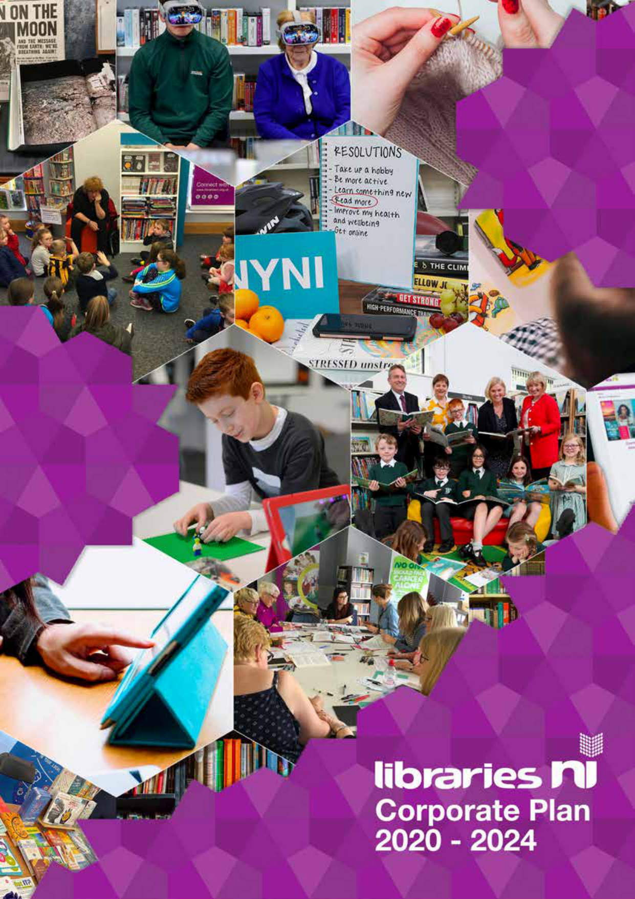
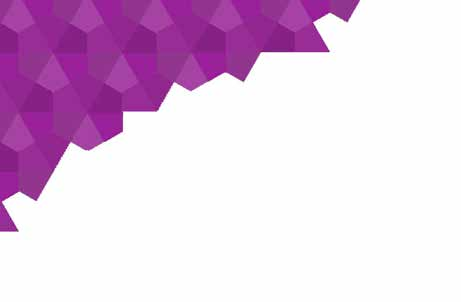
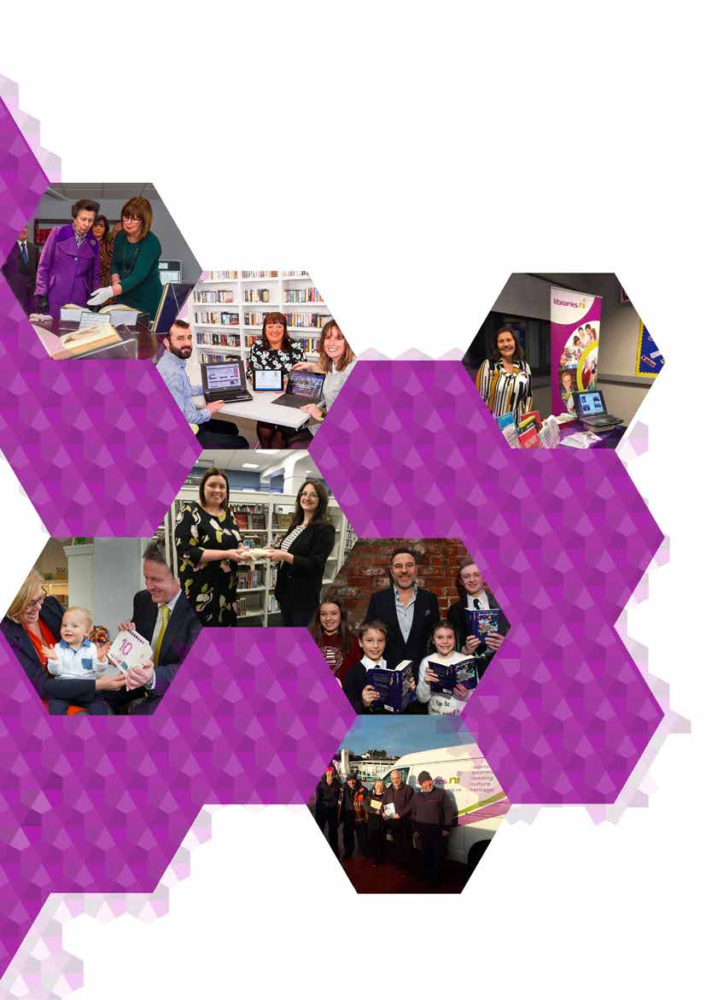
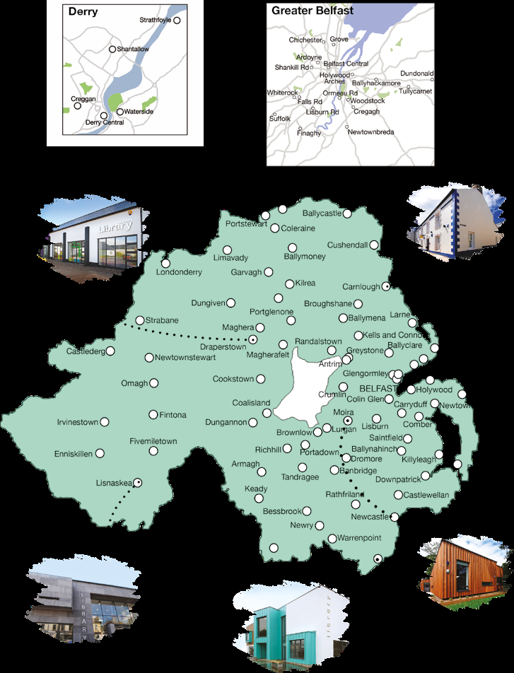
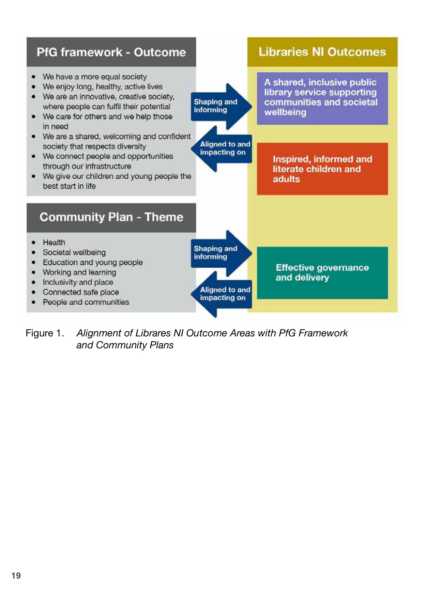
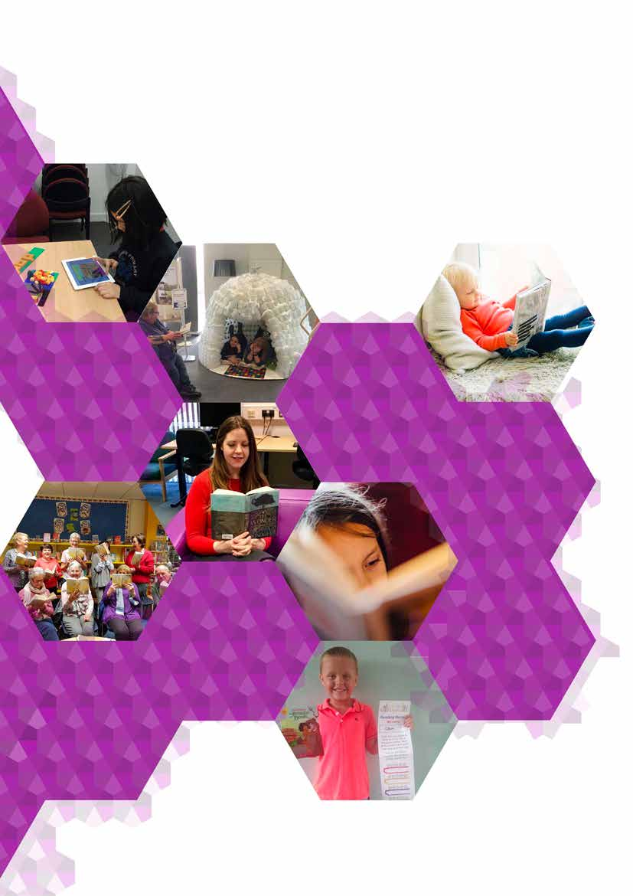
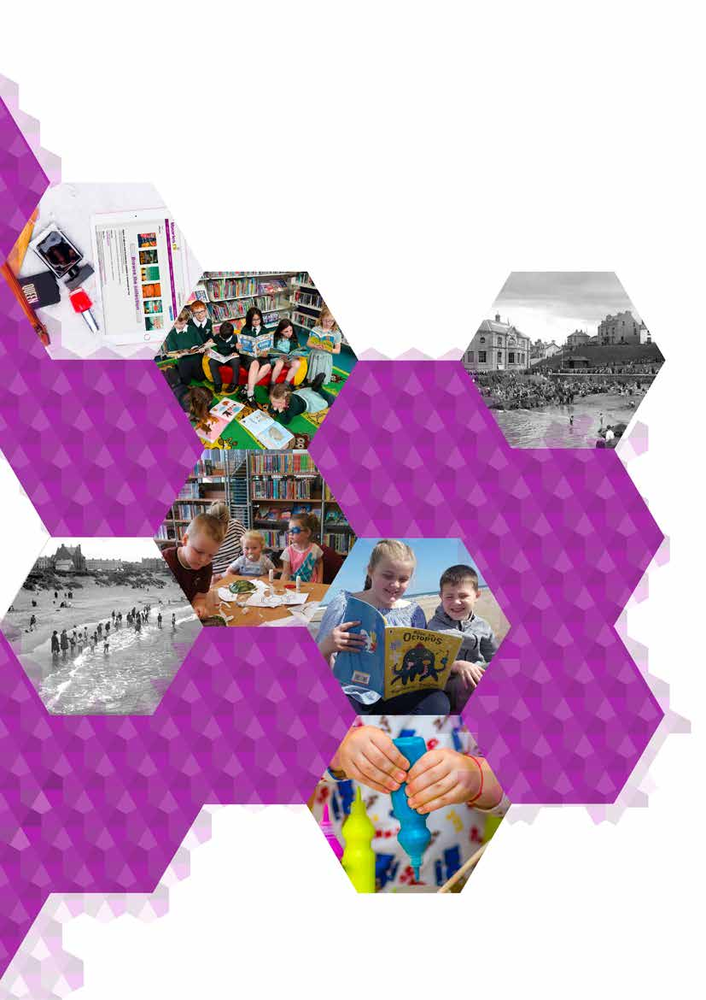
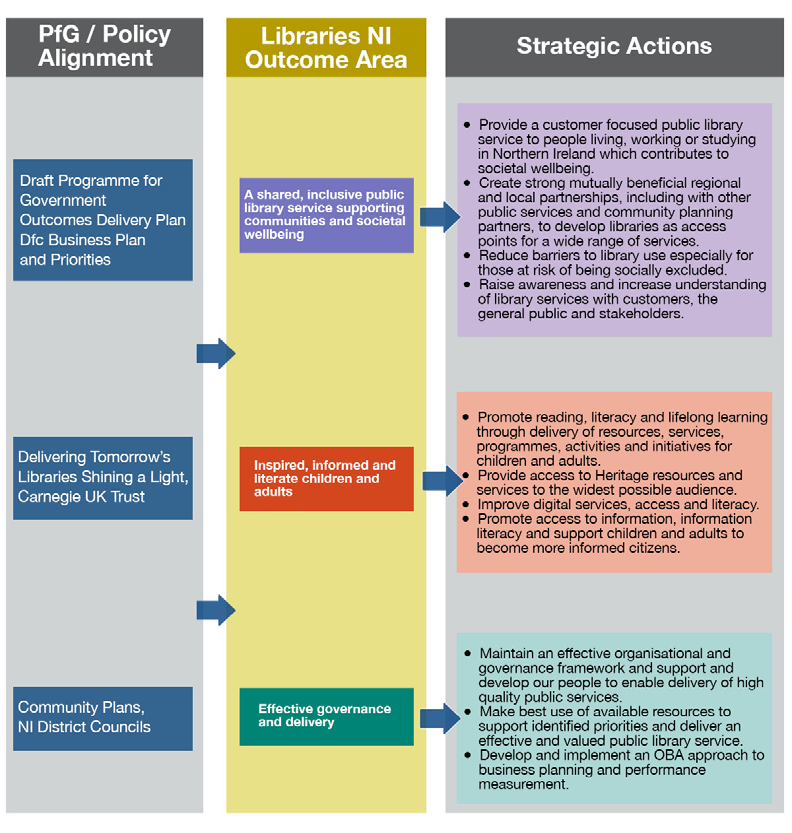

<!-- PAGE: 1 -->

# Libraries NI Corporate Plan 2020–2024

### Connecting People, Enriching Lives

**Northern Ireland Library Authority**

<!-- PAGE: 2 -->

<!-- PAGE: 3 -->

## Contents

- [Foreword by Chairperson and Chief Executive](#foreword-by-chairperson-and-chief-executive) (p. 4)
- [1. Who We Are](#1-who-we-are) (p. 7)
  - [1.3 Our Vision](#13-our-vision) (p. 7)
  - [1.4 Our Mission](#14-our-mission) (p. 7)
  - [1.5 Our Values](#15-our-values) (p. 7)
  - [1.6 Our Network and Services](#16-our-network-and-services) (p. 8)
- [2. Looking Back](#2-looking-back) (p. 10)
- [3. Performance Measures](#3-performance-measures) (p. 14)
- [4. Looking Forward: The Strategic Planning Context](#4-looking-forward-the-strategic-planning-context) (p. 15)
- [5. Outcome Areas and Strategic Actions](#5-outcome-areas-and-strategic-actions) (p. 21)
  - [Outcome Area 1: A shared, inclusive public library service supporting communities and societal wellbeing](#outcome-area-1) (p. 23)
  - [Outcome Area 2: Inspired, informed and literate children and adults](#outcome-area-2) (p. 27)
  - [Outcome Area 3: Effective Governance and Delivery](#outcome-area-3) (p. 31)
- [6. Measuring Outcomes and Performance](#6-measuring-outcomes-and-performance) (p. 33)
- [Appendix 1: Alignment of Libraries NI Outcome Areas and Strategic Actions with the draft PfG Framework](#appendix-1) (p. 35)

<!-- PAGE: 4 -->

## Foreword by Chairperson and Chief Executive

This plan builds upon the positive foundations that were laid in the 2016–2020 Corporate Plan whilst maintaining a firm commitment to help support those who live, study or work in communities across Northern Ireland. This Corporate Plan sets out the Outcome Areas and Strategic Actions that Libraries NI intends to focus on over the next four years, demonstrating how our public library service connects with and helps to deliver priorities in the draft Programme for Government (PfG) and the Department for Communities' (DfC) strategic priorities.

Libraries are welcoming, safe and trusted spaces in local communities, open to all and free to access. Through the dedication and expertise of our staff, the range of resources available and the activities provided, libraries make a positive difference to people's lives every day. They support literacy and learning for people of all ages, foster creativity, promote health and wellbeing, connect people with information and digital technologies, and contribute to community cohesion.

Libraries NI continues to operate within a challenging financial environment. Over the past four years, we have had to absorb significant real-term budget reductions, necessitating difficult decisions regarding service delivery, staffing levels and opening hours. Despite these financial constraints, we have continued to provide high-quality services, innovate and demonstrate resilience, working collaboratively with partners across government, local authorities, community and voluntary sectors and the private sector.

<!-- PAGE: 5 -->

Libraries support the delivery of other services, providing local access points and helping customers to connect with information and support that contributes to social and economic wellbeing. This is facilitated by our dedicated and professional staff who are committed to providing help and support to assist people, no matter what their background or circumstances.

There are substantial financial and operational challenges ahead. To address these challenges, we will continue to advocate for adequate and sustainable investment in the public library service, demonstrating the substantial social return on investment that libraries provide. We will also continue to explore new ways of working, embrace technological advances, and develop mutually beneficial partnerships to maximize the reach and impact of our services.

We look forward to working with our sponsor department, the Department for Communities, our Board Members, staff, partners and, above all, our customers to implement this Corporate Plan and to ensure that public libraries continue to connect people and enrich lives across Northern Ireland.

**Professor Bernard Cullen**  
Chairperson, Libraries NI.

**Jim O’Hagan**  
Chief Executive, Libraries NI.

<!-- PAGE: 6 -->

<!-- PAGE: 7 -->

## 1. Who We Are

- **1.1** The Northern Ireland Library Authority, more commonly known as Libraries NI, is a regional body responsible for the provision and delivery of a public library service in Northern Ireland. Libraries NI is the largest single library authority in the UK. Our primary duty, as set down in the Libraries Act (Northern Ireland) 2008, is to provide a comprehensive and efficient public library service for persons living, working or studying in Northern Ireland.
- **1.2** The Board of Libraries NI, when fully constituted, comprises a Chairperson and 18 Members, the majority of whom are councillors within the meaning of the Local Government Act (Northern Ireland) 1972. Board Members are appointed by the Department for Communities.

### 1.3 Our Vision

> A visible, accessible and inclusive library service at the heart of communities, enhancing lives and valued by all.

### 1.4 Our Mission

> Connecting people with information, ideas and experiences to foster lifelong learning, inspire curiosity, provide enjoyment and strengthen communities.

### 1.5 Our Values

- **Caring** – we care about our library users, the community, each other and what we do. We will provide a safe and welcoming environment where people can connect and explore. We will show respect for users of our service and for each other, will build trust and will strive to provide positive experiences for both external and internal customers.
- **Accountable** – we take responsibility, as individuals and as an organisation, for effective stewardship of the resources allocated to us and for delivering on our commitments. We will act with honesty and integrity and maintain high standards of governance, responsible leadership and efficient operations.

<!-- PAGE: 8 -->

- **Responsive** – we are a learning organisation that is open to new ideas and better ways to serve individuals and communities. We have a focus on quality, are creative and flexible and will continue to explore innovative ways of working to ensure that services are vibrant, effective and relevant to the changing needs of our customers.

### 1.6 Our Network and Services

The library network is crucial to the delivery of both an effective and comprehensive library service taking account of the geographic and demographic spread of Northern Ireland. Our services are currently delivered through a network of 96 branch libraries, heritage libraries, mobile libraries and a homecall service, which provide a wide range of free services including:

- Books and other material such as audiobooks, newspapers, periodicals and magazines;
- Downloadable eBooks, audiobooks and eMagazines and other online resources, most of which can also be accessed from home;
- Supported access to computers for use by the general public with free internet access for library members;
- Support for the development of ICT skills;
- Free Wi-Fi, enabling library members to use their own devices;
- Learning opportunities;
- Storytimes, Rhythm and Rhyme sessions and other activities for children;
- School class visits;
- Family history, heritage and local studies material;
- Access to information from a range of sources and organisations;
- Access to cultural and creative experiences;
- Reading groups for children, teenagers and adults;
- Health and wellbeing information, activities and events;
- Social activities, such as ‘Knit and Natter’ and ‘Tea and Newspapers’, which promote community cohesion and combat isolation;
- Study, meeting and shared social space.

<!-- PAGE: 9 -->

<!-- PAGE: 10 -->

## 2. Looking Back

- **2.1** In the period covered by the Corporate Plan 2016–2020 Libraries NI operated in a challenging environment with uncertainty in respect of longer-term planning and continued financial constraints in the public sector, characterised by a series of one-year resource allocations and significant budget reductions year on year. The key focus during the period was to ensure the continued delivery of frontline services while managing budget constraints and absorbing cumulative cost pressures.
- **2.2** The Corporate Plan 2016–2020 set out five corporate goals:
  - Delivering customer-focused services;
  - Contributing to societal wellbeing and building stronger communities;
  - Promoting reading, literacy, learning and digital inclusion;
  - Improving organisational capability and efficiency;
  - Securing appropriate investment in infrastructure and stock.
- **2.3** Across the four years of the previous plan, service delivery was guided by key strategic themes including: Children and Young People's Services; Health and Wellbeing; Digital Inclusion; Information and Learning; Heritage; and Reading and Reader Development.

<!-- PAGE: 11 -->

- **2.4** Our work in support of these corporate goals and service priorities included:
  - Developing and delivering public library services aligned to support draft Programme for Government and Department for Communities priority outcomes;
  - Increasing use of the public library service as a local access point for communities to many services delivered by the Department for Communities and other public bodies;
  - Partnering with local government in the delivery of Community Planning themes across the 11 council areas;
  - Sustaining high-quality services for children and young people through programs like Rhythm and Rhyme, the Summer Reading Challenge, Bookstart, and regular class visits;
  - Delivering digital inclusion initiatives, including the *Go ON NI* digital skills training program, coding clubs and Maker Space activities across regional hubs;
  - Enhancing access to local history and heritage through digitisation and community outreach;

<!-- PAGE: 12 -->

  - Providing access to health information and working with partners to deliver a range of health events and activities including Mindfulness and Healthy Eating sessions, adult health and teenage health fairs and the use of music as a tool to promote better mental health. *Take 5 Steps to Wellbeing* is an example of one successful initiative;
  - Developing social activities that combat rural and urban isolation, such as Knit and Natter groups, reminiscence sessions, and shared reading for older people;
  - Maintaining capital investment where possible, completing major library refurbishments and upgrades across Northern Ireland, including projects at Coleraine, Kilkeel and Lisburn Road;
  - Expanding digital collections, providing 24/7 remote access to eBooks, eAudiobooks, digital magazines and online databases;

<!-- PAGE: 13 -->

  - Continuing to promote free downloadable eBooks and audiobooks, eMagazines and other online resources, many of which can be accessed by library users from their own homes;
  - Celebrating the 130th Anniversary of Belfast Central Library and the tenth anniversary of the formation of Libraries NI;
  - Launch of the Libraries NI Storytelling and Cultural Program, showcasing local writers and performers;
  - Responding flexibly and creatively to customer feedback to improve services and remove barriers to use across all communities in Northern Ireland.

<!-- PAGE: 14 -->

## 3. Performance Measures

- **3.1** Each year an Annual Business Plan setting out the actions to be taken and the associated targets is prepared and approved. The Annual Business Plan is informed by the Corporate Plan, relevant priorities in the draft Programme for Government and the Department for Communities’ strategy and policy for the public library service. The Annual Plan outlines measurable key performance indicators (KPIs) to track progress across all service dimensions.
- **3.2** Over the 2016–2020 period, performance was evaluated across a range of output and outcome measures, including:
  - Total visits to libraries (physical and virtual);
  - Issues of physical and electronic stock;
  - Attendance at library events and educational activities;
  - Use of public access computers and Wi-Fi connections;
  - Customer satisfaction levels derived from the Continuous Household Survey and internal customer surveys;
  - Delivery against statutory Key Performance Indicators, agreed with DfC.

<!-- PAGE: 15 -->

## 4. Looking Forward: The Strategic Planning Context

- **4.1** In developing this Corporate Plan 2020–2024 consideration has been given to external factors that influence, shape and impact on libraries, library use and the public sector landscape within which the library service is delivered in Northern Ireland. These factors include public policy, economic, social, cultural, demographic and technological trends.
- **4.2** The return of the Northern Ireland Executive and the publication of *New Decade, New Approach* in January 2020 established an important political and strategic framework. This agreement reaffirmed commitment to public service transformation, regional economic growth, health and wellbeing, and educational attainment.
- **4.3** Libraries NI is well placed to support the Executive's overarching Programme for Government priorities, specifically in fostering inclusive growth, building safe and connected communities, tackling educational underachievement, and improving physical and mental health.

<!-- PAGE: 16 -->

- **4.4** In developing this Corporate Plan we have been mindful of the emphasis placed in the Programme for Government and by the Department for Communities on collaborative working across government departments, public bodies and the voluntary and private sectors. Libraries NI does not sit in isolation and through the work our staff do in local libraries, right across Northern Ireland, we make an active and sustained contribution to the work of many departments and agencies.
- **4.5** Community Planning provides an established vehicle for joined-up public service delivery. Libraries NI is a statutory partner on all 11 Community Planning Partnerships across Northern Ireland, working with district councils and local partners to align library services with community needs.
- **4.6** The financial context within which Libraries NI operates continues to be constrained. A prolonged period of austerity and single-year budget settlements has created substantial planning uncertainty. Over the decade since Libraries NI was established, the organisation has delivered significant levels of <!-- PAGE: 17 --> savings while continuing to deliver effective services. This has included reductions in library opening hours, reductions in staffing levels, reductions in the stock budget and cuts to maintenance and other budgets. The current situation is not sustainable and a solution is required to create greater financial stability and to provide an adequate level of resourcing to enable the organisation to plan with confidence, maintain stock quality, protect opening hours and invest in capital infrastructure.
- **4.7** Demographic change presents both opportunities and challenges for public libraries. Northern Ireland's population is ageing, with an increasing proportion of citizens aged 65 and over. At the same time, communities are becoming more ethnically and culturally diverse.
- **4.8** Public libraries play a vital role in providing welcoming spaces for new arrivals, refugees and asylum seekers, offering language learning resources, free internet connectivity and access to public services.
- **4.9** Child poverty and educational disadvantage remain entrenched in many areas of Northern Ireland. Libraries are uniquely placed to support early childhood development, reading for pleasure and family literacy, helping to break generational cycles of disadvantage.

<!-- PAGE: 18 -->

- **4.10** Public libraries are widely recognised as welcoming, accessible, trusted and shared spaces, embedded in communities and used by people of all ages, cultures and backgrounds to pursue leisure and learning and to have access to high quality information resources. Research carried out by independent organisations such as Carnegie UK Trust provides supporting evidence that public libraries are among the most trusted public institutions in society.
- **4.11** The rapid development of digital technologies, mobile communications and online public services has fundamentally transformed how citizens access information. While digital offers tremendous convenience, digital exclusion remains a major societal challenge in Northern Ireland, particularly among older people, those on low incomes, and rural communities without high-speed broadband.
- **4.12** Libraries provide free digital access, high-speed Wi-Fi and one-to-one digital coaching, acting as an indispensable public safety net ensuring no citizen is left behind in a digital-by-default society. However, declining budgets create serious challenges in funding the ongoing technological refresh and savings required to meet financial <!-- PAGE: 19 --> objectives. We continue to use customer feedback and information from customer surveys and the Continuous Household Survey to gauge customer expectations and requirements about services that we provide and to inform how we develop and deliver future services.
- **4.13** Our customers have told us that:
  - There are high levels of satisfaction with the services offered;
  - Libraries are highly valued as community hubs and quiet spaces for study and work;
  - Friendly and helpful staff are considered our greatest asset;
  - Access to free books, computers and internet remains essential;
  - Customers want modern, well-maintained buildings with extended opening hours and relevant book stock.

<!-- PAGE: 20 -->

### Staff and Leadership

- **4.14** Libraries NI has been operating for ten years and in that time there has been a number of changes and re-organisations deployed incrementally on an annual basis in line with the implementation of various voluntary exit and redundancy schemes. There have been reductions in staff numbers in every year since Libraries NI began operating and at the end of 2018/19 staffing had decreased by more than 30% compared to baseline establishment figures.
- **4.15** Frontline library staff possess deep knowledge of their local communities and have demonstrated outstanding flexibility, professionalism and dedication. However, continuous restructuring and staffing reductions have created significant workload pressures.
- **4.16** Investing in staff development, leadership training, mental health and wellbeing, and equipping staff with modern digital skills is a core priority of this Corporate Plan.
- **4.17** We will ensure our workforce is supported, valued and empowered to deliver vibrant, modern and citizen-focused services.

<!-- PAGE: 21 -->

## 5. Outcome Areas and Strategic Actions

- **5.1** This Corporate Plan has been developed taking account of outcomes-based principles and approaches which will be carried through into subsequent annual business plans. An outcomes-based approach represents a fundamental change to the way in which Libraries NI plans and delivers a public library service in Northern Ireland. The PfG framework requires public bodies to measure success not merely by inputs or activity counts, but by the real-world difference made to the lives of citizens.
- **5.2** To align with the draft Programme for Government and Department for Communities priorities, Libraries NI has established three strategic Outcome Areas:
  - **Outcome Area 1**: A shared, inclusive public library service supporting communities and societal wellbeing;
  - **Outcome Area 2**: Inspired, informed and literate children and adults;
  - **Outcome Area 3**: Effective Governance and Delivery.
- **5.3** The relationship between these Outcome Areas, the Programme for Government framework and local Community Plans is illustrated in Figure 1 below.

<!-- PAGE: 22 -->

*Figure 1: Strategic Planning Framework aligning Libraries NI Outcome Areas with PfG Outcomes and Community Plans.*

<!-- PAGE: 23 -->

## Outcome Area 1: A shared, inclusive public library service supporting communities and societal wellbeing

### Strategic Actions:
- Provide a customer focused public library service to people living, working or studying in Northern Ireland which contributes to societal wellbeing;
- Create strong mutually beneficial regional and local partnerships, including with local councils through Community Planning, to enhance service delivery and extend our reach;
- Maintain and develop the physical library infrastructure to provide modern, welcoming, shared and neutral spaces at the heart of communities;
- Promote social inclusion, tackle isolation and loneliness, and support vulnerable and disadvantaged groups;
- Support physical and mental health and wellbeing through tailored information, activities and partnerships.

#### Context and Delivery

- **5.4** Public libraries are shared, neutral and welcoming spaces accessible to everyone in Northern Ireland, regardless of religious, political, ethnic or socioeconomic background. This shared civic identity is a precious asset in a society transitioning from conflict.
- **5.5** Maintaining a high-quality physical estate is crucial. While capital budgets have been constrained, we will continue to seek capital funding and over the next four <!-- PAGE: 24 --> years projects will range in size, complexity and scale. Nevertheless, we anticipate redevelopment and new build projects being brought forward in a number of areas including Enniskillen, Fivemiletown, Newtownards and Banbridge. We will also continue to engage with the Department for Communities to develop proposals for investment at Belfast Central Library. Belfast Central Library is a Grade B+ listed landmark building of immense cultural importance; its comprehensive redevelopment is a flagship regional priority to create a world-class cultural and learning destination.
- **5.6** Libraries play a profound role in combating loneliness and social isolation. Initiatives such as *Knit and Natter*, *Tea and Newspapers*, reading groups, and adult social clubs provide vital connection for older citizens and those living alone.
- **5.7** In rural areas, where isolation manifests itself <!-- PAGE: 25 --> differently from urban areas, the extensive network of libraries is recognised as making a significant contribution to tackling social isolation, inequality and disadvantage. Our mobile library fleet visits rural primary schools, residential care homes and isolated communities across Northern Ireland.
- **5.8** Libraries NI is well placed to promote health and wellbeing through the provision of health information, health literacy activities, social programmes and health-promoting activities, delivered in partnership with Health and Social Care Trusts, the Public Health Agency and community organisations.
- **5.9** We will continue to support government initiatives such as *Take 5 Steps to Wellbeing* (Connect, Be Active, Take Notice, Keep Learning, Give), integrating these principles into library activities across Northern Ireland.

<!-- PAGE: 26 -->

<!-- PAGE: 27 -->

## Outcome Area 2: Inspired, informed and literate children and adults

### Strategic Actions:
- Promote reading, literacy and lifelong learning through delivery of resources, services, programmes, activities and initiatives for children and adults;
- Provide access to Heritage resources and services to the widest possible audience;
- Improve digital services, access and literacy;
- Support formal and informal education, skills development and economic wellbeing.

#### Context and Delivery

- **5.10** Reading for pleasure is one of the most powerful determinants of educational achievement, cognitive development and life outcomes. Libraries NI provides free access to a rich collection of books and reading materials across fiction, non-fiction, poetry and drama for all age groups.
- **5.11** Supporting literacy from the earliest age is a core service priority. Programs such as *Rhythm and Rhyme* introduce babies and toddlers to songs, rhymes and stories, supporting early speech and language development and bonding between parents and children.
- **5.12** The annual *Summer Reading Challenge*, delivered in partnership with The Reading Agency, encourages tens of thousands of primary school children to read six library books during the summer holidays, combating the 'summer reading dip'.
- **5.13** We will continue to invest in our book stock, ensuring a dynamic, diverse and appealing collection that meets user expectations and reflects the cultural diversity of Northern Ireland.
- **5.14** Access to high-quality information, whether in hard copy or <!-- PAGE: 28 --> online, together with opportunities to develop a love of reading from an early age engages children and young people in positive and enjoyable activities, improves literacy skills and facilitates lifelong learning, which in turn contributes to breaking the cycle of deprivation and educational under-achievement. Over the period of this Corporate Plan we will place particular emphasis on supporting children and families in disadvantaged and rural communities.
- **5.15** Northern Ireland possesses an exceptionally rich literary and documentary heritage. Libraries NI holds significant special collections, rare books, newspapers, manuscripts and photographic archives, centered on Belfast Central Library, Derry Central Library and Armagh Library.
- **5.16** We will continue to preserve and digitise heritage assets, expanding online access and developing public exhibitions, lectures and family history workshops to engage citizens with their heritage.
- **5.17** Digital inclusion remains a top priority. As more public and commercial services move online, it is essential that all citizens develop the skills necessary to access, <!-- PAGE: 29 --> evaluate and use information to improve digital literacy, taking account of the importance of online safety and privacy and enable them to make full use of the services and opportunities that exist.
- **5.18** Libraries NI recognises the importance of reviewing and developing its programmes and services in this area as customer needs evolve and we will seek to grow, expand and innovate our digital offerings, supporting coding academies, virtual enquiry services and creative technologies for life.

<!-- PAGE: 30 -->

<!-- PAGE: 31 -->

## Outcome Area 3: Effective Governance and Delivery

### Strategic Actions:
- Maintain an effective organisational and governance framework and support and develop our people to enable delivery of high quality public services;
- Make best use of available resources to support identified priorities and deliver an effective and valued public library service;
- Develop and implement an Outcome Based Accountability (OBA) framework to measure impact and drive continuous improvement;
- Ensure robust financial management, internal controls and risk management;
- Communicate effectively with staff, stakeholders and the public to promote awareness and understanding of library services.

#### Context and Delivery

- **5.19** Libraries NI is committed to the highest standards of corporate governance, accountability and integrity. Our Board operates under the code of practice for public bodies, ensuring rigorous oversight, compliance and transparency.
- **5.20** In a constrained fiscal environment, achieving value for money is paramount. We will continue to seek operational efficiencies through regional procurement, energy efficiency initiatives across our buildings, digital workflow automation and shared services.
- **5.21** Our people are our most valuable asset. Delivering the strategic actions set out in this Corporate Plan depends entirely on the expertise, commitment and professionalism of our staff. We will invest in staff learning and development, leadership programmes and wellbeing initiatives over the next four years.

<!-- PAGE: 32 -->

- **5.22** Libraries NI is committed to ensuring the highest standards of governance and accountability, underpinned by openness and transparency, to ensure that stakeholders can have confidence in the organisation’s decision-making processes and actions and in the management of its activities. The public sector financial environment is likely to remain challenging across the lifetime of this plan, requiring disciplined prioritisation and clear focus on core statutory responsibilities.
- **5.23** We will maintain constructive industrial relations through partnership working with trade unions and staff representatives.
- **5.24** We will enhance our marketing and communication strategies, utilising digital channels, local press and community outreach to celebrate the positive impact of libraries and ensure all citizens are aware of the free services available to them across Northern Ireland.

<!-- PAGE: 33 -->

## 6. Measuring Outcomes and Performance

- **6.1** Effective planning, performance management and reporting are vital in ensuring that the needs of service users are met, essential services are delivered and statutory obligations met, that the organisation continues to improve and that we are open and transparent about progress and risks. The move to an Outcome Based Accountability (OBA) framework represents an important evolution in how Libraries NI demonstrates public value.
- **6.2** The implementation of this Corporate Plan will be supported by:
  - Annual Business Plans which establish specific annual objectives, targets and resource allocations;
  - Directorate and Service Plans setting operational milestones for teams across the regional network;
  - Performance Management and Personal Development systems ensuring alignment of <!-- PAGE: 34 --> personalised targets and goals for individual members of staff to enable them to fulfil their respective roles in meeting the actions and targets set out in the Service Plans;
  - The Risk Management and associated assurance processes which are embedded in the routines and activities of the organisation and provide a structured and coherent framework for identifying, assessing and mitigating operational and strategic risks;
  - Regular reporting to the Board of Libraries NI and the Department for Communities through formal accountability meetings and the Annual Report and Accounts;
  - Ongoing user engagement, customer surveys and public consultation to assess customer satisfaction and outcome delivery throughout the year.

<!-- PAGE: 35 -->

## Appendix 1: Alignment of Libraries NI Outcome Areas and Strategic Actions with the draft PfG Framework

*The table above maps the three Libraries NI Outcome Areas and Strategic Actions to the relevant draft Programme for Government outcomes, including educational achievement, healthcare, regional equality, and community cohesion.*

<!-- PAGE: 36 -->

## Contact Information

**Libraries NI Headquarters**  
Lisburn City Library  
23 Linenhall Street  
Lisburn  
Co. Antrim  
BT28 1FJ  

- **Telephone**: 0345 4504 580  
- **Email**: enquiries@librariesni.org.uk  
- **Website**: [www.librariesni.org.uk](https://www.librariesni.org.uk)  

Libraries NI is the operating name of the Northern Ireland Library Authority.
