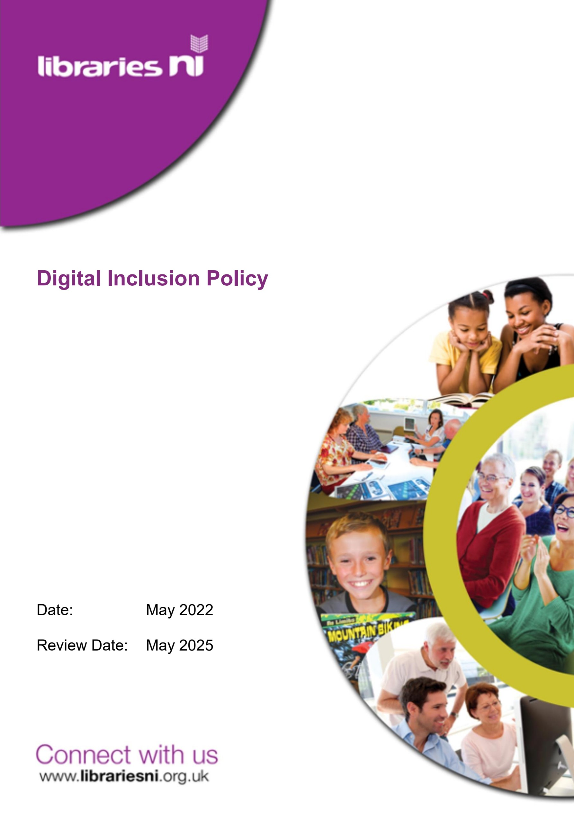

<!-- PAGE: 1 -->

# Digital Inclusion Policy

**Date:** May 2022  
**Review Date:** May 2025  

<!-- PAGE: 2 -->

## Policy Information

| Field | Detail |
| :--- | :--- |
| **Policy Title** | Digital Inclusion Policy |
| **Policy Number** | POL 071 |
| **Version** | V2 (May 2022) |
| **Policy Sponsor** | The Head of Service with responsibility for Online Services and Service Support |
| **Policy Owner** | The Service Development Manager with responsibility for Online Services and Service Support |
| **Committee and date recommended for approval** | Services Committee, 19 May 2022 |
| **Date approved by the Board** | 7 July 2022 |
| **Equality Screening Status** | Screened: 11 March 2019; Reviewed: 22 April 2022 |
| **Rural Needs Impact Assessment Status** | Assessed: 19 February 2019; Reviewed: 22 April 2022 |
| **Date Set For Review** | March 2025 |

### Related Policies

- Children’s and Young People’s Service Policy
- Heritage Policy
- Information and Learning Services Policy
- Library Computers Conditions of Use Policy and Guidelines
- Partnership Policy
- Reading and Reader Development Policy

<!-- PAGE: 3 -->

# Libraries NI
## Digital Inclusion Policy

### 1. Introduction

**1.1** Digital inclusion can be defined as the activities necessary to ensure that all individuals, including the most disadvantaged, have access to and use of information and communication technologies (ICT).

**1.2** This involves knowing how to use a range of technology to find information, solve problems and complete tasks. Digital skills include the skills of how to get online while digital literacy involves using the skills to complete tasks online.

**1.3** Today’s society requires people to be digital citizens in order to communicate, carry out every day transactions and to access information. However, many people lack the skills, confidence or access to ICT needed to be a digital citizen.

**1.4** Libraries provide digital support in both accessing information and communicating online. Libraries have a critical role to play in helping promote greater equality of access to and capability in using information. Public libraries complement and reinforce formal education. Staff have the skills to understand customer’s needs and help them to navigate through and make sense of the myriad of resources that are available.

**1.5** Libraries have a major role to play in the assisted digital agenda, addressing gaps and inequalities by providing accessible premises, free to use public access computers, a reliable broadband network working at consistent speeds and staff support to customers in the library. Libraries can provide the public with the confidence to use online services successfully.

### 2. Purpose

**2.1** The purpose of this policy is to outline Libraries NI’s approach to promoting digital inclusion through its services and facilities.

### 3. Policy

**3.1** Libraries NI will promote digital inclusion by providing access to free public access computers and Wi-Fi through a reliable broadband network in all static libraries. Libraries NI will make services accessible to people with disabilities and ensure that the service is as inclusive as possible.

**3.2** Libraries NI recognises that the skills required to be a digital citizen are constantly evolving and will seek to recognise this in its provision.

**3.3** Libraries NI will seek to promote digital literacy throughout its entire service provision.

<!-- PAGE: 4 -->

**3.4** Libraries NI will provide a programme of digital support and training for the development of both basic and more advanced skills and give the public confidence in accessing essential services online.

**3.5** Libraries NI will continue to review and develop programmes to meet the needs of customers.

**3.6** Libraries NI will work in partnership with Government Departments and other agencies to deliver mutually beneficial outcomes.

**3.7** Libraries NI will adopt digital technologies as appropriate.

**3.8** Libraries NI will promote online safety and privacy throughout its digital inclusion activities.

### 4. Authority

- **Policy Sponsor:** The Head of Service with responsibility for Online Services and Service Support.
- **Policy Owner:** The Service Development Manager with responsibility for Online Services and Service Support.
- **Policy Contact:** The Senior Service Manager with responsibility for Online Services and Service Support.

### 5. Related Documents

#### Policies
- Children’s and Young People’s Service Policy
- Heritage Policy
- Information and Learning Services Policy
- Library Computers Conditions of Use Policy and Guidelines
- Partnership Policy
- Reading and Reader Development Policy
