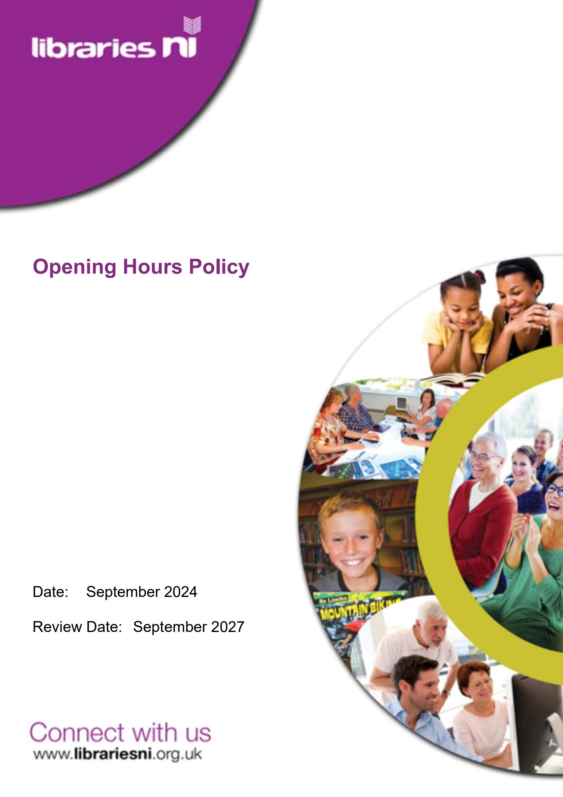

<!-- PAGE: 1 -->

# Opening Hours Policy

**Date:** September 2024  
**Review Date:** September 2027  

<!-- PAGE: 2 -->

## Policy Information

| Field | Detail |
| :--- | :--- |
| **Policy Title** | Opening Hours Policy |
| **Policy Number** | POL045 |
| **Version** | Version 4 (September 2024) |
| **Policy Sponsor** | The Chief Executive |
| **Policy Owner** | The Director of Library Services |
| **Committee and date recommended for approval** | Services Committee, 21 September 2024 |
| **Date approved by the Board** | 17 October 2024 |
| **Equality Screening Status** | 1. Screened: 26 June 2015 2. Reviewed: 8 February 2018 3. Reviewed: 5 August 2021 4. Reviewed: 15 October 2024 |
| **Rural Needs Impact Assessment Status** | 1. Assessed: 5 August 2021 2. Reviewed: 15 October 2024 |
| **Date Set For Review** | September 2027 |

### Related Policies

- Byelaws
- Customer Feedback Policy
- Equality Scheme
- Freedom of Information Policy
- Health and Safety Policy
- Partnership Policy
- Safeguarding Policy

<!-- PAGE: 3 -->

# Libraries NI
## Opening Hours Policy

### 1. Introduction

**1.1** The primary duty of Libraries NI, as set out in the Libraries Act (Northern Ireland) 2008, is to provide a comprehensive and efficient public library service for persons living, working or studying in Northern Ireland.

**1.2** This service is provided via a network of static libraries supported by Mobile, Homecall and Online/Digital services.

**1.3** *Delivering Tomorrow’s Libraries* states “it is important to ensure that the library service is available in the places, at the times, and in the ways that enable as many people as possible to use it.”

**1.4** Static library opening hours are a major factor in determining access to physical library buildings and programmes.

**1.5** Libraries NI offers a hybrid service enabling remote access to eBooks, eNewspapers, eMagazines, online resources and online programming enabling customers to access library services and resources remotely 24/7.

### 2. Purpose

**2.1** The purpose of this policy is to set out Libraries NI’s approach to static library opening hours.

**2.2** Opening hours in the context of this policy means staffed opening hours; it does not include the ‘Out of Hours’ service.

### 3. Policy

**3.1** Libraries NI will ensure that within the constraints imposed by available resources:
- a consistent, inclusive approach to determining opening hours is applied using a range of criteria and factors including a minimum number of sustainable hours per library band/category, the community in which the library is located, historic, known and anticipated usage and the availability of the Out of Hours Service
- account will be taken of libraries serving areas of substantial social need, designated rural libraries and/or libraries serving a specific demographic i.e. specialist, students/study, children, new communities
- opening hours relate to the historic level of use of a library
- the allocated hours are used in a way that best meets customer need which may determine a different range of opening times per library location

<!-- PAGE: 4 -->

- the allocated hours in every library meet customer need and allow a minimum range of programmes to be delivered in line with Libraries NI’s priorities
- library opening hours are affordable
- library opening hours are sustainable i.e. ad hoc closures due to staffing shortages should be avoided other than in exceptional circumstances.

**3.2** Seasonal Opening Schedules reflecting patterns of customer usage will be applied reflecting demand for services and resources.

**3.3** Library opening hours may be temporarily amended to accommodate annual events or celebrations both local and service wide i.e. festivals, sporting events.

**3.4** Library opening hours including standard, seasonal, planned short term amendments and ad hoc closures are notified on the Libraries NI website with mitigations offered including promoting the nearest open static library and access to digital services.

**3.5** To ensure static libraries are accessible at the optimum times, we will review available opening hours periodically through monitoring usage/usage patterns, library performance and take account of changes in the external operating environment.

### 4. Authority

- **Policy Sponsor:** The Chief Executive is the Policy Sponsor.
- **Policy Owner:** The Director of Library Services is the Policy Owner.
- **Policy Contact:** The Heads of Service are the Policy Contacts.

### 5. Related Documents

#### Policies
- Byelaws
- Customer Feedback Policy
- Equality Scheme
- Freedom of Information Policy
- Health and Safety Policy
- Partnership Policy
- Safeguarding Policy
