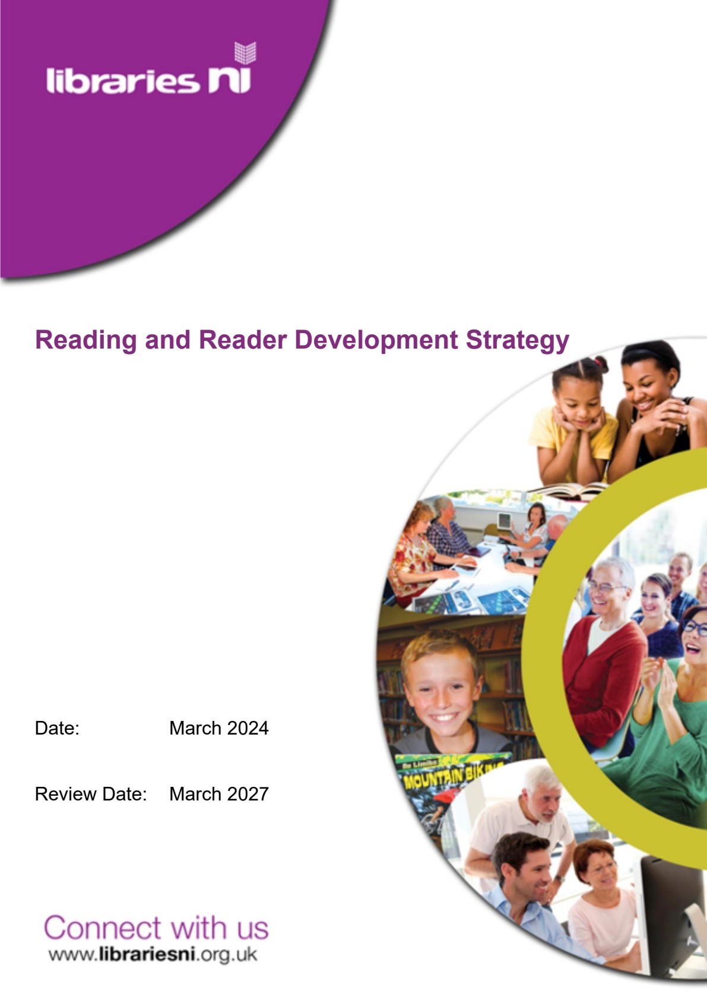

<!-- PAGE: 1 -->

# Reading and Reader Development Strategy

**Date:** March 2024  
**Review Date:** March 2027  

<!-- PAGE: 2 -->

# Libraries NI

## Reading and Reader Development Strategy 2024 – 2027

### 1. Introduction

1.1 Libraries NI’s primary duty, as set down in the Libraries Act (Northern Ireland) 2008, is to provide a comprehensive and efficient public library service for persons living, working or studying in Northern Ireland.

1.2 **Our Vision:** a visible, accessible and inclusive library service at the heart of communities, enhancing lives and valued by all.

1.3 **Our Mission:** connecting people with information, ideas and experiences to foster lifelong learning, inspire curiosity, provide enjoyment and strengthen communities.

1.4 The work of Libraries NI is guided by four service priorities:

* Customers
* Collections
* Network (including Community Planning)
* Online Services and Service Support.

1.5 The service priorities are delivered through a network of branch libraries, specialist heritage libraries, mobile libraries and through programmes, activities, outreach and online services.

### 2. What is Reader Development?

2.1 Reading is an essential life skill and a source of enjoyment. Active promotion of reading for pleasure and activities associated with reading is at the centre of reader development.

2.2 Reading can assist with wellbeing and is a gateway to learning and information, it improves vocabulary and leads to more developed language skills.

2.3 Reader development encourages people of all ages to read, to read more widely and to get more from their reading. Reader development enriches lives by improving confidence, promoting the enjoyment of reading, opening up reading choices and providing opportunities to share reading experiences.

2.4 Reader development activities include Reading Groups, Book Reviews, Festivals, and Author Events.

2.5 This document sets out Libraries NI’s strategy in relation to the reading and reader development service for all for the period 2024 to 2027.

<!-- PAGE: 3 -->

### 3. Aims and Objectives

3.1 The aim of this strategy is to foster a love of reading, to promote the benefits of reading and enhance the reading experience for people of all ages.

3.2 The objectives are:

* to widen participation in reading
* to support diversity
* to raise awareness of the benefits of reading
* to provide opportunities to share the pleasure of reading
* to increase staff knowledge of books and reader development
* to support staff to develop the skills necessary to engage customers in reader development.

### 4. Strategic Context

4.1 The Reader Development Strategy is set within the wider strategic agenda:

#### Draft Programme for Government 2016-2021

4.2 The Northern Ireland Executive has indicated in the Programme for Government that its primary focus for the period 2016-2021 is to grow the economy and tackle disadvantage. Free access to books and other reading material, whether in hard copy or online, together with opportunities to develop a love of reading and/or extend reading choices engages people in positive and enjoyable activities and facilitates lifelong learning, which in turn improves the quality of life and people’s life chances.

#### Delivering Tomorrow’s Libraries

4.3 One of the objectives associated with the core activities of libraries, as identified in the Departmental Public Library Service policy framework, is to ‘promote literacy, creative reading and lifelong learning.’ The Reading and Reader Development Strategy contributes to this policy by providing opportunities to foster a love of reading and realise the benefits of reading in enhancing life chances.

#### Libraries NI Corporate Plan 2020-2024

4.4 Libraries NI has a strategic outcome for inspired, informed and liberate children and adults, with the strategic action to promote reading, literacy and lifelong learning through delivery of resources, services, programmes, activities and initiatives for children and adults.

#### Developing Technology

4.5 This strategy takes into account the changing publishing environment and customer interactions where there is a wealth of formats available to read and enjoy. It also recognises that with emerging technologies the customer experience will be enhanced through social media, online reading resources, virtual reading groups, reviews and digital publishing.

<!-- PAGE: 4 -->

4.6 Advances in technology open up opportunities for Libraries NI to better provide customer advice on reading and reader development in a more intuitive and customer friendly way. These include an online catalogue which provides reader recommendations and links people to books they may enjoy.

#### Social Change

4.7 In an increasingly diverse and multi-cultural society, support for the significant minority of the population for whom English is not their first language is provided through a range of material in languages other than English.

### 5. Strategic Outcomes

5.1 Through the Reader Development Strategy Libraries NI will:

* encourage and inspire people of all ages to read widely and develop the confidence of individual readers
* become established as an expert commentator on reading and books in Northern Ireland, building an excellent reader development reputation
* develop and lead on reading strategies in Northern Ireland
* develop online services in reading and reader development which are the equivalent of those delivered in branch libraries
* promote and support the work of local authors through reader development initiatives
* celebrate the diverse communities within Northern Ireland and promote a better understanding of different backgrounds in a shared space
* develop knowledgeable and confident staff.

### 6. Delivery

6.1 Overall responsibility for the development and delivery of the reading and reader development strategy rests with the Head of Service responsible for Collections.

6.2 Operational responsibility for this strategy lies with the Libraries NI Service Development Manager responsible for collections.

6.3 The role of the Stock Team will be to develop and deliver programmes in partnership with Libraries NI colleagues and other relevant organisations, including other library authorities and reader development organisations, as well as publishers and authors to meet the targets in the three year development plan.

6.4 Libraries NI frontline staff will have a key role in inspiring a love of reading through programmes such as reading groups and advising and influencing the public on their reading choices.

<!-- PAGE: 5 -->

### 7. Monitoring, Evaluation and Review

7.1 The Reader and Reading Development Strategy will be reflected in the annual Libraries NI Business Plan and relevant Service Plans.

7.2 The key performance indicators for this strategy will be:

* participation in programmes/events and borrowing
* media presence.

7.3 This strategy will be kept under review as part of the annual business planning process and will be formally reviewed after three years.
