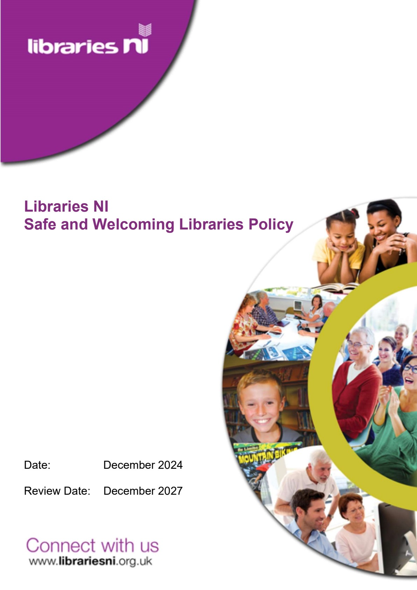

<!-- PAGE: 1 -->

# Safe and Welcoming Libraries Policy

**Libraries NI**

- **Date:** December 2024
- **Review Date:** December 2027

<!-- PAGE: 2 -->

## Policy Information

| Field | Detail |
| :--- | :--- |
| **Policy Title** | Libraries NI Safe and Welcoming Libraries |
| **Policy Number:** | POL061 |
| **Version** | 3 |
| **Policy Sponsor** | Chief Executive |
| **Policy Owner** | Director of Library Services |
| **Committee and Date recommended for approval** | Services Committee, 21 September 2023 |
| **Date approved by the Board** | 12 December 2024 |
| **Equality Screening Status** | Screened: 20 July 2020 Reviewed: 11 December 2024 |
| **Rural Needs Impact Assessment Status** | Assessed: 20 July 2020 Reviewed: 11 December 2024 |
| **Date Set For Review** | September 2026 |

### Related Documents

#### Byelaws
- Code of Conduct for Staff
- Customer Feedback Policy
- Customer Service Standards
- Data Protection Policy and Procedures
- Health and Safety Policy
- Library Computers Conditions of Use Policy and Guidelines
- Lone Working Policy and Procedures
- Privacy Statement
- Records Management Policy
- Risk Assessment Guidance
- Room Hire Policy and Procedures
- Safe and Welcoming Libraries: Exclusion Procedures
- Safe and Welcoming Libraries: Staff Guidelines
- Safeguarding Policy
- Social Media Policy

<!-- PAGE: 3 -->

## Libraries NI Safe and Welcoming Libraries Policy

### 1. Introduction

**1.1** Libraries NI is an inclusive service. We care about our customers, our communities, each other, what we do and the services we provide. We are committed to providing safe and welcoming libraries for our colleagues and customers. Our expectation is that all colleagues and customers will positively engage and demonstrate courtesy and respect at all times.

**1.2** The majority of people who use the public library service behave in an appropriate manner. However, there are occasions when library colleagues will be faced with customers whose behaviour towards them or other customers is unacceptable, or who are in breach of Libraries NI’s Byelaws, policies, procedures and guidelines. In such circumstances it is important that colleagues know how to respond to incidents of unacceptable behaviour.

**1.3** This policy relates solely to unacceptable behaviour by customers when they are using library services or communicating with library colleagues.

**1.4** This policy complements and reinforces Libraries NI’s Byelaws which have been made under Section 7 of the Libraries Act (Northern Ireland) 2008 and which help define and protect the conditions of use of library buildings and facilities.

### 2. Purpose

**2.1** The purpose of this policy is to:

- establish Libraries NI’s expectations in relation to customer behaviour
- indicate the types of customer behaviours that are considered unacceptable
- set out Libraries NI’s approach to managing and dealing with unacceptable behaviour by customers.

### 3. Policy

**3.1** Just as Libraries NI expects colleagues to adhere to the Code of Conduct and to treat customers courteously, with understanding and respect, similarly it expects customers to respect colleagues and all library users.

**3.2** Libraries NI does not expect colleagues to tolerate unacceptable behaviour from customers and will take action to deal with it in a fair, consistent and transparent manner in line with this policy and associated procedures and guidelines.

<!-- PAGE: 4 -->

**3.3** For the purposes of this policy unacceptable behaviour may include, but is not limited to:

- persistently disruptive behaviour
- using violent, abusive or obscene language to library colleagues or customers
- under the influence of alcohol or drugs
- using alcohol, drugs or vaping on library premises
- mean or unpleasant remarks
- making threats of any kind
- bullying, harassing or intimidatory behaviour
- malicious comments or allegations
- making derogatory or inappropriate remarks and/or using discriminatory language in relation to community background, race, religion, gender, sexual orientation, age, disability or any other section 75 category
- aggressive, abusive or obstructive behaviour or behaving in such a way as might cause injury to another person
- damage to property.

**3.4** This applies to behaviour in person, online, in writing or on the telephone.

**3.5** Libraries NI recognises that in some circumstances people may act out of character e.g. in times of trouble, distress or as a symptom of certain types or stages of illness and/or conditions. Where there is a concern about unacceptable behaviour consideration will be given to individual circumstances when deciding what action to take.

**3.6** A range of sanctions is available to deal with unacceptable behaviour. These range from a verbal warning to temporary or permanent exclusion from library premises and/or withdrawal of access to services. The level of the sanction will depend on the extent and seriousness of the behaviour. Customers will have the right of appeal against the imposition of a sanction.

**3.7** Training, support and guidance will be provided for colleagues to help them to:

- recognise and manage situations which could lead to unacceptable behaviour and take preventative action
- diffuse difficult situations
- ensure their personal safety
- understand and implement appropriate sanctions if required.

<!-- PAGE: 5 -->

### 4. Authority

- **Policy Sponsor:** The Chief Executive is the Policy Sponsor.
- **Policy Owner:** The Director of Library Services is the Policy Owner.
- **Policy Contact:** The Head of Service are the Policy contacts.

### 5. Related Documents

#### Policies
- Customer Feedback Policy
- Data Protection Policy
- Health and Safety Policy
- Library Computers Conditions of Use Policy and Staff Guidance
- Lone Working Policy
- Records Management Policy
- Room Hire Policy
- Safeguarding Policy
- Social Media Policy

#### Procedures
- Data Protection Procedures
- Lone Working Procedures
- Room Hire Procedures
- Safeguarding Procedures
- Safe and Welcoming Libraries: Exclusion Procedures

#### Guidelines and Other Documents
- Byelaws
- Code of Conduct for Staff
- Customer Service Standards
- Library Computers Conditions of Use Guidelines
- Privacy Statement
- Risk Assessment Guidance
- Safeguarding Guidelines
- Safe and Welcoming Libraries: Staff Guidelines
