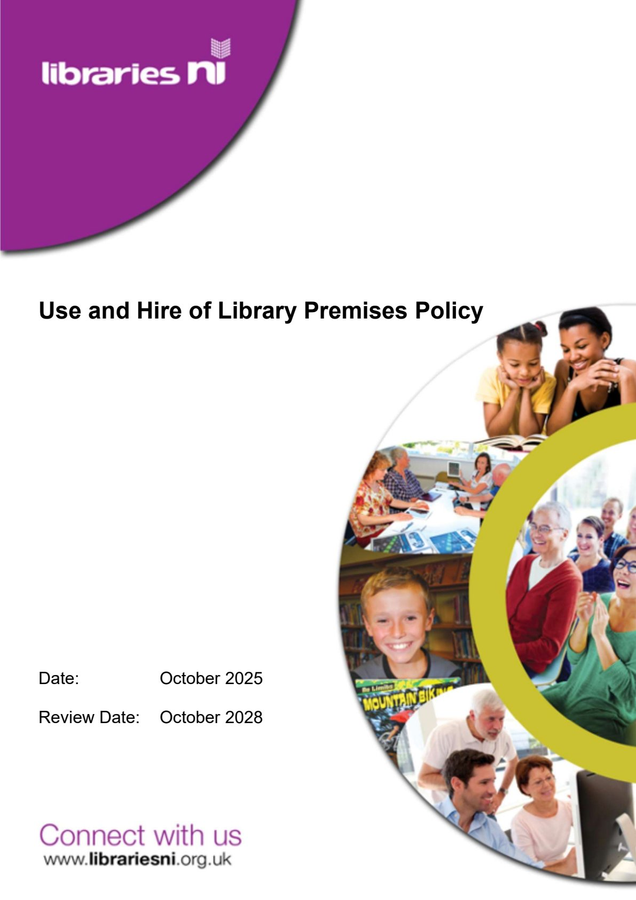

<!-- PAGE: 1 -->

# Use and Hire of Library Premises Policy

**Date:** October 2025  
**Review Date:** October 2028  

<!-- PAGE: 2 -->

## Policy Information

| Field | Detail |
|---|---|
| **Policy Title** | Use and Hire of Library Premises Policy |
| **Policy Number** | POL049 |
| **Version** | Version 5 (October 2025) |
| **Policy Sponsor** | The Director of Library Services |
| **Policy Owner** | Service Development Managers with Library Network Responsibility |
| **Committee Recommended for Approval** | Services Committee, 20 November 2025 |
| **Date Approved by the Board** | 11 December 2025 |
| **Equality Screening Status** | Last Screened: 4 July 2022; Reviewed: 9 December 2025 |
| **Rural Needs Impact Assessment Status** | Last Assessed: 4 July 2022; Reviewed: 5 December 2025 |
| **Date Set For Review** | November 2028 |

### Related Policies
- Customer Feedback Policy
- Data Protection Policy and Legislation
- Filming Policy
- Freedom of Information Policy
- Health and Safety Policy
- Libraries NI Byelaws
- Libraries NI Equality Scheme
- Library Computers Conditions of Use Policy
- Media Handling Policy
- Partnership Policy
- Safe and Welcoming Libraries Policy
- Safeguarding Policy
- Social Media Policy

<!-- PAGE: 3 -->

# Use and Hire of Library Premises Policy

## **1.** Introduction

**1.1** Libraries NI has a network of libraries in cities, towns and villages across Northern Ireland, providing library services in local communities. A number of libraries have dedicated meeting rooms but all have spaces within the library that can be used in a flexible way to facilitate a range of meetings, either for groups of people or for one-to-one meetings.

**1.2** Our vision statement positions Libraries NI as a relevant, accessible and inclusive library service making a difference to the lives of people and communities.

**1.3** We care about our customers, the communities we serve, the colleagues we work with and the services we provide. It is our aim to provide a safe, friendly and welcoming environment, promote a culture of openness and transparency, respect and inclusion where our customers, staff and partners are treated fairly.

## **2.** Purpose

**2.1** The purpose of the Use and Hire of Library Premises Policy is to define the conditions that need to be met to facilitate the use and/or hire of library meeting rooms and/or other areas on library premises.

**2.2** Decisions on the use and hire of library premises will be taken within the broader framework of legislation and policy within which we operate, including health and safety, equality and inclusion.

## **3.** Policy Statement

**3.1** Library buildings should be accessible to all, used in a fashion which is inclusive, within the legal framework and does not adversely affect the service to others.

**3.2** The use/hire of library premises will be subject to a number of considerations including but not limited to:
- Meetings and events which might compromise the perception of the Library Service as a welcoming and inclusive space to all will not be permitted;
- Meetings which might breach Libraries NI’s Health and Safety Policies will not be permitted;
- All bookings will be subject to relevant legislative and library policy constraints;
- Library space will be booked according to agreed procedures for the use/hire of library premises;
- Premises may be booked when available and at a time when an event will not impact adversely on normal service provision; <!-- PAGE: 4 -->
- Use of dedicated areas (including any area designated as a dedicated area) including meetings rooms and IT suites will normally be charged for;
- The premises will be hired at a cost outlined in the Room Hire Charges document.

**3.3** Persons or organisations seeking to hire/make use of library premises must provide all relevant information required by Libraries NI, including details of the person or organisation making the booking and the purpose for which the premises are being booked. Libraries NI reserves the right to refuse or terminate a booking at any time and shall not be liable for cost incurred by the person or organisation.

**3.4** If, for unforeseen circumstances, Libraries NI has to cancel a prepaid library premises booking the charge will be refunded.

**3.5** Further terms and conditions as contained in procedures for the use/hire of library premises and booking form shall apply.

## **4.** Authority

- **Policy Sponsor:** The Director of Library Services is the Policy Sponsor.
- **Policy Owner:** Service Development Managers with Library Network responsibility are the Policy Owners.
- **Policy Contact:** The relevant Area Manager is the Policy Contact.

## **5.** Related Documents

### Policies
- Customer Feedback Policy
- Data Protection Policy and Legislation
- Filming Policy
- Freedom of Information Policy
- Health and Safety Policy
- Libraries NI Byelaws
- Libraries NI Equality Scheme
- Library Computers Conditions of Use Policy
- Media Handling Policy
- Partnership Policy
- Safe and Welcoming Libraries Policy
- Safeguarding Policy
- Social Media Policy

### Procedures
- Room Hire Terms and Conditions
- Room Hire Charges
