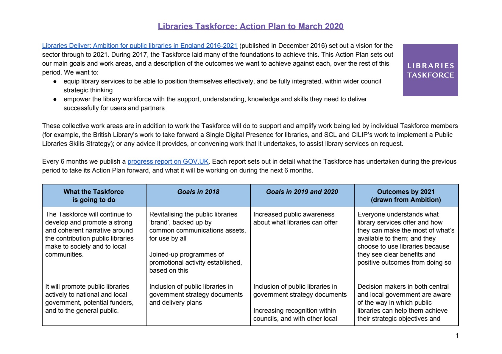

<!-- PAGE: 1 -->

# Libraries Taskforce: Action Plan to March 2020

*Libraries Deliver: Ambition for public libraries in England 2016-2021* (published in December 2016) set out a vision for the sector through to 2021. During 2017, the Taskforce laid many of the foundations to achieve this. This Action Plan sets out our main goals and work areas, and a description of the outcomes we want to achieve against each, over the rest of this period. We want to:

- **Equip library services** to be able to position themselves effectively, and be fully integrated, within wider council strategic thinking.
- **Empower the library workforce** with the support, understanding, knowledge and skills they need to deliver successfully for users and partners.

These collective work areas are in addition to work the Taskforce will do to support and amplify work being led by individual Taskforce members (for example, the British Library’s work to take forward a Single Digital Presence for libraries, and SCL and CILIP’s work to implement a Public Libraries Skills Strategy); or any advice it provides, or convening work that it undertakes, to assist library services on request.

Every 6 months we publish a progress report on GOV.UK. Each report sets out in detail what the Taskforce has undertaken during the previous period to take its Action Plan forward, and what it will be working on during the next 6 months.

---

### Action Plan Matrix: Advocacy and Narrative

| What the Taskforce is going to do | Goals in 2018 | Goals in 2019 and 2020 | Outcomes by 2021 (drawn from Ambition) |
| :--- | :--- | :--- | :--- |
| **Develop and promote a strong, coherent narrative** around the contribution public libraries make to society and local communities. | • Revitalising the public libraries ‘brand’, backed up by common communications assets, for use by all • Joined-up programmes of promotional activity established, based on this | • Increased public awareness about what libraries can offer | • Everyone understands what library services offer and how they can make the most of what’s available to them • People choose to use libraries because they see clear benefits and positive outcomes from doing so |
| **Promote public libraries actively** to national and local government, potential funders, and the general public. | • Inclusion of public libraries in government strategy documents and delivery plans • Increasing recognition within councils of the role that public libraries can play in delivering their strategic objectives | • Inclusion of public libraries in government strategy documents and delivery plans • Increasing recognition with local partners of the role libraries can play in delivering their strategic objectives | • Decision makers in both central and local government are aware of the way in which public libraries can help them achieve their strategic objectives and include libraries within their programmes and plans |

<!-- PAGE: 2 -->

### Action Plan Matrix: Evidence, Data and Strategic Integration

| What the Taskforce is going to do | Goals in 2018 | Goals in 2019 and 2020 | Outcomes by 2021 (drawn from Ambition) |
| :--- | :--- | :--- | :--- |
| **Strategic Integration** into partner strategies and commissioned services. | • Practical integration of libraries within other services’ strategies and work programmes | • Public libraries are partnering with, or being commissioned by, central and local government and other organisations to deliver a wide range of services into communities • Public library services have the skills to effectively market what they do to users and decision makers | • Libraries are recognized and commissioned as core delivery partners across public service reform agendas |
| **Provide easy access to evidence and data** to inform decision-making across library services and partners. | • A consistent, shared approach for library services to gather and publish data is in place • The existing research database is maintained, developed, and used by libraries to improve service quality, efficiency and effectiveness • The future research programme is used to steer and encourage potential funders to resource further priority research work • Library services are aware of these resources and trained to use evidence and data effectively | • All library services are publishing the information they collect in a consistent way • All library services are using data and evidence actively to improve their services and to support advocacy • Library services demonstrate they have the skills required to generate and use evidence and data effectively to improve service delivery and promote their work | • The core dataset is published as open data by all library services • There is an openly and easily accessible source of information on research and statistics relating to public library good practice and impact |

<!-- PAGE: 3 -->

### Action Plan Matrix: Step-by-Step Guidance, Toolkits and Workforce Skills

| What the Taskforce is going to do | Goals in 2018 | Goals in 2019 and 2020 | Outcomes by 2021 (drawn from Ambition) |
| :--- | :--- | :--- | :--- |
| **Ensure clearly signposted guidance and peer support** to take library services through setting strategic objectives to delivering a sustainable service. | • Learning from further analysis is identified and shared across the sector (e.g. on services 'bucking the trend' on performance, funding, efficiencies, and shared delivery models) • The Benchmarking Framework for libraries is promoted and developed, including setting up a support network for those using it • Approaches set out in the Taskforce toolkits are promoted, with practical support provided to councils and library services to embed these into how they work | • Library services are actively using the tools and frameworks created by the Taskforce, with appropriate support • Voluntary sector-led accreditation scheme is established and supporting service improvements (to be assessed by March 2019) • The approaches and advice the Taskforce promotes are kept up to date to reflect changing issues and environments | • Councils and library staff say they have access to the guidance and practical support they need to improve their services, and to position public libraries effectively in local public service provision • Library services are actively adapting their funding and delivery models to meet changing user needs • Library services are working together as a vibrant network, sharing knowledge and resources |
| **Help ensure the sector understands the future vision** and has the leadership, skills and support needed for the future. | • A programme of activities/events to develop sector leadership, skills, and knowledge (training sessions, sector forums, masterclasses, peer reviews, apprenticeships, secondments) is established, linked to the Public Libraries Skills Strategy | • The programme of skills development is regularly refreshed to keep it up to date in response to changing issues and sector needs • Councils and library services are using the Public Library Skills Strategy to inform the learning and development offer provided to councillors, senior officers, the library workforce, and volunteers | • People working in public libraries demonstrate the understanding, confidence, skills and knowledge they need to lead and succeed in a changing environment |

<!-- PAGE: 4 -->

### Action Plan Matrix: Governance, Working Practices and Transparency

| What the Taskforce is going to do | Goals in 2018 | Goals in 2019 and 2020 | Outcomes by 2021 (drawn from Ambition) |
| :--- | :--- | :--- | :--- |
| **Refine and iterate working practices** to adapt to the current environment and plan for sustainable sector support. | • Taskforce and its member organisations decide how they can best work together to support, add value and share good practice across the sector for the future, and plan how changes will be implemented | • Taskforce member organisations increasingly lead on taking Ambition actions forward | • The sector is confident that it has the right configuration of support to thrive for the future |
| **Open and transparent operation.** | • Maintain public accountability through regular reporting and open stakeholder engagement | • Continue publishing 6-monthly progress reports and meeting minutes | • Everyone can see how the Taskforce has gone about achieving the aspirations set out in the *Libraries Deliver: Ambition* document, and what it has accomplished at each stage via meeting minutes, 6-monthly progress reports, and annual reviews |
