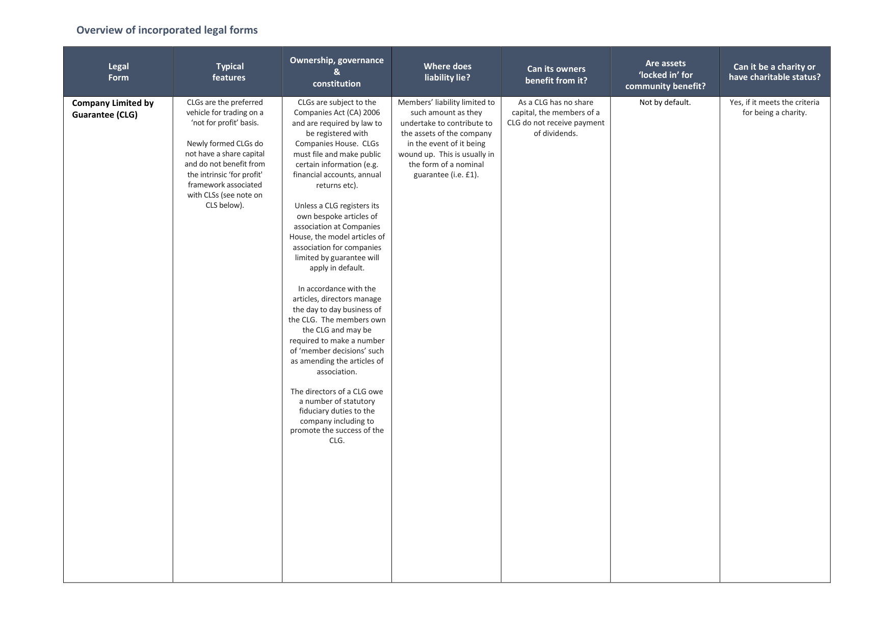
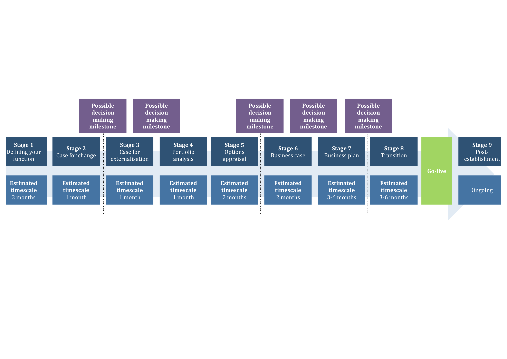
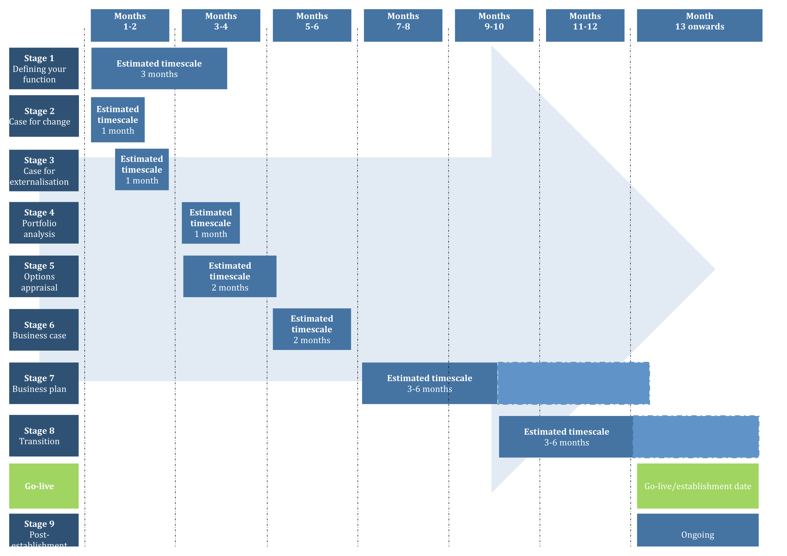

<!-- PAGE: 1 -->

# Libraries: Alternative Delivery Models Toolkit **Libraries Taskforce** (with the Optimo Partnership)
*March 2017*

## 1. Introduction to alternative delivery models toolkit

### 1. Introduction to the toolkit

This toolkit is designed to support library service managers, council commissioners and transformation teams, councillors, Friends Groups and community groups to consider the desirability, viability and feasibility of a range of alternative delivery model (ADM) options for their library services.

It demonstrates and describes a [staged approach](https://www.gov.uk/government/publications/libraries-alternative-delivery-models-toolkit/a-staged-approach-to-investigation-and-establishment) to investigation and establishment. It also describes the characteristics and potential advantages/disadvantages associated with each type of ADM.

We want to enable the user to undertake a robust, objective and evidence-based analysis of the various options should they wish to explore moving to a different delivery model.

This toolkit was developed by the [Optimo partnership](https://www.gov.uk/government/publications/libraries-alternative-delivery-models-toolkit/annex-background-to-optimo-partnership-members), on behalf of the Libraries Taskforce and the Department for Culture, Media and Sport (DCMS). It brings together a range of technical processes and the real life experiences of the 4 library services that have spun out from their respective councils. These demonstrate some of the challenges and barriers that have been overcome, as well as highlighting some of the benefits that have been realised.

### 2. Why develop an alternative delivery model toolkit for libraries?

These are challenging times for councils as they cope with significantly reduced budgets, increasing demands for adult social care and changing expectations from local communities. Libraries are not immune from the challenges facing councils and most councils are having to look for more radical approaches and solutions in this changing landscape for a range of services including libraries.

The way people use libraries and their expectations of public services are changing. Financial and demographic challenges are increasing. Standing still is therefore not an option.

Councils remain responsible for overseeing the delivery of a [‘comprehensive and efficient’ library service](http://www.legislation.gov.uk/ukpga/1964/75/contents) by listening to and reflecting the changing needs of their communities. Informed by these statutory requirements, an increasing number of library services and councils are taking steps to investigate new models of delivery.

Investigating new delivery models provides a range of stakeholders with an opportunity to consider the services currently offered by a library service. In partnership with communities and public bodies, a number of library service delivery models are developing innovative, needs-led and sustainable services across a range of agendas, such as [healthier and happier lives and greater prosperity](https://www.gov.uk/government/uploads/system/uploads/attachment_data/file/573911/Libraries_Deliver_-_Ambition_for_Public_Libraries_in_England_2016_to_2021.pdf). New delivery models can, in the right circumstances, be an effective way of promoting sustainability, resilience and innovation across the library sector and beyond.

Locality’s [Income Generation for Public Libraries](http://locality.org.uk/resources/income-generation-public-libraries-learning-case-studies-national/) report recognises that increased income generation can be delivered via a number of different models.

This toolkit was commissioned because the Libraries Taskforce and DCMS wanted to ensure that library services have access to the best possible information and advice in making decisions on whether or not to move to an ADM. This toolkit is designed to support you to consider whether your current delivery model maximises your library service’s sustainability. It is also designed to support you to consider whether a new delivery model would lead to benefits associated with a more holistic, innovative and inclusive offer.

### 3. How to use the toolkit

Using this toolkit will help you to undertake the process for investigation in a structured, robust and objective way. As the toolkit looks at each stage in detail, we have split the document up into separate chapters, whilst providing links between them where this is likely to be helpful.

It provides links to helpful resources and a range of templates that can be used at each stage of the process. The chief executive officers (CEOs) of the existing library service mutuals provide a range of lessons they learned and critical success factors from their transitions, as well as identifying the things they wish they had known.

The toolkit also examines specific technical issues that are likely to arise. Where possible we have provided potential approaches to addressing these issues.

### 4. The underlying principles of the toolkit

To make sure that the toolkit provides the basis for an objective appraisal of the various ADM options, we’ve designed it in line with the following principles:

The toolkit remains ‘model agnostic’ throughout the investigation process. No one model is promoted as a preferred option. It will give you the necessary tools to identify and establish which option might be right for your particular circumstances locally.

Keeping the library service in-house is considered as an option in its own right. This option assumes that the service may require some level of re-engineering to ensure it remains sustainable and viable.

The toolkit is designed to be scalable. In certain circumstances the library service and/or council may decide not to complete one or more of the stages along the journey to establishment.

### 5. What other support is available?

Further support to library services and councils who are exploring or working towards establishing an ADM will be made available by DCMS in 2017/18. This support is likely to include:

* coaching and mentoring provided by the CEOs of the existing library mutuals
* technical support provided by experts in business planning, legal and accountancy

## 2. Why consider an alternative delivery model?

### 1. Overview

The significant pressures facing councils and library services have led many to start considering whether their current delivery model is the right one. While library services may be able to redesign their in-house service to meet immediate pressures, their positioning within the council may make them less able to sustain future funding reductions or react to changes in customer expectations.

The process of deciding to establish a library service as an alternative delivery model (ADM) can be complex. What is right for one library service may not be right for another. Each library service will face a range of local challenges and expectations in relation to the particular needs of the local communities they serve, in addition to the national pressures being experienced across the sector.

Considering whether a library service’s current delivery model is the right one is an important step that requires careful thought. The process allows the library service and council to identify the barriers to development and sustainability, and consider whether an ADM would better allow the library service to realise its full potential.

Considering the suitability of ADMs does not start an irreversible process – investigating the desirability, viability and feasibility of various models may result in the library service concluding that the current delivery model is the right one. But the process may signal that one or more ADMs warrant further investigation.

### 2. Alternative delivery models across the public sector

Councils have always had the legal power to make use of different forms of service delivery. Following the introduction of compulsory competitive tendering in the Local Government Act 1988, councils were legally required to open many of their services to competitive tender. This requirement was replaced by the ‘Best Value’ regime under the Local Government Act 1999, after which many forms of alternative service provision have continued to flourish.

Under the previous coalition government, the [2011 Open Public Services White Paper](https://www.gov.uk/government/publications/open-public-services-white-paper) promoted greater use of different forms of service delivery. [Changes to local government funding during the 2010-15 Parliament](http://researchbriefings.parliament.uk/ResearchBriefing/Summary/SN05950) also obliged councils to experiment with alternative forms of service delivery, seek to reduce overheads, and explore new means to raise revenue.

A range of ADMs have been established across various sectors including libraries, adult social care, children’s services, health services, adult education, youth services and building control. The requirement for councils to reduce the level of funding allocated to services has often been the driving force behind the development of these new models. However other issues such as encouraging increased engagement with staff and communities, promoting innovation and reducing dependence on council funding have also encouraged library services to investigate and establish new models.

### 3. Why are library services establishing themselves as alternative delivery models?

This section provides an insight as to why 4 library services decided to explore the concept of establishing as an ADM.

#### Explore York Libraries & Archives Mutual Limited (previously York City Council Library & Archive Service)

> We wanted to develop our vision further and it was too restricting being in the council. The council was part of the cooperative council network and so was keen to let services spin out. We wanted to keep the quality of service high and paid staff in all our libraries.

#### Inspire Culture, Learning and Libraries (previously Nottinghamshire County Council Library & Archive Service)

> The council has a firm commitment to keep all libraries open and able to deliver the libraries strategy. The development of Inspire aims to enable the provision of sustainable services, whilst reducing costs. The core business case for the creation of Inspire was to initially make financial savings to ensure the range of services provided remained open and provided to the same level as in previous years. Through mandatory non domestic rate relief this was achieved, as exempt charitable status was given by HMRC in April 2016.

#### Libraries Unlimited (previously Devon County Council Library Service)

> A major public consultation in the summer of 2014 on how the council could save £1.5 million from the library service (in addition to previous budget reductions), highlighted that the public wanted to retain all 50 libraries with paid members of staff. Across Devon’s communities, there was a sense of ambition for libraries to have even greater impact in the future and a willingness of local people to help the library service to sustain and grow. That appetite for change, and a rejection of an alternative ‘community-led’ option, led the council to undertake an options appraisal in the autumn of 2014. The options appraisal concluded that establishing an ADM provided the best opportunity to save money and to deliver the outcomes the council and local communities wanted to see.

#### Suffolk Libraries IPS Ltd (previously Suffolk County Council Library Service)

> There was a council library review in 2011, an options appraisal and a political review to consider divestment.  The council at the time had already decided to become a commissioning body rather than a service provider. The decision to divest was taken in November 2011.

### 4. Will establishing as an alternative delivery model be right for every library service?

The decision to establish a library service as an ADM requires careful consideration. What works for one library service may not work for others. The process described in stages 1 to 7 provides a detailed description of the investigation process that will help each library service and council to identify the preferred option for their library service.

While the majority of delivery model options involve some form of externalisation, you should consider remaining in-house with re-engineering as a delivery model option in its own right during the [options appraisal stage](https://www.gov.uk/government/publications/libraries-alternative-delivery-models-toolkit/stage-5-options-appraisal).

The investigation process is designed to help a library service identify the delivery model that best meets the needs of the service, staff, communities and other stakeholders. Should the full investigation process be followed, the service will be well placed to implement its function and address the challenges it faces.

But establishing a new delivery model is not a panacea. The right delivery model will need to be accompanied by changes to things like the library service’s organisational culture and decision making processes; how it engages with stakeholders; how it procures services and manages the service’s operating model; and how it delivers its various functions. Without a commitment to ‘delivering differently’, the library service runs the risk of doing more of the same within its new delivery model.

## 3. Alternative delivery models explained

### 1. Overview

Most councils no longer rely solely on in-house operations to deliver either public services or their own internal functions (such as HR, finance, payroll and IT). Many have used their legal powers to establish a mixed portfolio of provision, involving delivery models that operate across areas including adult social care, children’s services, youth services, building control, and adult education.

Services that are not delivered ‘in-house’ involve some form of alternative delivery model (ADM):

* Local Authority Trading Company (commonly referred to as a LATC)
* Public Service Mutual (commonly referred to as a PSM or mutual)
* outsourcing (to an existing social enterprise or charity; or to a for-profit provider)
* joint venture (JV - potentially involving ownership and control by a range of stakeholders including (but not limited to) staff, the council, or independent provider(s))

Any full or partly externalised service will fall within one of the delivery model categories listed above. These are not necessarily exclusive - PSMs can be LATCs and JVs under some circumstances.

A further delivery model option exists; the library service ‘remaining in house with re-engineering’. This option reflects the need for some level of change to take place, without externalising the service. It is therefore a delivery model option in its own right.

### 2. Alternative delivery models - in detail

Each of the 5 ADM options offers library services and councils something different in terms of ownership, governance/control and the flexibility to innovate. The table below summarises the high level characteristics of each option.

| Delivery model | Ownership | Governance | Services |
| :--- | :--- | :--- | :--- |
| Remaining in-house with re-engineering | 100% parent council | Within council management structures and hierarchy | Can only deliver local public sector services |
| Local Authority Trading Company (LATC) - sometimes referred to as a Wholly Owned Company | 100% parent council(s) | Can be designed for flexibility/autonomy. Requires a council appointed board. Service Level Agreement (SLA)/contract with parent council(s) - control test | Flexible - but majority of services delivered on behalf of parent council(s) - function test |
| Public Service Mutual (PSM) | Variety of options: council and staff, staff and community, 100% staff | Can be designed as required. Board membership dependent upon ownership. SLA/contract with council(s). Well positioned to promote co-production | Flexible - can deliver services to councils, private or VCS customers |
| Outsource to existing social enterprise, third sector or private provider | 100% third party provider | Arranged via contract. Well positioned to promote co-production | Contracted services delivered on behalf of council(s) |
| Joint venture | Potential for joint ownership, including staff, council(s) and/or third party provider | can be designed as required. SLA/contracts as required. Well positioned to promote co-production | Flexible - can be delivered to council(s) and private/Voluntary and Community Sector customers |

Further details on each ADM option are provided below.

### 2.1 Remaining in-house with re-engineering

#### Option 1 - Remaining within the host council

The library service remains as a council operated service. Service re-design would be undertaken to improve systems, realise efficiencies, transform existing services or develop new services to meet the evolving needs of local communities. This could potentially be in conjunction with the development of a [community led library service](https://www.gov.uk/government/publications/community-libraries-good-practice-toolkit/community-libraries-good-practice-toolkit).

Case studies:

* [Warwickshire Library Service - Globe House, Alcester](https://www.gov.uk/government/case-studies/warwickshire-library-service-globe-house-alcester)
* [Hampshire library service transformation strategy](https://www.gov.uk/government/case-studies/hampshire-county-council-strategic-library-plan)

Potential advantages are that:

* the ‘do minimum’ option is likely to require lower levels of resource (when compared to the establishment of other delivery model options) and will not require a procurement process
* depending on the scale of the re-engineering, the required level of change may be achieved relatively quickly and at (potentially) lower cost
* one-off savings and efficiencies could be realised in the short term

Potential disadvantages are that:

* re-engineering may result in efficiencies and savings being realised, however, these changes may in certain circumstances result in the library service budget being reduced to an unsustainable level, to the extent that the service finds it difficult to meet the needs of the population either now or in the future
* the library service is likely to remain primarily dependent on council funding, increasing the negative impact of any future reductions in council funding
* the decision to remain in-house may result in the library service not being able to benefit from increased freedom to trade that would help to improve the service’s sustainability and flexibility to innovate, potentially threatening the long term sustainability of the service

#### Option 2 – Partnership across 2 or more councils

Two or more councils may be in a position to work together to deliver public library services. This would involve partnership working between the councils, including the sharing of staff and other resources. It could also potentially involve the joint procurement of back office services and support systems, in addition to the sharing of best practice.

The option would not necessarily involve the establishment of a new delivery model, but would instead be based on a partnership agreement between councils. One of the partner councils could act as the host for the ‘shared service’ with staff and service delivery responsibility transferred.

Case studies:

* [Libraries West](https://www.gov.uk/government/case-studies/librarieswest)
* [London Libraries Consortium](https://www.gov.uk/government/case-studies/london-libraries-consortium-partnership-working)

Potential advantages are:

* the ability to tap into expertise and intellectual property held across a number of councils
* reduced duplication and the development of efficient shared services across a number of councils
* possible savings opportunities, depending on the degree of sharing across councils
* the ability to realise increased purchasing power across a number of councils
* that in-house services are not required to pay VAT or corporation tax

Potential disadvantages are:

* the inability of councils to agree on the scope and scale of the partnership
* differences in operating systems and organisation cultures across the councils involved in the partnership
* the need to agree the terms of the partnership, particularly in relation to the level of investment and the sharing of risks and rewards

### 2.2 Local Authority Trading Company (LATC)

LATCs are bodies that are free to operate as commercial companies but remain wholly owned and controlled by the parent council(s). As trading bodies, LATCs are in a position to provide their services to a wider market than a council department.

#### Procurement process and commercial freedoms

LATCs are contracted by the parent council (or councils) to provide services back to the council(s) via a service contract. The council may decide to apply the [Teckal](http://www.cipfa.org/policy-and-guidance/articles/teckal-the-basics-explained) or in-house exemption which allows the authority to establish a LATC without the requirement for a procurement exercise. It is based on case law but has recently been codified in the [Public Contracts Regulations 2015](http://www.legislation.gov.uk/uksi/2015/102/contents/made). In general, the terms of exemption require:

* the council to control the vehicle as if it were an internal department, with there being no direct private share or ownership participation in the company (this is known as the control test)
* more than 80% of the vehicle’s activities to be with its ‘parent’ council (this is known as the function test)

If the council decides to undertake an open procurement, the Teckal requirements would not need to be in place.

#### Staff transfer

Employees of the library service would transfer to the LATC with their employment conditions protected by Transfer of Undertakings (Protection of Employment) regulations [(TUPE)](https://www.gov.uk/transfers-takeovers/overview).

#### Pensions

Although not dealt with under the TUPE Regulations, there is a statutory requirement in the UK (issued under the Local Government Act 2003) which provides both that transferring employees’ accrued pension benefits are protected and that they are given access to a scheme that is, at a minimum, ‘broadly comparable’ to the pension rights they had as council staff. The LATC may be in a position to apply for Admitted Body Status, enabling members of the Local Government Pensions Scheme to continue with their pension arrangements. Should the LATC not be in a position to secure [Admitted Body Status](http://www.lgpsregs.org/timelineregs/Statutory%20Guidance%20and%20circulars/CLG_AdmittedBody_guidance_Dec09.pdf), a broadly comparable schedule will need to be offered.

The LATC can also apply for [Function Provider](http://www.local.gov.uk/documents/10180/11935/workforce+-+education+and+young+people+-+teachers+pensions+-+TPS+function+provider+status+guidelines+20160419_FP+guidance+(004)/73a37cab-b6ac-4e3d-8aa0-6ce9a5eeecd9) status, enabling members of the Teachers’ Pension Scheme to continue with their pension arrangements.

The new LATC would usually be expected to meet the cost of staff remaining within these pensions schemes.

#### Use of surpluses

The LATC’s surpluses may be returned to the council (in the form of dividends or service charges) or re-invested into the delivering of services. The exact use of surpluses would be determined by the LATC’s constitution and the nature of the agreement between the LATC and the council. Like any company, LATCs are required to pay corporation tax on profits.

#### Potential advantages

Potential advantages are:

* if the Teckal exemption is used, no procurement exercise is required
* a clear commissioner/provider split exists, meaning that the council can incentivise the LATC to realise efficiencies and develop service offerings
* two or more councils can work together to establish a library service LATC, potentially offering further opportunities to realise efficiencies
* the council retains a high degree of control over the organisation, which may be a more politically palatable option than, for example, the PSM or outsourcing delivery models
* an LATC can transition into alternative forms of delivery (for example a PSM) in the future
* that despite certain restrictions on the type and level of commercial activities, LATCs possess greater freedom than in-house library services to develop and trade services, including the development and delivery of new non-statutory services which can generate a surplus for the organisation
* that depending on how the LATC has been set up, the council may be in a position to ‘claw back’ surpluses from the service
* an LATC may be able to achieve social enterprise status

#### Potential disadvantages

Potential disadvantages are that:

* the process of establishing an LATC can be complicated, resource intensive and time consuming
* the process would be undertaken ‘on top of the day job’ by library service staff, while it requires close working with a number of council departments (such as legal, finance, HR, property/premises etc.) and support from external experts
* as a Teckal LATC needs to be owned and controlled by one or more councils, there is limited potential for other stakeholders (such as staff, community groups, or Friends Groups) to influence the strategic direction of the company
* due to its close association with the council, a Teckal LATC is unlikely to achieve charitable status
* the ability of a Teckal LATC to access external funding is limited because it is owned by a public body
* as it is owned and controlled by the council, there is the risk that the creation of a LATC results in ‘more of the same’ being delivered
* should a Teckal LATC wish to develop new (non-statutory) service lines, the income from these services is limited to 20% of the LATC’s total turnover
* the LATC may be required to transfer surpluses back to the council, limiting the LATC’s ability to develop new services
* should the LATC be able to retain a proportion of the surpluses it has generated, these would be subject to corporation tax
* like any company, LATCs are required to pay VAT

### 2.3 Public Service Mutual (PSM)

The Department for Culture Media and Sport (DCMS) [defines a PSM](https://librariestaskforce.blog.gov.uk/2016/12/05/different-delivery-models-mutuals/) as an organisation:

* that has left the public sector (also known as ‘spinning out’)
* which continues to deliver public services
* which has a significant degree of employee control, influence or ownership

#### Case studies

* [Explore York](https://www.gov.uk/government/case-studies/explore-york-libraries-and-archives)
* [Inspire Culture, Learning and Libraries](https://www.gov.uk/government/case-studies/inspire-culture-learning-and-libraries)
* [Libraries Unlimited](https://www.gov.uk/government/case-studies/libraries-unlimited)
* [Suffolk Libraries IPS](https://www.suffolklibraries.co.uk/)

#### Ownership, control and influence

Typically a PSM will involve an element of employee-ownership (or at the very least a significant level of employee control or influence through, for example, membership of management boards). There is [evidence that this empowerment of staff can result in increased staff engagement and productivity](https://whitehall-admin.publishing.service.gov.uk/government/uploads/system/uploads/attachment_data/file/603295/Research_into_the_Public_Service_Mutuals.pdf).

The model also allows for the involvement of a range of other stakeholders, possibly including community groups and the council.

Depending on the intended ownership and governance arrangements, stakeholders (staff, community groups, Friends Groups and the council) may own part of the PSM and sit on the board of directors. Several advisory groups could be established to ensure that stakeholders are effectively represented and are able to influence the PSM’s strategic direction.

### 2.4 Commercial freedoms

PSMs have significant commercial freedoms and flexibility to ‘deliver differently’. As staff will play an important role within the new entity, they (along with community stakeholders if included within the PSM’s governance structure) are well placed to influence the PSM’s strategic direction and the type of services delivered. Staff and communities can play an important role in shaping services to reflect local needs, piloting innovative services through the re-investment of surpluses generated by the PSM.

#### Procurement process

PSMs are typically established by a staff group ‘spinning out’ of the council. This requires the support of councillors and council commissioners, as well as broad support from library staff.

Councils can make use of a number of procurement routes: from the council directly awarding the contract to the PSM, through to undertaking a public procurement exercise. An analysis of the potential procurement routes and the role of the council as an ‘expert commissioner’ is provided in [section 5 of the business case](https://www.gov.uk/government/publications/libraries-alternative-delivery-models-toolkit/stage-6-business-case#commercial-case). There is also a [case study](https://www.gov.uk/government/case-studies/suffolk-county-council-expert-commissioning) with further details on the role of the council as an expert commissioner.

Typically the PSM will hold a contract with the council, often referred to as the ‘core contract’. Despite the core contract, the PSM will need to think commercially, which may mean looking for ways to reduce dependence on the core contract (e.g. diversify income streams through the expansion of current services or the development of new services).

#### Use of public assets

The PSM’s constitution may include an [asset lock](https://www.gov.uk/government/publications/libraries-alternative-delivery-models-toolkit/stage-6-business-case#asset-lock) to ensure that assets transferred to the PSM by the council are solely used for community benefit.

#### Staff transfer

Same as for the LATC.

#### Pensions

Same as for the LATC.

#### Use of surpluses

As an independent entity, the PSM is typically in a position to decide how it uses any surpluses that it generates, although it is possible to include some council ‘claw back’ of surpluses as part of the core contract. Options for surpluses retained by the PSM include reinvestment in new services, investment in new assets or channelling funds into a reserve account. The use of surpluses may be limited by the PSM’s status, should it operate as a social enterprise or charity.

Like any company, PSMs are required to pay corporation tax and VAT.

#### Potential advantages

Potential advantages associated with PSMs include:

* becoming an independent PSM can provide the library service with the opportunity to break from the past and establish an organisation with a single focus on libraries
* the [business plan](https://www.gov.uk/government/publications/libraries-alternative-delivery-models-toolkit/stage-7-business-plan) would demonstrate how the strengths of the organisation can be maximised while, at the same time, developing plans to address areas of weakness
* operating as a PSM may increase the level of freedom and autonomy experienced by staff and managers, enabling them to be more creative within their roles
* a new [organisational culture](https://www.gov.uk/government/publications/libraries-alternative-delivery-models-toolkit/stage-1-defining-your-function#organisational-culture) can be established, leading to staff playing an increasing role in making decisions at an operational level which in turn can increase levels of staff engagement and motivation
* depending on the ownership and governance model assumed by the PSM, staff, community groups and Friends Groups (as well as other relevant stakeholders) will be in a strong position to influence the strategic direction of the organisation, thus giving the community a voice
* involving stakeholders (staff, community groups and Friends Groups in the decision making process, will provide them with power to address issues and bring about a positive change
* decision making processes may involve fewer layers of bureaucracy, resulting in more timely decisions being made which benefit staff, communities and increase the sustainability of the PSM
* as PSMs experience a high degree of commercial freedom, they are able to explore new areas of service growth and may be incentivised to generate income from new sources to offset reductions in the level of funding received from the council
* by empowering employees and communities to design and improve their services, PSMs are well placed to encourage innovation, for example they could pilot new services (designed by staff and communities) on a small scale
* if pilots are successful, and show significant social impact and value, they can be scaled up and potentially procured by public bodies
* as an independent entity, the PSM will be in a position to reinvest profits back into the organisation, fuelling innovation and a needs-led approach to service delivery
* they appear to demonstrate greater levels of efficiency, particularly in terms of lower levels of absenteeism and staff turnover
* being in a position to procure services in a more cost effective way (for example back-office support services)
* depending on the chosen legal form and constitution, a library service PSM may qualify as a [social enterprise or charity](https://www.gov.uk/government/publications/libraries-alternative-delivery-models-toolkit/alternative-delivery-models-explained#social-enterprises-charities), meaning that it may be eligible for grant funding opportunities not available to in-house council services

#### Potential disadvantages

The process of establishing a PSM can be complicated, resource intensive and time consuming. The process is often undertaken ‘on top of the day job’ by library service staff. It requires close working with a number of council departments (such as legal, finance, HR and property/premises) and support from external experts. Please refer to [case study: the journey from investigation to establishment](https://www.gov.uk/government/case-studies/libraries-unlimited-the-journey-from-investigation-to-establishment) for further details, including details of the resources required to support the process.

There may be significant costs to change, the nature of which need to be understood by all parties. It should also be accepted that changes to the way services are delivered may take time. The immediate challenges for PSMs once established usually involve ensuring business continuity and stabilising the service after significant reductions in funding and the move to a new organisational entity.

While PSMs may realise significant efficiencies, the decision to establish a PSM should not be primarily motivated by making efficiencies. Councils investigating the PSM model from a cost cutting perspective risk ‘setting the organisation up to fail’. Equal (if not more) attention needs to be paid to ensuring the sustainability of the service through delivering differently, modernising the library offer and diversifying income streams across the service.

Initially at least, most PSMs are reliant on their core contract held with the council. Over-reliance on this is a significant business risk. The challenge for PSMs is to diversify their income streams and reduce their dependence on the core contract.

Ensuring the involvement of staff, community groups and friends groups in the process can be a challenge. While it may be widely accepted that ‘doing nothing is not an option’, there is often resistance to change. The challenge of engaging with a wide range of stakeholders is significant, although it also presents the opportunity of meaningfully involving them in designing the service’s future function and strategic direction.

The staff group transferring to the PSM often does not possess all of the skills and capabilities needed to operate a commercially disciplined business. While training and development can help, PSMs may need to employ new staff at a management level or recruit non-executive directors to the board to make sure the organisation has the necessary skills, experience and expertise to be sustainable.

Like any independent company, PSMs are required to pay VAT and corporation tax.

### 2.5 Outsource

The process of outsourcing a council’s library service involves the procurement of a third party to deliver the library service on behalf of the council via a contract. The outsourcing of library services may take several forms, including:

* procuring an existing social enterprise or charity to deliver the service on behalf of the council
* procuring [local community groups to deliver library services on behalf of the council](https://www.gov.uk/government/publications/community-libraries-good-practice-toolkit/community-libraries-good-practice-toolkit) (with funding, professional library services and back-office support and systems).
* procuring another council to deliver the service
* procuring a for-profit provide to deliver the service on behalf of the council

#### Case studies

* [Hounslow library service](http://www.ccslibraries.com/libraries/hounslow-libraries)
* [Lincolnshire library service](https://www.lincolnshire.gov.uk/news/recommendation-given-to-outsource-library-services-to-gll/127998.article)

#### Ownership, control and influence

An outsourcing arrangement would conventionally involve a contract between the council and the appointed provider. Typically the council would have no involvement in the day-to-day running of the organisation (or its ownership or governance structures), but would instead by able to influence the way the service is run via the following means:

* the terms of the contract agreed between the council and the third party
* ongoing contract monitoring, which may include a regular monitoring and review process, service planning meetings etc
* potentially including an asset lock within the terms of the contract or lease, requiring the provider to use council assets for the purposes of the contract

#### Commercial freedoms

The council would specify within the contract the level of funding to be allocated to the service (for example the contract value).

Depending on the type of organisation that is procured and the nature of the contract, the procured provider may or may not be in a position to generate additional income through the delivery of (non-statutory) services included within the contract and service specification.

#### Staff transfer

Same as for the LATC.

#### Pensions

Same as for the LATC.

#### Use of surpluses

The procured provider is likely to seek efficiencies across the library service’s operating model, while also (potentially) identifying areas where income generation could be increased. This could lead to the provider realising a profit on the contract.

The council should therefore consider the treatment of profit prior to undertaking the procurement process. It may decide to state that any profits realised can be retained by the provider, or that a certain amount should be spent on the library service. Each option will create different incentives for the provider which are likely to have direct implications for the library service.

#### Potential advantages and disadvantages

Due to the large number of outsourcing options available to a council, it is difficult to be specific in terms of the potential advantages and disadvantages that could be realised.

The theoretical basis of outsourcing derives from the notion of competition as the driver of efficiency, quality improvement and innovation. However, some counter-arguments have been put forward which highlight [theories of market failure in public services](http://researchbriefings.parliament.uk/ResearchBriefing/Summary/SN05950).

Potential benefits associated with outsourcing include:

* the ability to tap into expertise (for example digital) to deliver an improved service
* increased purchasing power, shared systems and intellectual property
* savings and efficiencies can be realised as a result of the library service being part of a wider organisation
* savings can be underwritten in the contract

Potential disadvantages associated with outsourcing include:

* greater levels of opposition to the move from staff, councillors, friends groups, library users and communities
* the risk of the council realising ‘stranded costs’ if the outsourced provider accesses their back office support from an alternative provider other than the council. (This concept assumes that the council currently delivers back office services (e.g. HR, payroll, finance, ICT, legal etc.) to the library service. Should the library service procure back-office services from the market, the council may realise a stranded cost if those employees previously delivering back office services to the library service: (i) remain employees by the council; and (ii) are not required to deliver back office support to other services).
* risks associated with the provider not fulfilling the requirements of the contract (such as poor performance against contractual requirements)
* the risk that the procured provider may not reinvest operating profits back into the library service

### 2.6 Joint venture

The term joint venture can describe a range of different commercial arrangements between two or more separate entities. Each party contributes resources to the venture and a new business is created in which the parties collaborate together and share the risks and benefits associated with the venture.

A party may provide land, capital, intellectual property, experienced staff, equipment or any other form of asset. Each party generally has an expertise or need which is central to the development and success of the new business which they decide to create together. It is also vital that the parties have a ‘shared vision’ about the objectives for the joint venture.

In the case of libraries, a joint venture may involve the council and one or more third party establishing a new entity.

#### Ownership, control and influence

Ownership of the joint venture would conventionally be split across each of the parties involved. Typically this would be determined by the appetite of the council to share ownership, and the level of investment and risk taken on by each party.

#### Commercial freedoms

There are no specific limitations within the joint venture model, although the founding parties may wish to limit the remit of the venture in terms of the nature, scope and scale of services that can be provided. Depending on the legal form assumed, there may be limitations in terms of which services can be delivered and how.

#### Procurement process

Similar to the outsourcing option, the council would procure joint venture partners via a procurement process.

#### Staff transfer

Same as for the LATC.

#### Pensions

Same as for the LATC.

#### Use of surpluses

The treatment of surpluses will be determined by the type of joint venture created and the entity’s constitution.

#### Potential advantages and disadvantages

Due to the large number of joint venture options available, it is difficult to be specific with regards to the potential advantages and disadvantages that may be realised. The [HM Treasury guidance note](https://www.gov.uk/government/uploads/system/uploads/attachment_data/file/225321/06_joint_venture_guidance.pdf) page 18, provides an overview of the advantages and disadvantages associated with each legal form for a joint venture.

### 3. Summary of the main legal forms

It’s important to note that the ADM options listed in [the overview](https://www.gov.uk/government/publications/libraries-alternative-delivery-models-toolkit/alternative-delivery-models-explained#adm-explained-overview) do not relate specifically to legal form, but instead describe the type of delivery model and indicate the nature of the relationship between the delivery model and the council.

The term ‘legal form’ refers to the way a particular delivery model is structured, in terms of what type of company it is. Examples of legal form include a Company Limited by Guarantee or Shares, a Community Interest Company or a Community Benefit Society (previously referred to as an Industrial and Provident Society).

Assuming that (via the options appraisal) you have identified a PSM or joint venture as your preferred delivery model, you will be required to identify a legal form for the new entity.

This section provides you with an overview of the main legal forms to consider. As outlined elsewhere within the toolkit, it is essential that you first consider the function of your service. Once this has been determined, a decision needs to be taken in terms of the appropriate delivery model for the service. Once these have been confirmed, the identification of the preferred legal form for the service should be relatively simple to identify.

Please ensure that you receive qualified legal advice before confirming your legal form and registering your company.

### 3.1 Incorporated or unincorporated

Before considering which legal form is most appropriate for your delivery model, you must first consider whether you intend to establish as an unincorporated association or incorporated company.

#### Unincorporated association

An organisation set up through an agreement between a group of people who come together for a reason other than to make a profit (for example, a voluntary group or a sports club).

Individual members are personally responsible for any debts and contractual obligations.

Further information on unincorporated associations is available [here](https://www.gov.uk/unincorporated-associations).

#### Incorporated company

Incorporation is the process by which a new or existing business registers as a limited company. A company is a legal entity with a separate identity from those who own or run it. The vast majority of companies are limited liability companies where the liability of the members is limited by shares or by guarantee.

Further information on incorporated companies is available [here](https://www.gov.uk/government/publications/incorporation-and-names/incorporation-and-names).

[This table](https://www.gov.uk/government/uploads/system/uploads/attachment_data/file/602160/Overview_of_the_various_legal_forms_and_some_of_their_important_characteristics.pdf) provides an overview of the main types of incorporated legal form and some of their important characteristics. When you come to identify your legal form, it is really important that you understand and consider the characteristics of each legal form and how they will or will not support your delivery model to successfully deliver its function. We recommend that you seek legal advice before deciding on your legal form and registering your company.

### 4. Social enterprises and charities

The terms ‘social enterprise’ and ‘charity’ refer to the status of the delivery model. This is because whether an organisation qualifies for social enterprise and/or charitable status depends on its [function](https://www.gov.uk/government/publications/libraries-alternative-delivery-models-toolkit/stage-1-defining-your-function) and legal form. This is why status is usually considered at a later stage.

### 4.1 Social enterprises

Social enterprises are defined as ‘businesses with primarily social objectives whose surpluses are principally reinvested for that purpose in the business or in the community, rather than being driven by the need to maximise profit for shareholders and owners’.

Further details on the characteristics of social enterprises can be found [here](http://www.socialenterprise.org.uk/uploads/files/2012/04/what_makes_a_social_enterprise_a_social_enterprise_april_2012.pdf).

### 4.2 Charities

A charity is defined by the Charities Act as an institution which:

* is established for [charitable purposes only](https://www.gov.uk/government/publications/charitable-purposes/charitable-purposes)
* is subject to the control of the [High Court’s charity law jurisdiction](https://www.gov.uk/government/publications/what-makes-a-charity-cc4/what-makes-a-charity-cc4#part-5)

Details on the types of charity structure can be found [here](https://www.gov.uk/guidance/charity-types-how-to-choose-a-structure).

## 4. A staged approach to investigation and establishment

### 1. Overview

While the benefits associated with establishing the right delivery model are considerable, the processes of investigating and establishing an alternative delivery model (ADM) are complex and resource intensive. No two projects are ever the same. The required resources and timescales will differ according to local conditions and the availability of information to progress with the project.

The main stages along the journey to investigation and establishment are as follows:

* [stage 1: defining your function](https://www.gov.uk/government/publications/libraries-alternative-delivery-models-toolkit/stage-1-defining-your-function)
* [stage 2: the case for change](https://www.gov.uk/government/publications/libraries-alternative-delivery-models-toolkit/stage-2-the-case-for-change)
* [stage 3: the case for externalisation](https://www.gov.uk/government/publications/libraries-alternative-delivery-models-toolkit/stage-3-the-case-for-externalisation)
* [stage 4: portfolio analysis](https://www.gov.uk/government/publications/libraries-alternative-delivery-models-toolkit/stage-4-portfolio-analysis)
* [stage 5: options appraisal](https://www.gov.uk/government/publications/libraries-alternative-delivery-models-toolkit/stage-5-options-appraisal)
* [stage 6: business case](https://www.gov.uk/government/publications/libraries-alternative-delivery-models-toolkit/stage-6-business-case)
* [stage 7: business plan](https://www.gov.uk/government/publications/libraries-alternative-delivery-models-toolkit/stage-7-business-plan)
* [stage 8: transition](https://www.gov.uk/government/publications/libraries-alternative-delivery-models-toolkit/stage-8-transition)
* [stage 9: go-live and ensuring sustainability](https://www.gov.uk/government/publications/libraries-alternative-delivery-models-toolkit/stage-9-go-live-and-ensuring-sustainability)

If the options appraisal process identifies outsourcing as the preferred option, councils will need to follow an alternative process from stage 5 onwards. A procurement exercise will then be required to identify the preferred provider, removing the need for a business plan. It is recommended that the stages 1-9 are undertaken for all other delivery model options (including to remain in-house with re-engineering).

### 2. The journey from investigation to establishment

A diagram has been provided to show the [conventional 9-stage journey from investigation to establishment](https://www.gov.uk/government/uploads/system/uploads/attachment_data/file/603553/Diagram_showing_conventional_9_stages_from_investigation_to_establishment.pdf), including potential decision making milestones. Indicative timescales are also provided. The timescales associated with each stage will be determined by the progress made in agreeing the issues identified at each stage and the existence of the preferable conditions listed in [section 4](https://www.gov.uk/government/publications/libraries-alternative-delivery-models-toolkit/a-staged-approach-to-investigation-and-establishment#helpful-preconditions) of a staged approach to investigation and establishment.

Several of the stages can be undertaken concurrently if resources allow. If the library strategy has already been developed, [these timescales](https://www.gov.uk/government/uploads/system/uploads/attachment_data/file/602219/Diagram_showing_timescales_from_investigation_to_establishment_if_library_strategy_has_already_been_developed.pdf) could be considered realistic.

### 3. Resource requirements

The investigation and establishment stages are resource intensive. Work undertaken by library service employees is often on top of the day job. Significant support and leadership is also required from the council.

In line with most change programmes, a project board is often established at an early stage with clear terms of reference. The project board is normally chaired by the project sponsor, often the portfolio holder or council commissioner. The library service and council need to identify the necessary resources to progress the project and both sides will require project management capacity.

The council should identify resources from their legal, finance, HR, property/premises and pensions teams to support each stage of the process.

The library service should identify project management resources, and also ensure that the project is discussed at senior management and staff team meetings.

Both parties should also consider whether external support is required at particular points along the journey. Depending on the availability and capabilities of the resources that have been identified, [external support may be required](https://www.gov.uk/government/publications/libraries-alternative-delivery-models-toolkit/introduction-to-alternative-delivery-models-toolkit#other-support-available) to provide specialist expertise in relation to options appraisals, business planning, financial modelling, legal, any technical issues, and VAT advice.

Please refer to [case study: the journey from investigation to establishment](https://www.gov.uk/government/case-studies/libraries-unlimited-the-journey-from-investigation-to-establishment) for further details, including details of the resources required to support the process.

### 4. Helpful pre-conditions

Based on the experiences of library services that have undertaken the investigation and establishment process, a [downloadable self-assessment tool](https://www.gov.uk/government/uploads/system/uploads/attachment_data/file/602053/Template_1_-_Helpful_pre-conditions_self_assessment.docx) has been developed. This is designed to support you to identify the helpful (but not essential) pre-conditions that will increase the readiness of the library service and council to start the investigation process.

These pre-conditions focus on 3 main areas:

* developing a case for change
* defining the scope of the investigation
* assessing the availability of resources to support the investigation process

You should try to address as many of the identified barriers as you can before you start the investigation process.

### 5. Lessons learned and critical success factors

## 5. Important considerations before starting the investigation process

### 1. Overview

Before starting the investigation process, open discussions are required between the library service, councillors, council commissioners and community stakeholders. It is recommended that these discussions focus on the issues listed below, plus any other issues that are specific to the local context. Without agreement on these issues, the investigation process may be delayed or undermined.

### 2. Assessing the appetite for change

You need to assess at an early stage whether stakeholder groups are willing to support the proposal to investigate a range of alternative delivery models (ADMs), through open and honest discussions with councillors, council commissioners, library service management and staff, Friends Groups, community groups and library users.

You will need to stress that starting the investigation process does not necessarily mean that a new delivery model for library services will be established. Should a strong [case for change](https://www.gov.uk/government/publications/libraries-alternative-delivery-models-toolkit/stage-2-the-case-for-change) emerge, the case for doing nothing will weaken.

As part of this you may need to undertake a stakeholder engagement exercise. This exercise could articulate the case for change and the risks associated with ‘doing nothing’, particularly in relation to the library service’s ability to successfully and sustainably implement the current library strategy.

### 3. Understanding that change costs

During discussions with the council, it is important that everyone realises that, as with any type of transformational change, the investigation and (possible) establishment of an ADM will require investment.

The library service needs to allocate dedicated resources to lead the process. Each stage along the investigation and establishment journey requires significant support from the council’s transformation team and relevant support services (such as finance, HR, legal and premises).

If you decide to establish a new delivery model, a transition fund will probably be required to cover the costs of external support (for example business planning, financial modelling, legal, financial and marketing) and the new model’s set up costs. These costs could potentially be recouped by the council through future savings realised once the service has been established.

### 4. Understanding the democratic decision making process

Important decisions, such as authorising an options appraisal and the establishment of the preferred option (following the business planning stage), will probably require cabinet approval, while other decision making groups may also need to be consulted. The decision making process can take time, with decisions potentially required at each stage of the investigation/establishment process.

It is important to understand the processes and timings involved in establishing a mandate for change, including who will need to authorise the investigation stage of the process.

### 5. Expanding the scope of the investigation to include other services

Potential may exist for other services (for example those with some alignment to library services such as archive services, adult education and/or museums) to be included in the scope of the library service ADM. This may be particularly relevant where the council is undertaking a council-wide transformation programme which involves re-design of other services.

The case for including such services in the investigation process may be strengthened if these services share common priorities/objectives, customer groups and resources with the library service.

For further information, please refer to the [portfolio analysis stage](https://www.gov.uk/government/publications/libraries-alternative-delivery-models-toolkit/stage-4-portfolio-analysis).

### 6. One or more alternative delivery models?

Informed by the needs of the local population, the outcome of public consultations and an understanding of how each individual library operates, the library service and council may decide that separating the in-house service into two or more ADMs would best equip the service to deliver the library strategy.

Some councils have decided to establish a 2 tier structure - core library services, and a network of community run libraries who receive support from the council or the core libraries.

### 7. Potential for a joint approach involving 2 or more councils?

Two or more councils and their respective library services could choose to work together, especially if they are facing similar challenges. This could involve 2 library services being transferred into a single delivery model, or establishing a regional partnership arrangement to oversee the co-ordination of certain library service functions - for example [Libraries West](https://www.gov.uk/government/case-studies/librarieswest) - with one council acting as the lead authority.

It is therefore important for the library service and council to decide whether to engage with other councils.

### 8. On top of the day job - lessons identified

The investigation and establishment process is complex and challenging. The 4 Chief Executive Officers (CEOs) from the established library delivery models stress the importance of understanding the scope and scale of the investigation and establishment task.

Before starting the investigation process, the CEOs recommend that you consider the following lessons learned:

* a clear vision and strategy are essential, this will keep you going through the difficult times and remind you why you are doing this
* senior managers need to want to do this - it is not easy and will require a lot of determination
* staff must be informed, onboard and involved throughout
* don’t underestimate the emotional impact of this work
* it is important to seek allies who can help you steer it through
* be decisive and clear – keep the process moving
* be prepared to drive through obstacles
* good problem solving skills are essential

## 6. Stage 1: defining your function

### 1. Overview

The investigation process should always start with defining your library service’s future function. You should do this before you start to consider the preferred delivery model and legal form for your service. Form follows function! The diagram below demonstrates the thought process you should undertake to arrive at your preferred legal form and status, with the stage process outline within this toolkit supporting you to arrive at both.

By developing the service’s function (usually in consultation with the council, staff, library users, community groups, Friends Groups and other relevant stakeholders), the library service has the opportunity to demonstrate how it will deliver the library strategy.

It is worth differentiating between a library strategy and the delivery plan for the library service. The library strategy will most likely be developed and shaped by the council and will define the council’s duties to be met through the library service and the value of libraries. The delivery plan should demonstrate how the service will deliver this library strategy.

By understanding the library service’s intended future function, the service and council will be well placed to identify the preferred delivery model (during the options appraisal stage) and legal form (during the business planning stage).

The risk of deciding on form before function is that you select a structure which doesn’t allow you to deliver your strategic objectives effectively. This is because of the specific characteristics of each [legal form](https://www.gov.uk/government/publications/libraries-alternative-delivery-models-toolkit/alternative-delivery-models-explained#summary-legal-forms). Each legal form offers certain opportunities and restrictions, in terms of commercial flexibility, stakeholder representation and the required use of assets (not an exhaustive list). By selecting a legal form before fully defining the library service’s function, you may be storing up problems for the future. Therefore, we strongly recommend that you always consider function before legal form.

### 2. Needs analysis

A library strategy is usually informed by a comprehensive needs assessment. At local level, councils need to take a strategic, long-term approach to transforming their library service to strengthen its organisational and financial resilience. Decisions should be made based on an assessment of need as defined by the community and library professionals.

See [planning public library services to meet local needs](https://www.gov.uk/government/publications/libraries-deliver-ambition-for-public-libraries-in-england-2016-to-2021/libraries-deliver-ambition-for-public-libraries-in-england-2016-to-2021#planning-to-meet-local-needs) for more information.

The LGA published a guide entitled [‘Creating future libraries’](http://www.local.gov.uk/c/document_library/get_file?uuid=5058a843-792b-4002-ab8f-e96b13d6cd23&groupId=10180) designed to provide a simple self-assessment tool aimed at councillors, corporate managers and library managers. It can help you undertake a review and successful change process in your library services based on the lessons from the Future Libraries Programme.

This [link](https://www.gov.uk/service-manual/agile-delivery/how-the-discovery-phase-works) provides details on how to undertake the design and discovery stage in relation to assessing need and developing a library strategy.

A case study demonstrating how Hampshire County Council undertook an extensive needs assessment and consultation exercise to inform the development of a new library strategy can be found [here](https://www.gov.uk/government/case-studies/hampshire-county-council-strategic-library-plan).

### 3. Defining your function

Informed by the needs assessment, the library service should consider how it will deliver the library strategy. This is referred to as the library service’s function.

The diagram below shows several important issues that you should consider. While it may not be possible to develop a detailed understanding of all of these issues, it is important that you consider as many of the issues as possible when developing your library service’s function.

Each issue is examined in detail below.

### 4. Services

### 4.1 Service profile

The service profile is informed by the needs assessment and the priorities in your library strategy. Identify which services should:

* continue as they are
* be redesigned to meet need more effectively or make better use of resources
* be reduced in their scope and scale
* be designed from scratch to meet emerging or anticipated needs

Use the [service definition template](https://www.gov.uk/government/uploads/system/uploads/attachment_data/file/602052/Template_2_-_Service_definition.pdf) to assist you in considering your future service profile,

### 4.2 Growth strategy

The growth strategy is informed by the financial constraints faced by the library service and the answers to the above questions. Consider:

* the level of new income that will need to be generated by the library service to offset reductions in funding
* whether there is sufficient evidence to confirm that growth in existing services or the development of new services will lead to increased income generation
* the potential level of revenue that can be generated from existing or future services

It is also worth considering how these services will be delivered:

* will they be delivered solely by the library service, or via a network of volunteers, delivery partners or sub-contractors?
* would a joint approach to delivery involving other public bodies or voluntary and community sector organisations help to deliver against the priorities outlined within the library strategy?

To help you develop your growth strategy, the following templates have been developed:

* [customer market overview](https://www.gov.uk/government/uploads/system/uploads/attachment_data/file/602054/Template_3_-_Customer_market_overview.pdf)
* [competitor market overview](https://www.gov.uk/government/uploads/system/uploads/attachment_data/file/602056/Template_4_-_Competitor_market_overview.pdf)
* [partner market overview](https://www.gov.uk/government/uploads/system/uploads/attachment_data/file/602057/Template_5_-_Partner_market_overview.pdf)

### 4.3 Operating model

The operating model is informed by the growth strategy - you should consider what changes need to be made to the library service’s operating model. You may find it helpful to think specifically about the following questions:

* would the current staffing structure enable the service to deliver your service profile and growth strategy?
* what changes would need to be made?
* will these changes result in staff being moved to different service areas, new staff being employed or staff being made redundant?
* will the service’s current premises footprint effectively support the delivery of services, or does this need to change?
* do the library service’s current back-office arrangements need to change to enable the service to successfully deliver against the priorities in the library strategy?

### 4.4 Branding

Important branding issues to consider include:

* how do you want your library service and delivery model to be perceived?
* are there important opinion formers/stakeholders for whom organisational form will be influential in forming a view of your new delivery model?
* could you gain a competitive advantage through your choice of legal form or status?

### 5. People

### 5.1 Staff

Transferring staff from the council to a delivery model must be done in line with [TUPE](https://www.gov.uk/transfers-takeovers/overview) regulations. This includes consulting staff on the proposed changes in advance of being transferred to the new organisation.

### 5.2 Ownership

Important ownership issues to consider at this stage include:

* do you want the new delivery model to be autonomous or will the council continue to have a stake (either in terms of governance or ownership)?
* who will own the new delivery model - potential owners may include library staff, the council, Friends Groups, library users, community groups
* what are the anticipated benefits of various stakeholders assuming some level of ownership or influence?

### 5.3 Stakeholder involvement

Ownership of a service is only one way of stakeholders being represented within an organisation. Important issues to consider include:

* do you want to involve other stakeholders (for example service users) in the governance of the new delivery model?
* what are the potential benefits associated with stakeholders being in a position to influence the strategic direction of the delivery model, possibly via the library service’s governance model?
* who might those stakeholders be and how will you involve them?
* do you want a democratic one-member one-vote structure or should there be the opportunity to invest more and receive more return/more control?

### 5.4 Organisational culture

Your case for change may have identified the need for the library service to develop a new organisational culture. Meeting the challenges facing your service will involve delivering differently on several levels. How staff and other stakeholders influence decisions and the way the service operates will be as important as deciding what type of legal form is assumed by the service. Important issues to consider include:

* how would you describe the culture you would like to create within your new delivery model?
* how will you involve the staff, Friends Groups, library users, community organisations and other stakeholders?
* what values will underpin your new delivery model?
* what is the intended future role of staff?

### 6. Financial

### 6.1 Sources of income

In addition to the core contract held with the council, what other sources of income would you be looking to access? These sources may include:

* traded income, through the selling of services and/or products to third parties
* contract income, through successfully tendering to deliver services (for example to public bodies)
* external grant income (this may be restricted to certain types of organisations, for example social enterprises or charities)
* [social investment](goodfinance.org.uk/understanding-social-investment)

### 6.2 Use of surpluses

Should your library service generate surpluses or realise underspends in future years, you will need to make a decision about how these surpluses are used. If the library service has social enterprise or charity status, there will be restrictions on how surpluses can be used. Possible options for the use of surpluses include:

* reinvesting surpluses as a way of promoting innovation and needs led services
* enabling the council to claw back a proportion of the surpluses generated
* channelling a proportion of surpluses into a reserve account, thus helping to improve the sustainability of the delivery model
* distribution of surpluses to others, for example private individuals (to a limited extent)

## 7. Stage 2: the case for change

### 1. Overview

Libraries provide exciting opportunities to [act as hubs at the heart of communities and contribute to a range of national and local government priorities](https://www.gov.uk/government/publications/libraries-shaping-the-future-good-practice-toolkit/libraries-shaping-the-future-good-practice-toolkit#deliver-services). These priorities for a given locality and its library service will usually be outlined in the council’s library strategy.

This section of the toolkit is designed to support library services and councils, having defined their future function, to consider whether current priorities and intended library service functions can be achieved within existing resources and via existing structures; or if there is a case for changing from the current in-house model.

### 2. Why consider the case for change?

If councils and library services are in a position to fully meet local need within existing structures, then the case for change is weak. However, if the council and library service anticipate being unable to meet local need and deliver the library strategy, a case for change begins to emerge.

This case is further strengthened should the future viability of the library service or the ability of the council to deliver a statutory service be brought into question.

The council could focus thinking on which current services should be continued; which should be reduced; and whether any services should be stopped altogether. This will have been initially considered during Stage 1: defining function.

The alternative is to consider whether library services could be delivered differently, involving a move away from the current delivery model towards innovative models that may be able to improve the long-term sustainability of the service.

The process of considering the case for change is designed to help draw conclusions on whether the current in-house delivery model will be sustainable. Rather than test the suitability of a range of alternative delivery models, at this stage the process focusses on asking the fundamental question: is the in-house model the right one for the future?

### 3. Analysis of external factors

A PESTLE (Political, Economic, Social, Technological, Legal and Environmental) analysis is designed to map the external factors that are currently impacting or are anticipated to impact on the library service and relevant stakeholders.

A [PESTLE analysis template](https://www.gov.uk/government/uploads/system/uploads/attachment_data/file/602058/Template_6_-_PESTLE_analysis.docx) (this will download) is provided to support this process. Identify the main challenges facing the service, while also assessing each challenge in terms of its anticipated impact on the service and the likelihood of it materialising.

A PESTLE will help identify whether the current library service is able to meet future challenges and demands as an in-house service. The findings from this exercise provide helpful information to inform the case for change.

### 4. Analysis of strengths, weaknesses, opportunities and threats

Informed by the PESTLE analysis, it is recommended that you undertake a SWOT (Strengths, Weaknesses, Opportunities and Threats) analysis.

This exercise requires the library service and council to consider how well placed the service is to take advantage of the opportunities and address the threats identified in the PESTLE analysis.

A [template](https://www.gov.uk/government/uploads/system/uploads/attachment_data/file/602060/template_7_-_SWOT_analysis.docx) (this will download) is available to help you to undertake this analysis.

The SWOT analysis findings should be used to help draw conclusions about the current library service’s ability to address the challenges and exploit the opportunities you have identified. The findings from this exercise provide helpful information to inform the case for change.

### 5. Assessing the case for change

Informed by the PESTLE and SWOT analysis results, you will be in a strong position to consider the case for change. It is recommended that a document is developed with analysis of the following areas:

### 5.1 Summary of situation

An overview of the current status of the library service, in terms of the service’s ability to meet statutory services and locally agreed priorities. This should refer to the main challenges being experienced by the service, and provide details of how well positioned the service is to deal with these pressures.

### 5.2 PESTLE analysis

A summary of the findings from the PESTLE analysis, including details of the prominent external factors that are impacting on the service’s current operations and viability.

### 5.3 SWOT analysis

A summary of the service’s main strengths and the opportunities open to it, as well as an overview of its weaknesses and the threats facing the service.

### 5.4 Customer and community needs (current and future)

An analysis of the findings from recent needs assessments.

* an assessment of whether statutory requirements are currently being met (or exceeded), and whether this is likely to continue in the future
* identification of any gaps in current service provision, and risks associated with unmet need
* consideration of whether your intended function is achievable given your service’s current delivery model, or whether significant changes are required

### 5.5 Spending objectives

An analysis of whether the funding available to support the delivery of library services will allow for the needs of the population to be met. You need:

* to define the spending objectives for the library service, in terms of the desired outcomes and priorities
* an objective analysis of whether the funding available to the library services enables it to meet the expectations of communities and council commissioners

### 5.6 Benefits and risks associated with various levels of change

Informed by the above analysis, summarise the perceived benefits and risks associated with:

* Doing nothing – A review of existing arrangements and an explanation of how the library service is currently organised and delivered. Consider whether doing nothing is a viable option. Do existing arrangements enable the library service to meet (or exceed) statutory requirements and the spending objectives agreed with the council?
* The library service remaining in-house but undertaking a degree of re-engineering. Assess whether re-engineering the in-house service or sharing library services across 2 or more councils would realise significant advantages in terms of improving outcomes and engagement. Consider whether such changes would address underlying issues, and if these steps would be effective.
* Externalising the service (irrespective of which external delivery model option is selected).

These benefits and risks should be identified from the perspectives of library staff, library users and Friends Groups, community groups, the council and other important stakeholders.

### 5.7 Summary of findings

Following the above analysis, draw conclusions in terms of whether doing nothing is a desirable option. If some form of change is required, assess how strong the case for change is – could change be at a low level, or are more fundamental changes required?

## 8. Stage 3: the case for externalisation

### 1. Overview

Should the analysis undertaken during [stage 1](https://www.gov.uk/government/publications/libraries-alternative-delivery-models-toolkit/stage-1-defining-your-function) and [stage 2](https://www.gov.uk/government/publications/libraries-alternative-delivery-models-toolkit/stage-2-the-case-for-change) conclude that doing nothing is not an option, the case for some level of change will have been strengthened and further work to develop a business case for the means of change is necessary.

This section of the toolkit is designed to support you to consider the option of externalisation in more detail.

### 2. The case against externalisation

You need to make an objective assessment of the advantages and disadvantages associated with the library service operating within the council or any other options. It is recommended that you define a set of evaluation criteria which you apply to both the case for remaining in house and the case for externalisation, to demonstrate to stakeholders that you have been objective in your assessment. Your analysis should include an assessment at following levels:

* strategic level - do current arrangements enable the library service to act with a ‘single focus’, so it can prioritise the achievement of strategic objectives and priorities?
* service delivery level - is the library service able to take timely decisions so it can respond to emerging trends and needs and do staff, friends group and communities have the ability to shape services to reflect local need?
* back-office level - do current back office arrangements provide the library service with value for money services that enhance the quality of service delivery?
* stakeholder engagement level - do current arrangements encourage effective engagement with a range of stakeholders, including Friends Groups, community groups and other public bodies?

Library staff should be involved in these discussions, as they are in a strong position to understand the challenges facing the service and the steps required to address them. You should also consider how you can involve Friends Groups and community groups.

### 3. The case for externalisation

Informed by the analysis undertaken so far, the library service should consider whether the potential characteristics of an externalised service would help it to address some or most of the challenges it currently faces. For example:

* would externalising the service help you to deliver your library strategy?
* would externalising the service help you to offset reductions in funding by enabling you to generate increased levels of income?
* would externalising the service help you to keep libraries open?
* by externalising the service would you be in a better position to involve external stakeholders (for example Friends Groups, library users and community groups) in the design of services and decision making process?

### 4. Assessing whether externalising the library service is a practical option

An early analysis of any potential barriers to externalisation should be undertaken. Questions to consider through discussion between the library service and council include:

* to what extent could the library service be externalised without materially affecting the remaining council run services?
* to what extent could the library service be externalised without being materially affected by the remaining services?
* to what extent could the service offer be restructured in a new organisation to enable better outcomes for users, improved value for money and more freedom to innovate?
* has the council undertaken any work to consider the various procurement routes associated with the externalisation of library services?

### 5. Summarise your findings

Based on the above analysis, you can draw conclusions about whether there may be a legitimate business case for externalising the library service.

Many of the required changes to the library service could be achieved while the service remains within the council but you need to make an objective assessment about how likely it would be that these changes would take place and whether additional or greater benefits would be achieved externally, including securing new contracts and attracting various forms of grant funding.

It is important to note that (at this stage of the investigation process) establishing a strong case for externalisation doesn’t automatically mean that the preferred option is to externalise the service. At this stage of the process, it simply means that various externalisation options can be further investigated, while at the same time investigating the remain in-house with re-engineering option.

### 6. Delivery model detector

To support the early investigation of whether externalisation represents a viable option for further investigation, you can use the [delivery model detector](http://www.mutualventures.co.uk/tools-resources/questionnaire/).

The detector is a free resource that works by evaluating responses to a series of questions about a particular service. The questions cover 7 themes that are the most significant factors in determining how a service should be delivered. The 7 themes are:

* ownership and co-production
* community benefit
* governance
* finance
* sustainability
* marketing positioning
* current/proposed business model

Several library services have undertaken this exercise during the early stages of the investigation process. The output can contribute to the process of developing the options analysis based on a service’s perceived suitability to a range of alternative delivery model options, including remaining in-house with re-engineering.

Completing the delivery model detector does not replace the need for an options appraisal.

Similar resources may be available from other consultancy companies. Please contact the DCMS Mutuals Team at [mutuals@culture.gov.uk](mailto:mutuals@culture.gov.uk) for further information.

## 9. Stage 4: portfolio analysis

### 1. Overview

Assuming that the cases for change and externalisation are strong, the next logical step is to consider whether the library service may benefit from being grouped in an alternative delivery model (ADM) with other services.

The exact type of externalisation is not important at this stage. What matters is that you consider whether there is a case for grouping the library service with one or more other services.

Several examples exist of library services combining with other related services to establish a new delivery model:

* [York Explore](https://www.gov.uk/government/case-studies/explore-york-libraries-and-archives) – provides libraries and archive services
* [Inspire Culture, Learning and Libraries](https://www.gov.uk/government/case-studies/inspire-culture-learning-and-libraries) - provides a range of cultural and learning services

### 2. How to assess the suitability of other services

To assess the potential suitability for combining services in a new ADM, you should consider the following questions:

#### Grouped objectives

To what extent does the library service share a common aim and objectives with the other service(s)?

#### Organisational culture

Do the services share common cultural characteristics and management styles? Do the services have a history of joint working and delivery, or has there been a difficult history between the services?

#### Technical issues

Would joining the services mean that different professions (such as librarians and teachers) would both be employed by the new organisation? Are there any implications, in terms of pensions (for example Local Government Pension Scheme and Teachers’ Pension Scheme)?

#### Complementary services

To what extent are the combined services complementary?

#### Common user base

To what extent does the library service share a common user base with the other service(s)?

#### Service specific requirements

To what extent can any library service’s specific requirements be maintained if grouped with other services?

#### Grouped competitive advantage

To what extent would the group of services enable the new delivery model to have a competitive advantage?

#### Grouped operational synergies

To what extent is there scope to realise operational synergies if the library service is grouped with other services?

#### Grouped financial stability

To what extent will the new delivery model be more financially stable if the library service is grouped with other services?

If you identify that one or more services may be suited to joining the library service in the new delivery model, we suggest that you also consider the [case for change](https://www.gov.uk/government/publications/libraries-alternative-delivery-models-toolkit/stage-2-the-case-for-change) and the [case for externalisation](https://www.gov.uk/government/publications/libraries-alternative-delivery-models-toolkit/stage-3-the-case-for-externalisation) for each of these services.

### 3. Lessons learned

### 3.1 Inspire Culture, Learning and Libraries

When assessing which services could be brought together to be delivered, decision makers from Inspire considered the following issues:

* what are the synergies in terms of management structures, back office services and delivery?
* is there a common purpose / ethos (or could there be)?
* how have they been managed (by who)?
* do the income and cost structures for each of the services help to ensure the sustainability of a new delivery model?
* what liabilities are there, for example, pension deficit liabilities and redundancy liabilities that may be transferring to the new service?
* do we have political and wider stakeholder support?
* does it confuse or enhance the potential of success?

### 3.2 York Explore

York Explore undertook a lot of work to consider the case for joining the library and archives services in a single delivery model. They:

* did joint staff development work from the beginning to bring everyone together
* spoke to the National Archives about any implications for them
* benefitted from having a clear strategy - the council was reducing its arts department at the same time and because they had been working closely together, Explore were able to take in the inclusive arts element

Overall it can be important to consider other services and having a clear strategy helps to determine which they may be.

## 10. Stage 5: options appraisal

### 1. Overview

The options appraisal stage allows a number of different delivery model options to be explored and evaluated against a set of agreed criteria, leading to the selection of the preferred option. This stage can commence once the function of the library service has been clearly defined.

To evaluate the delivery model options, 3 main themes for investigation are used:

* desirability - the degree to which each option meets the strategic objectives and priorities of stakeholders
* viability - the degree to which each option is financially viable and sustainable
* feasibility - the degree to which each option can be implemented

These themes are mapped to specific criteria against which each option is evaluated. This leads to a final recommendation about the preferred delivery model which can then be taken forward to the business case.

### 2. Why undertake an options appraisal?

An options appraisal provides the opportunity to help councils and library services make an informed and evidence based decision on how to deliver library services. It does this by considering the relative advantages and disadvantages of a number of different delivery model options (including the current way in which the service is delivered).

The methodology helps you to consider the relative desirability, viability and feasibility of the different options, and to answer the following questions:

* are there better ways to achieve your objectives?
* are there better ways to use the resources available?
* is this the best way to achieve the desired outcomes?

An options appraisal can be helpful in the following ways:

* it provides a clear outcome by identifying a preferred model of delivery, which can then be developed in greater detail
* the process can be used to engage with key stakeholders and identify priorities from their perspective
* it can raise difficult and important questions at an early stage

While the options appraisal is important in helping to identify a preferred option, you will not necessarily be able to resolve all of the questions by the end of this stage – this is to be expected.

### 3. Summary of process

The process of undertaking the options appraisal consists of several important activities. If there are significant time constraints, it is possible for some of these activities to take place in parallel, allowing the process to be completed within a shorter time frame.

#### Developing a long-list of alternative delivery model options

The range of possible options will be informed by several different sources including:

* the case for change
* the case for externalisation
* any requirements of the particular service functions
* evidence and examples from across the library sector and beyond

#### Market analysis and assumptions to underpin appraisal

To undertake the appraisal, it is necessary to conduct some analysis of the market within which the delivery model will operate, and to explore other relevant areas. These could be proposed funding levels by the council (including any savings targets), evidence of unmet need and trading opportunities/external funding opportunities.

#### Developing assessment criteria

Development of a set of criteria, allowing each option to be consistently tested, is most effective when a range of stakeholders are involved. It is not just the criteria themselves that need to be developed, but also an understanding of how important each one is (this is often referred to as the relative weighting) and the definition of good and bad for each option (often known as the scoring mechanism).

#### Identifying gateway criteria

These are the most important criteria which can be used to quickly identify any options that are unsuitable. Typically 2 to 4 criteria from the full list might be identified as gateway criteria.

#### Developing a shortlist of options

Applying the gateway criteria to the long-list of options allows you to identify a shortlist of options which can be taken forward and developed in more detail. This means you can target your efforts at the most appropriate options.

#### Developing propositions for each of the shortlisted options

Each of the shortlisted options should be developed in more detail. This will enable you to consider each option in greater depth.

#### Objectively scoring each of the shortlisted options

Each of the shortlisted options will then be scored against each of the criteria. You should identify a team representing different perspectives to undertake the scoring, or involve external advisors, to ensure that the assessment is as objective as possible. Record comments and points of discussion during the scoring exercise.

#### Identifying the preferred option(s) for further investigation

At the end of the options appraisal you will have an overall score for each option. This should be interpreted carefully to identify the preferred option and a rationale prepared which explains why this is the preferred option.

Each of these activities is described in greater detail in the sections below.

### 4. Developing longlist of options

Typical delivery model options that might be considered for library services are listed below, and outlined in greater detail in [Alternative delivery models](https://www.gov.uk/government/publications/libraries-alternative-delivery-models-toolkit/alternative-delivery-models-explained#adm-detail). The delivery model options are:

* remaining in house with re-engineering (this should always be included as the status quo)
* Local Authority Trading Company (commonly referred to as a LATC)
* Public Service Mutual (commonly referred to as a PSM or mutual)
* outsourcing (to an existing social enterprise or charity; or to a for-profit provider)
* joint venture (potentially involving ownership and control by a range of stakeholders including (but not limited to) staff, the council, community agencies)

When identifying a long-list of options for delivery of library services, the following aspects should be taken into account:

#### The strategic case for change

The internal rationale for changing the method of service delivery. This could include factors such as the:

* council’s strategic plan
* desire to deliver improved value for money for council tax-payers
* potential for library services to be delivered in collaboration with additional services

#### The case for externalisation

The rationale for delivering the services outside of the council, and whether this lends itself to any particular models.

#### Requirements of particular service functions

Whether there are specific service functions that would suit some models more than others.

#### Evidence and examples from elsewhere

Library services are increasingly being delivered in new ways and you should consider examples of innovative models being used elsewhere when developing your long-list of options.

The range of options identified are likely to sit along a spectrum of ownership and control which, at one end, will be entirely with the council (for example an in-house service), and at the other end, entirely outside of it (such as an outsourced service).

It’s important to create a long-list that reflects all of the available options to you. This helps you to keep the options appraisal process robust and objective.

### 5. Market analysis and assumptions to underpin appraisal

You will need to make sure the options appraisal is based on realistic assumptions. Some initial research should be carried out to understand the market context in which the delivery model will operate. The findings from the [needs analysis](https://www.gov.uk/government/publications/libraries-alternative-delivery-models-toolkit/stage-1-defining-your-function#needs-analysis) should also be considered at this stage.

It is also important to consider likely future funding levels by the council (including any savings targets), as well as any potential trading opportunities and/or external funding opportunities that may exist.

### 6. Developing assessment criteria

Using assessment criteria for the options appraisal provides you with a consistent framework to analyse each delivery model option. As outlined in section 1, you should use 3 main themes for investigation - desirability, viability and feasibility.

These 3 themes mean you can develop an options appraisal scoring framework where each area is equally important, even if the number of criteria identified for each is different. For example, it may only be possible to identify 3 criteria to test feasibility, but there may be 10 criteria to test desirability.

Stakeholders may, however, feel that one theme is more important than the others. The process allows you to allocate a greater weighting to one theme.

### 6.1 Developing the assessment criteria

The development of assessment criteria is often done in a workshop format. This provides an opportunity to engage important stakeholders in the assessment process. Collective thinking and discussion of the 3 themes is likely to bring to the surface any underlying concerns, motivations, or questions that stakeholders have. Some examples of areas that you may wish to cover via the assessment criteria are outlined on the [assessment criteria template](https://www.gov.uk/government/uploads/system/uploads/attachment_data/file/602061/Template_8_-_Assessment_criteria.pdf).

Specific attention needs to be paid to whether the council is in a position to delegate delivery responsibility for statutory services. In the case of library services, councils are able to delegate their statutory functions.

After you have identified your initial set of assessment criteria, it is important to define these further through 2 further steps:

#### Weighting

A weighting representing the relative importance should be assigned to each criterion. This is usually a number between 0 and 10, with 10 representing an extremely important criterion and 0 representing one that isn’t important. It’s important to develop a range of weightings, making sure that not every criterion is rated of high importance.

#### Scoring mechanism - what do good and bad look like

A definition to determine a high and low score for each criterion should be created. This is most easily done by envisaging the scenarios that would warrant either an extremely high or extremely low score.

A worked example of this process is provided below for a fictitious libraries service:

| Criterion | Weighting | Good | Bad |
| :--- | :--- | :--- | :--- |
| Ability of option to enable a range of stakeholders (such as staff, Friends Groups and library users) to play a formal role in informing the delivery model’s strategic direction and decision making processes | High – 10 points | Option enables various stakeholders to assume a formal role within the model, enabling them to influence the service’s strategic direction and decision making processes | Option does not enable various stakeholders to assume a formal role within the model, thus not enabling them to influence the service’s strategic direction and decision making processes |

### 7. Identifying gateway criteria

After you have developed the full set of assessment criteria, it is usually relatively easy to identify a small subset of gateway criteria. These are make or break criteria – should an option not meet most or all of the criteria, the option drops out of the appraisal process.

Gateway criteria are applied at an early stage of the options appraisal to refine the list of delivery model options that progress to the main body of the appraisal.

The example provided above would be considered a gateway criterion, as it has been allocated the highest possible weighting of 10 points.

### 8. Developing a shortlist of options

Having identified gateway criteria, these can be used to rapidly identify a shortlist of options.

This step involves assessing each option against the gateway criteria to determine whether they should progress to the long-list or be discounted at an early stage. This process requires you to assess whether each long-listed option passes or fails each gateway criterion.

Having determined the outcome for all options in the long-list, this will lead to the development of a shortlist of options that are worth further consideration.

### 9. Developing propositions for each shortlisted option

Having clearly identified a number of shortlisted options that meet the gateway criteria, the next step is to develop propositions for each of these options. You will need to consider a number of important areas. The main characteristics of each option should be outlined, including:

* the required level of council ownership / control over the service
* the intended level of ownership and control from various stakeholder groups, including: staff, friends groups, library users, community groups and any other stakeholders
* the governance structure through which the ownership of the service will be expressed

A high-level financial model should be developed, informed by the proposed function of the library service and market analysis information. You will have already collected some of this during the [case for change (stage 2)](https://www.gov.uk/government/publications/libraries-alternative-delivery-models-toolkit/stage-2-the-case-for-change) and case for [externalisation (stage 3)](https://www.gov.uk/government/publications/libraries-alternative-delivery-models-toolkit/stage-3-the-case-for-externalisation).

A high-level consideration of the important technical features for each model should be undertaken. These include:

* the anticipated procurement route
* proposed contract management arrangements
* back-office services (such as finance, HR, payroll and legal), in terms of whether the option will be required to purchase these from the council, or whether these can be procured from the open market
* asset transfer arrangements relating to property, equipment and other relevant assets (including maintenance responsibilities)
* staff transfer arrangements
* pensions and redundancy liability transfer arrangements

### 10. Objectively scoring each shortlisted option

After you have developed a proposition for each option, the next step is to objectively score each option. This can be done in a number of ways. A collaborative process, such as a workshop, which draws on input from a number of stakeholders, is likely to build the greatest level of consensus and promote further buy-in to any potential recommendations.

Each option must be scored against each criterion. This should be done with the previously agreed scoring definitions available for reference. Sometimes the most logical way to structure the scoring is to assess each model against a particular criterion in one go. This can help to make sure that you are applying a degree of objectivity and consistency when looking through a number of models and criteria in a single exercise.

If this process is being undertaken with multiple stakeholders, it may be preferable to ask all stakeholders to individually consider a particular criterion or model, and then to discuss the results as a group before coming to a final consensus on the appropriate score. This helps to avoid ‘group-think’ creeping in.

Once the scoring is complete, the results should be entered into a spreadsheet which uses the pre-agreed weightings along with the scores to calculate a percentage score for each option.

For further information, please refer to the [options scoring template](https://www.gov.uk/government/uploads/system/uploads/attachment_data/file/602063/Template_9_-_Options_appraisal_scoring.xlsx) (this will download).

### 11. Identifying the preferred option(s) for further investigation

At this stage, you should have a percentage score for each model. This score can be understood as representing the degree to which each model satisfies the criteria you have chosen. It follows that, at a first glance, the model with the highest score represents the strongest fit with the criteria.

At this stage, it is important not to accept the score that has been generated without asking some further questions. In particular, where a number of options may have scored particularly close to each other, further consideration is warranted. In this instance, differences in scoring between the models should be closely examined to ascertain the precise reason. It may become obvious, for example, that one option has scored well against desirability but negatively against feasibility, with another option reversing these scores. This should then be explored further before deciding on a preferred option.

Should 2 or more options still be scored very closely together, we recommend including both of them within the [business case process](https://www.gov.uk/government/publications/libraries-alternative-delivery-models-toolkit/stage-6-business-case). This will allow you to further analyse both options, before one of them is identified as the preferred option.

## 11. Stage 6: business case

### 1. Overview

The development of a business case is sometimes (but not always) required by the council. The purpose of a business case is to weigh up the costs and benefits of a suggested course of action and thereby present the argument for a new way of delivering library services. This document is sometimes considered through formal decision-making processes within the council. A business case may not be required where there is agreement to proceed straight to the business planning phase.

### 2. Why undertake a business case?

A business case provides the opportunity to undertake a comprehensive analysis of the preferred option identified as a result of the options appraisal stage.

The level of detail required within a business case may vary depending on how it is being used. For example, a business case that is being used to justify further exploration of a particular delivery model option might contain fairly high-level information around the likely costs and benefits of any new model.

However, a business case being used for the decision to proceed with a new model will need to:

* contain well-developed costings
* contain clear estimates of timescales involved
* identify the benefits that will be delivered by the new model
* consider the most suitable procurement route

Many councils use, or base their business case templates on, the ‘five case model’. This is a structure for a business case that was developed by central government. It contains the following core elements:

#### Strategic case

Outlines the overarching strategic context and identifies key drivers for the council considering a library services delivery model. It explores business synergy and strategic fit, as well as considering external factors that may influence.

#### Economic case

Develops the economic case for progressing the preferred option. The overarching aim is to demonstrate that these options will be justifiable on the basis of value for money.

#### Commercial case

Examines some of the technical areas like contracting, procurement rules, state aid issues and other related topics.

#### Financial case

Outlines a financial case and implications for the preferred option.

### 2.1 Management case

Describes the overall deliverability of the preferred option and considers practical aspects such as implementation timescales and pathways.

These sections are described in greater detail below. [Full government guidance](https://www.gov.uk/government/uploads/system/uploads/attachment_data/file/469317/green_book_guidance_public_sector_business_cases_2015_update.pdf)on the five-case model is available.

We have developed a (downloadable) [business case template](https://www.gov.uk/government/uploads/system/uploads/attachment_data/file/602065/Template_10_-_Business_case.docx) with guidance for you to use. Alternatively, if your council follows a project methodology such as PRINCE2, the business case can be developed using that methodology. It may be a good idea to use a format that has precedence within your local authority.

From developing a [case for change](https://www.gov.uk/government/publications/libraries-alternative-delivery-models-toolkit/stage-2-the-case-for-change) and [case for externalisation](https://www.gov.uk/government/publications/libraries-alternative-delivery-models-toolkit/stage-3-the-case-for-externalisation), you will have undertaken some of the thinking required to inform the business case process.

### 3. Strategic case

The aim of the strategic case is to present the overarching case for change. This is done by exploring the strategic context and drivers for the library service’s delivery model. This might include areas such as:

* the council’s strategic aims and objectives
* relevant regional and national policies, strategies and plans
* demographic and demand trends
* broad trends across library services

The fit of the preferred option will be considered against these areas within the strategic case, and this will demonstrate any potential benefits of the preferred option when compared with the doing nothing or other options.

### 4. Economic case

The economic case aims to test whether the preferred option represents a value for money proposition. This can be determined through considering the likely costs and benefits of the new delivery model (in terms of both finances and service outcomes).

Typical costs that may be considered include:

* contract value
* investigation and set up costs (including staff time and establishment costs)
* stranded costs that will be realised by the council after the new model is established

Typical benefits that may be considered include:

* savings being realised
* reduced dependence on council income (if desirable/required)
* social impact and social value realised through the delivery of the library service’s new function

### 5. Commercial case

The commercial case outlines the procurement and contracting implications of the preferred model.

This should consider aspects such as commissioning arrangements, an assessment of the current marketplace, and how the new service will be planned and managed in accordance with relevant procurement regulations.

### 5.1 Procurement route

If the proposal is for library services to be delivered through a new delivery model, several typical procurement routes are available to the council. The precise options will depend on what the preferred option is. Typically councils will seek specialist advice on procurement, either from their procurement team or external experts. The options for procurement will include:

### 5.2 Direct award of the contract

In some instances it is possible to directly award the contract to the new delivery model. With this approach there is the potential of challenge from other providers, so the council must agree that it is willing to accept this risk. There are some instances in which the risk of challenge is much lower – for example, where the new delivery model is owned by the council and therefore subject to the [Teckal](http://www.cipfa.org/policy-and-guidance/articles/teckal-the-basics-explained) exemption.

### 5.3 Regulation 77 reserve contract

Under the [latest procurement rules](http://pcr2015.uk/regulations/regulation-77-reserved-contracts-for-certain-services/) it is possible to reserve certain contracts for tendering by organisations that meet certain criteria. This can be used to restrict competition where the council is intending to award a contract to a new PSM.

#### Full public procurement exercise

In some instances a full public procurement exercise is needed. This option carries a degree of risk that the contract may not be awarded to the new delivery model.

In addition to the procurement route, you should also consider a number of other technical areas including:

### 5.4 Contracting

Should the delivery model be awarded the core contract, the arrangement between the delivery model and the council will be formalised in a series of legally binding agreements. These agreements are likely to include the following:

#### Commissioning agreement

Confirming the nature of the services to be delivered over a given period, in addition to the contract fee. Performance related requirements will be identified.

#### Leases and asset transfer agreement

Identifying the assets that will transfer from the council, the terms of use, maintenance responsibilities and duration of agreements.

#### Support services agreement

Should the delivery model be required to purchase back-office support services from the council, this agreement will outline these arrangements and specify the costs and service requirements, in addition to timescales etc.

#### Admission Agreement (LGPS) and Function Provider Agreement (Teachers’ Pension Scheme)

See [pensions](https://www.gov.uk/government/publications/libraries-alternative-delivery-models-toolkit/stage-6-business-case#pension-arrangement).

### 5.5 Service requirements

The exact scope of services that are to be delivered by the potential delivery model should be considered. You will already have done a lot of this thinking during the [function stage](https://www.gov.uk/government/publications/libraries-alternative-delivery-models-toolkit/stage-1-defining-your-function). It is helpful to consider this from a number of perspectives, including:

#### The council

Whether there is any change to the services the council would consider funding for delivery on an ongoing basis.

#### Library users

The needs of users of the library should be considered, as there may be the potential to offer additional services that meet local demand. The potential for any additional traded services should be considered.

#### Other important stakeholders

When scoping service requirements, needs of other important stakeholders should be considered (such as Friends Groups, library users, councillors and community groups).

#### Pension arrangement and liabilities

Should the intention be to establish a new delivery model, it will be in the position to apply for [Admitted Body Status](http://www.lgpsregs.org/timelineregs/Statutory%20Guidance%20and%20circulars/CLG_AdmittedBody_guidance_Dec09.pdf), enabling staff who are members of the LGPS to continue with their pension arrangements.

For the LGPS, the delivery model will be required to agree either an open or closed superannuation rate, while the model will be required to arrange a [body or indemnity](http://www.lgpsregs.org/timelineregs/Statutory%20Guidance%20and%20circulars/CLG_AdmittedBody_guidance_Dec09.pdf).

The way in which pension liabilities could be shared between the council and the delivery model must be considered. Some important things to consider include:

* whether the pension scheme is open or closed, for example, for example whether new joiners are able to access the scheme or are offered alternative pension provision
* the employer’s contribution rate (ECR) must be considered - an actuarial assessment is usually undertaken to determine this
* the status of the LGPS, it may currently be in deficit, if this is the case, the council and delivery model would be required to agree a risk share agreement to demonstrate who is responsible for past and future liabilities, requiring the new delivery model to take full responsibility for this deficit risks setting the delivery model up to fail

For staff who are members of the Teachers’ Pension Scheme, the delivery model is required to apply for Function Provider status, while the new delivery model is also required to provide a [guarantee](http://www.local.gov.uk/documents/10180/11935/workforce+-+education+and+young+people+-+teachers+pensions+-+TPS+function+provider+status+guidelines+20160419_FP+guidance+(004)/73a37cab-b6ac-4e3d-8aa0-6ce9a5eeecd9) that is acceptable to the Department for Education.

Assuming the delivery model is able to achieve Admitted Body Status and Function Provider status, the arrangements covering the delivery model’s membership of these schemes will be outlined within the Admission Agreement (LGPS) and Function Provider Agreement (Teachers’ Pensions Scheme).

#### Redundancy liabilities

Staff transferring from the council to any new entity will have built up redundancy liabilities (note – these liabilities will not materialise unless redundancies are made).

While staff are employed by the council, this liability remains the responsibility of the council. As redundancy costs are in part calculated by the length of continuous service (protected under TUPE), it is essential that the council and delivery model reach agreement in terms of a risk sharing arrangement to cover this liability, should part of it materialise.

The council risks setting the delivery model up to fail if it expects the delivery model to cover part or all of this liability, particularly if the delivery model is required to make redundancies as a result of funding decisions made by the council.

#### Asset transfer

There are often assets (such as property and equipment) that may be transferred from the council to the new delivery model. At this stage some consideration should be given to what these assets are, as well as:

* the way in which assets could be transferred from the council to the delivery model (for example lease or transfer of freehold)
* upkeep and replacement of assets - how this responsibility would be shared between the council and the delivery model
* possible arrangements regarding maintenance responsibilities

#### Asset lock

An [asset lock](https://www.gov.uk/government/uploads/system/uploads/attachment_data/file/524154/14-1089-community-interest-companies-chapter-6-the-asset-lock.pdf) is a constitutional provision designed to ensure that the assets of the delivery model (including any profits or other surpluses generated by its activities) are used for the benefit of the community. A council may (or may not) feel that an asset lock is required for any new entity.
It removes the scope for members to make speculative capital gains resulting from the dissolution, disposal or conversion of the society into a company.

Charities (including charitable community benefit societies) and Community Interest Companies have statutory asset locks. Registered societies can adopt a voluntary asset lock, but only community benefit societies have the option of adopting a statutory asset lock.

#### State aid

[State aid](https://www.gov.uk/guidance/state-aid) is any advantage granted by public authorities (including councils) through state resources on a selective basis to any organisations that could potentially distort competition and trade in the European Union.

The definition of state aid is very broad because an advantage can take many forms. It is anything which an undertaking (an organisation engaged in economic activity) could not get on the open market. State aid rules can (among other things) apply to:

* grants
* loans
* tax breaks, including enhanced capital allowances
* the use or sale of a state asset for free or at less than market price

The rules can apply to funding given to charities, public authorities and other non-profit making bodies where they are involved in commercial activities.

Councils are responsible for ensuring their policy measures and projects comply with the rules. They should think about state aid early and seek advice to avoid problems and save time.

The rules can be complex and getting it wrong can mean recovery of state aid and suspension or withdrawal of aid schemes. This might have serious consequences for the recipients of aid (such as the new delivery model) and the delivery of policy objectives.

If the council intends to provide assistance, you should first check whether or not the assistance is likely to be deemed as state aid.

### 6. Financial case

The financial case tests whether the preferred option(s) represent financially viable and sustainable propositions. The basis of the case would usually involve a 5 year financial model which makes a range of assumptions around likely levels of future costs and income.

The model will outline anticipated levels of income and expenditure and should calculate profit and loss and cash flow over the 5 year period. The development of this model is particularly important for nascent organisations, in order to demonstrate the viability of the proposition.

The information you have developed while defining your [function](https://www.gov.uk/government/publications/libraries-alternative-delivery-models-toolkit/stage-1-defining-your-function) and undertaking [market analysis work](https://www.gov.uk/government/publications/libraries-alternative-delivery-models-toolkit/stage-5-options-appraisal#market-analysis) can be used to help inform the assumptions that underpin your financial model. Your growth strategy will provide particularly relevant information.

The 5 year financial model should also consider any planned efficiencies. Where these are unknown, sensible assumptions should be made – these could be tested with the council if necessary.

Lastly, some sensitivity analysis should be undertaken on the financial model. This is a way to consider a range of different scenarios in which growth and costs may be lower or higher than the original model.

We have developed a (downloadable) [financial model template](https://www.gov.uk/government/uploads/system/uploads/attachment_data/file/602534/Template_11_-_financial_planning_tool.xls) to support you during this process.

### 7. Management case

The management case tests the feasibility of the preferred option, in terms of its deliverability within various tolerances. Typically the management case would cover the following areas:

#### Timescales

Likely timescales for establishment of the new organisation, with consideration given to how the different activities relate to each other. It may be helpful to include a project plan or timetable for transition within this section.

#### Cost

The cost of both transitioning to the new delivery model and developing the library service within the new structure should be considered, from the perspective of the council and the new service. This section should be clear as to which costs the council is likely to need to cover, and whether any other funding sources are available.

#### Available resources

The resources available to undertake the new venture should also be considered in depth. These might include assets such as property and equipment, along with less tangible resources such as staff time in setting up the new delivery model.

#### Management of risks associated with establishment

It is important to consider what risks are associated with the establishment of the new delivery model, their likely impact, and any mitigations that could be used to manage them.

#### Technical considerations

This section may also consider some technical areas, such as the legal form of the new organisation, its proposed governance structure, the mechanism for contracting services, and transfer of any assets to the new delivery model.

### 8. Intended outcomes/outputs

The final business case document should provide a clear narrative around the rationale for the preferred delivery model and highlight the relative benefits and dis-benefits across the 5 cases.

The document may be used within a formal decision-making process to allow the council to agree an intention to further explore, or implement, the new delivery model. This could take the form of a Cabinet meeting or a group of senior leaders or management colleague.

It is important that the key messages within the business case document are clearly communicated to the stakeholders who will be making a decision regarding the potential establishment of the new delivery model. Where possible, you should engage with these stakeholders before the meeting to ensure they have an opportunity to air any concerns or ask any questions.

### 9. Lessons learnt and critical success factors

The CEO’s of the current library service delivery models have identified the following learning points in relation to the business case process. They are:

* to be clear on the benefits to the wider council as well as to the service
* clearly identify the risks and how they will be managed so stakeholders and decision makers can be reassured
* summarise what the options are and how they have been assessed during the options appraisal stage to come to the recommended approach
* have a thorough/robust strategy that can evidence ability to generate income
* support from staff and the public is really important and will require honest and open communications
* use evidence from services that have left a council to reassure stakeholders on technical matters, for example TUPE

## 12. Stage 7: business plan

### 1. Overview

This section sets out the process and areas to consider when developing a business plan. Producing a business plan provides an opportunity to plan, in detail, the way in which the alternative delivery model (ADM) will operate and will be a guiding document for the new delivery model in its first few years of development.

A business plan is typically needed when the identified preferred option requires a change in delivery model to be led by the in-house team. This could be a Local Authority Trading Company (LATC), Public Service Mutual (PSM), joint venture or in-house with re-engineering.

If the preferred option is to outsource the service, the next step will not be to produce a business plan. Instead you will need to develop a service specification along with documents to support the relevant procurement process (such as a Pre-Qualification Questionnaire and an Invitation to Tender).

The importance of [engaging stakeholders](https://www.gov.uk/government/case-studies/libraries-unlimited-stakeholder-engagement) in developing the business plan should not be underestimated. While this may take more time, it will create broader buy-in to a shared vision and smooth the journey of transition in the months to come.

### 2. Why develop a business plan?

The business plan is a useful document that allows stakeholders to understand what the new delivery model will do and how it will operate. The document will also serve as a future reference for the library service’s management team, enabling them to test the service’s development against the original vision. It is good practice for organisations to repeat the business planning process every 3 to 5 years. It may be helpful to link the period of your initial business plan to that of the initial contract (for example 3 or 5 years).

The process of developing a business plan is relatively fluid. Although it is a written document, the content for each section should be thought through before being documented. It can be helpful to use workshop sessions for this process, which also allow for stakeholder input. In addition to workshops, a certain level of research and desk-work is required to complete elements such as the market analysis and the financial model.

### 3. Business plan structure

Typical areas covered in a business plan are outlined below. We have developed a (downloadable) [business plan template](https://www.gov.uk/government/uploads/system/uploads/attachment_data/file/602067/Template_12_-_Business_plan.doc) (including guidance notes) that can help you to develop your business plan.

#### Vision and purpose

This section describes what the new delivery model wants to achieve, and how it will do this. It also helps to define the identity of the new organisation for both staff and customers.

#### Market

This section describes the external market in which the delivery model will operate. This should be considered at a number of levels (locally, regionally and nationally) and will include aspects which you will have started to already develop during the case for change and case for externalisation. These are:

* [likely demand for the service](https://www.gov.uk/government/publications/libraries-alternative-delivery-models-toolkit/stage-1-defining-your-function#organisational-culture)
* [analysis of typical customers](https://www.gov.uk/government/publications/libraries-alternative-delivery-models-toolkit/stage-1-defining-your-function#organisational-culture)
* [competitor analysis](https://www.gov.uk/government/publications/libraries-alternative-delivery-models-toolkit/stage-1-defining-your-function#organisational-culture)
* [PESTLE analysis](https://www.gov.uk/government/publications/libraries-alternative-delivery-models-toolkit/stage-2-the-case-for-change#analysis-external-factors) - looking at external factors that may influence the market
* [SWOT analysis](https://www.gov.uk/government/publications/libraries-alternative-delivery-models-toolkit/stage-2-the-case-for-change#analysis-strengths-weaknesses) - strengths, weaknesses, opportunities and threats

#### Services

A clear and concise description of the services that will be intended to be delivered by the new delivery model. This may include both the initial services (delivered at the point of go-live) alongside future services to be developed. It may be helpful to describe services in terms of the way they will be experienced by different stakeholders, including library users, Friends Groups, the council and the local community.

#### Organisational form

This section will consider key questions including the legal form of the new organisation, its governance and management, and how any surpluses will be used. We strongly recommend that you access expert legal advice when considering your legal form.

Consider the intended membership of your board of directors, the intended role of each director, and who from your senior management team should have a position on the board by right of their position within the delivery model (for example the ex-officio director).

#### Team

This section will introduce the proposed leadership team for the delivery model, and consider the staffing structure. You should also consider training needs of both the leadership team and the future workforce.

#### Stakeholders

This section will identify and prioritise a range of stakeholders that are important to the new delivery model. This could vary from council commissioners to library users. A clear engagement strategy for influencing these stakeholders should be outlined. A (downloadable) [stakeholder mapping and communication planning template](https://www.gov.uk/government/uploads/system/uploads/attachment_data/file/602068/Template_13_-_Communications_plan.docx) has been provided to support you during this process.

#### Quality assurance and monitoring

This section should outline the delivery model’s approach to assuring high-quality services to its customers, considering aspects such as risk management and performance management of contracts held by the delivery model.

#### Resources

This section should set out the practical resources that will be needed to deliver services. This section should include enabler and infrastructure elements, including:

* premises and office space
* equipment and resources
* legal requirements and quality standards
* partnerships with other agencies and/or suppliers
* external advisors
* supporting functions (such as IT, HR and payroll)

It should also include consideration of assets and staff.

#### Finances

This is a crucial section of the business plan which will come under close scrutiny if you decide to seek external or grant funding. It will need to demonstrate that you have considered how the financial management of the delivery model will work, and show that the organisation is forecasted to be financially sustainable over the medium term. The content of this section will include summary financial projections, based on your 5 year financial model.

We recommend that you access specialist VAT advice to consider any VAT implications for your new delivery model.

#### Transition

This section outlines a plan showing activities required from the sign-off of the business plan to the go-live date for the new organisation. Special consideration should be given to timescales and dependencies relating to technical aspects of the process, including the consultation process, setting up a pension scheme, transferring assets, establishing the company as a legal entity, and setting up support systems (such as IT, HR and payroll). For further information please refer to [Stage 8 - Transition](https://www.gov.uk/government/publications/libraries-alternative-delivery-models-toolkit/stage-8-transition).

#### Risks

This final section should capture risks, their anticipated impact, and the actions that have been identified to mitigate and manage them.

### 4. Intended outcomes/outputs

Once you have developed the full business plan for the new delivery model, it should be formally signed off by the council. This ensures that key stakeholders are appropriately sighted on the vision for the new organisation and understand how it intends to operate.

### 5. Lessons learnt and critical success factors

The CEO’s of the current library service delivery models have identified the following learning points in relation to the business planning process:

#### Libraries Unlimited

Independent advice from a business consultancy was incredibly valuable because it was the robustness of the business plan that enabled us to give confidence to internal council decision-makers, particularly those in finance and legal departments. We learnt a whole raft of new skills that we hadn’t needed before because the wider council took care of it for us. More than anything the process showed us how important it would be to bring new skills into the organisation once it was established.

The most challenging aspect was quickly obtaining the information that we needed in order to plan effectively. You need to pull together up-to-date information from across different council departments and often this was information that hadn’t been needed before.

#### Suffolk Libraries IPS

There was dedicated council support for us initially, but it soon became clear we needed our own and it had to be independent. Paying for it has to be part of the transition and set up process. It’s important to get independent contractual, HR and employment advice from organisations which have a strong background in charitable, public contracts or commercial ventures. Conflicts of interest will arise during your discussions with the council, so accessing independent support is crucial.

## 13. Stage 8: transition

### 1. Overview

This section provides a high level guide to planning for and undertaking the transition stage (which is sometimes also referred to as the implementation stage).

This section assumes that you have received authorisation to establish your preferred delivery model. For the purposes of this section we have assumed that your preferred delivery model option is a Public Service Mutual (PSM).

There is no one size fits all approach to transition and, depending on the type of transfer envisaged and where you are at in the transition process, you may need to consider different types of activities.

You should plan to access specialist legal advice regardless of the model you decide on. This is particularly important if you intend to apply for [charitable status](https://www.gov.uk/setting-up-charity) or [CIC status](https://www.gov.uk/government/publications/community-interest-companies-business-activities/cic-business-activities-forms-and-step-by-step-guidelines).

A delivery model’s transition plan will depend on:

* its legal form and status - CIC, charities or a companies limited by shares or guarantee will all have very different implementation requirements
* the intended relationship with the council - [Teckal](http://www.cipfa.org/policy-and-guidance/articles/teckal-the-basics-explained) implementation requirements are very different to non-Teckal
* the development of the necessary governance structures
* how your delivery model has been procured by the council - for example, direct award or procurement process

We have identified several important activities that most spin-outs will need to progress with. This is not intended to be a definitive list, rather high level guidance.

We have not specified timescales or the order in which these actions should be undertaken as this will vary between projects. We would recommend that you seek either expert professional advice and/or contact other library services that have previously undertaken the process prior to starting the transition stage.

### 2. Why undertake the transition stage?

The transition stage is designed to turn your business plan into reality. You will need to undertake a wide range of activities to ensure you successfully establish your new delivery model and the council’s services are smoothly transferred.

The following areas of activity will need to be undertaken, in addition to any other areas applicable to your specific situation. These are:

* establishing shadow governance arrangements (optional)
* incorporation of the new delivery model
* finalising your governance structure
* designing and establishing your future staffing structure
* confirming pension arrangements
* confirming asset and liability transfer arrangements
* arranging enabling infrastructure
* undertaking business development
* confirming contract documents with council
* undertaking staff transfer
* making applications and registrations
* go-live

Each of these areas are considered in detail in sections 6 to 17. We have created a (downloadable) outline [transition plan template](https://www.gov.uk/government/uploads/system/uploads/attachment_data/file/602070/Template_14_-_Transition_plan.xls) to help you plan the activities that you will need to undertake.

The process of transitioning to a new delivery model is underpinned by several important principles. The [role of the council as a commissioner](https://www.gov.uk/government/publications/libraries-alternative-delivery-models-toolkit/stage-8-transition#council-as-expert-commissioner), [staff engagement](https://www.gov.uk/government/publications/libraries-alternative-delivery-models-toolkit/stage-8-transition#staff-engagement) and [stakeholder engagement](https://www.gov.uk/government/publications/libraries-alternative-delivery-models-toolkit/stage-8-transition#stakeholder-engagement) are all important aspects of any transition process. These are considered in sections 3 to 5.

### 3. The council’s function as an expert commissioner

The council will play a critical role during the transition and post-establishment stages. The case study on [expert commissioning](https://www.gov.uk/government/case-studies/suffolk-county-council-expert-commissioning) provides further details, although it is based on a specific set of local circumstances (for example, the case for change and externalisation and the procurement route undertaken).

### 4. Staff engagement

How you engage with staff throughout the investigation and establishment processes will be key to the success of your new delivery model. We have been clear throughout this toolkit that staff engagement is a critical success factor during each stage. The transition stage is about turning the business plan into a reality; staff are very well placed to support and inform this process.

Involving staff in progressing with the activities during transition is a very good way of ensuring that they help shape the new delivery model. It is important to set up the forums that allow staff to influence the service once it has formally established.

Please refer to the [staff engagement case study](https://www.gov.uk/government/case-studies/suffolk-libraries-staff-engagement) for further details.

### 5. Stakeholder engagement

Your business plan may be predicated on a requirement to involve a range of stakeholders within the ownership and governance of your new delivery model. Stakeholders may also be involved in the design and delivery of new services, helping the delivery model to deliver differently. Your [stakeholder mapping and communication planning](https://www.gov.uk/government/publications/libraries-alternative-delivery-models-toolkit/stage-7-business-plan#business-plan-structure) should provide details of how you plan to engage stakeholders during the transition and post-establishment stages.

Please refer to the [stakeholder engagement case study](https://www.gov.uk/government/case-studies/libraries-unlimited-stakeholder-engagement) for further details.

### 6. Establishing shadow governance arrangements (optional)

Once you have received authorisation to establish your organisation, you should consider establishing your board of directors in shadow form. This will allow the new delivery model to start negotiations with the council as it will create separation between the new delivery model and council and a clear commissioner/provider split.

A shadow board will also help the library service to project manage the transition stage, assessing progress against the transition plan and managing risks from a delivery model perspective. The shadow board should work directly with the council’s project board during the transition stage to ensure that tasks are completed and risks are managed.

You should undertake a skills needs analysis for staff whose positions will automatically mean they are members of the board – referred to as ex-officio (for example CEO, finance manager and operations manager). This will allow you to understand the collective strengths and weaknesses of the shadow board. You may want to extend this process to your senior management team.

In most cases the senior management team of a public service spin-out are strong in terms of operational management, but do not possess the level of commercial, business development or marketing expertise and experience required by the new delivery model.

The intention may be to recruit other directors to the board with a view to bringing these skills and experience into the organisation, with the findings from the skills needs analysis being used to inform the job descriptions and personal specifications for any new roles. Your recruitment of new directors and/or non-executive directors should reflect your intended board structure, as outlined within your business plan.

This may mean that you will employ new members of the senior management team on a full time basis (for example a Commercial/Business Development Manager) or appoint non-executive directors who may assume the role on a voluntary basis.

### 7. Incorporation of the new delivery model

Assuming your confirmed legal model involves an [incorporated company](https://www.gov.uk/government/publications/libraries-alternative-delivery-models-toolkit/alternative-delivery-models-explained#incorporated-company), you will be required to [incorporate your new company](https://www.gov.uk/topic/company-registration-filing/starting-company). The shadow board may be in a position to start developing the new delivery model’s constitution, including a [Memorandum of Association and Articles of Association](https://www.gov.uk/limited-company-formation/memorandum-and-articles-of-association). We strongly recommend that you access expert legal advice when developing these documents.

### 8. Finalising your governance structure

Once your new delivery model is incorporated, you will be in a position to formally establish the governance structure outlined within your business plan. Directors can be appointed, while your shareholder or membership structure will be established (to reflect the ownership arrangements outlined within your business plan). We strongly recommend that you access expert legal advice at this stage of the process.

Please refer to the [developing your governance structure](https://www.gov.uk/government/case-studies/suffolk-libraries-developing-your-governance-structure) case study for further details.

### 9. Designing and establishing your future staffing structure

Your business plan may be predicated on the need to redesign your [staffing structure](https://www.gov.uk/government/publications/libraries-alternative-delivery-models-toolkit/stage-7-business-plan#business-plan-structure). The majority of spin-outs will undertake any restructuring while still part of the council. You will need to work closely with the council during the transition period to ensure that your intended staffing structure is achieved by the go-live date.

### 10. Confirming pension arrangements

Your delivery model will be required to ensure that the [necessary pension arrangements are in place](https://www.gov.uk/government/publications/libraries-alternative-delivery-models-toolkit/stage-6-business-case#pension-arrangement). The issues to be considered are outlined within the commercial case sub-section of stage 6.

Should your new delivery model achieve [Admitted Body Status](http://www.lgpsregs.org/timelineregs/Statutory%20Guidance%20and%20circulars/CLG_AdmittedBody_guidance_Dec09.pdf), it will need to arrange for a body or indemnity to be in place. Several spin-outs have recently struggled to find cost effective bonds, leading to the council indemnifying the new delivery model. This requires the new delivery model to pay the council for the cover being provided, with this arrangement offering both parties a cost effective solution.

A similar arrangement with the council may be put in place in relation to the Teachers’ Pension Scheme, where the new delivery model is also required to provide a [guarantee](http://www.local.gov.uk/documents/10180/11935/workforce+-+education+and+young+people+-+teachers+pensions+-+TPS+function+provider+status+guidelines+20160419_FP+guidance+(004)/73a37cab-b6ac-4e3d-8aa0-6ce9a5eeecd9) that is acceptable to the Department for Education.

### 11. Confirm asset and liability transfer arrangements

Your delivery model will be required to agree a risk share arrangement with the council. If your delivery model has been procured through a procurement process, the details of the risk sharing arrangements will have been detailed in the specification.

If your delivery model has been directly awarded the contract, the potential exists to negotiate a risk sharing arrangement.

Areas to discuss during the risk sharing negotiations include the treatment of [pension deficit liabilities](https://www.gov.uk/government/publications/libraries-alternative-delivery-models-toolkit/stage-6-business-case#pension-arrangement), [redundancy liabilities](https://www.gov.uk/government/publications/libraries-alternative-delivery-models-toolkit/stage-6-business-case#redundancy-liabilities) and [maintenance responsibilities](https://www.gov.uk/government/publications/libraries-alternative-delivery-models-toolkit/stage-6-business-case#asset-transfer), as well as any other liabilities outlined within the contractual documents (including leases).

We recommend that you access expert legal advice and support during these negotiations.

### 12. Arranging enabling infrastructure

The role of an effective back-office support function is to provide the support and administrative services that are required to allow your new delivery model to operate efficiently and successfully.

The functions of back-office support will vary greatly in their composition, size, roles and responsibilities and also in terms of whether the activities are delivered by the council, carried out in-house or outsourced to third party organisations.

Within the council, your service will most likely have received back-office services from the council, or a third party working on behalf of the council. The council may require this arrangement to continue once your new delivery model has established. However, many PSMs negotiate an arrangement with the council which allows the new delivery model to procure some or all of its back-office support from the market if the PSM has evidence that the market can provide a better value for money alternative.

In other cases, the council and new delivery model may agree to the delivery model procuring some or all of its back-office support from the council for a given period. Once this period has ended, the delivery model may be free to procure back-office services from the market, potentially allowing the service to procure services that offer greater value for money.

You will also be required to consider other supplier contracts that the library service access while part of the council. The council may have a preferred position on whether the new delivery model continues to access these services (they may be part of a wider agreement between the council and third party).

### 13. Undertaking business development

Your business plan may be predicated on the need to establish new partnerships and generate new sources of income. The transition period provides you with the opportunity to develop these relationships and design/pilot the services identified within your growth strategy.

The transition stage is resource intensive and requires a lot of focus. While getting the process right will take up a lot of your time, it’s important to also pay attention to business development as this will help the new delivery model to generate new sources of income as soon as possible after the go-live date.

### 14. Confirming contract documents with council

Once negotiations between the council and new delivery model have ended, the new delivery model will be required to sign a number of [contractual documents](https://www.gov.uk/government/publications/libraries-alternative-delivery-models-toolkit/stage-6-business-case#commercial-case).

### 15. Undertaking staff transfer

Staff will transfer to the new delivery model under TUPE arrangement on the go-live date.

We advise you to contact your HR lead within the council once authorisation to establish has been received. The council will usually oversee the TUPE process, with the support and involvement of the new delivery model. Each council will have its own TUPE process, including engagement/consultation with staff and trade union representatives.

Making early contact with your HR lead will allow you time to understand the process and make arrangements to ensure that the TUPE process is designed to align with the go-live date. [Staff engagement](https://www.gov.uk/government/publications/libraries-alternative-delivery-models-toolkit/stage-8-transition#staff-engagement) will play an important role in the TUPE process.

### 16. Making applications and registrations

Your new delivery model will be required to register for the following:

#### Corporation tax

After you’ve [registered your company](https://www.gov.uk/limited-company-formation/register-your-company) with Companies House, you’ll need to register it for Corporation Tax. You’ll need to do this within 3 months of [starting to do business](https://www.gov.uk/guidance/corporation-tax-trading-and-non-trading). This includes buying, selling, advertising, renting a property and employing someone.

#### VAT

You must [register for VAT](https://www.gov.uk/vat-registration/overview) with HM Revenue and Customs if your new delivery models’ VAT taxable turnover is more than £83,000. [Stage 7](https://www.gov.uk/government/publications/libraries-alternative-delivery-models-toolkit/stage-7-business-plan#business-plan-structure) recommended accessing specialist VAT advice during the business planning stage, so you should be well placed to understand your new delivery model’s VAT taxable turnover.

Your library service may currently hold various professional memberships and registrations that need to be transferred to the new delivery model. Identify which of these need to be transferred and which may need to be applied for by the new delivery model (for example. where membership or registration is non-transferable).

### 17. Go-live

Having worked with the council to ensure a comprehensive, legally compliant and timely transition, your new delivery model is ready to go-live in line with the contract start date.

The majority of new delivery models are required to continue to address some tasks that carry over from the transition stage although, in most cases, all of the critical tasks will have been completed.

## 14. Stage 9: go-live and ensuring sustainability

### 1. Overview

Once the new delivery model has officially gone live, there will be shift in focus from planning to delivery. The first 6 months to a year of the new organisation’s life is a critical period for establishing the culture of the new organisation and learning to deliver independently.

However, it is important that the question of sustainability is not shelved during the early years of the organisation’s development. Typically the initial contract will last for 3 to 5 years, so it is absolutely vital to maintain a focus on the organisation’s sustainability beyond this time period. Even where it is likely that the organisation will win a further contract with the council, time should be spent considering how the organisation can grow and diversify its income streams.

### 2. Why undertake post-establishment work?

Going live as a new delivery model is a huge achievement which should not be overlooked. However it is very often the case that not all issues will have been completely addressed during the transition/implementation phase.

Therefore the initial focus for the new delivery model is conventionally around 3 areas:

* addressing any outstanding implementation issues as quickly as possible, it may be appropriate to develop a post-establishment implementation plan to support this process
* focussing on the implementation of the business plan that has already been developed
* thinking strategically about the organisation’s future growth and sustainability

The second 2 areas are described in greater detail below

### 3. Implementing your business plan

It is important that the immediate focus, post go-live, is on implementing your business plan. Progressing against your plan will benefit your organisation and will demonstrate to stakeholders (including the council and library users) your ability to deliver the service that was originally envisaged.

Some activities that you may need to focus on in particular include:

### 3.1 Changes to the operating model

It is likely that you will have proposed changes to the way the service operates. Implementing these changes within the new organisation should be a priority.

### 3.2 Establishment of governance arrangements

Establishing your intended governance structure (including a board of directors, sub-committees and advisory groups) will hopefully have commenced prior to go-live, however it is likely that further work will be needed to continue to establish these groups. It may also be helpful for board members to undertake training to ensure that their balance of skills is appropriate for the organisation.

### 3.3 Service growth

Whilst continuing to deliver a high-quality library service to existing customers, you should also be looking to grow the service in line with your business plan. This may involve reaching new customers, or offering new services to your existing customers. [Implementing your growth strategy](https://www.gov.uk/government/publications/libraries-alternative-delivery-models-toolkit/stage-1-defining-your-function#growth-strategy) should be a priority.

### 3.4 Monitoring and quality assurance

It is important to establish processes to monitor and quality assure your services from day one. These may include the following areas:

#### Service quality

Careful attention should be paid to service quality. This is particularly important in terms of statutory library services. Any new quality assurance processes should be implemented quickly.

#### Financial monitoring and reporting

You will need to establish systems that enable you to monitor and report financial information. Sustainability (and particularly cash flow) are significant risks to new businesses, so you should treat this as a priority.

#### Contractual reporting requirements

The contract you hold with the council will require you to report against a set of measures or outcomes at an agreed frequency. Any inability to satisfy these reporting requirements may jeopardise your funding, therefore you should ensure that robust systems and processes are put in place to meet these requirements.

#### Maintaining strong relationships with the council

Depending on the particular model that has been chosen, you may now be operating as a library service that is entirely independent from the council, but funded by them. The strength of your relationships with the council will continue to serve you over the years to come, and so it is important to continue to maintain these relationships. Working with your commissioner to address any issues as they occur will be particularly important.

### 4. Strategic growth and sustainability

Planning for growth and sustainability is an important skill that the new delivery model’s leadership team will need to develop. Whilst some thinking around commercial growth of the new delivery model will have been done at the business planning stage, it is normal to revisit this and develop growth plans once established.

Opportunities for growth could take different forms. When thinking about potential opportunities it may be helpful to work through the [Ansoff matrix](https://en.wikipedia.org/wiki/Ansoff_Matrix) which considers growth along 2 axes. These are:

* expanding your customer base - reaching new customers either in the same geographical area, or beyond
* expanding your service offer - developing new services that could meet some of the needs of your existing customers

Your ideas for growth opportunities can be further developed into a growth plan which outlines how you intend to implement the different ideas.

Many organisations grow through contracts and/or investment. This can be actively prepared for through undertaking contract-readiness and/or investment-readiness work. This is described below.

### 4.1 Becoming contract-ready

When preparing to bid for and deliver new contracts there are a number of areas to consider. These include the following:

#### Opportunity appraisal

It is important that you are able to identify potential opportunities and decide whether to bid for them, quickly and in line with any organisational priorities. This process can be designed internally to ensure that relevant input is sought at the appropriate stage. It is also possible to develop a mechanism for assessing opportunities consistently against a number of criteria that reflect the organisation’s priorities.

#### Bid-writing capability

Writing bids can be a very intensive process, and it is important that you have this capability within your team (or accessible externally) when you are bidding for an important contract.

#### Financial modelling

Financial modelling can help with contract readiness in a number of ways. Firstly, identifying a pipeline of future opportunities can enable you to project the likely impact on the organisation’s overall finances in the future. This is done by applying a percentage likelihood to each opportunity, based on the chance of winning the contract.

Secondly, many Invitation to Tender documents ask you to price your service competitively and some detailed modelling may be required to determine the likely overall cost of delivering the service, and to price accordingly.

#### Engagement with commissioners

Building relationships with existing and potential future commissioners is important to your overall business development approach. Even if there are no contracts currently available, you may find it helpful to build the profile of your organisation and the services you deliver with future commissioners.

Further information on bidding for public sector contracts can be found [here](http://www.mutualventures.co.uk/tools-resources/bidding-for-public-sector-contracts/).

#### Partnership development

The Department for Digital, Culture, Media and Sport published some [research](https://assets.publishing.service.gov.uk/government/uploads/system/uploads/attachment_data/file/711105/Partnerships_for_Better_Public_Services.pdf) on how forming strategic partnerships with other organisations can offer mutuals new routes to delivering innovative and cost-effective solutions to the public. It looked at both the challenges and benefits for mutuals when forming partnerships.

### 4.2 Becoming investment-ready

In some instances, the use of external investment can be a helpful tool for organisational growth. In recent years there has been significant growth in the use of social investment (repayable finance which achieves both a social and a financial return).

Becoming ready to attract and secure investment for growth may also require some preparation. This typically focusses on understanding the rationale for the investment, and how it would be repaid. The development of an investment case, which can then be used to engage with investors, can prove fruitful.
Many sources of finance for voluntary, community and social enterprises (VCSEs) can be found at [Good Finance](http://goodfinance.org.uk/).

### 5. Intended outcomes and outputs

Although it may feel like a long way off, going-live as a new delivery model is only really the first step in a journey to develop a resilient and sustainable organisation. The effective use of strategic planning tools, as outlined in this section, can be critical to diversifying income streams and building a resilient organisation for the long-term future.

## 15. Annex: background to Optimo partnership members

#### Explore York Libraries & Archives Mutual Limited (previously York City Council Library & Archive Service)

Explore established in May 2014 as a mutual benefit society with charitable status. The company is made up of the libraries and archives services which were previously part of City of York Council. It is owned by its community members and staff, and is managed by a Chief Executive Officer (CEO) and representative board. Explore has a contract with City of York Council for five years. Staff who were previously employed by the council have transferred across to the new independent organisation, which is committed to improving the City Archive as well as keeping all York’s 14 libraries, two reading cafes and the mobile library open, with paid staff in every one.

#### Inspire Culture, Learning and Libraries (previously Nottinghamshire County Council Library & Archive Service)

Inspire is a community benefit society with charitable status created to deliver a range of cultural and learning services across Nottinghamshire. The society has an independent board that includes community elected, staff elected and council nominated members, as well as the CEO and co-opted members. The society’s membership is over 35,000. The contracting arrangements began on 1 April 2016 following 18 months of work to establish the new organisation and agree the contractual relationship with the council and other funders.

Our mission is to inspire people to read, learn and enjoy culture. We have a set of values established by our staff that underpins our commitment to public services, working as a mutual organisation and how we aim to treat staff, customers and stakeholders. The library service has 60 libraries and is the backbone to all Inspire services.

#### Libraries Unlimited (previously Devon County Council Library Service)

Libraries Unlimited is an independent staff and community owned social enterprise, established in April 2016. We are a company limited by guarantee with charitable status with a 5 year contract with Devon County Council to provide 50 libraries and 4 mobile libraries. We also run Fab Lab Devon, a Business and Intellectual Property Centre and 3 prison libraries. Our mission is to bring ideas, imagination, knowledge and creativity to people’s lives and communities.

#### Suffolk Libraries IPS (previously Suffolk County Council Library Service)

Suffolk Libraries IPS took over the running of Suffolk’s public library services in August 2012, and is about to extend the contract with the county council for an additional five years. The IPS is community owned with a membership of 44, comprising a community group for each branch library. They elect the board of directors at the society’s AGM. All 44 libraries have stayed open, have either retained or increased opening hours, there have been a number of service wide innovations and enhancements, and every library has had some refurbishment or investment primarily funded by their local group.

#### Mutual Ventures

We support public service commissioners, organisational leaders and front-line staff who are seeking to identify, develop and grow the right delivery model for their services. We supported both Explore York and Libraries Unlimited to establish as independent PSMs, providing support during the business planning and transition/implementation stages. We were also one of the preferred providers (by number of contracts secured) to the Cabinet Office Mutual Support Programme and regularly deliver ADM masterclasses to help develop an understanding of the various delivery models and the processes involved in investigating and establishing new models of delivery.
