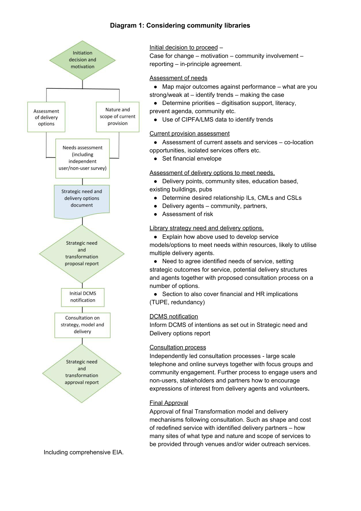
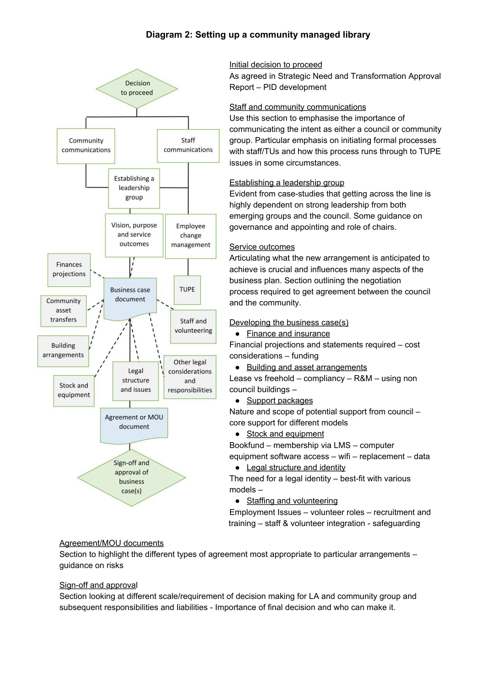

<!-- PAGE: 1 -->

# Community Managed Libraries: Good Practice Toolkit **Libraries Taskforce** *First published March 2016; revised March 2018; updated June 2018*

This good practice guide has been produced by the Libraries Taskforce for:

* heads of library services who are:

considering transformational projects involving increased participation of community volunteers and organisations in delivering their library service
supporting communities considering taking over or establishing a community managed library
supporting a community managed library that is council led
* communities who are looking to establish community managed libraries

The Taskforce believes that the involvement of volunteers in supporting paid staff in running public libraries can be valuable in augmenting services available and ensuring close collaboration and engagement between public libraries and the community. The Taskforce does not endorse community managed libraries with no support from the local council.

We recognise that some councils, for various reasons, are considering a range of different models for community involvement and some already have implemented them. We want to ensure that, if this path is followed, all parties involved make informed decisions: understanding the pros and cons and learning from others who have gone before, so a high quality service is provided to local people.

## 1. Introduction

This toolkit has various sections which we hope will be useful to these audiences as they progress through the planning cycle. They cover the various steps and provide supporting information on:

* considering setting up a community library
* implementing a community library
* sustaining a community library

We want to help anyone using this toolkit to undertake, or contribute to, a robust, objective and evidence-based analysis of the various strategic approaches open to them to deliver a library service that will meet the needs of their local communities.

In doing so, we’ll consider some of the challenges and barriers to overcome, as well as highlighting some of the benefits that can be realised.

In addition to this toolkit, there is a [Community Managed Libraries Peer Network](https://communitylibrariesnetwork.org), supported by the [Libraries Taskforce](https://www.gov.uk/government/groups/libraries-taskforce), [Libraries Connected](https://www.librariesconnected.org.uk/) (LC), and [Locality](http://locality.org.uk/). The network:

* provides a regular blog to share experiences and information
* has a regular [programme of training events and workshops](https://communitylibrariesnetwork.org/events/) (provided both face to face and via webinars)
* has a [resources page](https://communitylibrariesnetwork.org/resources/) which includes resources from within the sector and where you can watch previous webinars
* can act as a forum to link newer community managed libraries to more experienced peers
* has [written a report](https://communitylibrariesnetwork.wordpress.com/2018/04/18/changing-landscape-a-report-from-the-community-managed-libraries-conference/) on its first national conference

It’s free to join, and councils and groups considering setting up community managed libraries, as well as existing community managed libraries, are encouraged to sign up to its blog.

Throughout the toolkit we have provided example agreements. This is for information purposes only, and is not intended to provide, and should not be relied on for, legal advice.

## 2. Initial considerations and context

These are challenging times for councils as they cope with significantly reduced budgets, increasing demands for adult social care and changing expectations from local communities. Libraries are not immune from the challenges facing councils. Most councils are having to look for more radical approaches and solutions in this changing landscape for a range of services including libraries.

The way people access information and spend their leisure time is changing. People’s use of libraries their expectations of public services are changing. Financial and demographic challenges are increasing. Standing still is therefore not an option.

Councils remain responsible for overseeing the delivery of a [‘comprehensive and efficient’ library service](http://www.legislation.gov.uk/ukpga/1964/75/contents) by listening to and reflecting the changing needs of their communities. Informed by these statutory requirements, an increasing number of library services and councils are taking steps to investigate new models of delivery.

Community libraries can play a part in transforming a library service. Any decision to establish community libraries requires careful consideration. What works for one library or library service may not work for others. Our [Alternative delivery models toolkit](https://www.gov.uk/government/publications/libraries-alternative-delivery-models-toolkit) examines different approaches that library services can take. Using that toolkit, and this one, should help you to understand the pros and cons of outsourcing the delivery of a library service to community groups.

Providing library services via community volunteers and organisations has become more common in recent years. It can seem attractive to councils facing reducing resources and to communities themselves as a way to protect and preserve local libraries. It is, however, a significant step for both parties and one that needs to be worked through carefully to ensure the needs of communities can still be met and that any community managed libraries are established in a sustainable way. Research was undertaken on behalf of the Taskforce into the factors supporting the service effectiveness and sustainability of community managed library provision. Findings identified:

* the wide variation in the operational structures and services offered by community managed libraries across England
* things that would support community managed libraries’ longer-term sustainability, such as building income generation skills and opportunities
* the sorts of issues that community managed libraries raised as potential issues of concern, such as limited sources of funding, building restrictions, volunteer performance and availability, and sensitivity to increases in things like overhead costs
* community managed libraries’ wish for greater communication, understanding, and strengthening of links with their council, including ongoing ad-hoc or targeted support that does not necessarily relate to direct funding; for example, informal advice, support with accessing local volunteer networks, and combined training sessions
* the value of increased cohesion and learning between community managed libraries developed through a nationwide peer support group

We’ve drawn on this research in writing this toolkit.

## 3. Considering community libraries

### 3.1 Why a community library?

The Taskforce’s [Libraries deliver: Ambition for public libraries in England 2016-2021](https://www.gov.uk/government/publications/libraries-deliver-ambition-for-public-libraries-in-england-2016-to-2021/libraries-deliver-ambition-for-public-libraries-in-england-2016-to-2021) strategy encourages councils to consider service:

* accessibility (physical, virtual and outreach)
* quality (mapped to local needs)
* availability (including opening hours)
* sustainability

It also encourages all library services across England to be designed in line with [7 principles](https://www.gov.uk/government/publications/libraries-deliver-ambition-for-public-libraries-in-england-2016-to-2021/libraries-deliver-ambition-for-public-libraries-in-england-2016-to-2021#design-principles) (endorsed as good practice by the library sector). Library services should:

* meet legal requirements
* be shaped by local needs
* focus on public benefit and deliver a high-quality user experience
* make decisions informed by evidence, building on success
* support delivery of consistent England-wide core offers
* promote partnership working, innovation and enterprise
* use public funds effectively and efficiently

Councils need a clear vision and strategy for their library service which:

* addresses local needs
* is consistent with their statutory duty
* can be delivered within budget

The Taskforce’s [longer-term, evidence based and sustainable planning toolkit](https://www.gov.uk/government/publications/longer-term-evidence-based-sustainable-planning-toolkit) provides advice on developing a library strategy. This includes making libraries an integral part of wider external strategies and statements.

Should a library service decide it wishes to involve communities in the delivery of this strategy, it needs to articulate what this role will be and how it will contribute to achieving the service’s strategic outcomes and priorities. Services should be aware of, and have given consideration to, other delivery options in arriving at this point. The Taskforce toolkit on [Alternative Delivery Models](https://www.gov.uk/government/publications/libraries-alternative-delivery-models-toolkit/alternative-delivery-models-explained) highlights the scope of options.

This could include:

* reducing costs through the community managing the library or acquiring the leasehold or ownership of a library building
* maintaining or increasing access to the library service by retaining smaller libraries
* increasing opening hours through the use of volunteers
* co-locating with other partners / organisations, to support the continuation of the library and to offer an enhanced local facility

This approach is set out in Diagram 1. The following sections provide more detailed guidance on each phase of activity needed if a council decides to undertake this option.

### 3.2 Important decisions

The process set out in [Diagram 1](https://www.gov.uk/government/uploads/system/uploads/attachment_data/file/691693/Considering_community_libraries_diagram__1_.pdf) identifies the first set of decisions needed to progress. They are:

* agreement to formally consider establishing a community library (or libraries)
* agreement on service need and the best service model to meet it
* a final decision to proceed to a community library

This may take longer to work through than anticipated - there is no set time, and you may need to iterate the process before coming to the right conclusion for your area. The process may be applied to a whole service or to decisions about individual libraries. Before these decisions can be made you need to have the right information available and understand the likely implications. This requires a solid understanding of:

* current provision and constraints
* all available delivery options
* community needs - including user and non-users
* the risks associated with implementing change
* the statutory obligation in delivering the service

#### Agreeing to start the process

Proposals to move to ‘community’ provision can be a cause for concern for both staff and local communities. A formal decision to begin the process of exploring a community library offer can be extremely helpful. It gives an opportunity to provide context and explain the reasoning behind exploring this option. Whilst decision making points within councils will vary this should cover:

* a clear case for change
* obtaining ‘in-principle agreement’ to explore the options
* setting out how the community will be involved in doing this
* an honest assessment of potential staff implications
* leadership roles in managing the process

If major stakeholders aren’t clear about the context of your thinking there is more likely to be resistance (from staff and members or the community), ultimately making the process slower and more difficult.

#### Part of the statutory service?

Councils have a statutory obligation to provide a library service, so any proposed changes to the service will need to meet these. The guidance on [libraries as a statutory service](https://www.gov.uk/government/publications/guidance-on-libraries-as-a-statutory-service/libraries-as-a-statutory-service) sets this out.

It’s good practice to inform the Department for Digital, Culture, Media and Sport (DCMS) of any intentions to change at the earliest practical opportunity (certainly prior to public engagement). This will assist the Secretary of State in their statutory superintendence role.

Critically, in addition to giving early notification to DCMS of proposed changes, councils will need to demonstrate:

* plans to consult with local communities alongside assessment of their needs
* consideration of a range of options (including alternative finance, governance or delivery models) to sustain the library service
* a rigorous analysis and assessment of the potential impact of their proposals

Details about your proposals should be emailed to the DCMS Libraries Team on [dcms-libraries@culture.gov.uk](mailto:dcms-libraries@culture.gov.uk).

#### The nature and scope of the service offer

Transformation of library services is often linked with efficiency savings. The experience of councils that have implemented community libraries [suggests that this delivery model can provide savings - although the longer term sustainability of this model has not yet been fully tested](https://www.gov.uk/government/publications/research-and-analysis-to-explore-the-service-effectiveness-and-sustainability-of-community-managed-libraries-in-england/research-and-analysis-to-explore-the-service-effectiveness-and-sustainability-of-community-managed-libraries-in-england#stakeholder-perceptions-of-community-managed-libraries#sustainability).

There may be other considerations beyond the need to make revenue savings. For example the potential shape of the future service may be influenced by:

* whether existing council buildings need significant investment
* the need to rebalance library building cost with usage
* the ability or desire to explore co-locating public services
* changing local demographics and needs
* other issues that the communities themselves raise

#### Thinking through the relationship with the council

One in three library services now has at least 1 community supported or managed library operating within their area (Libraries Taskforce [extended basic dataset as of 1 July 2016](https://www.gov.uk/government/publications/public-libraries-in-england-basic-dataset) - this excludes community libraries independent of the local council). A dozen councils have 10 or more community libraries in their area.

Deciding on the basis of a future relationship between communities and the council in delivering library services is a local political decision, and should be based on early consultation with local people. There may, or may not, be limits to acceptable levels of change. For example involving volunteers in managing a library may work in your locality, but making libraries fully independent and/or transferring a buildings freehold may not be acceptable. Getting a feel for the right type of relationship for your area, and building it into the initial discussion/decision process may help keep the project on track.

Following on from the various models of community library models identified in the 2013 Locality and Arts Council England report [Community libraries - Learning from experience: guiding principles for local authorities](http://www.artscouncil.org.uk/advice-and-guidance/browse-advice-and-guidance/community-libraries-learning-experience-guiding-principles-local-authorities), this toolkit looks at 3 models. Community libraries can be community support, community managed or independent.

Community supported libraries are:

* council-led and funded, usually with paid professional staff, but given significant support by volunteers
* part of the public library network and included in the statutory service

Community managed libraries (CMLs) are:

* community led and largely community delivered libraries, rarely with paid staff (but with some professional support) and some form of ongoing council support
* part of the library network but these libraries may or may not be included as part of the statutory provision

Independent libraries are:

* not part of the public library network nor part of the statutory library service

There are different levels of staff and asset implications between these approaches - the biggest changes will be where independent libraries are established, and the least for community supported ones. Even within the latter 2 models there could be varying levels of council support - there is no set structure or requirements.

[Annex A](#annex-a) contains a brief overview of the pros and cons of each approach.

### 3.3 Assessing needs

Councils should engage with local residents to help understand their needs. (DCMS will expect councils to be able to demonstrate they have done this should there be any subsequent complaints about changes to library provision).

The needs assessment should ensure the council has a thorough understanding of the current provision and, critically, local community needs and views. This is to help inform choices about the future strategy and delivery model for the service. Consultation and engagement with users, non-users and local community groups is integral to this work.

The taskforce toolkits on [longer-term, evidence based planning](https://www.gov.uk/government/publications/longer-term-evidence-based-sustainable-planning-toolkit), and [Alternative Delivery Models](https://www.gov.uk/government/publications/libraries-alternative-delivery-models-toolkit) (particularly Stages 1-3) provide some useful guidance on how to go about this sort of analysis.

#### Assessing current provision

You should start by understanding current provision and look at data about existing service impact and performance, alongside the costs and assets used to achieve this – things like book stock, and buildings. Diagram 1 shows how this can inform your assessment of local needs.

You need to look at a number of things in depth as part of your needs assessment. These should include:

Usage data analysis identifying trends, and looking at the data in light of wider factors to understand usage more deeply, particularly on an individual community level.

Demographic insight data including changes to the numbers and types of people using each branch. Looking at age profile, deprivation indices and any specific issues such as health needs and literacy levels.

A detailed assessment of library assets and buildings, examining locations and condition, to help identify current and future capital requirements.

Identify wider community assets to better understand what else exists in the area that might offer future partnering opportunities. For example schools, community venues, or private and third sector businesses.

A detailed assessment of:

* current cost and performance data to fully understand the service
* cost per user or issue ratios
* capital and asset investment required for the different levels of provision

You will also need this to initiate and support any transformation you undertake.

Understanding trends in usage, and the causes of change, is complex. You should base this on careful analysis of current and future local needs. This should allow your service to match these demands with available resources, and help to define sustainable resource levels and delivery mechanisms.

#### Users and non-users: what are local needs?

You need to identify local needs through robust and reliable engagement with local people. There are 2 distinct phases to this:

1. identifying local needs and information about what residents, current users and non-users, want from a library service
2. setting out proposals for change based on this initial information

This section focuses on the first phase, exploring how needs can best be assessed and contribute towards decision making.

First you should establish local needs and demands. You can supplement an analysis of underlying demographics, deprivation, literacy levels, health needs, car ownership, mobility and existing usage by surveying and talking to local communities (both users and non-users) and partners about what services they might want in the future and how they want to access them (physical, virtual or outreach). The Taskforce’s Longer-term, evidence based and sustainable planning toolkit includes guidance on using data as part of a strategic review. [Annex A](https://www.gov.uk/government/publications/longer-term-evidence-based-sustainable-planning-toolkit/longer-term-evidence-based-sustainable-planning-toolkit#annex-a) covers the data sources you’ll need to refer to, [Annex B](https://www.gov.uk/government/publications/longer-term-evidence-based-sustainable-planning-toolkit), useful datasets to refer to and [Annex C](https://www.gov.uk/government/publications/longer-term-evidence-based-sustainable-planning-toolkit/longer-term-evidence-based-sustainable-planning-toolkit#annex-c), data tools you may wish to use.

Any survey that forms part of the needs assessment should be robustly designed, and use a range of engagement methods to test out views on future needs and requirements of different parts of the community. We strongly recommend getting specialist advice. The Local Government Association (LGA) has produced [guidance](https://www.local.gov.uk/sites/default/files/documents/New%20Conversations%20Guide%209-2_0.pdf) for councillors and council staff at all levels on consulting and engaging with residents when major service transformation is being undertaken.

### 3.4 Meeting community needs

#### Delivery model

Once you’ve undertaken an assessment of local need the next task is to consider how you’ll meet it. In recent years the use of alternative delivery models has increased across a range of service areas. The Taskforce toolkit on Alternative Delivery Models highlights [5 approaches](https://www.gov.uk/government/publications/libraries-alternative-delivery-models-toolkit/alternative-delivery-models-explained), with further detail on the ownership, governance and service delivery implications for each, and case studies. These are:

* [remaining in-house with re-engineering](https://www.gov.uk/government/publications/libraries-alternative-delivery-models-toolkit/alternative-delivery-models-explained#in-house)
* [Local Authority Trading Company](https://www.gov.uk/government/publications/libraries-alternative-delivery-models-toolkit/alternative-delivery-models-explained#latc) (LATC) - sometimes referred to as a Wholly Owned Company
* [Public Service Mutual](https://www.gov.uk/government/publications/libraries-alternative-delivery-models-toolkit/alternative-delivery-models-explained#mutual) (PSM)
* [Outsource](#outsource) to an existing social enterprise, third sector or private provider (including community managed options)
* [Joint venture](https://www.gov.uk/government/publications/libraries-alternative-delivery-models-toolkit/alternative-delivery-models-explained#joint-venture)

What is important is that the right approach is chosen with, and for, each community. If you think that a community library model might be one you want to explore the 3 types - Community Supported, Community Managed and Independent provide a good framework to start thinking about which might be the best fit locally.

Benefits and considerations for each are set out in [Annex A](#annex-a).

#### Identifying the right people to work with

If you choose to look at establishing community managed libraries then identifying the right community bodies to support and manage this transition is critical. They could be parish or town councils, established community organisations, Friends of the Library or local residents who come together to form an organisation to manage a library. For example in Warwickshire, some community-managed libraries share buildings with parish councils and other local partners and offer a wider range of services such as Citizens Advice Bureau. Dunchurch Parish Council pays for office space within the village’s [community library](https://www.warwickshire.gov.uk/dunchurchlibrary), providing an important source of income.

These bodies may show an interest following a specific council call for potential partners; or may emerge in the course of consultation. Councils should be alert to potential partnerships from the start of the process. Councils who have already supported the establishment of community managed libraries stress the importance of early discussions with the community and the benefits of a collaborative process which allows for informed decision making and a better understanding of the issues from both perspectives.

#### How will you provide your service?

Based on a needs assessment the council can consider how the service could best be delivered (looking both at methods of delivery and also the number and location of any physical service points or branches).

Prior to detailed consultation with local stakeholders the council will need to assess the strengths, capacity and costs associated with different approaches. This will involve looking at a range of delivery mechanisms including:

Static libraries, either stand alone or co-located as community hubs; maintaining these involve premises and staffing costs. Libraries can co-located with a number of services, for example:

* a local/parish council
* a health clinic or GP surgery
* a school or college
* local police

Co-locating with other services can help to offset these costs and can also help join up services for users, allowing buildings to be opened for longer. But before going down this route you need to think carefully about how any co-location will complement the library service you want to provide.

Mobile services are often used to reach rural areas or specific communities; but are a relatively expensive option. The council needs to understand who uses these, whether changes need to be made to patterns of provision, and if any alternative provision might be available. For more information see the [Hampshire County Council case study](https://www.gov.uk/government/case-studies/hampshire-county-council-strategic-library-plan).

Home delivery services can be used to reach people who can’t get to a library building for various reasons - for example, if they are housebound, or in a hospital.

Library services can be provided online through access to e-books, e-magazines and e-audiobooks.

[Book drops](http://www.cumbriasupportdirectory.org.uk/kb5/cumbria/asch/service.page?record=OT7z0c6dpxU) are self-service points in community venues and are often established in more remote areas.

Outreach services are often used to engage those who currently do not or cannot access physical libraries. These can be used to achieve a particular outcome, such as engagement of the elderly via book clubs, an employment support programme or a literacy programme focused for young children and parents.

#### Risks and barriers

Transforming library services is a sensitive and complex issue. Challenges might include:

* uncertainty for communities and staff leading to a dwindling interest in/commitment to progressing alternative models
* being able to act quickly enough on innovative or partner opportunities as they arise
* timing transformation to avoid services becoming unviable before there has been the opportunity to consider how other delivery models could be adopted
* the possibility of a legal challenge
* a DCMS review of the council’s decision making arising from a complaint under its [superintendence role](https://www.gov.uk/government/publications/guidance-on-libraries-as-a-statutory-service/libraries-as-a-statutory-service) - this requires significant resources to prepare a response; and as the Secretary of State will make adecision on whether to hold an enquiry after a council has agreed a change, councils in this position have to take a view whether to risk implementing it in the knowledge it might be revoked)

#### Analysis of evidence and recommendations

Once all this initial analysis has been undertaken, a report should be put to the council, to:

* agree and endorse identified needs
* set strategic outcomes for the future service
* explore and propose who might deliver the service in the future and how
* pull out financial and HR implications (for example TUPE and redundancy) of different service delivery options that might be considered

Once the council has decided on a way forward it can then initiate public consultation. Through discussion this will identify specific service solutions for individual communities.

At the point this report is agreed, and prior to beginning the next stage of consultation, we want councils to inform the DCMS Libraries Team [dcms-libraries@culture.gov.uk](mailto:dcms-libraries@culture.gov.uk) about their proposals prior to public engagement to assist the Secretary of State in their superintendence role. Councils should be able to demonstrate:

* plans to consult with local communities alongside an assessment of their needs
* consideration of a range of options (including alternative financing, governance or delivery models) to sustain library service provision in their area
* a rigorous analysis and assessment of the potential impact of their proposals

Further details on this can be found in the guidance note [Libraries as a statutory service](https://www.gov.uk/government/publications/guidance-on-libraries-as-a-statutory-service/libraries-as-a-statutory-service).

#### Consulting on the proposal

One of the 7 Design principles set out in Libraries Deliver: Ambition says that library services should:

> co-design and co-create their services with the active support, engagement and participation of their communities so services are accessible and available to all who need them

The LGA has developed a tool, [New Conversations](https://www.local.gov.uk/sites/default/files/documents/New%20Conversations%20Guide%209-2_0.pdf), which:

* provides detailed guidance on how to undertake successful consultation and engagement
* helps councils self-assess how effective they are
* suggests ways to improve and shares practical tools to use
* includes case studies of good practice
* includes detail on legal requirements regarding both consultation and engagement

A consultation is likely to have a number of aims:

* to seek confirmation of the outcomes of the needs assessment as the basis for the area’s future library service
* to agree the nature and scope of the future library service to meet these needs
* to identify and agree a structure of service outlets/points across the area (which could be stand-alone libraries or provided in partnership with organisations like schools, community buildings, or other organisations and businesses)
* to identify who is best placed to undertake delivery of the service

A well planned consultation can:

* involve local people in agreeing the general shape of the future library service
* engage those groups and individuals who have already expressed an interest in forming part of the service offer
* seek further interest from other organisations or groups who have not previously come forward

The consultation process should be transparent and based on evidence. It’s good practice to engage the community early in the process and provide them with a range of information on all the possible models, including costs and benefits, and involve them in deciding on the best option.

### 3.5 Next steps after consultation

#### Reporting and decisions

Decision makers can now be asked to agree a final proposal but only if only after:

* this final community consultation phase
* the proposed strategy and model has been amended following feedback

This final proposal should:

* cover the future shape and cost of the re-defined service
* identify delivery partners
* detail the number, type and nature of sites which will be retained and the services provided through these venues and/or through wider outreach services

Any proposals made should be subject to a comprehensive Equalities Impact Assessment.

#### Expectations and timetables

Reaching this point in the process is a major step and will take a considerable time to reach - 12 months isn’t unusual. Whilst in some instances it has been quicker, for others it has much been longer.

Developing this proposal and and identifying potential delivery partners does not constitute a final decision to transfer. You will have reached an ‘in-principle’ decision, which is still subject to a further level of detail around staffing, business plans, governance arrangements and detailed agreements on a number of different issues.

The next section of the toolkit [Setting up community libraries](#setting-up) explores all the issues associated with implementing a community library. It provides guidance on the nature and scope of the discussion/negotiation that should provide the confidence, for both the community group and the council, in making a final decision to move to a community library whatever model is employed.

We’ve described the process here in a linear way for the purposes of clarity and identifying the various stages; but the reality may be less so. You can bring forward the work of this and the next section [Setting up community libraries](#setting-up) together although this may result in abortive work and disappointing communities who have invested time and energy if their expectation of involvement is not met. Some community bodies will be able to demonstrate a robust and sustainable plan and the capacity to take on such an undertaking - but some may not.

### 3.6 Good practice and learning

1. Case study: [Hampshire County Council: strategic library plan case study](https://www.gov.uk/government/case-studies/hampshire-county-council-strategic-library-plan)
2. Case study: [Sutton libraries: public consultation](https://www.gov.uk/government/case-studies/sutton-libraries-public-consultation)1. [New Conversations: LGA guide to engagement, 2017](https://www.local.gov.uk/sites/default/files/documents/New%20Conversations%20Guide%209-2_0.pdf)
3. [Longer-term evidence-based sustainable planning toolkit](https://www.gov.uk/government/publications/longer-term-evidence-based-sustainable-planning-toolkit)
4. [Libraries Deliver: Ambition for Public Libraries in England, 2016-2021](https://www.gov.uk/government/publications/libraries-deliver-ambition-for-public-libraries-in-england-2016-to-2021)
5. [Libraries Connected’s Universal Offers](https://www.librariesconnected.org.uk/page/universal-offers)
6. [What makes a good library service?](https://moderngov.sutton.gov.uk/mgConvert2PDF.aspx?ID=15468) issued by CILIP: the chartered institute of library and information professionals
7. [Community Libraries: key considerations for community organisations
seeking to take over library services and assets](http://mycommunity.org.uk/wp-content/uploads/2016/09/4.-Community-libraries-v4.pdf)

## 4. Setting up community libraries

[Diagram 2](https://www.gov.uk/government/uploads/system/uploads/attachment_data/file/691690/Setting_up_a_CML__2_.pdf) shows the steps needed to follow when setting up community managed libraries.

### 4.1 Communications: tell people what is happening next

#### Library staff

Once you have taken a decision to move forward with community managed libraries you need to communicate strongly, clearly and honestly with all library staff. Whilst staff should have been involved in earlier discussions it’s important to appreciate how worrying and challenging this process and decision can be to existing library staff.

Communications with all staff should take place at this point (ahead of any formal process of communications with affected staff), and should aim to:

* set out exactly what has been decided
* provide some information about the implications for staff
* be clear on the future timescales

#### Volunteers and community groups

Similarly, the process to this point will have engaged and developed relationships with potential volunteers and community groups – who may be involved in delivering the service for the future. These groups should be given the same information as existing staff, and, in addition, give details about how and when they will be further involved.

### 4.2 Governance and leadership

#### The importance of strong leadership

The council should decide who (usually the head of the library service) will lead the process on consulting with communities. They will also need to engage, as required, with other council teams - for example IT, legal and property services. This person will need project planning support, including reporting and weekly tracking of project progress against identified milestones. This support is crucial as the process can be unpredictable and subject to change.

#### Governance models

It’s advisable to set up some sort of project board or steering group to ensure there is a strong leadership group. This will support clear lines of communications, clarify roles and responsibilities and help focus on a well-defined project plan and timetable. Drawing up a Project Initiation Document, (PID), is good practice in governing projects.

Regardless of the governance model, it’s crucial to have support from the portfolio holder and senior management to work through any challenges and seek resolution. You may also need specialist support to undertake community engagement work. The LGA has produced [guidance](https://www.local.gov.uk/sites/default/files/documents/New%20Conversations%20Guide%209-2_0.pdf) for councillors and council staff at all levels on consulting and engaging with residents when major service transformation is being undertaken.

### 4.3 What service will the community libraries provide?

#### Developing service outcomes

Both sides need a clear understanding of what service outcomes the new CML will deliver. This could be achieved by developing a local outcomes framework to contribute to your business planning. It could be developed by the council, the community bodies, or jointly.

This can identify how a community library will contribute to wider policy and deliver against the needs assessment, by linking proposed actions to the priorities and desired outcomes directly relevant to the community library’s locality.

Establishing an outcomes framework can provide focus to the business plan; investing time in its development can help make the future plans more robust. The Chief Leisure Officers Association and the LGA have guidance on [developing an outcomes framework which you can use at a local level](https://www.local.gov.uk/our-support/our-improvement-offer/culture-and-sport-improvement/guide-developing-local-outcomes/how-do-i-create-my-own-framework).

The benefits of developing a framework include:

* being able to evidence and measure the impact of your plans against both the community body’s and/or council priorities
* setting out future improvement work focused on the desired outcomes
* informing negotiations between the council and community bodies about the future support and investment needed to succeed

#### Negotiating local council and community priorities

Once a potential provider has come forward it will begin to articulate its own aspirations. This will influence any agreement it seeks to enter into with the council. There will be topics where there are divergent views. Both parties will need to negotiate and should expect to make compromises.

Examples of topics likely to require discussion and negotiation, dependant on the model chosen, are:

* capital and/or improvement works ahead of handover
* lease or freehold property agreements/asset transfers
* on-going revenue contributions
* access to systems – payroll, Library Management System
* legacy equipment and future replacement – furniture, shelving, PCs
* access to bookstock or future funding
* non-domestic rate relief
* access to training and advice
* refresh of assets
* start up and transitional support

These are all vital in providing a background for the next stage of Business Planning.

### 4.4 Developing the business case

It’s useful for you to prepare an initial information pack anticipating the main topics that community groups and organisations interested in taking on the running of a community managed library service will need to know about. This pack should include:

* usage / visitor information for the branch(es) being discussed
* the needs assessment undertaken for the area you are discussing
* an impact assessment of any proposed closures
* financial data on running costs for the service and the individual library, including projected capital costs for building upkeep
* what advice and support, if any, the council will provide to help communities engage in the process and develop plans
* what continuing support will be available should communities take over the management of a community library

It’s also helpful to supply a business case template as part of this pack. This will ensure the council receives information and proposals from the community groups in the format needed to assess whether the proposals made are deliverable and sustainable.

At the same time the council may find it helpful to provide guidance and a business case template to community groups as they begin to consider what’s required in running a community managed library. This could include the following:

* vision for the community managed library
* purpose
* financial projections
* community asset transfers
* building arrangements
* stock and equipment
* legal structures and issues
* other legal considerations and responsibilities
* staffing and volunteers

Guidance for community organisations going through this process could suggest including a timescale for the completion and implementation of their proposal to manage a library. Communities may wish to create a project plan which covers the proposal and business planning stage, the transfer of assets, potential refurbishment, recruitment, training and development of volunteers and any maintenance and anticipated delays.

#### Vision for the community managed library

Communities need to include an overview of the service they propose to provide. This should cover whether they are intending to use the existing premises and if there are plans to run other services from the building. This should be based on the service outcomes discussed above.

#### Purpose

The group will need to be clear on business case objectives and purposes as well as financial and operational details, illustrating how the group would benefit by the proposal and how this would be measured and evaluated (preferably expressed in a quantifiable way). Social as well as financial benefits should be included.

#### Financial projections

A successful business case will need to include a financially viable and sustainable business plan. Initial financial projections should include funding arrangements for a 3 or more years. Community groups should be required to show anticipated income, expenditure and cash flow; and state their resource requirements and how these will be generated and sustained. This is to ensure that the community managed library will be sustainable in the longer term.

Potential things to consider in this planning are:

* staffing and volunteers
* premises related
* suppliers and services
* income

With staffing and volunteers - there will be some clear costs associated with paid employees; but volunteers don’t come at zero cost. Training, travel, uniform and other costs may be incurred. Whether paid or voluntary, the operating body will be responsible for staffing and public liability insurance. Building insurance will generally stay with the owner.

There’s a long list of premises related costs such including utility bills and service contracts associated with running a building. The council will know these and should share them with prospective community organisations. Premises costs that are most likely to change at the point of handover include non-domestic rates (depending upon the level of relief the new entity is entitled to), and insurances. Utility costs could vary for the future if the new community managed library does not benefit from the council’s purchasing agreements.

Supplies and services covers the many items need to be purchased throughout the year to keep the library operating. These range from small items such as cleaning materials, stationary and toilet rolls to larger replacements of equipment, computers and furniture. Community groups need to think through in these in detail, identify what they might be responsible for and build these costs into the business case. Book stock will generally constitute the biggest purchase each year.

The ability to generate income is important in sustaining a community managed library. [Recent Taskforce research](https://librariestaskforce.blog.gov.uk/2017/09/05/exploring-the-service-effectiveness-and-sustainability-of-community-managed-libraries-in-england/) has illustrated how this can be successfully achieved. However, it also identified potential barriers to sustainable growth such as building restrictions, high dependency on volunteer performance and availability, and a high level of sensitivity to additional financial burden, such as increasing overhead costs. This means that the rates of sustainable revenue growth identified in the research should be considered as relatively fragile. Income projections must be realistic and any projected revenue growth from existing levels must be clearly stated and explained in the business case. For further advice and guidance on income generation see:

* Libraries Taskforce [blog on income generation](https://librariestaskforce.blog.gov.uk/2017/06/15/income-generation-for-public-libraries/)
* Locality report: [Income Generation for Public Libraries: learning and case studies from a national pilot project in England](http://locality.org.uk/wp-content/uploads/Income-Generation-for-Public-Libraries-Feb-2017.pdf)

#### Community asset transfers

Community asset transfer involves the transfer of ownership and/or management of the library building from the local council to a community based organisation or group. A number of public bodies, in particular councils, have the power to dispose of land and buildings at less than market value where they are able to show this will result in local improvements to social, economic or environmental wellbeing. The legislation that allows councils to do this is the [General Disposal Consent (England) 2003](https://www.gov.uk/government/publications/disposal-of-land-for-less-than-the-best-consideration-that-can-reasonably-be-obtained-circular-06-2003).

Library services wishing to include an asset transfer as part of the formal agreement with a community organisation will need to work out the detail with the council property team. This information will be shared with potential providers who will usually have to illustrate in their business case how they are capable of maintaining and operating the building in the future.

Locality have produced a [guide for local authorities on community managed libraries](http://locality.org.uk/wp-content/uploads/Companion-Guide-for-Local-Authorities-Empowering-Communities.pdf) and [information for communities on community asset transfer](http://mycommunity.org.uk/programme/community-asset-transfer/). Advising Communities also have [guides on community asset transfers](https://advisingcommunities.uk/help-your-organisation/advice-and-information/knowledgebank-information/community-asset-transfer). More recently the Community Managed Libraries Peer Network has run a [webinar](https://register.gotowebinar.com/register/6819594813704819457) on this subject, and can signpost to further practical advice from those who have worked through this process.

In addition, there is also research published in 2020 on [The community asset transfer of libraries: considerations in community managed libraries taking a lease](https://www.sheffield.ac.uk/polopoly_fs/1.878412!/file/Library-report-final-2020.pdf) which considers this in relation to the long-term sustainability of community managed libraries.

If considering a transfer councils need to provide guidance on property transfers to community groups alongside guidance on developing an asset management plan. A community group may wish to manage the service from another property if suitable and other local services / businesses could co-locate to reduce costs. All buildings must be physically accessible and compliant with the [Equality Act 2010](https://www.gov.uk/guidance/equality-act-2010-guidance). Also, a community group may consider working with a town / parish council who may take on the lease.

#### Building arrangements

Premises or facilities management covers a wide range of activities, and many community led libraries have taken on the responsibility for the maintenance and upkeep of the interior of the building. Critical activities can be grouped as:

* facilities management
* site and building maintenance
* contract management

In managing the facility, community groups may wish to rent out the building for use by other groups and so it’s advisable to develop a policy on the use of the building and to ensure the safety of all users. The policy could include rental terms, and legal compliance (covering the necessary licences if music, food and alcohol were being offered at events). They will need to make reasonable adjustments to buildings so they comply with the [Disability Discrimination Act 1995](http://www.legislation.gov.uk/ukpga/1995/50/contents).

Community groups will be responsible for the health and safety within the library and for those working in and visiting it once they take possession. Health and safety is a complex area involving [legal responsibilities](http://www.legislation.gov.uk/ukpga/1974/37/contents) and it’s advisable to look at official guidance from the [Health and Safety Executive](http://www.hse.gov.uk/aboutus/index.htm).

It’s also advisable to undertake a fire safety risk assessment and ensure there is a lead person who can ensure all volunteers are trained in emergency procedures and that all signage and equipment is compliant with regulations. Periodic checking of the fire equipment is likely to be required. Wiring and portable electrical appliances also need to be independently tested periodically.

Other things to put into place include:

* a planned maintenance programme to maintain electrical equipment and boilers
* a contingency fund to cover replacements
* internal and external decoration and repairs
* upkeep of any pathways or gardens

Within any lease agreement the responsibility to ensure compliance (that the building is safe) will remain with the council in that they will be responsible for checking or monitoring it. The cost of works in most instances would pass to the community group but councils should build in resources to ensure inspections are undertaken.

When taking over the management of a community library, the community group will need to think about cleaning, alarm systems, CCTV and other contracts.

A number of organisations provide useful advice on contract management issues. These include [Community Matters](http://www.communitymatters.org.uk/content/462/Online-Guidance-and-Advice), a national membership organisation which includes community organisations. It offers online guidance and advice and is a useful resource as is the [Community Knowledge Hub](http://libraries.communityknowledgehub.org.uk) run by Locality.

#### Stock and equipment

To attract borrowers community managed libraries need a range of quality book stock that meets user needs. Stock needs to be reviewed, renewed and replaced to keep collections current. Specialist support and training will often form part of the handover training and / or ongoing council support.

There are different approaches and options to acquiring new stock. These are:

* central procurement and allocation by the council
* local selection but procurement by the council with local delivery
* local procurement by the community managed library
* donations

Procurement by the council will depend upon the agreement negotiated between the council and the community library. The core stock may remain the property of the library authority, and may be refreshed by circulating collections and provision of a certain number of new books each year. With this arrangement, the community library stock may be obtained through the council’s procurement contract and delivered to the library jacketed and shelf ready. As many councils belong to a purchasing consortium, book stock purchased this way is likely to be cheaper than if a community library purchases direct. The stock purchased in this way will also be selected by trained staff. Alternatively a community library may select their own new book stock but procure the stock via the council’s procurement system.

The [National Acquisitions Group](http://www.nag.org.uk/) (NAG) is a professional organisation for people responsible for or interested in the acquisition, management and development of library resources in libraries of all types. Many of their guidance documents can be accessed without membership. In particular:

* [Servicing Guidelines: Best Practice for Public Libraries](http://www.nag.org.uk/publications/servicing-guidelines-best-practice-for-libraries/%20Servicing%20guidelines) which aims to provide a single servicing requirement to enable libraries to streamline their current supply chain, providing better customer service through greater efficiency and make cost savings
* [Supply Specification - best practice for libraries](http://www.nag.org.uk/publications/supply-specification-best-practice-for-public-libraries/) provides best practice guidance to 2 elements in the effective management, selection and supply of a best value, customer-focused stock: the supply specification and the stock management framework which underpins it

Some community managed libraries purchase and process their own book stock using support/funding from the council or from their own fundraising. A range of sources used include online purchases, local charity shops, book shops and supermarkets. This process can be time consuming in the purchase and processing of the stock. Community libraries can also purchase stock directly through specialist book wholesalers and publishers and may be able to negotiate a discount as a charitable organisation. Some suppliers provide advice and guidance by specialist library staff. Another option may be to form consortia with other community libraries to reduce costs.

Community libraries often receive books donated by local residents but this can’t be relied upon for new releases or for a well-balanced stock. To ensure a range and breadth of stock, donations need to be supplemented by new purchases. Depending on the arrangement with the council, some community libraries can add donated stock to the core collection if a catalogue record exists. Others keep donated stock as a separate loan collection and / or sell donated stock to generate income.

Community libraries should also consider whether they wish to stock DVDs, audio-books, newspapers and magazines.

#### Legal structure and issues

Legal issues to be considered are on structures and governance and statutory obligations.

Any organisation considering taking on the responsibilities of managing a community library needs to be a formally constituted body, with a representative and accountable governance structure. Examples of the 3 most common legal structures are:

* Community Interest Company (CIC)
* Industrial & Provident Society (IPS) (co-operative)
* Charity Incorporated Organisation (CIO)

Charities are regulated by the Charity Commission; charitable status enables an organisation to take advantage of tax relief and ensures that its operations are solely for the benefit of the community. Community organisations should consult the [Charity Commission](https://www.gov.uk/government/organisations/charity-commission) for further guidance. Communities wishing to take over the management of a library service are strongly advised to take independent specialist legal advice on how they should be set up and constituted.

The CML Peer Support network ran a legal and governance workshop and have published the [handout](https://communitylibrariesnetwork.wordpress.com/resources/) for it.

Under the [Public Libraries and Museums Act 1964](http://www.legislation.gov.uk/ukpga/1964/75/crossheading/the-public-library-service), councils have a statutory duty to provide a comprehensive and efficient library service. In considering how best to deliver this statutory duty, each council is responsible for determining, through consultation, the local needs and to deliver a modern and efficient library service that meets the requirements of their communities within available resources.

The 1964 Act places a duty upon the Secretary of State to superintend and promote the improvement of the public library service provided by councils in England and to secure the proper discharge of the statutory duties on councils. DCMS’ Libraries team will investigate complaints that a library authority is not doing so, and if there is a view that this might be the case the Secretary of State has the power to make a remedial order against a library authority following a local inquiry.

The question of whether any particular libraries, including any community libraries, are to be included or disregarded by the Secretary of State in their consideration of any formal complaint about a library authority failing to carry out its statutory duties will depend on the specific facts of the case and, in part, whether the council considers them to be part of its statutory library service.

More information on the legislative framework and points to consider if a library service is being reviewed, including factors that will be considered by the Secretary of State in deciding whether to order an inquiry, can be found in the guidance, [Libraries as a statutory service](https://www.gov.uk/government/publications/guidance-on-libraries-as-a-statutory-service/libraries-as-a-statutory-service) that was published by the Taskforce. The information contained in that guidance is not a statement of government policy but provided to help guide councils and other interested parties.

#### Legal considerations and responsibilities

Before entering into a contract arrangement, a council needs to work with the community organisation to ensure it’s aware of, and can be compliant with legal requirements relating to:

* safeguarding
* copyright
* data protection and the General Data Protection Regulation (GDPR)
* Public Lending Right
* data provision
* health and safety
* public liability and contents insurance

The council may refer community organisations to its own guidance on policies and procedures and cover these issues in a volunteer training programme. However it will be the responsibility of the community managed library to ensure it complies with the law.

Safeguarding policy and procedures are needed to ensure children, young people and vulnerable adults are safe; and that the community organisation running the library is fulfilling its protection responsibilities. The organisation needs to ensure all volunteers are aware of the policy and how concerns can be raised and are dealt with. Guidance on policies and procedures relating to safeguarding vulnerable adults and children may be available from the council.

Organisations who have produced more information on safeguarding are:

* the [National Council for Voluntary Organisations](https://knowhownonprofit.org/people/volunteers/keeping/ncvosafeguardingforvolunteerivolvingorgs.pdf), which helps organisations using volunteers to identify the main features of a good approach to safeguarding
* the NSPCC who have [information on what to include in a safeguarding policy for young people](https://www.nspcc.org.uk/preventing-abuse/safeguarding/writing-a-safeguarding-policy/)
* Age Concern who have [fact sheets relating to safeguarding older people](http://www.ageuk.org.uk/Documents/EN-GB/Factsheets/FS78_Safeguarding_older_people_from_abuse_fcs.pdf?epslanguage=en-GB?dtrk=true)

In 2014, reforms of UK copyright law were implemented and a [guidance leaflet on the exemptions to copyright for libraries, archives and museums](https://www.gov.uk/government/uploads/system/uploads/attachment_data/file/375956/Libraries_Archives_and_Museums.pdf) was published. This is relevant to community managed libraries as libraries provide access to copying equipment, library users need to be aware of copyright law and restrictions. It’s good practice to provide an information poster and to signpost further information and advice. The Library and Information Association and the Libraries and Archives Copyright Alliance have produced a [poster which provides messages on copyright for non-commercial private study and research](http://www.cilip.org.uk/advocacy-campaigns-awards/advocacy-campaigns/copyright/briefings-resources/copyright-poster).

Where a council is providing community libraries with access to the Library Management System (LMS), guidance on usage and the data sharing protocol should be included in the training for library volunteers. Community libraries will be required to follow the council’s data sharing protocols and sign the council’s data sharing agreement.

GDPR came into force on 25 May 2018 and replaced the current Data Protection Act. For more information on what it means The Information Commissioner’s Office has published a [guide to GDPR](https://ico.org.uk/for-organisations/guide-to-the-general-data-protection-regulation-gdpr/) which explains the provisions of the GDPR to help organisations comply with its requirements. Alongside the guide (which is constantly being updated) they have produced a number of tools to help organisations to prepare for the GDPR including a [checklist for data controllers](https://ico.org.uk/for-organisations/resources-and-support/data-protection-self-assessment/getting-ready-for-the-gdpr/). Other organisations who have published guidance on GDPR are:

* The Community Managed Libraries Peer Network with a guide on [what you need to know about GDPR and how to stay compliant](https://communitylibrariesnetwork.files.wordpress.com/2018/03/what-you-need-to-know-about-gdpr-how-to-stay-compliant.pdf)
* The Fundraising Regulator and the Institute of Fundraising with [six short guides on GDPR](https://www.institute-of-fundraising.org.uk/guidance/research/get-ready-for-gdpr/spotlight-series/)
* CILIP, The library and information association with a [guide to GDPR](https://www.cilip.org.uk/page/gdpr). You can register as a guest user to download this free guide
* [IFLA](https://www.ifla.org/publications/node/11549) have produced briefing on [Data Protection in the EU: What Does it Mean for Libraries?](https://www.ifla.org/files/assets/clm/publications/briefing_general_data_protection_regulation_2018.pdf)

For examples of data protection and sharing arrangements with a community managed library see schedule 5 in [Dorset County Council’s agreement with community organisations](https://www.gov.uk/government/uploads/system/uploads/attachment_data/file/698166/Sample_agreement_between_Dorset_County_Council_and_community_organisations.pdf). This is for information purposes only, and is not intended to provide and should not be relied on for legal advice.

[Public Lending Right](https://www.bl.uk/plr/about-us) (PLR) is the right for authors to receive payment for the loans of their books by public libraries. Payment is made from government funds to authors, illustrators and other contributors whose books are borrowed from public libraries. Payments are made annually on the basis of loans data collected from a sample of public libraries in the UK. The scheme is run by the British Library.

Community managed libraries which form part of a council’s statutory provision would fall within the [Public Lending Right scheme](https://www.plr.uk.com/allAboutPlr/news/whatsNew.html). However, if a library sits outside the statutory library service, it does not qualify for the PLR scheme and is not included in the PLR library sample. Libraries outside the statutory public library service can still lend books to the public without breaching copyright. They would not have to enter into separate agreements with authors to lend their books and to provide payments to authors.

#### Data provision

The council and the community managed library will need to agree the type, frequency and method of providing and sharing. The arrangements and requirements should be detailed in the management agreement between the two parties. To ensure consistency of data capture and to reduce the reporting process for community managed libraries, many councils extract this data from the LMS system and share it with community group.

#### Staffing and volunteering

Community groups which are considering employing staff may need to seek independent advice on any [Transfer of Undertakings (TUPE)](https://www.gov.uk/transfers-takeovers/overview) implications.

The council needs to assess the likely skills, experience and capacity of volunteers to take on the management of a library. Community groups will need to consider how they would recruit a good mix of volunteers longer-term, developing succession planning, including partnering with schools or other youth organisations to try and attract younger age-groups.

Volunteering roles in libraries can cover a wide range of roles from frontline ones dealing with users to those in the back-office which need different skills. For example managing finances, designing marketing initiatives, and managing property/maintenance duties. This is in addition to skills specific to library work. Some [library services](https://www.oxfordshire.gov.uk/cms/public-site/volunteering-oxfordshire-libraries) advertise specific role descriptions across their network and invite applications. There are some organisations such as [Reach Volunteering](https://reachvolunteering.org.uk/) that help broker links between organisations and people who may have specialist skills that they are prepared to make available to community groups - for example, in IT, web design.

Nationally, volunteers are actively engaged across the museums, libraries and archives sector and they bring a mix of skills which can include event management, financial and teaching expertise.

There are a number of benefits from volunteering as it:

* may be a way back into work for those who are unemployed
* is a way of developing new skills and building a CV
* can broaden social networks
* enables people to share their skills (and for the benefit of the local community)

In community supported libraries, volunteers may assist staff in:

* keeping library stock tidy and attractively displayed
* helping customers to find and choose books
* helping customers to use self-service machines and public computers

Where library services recruit community library volunteers to assist paid staff, they may be recruited through the Library Friends Groups as happens in Oxfordshire library service. The [Library Volunteer Charter](https://www.oxfordshire.gov.uk/cms/content/becoming-community-library-volunteer) sets out the expectations and responsibilities of a library volunteer.

Volunteer coordinators or managers should be prepared to keep a log of hours volunteered by individuals for purposes of references, also this data could be used as a criteria to get further funding, for example as proof that the CML is truly engaging the community (this will depend on the bid).

It is also worth collecting demographic data such as demographic data on volunteers as proof that the whole community is being offered the opportunity to volunteer. Although individuals are not obliged to offer answers to these questions.

Community managed library trustees may find it helpful to develop a volunteer policy and get information and support on preparation work before recruiting volunteers, including how to recruit volunteers and helpful tips on supervision and support. Councils may provide advice on volunteer recruitment, retention and development. A range of voluntary organisations also provide useful resources such as:

* [Knowhow Nonprofit](https://knowhownonprofit.org/people/volunteers/recruiting)
* the NCVO’s [guidance on volunteer management](https://www.ncvo.org.uk/practical-support/information/volunteer-management)
* sample agreements can be found in the toolkit at 4.8 [Good practice and learning](#good-practice-learning) at the end of this section

### 4.5 Agreements and contracts

An agreement with the council (a Service Level Agreement or a Memorandum of Understanding) is an essential document for establishing a community managed library. It sets out the support package the council will provide for communities wishing to take on the management of a library, and the requirements the community will have to meet. It’s vital that this document is flexible and can be updated to reflect service and technological developments and any additional support that may be necessary.

Issues community groups might wish to seek clarification on could include:

* length of contract, review arrangements and timescales
* circumstances where a break clause can be invoked
* whether there will be a grant available to offset running costs
* whether the service will be part of the statutory provision
* monitoring arrangements - such as what statistical data will need to be provided to or from the council for example visitor numbers, issues
* property issues such as ownership / leasehold of the building and maintenance / insurance arrangements
* ownership of the stock, and plans to update and procure new stock
* whether the community managed library will be part of the council library network and have access to the LMS
* whether the community library will be included in [LC’s Universal Offers](https://www.librariesconnected.org.uk/page/universal-offers), for example, receiving materials for the Summer Reading Challenge and Books on Prescription
* provision of secure wifi and internet access via public computers - who owns and maintains these and who will upgrade and refresh the system over time
* initial and ongoing professional support and training from the library service

### 4.6 Final decision

The final decision to transfer will not take place until the council is content with the business case. Experience from organisations that have gone through this process suggests that the business case may require a number of iterations to reach this point.

Whether the decision will require a further and final committee or cabinet decision will depend on how earlier reports have sought approval. Where there is a broader programme of work, potentially involving numerous sites, seeking delegated authority at the earlier reporting stage will make for a smoother and timelier handover.

For both the council and the community group(s) involved the final decision is based on an assessment of risk. Ideally as the process moved forward both sides would have compiled a project risk register, listing any potential risks relating to the successful implementation of the proposal and how the risks can be mitigated. By the final decision-making stage a review of risks should show clear actions for mitigation or have secured agreement to accept the risk.

### 4.7 Handover

The main lesson learned from councils and community groups who have completed this process is not to expect everything to be perfect at the point of handover. In particular, it’s not uncommon for the leases not to have been signed. There are mechanisms such as ‘tenancies at will’ that will allow this gap to be overcome and the community group to occupy and begin operating the site. Issues like this must be logged on the risk register and only be agreed to in in full sight and understanding of the risk they present. There is clearly a balance to be struck between the enthusiasm to complete and the robustness of the agreement.

### 4.8 Good practice and learning

1. [Checklist for communities running a community managed library with volunteers](https://www.gov.uk/government/case-studies/chalfont-st-giles-checklist-for-setting-up-a-community-library) from [Chalfont St Giles Community Library](http://www.chalfontstgiles.org.uk/shops/CommunityLibrary.htm).
2. [Business case](https://www.gov.uk/government/publications/libraries-alternative-delivery-models-toolkit/stage-6-business-case) section of [Libraries: alternative delivery models toolkit](https://www.gov.uk/government/publications/libraries-alternative-delivery-models-toolkit) and (downloadable) [business case template](https://www.gov.uk/government/uploads/system/uploads/attachment_data/file/602065/Template_10_-_Business_case.docx)
3. [Business plan](https://www.gov.uk/government/publications/libraries-alternative-delivery-models-toolkit/stage-7-business-plan) section of [Libraries: alternative delivery models toolkit](https://www.gov.uk/government/publications/libraries-alternative-delivery-models-toolkit) and (downloadable) [business plan template](https://www.gov.uk/government/uploads/system/uploads/attachment_data/file/602067/Template_12_-_Business_plan.doc)
4. Case studies on council council agreements and arrangements with community managed libraries include: [Buckinghamshire](https://www.gov.uk/government/case-studies/community-libraries-in-buckinghamshire), [Dorset](https://www.gov.uk/government/case-studies/community-libraries-in-dorset), [Gateshead](https://www.gov.uk/government/case-studies/community-libraries-in-gateshead), [Gloucestershire](https://www.gov.uk/government/case-studies/community-libraries-in-gloucestershire), [Sheffield](https://www.gov.uk/government/case-studies/community-libraries-in-sheffield) and [Warwickshire](https://www.gov.uk/government/case-studies/community-libraries-in-warwickshire).
5. Dorset County Council have a [sample agreement](https://www.gov.uk/government/uploads/system/uploads/attachment_data/file/698166/Sample_agreement_between_Dorset_County_Council_and_community_organisations.pdf) with community organisations which is available to download
6. A [sample Service Level Agreement](https://www.gov.uk/government/uploads/system/uploads/attachment_data/file/698168/SLA_template.doc) is available to download
7. NCVO have produced a variety of [information and guidance](https://www.ncvo.org.uk/practical-support/information) documents which are relevant to CMLs, for example ones on governance and trustees, impact and volunteer management (membership is free for the smallest organisations)
8. A [sample health and safety induction checklist](https://www.gov.uk/government/uploads/system/uploads/attachment_data/file/698164/Health_and_Safety_Induction_Checklist.doc) is available to download

## 5. Successfully operating a community library

Councils and community groups must consider how to sustain a CML once it has been established. The Taskforce commissioned [research into exploring the service effectiveness and sustainability of Community Managed Libraries in England](https://librariestaskforce.blog.gov.uk/2017/09/05/exploring-the-service-effectiveness-and-sustainability-of-community-managed-libraries-in-england/). This looks at many of the issues faced by community libraries in detail, through supporting case studies of 9 CMLs, operating different models in different parts of the country and in varied types of area. The following sections highlight some of these in an attempt to provide guidance on the main considerations in ensuring a community library continues to deliver an excellent service to its community. [Diagram 3](https://www.gov.uk/government/uploads/system/uploads/attachment_data/file/691691/Successfully_operating_a_CML_diagram__3_.pdf) also illustrates these points.

### 5.1 Ambition and growth

Initial business plans should have set out ambitions for delivery and growth. This could include:

* increasing the range of services offered against the 7 Outcomes (where applicable to the local community)
* increase in membership and usage
* growing the volunteer basis
* ability to become self sustaining financially

CMLs should measure their success against these. The research found that CMLs are generally delivering on a range of indicators including increasing opening hours, visitor counts and book issues, together with generally pushing customer satisfaction levels in the right direction.

Continually improving against these indicators may become more difficult over time and activity growth frequently correlates to both increased costs and risk. Managing a CML will require:

* monitoring the main indicators regularly and analysing emerging trends
* ensuring projected growth is attainable – it may slow down from early growth
* not over-promising outcomes to funders
* fully understanding relationships between outputs and cost

### 5.2 Developing relationships and networks

Community managed libraries should establish and nurture relationships on a number of fronts and ensure good strong communications are in place through which good practice and learning can be shared. The main relationships are with:

* users
* supporters, for example ‘Friends of the library’
* the wider community
* the council’s library service
* local councils
* other community managed libraries
* the wider library sector

The CML’s management group needs to have a close working relationship with their volunteers. Encouraging suggestions for improvements should be part of the relationship.

The CMLs volunteers as local residents may have good contacts with relevant local organisations.

The Taskforce research emphasised the importance of councils maintaining an ongoing relationship with community managed libraries in their area; and also encouraged community libraries to participate in networking to share learning. The [Community Managed Libraries Peer Network](https://communitylibrariesnetwork.org), supported by the [Taskforce](https://www.gov.uk/government/groups/libraries-taskforce), [LC](https://www.librariesconnected.org.uk/page/universal-offers), and [Locality](http://locality.org.uk/), provides a regular blog to share experiences and information, has a regular programme of training events and workshops (provided both face to face and via webinars), and can act as a forum to link newer community managed libraries to more experienced peers. It is free to join, and councils and groups considering setting up community managed libraries, as well as existing community managed libraries, are encouraged to sign up to its blog. The Society for Chief Librarians is looking at what support community managed libraries might benefit from via them in the future.

#### Users and the wider community

There are a number of ways in which relationships with users and the wider community need to be developed. Ensuring the library is welcoming to its existing and potential customer base is vital to success. Volunteers and staff alike need to be supported via training and materials that help develop a positive relationship with customers.

The library needs to balance continuing to meet the needs of existing customers with changes required to attract and encourage new users. This requires regular feedback from users and non-users, through:

* user and non-user surveys
* staff and volunteer feedback
* wider community representation on the Board
* customer comments box and boards, which are regularly reviewed and acted on
* the CML becoming involved with other groups within the community

Building strong links with its community will help establish local loyalties and should help the CML keep its offer aligned to local needs.

#### The council

Through the research undertaken, community managed libraries indicated they would like to have greater communication with their council through which they can build and develop better formal and informal relationships. The nature, scale and formality of this relationship is clearly likely to be greater for Community Supported Libraries and Community Managed Libraries than for Independent Libraries. The relationships will differ depending on whether the library is considered part of the statutory offer, if council staff are engaged, or if there is a funding agreement. Regardless of this, every effort should be made to ensure that these relationships remain a positive and supportive both sides.

Community libraries should think carefully about what they need to do to nurture the relationship and to ensure that roles and individuals are identified and assigned to do this. It’s important that they appear professional and competent.

A good strong relationship will ensure that a community managed library can continue to operate effectively, with the council being willing to assist in areas such as:

* quality up to date stock, new books and access to request and reservation services
* maintaining wifi access, library computers and printers
* integration with the library service’s network and the ability to issue a membership card
* access to council services including all stock, digital resources, a home library service and library service website
* capacity to run events and library offers such as the Summer Reading Challenge
* regular professional support in the library from a community library liaison officer and the option of phone / email contact
* additional support and advice through links with nearby council-run libraries
* ongoing training for volunteers supported by online training material
* some financial support

#### Other community libraries

The challenges of running a community library are many and at times it will feel like a lonely place. One way of sharing problems and learning is to talk and engage other people doing exactly the same elsewhere. People running CMLs are advised to seek out other community libraries and develop a relationship with them – they are highly likely to have encountered similar issues and may be able to offer practical insights - and moral support shouldn’t be undervalued.

There are already regional groupings such as that operating in Dorset’s 8 Community managed libraries. Beyond this CMLs can get involved in the nationwide [Community Managed Libraries Peer Network](https://communitylibrariesnetwork.org) which received support from the Taskforce, LC and Locality to get established – it provides a way to share learning and training, and it’s free to join (by signing up to its blog).

#### The library sector

CMLs can gain from learning what is happening across libraries more generally. The various operating models will connect a CML to the sector in varying ways, but wider current and relevant thinking is something it can benefit from seeking out.

For those CMLs with a stronger association with the council, this may come through paid staff. ILs will need to develop these relationships themselves as will libraries which are not part of the statutory service.

Some other ways to do this are to:

* [sign up to CILIP’s non member newsletter](https://www.cilip.org.uk/page/Infopromaglaunch) (the Information Professional)
* [sign up for alerts to the Taskforce blog](https://librariestaskforce.blog.gov.uk/about/): it has regular postings about issues of interest to those running libraries, including case studies and guest blogs on a wide range of subjects
* keep an eye on [LC’s news page](https://www.librariesconnected.org.uk/news-and-blog)

### 5.3 Managing risk

All CMLs have to manage risks. These will vary but [recent Taskforce research into CMLs service effectiveness and sustainability](https://librariestaskforce.blog.gov.uk/2017/09/05/exploring-the-service-effectiveness-and-sustainability-of-community-managed-libraries-in-england/) identified some common issues, many of which are covered elsewhere in the toolkit, such as availability of volunteers. The research particularly highlights the availability of funding, and building constraints, as significant risks to both growth and sustainability. Both are issues over which a CML may have influence, but not control.

Frequently reported risks relating to these include:

* availability of ongoing council support
* availability of ad-hoc council support
* localised funding opportunities
* income generating activities

There are a number of organisations who will fund, support and advise CMLs.

### 5.4 Recruiting and retaining volunteers

Many community libraries identify the recruitment and retention of volunteers as one of the main challenges they face. This can be even more challenging when the initial impetus of taking over a library has waned, and the original publicity is no longer available to attract new people. Many CMLs report that the relationship with volunteers matures considerably in the first few years of operation from both perspectives.

There can be tensions when attempting to impose set shifts, time commitments or training requirement. Volunteers’ interest may reduce, or other commitments take precedence. As a result a library may need to invest a greater amount of time and effort into maintaining volunteer levels than originally anticipated.

There’s considerable advice and support available to CMLs to assist in attracting and retaining a strong volunteer pool. Worth exploring are:

* [Volunteering Matters](https://volunteeringmatters.org.uk/) - a community volunteering service
* The [National Association for Voluntary and Community Action](http://www.navca.org.uk) is a membership network that provides specialist advice, support, policy information and training for volunteers
* The [National Council for Voluntary Organisations (NCVO)](https://www.ncvo.org.uk/) is an umbrella body for the voluntary and community sector in England
* other community managed libraries may be able to provide advice

Leadership is a specific area of volunteering which many community libraries report as being crucial to longer-term success. In addition to well-defined governance arrangements, it’s leadership that will ensure a library has direction, and is organised and planned in delivering it. Many CMLs can be too reliant on a single individual in fulfilling this role. This is a potential weakness and to mitigate this risk CMLs need to develop a strong Board with clearly assigned roles and responsibilities plus succession planning so other people are in a position to step up to lead in the future. This is not an easy task and councils may be able to provide valuable support and encouragement – assisting with recruitment, meeting with key officials on a regular basis and even celebrating the achievement of the library can all encourage more volunteers to step forward to take on crucial roles such as Chair or Treasurer.

### 5.5 Developing volunteers

Leicestershire Library Service in partnership with LC have created a volunteer training package [Making the Most of Your Library](https://www.librariesconnected.org.uk/content/making-most-your-library-0) for volunteers working in community managed or community led libraries which has been co-created with volunteers.

If you are a volunteer considering using this package please get in touch with your local library service contact, if you don’t know who that is please email Libraries Connected at [info@librariesconnected.org.uk](mailto:info@librariesconnected.org.uk) and they will put you in touch with the correct person.

### 5.6 Keeping arrangements under review

Agreements should be kept under review and updated or renewed appropriately. You should:

* constantly review the operation in light of any agreements you have
* open discussion way ahead of existing agreement expiring
* make the council aware of any issues as early as you can

### 5.7 Business plan review

As part of the business plan review you should:

* monitor the outcomes and performance of the library, using this to continue to make the case and show value to the council
* review the structure and organisation of the community organisation running the library
* carry out ongoing fundraising including securing local and national funds and grants
* carry out continuous improvement and benchmarking

#### Fundraising

Most community managed libraries are registered charities and so are able to apply for lottery funding and grants from trusts and foundations. Funding can be used to improve buildings, facilities and run events.

Additional options for income generation currently used by community managed libraries include:

* room hire
* charging for events and clubs
* subscriptions and donations to Friends of the Library groups
* running a cafe or shop
* sales of bookstock no longer required or surplus donations
* holding fairs to sell local crafts, plants, etc
* income from shared premises with other partners such as children’s centres and the police
* securing a parish precept to help with running costs

Power to Change has published [The community business success guide to room hire](https://www.powertochange.org.uk/research/community-business-success-guide-room-hire/) which explores how community businesses earn money from room hire.

Other income generating methods are covered in a [Taskforce blog on income generation masterclasses they ran in May 2017](https://librariestaskforce.blog.gov.uk/2017/06/15/income-generation-for-public-libraries/). This covered a range of entrepreneurial methods used by libraries to raise money and also gives links to sites providing further advice and information on things that CMLs could explore, and on social investment and crowdfunding. Some of the guest blogs posted by members of the [Community Managed Libraries Peer Network](https://communitylibrariesnetwork.org) mention how these CMLs raise money from their local residents and other funding sources.

#### Continuous improvement and benchmarking

All good organisations continually look for ways in which they can improve - and CMLs should be no different. They need an organised, and on-going, system of monitoring and evaluating performance from which they can identify areas for improvement
The Libraries Taskforce has recently published a sector-led [Benchmarking Framework for library services](https://www.gov.uk/government/publications/benchmarking-framework-for-library-services) which covers:

* leadership
* governance and management
* evidence based decision making
* community consultation and engagement
* outcomes-focused strategy and planning
* collaborative working and enterprise
* managing and developing people
* managing financial and physical resources
* service design, innovation and delivery
* review, improvement and learning

These areas/topics are designed to assist those involved in assessing libraries to clarify their thoughts and understand their libraries strengths and areas for improvement. The process involves the library asking itself a number of questions about how it operates and essentially scoring itself against each. For a relatively small organisation like a community library it’s possible (and advisable) to involve all those in engaged at the library as well as wider stakeholders such as council liaison staff, library partners and users.

It’s important that the collecting of data and information results in actions to ensure that the CML successfully tackles areas identified as right for improvement. Being able to evidence such a process should also provide ongoing assurance to the council or other funders that the CML is aspirational and well managed.

The Framework was designed to be suitable for use not only by library services, but by single branches, and CMLs.

### 5.8 Good practice and learning

Below are a number of exemplar documents and templates provided by library services and community managed libraries.

1. [Volunteer recruitment flowchart](https://www.gov.uk/government/uploads/system/uploads/attachment_data/file/714005/Volunteer_Flowchart.odt)
2. [Volunteer recruitment poster](https://www.gov.uk/government/uploads/system/uploads/attachment_data/file/714007/Volunteer_recruitment_poster.odt)
3. [IT and digital volunteers recruitment poster](https://www.gov.uk/government/uploads/system/uploads/attachment_data/file/714010/IT_and_digital_volunteers.odt)
4. [Volunteer role description](https://www.gov.uk/government/uploads/system/uploads/attachment_data/file/698165/Role_description_-_Volunteer_library_assistant.docx)
5. [Volunteer application form (version 1)](https://www.gov.uk/government/uploads/system/uploads/attachment_data/file/714013/Volunteer_Application_Form.odt)
6. [Volunteer application (version 2)](https://www.gov.uk/government/uploads/system/uploads/attachment_data/file/698171/Volunteering_expressions_of_interest_form.docx)
7. [Volunteer interview preparation](https://www.gov.uk/government/uploads/system/uploads/attachment_data/file/714014/Volunteer_Interview_Preparation.odt)
8. [Volunteer policy and agreement](https://www.gov.uk/government/uploads/system/uploads/attachment_data/file/698167/Sample_libraries_volunteers_policy.docx)
9. [Volunteer agreement](https://www.gov.uk/government/uploads/system/uploads/attachment_data/file/714015/Volunteer_Agreement.odt)
10. [Volunteer training and information checklist](https://www.gov.uk/government/uploads/system/uploads/attachment_data/file/714006/Volunteer_Training_and_Information_Checklist.odt)
11. [Sample comprehensive training checklist](https://www.gov.uk/government/uploads/system/uploads/attachment_data/file/698163/CML_volunteer_training_checklist.docx)
12. [Sample volunteer care plan](https://www.gov.uk/government/uploads/system/uploads/attachment_data/file/698169/Volunteer_care_plan_-_CML_sample.docx)
13. [Sample volunteer expense claim form](https://www.gov.uk/government/uploads/system/uploads/attachment_data/file/698170/Volunteer_Expense_Claim_Form.docx)
14. [Handbook for volunteers](https://www.gov.uk/government/uploads/system/uploads/attachment_data/file/714008/Handbook_for_volunteers.odt)
15. [Health and safety responsibilities](https://www.gov.uk/government/uploads/system/uploads/attachment_data/file/715009/Healthy_and_safety_responsibilities.odt)
16. [Manual handling handbook](https://www.gov.uk/government/uploads/system/uploads/attachment_data/file/714011/Manual_handling_handbook.odt)
17. [Information and security volunteer training](https://www.gov.uk/government/uploads/system/uploads/attachment_data/file/714012/Information_Security_Volunteer_Training.odt)
18. [Online safety training](https://www.gov.uk/government/uploads/system/uploads/attachment_data/file/715016/Online_safety_training_2016.pptx)
19. [Marvellous Marketing toolkit](http://www.culturehive.co.uk/resources/marvellous-marketing-for-story-selling/) is a free toolkit developed by Spark Arts for Children, working with libraries, Friends Groups, community centres and artists with creative ideas to generate interest in your library events. It covers everything from social media techniques to event checklists, and includes case studies and a top tips section.

## 6. Annex A: types of community library

This provides a brief overview of some of the main benefits of each approach to community managed library provision, and lists some issues that the council and community might need to consider before adopting the model. The models discussed are: community supported, community managed and independent libraries, and case studies for each model are included.

### 6.1 Community supported

Council-led and funded libraries usually have paid professional staff but are given significant support by volunteers. These libraries are part of the public library network and included in the statutory service.

#### Benefits

With the support of volunteers, small branch libraries with one or two staff members can continue to operate and deliver a range of services that otherwise might not have been feasible.

Operating costs can be reduced and a library can remain open for longer hours.

The staff are trained by the council and aware of all the universal library offers and service development. The service will have all the core library infrastructure, including book stock,
LMS, public access terminals.

Volunteers may undertake income-generating activities that can contribute to library running costs.

Volunteers can gain experience as an entry into paid employment.

This model presents the opportunity to retain the core elements of service quality and retain a library within a local community.

#### Considerations

Attracting and retaining trained volunteers may be an issue. The continuation of staff managing the library will depend upon council funding, and paid posts will almost inevitably be reduced.

Staff time is needed to manage volunteer rotas and training, as are management skills in managing volunteers (which differs in many ways from managing paid staff).

The council needs to consider equalities issues - for example how to attract a range of volunteers that fully reflect the community.

Case study of a community support library: [Wendover community library, Buckinghamshire](https://www.gov.uk/government/case-studies/community-library-wendover-buckinghamshire)

### 6.2 Community managed

Community led and largely community delivered libraries rarely have paid staff (but may have access to some form of ongoing council support including professional staff).

Often LC’s Universal Offers are made available either directly or through partnership support from the council’s library service.

While part of the library network, these libraries may or may not be included as part of the statutory provision.

#### Benefits

Community managed libraries reduce council operating costs and enable smaller communities to retain a library that might otherwise have to close.

The model enables increased community involvement in, and control over, local library services. Communities can shape the service to meet local needs.

A locally run and resourced library, with professional support from the council, may be better resourced and therefore able to provide a better service than one provided directly by a more financially constrained council.

Many community managed libraries at least retain the previous opening hours, or may even find ways to increase them.

Council support will generally include core book stock, funding for new stock and perhaps circulating stock. Depending on the formal agreement, the council may also provide professional library support and training, public computers, wifi and be responsible for IT maintenance and upgrades.

Allowing a community library access to the LMS gives the local community access to the council’s full library catalogue. Having one membership card across the network will enable users to borrow and return books across the network. People can join the library locally, make and collect reservations locally and access the council’s online library resources including e-books and e-magazines.

Volunteering in a community library can provide people with a wide range of experience in roles that can help them gain entry into paid employment. Or provide people with an opportunity to give something back to their community and meet new people through volunteering at the library.

#### Considerations

The community organisation responsible for managing the library needs to have the capacity and the skills set to make this model work.

Financial sustainability will be dependent upon the continued support from the council and the community’s effectiveness in fundraising.

There should be a formal agreement with the council on what support the library will receive. This sets out the basis of the partnership and helps manage both community and council expectations.

Council support will often include a grant towards running costs, provision of core book stock and new stock, library training and professional support. Depending on the formal agreement, the council may also provide the library’s IT for example public computers, broadband and wifi, IT maintenance and equipment replacement.

Continual refreshment of the book stock and access to IT and LMS upgrades is crucial in ensuring this model continues to play a part in the council network of libraries. Advice from experienced library staff, and ongoing access to training in service developments, is important for service sustainability.

A library dependent on volunteers is at risk if volunteer support reduces. There may be competing community demands for their time and talents. Similarly ensuring that opening hours are always staffed requires active management of the volunteer rota. Relying on volunteers could also affect the quality of the service.

Continuation of access to new book stock and a networked IT and LMS infrastructure with upgrades are crucial in ensuring this model continues to play a part in the council network of libraries. Advice from experienced library staff, and ongoing access to training in service developments, is also important for service sustainability.

Over time building maintenance, repairs and refurbishment will be necessary and funding it may be challenging.

The council needs to consider equalities issues such as the potential of attracting community organisations across all economic sectors; and trade unions’ perspective on the role of volunteers in public libraries.

Case studies of community managed libraries are:

* [Chalfont St Giles community library, Buckinghamshire](https://communitylibrariesnetwork.wordpress.com/2017/11/09/in-profile-chalfont-st-giles-community-library/)
* [Little Chalfont community library, Buckinghamshire](https://communitylibrariesnetwork.wordpress.com/2018/02/13/in-profile-little-chalfont-community-library/)
* [Farnham Common community library, Buckinghamshire](https://www.gov.uk/government/case-studies/community-library-farnham-common-buckinghamshire)
* [Colehill community library, Dorset](https://www.gov.uk/government/case-studies/community-library-colehill-dorset)
* [Stalbridge community library, Dorset](https://www.gov.uk/government/case-studies/community-library-stalbridge-dorset)
* [Wool community library, Dorset](https://www.gov.uk/government/case-studies/community-library-wool-dorset)
* [Lechlade community library, Gloucestershire](https://www.gov.uk/government/case-studies/community-library-lechlade-gloucestershire)
* [Mitcheldean community library, Gloucestershire](https://www.gov.uk/government/case-studies/community-library-mitcheldean-gloucestershire)
* [Deeping community library, Lincolnshire](https://communitylibrariesnetwork.wordpress.com/2017/11/29/guest-blog-deeping-community-library/)
* [Frecheville Library and Learning Centre, Sheffield](https://www.gov.uk/government/case-studies/community-library-frecheville-sheffield)
* [Upperthorpe community library, Sheffield](https://www.gov.uk/government/case-studies/community-library-upperthorpe-sheffield)
* [Harbury Village Library, Warwickshire](https://www.gov.uk/government/case-studies/community-library-harbury-warwickshire)

### 6.3 Independent

These libraries are not part of the public library network nor part of the statutory library service. Usually the community has taken on the management of the library in the face of potential closure.

The council still has a legal duty to provide a full and comprehensive library service to the residents of those communities.

#### Benefits

If the local community has decided to take on the running of the library, an independent library with community funding will be able to tailor its services to community needs.

Depending on how the organisation that runs it is set up, it may have access to certain types of funding that the council could not benefit from. For example certain types of social enterprise funding or grants from charitable foundations.

#### Considerations

Running a library independent of a local public library network means the community will not have access to council-provided online digital information resources, e-books and e-magazines.

Library users cannot reserve council book stock and pick it up at an independent library.

Independent libraries may not have access to LC’s Universal Offers and may not provide activities such as the Reading Well Books on Prescription, Reading Ahead and the Summer Reading Challenge.

This model will be heavily dependent on volunteer capacity and the management’s board’s entrepreneurial expertise, to generate operational income and funding.

Case studies of Independent libraries are:

* [Blackfen community library, London Borough of Bexley](https://communitylibrariesnetwork.wordpress.com/2017/12/14/in-profile-blackfen-community-library/)
* [Garden Suburb community library, London Borough of Barnet](https://communitylibrariesnetwork.wordpress.com/2018/01/18/in-profile-garden-suburb-community-library/)
