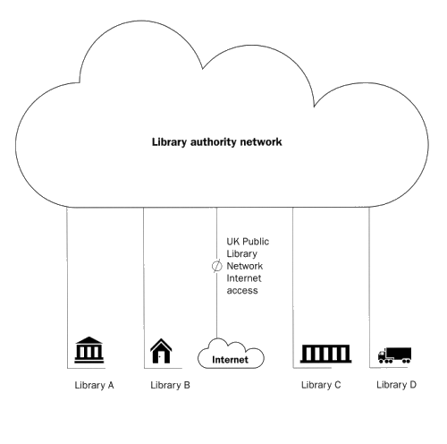
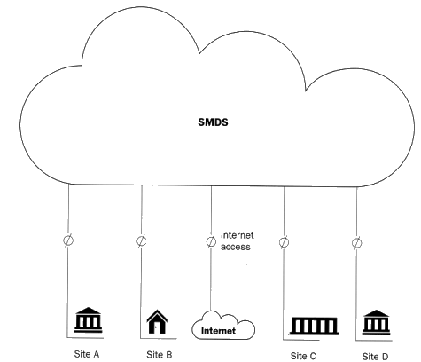
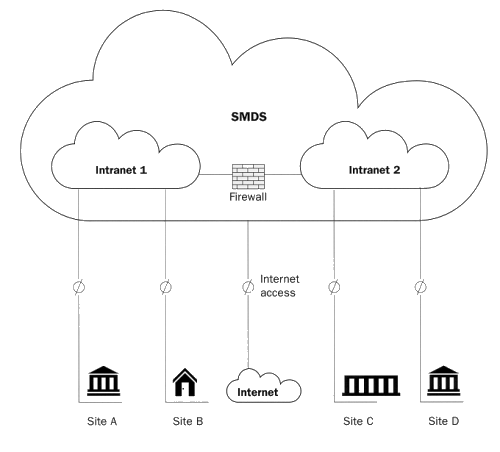
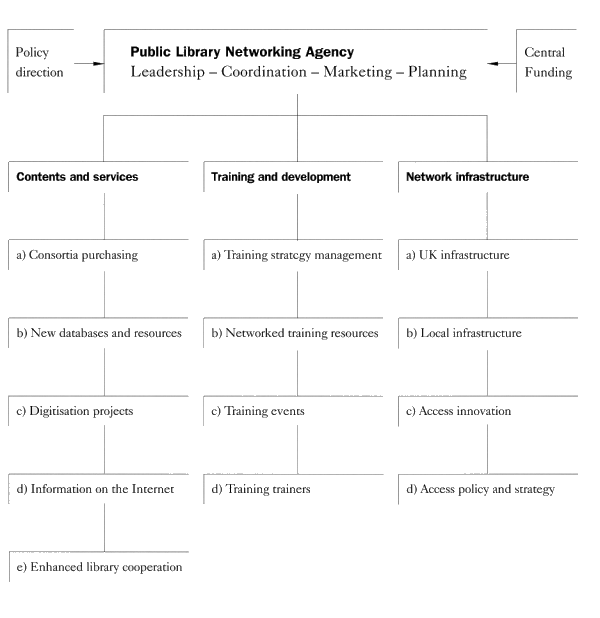

<!-- PAGE: 1 -->

# New Library: The People's Network

**Library and Information Commission Working Group on Information Technology**
*October 1997*

---

## Public Library Statistics

**1.** There are 4,759 libraries in the UK, of which 693 are mobile libraries, plus 19,136 service points in hospitals, prisons, old people's homes, etc.

**2.** There are 129,612,000 books in the public library service, which take up 3,600 km of shelving space — or 2.5 times the distance from John o'Groats to Lands End — compared with 3,149 km of UK motorway.

**3.** 58 per cent of the population hold library membership — 33,865,000 out of a total UK population of 58,388,000. There were 377,000,000 visits made to libraries in 1995/96.

**4.** Compare that with football attendances: 33,000,000 people in the UK were admitted to a professional league match in the 1995/96 season.

**5.** 10 million people use libraries on a regular basis — at least once a fortnight.

**6.** The fifth most popular pastime in the UK is visiting the local library. The first four are (a) visiting a pub, (b) eating in a restaurant, (c) driving for pleasure, (d) eating in a fast-food restaurant.

*Sources: Library and Information Statistics Unit (LISU), Loughborough University; Football Association, Football Association of Wales, Scottish Football League, Irish Football League; The Henley Centre (included in Social Trends, 1996).*

> 'If the public libraries in the UK do not act as the bridge between the new electronic information world and the language and history of print, then no one will, and we risk losing our culture, heritage and education'
> — Frances Hendrix.

---

## HEAR IT AGAIN

> 'For out of olde feldes, as men seyth,
> Cometh al this newe corne yer by yere,
> And out of olde bokes, in good feyth,
> Cometh al this newe science that men lere.'
>
> * Chaucer: The Parlement of Foules *

Fourteen centuries have learned,
From charred remains, that what took place
When Alexandria's library burned
Brain-damaged the human race.

Whatever escaped
Was hidden by bookish monks in their damp cells
Hunted by Alfred dug for by Charlemagne
Got through the Dark Ages little enough but enough
For Dante and Chaucer sitting up all night
looking for light.

A Serbian Prof's insanity,
Commanding guns, to split the heart,
His and his people's, tore apart
The Sarajevo library.

Tyrants know where to aim
As Hitler poured his petrol and tossed matches
Stalin collected the bards...
In other words the mobile and only libraries...
of all those enslaved peoples from the Black to the Bering Sea
And made a bonfire
Of the mainsprings of national identities to melt the folk into one puddle
And the three seconds of the present moment
By massacring those wordy fellows whose memories were bigger than armies.

Where any nation starts awake
Books are the memory. And it's plain
Decay of libraries is like
Alzheimer's in the nation's brain.

And in my own day in my own land
I have heard the fiery whisper: 'We are here
To destroy the Book
To destroy the rooted stock of the Book and
The Book's perennial vintage, destroy it
Not with a hammer or a sickle
And not exactly according to Mao who also
Drained the skull of adult and adolescent
To build a shining new society
With the empties...'

For this one's dreams and that one's acts
For all who've failed or aged beyond
The reach of teachers, here are found
The inspiration and the facts.

As we all know and have heard all our lives
Just as we've heard that here.

Even the most misfitting child
Who's chanced upon the library's worth,
Sits with the genius of the Earth
And turns the key to the whole world.

Hear it again.

* Ted Hughes, July 1997 *

*'Hear It Again' copyright © 1997, Ted Hughes *

---

## Cofiannau

* Roedd yr ogof yn gofiant: *
* anifeiliaid a than, fel lluniau plant *
* ymhob marw, pob rhamant.*

* Rhoddwyd pob diferyn o dalent *
* fel yr aeron sur ar fur di-rent *
* eu cartref a'u mynwent *

* i gyhoeddi'n derfynol *
* yn felyn a choch, yn wlyb ddiferol *
* y buont yma'n byw. Ac ar eu hol *

* gadawsant nid esgyrn yn unig *
* ond y waedd oesol, gyntefig, *
* y waedd sy'n dal i chwarae mig *

* yn swbwrbia'r llenni tynn, *
* ar ddalennau pob perthyn, *
* yn storiau'r dyddiau hyn.*

* Ar fas-data'n profiadau *
* bathwn ystyr a geiriau *
* pennod arall yn agor a chau.*

**Y Prifardd Dafydd Pritchard**
*Llyfrgellydd Cynorthwyol, Llyfrgell Genedlaethol Cymru / Assistant Librarian, National Library of Wales *
* Bardd y Goron 1996 / Crowned Bard 1996 *

'Cofiannau' means 'Biographies'. From the day man inhabited caves he felt a need to express himself, originally with simple pictures painted on cave walls, and people have always wanted to know about those who have gone before them. The urge remains; only the technology has changed.

*'Cofiannau' copyright © 1997, Dafydd John Pritchard *

---

# Chairman's note to the report

This report was commissioned from the Library and Information Commission by the Department for Culture, Media and Sport.

At the first meeting of the working group, on 24 April 1997, we had a general and fascinating discussion about the role of the public library in the next century. We all agreed that the book would continue to play an absolutely central role in our life and culture, but we also recognised that electronic access and delivery, particularly of educational and reference works and government and local information, will play a transforming role in the future activities of the public library. We thus determined at a very early stage that the three areas of particular interest would be, first, the * consumer * - what the citizen will expect from the public library as we enter the new century. Secondly, * content * - what is actually going to be delivered through the public library system. And finally * training * - reskilling the library workforce for the new age. The research we commissioned, which is described in the report, confirms the importance of these three headings.

The working group was asked to report its initial findings to government by the end of July. This we have done. But, although our recommendations are clear, we have worked to a very tight time-scale and we are fully aware that more work needs to be done in one or two crucial areas.

We must all thank the Poet Laureate, Ted Hughes CBE, for augmenting this report by writing a poem about libraries for us.

* Matthew Evans, July 1997 *

---

# Contents

| Public Library Statistics | Hear It Again - Ted Hughes | Chairman's note to the report |
| --- | --- | --- |

| Introduction | | 6 Copyright and licensing issues |
| --- | --- | --- |
| 1 Access to knowledge, imagination & learning | | 7 Performance evaluation |
| 2 Listening to the people | | 8 Implementation - creating the momentum |
| 3 Skills for the new librarian | | 9 A summary of recommendations & costs |
| 4 The network infrastructure | | Appendices An international perspective Qualitative research on library users Acknowledgements Terms of reference Glossary Addendum - November 1997 |
| 5 Investment & income | | |

| Cofiannau - Dafydd Pritchard | Endnotes | Library Quotations | Library Questions |
| --- | --- | --- | --- |

Home

---

# Introduction

The biggest changes in public libraries over the coming years will arise from the development of information technology (IT). These revolutionary changes will bring about previously undreamed of increases in the quality and quantity of detailed informatio information and knowledge readily and speedily available to the public. It is not possible to predict exactly the technology that will make this information accessible, but the government does predict that, whatever the technology, there will be a central role for public libraries.
Department of National Heritage, * Reading the Future * (1997)

The information superhighway should not just benefit the affluent or the metropolitan. Just as in the past books were a chance for ordinary people to better themselves, in the future online education will be a route to better prospects. But just as books are available from public libraries, the benefits of the superhighway must be there for everyone. This is a real chance for equality of opportunity...
Tony Blair, * New Britain: My Vision of a Young Country* (1996)

The introduction of information and communication technologies presents a challenge and opportunity for the United Kingdom as great as the industrial revolution in the nineteenth century. However, many citizens and communities will need help to meet the new demands of the emerging information society. Individual access to information and communications networks will be impeded by cost. And even as prices fall and ownership of suitable systems spreads, the intellectual challenge of obtaining access will remain, requiring skills development and support in information-handling for all citizens.

Public libraries are the ideal vehicle to provide this access and support, and to foster the spread of vital new technological skills among the population. Well over half the population already use libraries, and librarians have an unrivalled reputation for helping the knowledge-seeker.

This report argues for the transformation of libraries and what they do; it makes the case for re-equipping them and reskilling their staff so that they can continue to fulfil their widely valued role as intermediary, guide, interpreter and referral point - but now helping smooth the path to the technological future.

- Tomorrow's new library will be a key agent in enabling people of all ages to prosper in the information society - helping them acquire new skills for employment, use information creatively, and improve the quality of their lives. Libraries will play a central role in the University for Industry, in lifelong learning projects, and in support of any individual who undertakes self-development.

- Tomorrow's new library will be integrated components of a new national educational system - meshed into the National Grid for Learning, partnering schools, facilitating homework clubs, supporting literacy acquisition, and helping children and students access and interact with learning resources worldwide.

- Tomorrow's new library will remain open and accessible to all, without precondition, whether for material in printed form or for access to the wealth of resources available online. Libraries will continue to be the first recourse for meeting all information needs.

- Tomorrow's new library will continue to make information about every aspect of life available to people, and provide hugely valued leisure and cultural opportunities. As other institutions and services adopt new technologies, it is vital that libraries are at the leading edge of change and maintain their place at the hub of the community

- Tomorrow's new library will enable people to involve themselves more fully with the democratic process. Using information and communication technology, people will have ready access to local, central government and EU information and services. They will be able to contact and interact with government, their local councillors and their MPs. The networked library, equipped with new technology, will provide people with many more opportunities to participate in the decision-making processes that affect their lives.

The library is an enormously powerful agent for change: accountable to and trusted by people, and integral to education, industry, government and the community. A UK-wide information network made available through libraries and implemented on the basis of a high-specification central core could do more to broaden and encourage the spread of information and communication technology skills among the population - especially the young - than any other measure the government could introduce.

These developments will bring benefits - including export opportunities - throughout the UK economy, and not least for its software and graphics industries. Experience in the USA has already shown that it is those who have had easy access to powerful computers at a relatively early age who have gone on to build the Silicon Valley industries.

Renewed and reinvigorated by technology investment, libraries will become very different places. They will retain their spaces for books, study, exhibitions and events, but they will gain new learning spaces - interactive spaces - new uses and new users.The rapid spread of high-performance communications will mean that even the most remote rural library will offer access to the same facilities as a large urban library, providing a means to draw in those people who, through geography, are furthest removed from the opportunities offered by the Information Age.

Librarians will add new skills to their current capabilities. They will help people overcome their anxieties about the new world of networked and digitised information, and assist them to navigate through it.

This development of an information society and the introduction of the UK Public Library Network - the people's network - will require the library service itself to change. This report describes the nature of the changes required and proposes the establishing of a Public Library Networking Agency to bring them about, while maintaining the best of what people currently value in their local library service.

---

# 1 Access to knowledge, imagination & learning

## Introduction

**1.1** The UK Public Library Network will have enormous potential to deliver resources for information and learning to citizens across the whole country, through 4,200 static library sites and other library outlets.

**1.2** Access to the network will also allow every citizen to communicate interactively between libraries, with museums, galleries and the media, with local and national government, with public services, and with agencies in the voluntary and private sectors. Moreover, there will also be the capability for communication within and between communities, whether they be local or global, founded on geography or on a common purpose.

**1.3** Public libraries are already used by 58 per cent of the population. They are a first stop for information, they are widely used by children and young people as an adjunct to formal learning, and their reputation for supporting the knowledge-seeker is unparalleled. Their unique combination of resources, services and personal support attracts some 1.3 million visitors every working day, and 10 million users visit frequently - at least once a fortnight. Library staff respond to over 50 million enquiries each year, on a universal range of topics.

**1.4** In the information society, making information and communication networks accessible to every citizen will be vital to generate the energy for success. In exploiting new technologies through the networked library, priority must be given to:

- enhancing education and lifelong learning opportunities for children and adults;

- supporting training, employment and business, to foster economic prosperity;

- nurturing social cohesion through fostering a politically and culturally informed society.

**1.5** The new and growing range of resources and facilities which networking can deliver, combined with the existing assets of the public library system, will form the core of a powerhouse of knowledge, enabling the smallest and most isolated local library to offer the same range, depth and quality of information as a large centra central library, providing equal access to the global and the local. An outline of what this will mean in terms of content - resources for knowledge, imagination and learning - and services - facilities and support offered - is given below.

**1.6** The principal strands of content and services which will pervade the networked public library are:

- education and lifelong learning;

- citizens information and facilities for participation in society;

- business and the economy, training and employment;

- community history and community identity;

- the National Digital Library.

**1.7** Throughout this chapter and elsewhere in the report a series of scenarios illustrates the potential of the UK Public Library Network to meet people's needs in the digital age. These scenarios are fictitious, but they are based on situations in which libraries are often called upon for help, and they present solutions which will be available only through a networked library - one that is in touch with all areas of the UK and the world.

## Education and lifelong learning

**1.8** Public libraries complement formal education provision by providing a resource base and a platform for people of all ages to participate in lifelong learning. They will therefore form an integral part of the National Grid for Learning and the Unversity for Industry, and implementation of the network should consider this a priority. Helping young people learn how to is an essential function of the public library. Support for children and young people in acquiring basic skills, building their personal knowledge-base, and developing competence in information searching and analysis will complement the formal learning in their place of study.

**1.9** Rich multimedia resources provided after school, in a safe, culturally creative environment, will help overcome the inequality of opportunity experienced by those who do not have access to new technology at home. Several studies have indicated that children can benefit both educationally and socially from having well-managed access to various forms of information and communication technology (ICT) from an early age (Denham, 1997). The early introduction to independent learning in the library will promote a more rounded education, while also imparting the skills needed to learn independently in later years.

**1.10** The 1995 report Investing in Children declared that

The public library has a duty to meet children's need and desire for information in a range of media as well as books. It should provide information in appropriate media and formats, and whatever technology is needed to deliver them ... [public libraries have] to recognise that children are becoming increasingly computer literate and have high expectations regarding the use of computers in libraries and instant personal access to information (LISC(E), 1995, pp. vii, 9).

**1.11** To date, however, as a survey it quotes discovered:

public libraries in Britain have done little to equip young people for a life in which the computer is a major element in learning, work and recreation. (Lonsdale and Wheatley, 1992; LISC(E), 1995, p. 62)

**1.12** Networked resources also offer opportunities for adults to follow a personal learning path, whether in support of a career or an individual interest. In partnership with schools, colleges and universities, the public library will allow flexibility of study in both time and place.

**1.13** The urge to learn is a distinguishing feature of the human mind. Knowledge is power - and universal access to information is a hallmark of freedom in a democracy but knowledge is also discovery, excitement, personal growth and self-confidence.

**1.14** The use of existing services demonstrates that there is no limit to the type of information which people seek every day in libraries. The 'Saturday syndrome' sees libraries overflowing with users whose pursuit is personal, intense and determined. People of all ages and backgrounds reinforce a general interest in the arts or sciences, seek out the remote truths of their family history, catch up on current affairs, or search for the answer that will clinch a prize. Children pursue hobbies, and the more they do so the more likely they are to be in the library as adults, ably feeding a natural curiosity. Throughout the week the phones ring for a fact, a statistic, a name, an address, an illustration, or 'If I sing a tune can you tell me the title?'

Scenario One: Zahir Learns to Read

**1.15** Digital communications in the information society will bring new resources in unprecedented quantity, making available the equivalent of millions of pages of words and pictures. The library as an entry point to the information superhighway will bring unprecedented opportunities to learn for leisure, to find out for fun, and to experience the personal fulfilment of discovery.

**1.16** Through the networked public library, existing library resources will be newly opened up to more people. The catalogues of public library collections currently accessible only locally will be linked to create a UK-wide library system. This rich collective resource will be available at any local library. Eventually, catalogues will be enhanced with requesting systems so that remote users can locate and order the items they need. Cross-sectoral access (public/FE/HE) will introduce the flexibility of access to resources inherent in the concepts of open and distance learning.

**1.17** Such a wealth of resources will make digital discovery an awesome and exciting experience, but many people will need the support of a trusted and accountable intermediary - not only in accessing but also in interpreting and evaluating what is available. With library staff providing this support, the unique role of the library as 'the people's university' will be immeasurably enhanced.

**1.18** The accessibility of public libraries, enhanced by networking technologies, will ensure that people with mobility problems will find it easy to exploit the new opportunities. At the same time, as systems develop on the back of current research, services will be adapted for use by people with impaired sight or hearing. People with disabilities have the same desires to find out and learn as others: the information society must not be one in which they experience exclusion.

**1.19** In this area, content to be delivered will include:

- multimedia learning resources geared to national curricula;

- self-training packages for core skills;

- networked encyclopaedic databases;

- specialist resources on topics for leisure and learning;

- access to World Wide Web sites;

- networked electronic journals;

- digitised collections of images, film, and video and sound recordings;

- all UK public library catalogues;

- the digital collections of major libraries.

Scenario Two: Susan thinks about a career

**1.20** Services in support of educational and lifelong learning will include:

- access to the National Grid for Learning;

- support in accessing and searching global resources;

- guidance on the reliability of databases;

- access to and participation in special-interest Internet communities;

- access to specialist libraries and collections, and to virtual visits to exhibitions;

- information and guidance on educational and learning opportunities;

- interactive communications with educational institutions;

- access to local education authorities and information on finance for learning, grants, awards, etc.;

- online application facilities;

- Ofsted reports on schools and colleges;

- access to the library network and networked resources from home, school or the workplace.

## Citizens' information and involvement in society

**1.21** The UK Public Library Network will also be a gateway for citizen communications - an opening to the networked society which will promote a healthy democracy and social cohesion.

**1.22** In recent times disillusion with political, legal and social institutions has generated an atmosphere of cynicism and alienation. People - particularly young people - have distanced themselves from a system which they see as irrelevant to their circumstances. A public library network of access points, open to every citizen, for the delivery of information on government and government services - both local and UK-wide - and, especially, for enabling interactive communications with government and others, will help bring a sense of belonging and renew the potential for participation in society.

**1.23** Such a network will stimulate the production of digital information and interactive services for citizens which has already been explored by some government departments and local authorities. Many public agencies now have Internet Web sites; these will be further developed to meet the increased expectation of citizens using the library network.

**1.24** Easier two-way transfer of information and documentation between people and providers will also allow faster and more efficient routine transactions with government and public services, leaving more time for citizen and public servant to interact face to face on individual issues of greater sensitivity. For example, government.direct sets out a prospectus for the delivery, electronically, of central government services across the country, with public libraries as one channel of access. These services include the collection of taxes, granting of licences and administration of regulations.

Scenario Three: Linda consults the people

**1.25** A healthy society must also communicate with itself, and the UK Public Library Network will not only provide access to the centres of administration but will enable people to interact with all manner of voluntary organisations and interest groups. Individuals will be able to become better informed and to promote their views in the interests of wider community development. In addition, local government will be able to use the network to consult residents affected by local issues of policy, planning and prioritisation.

**1.26** When citizens are openly and freely in communication with government, democracy can be said to have 'grown up'. Those groups generally regarded as 'minorities' are, together, the *majority*; ensuring improved access for those with a minority or special interest will also enhance the quality of life for the whole of society.

**1.27** In this area, content to be delivered will include:

- information on local authority services - education, health, welfare and social services, planning and leisure, for example;

- information on local authority performance and budget deployment;

- information on local and regional development;

- online government publications and reports of proceedings;

- information on European government, legislation and citizens' rights;

- information on interest/action/pressure groups and voluntary organisations;

- legislation and legal publications;

- party-political information, policy and contacts.

**1.28** Services in support of government and citizens will include:

- interactive communications with MPs and councillors;

- communications with interest/action/pressure groups;

- self-publishing facilities for citizens;

- the processing of routine transactions - for example, applications for planning permission, or for driving licences;

- teledemocracy - the canvassing of public opinion, electronic voting;

- access to specialist advice and counselling agencies;

- booking facilities for local services;

- diary access for meetings and advice bureaux.

Scenario Four: James expands his business

## Business and the economy, training and employment

**1.29** The successful business already exploits information as an organisational resource. However, the majority of businesses in the UK are small and medium-sized enterprises - around 73 per cent of companies employ fewer than ten people - and such companies, and the 3 million self-employed, do not have the capacity to employ information specialists or to acquire expensive collections of data to inform their marketing and development activities.

**1.30** Support agencies such as chambers of commerce, business development agencies and trade associations will increasingly network to maximise their effectiveness. The Programme for Business, launched in February 1996, aims to ensure that firms in all sectors can improve their effectiveness through effective and innovative uses of ICT. Public libraries - especially the major city libraries - have variously developed enormous print-based resources to support business; the UK Public Library Network will allow still larger amounts of information to be available to even the smallest and most remote local library through access to remote databases on trade and commerce. The technology will allow greater cooperation to inform and support the UK's industrial, commercial and financial enterprise.

**1.31** The library has always been a resource for learning, and has a specially important role to play in learning in order to update or acquire job skills. A recent DTI study revealed that 52 per cent of UK companies think their employees have insufficient training in ICT, but at the same time 35 per cent of UK companies give no ICT training at all. As part of a return-to-work plan, skills development or reskilling for a different job, the UK Public Library Network will provide information and learning resources for independent study in a supported environment.

**1.32** It will also provide information on training and job opportunities. Some 6.5 million people - one fifth of the population of working age - go through a change in employment situation each year. In this environment, business information becomes employment information.

**1.33** Citizens are also consumers, and thus the ultimate generators of national wealth. The consumer needs ready and reliable access to information on products, services and producers, as well as access to legal and commercial information - all of which the UK Public Library Network will provide. The IT for All initiative aims to raise awareness of ICT, provide access, and develop the ICT skills of individual citizens, and specifically adults.

**1.34** In this area, content to be delivered will include:

- databases of company information, personnel and locations;

- databases of products and services;

- resources for market research;

- trade information on important import/export regulations and opportunities;

- data on countries and their markets;

- networked information on intellectual property - patents, designs, etc.;

- information on UK and European legislation;

- information on accreditation and qualifications;

- information and guidance on training opportunities;

- learning packages and opportunities through the University for Industry;

- consumer intelligence;

- the facilities for small and medium - sized enterprises in particular to conduct business with government electronically.

**1.35** Services in support of business, the economy, training and employment will include:

- interactive access to resources from office and home;

- video access to specialist information sources and expertise;

- partnership developments with chambers of commerce, business and regional development agencies, and TECs;

- UK and international connectivity to trade and industry bodies;

- supported facilities for the preparation of CVs and applications;

- access to local and national consumer organisations;

- access to environmental services and trading standards officers;

- information and employment conditions and job opportunities.

Scenario Five: The Patels go into computers

## Community history and community identity

**1.36** An area in which libraries support both the acquisition of knowledge and a sense of community is that of community history. Through a unique tradition of storing archives, records, maps, photographs and film, libraries have long been custodians of the people's identity and the community's self-image.

**1.37** Use of these resources is already an area of expansion in library usage. Local history - and especially sight of primary sources - is a feature of the national curriculum. Learning is generated out of a child's natural curiosity about grandparents' childhood; descendants of emigrants across the world, as well as adopted and fostered children, regularly and increasingly seek to uncover their roots. Access to global networks will help enormously in meeting this profound natural need to learn about their roots by giving minority communities access to their countries of origin. This is just one area in which, through public libraries, the peoples of the UK will increasingly experience the cultural diversity of our society and the rich fabric of global culture.

Harriet looks to the future - by discovering her past

**1.38** In local history above all, libraries house unique collections. Digital technologies will allow such collections - which are largely paper-based - to be converted into new formats. This will make these resources more widely accessible, and their availability in digital form will facilitate the security and conservation of the original, often inherently valuable, documents.

**1.39** In this area, content to be delivered will include:

- unique local collections networked nationally;

- digitised collections of archives such as records of births, marriages and deaths, and local newspapers;

- digitised collections of maps and photographs of streets, villages, towns and cities;

- catalogues of local-history libraries across the world;

- catalogues of public record offices;

- visits to virtual social-history exhibitions in museums and galleries.

**1.40** Services in support of community history will include:

- interactive communications with specialist librarians and archivists;

- use of networked learning packages related to genealogy and family history;

- access to genealogy research services;

- community publishing of personal stories and local histories;

- the capacity to contact and participate in community history societies;

- e-mail links to newspapers (a common source of information).

## The National Digital Library

**1.41** Inherent within the capability of networking technologies is the capacity to reconstitute the visual into the virtual and to deliver it from its custodial home to the widest community in local libraries - and indeed elsewhere. The significant collections in public libraries - photographs, rare books, maps - as well as their sister collections in museums and galleries, will be converted to create online collections which are accessible not only to researchers but to all citizens, supporting cultural awareness and identity.

**1.42** More imaginatively, multimedia exhibitions - images, narrative, background - which can be visited on-screen in local libraries will give everyone the opportunity for the 'guided tour' as opposed to the 'passive walkabout'. In addition to the value of giving the tax-payer greater direct access to publicly funded collections, such technology will also allow the development of new approaches to the visual arts and their promotion; projected through networks to an international audience, this will create the ultimate marketing tool in promoting the UK's cultural heritage to the peoples of the world. This will foster and support the tourism industry.

**1.43** In this area, content to be delivered will include:

- the unique visual and cultural assets of the national libraries;

- the same in regard to the holdings of other significant libraries and of museums and galleries;

- the ability to bring together related material from separate collections;

- virtual visits to exhibitions and special programmes in museums, galleries and centres of culture;

- transmissions in video of film, theatre and musical productions;

- digitised collections of archives and record offices;

- interactive learning resources on arts, culture and the media;

- 'what's on' information in the arts and heritage.

**1.44** Services in support of the National Digital Library will include:

- informed, guided tours of virtual exhibitions;

- access to supported virtual visits to libraries, records offices, museums and galleries;

- interactive access to expertise;

- partnership networks with advice and information specialists within or outside the public library sector.

## Developing the libraries' role

**1.45** Public libraries have already demonstrated their capacity to guide beginners in using information and communication technologies and to help individuals develop their 'computeracy'. The BBC's 'Computers Don't Bite' campaign has been promoted through and supported by libraries across the land with both printed information and taster sessions in an independent anxiety-free environment.

**1.46** Integral to public library networking will be provision for training/learning in the new technology. At an introductory level this may be provided by library staff, who will encounter the uninitiated on a daily basis, but learning organisations and private companies will be enthusiastic to collaborate with library service providers in developing strategies for public training/learning provision.

**1.47** As trusted intermediaries, public libraries can span the present and the technological future, ensuring no citizen is left behind, providing a safety net against alienation and social exclusion from technological advance - a route to universal access and opportunity.

## The development of resources for the UK Public Library Network

**1.48** Networking public libraries will take the UK's public library system through a period of substantial change into the new era of the information society. During the transition years, and for the foreseeable future in some areas, the demand for books and other non-networked resources will continue; meanwhile a UK-wide lead and financial support will be necessary to generate the range of electronic resources and services which users will expect of their networked local library. This will involve the following areas of content and service development:

- commercial publications;

- government and public information;

- new electronic library resources;

- Internet access.

**1.49** The range of resources and services envisaged will depend on a UK-wide initiative involving unprecedented collaboration, planning and investment, and we recommend that an agency be established to direct and manage the development process. The agency's role would cover the following areas:

### Central purchasing

**1.50** The agency will advise on:

- licensing and purchasing issues in the area of electronic publishing and acquisition of resources and the networking of those resources through UK public libraries;

- negotiating agreements and financial transactions;

- service provision - the online mounting of data services.

**1.51** This operation alone will require a dedicated team to undertake the complex and time-consuming negotiations involved in securing agreement to make commercial resources available on the network.

**1.52** A fund of £2 million per year for five years is recommended for the purchase or licensing of commercially published electronic resources, supported by a UK consortia purchasing team with salary and running costs of £300,000 per year.

### Government and public information services

**1.53** Several pilot projects to develop services in this area have been undertaken (government.direct, and various projects by local authorities and regional partnerships), but further development is needed to continue this process through to the point of delivery. A development fund of £2 million per year for five years is proposed to enable this transition to be completed. Subsequently the providers (government, local authorities, public bodies, etc.) will be responsible for funding their own networked information and services as such activity increasingly becomes the norm.

### Creating the UK's public library resource

**1.54** New electronic resources will have to be developed to deliver the information, learning and cultural benefits envisaged in the plan. These will cover areas such as community information; business, economic and training information; community and family history resources; a UK-wide enquiries network within libraries; and so on. The agency would commission the development of such resources from appropriate bodies, with funding recommended at a level of £30 million over five years. Again, the future of this process should be reviewed towards the end of that period.

**1.55** The National Digital Library envisaged in the plan will depend on the conversion of special and rare collections into digital format. A major project to identify and prioritise appropriate collections of items will be needed; it should look across all sectors to locate opportunities for partnership with collections in museums, galleries and the national libraries. Funding of £30 million over five years will be required to realise the creation of this resource.

### Exploiting the Internet

**1.56** A range of services will exist to allow library users to discover both free and commercial resources on the Internet. We recommend that £3 million be provided over the first five years of the programme, to support public libraries in developing controlled gateways to high-quality Internet resources in specific subject areas.

### A common information framework

**1.57** It is important that all development work proceeds within a common framework of information standards and best practice. The British Library and the Joint Information Systems Committee of the Higher Education Funding Council are investigating the establishment of a National Agency for Resource Discovery to advise the library community in this area. A scoping study by David Kay of Fretwell Downing Informatics Ltd and Professor Peter Brophy of the Centre for Research in Library and Information Management at the University of Central Lancashire has been presented to the BL and JISC for their consideration. We recommend that this agency be supported up to £100,000 per year, so that its work can be extended to assist the development of networking in UK public libraries.

**1.58** In undertaking this work, the agency will need to discuss widely the creation of content and licensing arrangements, with the library community and with service and content providers.

## Costing summary

| | £ million |
| --- | --- |
| Central purchasing of commercial publications | 2.0 |
| UK consortia purchasing team | 0.3 |
| Government and public information services | 2.0 |
| UK public library resources | 6.0 |
| Digitisation programme | 6.0 |
| Exploiting the Internet | 0.6 |
| Common information framework | 0.1 |
| | |
| Total per year | 17.0 |

## Scenario 1 Zahir learns to read

> **Zahir is five years old, and his grandmother brings him to the local library. He enjoys the reading books in school, but he enjoys even more the stories his grandmother tells him - about growing up in India.**

> **The library has books with lots of pictures and writing in Punjabi and English telling the same story. Zahir can also use the touch-screen library computer to see the insides of other books and choose to read them in English or Punjabi. The reader's voice is friendly, and Zahir is getting good at guessing the next words and playing the quizzes there too.**

> **When he has read a book he really enjoys, he races to the computer to write what he thinks of it. Anyone else looking up that book can see what he has written. His younger sister speaks her views of the picture-books she likes, and the computer makes her words appear on the screen.**

> **Although Zahir comes to the weekly story-time, he also enjoys his own story-time on every visit by seeing his favourite writers reading their own books on videos from the National Centre for Children's Books at Newcastle. He likes to watch the video of Shirley Hughes drawing Dogger, the hero of his favourite book when he was four.**

> **There is a special game he plays with his two friends in which they can use the computer to make up a story of their own with different endings and then print it out. If they get stuck on a word, the dictionary helps - sometimes with a picture or a moving image of what they are trying to describe.**

> **When he brings his books back, the librarian suggests other books he might enjoy, as the library has a list of all the ones he has borrowed before and written something good about. He prefers to choose his own, though, and has enjoyed trying to read a really long book on dinosaurs. When he brings it back on Sunday afternoon, the lady gives him a list of stories about dinosaurs - he chooses the ones about Dilly the Dinosaur, as someone his age who lives in the Punjab thought it was very good - and she also tells his grandmother about the Dinamites exhibition that is on this week. His grandmother promises to take him there, and tells him he can visit it again on the CD-rom in the library.**

Back to main text

## Scenario 2 Susan thinks about a career

> **I'm fourteen years old, and starting to think what I want to do when I leave school. Looking in my local library for a good read, I discovered they could help me with careers advice. Through their computer, I was able to ask about careers in engineering from something called the National Learning Network. I also got fifteen minutes' free advice from the Careers Guidance Centre twelve miles away, and I paid for another half an hour with my smartcard. I found out what qualifications I'd need and where I could study.**

> **Leeds University looked interesting, so I visited its Web site and got a virtual tour of the campus, including the low-down on what it was really like from students there now.**

> **Obviously I wanted to know what I would be likely to earn, and what the career prospects are like. The business information librarian helped me to pick out four local companies, and I filled in their on-screen forms for more information. They e-mailed me their salary listings and current vacancies straightaway. But do women actually work in engineering? An e-mail to the Equal Opportunities Commission gave me some statistics, which I printed out. It seems more and more women are making it in this field.**

> **The library's video archive had a careers section, and I watched several high-powered women talking about how they'd got to where they are today. Then I joined the special-interest bulletin-board for Women in Engineering at the student rate.**

> **I finished by looking at the online UCAS application - though it'll be a few more years before I'm ready to fill it in.**

Back to main text

## Scenario 3 Linda consults the people

> **I am a ward councillor for a large rural farming community. With public-spending constraints, we are faced with tough decisions.**

> **For some time, I've used the local library for my surgeries - I'm always surprised at how many people use it, and I get a lot of e-mails from there. The library staff are really helpful and encouraging - especially to older people who find the technology frightening. Now it seems sensible to move the library into the local school, to save money. But what will my constituents think?**

> **I've had meetings with community groups at the library - it's tough going, with very outspoken views. However, I'm well informed: the library has distributed the leaflet with our proposals, but also has gathered responses from a write-back form on the Internet, so I've got a good idea what everyone thinks - and not just the vocal minority. I can also weight the views of local people; those in other areas have also commented, but they won't be using the combined facility. The chief librarian has also been involved, using the video link to answer people's questions about the proposals directly, and a 'Your questions answered' file is kept up to date on the library system, so I can see people's concerns.**

> **We conducted an electronic referendum yesterday and gathered all the votes from my community, who were well informed about the pros and cons. We go ahead with the combined library and school, and I and my fellow ward councillors have agreeed to protect Saturday and Sunday afternoon opening from the savings.**

> **The whole thing has gone so well - I feel confident we've made the right decision, and that everyone has taken part and understands the issues and the tough choices. My colleagues in Planning are impressed, and the chair wants to use the process for a consultation on a major development in another rural area. He may not get the support he wants, but at least the response will be more reliable and comprehensive than just hearing the loudest voices.**

Back to main text

## Scenario 4 James expands his business

> **James Greaves, forty-seven, employs thirty people making castings for the pumping industry. Aware that his business could be run better, he goes to the library with a general need for information about how he might find more customers for his products and how he could improve his operations.**

> **James finds the librarian really helpful, telling him about the free help he can get from Business Link, who will assess his business with him. He makes an appointment with an adviser for next week, but he wants to make a start now, on his own.**

> **The BBC online self-assessment programme called Fit for Business is great - really good at showing him his strengths and weaknesses. He sees the needs to market his products more effectively and develop his own management skills, and to find out how to export his products abroad. The BBC Education Web site tells him about the Business and Work Hour on the BBC2 Learning Zone, especially for SMEs - small and medium-sized enterprises, which James realises he is.**

> **James samples part of the programme online, and finds it really interesting to see and hear someone like him talking about how they reached new markets and whom they contacted to help them. He then finds the AGORA Web site, coordinated in the UK by the BBC, which links businesses like his across Europe, and gets the details of some companies which are likely customers for his products. The librarian suggests that James look at the DTI site, where he finds useful information on what he needs to do to export his products to Europe - he'll ask more about that next week, when he meets the business adviser.**

> **James decides there's much more to learn than he thought, and he becomes a regular visitor on Saturday afternoons, keeping up to date to get an edge over his competitors, and using the BBC Alert database to see what broadcasting is in the pipeline that will be useful to him.**

Back to main text

## Scenario 5 The Patels go into computers

> **Mr Patel has run a successful small newsagent/supermarket for several years, opening long hours and stocking a wide range of goods, including lunchtime food for the small but loyal nearby office community. Three years ago he bought the next-door building to sell more foods, but there is still some redundant space above the shop where at present his daughter, Amy, is assembling a mail-order PC that she bought in component form.**

> **Amy Patel enjoys this, and thinks there could be scope for a business putting together custom-specification PCs. Her father agrees that there might be an opportunity - certainly there is no nearby computer shop - but he is concerned about expanding into new markets. What are the trends in PC sales? How many custom-assembled PCs are sold against off-the-shelf systems? What kind of PC sale is more profitable? How and where could he advertise a PC shop?**

> **On a trip to the library with his grandchildren, he sees a poster advertising a half-day introduction to the library's Business Support Service. It's free, so he decides to take off time from the shop and go. He finds it answers a lot of the questions he had, and he discovers there's a dial-in service available on subscription, with an online enquiry service and an easy-to-use gateway to other relevant information sites - including the access point for the University for Industry. The cost of his subscription includes a consultation to design a business development course suited to his exact needs, drawn from courses across the country.**

> **Dialling in from the planned PC centre above the shop, the Patels are able to get information at crucial times in their business planning process. Amy is doing courses on advanced PC engineering, direct-mail marketing, customer management, and health and safety. Most of them she does from home, but she enjoys going to the library for Learning Circle sessions and to pick up additional information. What particularly impresses the Patels is the contribution to the courses from people working in industry.**

> **PaTech has now been trading for six months, and Amy Patel has already had to hire a student to help her process orders.**

Back to main text

## Scenario 6 Harriet looks to the future - by discovering her past

> **Harriet Hardcastle, fifty-seven, listens to Radio 5 Live and hears about a major Millennium local history project. She's very interested in the way her town has developed and changed over the years, and she hears that her library will be the main local centre involved in the project.**

> **When she arrives, the librarian knows all about it and shows her to a terminal. She has never used a computer, but soon gets the hang of things. She explores the recent history of the town, looking at maps and seeing photographs of how it has changed. She picks a photo and sends it as a Webcard to her daughter in Australia. There is also a school project, which is fascinating, and she enjoys dipping into the recordings of people of all ages talking about living in the town then and now.**

> **She is invited to contribute a three-minute recording into the computer, but she'll do that next time: first she wants to find out more. When she had typed in her name, a list of other Hardcastles associated with the town had come up on the screen - one of them a distant relative killed in action in the First World War.**

> **This is really getting interesting. Using a combination of original archive materials, including photographs and the archive footage of programmes about the Great War from the BBC, she traces the development of the war and finds out about the circumstances that led to Private Hardcastle's death. The library catalogue shows her there is a special collection on the Great War at the local university, and she can use her library card as identification to go there and look at things.**

> **She see some programmes coming up on tracing your family tree, and discovers she can come to a beginners session at the library that week, run by the local family history society.**

> **She is fascinated by this local family connection with world events, and leaves with books on the First World War and some information she has printed out from the computer, as well as an audiobook of letters from the trenches. She is inspired to involve her grandchildren in all this, and sees that the archive of twentieth-century oral history will be a good beginning - they love listening to stories, and these will be real ones.**

Back to main text

## References

Denham, Debbie (1997). 'Children and IT in public libraries', *Youth Library Review *, 23 (spring).

LISC(E) (1995). Library and Information Services Council (England), * Investing in Children: The Future of Library Services for Children and Young People *. London:HMSO.

Lonsdale, Ray, and Wheatley, Alan (1992). 'The provision of computer material and services to young people by British public libraries', * Journal of Librarianship*, 24(2), June, pp.87-98.

---

# 2 Listening to the people

## Introduction

**2.1** In setting out to develop information and communication technologies in libraries on a large and intensive scale, it is important that library users' needs and motivations are understood, and also their perceptions of IT in relation to current library services. It is also vital that we listen to people's views about our proposals to develop library services using the new technologies.This chapter therefore describes the findings of a small-scale qualitative research programme, conducted in June and July 1997, whose aims and methodology can be found in Appendix 2.

**2.2** A range of experts was consulted to refine the vision of what libraries might offer, and research was conducted among six key library user groups, including mid-teens (aged fourteen/fifteen years in a deprived inner-city location), school-leavers, families with a general interest in the library, 'lifelong learners', and adults engaged in some form of part-time study to make a career change or return to work. Fieldwork was carried out in four different locations, selected to represent a range of library services: a small local library, a main central library, a library in a deprived inner-city area, and a rural library.

**2.3** In general, people's starting position was full of goodwill towards the current service, even though there was dissatisfaction with cutbacks in opening hours and with spend on bookstocks. A principal concern was that the introduction of IT could be unrealistic in a regime of tight finance.

## Research overview

**2.4** The findings in this section are based on the research analysis which follows.

- The public library embodies the democratic principle of the public's right to information in whatever form. People are conscious that the use of IT is fundamental in today's society, and recognise that public libraries have a role to play in making it accessible to all - to level the playing-field and provide technology for those who cannot afford to buy it.

- With the introduction of IT, there is great potential to stimulate, educate and inform for both recreational and vocational purposes.

- The greatest value seems to be in the area of education in its widest sense. There is a tremendous opportunity for libraries to play a greater role in meeting the needs of schoolchildren and school-leavers and in supporting lifelong learning. More and more young people undertake project work. Significant numbers of people fall through the net. Where do the 3 million self-employed get their training?

The public library could become the natural place for people to turn to for advice, support and practical training in IT and communication skills, and could potentially play a significant role in training and retraining.

Bearing in mind the limited scope of this research, the most motivating applications overall were homework clubs, links to schools, the idea of the one-stop shop for school-leavers, the library as a training centre for information and communication skills, and advanced services.

Although the idea of open learning in a comfortable self-paced way was appealing, people need first to acquire the basic computer skills to enable them to do this. Only a few realised the full potential in developing literacy skills.

Other applications such as access to rare archives had more specific appeal, but those who responded favourably were very enthusiastic. It seemed that specialist collections receive little promotion beyond regional boundaries, and this would need to be addressed.

The value to the community of the library as a local knowledge centre was understood and thought to be an essential service which could only improve with the benefits of IT. Suggested links to local government had limited appeal to the groups surveyed, but it would require a more substantial study to confirm this finding.

- The networking solution adopted for rural areas could be different and would require further investigation. Rural communities tend to have fewer resources available, so there is more incentive to use the new services - either remotely from home or from convenient village access points. Recreational reading is enormously significant, and facilities such as renewing books by remote access, making requests, and possibly having books sent to you would be a big improvement in the service.

- The convenience of opening hours needs to be addressed from the users' point of view. If the intention is to provide a service to maximise use and further recreational and vocational learning, the library needs to be open during evenings, weekends and lunch-times, so that all can benefit from the service.

- Networking should not be restricted to national boundaries: people realise that we are in a world information environment and that it is essential to be part of the global network, otherwise we will get left behind.

- The public library is an important focal point in the community. There is a feeling that its position has been eroded, that it does not currently present a compelling reason to go there and that it is lagging behind the times rather than moving ahead. Though there is a tremendous amount of goodwill for the public library service among users, there is a significant opportunity to revitalise libraries, stimulate greater usage, broaden the appeal, and make a big difference in people's lives.

- New technology and networked libraries are essential if libraries are to gain status in the new world of networked information, knowledge and learning. IT could be a big step forward in encouraging learning - making it seem more fun and motivating, especially to those who currently feel that libraries are not for them.

- People really value the quiet learning space provided by the library at the moment, and any development needs to be complementary to this. There were some indications from our research that new uses would add value to the library in an exciting way, but that they would require separate spaces. How the new technology should be integrated to maintain important library values will need to be taken into account and investigated further.

- The future of librarians will be to enable and facilitate. The overall purpose of the job will be essentially the same, but the skills needed will be different. Librarians will have to think about their role, management skills, delivering services and 'customer care', and this may require a cultural shift in attitude for some. More librarians have to come out from behind the desk and be more outward-going.

- Most people had a narrow view of the total range of services offered by public libraries. This was particularly true of people who accessed books and information from other sources. This indicates a need to use higher-profile marketing of the public library service, to show what's on offer and to encourage broader use and access for the widest possible range of people.

- Whether the service is free or could be charged for is an issue that will need further examination. Libraries already make charges for some things, and most people do accept this.

- When designing new services, librarians will need to understand in more detail how far people are prepared to travel for particular uses. In this study we found that specialised resources which are self-evidently more costly were not expected to be available in every local library.

- There will be some people who do not want IT to displace what they value in libraries and would rather have better bookstock and a more comfortable reading space. For these people it is especially important to preserve the library atmosphere and the large-scale presence of books, and to house any of the advanced services in a separate space.

- The experts we talked to who represented small businesses felt that libraries potentially present an opportunity to be at the heart of partnerships with the private sector. This area was outside the remit of this study, but is a very important one in terms of service packaging, marketing and financing, and will need thorough examination.

## Main findings

### Overall reaction to IT development in public libraries

**2.5** The overall reaction was as follows:

- The development of IT in public libraries was regarded as essential if libraries are to play an integral role in the new world of networked information, knowledge and learning.

- Respondents were impressed by what the information technology network could potentially deliver, and a large majority reacted very favourably.

- The most enthusiastic were the better informed - aware of the Internet capabilities, and conscious of the fact that, if libraries did not go ahead with public library networking and be part of the global network, they would get left behind.

- The applications of networking libraries that aroused most enthusiasm tended to concern education and support for lifelong learning, while levelling the playing-field for those unlikely to be able to afford to buy the new technology themselves.

- People perceived the library as the natural place for self-learning and training in appropriate skills.

- The librarian was seen to have an important role to play in helping and coaching people in IT. The presence of the librarian was also necessary to maintain a 'human feel' - especially to encourage those people with 'techno-fear', worried about the 'coldness' and inaccessibility of IT.

- Access to the world's information bank was seen to be necessary but was not a primary driver. Most needs were already fulfilled by the local library bookstock and an occasional special request or visit to a main central library. A more tangible benefit was having immediate access to information when all relevant books were on loan.

- More advanced services, such as videoconferencing and virtual reality, were especially appealing to the young audiences, and were acceptable as long as the ideas were information- or communication-related. The possibility of videoconference links created broader interest.

- The people who did have possibilities of access from home were very receptive to the idea of using services remotely.

- Most people felt quite strongly that development should not be at the expense of the things that make a library special.

- A minority was slightly turned off by the concept of IT making greater inroads into peoples' lives generally. This minority tended to be older, enjoyed libraries the way they are, and simply wanted the future to invest in more bookstock, longer opening hours and a few more comfortable chairs. However, they did recognise the value of IT in libraries as an investment for the future of younger generations.

- In the rural user group, the women with the greatest interest in networked libraries were those who had children doing homework projects.

## Key concepts

### Meeting the needs of children

**2.6** Specific educational benefits of IT were welcomed with considerable enthusiasm among both parents and children.

**2.7** *Homework clubs* with IT facilities were thought to be a brilliant idea. The reasons given were:

- IT would motivate children and give them practise in essential computer skills and other new technology;

- the library network would also ensure access to a wide choice of relevant and interesting references for children's project work;

- the children would be less distracted in a library environment and be able to concentrate more;

- help and guidance would be on hand, if needed.

**2.8** *Links to schools* were also felt to be a good idea - mostly because schools' resources were thought to be limited and such links would provide valuable support. Use for parent communication with the school was of interest only among a minority; it was generally felt that a direct link with schools would not be practical and could potentially take up valuable time of teaching staff already under pressure. However, mothers did feel it would be a good idea to have access to the national curriculum.

**2.9** Women in the rural user group with children doing homework projects, showed great interest in networked libraries and were very enthusiastic about the idea of being able to remotely access information from home or at a convenient access point.

### Meeting the needs of school-leavers

**2.10** IT was perceived to be particularly beneficial to this age group. Not surprisingly, they were particularly motivated by the concept which presented

Easy and fast access to a complete up-to-the minute picture on

- careers advice

- training opportunities

- FE, HE places

- jobs

- company information

and at the same time be able to find out how to write a CV and practise for an interview on a CD-rom.

**2.11** User suggestions:

*'Real insight into courses and universities: town, campus, student life, etc.'*

*'Could catalogue people's opinions about the courses, and what the college is really like. That would be very useful.'*

**2.12** This age group especially welcomed the idea of an established base where you could learn and use new information technology, including more advanced services.

**2.13** Remote access from home was mentioned by this group as a potential additional benefit, for those times when the library was closed or when there was no need to use any of the other services.

### Supporting lifelong learning

**2.14** People we talked to who were participating in any kind of lifelong learning already used the public library for that purpose. The library was regarded as a good place to go to pursue self-education with more personal goals, or leisure interests and hobbies. Primarily it provided a quiet study space and reference materials that people could use in their own time - provided the library was open. Longer opening hours were obviously a particular issue here.

**2.15** The majority thought that IT skills were necessary in a world in which technology-based employment is growing, and some had already taken steps to acquire these skills through public libraries. Others showed enthusiasm at the possibility of acquiring these skills at the library.

**2.16** The concept of *open learning* in a library environment was appealing to many, though a minority felt they would personally prefer to have the greater social interaction from attending a course. The greatest barrier for some would initially be that they would need to acquire basic computer skills and to overcome some kind of 'techno-fear' in order to do this.

**2.17** A few more socially minded females recognised the value in encouraging literacy among people disadvantaged by a culture/language who they felt would be less likely to enrol into formal education.

### Meeting the needs of the community

**2.18** The library was already used as a *local knowledge centre* by some, though it was recognised that IT could potentially significantly improve that service and provide a way to be better informed about what was going on in an area - either local or remote, if you were planning a trip. People showed considerable interest in using such a service.

**2.19** *Local history and culture archives* had been used from time to time, mainly for assistance in school project work, and were thought to be an essential library resource, though IT applications in this area were found to be of limited interest.

**2.20** Providing *links to local government * received a mixed response. Some felt in principle it was a good idea but were doubtful about how effective it would be. Women who seemed most likely to participate actively in local government matters were the least interested in this application of IT:

*'Don't believe that local community action would really work.'*

*'Would my point really be heard on a computer? You can ignore a computer - you can't ignore a person.'*

## New opportunities

### Training centre for information and communication skills

**2.21** Reactions to the potential use of the library as a training centre depended to a large extent on the subject-matter. People wanted what was on offer to be complementary to how they perceived the role of the library. Training connected to information and communication skills received an enthusiastic response and fitted with their perceptions. The advantages were that it would bring people into the library who could not go to college.

**2.22** *Basic computer skills* training was particularly appealing, though it seemed more appropriate for adults than for younger groups, who were already taught such skills at school. The idea of an introductory session to the Internet created strong interest in all groups.

**2.23** Centres where people could improve *interpersonal communication skills* generated interest and appeal across all groups, and overall the library was felt to be an appropriate place to house them. People responded favourably to the idea of improving communication skills through subject-matter they were interested in. Not surprisingly, guidance on interview techniques was of particular interest among school-leavers.

### A place to try out new learning experiences

**2.24** The opportunities presented by *videoconference links* had broad appeal. As well as education-related use, the most relevant general application was as a way to access support groups in health matters. The relevance of the subject-matter would encourage people to use unfamiliar technology and to acquire basic skills.

**2.25** The idea of shared learning experiences through this channel had mixed appeal. The prospect of being able to 'attend' a lecture or consult an expert remotely was very motivating for a few, though the majority of the people we talked to were uninterested in this possibility. Learning a language was of interest to a few, as was the benefit of being able to have a tutorial if doing a correspondence course.

**2.26** Access to *advanced services *, such as virtual reality, was especially motivating for younger male audiences, who were very enthusiastic at the prospect and thought it appropriate as long as the ideas were information- or communication-related. It was seen as a way for the library to move ahead and provide a unique service in allowing people to try out and use the latest new technology. Moreover, this group saw the library as the natural place where this could happen in the community:

*'If the library doesn't offer it, who will?'*

**2.27** Security aspects were a concern across several of the groups. Worries were expressed about vandalism, and about 'dealing with kids monopolising equipment'.

### Access to rare archives

**2.28** The idea of being able to delve into 'rare hidden collections' had mixed appeal. Some were very enthusiastic, especially about the idea of being able to visit a museum or exhibition. Many were indifferent, and the males especially were more excited by the possibilities of being able to access moving images such as sporting archives or news bulletin archives.

## Issues for users in introduction and use of IT

### Issue: Achieving the right balance

**2.29** People were passionate about books, about being surrounded by books in peace and quiet, able to browse and find the unexpected - all important library values people do not want to lose. There was a strong concern expressed that 'once IT gets a foot in the door it could take over' at the expense of the bookstock and the 'good values' of the library:

*'Nothing's going to stop new technology, but don't go too far.'*

*'IT mustn't take over from the books but bring the library into the 90s.'*

*'Worried that through technology the library will change and that books might eventually disappear. Must retain the value of the library.*

### Issue: Will it be free?

**2.30** Keeping the service free was really important for many:

*'The second you have to pay, you're putting it in a different category.'*

*'If it isn't free, the people who couldn't afford to pay would be put off.'*

**2.31** Mixed views were expressed regarding the acceptability of charges. Young people were more prepared to pay for services generally. Many felt that it would be acceptable to charge for some services, and compared this to the charges now made for ordering a book, while others felt quite strongly that all services ought to be free. There was a general consensus that initial trial of IT services, and basic instruction, should be free. Access from home was seen as a convenience for the slightly 'better off' who had their own equipment, and as such could be more acceptably charged for.

### Issue: Having enough terminals

**2.32** The demand for IT in libraries was further evidenced by the issue raised regarding the number of terminals required to provide an adequate service:

*'Would you ever get enough terminals? How would you get on them?'*

**2.33** Apart from the funding aspect - which raised some concerns - people reacted negatively to the thought of banks of terminals, which they felt could be intimidating. If the number of terminals was limited, people accepted that some rationing/booking system would be necessary, to give everyone a chance to use them.

### Other concerns

**2.34** Other concerns were mentioned at a low level, but are worth noting:

- *'The introduction of new technology nearly always sees a reduction in staff. For an effective service, more staff would be needed: librarians to help and coach in skills, and technicians for when the computers crash.'*

- 'Techno-fear' was evident among some - especially women. Despite some of them using computers at work, they did not seem confident about using them in other situations. The role of the librarian in encouraging and coaching will be vital with this group.

---

# 3 Skills for the new librarian

## Introduction

**3.1** A comprehensive training initiative in information and communication technology (ICT) for the public library sector will be seen as an important component of the government's plan to foster a learning society. There will be a considerable impact as a result of reskilling a large group of people who come into contact with over half the population, including all ages and social classes. By building on the skills and commitment of public library staff, the government has the chance to develop a high-quality training initiative that will enable the public to understand and exploit the potential of ICT in daily life.

**3.2** Public library services across the UK have a strong tradition of accessibility, combined with helpful and proactive service delivery. The 60 per cent growth in the number and complexity of enquiries made to the public library over the last ten years (CIPFA, 1986-) illustrates the public's growing expectation and confidence that library staff are able to help them to access and interpret information from a variety of sources.

**3.3** Public library staff already have many of the communication and customer- care skills which underpin high-quality public service delivery. These skills, and librarians' status as 'honest brokers', clearly make a strong base from which to build the skills for working with a growing diversity of material - including both print and electronic formats, from both global and local sources - that the information society will bring. The additional skills which staff will need in order to offer services using the UK Public Library Network can be integrated into a sound model of education and public service. This makes a UK-wide training and development initiative for this sector a sound investment.

**3.4** A UK-wide training initiative must ensure that public library staff are ready to meet the challenges of their new role. In addition to anticipating and meeting the public's demand for access and interpretation of a wider variety of information material, library staff will be expected to add value and create new content that will be relevant in daily living and learning. People - especially new users - will rely on library staff to support them in exploiting the potential of networks for increased community communication and for interactive links with government and public services.

**3.5** The aspirations surrounding the emerging technologies in other countries are outlined in Appendix 1. There is a widely held view that librarians will play a significant role in helping users adapt to and embrace ICTs in their daily lives. A European perspective on this role is cited in the European Commission report *Public Libraries and the Information Society*:

The two main aspects in the professional discussion focus on the new roles of libraries and the changes required in order to arrive at a future oriented curriculum. The study has analysed roles such as

- Net navigator

- IT gatekeeper

- Information consultant

- Information manager

- The educator

The study has identified some new, emerging 'roles ... and professional conditions for improved services taking into account experiences such as information overload leading to the demand for more selection thereby forcing public libraries to work in closer cooperation with users and their needs'. (Thorhauge et al., 1997)

**3.6** The introduction of the UK Public Library Network will thus have a profound impact on the operation and management of the library service. As with all organisational change programmes, the 'people factor' will be one of the most significant issues in ensuring success, and with such a large-scale project a comprehensive and focused training and development programme will be essential to provide rapid enhancement of services to the public.

## The need for investment in training

**3.7** There are over 27,000 employees in the public library sector, of whom 26 per cent are professionals and 74 per cent support staff (LISU, 1997). Staff at all levels - whether functioning as strategic managers, middle managers or service-delivery staff - will need an understanding of the current and future impact of networked information provision, and the skills to apply this understanding. Research shows that the extent of Internet and other networked information provision is minimal in public libraries at present (estimated at less than 3 per cent of libraries) and very little ICT training is thus actually in place, but most library authorities *do recognise the need for Internet and ICT training for their staff if they are to realise their potential role in the twenty-first century (Stone, 1997).* (*The term 'library authority' is used in this report to refer to the various statutory bodies responsible for public library services in the UK, being local authorities in England, Wales and Scotland, and, in Northern Ireland, the five Education and Library Boards under the Department of Education, Northern Ireland.)*

**3.8** A UK-wide programme of ICT training for all library staff will require a considerable investment over and above current training provision. This need for large-scale investment in skills development in public libraries has been recognised elsewhere. Bill and Melinda Gates have formed the Gates Library Foundation, which is providing $200 million in cash and $200 million in software to public libraries in low-income communities throughout the USA and Canada, to support Internet access and to provide support and training for librarians and library staff (ALA, 1997).

**3.9** There is much to learn here from other UK public-service sectors that have introduced systemic technological and culture change. Within higher education, the impact of information and communication technologies has led to significant changes in many learning environments, and successful implementation of ICT developments has been shown to depend on clear direction, critical investment appraisal, and skilled, motivated staff. The Joint Information Systems Committee (JISC) of the Higher Education Funding Council has encouraged universities to pay particular attention to training and development issues, and ICT training programmes have been set up for all staff - including vice-chancellors, academic staff, librarians and ICT professionals. In the JISC's current five-year strategy, training and development form a major part of the implementation plan, with the need for both local and nationally organised programmes being emphasised (JISC, 1996b).

**3.10** The JISC set up the Electronic Libraries (eLib) programme to bring about pragmatic technology and communications solutions to improve the range and quality of HE library services in the electronic age. Upgrading the skills of the librarians who implement, manage and support the immense variety of constantly developing services is an essential component of the investment strategy. eLib national training programmes cover culture change, applying ICT to enhance work quality, network skills, networked information resources, and training the trainer (JISC, 1996a).

**3.11** The NHS has also recognised the need for national training initiatives to support major cultural and organisational change. In the last five years, the NHS not only has introduced a national initiative to improve clinical effectiveness through production and dissemination of systematic reviews of research but has also implemented a national ICT network, NHSnet. Both changes have been supported with investment in national training programmes, some of which lead to new national qualifications such as the Master's degree in Evidence-based Medicine and the professional qualification for NHS information management and technology staff. The role of NHS librarians as active participants in change management - both as drivers towards a knowledge-based and technology-based NHS and as consumers and providers of training in finding and appraising resources on the Internet and the NHSnet - has been recognised and financially supported (Palmer and Streatfield, 1995).

**3.12** In a project introducing ICT skills training for teaching staff, the Bristol Education Online Network found that, despite previous experience with use of IT in their work, and short-term intensive training, teachers' confidence in their ICT skills remained low, and that further expert guidance was needed for them to understand how to use ICT to meet the needs of students and how best to guide them in the use of the system. The budget estimate for training and learning support activities in this project was £1,600 per member of staff trained.

**3.13** Other examples of national training initiatives include the training of 35,000 Camelot Lottery operators, which is estimated to have cost £1 million, and the training of 85,000 Post Office staff, which cost £30 million.

**3.14** It is clear from these examples that significant and long-term investment in ICT training is already evident in other public sectors and will be needed in the public library sector. The exact level of investment will be determined only through a comprehensive survey of current ICT training and a detailed training needs analysis; however, the following sections offer a description of the design and implementation of a UK-wide ICT training initiative for public library staff, with indicative costs.

## The elements of a training initiative

**3.15** The training and development activities required to support a successful programme of managing change on the enormous scale anticipated here must address three key areas:

### Strategy

**3.16** It will be necessary to:

- understand the culture, values and aims of the government, the library authority and the public;

- understand the relevance of the UK Public Library Network to advancing these principles;

- steer the public library to maximise its potential to understand and meet the requirements of the individual and the community.

### Operations

**3.17** It will be necessary to:

- implement this strategy to meet the specific requirements of the local authority, particular user groups and individuals;

- enhance the effectiveness and efficiency of front- and back-office systems and activities;

- improve the quality of the working environment.

### Environment

**3.18** In the very broadest sense, it will be necessary to maintain and develop the UK Public Library Network to:

- meet changing demands;

- anticipate the impact of competing pressures and partnership opportunities;

- influence the forces for change in the light of external circumstances.

**3.19** These key areas affect all staff working in public libraries, whether they are generally regarded as strategic managers, operational managers, technical support or service-delivery staff. For example, the chief librarian, the network manager and the library assistant will all require technical training, but they will also need to understand the strategic implications of the network for the responsibilities within their particular span of control.

**3.20** The educational outputs that would be expected from a training initiative for all 27,000 public library staff in the UK are as follows:

- all staff trained in the concepts of the UK Public Library Network and its likely impact upon each of their specific roles;

- all staff understand the magnitude of the change programme upon which they are embarking;

- all staff acquire new ICT skills that meet UK Public Library Network competence levels, and can apply these skills to all relevant aspects of their work;

- all staff are formally assessed on these skills as part of their learning programme, and have an up-to-date record of learning achievement.

**3.21** To ground this in reality, the new ICT-based skills that staff will need to deploy in providing services to members of the public are illustrated in the following scenarios drawn from those used in Chapter 1. In these scenarios, the activities shown in green have always been core skills but now have an ICT element, and those shown in red are completely new skills which the networked environment requires.

### Susan thinks about a career

While the librarian is already skilled in defining the woman's information needs, she will now have a knowledge of electronic resources to draw on in answering questions. She will show the woman how to use the Internet and issue her with an e-mail address, having first made the necessary security checks. The librarian has designed the Web interface to be particularly useful for local members of the public, and has mounted a news page for students, including useful hypertext links.

Earlier today she installed a new printer and loaded the local software after liaising with the help desk. She also ran her weekly monitor of the performance of the site library server and checked the automated backup routine.

Technical staff are working behind the scenes to implement the local wide area network links, gateway access to the metropolitan area network and the UK Public Library Network and to monitor network performance. Network management tools have been installed, as has remote troubleshooting software for local server diagnosis. The firewall server has been installed, and security reports have been developed in line with national standards.

Staff are installing and maintaining new kit as they build the local network infrastructure, in line with the project plan. The new Web server has been installed. Telecomms links are being run through the local metropolitan area network. Staff have set up a system for smartcard management. The e-mail database is now automatically managed.

Library managers have been marketing the new electronic services, building on contact with the local schools. They have set in place a systems design and development methodology. Overall implementation has depended on project management skills. The electronic resources available have caused managers to review their investment appraisal model and enabled a purchasing consortium to negotiate competitive rates from suppliers. A network security policy has been introduced, together with an agreed authentication policy. Charging mechanisms have been established using smartcard technology. There is a new collection management and digital archive policy. New performance indicators have been developed.

### Zahir learns to read

The librarian defines the child's needs and then identifies helpful resources, including electronic books. The design of the children's Web interface works well. However, there is also a useful range of help guides. The librarian demonstrates the use of the Internet and the local help screen that is available in several languages. The purchase of relevant image sources complements the service well. The librarian's knowledge of the word processing and e-mail packages is put to the test.

Technical staff have implemented the local gateway access and the library's new ICT security policy. An Internet screening service is in place to ensure children do not have access to inappropriate material. Special kit has been installed to make the system easy for children. New image bases have been mounted on the network in a way that does not degrade overall network performance. Server space allocations are being reviewed, and automated 'clear out' programs are run. Links with the library management system are now in place.

The new services have caused the chief librarian to review the building services management and investment strategy, the definition of investment priorities, the equal opportunities policy, and the health and safety policy. Financial and technical analysis of the implications of the cost of bandwidth and of storage costs has led to modification of the network. Serious consideration is being given to moving to networked computers. A new policy on video and images archiving has been implemented, as has a programme to audit the library's compliance with copyright and intellectual property law.

### The Patels go into computers

The librarian defines the business need and, via an electronic information gateway, evaluates the information resources available, and runs a brief training session in using the Internet and downloading data into a word processing and spreadsheet package. Links with other local business providers are already in place, but smartcard services have helped members of the public access their services directly. Providing training courses on the use of business information and guiding people to FE and HE colleges is welcomed.

The technical staff have set up the network in such a way that dial-in access is possible. Considerable work has been done to ensure national and international standards are followed, making the current project to integrate telecommunications and network support less problematic than might be.

The library manager is pleased that the marketing strategy is successful, and that there are active contacts with the local business community. A new pricing policy has been developed for services. The legal implications of information provision have led to a legal disclaimer being introduced. The negotiations with the telecommunications providers to support dial-in links between the library and home businesses have been successful.

## Implementing a training initiative for public libraries

**3.22** The sketches above give a broad overview of the range of training needs to be addressed in implementing the UK Public Library Network. Clearly, they are not specific to one library but are relevant to the whole public library sector. Some library authorities have introduced programmes which address some of these learning needs, but few have the financial resources, telecommunications equipment or skilled staff to contemplate running by themselves the training programme needed to support the changes to service provision.

**3.23** The key issues surrounding the development and delivery of a structured ICT training to all 27,000 public library staff are:

- how such training is to be accomplished, on a large scale and over a short time-period;

- the extent to which existing training courses, resources and packages are useful;

- the design and production of new generic materials and courses;

- the capacity of local training agencies to tailor generic resources and develop resources of their own.

**3.24** Where conceptual and structural issues are concerned, training resources will be provided most cost-effectively at a regional or UK-wide level. Trainees will then share the wider range of experiences of a national cohort and will develop a common conceptual understanding that will make for greater cooperation and collaboration - an important element in organisational change of this magnitude. However, local training is also essential in those aspects of networking that affect the routine part of a job, and all training - at whatever level it is managed - must be capable of being delivered in the workplace.

**3.25** Flexibility in implementation is thus important. A UK-wide training initiative should be delivered in such a way as to ensure consistency yet respect local autonomy, and should enable members of the network to benefit from national and regional approaches and from assessment of learning within recognised qualification structures in partnership with accredited training bodies.

**3.26** A variety of training approaches must be adopted, ranging from flexible learning using distance-learning packages, through to formal classroom activity. Much learning can be provided through routine coaching, or can be cost-effectively delivered through cascade approaches to training, by which the trainee becomes a trainer, training many others. This will also create a de facto UK-wide network of trainers. Some of the resources required for this training programme may be available from national library and information training providers, but it is likely that much will also have to be developed specifically for the UK Public Library Network and be tailored to meet local needs.

**3.27** It is essential that a training initiative of this magnitude is well managed, and that the right balance is achieved in local, regional and national delivery. The Public Library Networking Agency must develop an overarching UK-wide training framework to ensure that:

- library authorities have the practical support of a formal body tasked with a partnership approach to training and development to deliver much needed resources;

- formal structures are developed to report on training outputs, both in terms of direct performance indicators and also as a component of project evaluation and value-for-money analyses;

- training activities are devised and implemented in parallel with technological and service changes, and financial plans for technical innovations always include training costs;

- training activity is linked to accredited training structures and is accredited to recognised standards - for example, specified as Scottish and National Vocational Qualifications (S/NVQ) competences, or undergraduate and postgraduate degree course learning outcomes;

- resources are not duplicated, and delivery is undertaken in a cost-effective manner;

- programmes to ensure the continued and continuous development of staff are put in place.

**3.28** Under the umbrella of this UK-wide framework within which library authorities will exploit shared resources to meet local requirements there will be several components:

**3.29** At UK level:

- Over a five-year period, the Public Library Networking Agency will implement an ICT training programme which will include:

- UK-wide coordination and articulation of training needs;

- specification of core competences, training targets and standards;

- reports on training outputs, in terms of direct performance indicators, project evaluation, and value-for-money analyses.

- The agency will commission training initiatives from local/regional/UK training providers who will run training activities, produce learning materials, and manage assessment and accreditation processes to specification. Initially the emphasis will be on using many of the learning resources already available, but eventually new resources will be developed which emphasise learner flexibility and can be readily tailored to local requirements.

- UK-wide and regional training will particularly focus on anticipated changes, strategic skills development, project management, areas where standards or complex systems interfaces are important, and specialist ICT networking and telecommunications skills.

- A competence S/NVQ type approach will be adopted, to provide a commonly recognised framework for training. It will be sufficiently flexible to ensure local training priorities remain paramount. Non-S/NVQ training may also be accredited through the quality assurance systems managed by higher and further education or by professional providers. At the higher levels, where S/NVQs may not be appropriate, credit rating of undergraduate and postgraduate qualifications may be more appropriate. The role of the British Association of Information and Library Educators and Researchers (BAILER) will be important in this, as will the British Computer Society and the Library Association.

**3.30** At the local level and regional level:

- Local and regional initiatives will cover most of the training output. Tailoring and delivery of core learning materials produced centrally will take place to enable local managers to address particular service and strategic objectives. It is expected that many of the local library and information service providers will also generate their own training resources.

- An important element in implementation of the training programme will be cooperative and collaborative initiatives at regional level, such as cascade training consortia. Sharing of expertise and planning joint ventures will be accomplished through a regular series of seminars and videoconferences.

- Training programmes will be quality-assured using favoured organisational methods. Examples include integration within organisational Investors in People programmes, and kitemarking of service providers by TECs.

**3.31** As mentioned earlier in this chapter, it is difficult to specify accurately the costs of implementing this training framework without further needs analysis and mapping exercises, but it is proposed that an average of £2.8 million be spent each year for five years on the development, delivery and accreditation of ICT training resources. In addition, commissioning the development, delivery and accreditation of this training programme and monitoring the relevant contracts which are the responsibility of the Public Library Networking Agency will have associated costs estimated at £200,000 per year for five years for staff and overheads, creating a total cost of £3.0 million per year for five years.

**3.32** It is estimated that every public library employee will require an average of five days' formal training in each of the first two years of network implementation, with three days of formal training in Year 3 and 1.5 days training per year thereafter. Exact timings will depend upon the project implementation schedule, but it will be important and not impossible to achieve the widest distribution possible of ICT skills early on in the implementation of the network. This totals 135,000 training days for the first two years of network implementation, 81,000 days in the third year, falling to 40,500 training days per annum for the entire sector in subsequent years.

**3.33** In addition to formal training, staff will be expected to be involved in independent, self-managed study time to further develop their skills in the relevant areas. An annual commitment of five days per employee is required.

**3.34** It will be very important to ensure that staff are able to have time away from their normal duties for both formal and informal ICT training. The Bristol pilot project involving ICT training for teachers showed that it is critical for confidence and skill-building to have sufficient time to practise the new skills on an appropriate system, with support when required. Obviously, with library-wide training required, services to the public could be totally disrupted if funding is not found to cover some staff-release costs. It is proposed that funding is required to match at least 50 per cent of training release costs; this is estimated at an average of £2 million per year for five years.

**3.35** It will also be important forat local and regional level to share experiences and to develop collaborative approaches to sustained training and development. An incentive scheme of £300,000 per annum should be established for regional and local cooperative training ventures such as videoconferences, seminars, cascade training schemes, etc.

**3.36** The total investment over five years for a UK-wide programme to develop, delivery and accredit training to 27,000 public library staff is £15 million - plus £11.5 million to cover regional cooperation and 50 per cent of staff-release costs. Library authorities would be expected to cover the other 50 per cent of training release costs. This is additional to current library authority spending on training, but is a modest and cost-effective investment (less than £1,000 per employee over five years) in comparison to other national training initiatives and in terms of the benefits which will be passed on to the 58 per cent of the population who currently use public libraries.

**3.37** Investment in the training of librarians creates a human resource with talents that benefit all sections of the community. The skilled new librarian will be confident in providing enlightened support in navigating the information maze, advocating accessible routes to learning for all, and welcoming all citizens into the people's network.

## References

ALA (1997). 'Bill and Melinda Gates establish library foundation to give $400 million to libraries'. *ALA News Releases *, 2(30), June.

CIPFA (1986-). * Public Library Statistics: Actuals *. London: CIPFA.

JISC (1996a). * Electronic Libraries Programme *, 3rd edn. Bristol: JISC.

JISC (1996b). * Five Year Strategy 1996-2001 *. Bristol: JISC.

LISU (1997). * Library Information Statistics Tables for the United Kingdom *. Loughborough: LISU.

Stone, P. (1997). * Project EARL(Electronic Access to Resources in Libraries): Networking for Public Libraries' Information and Resource Sharing Services via the Internet *. Final report. London: BLRIC.

Palmer, J., and Streatfield, D. (1995), 'Good diagnosis for the twenty-first century', * Library Association Record *, 97, pp. 153-4.

Thorhauge, Jens, Larsen, Gitte, Thun, Hans-Peter, and Albrechtsen, Hanne (1997). * Public Libraries and the Information Society: Study on behalf of the European Commission* DG-XIII/E/4 Prolib/PLIS 10340. Draft final report. Luxembourg: European Commission.

---

# 4 The network infrastructure

## Introduction

**4.1** This chapter examines how and at what cost an infrastructure can be created to meet the vision of the networked library service of the twenty-first century. These are preliminary views - within the very tight time-scale of this report - and there is still work to be done once these proposals have been adopted in principle by government.

**4.2** The infrastructure has been considered at local and UK-wide levels, and recommendations cover the provision of networks, hardware for users, management and coordination issues.

**4.3** The implementation of a technology infrastructure should be fully integrated with the creation of content that people will want to use, with the National Grid for Learning, with training and development programmes inside the library service, and with coaching programmes for users. The funding proposals presented here attempt to provide the means for such an holistic approach to implementation.

**4.4** These proposals provide the means to encourage innovation across the library networks. When implemented, they will make networked information and learning resources available to every UK citizen in all communities, linking individual learners - adults and children - and their teachers to a panoply of institutions and organisations. At the same time this network can make UK public libraries' services available worldwide, and give UK citizens access to global information sources.

**4.5** The chapter gives a summary of recommendations; an examination of the network requirements both locally and for the UK (the bulk of the discussion); the recommendations in more detail and the reasons behind them; a discussion of the factors involved in implementation; funding and management recommendations; and finally a section on costs.

## Summary of recommendations

**4.6** The objective is to create a network infrastructure that will enable a step change in the way the public library service operates. The service has to be made easy to use, attractive to use, and accessible in all communities. The proposals should encourage innovation and sustainable continuous improvement.

**4.7** This chapter sets out to scope the requirements but not to present them in detail. That is for the next stage. There are more than 4,700 fixed and around 700 mobile libraries; there are also over 19,000 service points - mainly unstaffed - in hospitals, prisons and community locations. All of them should be well equipped, so that all users in all places get ready access to the best networked library available.

### Hardware

**4.8** People should see that these facilities are readily available to them, so the smallest library should have three or four multimedia terminals for users, plus terminal(s) for librarians' use. The largest libraries will need forty or more terminals for users, plus those for librarians'. If we estimate that an additional 40,000 terminals are required - together with printers, other ancillary equipment and installation on a suitable LAN (local area network) - then a spend of around £120 million is likely.

**4.9** Maintenance and upgrading also need to be funded. In practice it is proposed that funding be made available on a flexible basis to cover hardware provision, training and other requirements according to local circumstances - see below.

### The networks

**4.10** To ensure people have fast access to networked services, every library should be connected by ISDN (Integrated Services Digital Network) where available. Where this is not currently possible, a negotiation with the network providers will be required to plan and agree the provision and financing. As the number of terminals and user sessions increases, higher bandwidths will be required. Sufficient bandwidth (i.e. capacity) will be required to deliver distance learning and real-time interactive visual services, as applications become available.

**4.11** The whole of the system should be linked by a UK-wide network that ensures that individuals in any area can enter into and interact with resources and learning programmes available outside their immediate area.

**4.12** Technology is available to help do all this, but the best, most advanced and highest capacity is not available everywhere. As a start, the core requirements for information and learning can be delivered everywhere, and it will be possible to go beyond this in many places. Main sites in all authorities can be connected to the proposed UK-wide network. Within authorities, technical and cost constraints will prevent all of the requirements being delivered to every single place from the start - it should be possible to reach all locations as the project continues. Right from the start, funding and contractual arrangements should be created that enable remoter places to have services otherwise unaffordable.

**4.13** The costs of the network technology are difficult to estimate at this stage, before a full audit and design study. In round terms, a gross budget of £36 million is proposed for connections and £48 million annual rentals should be made available for local library systems. This would provide for a mix of network capabilities designed to fit local requirements. A budget of around £10 million for connection and £36 million annual rentals for UK networking would also be required. This budget envelope includes an allowance for full network management.

**4.14** We have examined some individual operating costs and ICT investment proposals as a guide. However, exact figures will arise from the detailed audit recommended elsewhere in this report.

**4.15** The overall investment can be related to the current ICT spend for public libraries. Replacement and new projects capital costs for IT in the library services of England, Wales and Northern Ireland were reported as £7.6 million in 1996/97 (Information for All, 1996). In 1995 IT expenditure for all libraries in the UK during 1994/95 was reported as approximately £20 million (CIPFA, 1995).

**4.16** A detailed implementation plan will need to account for the systems library authorities already have in place or are developing, and some of the above costs will be offset by these. There is scope to share the costs of the local infrastructure between local and central government.

**4.17** For local networking, an important point to consider is the possibility of libraries being connected into a local branch of an education network such as that being considered by government.

**4.18** An ICT project of this scale will also create opportunities for efficiency savings, as well as new revenue-earning services, including payment from central government for the delivery of electronic services.

**4.19** It is proposed that the network should consists of two main components:

- the library authority networks;

- the UK Public Library Network.

### The library authority networks

**4.20** The objective here is to assist library authorities to continue to develop their networks with maximum flexibility, responsiveness to local needs, and sensitivity to existing infrastructure.

**4.21** It is proposed that library authorities should be assisted with funding which could be bid for according to agreed criteria and could cover the cost of:

- connectivity;

- hardware;

- Web sites/servers;

- maintenance;

- upgrading;

- staffing/training;

- special needs;

- convenient and extended opening hours.

**4.22** Allowing a choice of how funds are allocated between these areas would ensure local flexibility and sensitivity.

**4.23** There should be minimum standards of connectivity for all locations, providing for:

- fast connection to the Internet;

- interactive sessions using videoconferencing and multimedia tools with locations inside and outside the libraries network.

**4.24** The capability (subject to demand) for higher-quality real-time services should also be considered.

**4.25** A mixture of network provision dependent on local conditions is envisaged, including ISDN and higher-bandwidth networks.

**4.26** We also recognise that some digitally recorded material could be more cheaply and efficiently provided by increasing the availability of CD-roms.

**4.27** It is also proposed that minimum standards of hardware provision (terminals for users) should be set out, to ensure wide availability to library users. These standards should be specified in detail by the Public Library Networking Agency when established.

### The UK Public Library Network

**4.28** This would interconnect all public library authority networks at a guaranteed level of bandwidth. This should be scalable in the range of 2 to 35 Mb/s in the first instance, with development pathway to 155 Mb/s and beyond, so that libraries can deliver such services as access to digital film archives, or real-time interactive distance learning. This capacity would allow a universal availability of multimedia to reasonable level.

**4.29** The UK network would enable higher-quality connections to other similar networks, and permit the creation of services for delivery across the whole of the network. It is recommended that a managed network service be purchased for the UK public library service.

### Funding

**4.30** There should be a UK-wide funding programme in which there are two pools of funding:

- for the library authority networks - funded by a procurement process through a managing agent. Funds should be available for regional consortia where library authorities choose to have cooperative arrangements. Compliance with the minimum standards will be required. The managing agent should be capable of managing an allocation process when required.

- for the UK network - the network to be specified and awarded to an operator or operators after a tender process.

### Management

**4.31** The whole process should be managed by a managing agent under the supervision of a designated body.

## Developing the infrastructure

### Background

**4.32** It is widely recognised that the Internet will continue to be the principal driving force for the development of the information society. The Internet is a versatile and pervasive digital network capable of supporting a wide range of applications and providing access to a diverse and rapidly expanding range of information services. The Internet also provides a dynamic development environment that is pioneering a wide range of new technologies, applications and services. Connecting the UK public libraries to the Internet will therefore enable them to extend their services to a wider user community and to participate fully in the development of the information society.

**4.33** The Internet is formed by the interconnection of thousands of separate networks in different management domains. Within a single management domain there may be several networks, and the management domains cover both private and public network services. The component networks exploit numerous telecommunication technologies, ranging from the dial-up telephone network to state-of-the-art broadband switching technologies. The objective of the Internet is to integrate this complexity and diversity into a single unified network from the user's point of view.

**4.34** The Internet approach offers considerable flexibility for networking the public libraries, allowing a solution that matches the organisational and funding characteristics of the sector, that can take advantage of specific UK opportunities and developments in telecommunications at both UK and regional levels, and that can embrace a variety of network technologies - including new technologies that will help the networking programme to evolve in the future. Furthermore, the Internet is associated with a rich and diverse development programme that is pioneering new applications and addressing major issues such as privacy, security, copyright, etc. The public libraries will be able to participate in the benefit from this programme.

**4.35** However, the Internet alone cannot provide the level of service required by the UK's public libraries. The Internet has bottlenecks of information flow which cannot be managed, and it is a complex environment in which undesirable material cannot easily be controlled. It is therefore proposed that the library service adopts a model which allows management of these and other important issues.

**4.36** The proposed model for networking the public libraries has two levels:

- the provision of local networks to interconnect the libraries associated with each library authority;

- the interconnection of the library authority networks and their connection to the Internet and to other UK and international networks, including the National Grid for Learning and the University for Industry.

### Library authority networks

**4.37** Although this project is directed at the public library service, implementation has to be through the library authority structures and funding mechanisms. In referring to library networks, it is recognised that these are sometimes part of a wider integrated local network. It is assumed that funding can and will be earmarked for library services within this context.

**4.38** The following assumptions have been made about the nature of local networked public library services:

- Every local public library service can be represented as:

- clusters of users;

- a provider and publisher of content and services;

- a provider of expert guidance through information channels and sources, and in content publishing.

- Users are in a variety of contexts, combining location, need and service level:

- in major lending and reference libraries;

- in local community libraries, where (for example) after-school and student use should intensify from late afternoons, particularly when stimulated by homework clubs;

- in mobile libraries;

- in schools and other educational institutions;

- at other community information and service access points - such as information kiosks in rural post offices or in hospitals;

- at home and at work (thereby impacting on the remote dial-in services offered by public libraries), from where users should be able to access a range of free and chargeable services, via the Internet;

- in prisons.

- Users will be presented with a range of services and advice, and these should be matched to users' ability to make use of the systems and software available. The principle of access to increasingly sophisticated systems, software and advice should be built into the services presented. Expert assistance and guidance will be integrated with the services, and this expertise will be available online (via telephone helplines) and on-site, and will include an extended-hours service.

- All publicly provided locations will benefit from full multimedia access to services - text, audio and graphics and simple video services as a minimum, but ranging to higher-quality video and other services, dependent on demand - and for the purposes of costing there will be a minimum standard of terminals provided for users, to comply with the overall UK framework.

- Library authorities will continue to plan and purchase systems independently, but public library development will be in line with the UK-wide policy being developed here.

- Individual local public library systems will be interconnected (using agreed UK standards) to provide a UK Public Library Network service that provides interactive communication with:

- other public-sector online services;

- commercial online and Internet services;

- services running on SuperJANET and other similar networks in the higher education sector.

- The purpose is to provide:

- guaranteed high-quality levels of service for users;

- cost-effective purchase for the public sector of the infrastructure and content.

**4.39** Each library authority will be responsible for managing an Internet-compatible network connecting all the libraries within its jurisdiction. These networks could exploit specific regional initiatives and opportunities where they exist - including collaborative ventures with local industry, schools, colleges, universities, etc., and local telecommunications opportunities. Each local network will exploit a mix of network technologies to meet its specific requirements. These technologies include the standard telephone network, higher-bandwidth services available on public and private networks, leased lines, and cable/modem, radio and satellite solutions.

**4.40** It is expected that responsibility for each of these networks will be a local matter, but they should be supported via a UK programme that pump-primes and stimulates development and offers technical support and coordination. An appropriate UK-wide support programme will help to ensure local network compatibility, will encourage sharing of resources and experience, and will help to ensure that complete coverage of all libraries can be achieved within a time-scale to be defined.

### A UK network

**4.41** Two basic approaches have been considered:

- a managed approach, under which there would be coordinated procurement and management of the network;

- a totally decentralised approach, under which library authorities would separately negotiate and procure their own Internet connections.

**4.42** Option (a) would allow the provision of specific network resources and guaranteed levels of performance for inter-authority traffic. This is important to facilitate close collaboration among all of the library networks on a UK scale - for example in realising the vision of creating a National Digital Library, or for sharing networked resources at the UK level. If, however, the primary requirement is to provide access for each library network to the global Internet without any specific requirement for good UK-wide interconnection of library networks then the decentralised option - option (b) - would be appropriate.

**4.43** For option (a) it would be necessary to develop or procure a switched wide area network providing some 200+ access points spread across the UK. This could be developed and managed by the Public Library Networking Agency, or it could be supplied as a managed service by one or more network service providers; it could also be part of the framework of the National Grid for Learning. A mix of these options is also possible. The final choice would be determined by cost-effectiveness and flexibility to meet changing requirements. A central management team would be required to oversee the operation and development of the network. The JANET/ SuperJANET network in the higher education community is an example of this approach which could provide useful guidance for the public library community.

**4.44** Option (b) does not require the provision of any dedicated UK network resources. Each library network would independently connect to the Internet, using an appropriate Internet service provider (ISP). It is likely that several ISPs would be involved in covering the full set of library networks. These connections could be procured either independently by each authority or by a central procurement initiative covering all networks, though this would carry with it the problem of reconciling dispersed funding with strategic direction. Central procurement would have the advantage of bulk purchasing on a UK scale, which should attract considerable interest from the ISPs and yield reduced costs compared with independent procurements. The central procurement would identify the best ISP for each library network, and the library authorities would then individually contract with the appropriate ISP.

**4.45** It is strongly recommended that option (a) - the managed approach - is taken, on the grounds that it offers advantages of:

- economy;

- technical resilience;

- guaranteed service levels;

- realisation of a UK-wide strategy.

**4.46** There is already an example of this approach in UK, namely JANET - the Joint Academic Network, linking higher education institutions - which is recognised as a success and is much envied abroad. This is not to say that the UK Public Library Network would emulate the technical infrastructure of JANET: the world has changed since JANET was established, and there are many other options now available. However, the benefits and outcomes of a managed network like JANET are those appropriate for the UK Public Library Network, as follows:

### Reasons for a managed network

### Guaranteed service levels

**4.47** A managed network will ensure that within the UK Public Library Network minimum levels of bandwidth can be guaranteed which will provide predictable and reliable levels of service for users. This is essential for user satisfaction - particularly in providing the multimedia services which are required for lifelong learning and educational applications. At the same time the managed network will ensure that capacity can be geared to traffic need and overcapacity can be avoided. A managed network will also guarantee universal access and service levels irrespective of geography, and thus overcome the potential disadvantage of rural locations. In this way a UK-wide strategy can be realised, ensuring equality of access and maximum benefit for all citizens.

### Combined purchasing power for telecommunications

**4.48** A managing agent acting on behalf of all the public library authorities would be in a powerful position to negotiate advantageous rates. This would be particularly helpful to smaller authorities and rural areas, where bandwidth and connectivity costs could aggravate geographical disadvantages. Access to advantageous tariffs for libraries has been identified as an objective by OFTEL, which is committed to facilitating this process. The costs of operation of this model are likely to be significantly better than those of a decentralised model of operation.

### Management of content

**4.49** This solution would make it considerably easier to filter out illegal or otherwise unacceptable content being distributed over the UK Public Library Network, although this important policy issue must be the subject of further discussion.

### A mechanism for licensing of content

**4.50** A concerted UK-wide approach to negotiation of national licences for access to copyright material would be a powerful and simplifying process for large-scale access, with the potential for immense savings to the public purse. Substantial progress has been made in the university sector which will pave the way for this development.

### Creation of content

**4.51** A managed network will encourage UK-wide cooperation on creation and maintenance of content generated by public libraries, avoiding wasteful duplication and creating a trading environment where useful products can be shared and disseminated - in cooperation with the private sector where appropriate. The managed network will also be a more favourable environment for the development of new services, and will bring all citizens within equal reach of these opportunities.

### Mirroring of content

**4.52** A big problem with the Internet is that it can become clogged with traffic, and access to remote resources and can be slow and frustrating. A useful solution to this is the mirroring of resources, whereby important information sources are copied and held where they are more readily accessed. This is already happening on JANET. It is envisaged that in the managed network libraries will cooperate to obtain a licence for a major reference resource and hold it on a public library server. The guaranteed bandwidth of the network will provide the required access capacity for all the public libraries.

### Links to other networks and abroad

**4.53** Links to other networks such as JANET and NHSnet will be facilitated through use of a managing agent, which would be well placed to negotiate service-level agreements, cooperative licensing schemes, and so on.

**4.54** The World Wide Web (WWW) will be an important element of public library networking for the foreseeable future. To improve the performance of wider WWW access and make efficient use of network capacity - particularly high-cost international links - it is anticipated that WWW caches will be required. Caches significantly reduce the number of external access requests and allow the implementation of filtering to screen some of the unwanted information. The UK Public Library Network would allow these facilities to be provided and managed efficiently for the whole sector.

### Management information

**4.55** The whole public library service could benefit from improved management information from the UK Public Library Network, not solely about the technical performance of the various networks, but more importantly about user behaviours and preferences. This would enable improved demand forecasting at the micro and macro levels and enable demand-led development of new services.

### Branding

**4.56** A UK-wide service will allow the public library service to offer a consistent look and feel to users. This should be used to encourage take-up, and will further ensure universal access through better marketing and through friendly easy-to-use screens and menus that reassure all users, enable them to find the service they want quickly, and act as signifiers of quality.

## Capabilities of the UK managed network

**4.57** The UK network will be a wide area network interconnecting all of the library networks and providing access to the wider Internet, including international access, and linking into the National Grid for Learning and the University for Industry. Access to the network from the library networks will be via permanent connections. The network must be capable of offering a range of access bandwidths from several hundred kilobits per second to tens of megabits per second, both to meet the different requirements of the library networks and to provide a future upgrade path.

**4.58** In considering the linking of the library networks to the Internet, it is important to specify the requirements for the connections. These requirements will include the bandwidth of the connection, reliability, Internet options - which service providers are used, and how they are connected - etc. The bandwidth requirement will depend on a number of factors associated with the development of the library networks to be connected, including:

- the size of the end-user community requiring access to the Internet - this will be a function of the number of simultaneously active user terminals;

- the capabilities of the available user terminals, and in particular the multimedia capabilities;

- the range of Internet applications and services of interest to the users. It is expected that e-mail and basic information access via the World Wide Web will be standard. More advanced applications using facilities such as multicasting (delivering the same data packet to a number of locations), videoconferencing, video content and virtual reality will become increasingly important (see implementation stages 2 and 3 - paragraphs 4.64 and 4.65);

- the range of networked information and library services available on the library network that can be accessed from the Internet.

**4.59** It is expected that over a period of only a few years the bandwidth requirements will grow considerably as the public libraries develop their networked services. The provision of Internet access must therefore include a performance-upgrade path that is within the funding capabilities of the sector.

## Implementation

**4.60** Three stages of implementation are envisaged.

### Stage 1 - establishing connectivity

**4.61** This will involve:

- using services that can be provided now by existing companies to upgrade all libraries - irrespective of location - to current best practice, providing bandwidth to accommodate the factors listed above;

- establishing a managed UK network with appropriate interfaces to local and other networks as described above.

**4.62** The network should be provided as a managed service, available twenty-four hours a day, seven days a week. A service-level agreement should be developed to define the required services in detail. A growing number of British Internet service providers are capable of providing private networks on a UK scale, and the most appropriate method for obtaining the network would be via a competitive procurement for a managed service.

**4.63** The contract with the selected service provider should include access to the wider Internet. In addition, specific bilateral links to other networks might be required - for example, to the higher education community's JANET network or to the Government Data Network. These links would be negotiated separately. International access should be sought as part of the requirement for the UK network, but the possibility of separate provision should also be explored. As a guideline, the cost of a 2 Mb/s transatlantic link is estimated at £0.5 million per annum.

### Stage 2 - re-engineering and adding value to the public library services UK-wide

**4.64** This will involve service development requiring investment in content origination and in the quality of service delivered to identified user groups - for example, in:

- cooperatively managed UK-wide services;

- remote (dial-up) access for every household and business that wants to be connected;

- content and services exploiting links from local libraries to local schools, adult education centres, business training establishments, etc.;

- improved content publishing and distribution capabilities;

- extension of information-user groups with targetable needs for service - for example, business users in an industry sector; people with disabilities; environmental action groups; ethnic groups with special cultural, learning and language needs;

- charging mechanisms for added-value services - for example, to business;

- enhancements to messaging networks for individuals to communicate with councillors, local government offices, MPs, etc. from all access points via e-mail and videoconferencing (the simple provision of which should be within Stage 1).

### Stage 3 - advanced services development

**4.65** This will involve piloting and implementation of services utilising leading-edge networking and software, enabling:

- personalised libraries using intelligent agents to seek out material likely to be of interest in the light of past user behaviour;

- totally new services created specifically for the network;

- new inter-regional and international networked library services;

- more advanced and fully interactive community/citizen services, extending democratic access to government representatives, officials and information;

- next-generation content and services providing educational software, etc.

## Management of the network

**4.66** A range of issues which will need an expert professional management approach has been identified. These issues are:

- procurement - procurement of products and services which form the network services, and achievement of economies of scale on behalf of the public library community;

- network contract management - managing contracts with the telecommunications suppliers on behalf of the public library community;

- service-level monitoring - operation of the network to standards set by and on behalf of the public library community;

- service coordination - coordinating the provision of services offered on the network either by participating libraries or by third parties - for example, mirror sites;

- network links - managing the interface with other networks, including government departments, SuperJANET, NHSnet, international links, etc.;

- support - providing expert advice to participating libraries;

- development - keeping up to date with technical development on behalf of public libraries, and promoting continual improvement;

- registration - management of public library participation and (possibly) looking after domain names etc.

### Managing agent

**4.67** These issues would almost certainly need to be handled by a managing agent. Two models are possible:

- the cooperative model - by which all participating public libraries would agree to set up an agency to act on their behalf;

- the contracted model - by which a tender document would be drawn up on behalf of public libraries for open competition by competent parties, and the successful bidder would operate the service on behalf of the libraries.

**4.68** Option (a) is likely to present formidable problems. At present there is no mechanism by which libraries could reach such an agreement, and reaching consensus from *an ab initio* position would be costly and time-consuming. Such problems would hinder the speedy and effective implementation of such an important initiative as this.

**4.69** On the other hand, option (b) could be organised with relative ease through existing mechanisms. Assuming that central funding is forthcoming for the UK Public Library Network, the Department for Culture, Media and Sport, in consultation with other relevant departments, could channel this through to the Library and Information Commission. The LIC could oversee a tendering and selection process, calling on specialist advice as necessary. The LIC could either advise government on the letting of the contract, or let the contract on behalf of government. Following the award of the contract, the LIC would be the appropriate body to monitor and arrange for audit of compliance.

## Local development

**4.70** Local development for the new services has been considered with the following factors in mind:

- Library authorities already operate networks in a variety of configurations, and with variable degrees of sophistication, for public library services.

- It is recommended that all library authorities bring their networks up to a minimum standard in order to deliver world-class standards of networked information services to their users.

- Any solution has to be responsive and flexible to local needs and policies.

- Differences in population density and geography need to be allowed for.

- Implementation should be compliant with a UK-wide framework that will emerge from the detailed design phase, and which will include:

- Internet compatibility;

- interconnecting all libraries within an authority;

- compatibility and connection with the UK network.

- There is no prescription for the hardware configurations required to meet local needs beyond the requirement to comply with a minimum UK standard.

**4.71** On this basis, it is recommended that a pool of funding be created that enables objectives to be met on a matched funding basis. The assessment of such funding should take account of in-kind resources such as staffing for extended opening hours and similar operating costs. Library authorities should have access to funds that will enable them to acquire the appropriate mix for their local needs of connectivity, hardware, training, and so on.

**4.72** Finally, library authorities should meet the needs of the library service by being prepared to outsource implementation - this will help to overcome resource bottlenecks that some library authorities' in-house ICT departments are experiencing.

## Choice of network solutions

**4.73** A number of network solutions to meet libraries' needs both locally and UK-wide have been considered, and indicative proposals have been provided to summarise how currently available services could meet the requirements. Over the short to medium term, market conditions are likely to drive down the costs of networking (but, equally, usage rates are likely to increase significantly). The question of migration to technologies with greater capacities and capabilities is catered for - in general, this is better managed by purchasing a managed solution - and the network should be reviewed frequently in the light of user demand and the content and services available.

**4.74** The assessment is that a mix of SMDS (Switched Multi-megabit Data Service) and ATM (Asynchronous Transfer Mode) technologies could meet the need, matched to appropriate local networking. ISDN links would provide additional flexibility for audioconferencing and simple videoconferencing worldwide.

**4.75** Present needs can be satisfied by this (or an equivalent) combination, and future needs - including the delivery of more advanced content applications - should be provided for by a growing proportion of ATM and other new technologies in the network.

## Network solutions and costs

**4.76** The network descriptions and costs outlined below are for illustrative purposes only. A particular solution cannot be recommended without first conducting a full tendering exercise.

**4.77** SMDS is designed to integrate with LAN data networking architectures, and its connectionless nature (see below) and multicast facilities make it ideal for interconnecting LANs over the wide area. SMDS suits 'bursty' data applications, and extends down to sites with relatively low bandwidth requirements. SMDS is also ideal where bandwidth between sites is required 'on demand' up to the agreed service-class bandwidth. This means that SMDS is very efficient where the volume of traffic between sites is unpredictable and varies significantly on a daily or weekly basis. In the context of intranets, in which closed user groups obtain the benefits of the Internet on a password-controlled basis, users can rapidly access information, download trade and financial market information, access corporate news and directories, view archived photograph and film collections, and so on.

**4.78** ATM is an emerging communications technology which can be used as the basis for both local and wide area networks. Its specification enables it to support voice and real-time video as well as data applications. Within both the customer and the service-provider domains, this creates opportunities to reduce total communication costs by streamlining the operational and support overheads.

**4.79** ATM can provide quality-of-service guarantees which SMDS (and Ethernet) cannot, and ATM supports real-time services such as voice and video. While some video applications, such as desk-to-desk videoconferencing, may be supported over SMDS, it is inappropriate for high-quality video services, such as business television or real-time training delivery.

**4.80** While it appears that the majority of the requirements for application and information availability between libraries could, in the short to medium term at least, be satisfied by a core network based on SMDS (probably with ISDN serving the smaller and outlying libraries), it would also be appropriate to consider migrating to ATM at some or all sites at some point.

**4.81** Interworking between SMDS and ATM networks can be delivered where required.

**4.82** Networking technology is evolving rapidly, and this, combined with likely changes in user requirements in libraries, suggests that contractual arrangements should allow for migration and future-proofing.

### Basis for the costing of the UK managed network

**4.83** The costing is based on the following assumptions:

- The network will interconnect all library authority networks.

- The costs for the UK managed network service have been prepared to an agreed outline specification. The suggested solution is based on an SMDS network, to allow the overall investment to be estimated and to provide a standard for comparison with other potential solutions.

Being a connectionless service, SMDS simplifies the planning and dimensioning process for constructing the network. 'Connectionless' means that customers do not need to pre-establish connections of a particular bandwidth before information is transmitted. The customer needs only to forecast roughly how much traffic will be going into and out of a site - the destination or origin of that traffic and exactly how much of it there is is not important. If the access class at any one site starts to become a constraint, the access can be upgraded to provide greater bandwidth.

**4.84** The cost of such a network can be estimated with accuracy only when the requirement has been studied in more detail. A guideline estimate for a network providing 2 Mb/s access for 189 library networks indicates costs in the region of £1.7 million for installation and £7.5 million annually - exclusive of VAT and the costs of routers and other hardware. Upgrading the performance of all connections by a factor of five would increase the costs to £6.2 million for installation and £14.9 million annually. These figures are derived as below.

**4.85** The SMDS price consists of a connection charge and annual rental, both of which are based on an access class. An additional distance-related rental will apply for any customer site more than 25 km from the nearest SMDS service point. As 16 Mbit/s and 25 Mbit/s access classes are offered only as part of discrete closed user groups and subject to Identified Traffic Connection charges, the costing has been based on 2 Mbit/s and 10 Mbit/s access classes only. Of the 189 sites whose details were provided for the costing exercise, 121 were located within 25 km of an SMDS service point and 52 were over 25 km. Sixteen sites had either no postcode or the wrong postcode, so an assumption has been made that they have an average distance of 67 km - the mean distance of the 52 sites which are over 25 km - giving a total of 68 sites which are an average of 42 km over 25 km. The resulting costs for the 2 Mbit/s and 10 Mbit/s access classes are as follows:

**2 Mbit/s access class**
Connection charge = £9,000 x 189 sites » £1.7 million
Annual rental (up to 25 km) = £16,000 x 189 sites » £3.0 million
Additional charge over 25 km = 68 sites x 42 km x £1580km » £4.5 million

**10 Mbit/s access class**
Connection charge = £33,000 x 189 sites » £6.2 million
Annual rental (up to 25 km) = £55,000 x 189 sites » £10.4 million
Additional charge over 25 km = 68 sites x 42 km x £1580/km » £4.5 million
Total annual rental = £10.4 million + £4.5 million » £14.9 million

**4.86** It should be noted that these costs are for budgetary purposes only and exclude VAT. A more detailed breakdown would result as part of a tendering process for the provision of a UK library network.

**4.87** In addition, these costs do not include hardware costs such as routers and associated SMDS cards for each of the 189 local network sites. An allowance of £0.4 million for connections and £6.4 million rentals for a 10Mb/s service has been built into the overall funding proposals to allow for these.

**4.88** Typical bandwidths per site with SMDS are 0.5 to 2 Mbit/s, and the service supports only data applications. It is ideal for LAN traffic and relatively large numbers of sites. However, where the total aggregate bandwidth per site is around 5 Mbit/s or is growing rapidly, an ATM network may be a more cost-effective solution compared with the 10 Mbit/s service quoted above, and additionally provides the ability to support real-time applications such as voice and video alongside the intranet traffic.

**4.89** The diagram below shows a very simple model of connecting four of the 189 sites, with each site having a single physical connection to the SMDS 'cloud', allowing it to communicate, in theory, to any other site connected to the cloud. SMDS uses incoming and outgoing address screening to form closed user groups, thereby maintaining security.

**4.90** While SMDS already offers a gateway which allows customers high-speed access to and from the wider Internet community - as indicated in the diagram above - costs for such Internet access have not been included.

**4.91** In addition to providing the 'network' to link all the library authority networks, SMDS has the capability to connect the 'network' to other intranets such as the academic networks - for example SuperJANET - as shown in the diagram below.

**4.92** Where two or more customers' intranets join together, this forms what is becoming known as an 'extranet'. Again, the introduction of a cloud network such as SMDS can simplify the process of integration of already existing systems, at least at the network level. The 'new' site(s) has only to connect to the cloud, using the single physical connection, to then be able to establish connectivity to all the other sites. The fact that connectivity is changed through software rather than hardware means that connections can be rapidly established and changed in response to a physical or logical restructuring of the organisation.

## References

Information for All (1996). *Millennium Libraries: A National Public Library Network.* Cambridge: Information for All.

CIPFA (1995). * Public Library Statistics: Actuals 1993-4*. London: CIPFA.

---

# 5 Investment & income

## Introduction

**5.1** The UK Public Library Network will require a mix of funding solutions to meet the different financial requirements associated with developing the infrastructure, operating and managing the network, creating content, and developing new services. Although central government will need to play its part in funding, given its other priorities and public-expenditure pressures it will be necessary to draw on as wide a variety of funding sources as possible, and to seek to maximise the possibilities of cross-sector collaborations and partnerships with other public agencies and the private sector.

**5.2** Possible sources of funding include:

- local and UK-wide partnerships with the private sector;

- central government/National Lottery;

- partnership between central government and local government, including library authorities;

- revenues from the users of certain added-value services;

- many other libraries which could potentially be considered as partners - for example:

- the further education and higher education libraries, which are funded through FEFC and HEFC;

- the school libraries, which are non-statutory;

- special libraries in commercial, public-sector and voluntary organisations.

**5.3** The sources of funding will in turn govern the procurement methods that are possible - for example, it would be very difficult to procure a core central infrastructure through local financing.

**5.4** The implementation of the network must be informed by the emerging vision for the public library service and the core aims and values which underpin it - particularly the key principle of equality of access. It must therefore marry short-, medium- and long-term goals within a strategic framework that avoids quick-fix solutions driven solely by financial considerations.

**5.5** To realise a UK framework that is concerned with maximising public access to digital resources and ensuring no one is marginalised or excluded, a UK solution is required. Such a solution will need to ensure core funding to provide an agreed threshold of access provision in all libraries. Additionally, it will provide a focus to inform, coordinate, promote, facilitate and stimulate access to other funding opportunities at local, regional, UK and European level. This will maximise opportunities for collaboration, and will encourage innovative and imaginative ways of developing added-value services that in turn will help to sustain core services.

**5.6** Unless provision of the proposed network is seen as a public service - if it is left to the private sector - there is a danger that the flow of information will be controlled for commercial purposes. The librarian must act as a disinterested broker - in certain instances ensuring that the user has access to a range of information from a number of different private-sector sources.

**5.7** The first task is to conduct an inventory and audit of current infrastructure and services, so as to understand what is already in place, what is currently planned, and what needs to be boosted. Let us assume that we can then proceed by way of modular systems as follows:

- library authority networks of computer terminals in libraries, and perhaps elsewhere, mainly to link libraries and to access information on the Internet, but also to provide local tools such as educational software, and access to new services - see (b);

- the provision of library-generated community information services on Internet Web sites, however accessed - including possible access from the home;

- the purchase of access by library users to subscription services already available on the Internet;

- the scope to transact specified central government, local government, utility and/or retail shopping business over the Internet - the precise services to be selected by the library authority;

- the issuing of library cards, in whatever technological form, uniquely to identify readers, and perhaps also to charge them for any or all of the above uses.

**5.8** A central body should be appointed to:

- specify, procure and supervise the UK managed network service;

- specify the service levels and connection policy to the library authority networks;

- set and monitor the standards for implementation of the network;

- coordinate procurement and direct the production of content;

- drive the overall implementation programme - including change management, training and support;

- establish an arrangement to enable local procurement of standard components such as PCs at standard terms, such that local areas benefit from the total purchasing power of the group;

- ensure equity of service across the UK;

- coordinate distribution of development funding to library authorities.

**5.9** The following table illustrates the most appropriate source of funding for the various elements envisaged. Note: 'Central' means existing or new government programmes or grants and Lottery funding.

| Elements | Funding |
| --- | --- |
| Public Library Networking Agency | Central |
| Content | |
| | |
| Commercial: purchased/licensed | Centrally negotiated,locally procured |
| Consortia purchasing team | Central |
| Government/public information | Central/partnership |
| Library-/library+partners-generated | Central/local and partnership funding(education sector/DTI/government; local authority as information provider) |
| Digitisation of rare and special collections | Central/local/partnership |
| Internet | |
| Gateways | Central/local |
| Subscription | Central/local |
| Common information framework | Central |
| Training and development | |
| Training programme management | Central/local |
| Networked courses: delivery and accreditation | Central |
| Staff release | Local |
| Local training incentive fund | Central |
| Network infrastructure | |
| | |
| UK 'backbone'/Public Library Network (PLN) | Central/partnership |
| Local library networks to PLN standards,plus associated kit | Central/local or Central/local/partners(where metropolitan area networks, distributed access to catalogues, etc. are in development) |

## Financial instruments

**5.10** Funding for ICT projects could, in principle, take a variety of forms, as follows.

### Private finance initiatives

**5.11** In view of the extensive possibilities open to the private sector, there should be scope for private finance initiatives (PFI). The most relevant are:

- where an entire building or unit is built and operated by the private sector and leased back as a managed facility to the library authority;

- where just the ICT facility - kit and network services - is operated by the private sector and is leased back, for a fee, to a single library authority or a group of library authorities.

**5.12** Whatever the sunk investment in ICT, or the scale and type of provision, there is scope for a PFI project in funding a specified level of service provision, over a specified contract life, with open communication standards and suitable training, operating and maintenance obligations. The more that appropriate risks can be transferred to the private sector, the more likely it is that the higher cost of finance incurred by a private-sector company rather than a public-sector body will be outweighed by greater value for money over the life of the contract as the private sector achieves better management of technology, service flexibility and risk. Provided the library user gets the service specified in the contract, there is no obvious reason why the library authority needs to own the hardware by which the service is provided.

**5.13** Any mixed mode of funding might require some mechanism to ensure that the service can be sustained if one of the sources of funding is suddenly withdrawn.

### Central government funding

**5.14** Central government funding might be available - potentially as grant finance (no repayments) or loan finance (repayments funded from income according to a fixed schedule and interest rates), or even as some form of launch aid (repayments according to a percentage of commercial income above a threshold level, but no repayments if commercial income does not reach that threshold), though this last option would be seen as one that penalises the more successful operation. In view of the important role that the UK Public Library Network will play in the National Grid for Learning, it is important that funding for the National Grid for Learning should embrace public libraries as well as schools.

**5.15** The key question for the library authority is whether the investment project looks sustainable. The key question for central government is whether seeking some form of return from early projects might help restore the resources to fund later developments.

**5.16** In terms of distribution criteria, funding could be provided:

- on a formula basis (per head of population served, or based on the size of the local library network);

- on a challenge basis - for example, the best new content proposals for community information, say, drawing on a variety of partnerships between library authorities and/or others;

- based on geographical considerations (urban/rural factors).

### Lottery funding

**5.17** It may be possible to secure funding from the National Lottery, if central government sets suitable criteria for eligibility and distribution. One possibility is for the Millennium Fund to be replaced, after the year 2000, by a fund for connecting libraries, schools and others to the information superhighway.

**5.18** One particular point to note here is that adequate revenue provision must be found to cover the operating costs of capital investment funded by the Lottery.

**5.19** One way of addressing this might be through a Lottery endowment grant, where the funding is invested and the interest can be used as revenue - to pay staff costs, for example.

**5.20** It should be noted that libraries are not currently eligible for Lottery funding of their core activities. To use Lottery funding for this purpose would require government intervention either:

- to change the eligibility criteria; or

- to identify this development as being such a significant enhancement to libraries' current role that it is no longer seen as a core activity and so falls within the Lottery's provisions.

### Local government funding

**5.21** Local government might likewise contribute funding by obtaining credit approvals (permissions from central government for the local authority to borrow funds on the market). Basic credit approvals can be used for a variety of purposes, and supplementary credit approvals can be used on condition that the funds are put to a specific use.

**5.22** Credit approvals score as public expenditure, and affect the PSBR, so central government will have views on the overall availability of finance. Within this overall total, local authorities can exercise their discretion on their own priorities, except where central government imposes a view - perhaps by means of top-slicing credit approvals to give greater priority to funding specific types of investment project.

### New information providers

**5.23** There are new information providers who are required to reach specific audiences. TECs and business development agencies have been given a large amount of public money to do this - to brief small companies on how to export, for example. Public libraries are frequently seen as providing a useful channel for these agencies, and partnerships have already developed in some parts of the UK. The library can continue to act in the role of information broker and service provider. This would be a natural extension of its core role of providing mediated access to library services and resources, and would reaffirm the fundamental position of the library as a key node in the public knowledge network.

### Franchises

**5.24** A situation could be envisaged in which certain services - such as job search - were provided by franchisees within the library who could offer supplementary services across the library network. One way this might work is by the franchisee offering so many hours per week free to selected categories of client in return for the facility, and then charging for the service from there on. Additional revenues could also come from allowing companies to advertise their services across the library network. These examples show how added-value services may be developed to help sustain core services.

**5.25** Clearly the cost benefits of such developments will depend on local circumstances. These developments will not be viable in all areas, and should not be regarded as a replacement for core funding, but where opportunities exist or can be encouraged - for example via a consortium approach, promoting models of best practice etc. - such partnerships will provide a valuable resource to support and sustain basic levels of access to networked services.

## Other financial opportunities

**5.26** It is also worth noting that statutory or regulatory instruments may be available to central government to affect the distribution of costs. For example, where there is a public interest in obtaining Web-site access to records of agendas, minutes and papers taken at meetings of statutory bodies, effective cross-subsidisation could be imposed on such bodies by legislating to require them to deposit such records with libraries in electronic form. This might also be the case with local government proceedings or issues.

**5.27** As a condition of their operating licence, railway and bus companies could be required to deposit copies of their timetables and fare structures with the library, in electronic form - though the commercial benefits from making this information easily available to the public make it unlikely that regulation would be needed in this area. There was also talk, in the run-up to the recent general election, of telecommunications companies being required to provide libraries and schools with access to the information superhighway as a condition of their operating licence. Such a requirement could provide the foundation for a wider UK government information policy.

## Financing knowledge provision

**5.28** The issues involved in financing the construction of Web sites generated by the library sector to display information and resources on the Internet are substantially different from those concerning the core funding of the network. Again there are a number of different funding mechanisms, which would all apply:

- central funds to establish a core set of facilities;

- a pool of funding to upgrade the less well equipped libraries to a minimum level of facilities;

- pioneer funds (perhaps from the National Lottery), to enable particularly innovative proposals to be taken forward.

**5.29** It will be important for the library to own the intellectual property represented by the information on its Web site, and to establish copyright where appropriate. If there is scope for a PFI project in this area, it may be limited to digitising important or rare archive material in return for a licensed period of exploitation under specified price and other terms, at the end of which period full ownership of the material must transfer back to the library. But, even this design, build, operate and transfer (DBOT) approach may be less satisfactory than a fully public-sector approach in which the library authority owns and manages the whole project - albeit placing a (fixed-price) contract with a private-sector company to build and manage the Web site to the library's specification.

**5.30** As well as the capital costs of construction, account should be taken of the revenue costs of keeping Web sites constantly and consistently up to date.

**5.31** It would be appropriate for the Public Library Networking Agency to issue guidance on the open standards to which Web sites should be constructed. One model might be that adopted by the Cyberskills Association, whose Cyberskills Exchange provides its members with a set of tools to provide a standard architecture, a common look and feel, and a structure for:

- searching;

- holding 'libraries' of information;

- discussion forums;

- conferences;

- reports;

- billable services.

**5.32** The Cyberskills Exchange also provides a support group for the community of information managers that run the 'information hubs', offering advice and guidance on best practice.

## Purchase of access to subscription services

**5.33** It seems likely that, as with the printed word, different library users will want to access different sources of information on the Internet, some of which may set licence conditions or charge a subscription fee. For example, a student may require access to an economics journal, or a member of the public access to back issues of New Scientist. As part of the normal operations of the library, the library authority may elect to purchase access to these subscription services for its readers, whether or not it passes on charges to them.

**5.34** The obvious requirement here is for a UK initiative to form a purchasing consortium to negotiate the very best terms for purchasing in bulk, where this is appropriate. Given the proportion of the UK population represented by library users - 58 per cent - the purchasing power of this consortium should be considerable.

**5.35** There needs to be a consistent access policy, with perhaps some local flexibility where charges are deemed appropriate. But there is a need to ensure against situations whereby one authority charges and another doesn't, thus compromising the principle of equality of access.

## Financing the infrastructure

**5.36** This chapter is written on the basis of the recommendations made in Chapter 4 - namely:

- a single UK managed network service to provide the core 'backbone' services;

- a standard connection to existing library authority networks;

- a central fund made available to encourage library authorities to upgrade their existing networks and access devices where necessary.

**5.37** Different library authorities will start with different sunk investments in ICT. Some may have well-developed internal systems - perhaps even with links to other parts of local government, and perhaps servicing most, if not all, the libraries in the area. The requirement for these authorities may be to extend the network to all libraries, to introduce some form of external gateway to the Internet, to upgrade the bandwidth of telecommunication links to a more suitable open standard, and/or to introduce security firewalls between the public and private parts of the network to prevent hacking. Other library authorities may have little sunk investment in ICT, and their local networks will have to be substantially upgraded.

## Commercial transactions

**5.38** If certain libraries wish to make available to their readers the opportunity to conduct business transactions over the Internet, the two main requirements are:

- an enhanced certainty that the reader is who he or she claims to be - to ensure that the library is not party to fraudulent misrepresentation;

- being satisfied that the reader is both able and willing to fund the costs of his or her transaction.

These are discussed further below.

**5.39** Another opportunity for libraries may be the provision of suitable software for a variety of off-line uses. Typical hobby uses may require family history, gardening, computer-aided design or financial software. Further ranges of software will be needed for children's education after school hours or in the holidays, or for lifelong education programmes. Some libraries might choose to offer business applications, but this might be seen as beyond their remit and might impact upon local companies offering services to small businesses on a commercial basis. Alternatively, this is another area for potential partnership with the private sector.

**5.40** On the other side of the fence, the library may be able to secure commission income from service providers who transact authorised Internet business - for instance from the sale or purchase of stocks or shares. Consortium negotiations may be needed to secure the best commission rates.

**5.41** In deciding whether or not to provide such commercial services, libraries will need to consider the impact such provision might have on the conduct of normal business. There might be controversy if libraries were seen to be stepping beyond the bounds of their public-service role and competing with local businesses. In any case, it will be necessary for library authorities to ensure that they are not undermining local business potential through anti-competitive activities.

## Library cards

**5.42** Library cards currently fulfil a number of important functions, which could be enhanced by the use of smartcard technology, including the recording of:

- membership details;

- borrowing status;

- items on loan;

- use of facilities available - levels of access, and whether free or charged for etc.;

- approved charges for use of any library facilities;

- discretionary allowances - for example, for children and for those over sixty;

- approved business transactions on the Web;

- residency status - to allow the potential for votes being registered electronically, on local issues or in central referendums or elections. No such services exist at present, but these could be envisaged in the future.

**5.43** In the case of establishing identity, it would be possible for libraries to make use of a central-government-sponsored smartcard, if one were introduced. Failing this, or while waiting for it to be developed, the library would follow the procedures it currently uses when issuing library cards to borrowers.

**5.44** One solution might be for libraries to make use of a smartcard already in circulation, such as those which will be used for social security benefits (which would enable certain groups to be targeted for preferential or free access to key services, such as might help unemployed people to find jobs). Or there could be some form of prepayment card, like telephone cards.

**5.45** Once again, there will be virtue in library authorities acting together to agree common standards for the issuing of library cards and the obligation to make payment in respect of debts incurred. This would facilitate out-of-area services being made available to professionals away from base, or to the general public on holiday or visiting relatives.

**5.46** See paragraphs 5.55 to 5.60 for more on the subject of charges for facilities.

## Procurement

**5.47** All procurement will be via open tendering, to secure best value for money. The EC Procurement Directives require advertising in the *EC Journal* for contracts in excess of £180,500.

**5.48** All the usual public-sector disciplines will apply. Officers placing the contract will be accountable for propriety, regularity and best value for money, and will need to consider in advance the precise mandatory and desirable user specifications put out to tender, the appropriate degree of risk transfer, the scope for fixed-price or incentive contracts, and the penalties to be triggered by breach of contract terms or project milestones.

## Risks and reward management for ICT projects

**5.49** In a PFI project the private sector will take on the project risks - both technical and business - but will expect to be rewarded accordingly. The supplier will usually be responsible for designing, implementing, running and maintaining the project solution, and also for any technology update needed to keep it current.

**5.50** Many contracts specify a reward for the supplier based on how well the system is used. It is important to agree the right balance here between unit cost and level of usage, so that the supplier may incur some penalty if the system is not used as well as had been predicted, but gains extra revenues if it is used more.

**5.51** The critical issue in any PFI contract is for both sides to have an agreed commercial deal at an early stage - each side has to understand the other's position *vis-à-vis* the way in which costs have been allocated. It needs to be made clear who bears the costs if anything goes wrong.

**5.52** A risk register must be agreed that covers all areas, including technology, usage and any vulnerability to changes in legislation. The register must specify who is responsible for each risk, and both sides must agree how the risks will be minimised and managed. If too much risk is passed over to the supplier the costs may well soar, so the right balance needs to be found.

**5.53** There needs to be a process of continuous review, monitoring how the contract is being managed, and this too must be defined at an early stage. It must be made clear what will happen if the requirements change, if new applications are needed.

**5.54** An exit strategy must also be defined, specifying what will happen at the end of the contract period, who owns any assets, and how the contract will be rebid.

## Charging

**5.55** Access to network services could be free at the point of use, even if the library is required to make payment to a service provider, or could be charged to the user. This crucial issue cannot be determined in principle at this stage, since it will relate to the funding source of the UK Public Library Network, particularly if public/private partnerships are involved.

**5.56** There are a number of key factors which underpin and inform this principle:

- The principle of free access (to a defined level of service) at the point of delivery raises the question of how the service should be paid for rather than what level of charge is appropriate.

- The emerging information and communication technologies are the new literacy, and the successful communities of tomorrow will be those who, given access, are informed and educated in the use of these technologies.

- Without such access, groups of people will be cut off from this developing knowledge-rich world, and their ability to survive and succeed in the information economy will be greatly reduced. This will have knock-on effects in terms of social inclusion/exclusion, impact on local communities and local economies, and a widening gap between the information-rich and the information-poor.

- Conversely, establishing a threshold of free access within a UK public library network will:

- ensure a basic equality of access throughout the whole country;

- provide a UK platform to facilitate the cultural change necessary to encourage people to acquire and use the new information and communication skills and to adjust more rapidly to the developing information society;

- very quickly build up the critical mass of users that justifies investment in the infrastructure;

- move the debate away from the bottle's neck to the bottle's contents: the future of the network lies not in the technology but in the content and services that can be made available.

**5.57** Investing in the skills base of the country now will both stimulate demand for content and develop the necessary expertise to provide it. Given the global nature of the developing information and communication technologies, this will help the UK to gain market advantage and build a more secure future for the country. Any charge will act as a barrier to access. It will not affect the ultimate direction of change, but it will affect the pace of that change. Where the threshold of access is established will determine whether the country takes a quantum leap forward into the information society or merely breaks the sound barrier.

**5.58** Having established the threshold of access that is free at the point of delivery - and that may require a change to the legislative framework - attention can shift to the development of added-value services that may provide revenue streams to support and sustain the core service. For example, just as today books are free but one pays to borrow CDs and videos, a fiction library might be free but added-value services for business might be charged for. One could charge a user to access a commercial database or to book a holiday, or even rent 'virtual' space out to a business on the library Web server.

**5.59** Charging according to use within this framework will not compromise the principle of equality of access. Where resources are still scarce initially, access to 'free' services may be time-limited to provide a simple regulatory mechanism.

**5.60** Collaboration with other public- and private-sector bodies will be vital, not only in terms of developing added-value services but also in enabling maximum benefit to be derived from available resources - for example, bending existing local ICT resources towards development of integrated networks, realising potential economies of scale, cost sharing, resource sharing and expertise sharing. A number of examples of public/private- sector partnerships have already been outlined above. While all have (potentially) a local application, much can be done at UK level to facilitate such arrangements to ensure effective coordination and exploitation of best practice.

## Income potential

**5.61** The proposed investment will result in a number of opportunities to generate income which can be used to offset some of the costs or to improve or diversify the service. These might include:

- new services which exploit the infrastructure and are offered on a commercial basis;

- sponsorship and advertising fees;

- charging for specialist training - which may be delivered through partnerships;

- enabling commercial organisations to use the infrastructure - to 'rent' space on the library network, for example;

- charging for commercial use of content whose digitisation has been funded through this initiative; this represents a major opportunity for UK content and services as worldwide exports ;

- income from central government for the provision of electronic services.

**5.62** No attempt has yet been made to quantify the value of these opportunities.

---

# 6 Copyright & licensing issues

## Introduction

**6.1** The success of the UK Public Library Network will depend crucially on its ability to make substantial amounts of material ('content') accessible via the network. This in turn will depend on those who own copyright in content (including their licensees - for example, publishers) being willing to permit its inclusion on an agreed commercial basis in the databases to which the network will be connected.

**6.2** In the vast majority of cases, the digitisation of content and its incorporation into the databases connected to the library network, and its subsequent accessing (and possibly copying) by users, will require permission from the copyright owners. In some cases it may be possible to obtain permission through relatively uncomplicated negotiations with the copyright owners (see paragraphs 6.29 and 6.30). In many other cases, however, permission may be harder to extract.

**6.3** This permission will be granted in the form of licences - preferably based on a standard licence or on a set of standard licences prepared in advance to set the agenda for negotiations with copyright owners. There is a lot of work taking place by various interested parties to point the way forward.

**6.4** In responding to any request for permission, most copyright owners will be predominantly influenced by two considerations:

- Will their rights be adequately protected, given the current state of copyright law and the procedures for rights administration and enforcement proposed for the network?

- Will they obtain a satisfactory return for granting permission to download content on to the network?

**6.5** Having determined who should be approached on behalf of copyright owners - and also whether they are entitled to grant the rights required and whether warranties and indemnities should be obtained from them - the agency responsible for managing the content on the network will have to address these questions in reverse:

- Can adequate assurances be given in relation to protection of copyright, and what steps should in principle be taken to protect the copyright owners' rights?

- Will the network generate the sums necessary to offer a return to those copyright owners that demand one?

**6.6** The UK public library sector benefits from certain special privileges (see paragraph 6.23). Although these cannot easily be transposed into the electronic domain, they should not be neglected in the search for an equitable balance between the UK Public Library Network and copyright owners.

## Protection of rights on the network - summary of the copyright position

**6.7** UK law in this area - the Copyright, Designs and Patents Act 1988 (as amended) - is further developed than that of many other countries. It provides that copying a literary, dramatic, musical or artistic work includes 'storing the work in any medium by electronic means' (although this provision omits sound recordings and films). It also states (Section 17) that copying in relation to work of *any* description includes making 'copies which are transient or are incidental to some other use of the work'. Both 'electrocopying' and 'digitisation' are therefore included in the concept of copying.

**6.8** The unauthorised downloading into a computer of electronic copies of material or extracts from databases accessible via a network will therefore infringe copyright under UK law, subject to 'fair dealing' and other exceptions to infringement (see paragraph 6.23). The printing out of such material from screen would also amount to an infringement of copyright.

**6.9** Transmission of copyright works via telecommunications systems and therefore via networks is also generally considered to be an infringement of copyright.

**6.10** The law itself, as it stands in the UK, therefore:

- requires the agency managing content on a library network to obtain licences from the copyright owners; but

- allows copyright owners to grant a licence to make their content available on the network in the knowledge that remedies are in principle available in the UK against infringements.

**6.11** It does need to be acknowledged at the same time that the copyright issue is not restricted to the UK but is a global one. Copyright owners will own rights in other countries, and the UK Public Library Network, if delivered via the Internet, will be accessible to users around the world. This creates the possibility of infringements occurring overseas or involving overseas rights. A number of initiatives are being taken to attempt to harmonise laws internationally to deal with some of these problems, although legislation is still some years away. A first step has been taken with the WIPO Copyright Treaty and the WIPO Performances and Phonograms Treaty, agreed by the World Intellectual Property Organisation in December 1996.

**6.12** The existence of similar initiatives in other sectors - such as the site licensing model developed jointly by the Publishers Association and JISC - will serve to reassure copyright owners. In the non-profit sector, networks such as SCRAN (the Scottish Cultural Resources Access Network) point the way to the creation of networks with primarily educational content aimed at schools, and in the commercial sector there are numerous examples of databases being set up which charge for access and downloading.

## Protection of rights on the network - administrative procedures

**6.13** Copyright owners who are invited to contemplate the possibility of licensing material for the network will need to be reassured by the agency responsible for managing the content that:

- procedures will be in place whereby infringements of copyright occurring on the network can be monitored and, when identified, the relevant copyright owners will be informed;

- appropriate steps will be taken to restrain instances of unauthorised copying of material from the network.

**6.14** Rapid action taken in sustainable cases will dissuade others from infringing copyright material accessed via a library network. Who should take these steps, however, will be a subject for negotiation between the content management agency and the copyright owners.

**6.15** Given the cost involved in enforcing copyrights, it is recommended that it should be a term of the standard licence proposed by the content management agency that it is the copyright owner's responsibility to take action in respect of any infringement which comes to light (see paragraphs 6.34 and 6.35). However, copyright owners are likely to be persuaded of the merits of this approach only if the agency agrees to take practical steps to minimise the risk of infringements. The agency's responsibility could be limited to monitoring and informing copyright owners of infringements, while making the terms on which users can access material from the network very clear (see paragraphs 6.37 and 6.38).

**6.16** The problems of enforcement of copyright and indeed of identification of unauthorised copies or copying should not be underestimated. However, there are various practical and technical means of protection to buttress the existing protection afforded (at least in the UK) by copyright law. There are many experiments currently under way involving the use of encryption and security-key technologies to allow access only to authorised users - for example, those who have paid the requisite fee or can prove their right to access - as well as electronic copyright management systems such as COPICAT, COPEARMS, COPYSMART and IMPRIMATUR. Some of these technologies are now being used in connection with electronic banking and other commercial activities on the Internet.

## Can copyright owners be offered an attractive return?

**6.17** Most (though not all) copyright owners can be expected to demand some return in exchange for permitting the digitisation of their material and its incorporation on to the network.

**6.18** One initial project for Public Library Networking Agency should be to investigate the categories of copyright owners for whom a non-financial (or very modest financial) return would be adequate. These are most likely to be found in public-service and non-profit sectors. Foremost among them will be other libraries, but they will include other groups and bodies for whom public access and education are policy objectives as important as generating revenue:

- local libraries and library networks;

- educational and academic institutions;

- charitable trusts;

- museums and galleries.

**6.19** These groups will own copyright in material which will be a vital component on the national network. There may well be scope for negotiating licences with such bodies in return for non-financial benefits or a relatively modest licence fee, although they can be expected to seek a commercial return for commercial exploitation generated by the network (see paragraph 6.21(e)).

**6.20** It will take time to accumulate content on the UK Public Library Network.There are clear advantages in building critical mass in the early stages by acquiring content that is both quantitatively and qualitatively credible from sources in the public-service and non-profit sectors. However, as time progresses, libraries will need to widen their scope and embrace content from the vast array of commercial sources.

**6.21** For copyright owners who license content commercially, the expected return for the grant of a licence will be largely financial. It will typically take the form of a royalty, but should take account of the following (accepting that these are all matters for negotiation):

- the limits on affordability imposed by the amount of revenue generated from funding sources and charging (see Chapter 5);

- some level of discount to reflect the primarily non-commercial nature of the library network, and the possibility that users - or certain users such as educational users, students, etc. - may be able to access it free of charge;

- a discount to reflect the exemptions afforded to libraries under copyright legislation in the UK (see paragraph 6.23);

- whether the royalty should be a one-off fee rather than a continuing liability (supplementary fees could be offered on digitisation of new editions or revised editions of works), or whether the fee should be based on usage measured by 'hits' on the system or on some other pricing model (e.g. printing fees or subscription payments);

- to the extent that there are any commercial spin-offs from the library network, then commercial rates or near-to-commercial rates could be offered in relation to these;

- any possibility of ancillary benefits - such as publicity - accruing to the copyright owners as a result of their works being incorporated on the network could be factored into the royalty calculation;

- any precedent set by the payments made under the Public Lending Right scheme.

**6.22** It must be a fundamental premiss for the agency seeking the licences that all rates are negotiable. Opportunities for royalty-free or low-royalty licences from copyright owners in the business sector should not be ignored. Databases containing commercial information, for example, might be licensed for a modest return that reflects the promotional/advertising benefits of inclusion in the national network (see (f) above).

## The special position of libraries under UK copyright law

**6.23** Sections 37 to 44 (inclusive) of the Copyright, Designs and Patents Act 1988 contain special provisions that relate to copying of copyright material by prescribed libraries and archives. Under these provisions it is possible for the librarians of prescribed libraries to do certain things which would otherwise be infringements of copyright:

- to make and supply a copy of an article in a periodical; and/or

- to make and supply a copy of a reasonable proportion of a published work

provided that certain conditions are complied with. These conditions are, broadly speaking, that the person requesting the copy confirms that it is required for the purposes of research or private study; that only one copy is supplied; and that at least the cost of making the copy is paid. Multiple copying is prohibited.

**6.24** Nothing here militates in principle against the making of such copies, their supply, or the confirmation of fulfilment of the conditions, by electronic means. The conditions mentioned in the previous paragraph could be incorporated into the licence terms applicable to users of the network, or they could be included in special 'non-paying' licence terms.

**6.25** There are certain practical difficulties, such as ensuring that only one copy will be made if it is transmitted via the Internet, and obtaining a signed declaration from the person requesting the copy. These are most likely to be addressed in the context of the technical forms of protection (for example, encryption, security technology) currently being developed.

**6.26** As indicated in paragraph 6.21, these special provisions should be taken into account in any negotiations with copyright owners in relation to applicable royalties or fees.

## Who should be approached on behalf of copyright owners?

**6.27** The number of copyright owners who will need to be approached will be very large. It will increase in proportion to the number, and type, of copyright works which are sought to be incorporated on the network.

**6.28** The cost of negotiating with each of the copyright owners individually will be prohibitive, quite apart from the time involved. What will be required, therefore, is:

- a collective approach on behalf of the entire sector - which is implicit in the idea of a managed network serving libraries throughout the country (see paragraph 6.32);

- that, wherever possible, any approach is made to collective bodies empowered (or who may become empowered) to negotiate on behalf of entire groups of copyright owners. Examples of such bodies are the Authors Licensing and Collecting Society (ALCS), the Publishers Association, and Mechanical Copyright Protection Society Limited (MCPS). Other bodies could be approached, depending on the nature of the material which is sought to be included on the network and the way in which it can be exploited or used by users - for example, the Performing Right Society Ltd in relation to public performance or broadcasting of musical works, or Phonographic Performance Ltd in relation to public performance or broadcasting of sound recordings. There may also be scope for using the Public Lending Right scheme as a platform from which to approach authors or their estates, at least in respect of books eligible under the scheme, although this would necessitate amendment to the relevant legislation;

- that, wherever possible, model licences are developed for groups of works, to avoid the need to seek clearance for every single work.

**6.29** There might be a number of ways of dealing with the need to obtain licences from copyright owners via collective licensing bodies representing them. Either a licence could be negotiated with the body on behalf of its members (assuming that the body was or became duly empowered to grant such a licence), or a form of licence could be negotiated which the body could then recommend to its members.

**6.30** In sectors which are relatively informally organised and have no collective body, attention could nevertheless be focused on bodies which 'represent' their sectors. In the case of museums and galleries, for example, the Museum & Galleries Commission and/or the Museums Association could be approached and a 'model' licence be negotiated for use with museums and galleries. A similar model agreement would need to be developed for use with local libraries/library networks.

**6.31** The problem of how to deal with material where the copyright owners are difficult or impossible to trace will need to be addressed. It could be a contractual term applicable to users of the network wishing to copy such material (or even calling for it to be made accessible on the network, thus requiring someone else to copy it by putting it on the system) that they indemnify the networking agency against claims arising. However, enforcing such indemnities may not be cost-effective. Another solution to this type of problem would be for the networking agency to undertake a risk assessment of the likelihood of claims and then, based on this risk assessment, build a contingency for claims into its budgets. The possibility of obtaining insurance to cover the risk of claims should not be ruled out, although the premiums offered would have to be set at a feasible level for insurance to be a full answer.

## Who should negotiate, and who should hold the licences?

**6.32** It is likely that the agency responsible for negotiating the terms of the licences will need to be separate from, though working under contract to, the proposed Public Library Networking Agency that will hold the licence (see also Chapter 4). The purpose of such a separation would be to reflect the following principles:

- the content on the network should be managed by a professional agency chosen for its expertise in administering networks and in negotiating with third parties, and which is very likely to be either a commercial entity or driven (at least in part) by commercial interests; this agency may therefore need to be different from the public-interest-type body (a charity?) which 'owns' the network or on whose behalf the network is managed;

- the content management agency may be retained under the terms of a management contract which may be terminated or expire, whereas the licences from copyright owners should (so far as possible) be perpetual or of long duration (see paragraph 6.35);

- the content management agency will be capable of becoming insolvent, whereas the licences should be immune to any disappearance of this agency.

**6.33** If this separation of functions is adopted, then any agreement between the content management agency and the Public Library Networking Agency will need to contain a grant to the content management agency of any rights needed to carry out the management function.

## The terms of the licences

**6.34** As indicated, the terms of the licences should be as standard as possible, on grounds of cost, ease of negotiation, and transparency.

**6.35** In determining what terms the licences should contain, the following are among the issues that will need to be considered (acknowledging that these are matters for negotiation):

- the rights granted, including:

- the digitisation of the relevant works or, if the works are accessible online, permission to access and/or download them (more sophisticated provisions would be appropriate in the case of licences to allow whole databases to become connected to the national network);

- the incorporation of the digitised content on to the network (or making it accessible via the network);

- the right to enable users to access this material and any rights to copy it, and in what circumstances or on what terms such rights may be exercised (see paragraphs 6.37 and 6.38);

- any ancillary rights to exploit the material commercially;

- the right to create hypertext links from content pages to other sites;

- what works are covered by the licence;

- the duration of the licence - preferably perpetual or of long duration;

- the warranties sought from the copyright owner - in particular that:

- the copyright owner is entitled to grant the rights licensed;

- the content management agency will not be exposed to claims in defamation or for other unlawful statements made over the Internet (negligent misstatement, breaches of confidence or privacy, etc.) - these warranties will be important, because the content management agency will have neither the time nor the resources to vet content;

- an indemnity against breaches of the above warranties;

- which party bears responsibility to take action in respect of any infringements.

**6.36** Specific model licences could be developed for use with public access/educational-type licences (see paragraph 6.18). These licences might contain reciprocal provisions benefiting the copyright owners - for example, by granting hyperlink access to their content on the national network fro m local library networks, university intranets, and museum or gallery Web sites.

## End-user terms

**6.37** Copyright owners will have an obvious interest in the terms on which end-users will be permitted to gain access to the network. These terms will almost certainly have to be agreed by or acceptable to the copyright owners, and will need to be drafted by reference to the technical gateways established for the network.

**6.38** The terms applicable to end-users will be contractually binding even if imposed via the network, provided that:

- the terms are brought to the reasonable notice of users before they communicate their acceptance of the service - perhaps on a screen which appears before the screen on which acceptance is communicated; and

- a contract actually exists; this requires that consideration of some sort passes from the user. Consideration can taken the form of promises in return or of payment. The existence of such promises in return will be determined by the record of any communications between the parties.

## Other rights

**6.39** There will be material on the network in which the content management agency can claim rights because it will have been generated for the purposes of running the network:

- explanatory material, screens, screen layouts and the like - care should be taken to ensure that whoever is commissioned to create these works should assign the copyright in them to the content management agency or to any other body holding the rights (see paragraph 6.33);

- the act of compiling all the material for the network will (provided, of course, that such compilation is licensed) create databases which are currently protected as full copyright works in the UK - they fall into the category of literary works (as compilations). Following implementation of the European Directive on databases, the databases will probably attract the new form of protection provided in the Directive. Again, whoever is commissioned to compile the databases should assign the copyright in them to the content management agency or to the body holding the rights in the network.

**6.40** In addition, as already indicated, local libraries/library networks will also have created material and databases in which they will own copyright, and which should merit special treatment as falling into the public access/educational category.

---

# 7 Performance evaluation

## Introduction

**7.1** In embarking on the implementation of the public library networking programme it will be necessary to build in processes to evaluate both systems and services. Initially this will be in order to ensure that the best value for money is obtained in both procurement and service development. Subsequently the performance of what is being developed will need to be monitored and evaluated so that provision can be adapted and developed in ways which will have the maximum benefit. Ultimately the users' views on what they get from the networked library will be the most important in determining the future direction of the programme.

**7.2** In addition to the traditional methods of counting the use of resources and services, the development of user surveys has considerably advanced the understanding of perceptions and satisfaction levels among library users. Many library authorities have supported recent national initiatives led by CIPFA to establish standards in user surveys, for both adults and children, and a UK picture of library user appreciation is now beginning to emerge.

**7.3** Performance evaluation of networked electronic library services is even more recent. Counting the number of accesses of a particular electronic resource is straightforward, and 'Webwatch services' are enhancing the capacity of the technology to monitor both usage and users. However, evaluation beyond this level - testing the impact and outcomes which result from use - is still at the development stage. In this area, the public library networking programme will need to draw on the research currently being undertaken in other sectors - especially the higher education library sector. This chapter presents an overview of the literature and the work currently in progress in this important field.

## Principles of performance evaluation

**7.4** In recent years interest in library performance measurement has been intense, and various studies have been published on both sides of the Atlantic. The reasons for this interest are not hard to find: pressure on resources has led to an ever-more intensive search for efficiency of operation, while concern to serve users' needs has focused attention on effectiveness. Funders have demanded not only that value for money be achieved, but that it be demonstrated by reference to factual data. Users, and other stakeholders, have become more vociferous, while the adoption of an 'access' strategy - using ICTs to reach remote resources - in contrast to a 'holdings' strategy - the continual accumulation of physical collections on site - has led to a greater reliance on external providers, and, with it, greater use of contracts, service-level agreements, etc.

**7.5** The performance indicators that are needed and how they are used can be viewed from a number of perspectives. Policymakers, library managers and customers will have varied attitudes to what constitutes an efficient and effective public library service, although it is possible to identify some commonly accepted indicators. Generally it is the library manager who will need most the comprehensive approach, in order to adapt services to meet needs and expectations. However, the 'stakeholder' approach does draw the attention of managers to the need to demonstrate the value of the investment - it is axiomatic that the user's perspective is, ultimately, the most important.

## Performance indicators for the networked library

**7.6** There has so far been no systematic study to develop and make use of performance indicators for the new networked electronic libraries. There are moves in this direction, however. The higher education community - and the HE library community in particular - has amassed a wealth of experience in developing networked services to the HE user community. With this have come much debate on the role of the HE library in the provision of electronic information and a recognition of the need for new kinds of management information and performance indicators. Electronic services are increasingly being delivered to the desktop, in or beyond the campus.

**7.7** In making effective use of 'library' services, end-users will no longer require access only to physical stock. In these circumstances the contact between user and resource is invisible, and library staff may not know who is using which service; they may be unaware of alternative solutions which users find for themselves. The effectiveness of library services is thus more difficult to judge than in a conventional print-based environment. However, two recent research studies of particular significance have focused on developing strategies for generating management information and devising performance indicators for (a) the academic networked environment and (b) the electronic library.

### The networked environment

**7.8** *Assessing the Academic Networked Environment: Strategies and Options* (McClure and Lopata, 1996) is the outcome of a study supported by the Coalition for Networked Information in the USA. The publication is described as a manual which 'can assist network managers and higher education decision-makers with improving the usefulness and quality of their networks and ultimately increasing the satisfaction of network users' (p. 3). Its authors:

- describe a range of techniques that assess the academic networked environment;

- identify and discuss data-collection issues and problems;

- provide procedures for collecting and analysing the data needed to produce the assessment;

- provide a baseline set of measures (e.g. counts of users, costs, network services, support services, user satisfaction, etc.) for conducting network assessments as a means for improving academic networked services.

**7.9** Performance measurement allows the organisation to:

- Identify the successful and less successful aspects of the network in relation to user needs and organisational goals.

- Provide trend data to assess changes in the use of the network and network services over time.

- Assist decision makers in allocating (or re-allocating) resources and in planning for future network developments.

- Assist network and library managers in justifying expenditure and accounting for those expenditures.

- Monitor network activities and services to detect any change in activities or the quality of services.

- Determine the degree to which users are satisfied with the network and networked services.

- Serve as a first step in benchmarking, i.e. identifying best practice performance, using that performance as a goal, investigating the factors that led up to that performance, and then trying to replicate that level of performance. (McClure and Lopata, 1996, p. 5)

**7.10** *Assessing the Academic Networked Environment* places a heavier emphasis on qualitative methods of data collection than is usual in the literature of performance measurement, and includes details of techniques such as network benchmarking, focus groups, critical-incident techniques, group process surveys, scenario development, and observation.

### The electronic library

**7.11** Management Information for the Electronic Library is a UK study in progress for the Joint Information Systems Committee of the Higher Education Funding Council, and is examining how performance indicators for the electronic library might fit into the context of performance measurement as discussed in the Joint Funding Council's Ad-Hoc Group on Performance Indicators for Libraries report *The Effective Academic Library* (HEFC(E), 1995). A range of indicators similar to that of McClure and Lopata is being developed, but from a perspective of information access and delivery. The study is being conducted at the Centre for Research in Library and Information Management at the University of Central Lancashire, following an earlier scoping study (Brophy, 1995). The final report is due in summer 1997.

**7.12** Work in progress for this study (Brophy, 1997) demonstrates that types of management information and performance indicators can be identified in relation to library managers' needs for decision-making information. Managerial tasks can be combined with identified functions of the electronic library to provide guidance on the kinds of decision which library managers will need to take to inform library planning and ensure that outcomes represent the best value for investment and effort.

**7.13** The Management Information for the Electronic Library study is highlighting the complexity of managing the ever-changing mix of traditional and electronic services to deliver end-user services to ever more diverse locations through the present-day academic library. The need for defined and agreed performance indicators to evaluate these services is an important issue.

**7.14** The networked public library will present the same challenges to public library managers. Research in performance measurement and performance evaluation in the networked public library will need to be aligned with ongoing work in other sectors, and especially with that in higher education.

## References

Brophy, P. (1995). *Management Information for the Electronic Library: Report on a Scoping Study undertaken for the Joint Information Systems Committee under FIGIT's Supporting Studies and Activities Programme *. Preston: CERLIM, University of Central Lancashire (unpublished).

Brophy, P. (1997). * Management Information Systems and Performance Measurement for the Electronic Library: eLib Supporting Study *. Draft report to JISC/HEFC(E).

HEFC(E) (1995). * The Effective Academic Library: A Framework for Evaluating the Performance of UK Academic Libraries: A Consulative Report to HEFC(E), SHEFC, HEFC(W) and DENI by the Joint Funding Council's Ad Hoc Group on Performance Indicators for Libraries *. Bristol: HEFC(E).

McClure, C. R., and Lopata, C. I. (1996). * Assessing the Academic Networked Environment: Strategies and Options*. Washington, DC: CNI Publications.

---

# 8 Implementation - creating the momentum

**8.1** The proposals contained in this report pave the way for the complete transformation of public libraries in the UK. Libraries can now assume a central role, delivering access to information and communication technologies vital to national success. The networking of public libraries will place them in the forefront of the drive to create an educated, informed and ICT-literate society.

**8.2** Information and communication technologies are a major force for change in almost every sphere of activity, including areas which already have well-established links with libraries - particularly in education, government, industry and commerce. This creates an exciting mix. It is essential that the implementation of our strategy relates to this wider context.

**8.3** We see the following as the main challenges:

For government * - to take a lead in developing and delivering an integrated national information policy with a strong emphasis on a central role for libraries.

- * For the technology and communication industries * - to seize the opportunity for provision and management of network infrastructure, services and content for libraries.

- * For libraries and library authorities * - to embrace the concept of the new library and to provide a new and dynamic interface between people, technology and information.

- * For educators* - to ensure that the benefits that can be delivered by information and communication technologies are available both to those in school and formal education and to independent lifelong learners.

**8.4** Partnerships between these groups will be essential to achieve the revolutionary transformation we are seeking. Each has an important role to play.

**8.5** The single most important step is for government to signal its commitment to its information policy by providing a comprehensive and consistent approach to the development and application of information and communication technologies in public libraries, with the UK Public Library Network at the centre. This approach must mesh with similar initiatives in the education sector and elsewhere, building on the relationships that already exist, and - given the high level of investment required for each component of our strategy - focusing resources on areas of common purpose.

**8.6** The government's commitment may be registered in four ways:

- by establishing a central coordinating mechanism which brings together the appropriate government departments and regulatory authorities;

- by establishing a development agency - the Public Library Networking Agency - to energise and coordinate networking developments in public libraries;

- by developing appropriate partnerships between the public and private sectors to implement the strategy;

- by providing a funding commitment which will encourage others to contribute to the costs of the public library networking plan.

## Agents for change

**8.7** The main elements in each of these strands should be as follows:

### A central coordinating mechanism

**8.8** This should be specifically responsible for ensuring that our proposals for libraries are taken forward by government in step with similar initiatives, particularly in education and learning. It should therefore involve those departments and agencies with interests in the development of a national infrastructure, the creation and dissemination of content, and the provision of education and lifelong learning. It is essential for this mechanism to have a UK-wide focus and remit.

### Establishing partnerships

**8.9** Our strategy for libraries provides the opportunity to combine a public good with a commercial return. We believe that partnership is essential if we are to unlock the resources required to deliver and develop our vision and stimulate achievement. We recommend that government initiates urgent discussions with telecommunications companies, service providers, content creators, and hardware and software producers in order to establish new partnership arrangements that will provide the means of implementing our strategy.

### The Public Library Networking Agency

**8.10** There is an immediate need to establish a single UK body - a development agency - to act on behalf of the public library sector in order to:

- lead and coordinate development and implementation of networking across the UK public library sector;

- act as a focal point for discussions with the private sector;

- provide the link with government in developing the public library element of an integrated strategy for information;

- market the concept of public library networking among library authorities, identifying the benefits that will result from prompt participation;

- be responsible for the management and channelling of central funds towards the implementation of the public library networking plan;

- establish a programme for developing new products in:

- content and services;

- network infrastructure;

- staff training.

**8.11** The Public Library Networking Agency will be a small tight-knit body with a UK-wide remit. It should take its policy direction from the Library and Information Commission, with the necessary arrangements for full participation by representatives from Scotland and Wales. (The LIC's remit covers only England and Northern Ireland - except in matters related to research and international issues, when Scotland and Wales are also represented.)

**8.12** It will operate by commissioning other bodies to undertake the various elements of the public library networking development. The elements of its responsibilities are as shown below.

### Content and services

**8.13** Bodies will be commissioned to provide the following:

- consortia purchasing - supporting the arrangements at local, regional and national level;

- new databases and resources - developing subject-based or local/regional resources and databases around key needs and issues;

- digitisation projects - local/regional/UK initiatives to access special collections or those best served by digitisation technologies;

- information on the Internet - coordinating and facilitating access to resources;

- enhanced library cooperation - networked access to library catalogues and enhanced interlending and related facilities.

### Training and development

**8.14** Bodies will be commissioned to provide the following:

- training strategy management - overall management of the UK training strategy;

- networked training resources - commissioning new resources for manager and staff training, networked for local use;

- training events - organising local and regional training events;

- training trainers - managing the training of local library trainers to support a 'cascade' process.

### Networks

**8.15** Bodies will be commissioned to provide the following:

- UK infrastructure - managing the higher-level public library network for speed and quality of connectivity;

- local infrastructure - negotiation with library authorities to upgrade local networks to a common standard;

- access innovation - developing innovative technology to ease access for new users, the isolated, and people with disabilities;

- access policy and strategy - coordinating policy and strategy around free/charged services, cross-sectoral networking, and community communications.

## A funding commitment

**8.16** Funding will be required from various sources, but it will be necessary for government to provide a meaningful contribution, both as a signal of intent and as an incentive for others to participate. We therefore believe there is a minimum requirement for government to:

- fund the work of the Public Library Networking Agency;

- underwrite the costs associated with a UK training programme for librarians;

- provide or broker central funding to initiate the implementation of the UK Public Library Network and to incentivise library authorities and other partners to participate from the beginning.

**8.17** In this way government leadership will generate and guarantee the momentum to create a model of excellence which will be visible across the world.

---

# 9 A summary of recommendations & costs

## Summary of recommendations

**9.1** That government signals its commitment to an information policy with a strong emphasis on a central role for public libraries by:

- establishing a central coordinating mechanism which brings together appropriate government departments and regulatory authorities;

- establishing a development agency - the Public Library Networking Agency - to energise and coordinate UK-wide networking developments;

- developing appropriate partnerships between the public and private sectors to implement the public library networking plan;

- making a funding commitment which will encourage others to contribute to the investment in the public library networking plan.

(Chapter 8)

**9.2** That the Public Library Networking Agency be charged with developing the public library network through:

- the creation of a UK 'backbone' infrastructure to link individual public library networks;

- negotiation with library authorities to upgrade local library networks to a common UK standard on a shared-funding basis.

(Chapter 4)

**9.3** That the Public Library Networking Agency undertakes to procure and/or develop content and services to enable 'access to knowledge, imagination and learning', and that content development be given priority in the following areas:

- enhancing education and lifelong learning opportunities for children and adults;

- supporting training, employment and business to foster economic prosperity;

- nurturing social cohesion through fostering a politically and culturally informed society.

(Chapter 1)

**9.4** That this content to be delivered via the UK Public Library Network should include:

- commercial publications;

- government/public information and the facility to undertake electronic transactions with central government as part of the government.direct initiative;

- library-generated new resources, or resources developed by libraries with partners in the public and/or private sectors;

- a programme to digitise rare/special collections in public libraries and the delivery of other digitised collections from the national libraries, museums and galleries, and other partners;

- access to Internet resources - both 'free' and commercial;

- support for the common information framework proposed, initially, by the British Library and the Joint Information Systems Committee of the Higher Education Funding Council.

(Chapter 1)

**9.5** That the Public Library Networking Agency develops a training strategy for the 27,000 employees in the public library sector, through:

- the development of new training resources to be delivered over the UK Public Library Network;

- the organisation of face-to-face training events;

- a part-funded programme of staff release in order to realise the substantial training and development needs at strategic, managerial and operational levels in all library authorities;

- the allocation of a local training incentive fund to facilitate training at local and regional levels.

(Chapter 3)

## Summary of costs

**9.6** The indicative costs given in the various parts of the report are brought together below. However, costs have here been staggered, since expenditure in each area will not begin at the same level at the same time.

**9.7** For each element of cost, the recommended source - a 'central' fund for UK-wide investment, funding from the library authority, or contribution by partners - was indicated in paragraph 5.9. There will be an initial period during which the funding source is confirmed. The first step of implementation will be to establish the Public Library Networking Agency, which will address this task in partnership with the Library and Information Commission, the Department for Culture, Media and Sport, and other appropriate government offices and departments.

| | £ million in year | | | | | | |
| --- | --- | --- | --- | --- | --- | --- | --- |
| | 1 | 2 | 3 | 4 | 5 | 6 | 7 |
| Public Library Networking Agency | 0.5 | 0.5 | 0.5 | 0.5 | 0.5 | 0.5 | 0.5 |
| Content | | | | | | | |
| Commercial publications | | 2.0 | 2.0 | 2.0 | 2.0 | 2.0 | |
| Consortia purchasing team | 0.3 | 0.3 | 0.3 | 0.3 | 0.3 | 0.3 | |
| Government/public information | | 2.0 | 2.0 | 2.0 | 2.0 | 2.0 | |
| Library/partnership new resources | | 6.0 | 6.0 | 6.0 | 6.0 | 6.0 | |
| Digitisation of special collections | | 6.0 | 6.0 | 6.0 | 6.0 | 6.0 | |
| Internet access | | 0.6 | 0.6 | 0.6 | 0.6 | 0.6 | |
| Common information framework | 0.1 | 0.1 | 0.1 | 0.1 | 0.1 | 0.1 | |
| Training and development | | | | | | | |
| Training programme management | 0.2 | 0.2 | 0.2 | 0.2 | 0.2 | 0.2 | |
| Networked courses, delivery and accreditation | 1.4 | 2.8 | 2.8 | 2.8 | 2.8 | 2.8 | |
| Staff release (50 per cent of total) | | 2.0 | 2.0 | 2.0 | 2.0 | 2.0 | |
| Local training incentive fund | 0.3 | 0.3 | 0.3 | 0.3 | 0.3 | 0.3 | |
| Network infrastructure | | | | | | | |
| UK 'backbone' - Public Library Network | | | | | | | |
| set-up | 5.0 | 5.0 | | | | | |
| ongoing | | 18.0 | 36.0 | 36.0 | 36.0 | 36.0 | |
| Local networks | | | | | | | |
| set-up/grade | 10.0 | 26.0 | | | | | |
| ongoing | | 20.0 | 48.0 | 48.0 | 48.0 | 48.0 | |
| Local 'kit' (terminals, printers, etc.) | | | | | | | |
| set-up | 40.0 | 40.0 | 40.0 | | | | |
| ongoing | | 6.0 | 12.0 | 18.0 | 18.0 | 18.0 | |

**9.8** All the elements of the plan should be funded up to and including Year 6. In Year 7 the Public Library Networking Agency, in consultation with the Department for Culture, Media and Sport, other government offices and departments and any other relevent body, should undertake a review in order to redefine the strategy for the ensuing period.

**Addendum - November 1997**

---

# Addendum

## Note of Clarification

Chapter 1 of the report outlines the content and services which will be delivered through the public library network. Chapter 9 is a summary of recommendations and costs.

Paragraph 1.4 gives the broad outline objectives the of content and services to be delivered; paragraph 1.6 then details five 'strands' of content.

In Chapter 9, the recommendations state that the Public Library Networking Agency 'undertakes to procure and/or develop content and services and that priority is given to 'the following areas'. At this point it reiterates the broader areas of content as described in paragraph 1.4. rather than the detailed list in paragraph 1.6.

It should be noted that these are intended to include all of the five strands of content as detailed in the Paragraph 1.6. Specifically the objective of 'nurturing social cohesion through fostering a politically and culturally informed society' (Paragraphs 1.4.c and 9.3.c) embraces both citizens' information and facilities for participation in society' (1.4.b) and 'community history and community identity' (1.4.d) as well as the digitisation envisaged in paragraph 1.6.e and described later in the report in paragraphs 1.41 to 1.44.

John Dolan
Project Leader

November 1997

---

# 1 Appendix An international perspective

## Introduction

**A1.1** This report has identified ways in which the UK Public Library Network will contribute to the transformation of the United Kingdom into an information society. This appendix provides a brief literature review of some of the reports in which governments around the world have given their views on the importance of the information society, and the role that libraries will play in bringing this about. The reports were typically very high-level visionary documents that suggested policy developments.

**A1.2** The reports used for this review were identified through a literature search of the Internet and print sources. Twenty-four documents from fourteen separate countries were used in its preparation. The survey was limited to documents published in English; countries that had produced suitable reports but had not made them available in English have not been included. Nearly all of the reports cited are available on the World Wide Web, and where possible Web addresses are provided in the references. The reports are cited by their country of origin in this review. The references are also ordered by the country of origin of the reports.

**A1.3** The literature review is in eight sections:

- What is the information society?

- Reasons for developing an information society

- Visions of the information society

- Barriers to the development of the information society

- Overcoming the barriers to the information society

- Some roles for the public library

- Brief summary

- References

## What is the information society?

**A1.4** Of the reports surveyed, very few actually offered an exact definition of the information society. Generally there was a recognition that society is about to undergo a 'revolution where there will be an explosion in the amount and exchange of information' (Denmark). This revolution is taking place due to the development of information and communication technologies (ICTs)(EU 1, EU 2). These technologies are therefore 'generating a new industrial revolution already as significant and far-reaching as those of the past' (EU 2).

**A1.5** Only one of the reports specifically defined what it meant by the term 'information society:

The term 'information society' describes an economy and a society in which the acquisition, storage, processing, transmission, dissemination and utilisation of knowledge and information, including the ever- growing technical possibilities inherent in interactive communication, play a decisive role. (Germany 1).

## Reasons for developing an information society

**A1.6** None of the reports in any way argued that a government should act to prevent the development of an information society within its country. It was universally accepted that society is going to develop in this way on a global scale, and that action must be taken to prepare for the great changes ahead as soon as possible. There is a widespread fear that unless a country develops its own information society as soon as possible it will become actively disadvantaged in global economic terms (Finland). Other possible consequences could be that if a country does not take charge of its own developing information society it will have one imposed upon it from elsewhere in the world.

As a society we have choices to make. If we ignore the opportunities [of the information society] we run the risk of being left behind as other countries introduce new services and make themselves more competitive: we will become consumers of other countries' content and technologies rather than our own. (Australia)

**A1.7** This could have a very large negative impact on the culture of a country, as it may be swamped by that of the global society (Iceland, Australia). These fears are stated very clearly in a Canadian document:

If we fall behind our trading partners in building our Information Highway, its worldwide counterpart will come to Canada - later - and not the way Canadians want to see it. Failure to seize the opportunity of using Canada's Information Highway will also result in reduced competitiveness and the loss of high-growth knowledge industries and high-quality jobs. The social costs in terms of lost job opportunities will be enormous. Our national cultural dialogue will languish and our governments will be less able to keep up with the rapidly changing realities of the electronic age. (Canada 1)

## Visions of the information society

**A1.8** The visions of the information society can be divided into two types. Firstly, many reports had visionary statements which detailed the aspirations of how the information society should impact upon a country. These aspirations were very high-level and very grand, and can perhaps be considered the equivalent of a mission statement. The second type of vision was much more pragmatic and looked at the potential impact on certain areas of life. These included the impact on the economy, the way that citizens can interact with their governments, and most importantly the way society will have to become based on lifelong learning.

### Grand aspirations

**A1.9** The grand aspirations typically state that the country will:

- become a leader in the development of the information society (USA 1);

- develop an advanced society based on networking (Finland);

- build a stronger sense of community and sense of national identity (USA 1);

- become a lifelong learning society (EU 1);

- grow in economic terms (Canada 2);

- enable citizens to participate more actively in government (Ireland);

- give every citizen access to the networks upon which the information society will depend (Thailand).

**A1.10** Perhaps the grandest statement of this type can be found in the report from Singapore entitled *IT 2000 - A Vision of an Intelligent Island:*

IT 2000 aims to transform Singapore into an Intelligent Island, where the use of information technology is pervasive in every aspect of its society - at work, home and play. Singaporeans will be able to tap into a vast well of electronically stored information and services which they can use to their best ends - to improve their business, to make their work easier and to enhance their personal and social lives. Singapore, the Intelligent Island, will be a global centre for science and technology, a high value location for production and a critical node in global networks of commerce, communications and information. (Singapore 1)

### A lifelong learning society

**A1.11** The majority of the reports envisage that the information society will need to be a lifelong learning society - where, irrespective of their physical location, individuals must continue to develop new skills and take part in education courses. This is stated very clearly in a Canadian document:

In the new global economy, where knowledge is the key resource, the quality of the nation's human resources is critical to ensuring competitiveness, For this reason lifelong learning is a key design element of the Information Superhighway. The Key to Prosperity in the knowledge economy is for workers to make intelligent use of information. Learning must span all our working lives. Technology will make that possible. (Canada 2)

**A1.12** Teaching and training will become more easily available over the networks, and consequently will be more accessible to more people. New methods of learning will be made possible, as personal interaction with a teacher may no longer be required (Germany 1).

### Economic impact

**A1.13** The information society is seen as having a major impact on the way that businesses operate. The market in which business takes place will be opened up on a global scale (Iceland), and, in order to be able to compete, businesses will need to have access to the latest technology. There will be a move towards more 'knowledge-based' activities, and there will be job losses in some more 'traditional' areas of employment. However, many new jobs will be created in the knowledge industries, and there will be a constant need for retraining and reskilling of the workforce (Canada 1).

**A1.14** As more resources become available online, more people will be able to and will chose to work from home (Ireland). This will lead to the development of 'virtual' communities, as people will socialise over the networks. Membership of these communities will not be limited by the geographical location of their members.

**A1.15** Working from home also has implications for the traditional employee/employer dichotomy:

The emphasis will change from training to become an employee to acquiring skills which are marketable. Thus, increasingly, people will look for 'customers' instead of employers. Relevant skills will be largely based on the new technologies. (Ireland).

### Democracy

**A1.16** The information society will have a population that is able more effectively to interact with its governments. Public information will be more easily accessible, and citizens will be able more effectively to participate in decision-making (EU 1). Denmark in particular has a strong vision of the new ways in which the government will be accessible and responsible to its people. This vision includes the principle that all 'official publications with public promulgations will change to electronic form' (Denmark).

### Home entertainment

**A1.17** Increasingly homes will be equipped with the new communications technologies, including access to the Internet. There will be a rise in home shopping through the convergence of television and communication technologies.

## Barriers to the development of the information society

**A1.18** The reports identified barriers that are preventing countries from developing into information societies. These barriers are:

- lack of public awareness about the information society and the information superhighway;

- lack of access to the information superhighway;

- lack of training to make the most of the new technologies;

- legal and technical difficulties which exist;

- lack of infrastructure on which the necessary networks will run.

### Lack of public awareness/use

**A1.19** A barrier that is frequently identified in the reports is the lack of public awareness of the information society and the information superhighway, and of the potential impact they will have on many aspects of society. This lack of awareness means that businesses in particular are not developing networked services and will not be prepared for the move to the global economy.

**A1.20** That consumers are not yet active enough on the information superhighway is partly responsible for the low number of commercial services available. This is leading to a vicious circle whereby many consumers do not use the information superhighway as it carries no services in which they are interested, and companies are not providing networked services because there are not yet enough consumers to use them (Netherlands).

### Lack of access

**A1.21** Only those who have access to a networked computer will be able fully to participate in the information society. This participation is therefore limited to those who either can afford a computer or can get access through their place of work or education. The lack of universal access is seen as an extremely important barrier to overcome. All the reports identify that without universal access the information society which develops will be undemocratic, as it will be split into 'information haves and have-nots' (EU 2). The commitment to ensuring universal access is stated very strongly in many documents. One example is 'equality of opportunity is a fundamental tenet of American democracy' (USA 3). 'Opportunity' in this quote refers to access to the information superhighway.

**A1.22** Those who do have access to computers are often finding that the cost of using the networked services is prohibitive. This is also acting as a barrier (Denmark).

### Lack of skills

**A1.23** Another barrier identified is the inability of people to make use of the new technology. Large sections of society currently lack the necessary skills to make use of the possibilities that the information society will hold. Providing access needs to be matched with the provision of training (Australia).

The development towards an information society must not create new inequalities between those who master the technology and understand its potential and those who refuse or are unable to make use of it. (Norway)

### Legal issues

**A1.24** There are a number of legal issues that also act as barriers to the development of a functioning information society. Copyright issues are particularly problematic, as electronic versions of documents not only can be copied an infinite number of times but may easily be modified for reuse, making it difficult to distinguish the original (Sweden). Other questions to be addressed are authenticity of information and labour legislation in respect of the increased number of home workers, for example.

### Technical barriers

**A1.25** There are technical barriers which still need to be overcome, such as the development of universal standards which will make all applications able to interact seamlessly. Also, services and applications tend to be designed for use by people who already have considerable technical skills (Japan 1). These services and applications are therefore not easy to use by those who have fewer technical skills (Germany 1).

### Investment required/infrastructure required

**A1.26** There are many countries which do not currently have the necessary infrastructure to support a full-scale information society. At present the necessary infrastructure may be found only in urban areas of high population. This is particularly the case in the more rural countries such as Ireland and Thailand (Ireland, Thailand).

## Overcoming the barriers to the information society

**A1.27** Across the reports, there is surprising similarity in suggested policies which would assist the move into an information society. These policies generally concentrate on overcoming the barriers that have been identified above.

### Awareness

**A1.28** The public and industry will be made more aware of the information society and its implications through the adoption of two main policies. Firstly, there will be a move in several countries to set up a national government-funded organisation that will have responsibility for raising awareness of the information society with the public and with commercial organisations (Ireland, Iceland). Secondly, government institutions at both national and local level must start to use information and communications technologies themselves, in order to be demonstrators and so lead the way for the rest of society (Thailand, EU 2).

Since the government is an important element of the economy and society, and public services provided by the government are essential for daily life, the dissemination of information systems in the public sector serves as a basis for the same process in the overall society. (Japan 2)

### Access

**A1.29** The development of physical access points is generally again touched upon in two ways. There is a move to ensure that access for all who require it in their homes is available at a reasonable cost (Canada 1, EU 3). There is also a call for strong legislation or suggestions that 'local access points are needed to allow everyone to plug into the networks of knowledge and information' (EU 1). Typically these access points will be provided for free (Denmark). The location of these access points will be in public buildings such as libraries, schools and government offices. (The issue of access points in public libraries will be discussed more fully below.) These local community access points are strongly identified as having a key role to play in preventing the development of a society divided between information haves and have-nots (USA 1).

### Skills

**A1.30** A considerable amount of attention is given to the need for all citizens to have the opportunity to develop the skills that they will require to participate fully in the information society:

It is therefore of decisive importance that adults are also offered suitable facilities for acquiring the necessary knowledge and skills irrespective of whether this is given priority by employers. (Norway)

**A1.31** Ways to achieve this are suggested at either a local or a national level or both. At a national level, one example is the Irish move to develop a 'national learning initiative' (Ireland). Such national initiatives generally concentrate on ensuring that all education facilities incorporate the applicable ICT into their teaching. The local-level approach concentrates on the development of the 'lifelong learning society', in which those outside institutional education will have the opportunity to develop the necessary skills over the networks or through work or local education/training initiatives (Thailand).

### Infrastructure

**A1.32** Policy concerning infrastructure concentrates on the details of how it will be funded. Most countries have adopted an approach that combines a mixture of public guidance and commercial money. The very influential Bangemann Report states that infrastructure must now be developed solely by commercial organisations, without 'financial assistance, subsidies, dirigisme, or protectionism' (EU 2).

### Technical and legal issues

**A1.33** To overcome the current legal problems there are recommendations that new laws be drawn up which will simplify the situation - in particular with consideration to copyright issues (Germany 1).

**A1.34** One suggestion for overcoming the technical barriers is the development of a government-funded research strategy to look at these issues. This will take place in tandem with a publicity campaign to convince industry of the importance of overcoming these barriers (Canada 1).

## Some roles for the public library

**A1.35** A number of reports identify special roles for public libraries in their information societies. The most typical roles are:

- public access points to the networks;

- providing teaching and training;

- assisting in knowledge resource discovery;

- knowledge providers.

### Libraries as access points

**A1.36** A large number of the reports strongly identify public libraries as being highly suitable locations for public access points to the information superhighway (Australia, Canada 1, Finland, Germany 1, Sweden, Thailand, USA 1, 3).

For the large number of Danes who do not have the possibility of using a computer at work there must be alternative opportunities to become familiar with this basic tool of the information society and have access to its information network. In this respect adult education and the public libraries shall be the principal instruments. (Denmark)

Every individual in this country should have the opportunity to participate on the Information Superhighway by the year 2000. The quickest, most efficient way to do this is to bring the Information Superhighway to the neighbourhood - to schools, libraries and community centres. (USA 3)

**A1.37** There is often no mention of how these access points will be funded. However, there are a few reports which do call for considerable investment in the public library system in order for it to fulfil the role of the information net.

The Expert Committee saw libraries as a crucial success factor of the information society, and it recommends that the whole library system must be rapidly be brought within the reach of the network services. Adequate equipment and telecommunication links as well as the existence of necessary expertise in both research and public libraries must be guaranteed. (Finland)

The Expert Group recommends, that, with the spread of broadband infrastructure, broadband links be provided to all schools' libraries and medical and community centres by the year 2001.The Group recommends that connections be funded on a dollar-for-dollar basis by the State/Territory and Commonwealth Governments. (Australia)

**A1.38** Another country that explicitly states its support for libraries is Singapore. As part of Library 2000, Singapore's public libraries will be redeveloped so they can support the island's information society more effectively. This will involve creating a

'network of libraries without walls' that enables access to information and resources from anywhere at any time. To do this, 500 libraries and information centre will be linked by a computer network which will connect them to overseas libraries and databases. (Singapore 2)

### Librarians as teachers/trainers

**A1.39** Public libraries are identified as places where people can gain the skills that they need to play a part on the information superhighway. The first scenario of how this might happen is an extension of the access point role whereby the library acts as the means through which people get access to the training provided over the information superhighway (Denmark, Australia). The second scenario is librarians themselves providing the training which will be required (Canada 2).

Public access points will be vital training mechanisms, but formal training mechanisms may also be needed for some key community trainers such as librarians and teachers. (Australia)

### Knowledge managers

**A1.40** Public libraries are identified as being important managers of the new information resources - or, in the terms of the Swedish report, 'information pilots of the future in the ocean of knowledge'. The Danes more explicitly spell out this role:

The libraries' role and working conditions shall be re-evaluated in the light of a development where electronic publications gradually take over the role of magazines and books. The libraries shall act as intermediaries and play a leading role in helping users to navigate through an increasing flood of information. (Denmark).

**A1.41** This role is also seen as vitally important in Singapore:

In the age of information overload, the job of the librarian in the next century will be to point us in the right direction, where to look and help concentrate the information that we need, and to do all this in an attractive, even entertaining, way. (Singapore 3)

**A1.42** It is interesting to note here that the emphasis in Singapore is not only to provide new services, but also to provide them in a 'customer-orientated' manner (Singapore 3).

### Making content available

**A1.43** Another role foreseen for libraries (not just specifically public libraries) is that of information providers. There are recommendations in a number of reports that library content - i.e. libraries' books and other resources - be made available in electronic form.

Emphasis should be placed on making all book and magazine files in the country's libraries accessible to everyone in electronic form. (Iceland)

**A1.44** Although again not specifically mentioning public libraries, there are recommendations that the collections of cultural institutions be available in digital form. A Canadian report states that

collections have been built, preserved and made available at public expense. They document and allow us to appreciate the cultural diversity and wealth of expression which is Canada. Digitalisation of these collections offers a unique opportunity to make them available to Canadians across the country. (Canada 1)

## Brief summary

- The reports that were used in this review uniformly revealed a sense of urgency in the need to prepare for the development of the information society.

- Visions of this society are surprising similar, irrespective of the country of origin. The information society will be one that needs to be based on lifelong learning.

- There are a number of barriers which need to be overcome - one of the most important being the lack of universal access to the information superhighway.

- Very similar policies are being developed globally in order to overcome these barriers. These policies will concentrate on raising awareness, putting training mechanisms in place, ensuring that universal access is possible, and developing the necessary infrastructure.

- Public libraries are being seen not only as a means to implement these policies, but also as a vitally important component of an effective information society:

In the 21st century, the basis of all wealth and achievement will be knowledge and culture. The cities which contribute most to human civilisation will be those which are best able to educate and organise their people, attract talent from all over the world, make use of available existing knowledge, originate new knowledge and apply them sensibly. Public libraries of a new kind will play a vital role in creating and sustaining such dynamic human communities. (Singapore 3)

## References

**Australia**

Broadband Services Expert Group (1994). *Networking Australia's Future: Final Report of the Broadband Services Expert Group* (online). Available at http://www.dca.gov.au/pubs/network/toc.htm (accessed 30 June 1997).

**Canada**

Information Highway Advisory Council Secretariat (1996). *Building the Information Society: Moving Canada into the 21st Century * (online). Available at http://strategis.ic.gc.ca/SSG/ih01103e.html (accessed 29 January 1998).
Please note this url has been updated and therefore is different to the url published in the paper copy of this report.*

Information Highway Advisory Council Secretariat (1995). * Connection, Community, Content: The Challenge of the Information Highway * (online). Available at http://strategis.ic.gc.ca/SSG/ih01070e.html(accessed 29 January 1998).
Please note this url has been updated and therefore is different to the url published in the paper copy of this report.*

**Denmark**

Ministry of Research (1994). *Info-Society 2000* (online). Available at http://www.fsk.dk/fsk/publ/info2000-uk/ (accessed 21 May 1997).

**European Union**

Information Society Forum (1996). *Networks for People and their Communities: Making the Most of the Information Society in the European Community * (online). Available at http://www.ispo.cec.be/infoforum/pub.html (accessed 21 May 1997).

Bangemann, M., et al. (1994). * Europe and the Global Information Society. Recommendations to the European Council *(online). Available at http://www.ispo.cec.be/infosoc/backg/bangeman.html (accessed 20 May 1997).

Pigott, I. (1997). * Green Paper on the Role of Libraries in the Information Society* (online). Available at http://www2.echo.lu/libraries/en/green.html (accessed 23 May 1997).

**Finland**

*Finland's Way to the Information Society* (1996) (online). Available at http://www.ncb.gov.sg/nii/96scan1/finland.html (accessed 21 May 1997).

**Germany**

Council for Research, Technology and Innovation (1995). *The Information Society: Opportunities, Innovations and Challenges. Assessment and Recommendations *. Bonn: Ministry of Education, Science, Research and Technology.

Federal Ministry of Economics (1996). * Info 2000: Germany's Way to the Information Society* (online). Available at http://www.bmwi-info2000.de/gip/programme/info2000/info2000_e.html (accessed 23 May 1997).

**Iceland**

*The Icelandic Government's Vision of the Information Society* (1997) (online). Available at http://www.stjr.is/framt/vision00.htm (accessed 3 June 1997).

**Ireland**

Information Society Steering Committee (1996). *Information Society Ireland: Strategy for Action * (online). Dublin: Department of Enterprise and Employment, Irish Government. Available at http://www.forfas.ie/infosoc/ (accessed 29 January 1998).
*Please note this url has been updated and therefore is different to the url published in the paper copy of this report.*

**Japan**

Telecommunications Council (1994). *Reforms toward the Intellectually Creative Society of the 21st Century * (online). Available at http://www.mpt.go.jp/Report/Report1993No5/contents.html (accessed 30 June 1997).

Ministry of International Trade and Industry (1994). * Program for Advanced Information Infrastructure* (online). Available at http://www.glocom.ac.jp/NEWS/MITI-doc.html (accessed 30 June 1997).

**Netherlands**

Information Superhighway Steering Group (1995). *A Vision for Acceleration: Working Plan for the Information Superhighway* (online). Available at http://www.minez.nl/nota/snelweg/englisch.htm (accessed 23 May 1997).

**Norway**

Ministry of Transport and Communications (1997). *The Norwegian Way to the Information Society. Bit by Bit: Report from the State Secretary Committee for IT* (online). Oslo: ODIN. Available at http://odin.dep.no/it/it-way/ (accessed 20 May 1997).

**Singapore**

*IT 2000 - A Vision of an Intelligent Island * (n.d.) (online). Available at http://www.ncb.gov.sg/ncb/vision.asp (accessed 20 May 1997).

* The Library 2000 Report * (n.d.) (online). Available at http://www.asianconnect.com.8080/library/gw/lib-12000.pl (accessed 8 July 1997).
* N.B. unable to acess site as of 29 January 1998 *

Yeo, G. (Minister for Information and the Arts) (1996). * Libraries for a Renaissance City* (speech) (online). Available at http://www.gov.sg/mita/speech/speeches/v20n4011.htm (accessed 8 July 1997).

**Sweden**

Swedish IT Commission (1995). *Communication Without Frontiers* (online). Available at http://www.itkommissionen.se/rapporter/rapport1/eindex.htm (accessed 23 May 1997.

**Thailand**

National Information Technology Committee (n.d.). *Social Equity and Prosperity: Thailand IT Policy into the 21st Century * (online). Available at http://www.nitc.go.th/itplan/itplane.html (accessed 21 May 1997).
* N.B. unable to acess site as of 29 January 1998*

**USA**

United States Advisory Council on the National Information Structure (1996). *A Nation of Opportunity: Realising the Promise of the Information Superhighway * (online). Washington, DC: National Telecommunications and Information Administration, US Department of Commerce. Available at http://www.benton.org/Library/KickStart/nation.home.html (accessed 20 May 1997).

(1994). * Libraries and the NII: Draft for Public Comment *(online). Available at http://ifla.inist.fr/ifla/documents/infopol/us/niilibry.txt (accessed 20 May 1997).

United States Advisory Council on the National Information Structure (1996). * KickStart Initiative: Connecting America's Communities to the Information Superhighway*(online). Washington, DC: National Telecommunications and Information Administration, US Department of Commerce. Available at http://www.benton.org/Library/KickStart/kick.home.html (accessed 20 May 1997).

---

# 2 Appendix Qualitative research on library users

## Aims of this study

**A2.1** A considerable amount of quantitative research exists which provides detailed knowledge of current library usage patterns. Chapter 2 in this report presents the results of research carried out to gain a qualitative understanding of user needs and motivations, and to investigate reactions to potential developments of new technology and networked libraries. This research is intended to provide directional guidance for the implementation of the report .

**A2.2** Specific application concepts were identified and tested out, assessing appeal, relevance and potential impact among key target groups. Fieldwork was carried out in four different locations, selected to represent a range of library services: a small local library, a main central library, a library in a deprived inner-city area, and a rural library. The methodology used is outlined at the end of this appendix.

## User attitudes

**A2.3** As background to the main findings presented in Chapter 2, this section outlines perceptions of the existing library service among our sample.

## Perceived role

**A2.4** The public library was perceived to be a keystone in each local community, and there was a common understanding as to its role and purpose. The library was seen mainly as a place to borrow books, but there was a tremendous respect and appreciation of the special space it provides. Other aspects which users perceived as important were:

- a source of information;

- expert staff to help you;

- a place to study in peace and quiet 'without distractions';

- an important resource for children, to develop their interest in books and reading ;

- a place to help people develop interests/hobbies;

- somewhere to go when you don't know where to go (especially true for the elderly);

- a free service - 'a safety net' for all.

**A2.5** While the library was known to be the place where local culture and history are preserved, and people had drawn on this service from time to time, this function was more recessive.

## Imagery

**A2.6** The imagery was dominated by the large-scale presence of books, but other attributes associated with the library were:

- its 'public' nature, for use by everyone;

- an appealing environment - being surrounded by books an important factor;

- a familiar, relaxing place - unthreatening and safe;

- a quiet haven from busy urban life;

- 'Not as stuffy as they used to be' - the rule of silence no longer insisted upon;

- helpful staff;

- an important social place - especially for students and older people.

**A2.7** A few younger respondents held the view that the library tended to have a 'downbeat' image and to be full of people killing time when they had nothing else to do. They thought that it needed to become much more mainstream, pushing itself forward and leading with new media rather than lagging.

## User satisfaction

**A2.8** In general, people's experiences were based on one or two libraries in their immediate vicinity, so they were not generally aware of any wide variations in quality of service. There was a tremendous amount of goodwill expressed towards the local library. Satisfaction with the service was generally high, and also with the library environment. Any dissatisfaction was at a low level and usually about lack of comfortable seating, poor layout/labelling, and slowness of supplying a book on order from another library.

## Principal concerns

**A2.9** The public library was perceived to be under increasing financial pressure, as evidenced by restricted opening hours, closure of some small libraries, and apparent lack of newly published titles in bookstock.

**A2.10** Given this view, for some people the concept of the introduction of IT seemed unrealistic, and the funding of it became a major issue for them.

# Methodology

**A2.11** The research programme was in two stages. In Stage 1, concepts were developed by consolidating existing thinking and carrying out a combination of in-depth interviews and brainstorming among key individuals, as well as paying a visit to a leading-edge library. A workshop was held among futurists and technologists, and included individuals whose specialisms were in the fields of education and language as well as advanced services in IT. In addition, twenty experts were consulted representing LIC members, librarians, education, small businesses (including Business in the Community), local government, technologists and futurists.

**A2.12** Stage 2 was a small-scale qualitative study among six key library user groups , and included mid-teens (aged fourteen/fifteen years in a deprived inner- city location), school-leavers, families with a general interest in the library, 'lifelong learners', and adults engaged in some form of part-time study to make a career change or return to work. Fieldwork was carried out in the locations described in paragraph A2.2.

**A2.13** Various items of stimulus material were used in the groups, to aid exploration, and included a video of 'The Library of the Future' to demonstrate some of the possible applications of public library networking, mood boards encapsulating various images, and concept boards covering the main themes identified in Stage 1.

**A2.14** Stage 1 was used to inform Stage 2 and the conclusions presented in Chapter 2.

---

# 3 Appendix Acknowledgements

## Members of the working group

Chairman: *Matthew Evans *, Chairman of Faber and Faber and The Library and Information Commission
Vice-chairman: * Professor Mel Collier *, De Montfort University (to July 1997); Dawson Holdings PLC (from August 1997)
Project leader: * John Dolan *, Head of Central Library, Birmingham City Council

* Richard Bent *, HM Treasury; now Department of Trade and Industry
* Robert Craig *, Director, Scottish Library and Information Council
* Lorcan Dempsey *, Director, UK Office for Library and Information Networking
* John Diamond *, Journalist
* Sir Brian Follett *, Vice-chancellor, Warwick University
* Margaret Haines *, Principal Adviser, Library and Information Commission
* Grace Kempster *, Chief Librarian, Leeds City Council
* Richard Livesey-Haworth *, Group Executive Director, ICL plc
* Bill Macnaught *, Director of Libraries and Arts, Gateshead Metropolitan Borough Council
* Dr Robert Sabin *, Vision Campaign Project Manager, BT
* Linda Tomos *, Director, Wales Information Network, Department of Information and Library Studies, University of Wales Aberystwyth
* Peter Wienand*, Farrar & Co.

**Observers**
*Sally Booth * CBE, Department for Culture, Media and Sport
* Neville Mackay *, Department for Culture, Media and Sport

## Other participants

The working group broke into smaller groups to prepare each chapter, and we are extremely grateful to the following, who joined in, gave their time, and made significant contributions to the finished report:

* Zohra Ahed *
Chris Armstrong *, Centre for Information Quality Management
* Chris Batt *, Borough Libraries and Museum Officer, London Borough of Croydon
* Leigh Brownsword *, Pentagram Design Ltd
* Professor Peter Brophy *, Head of the Centre For Research in Library and Information Management, University of Central Lancashire
* Bob Christie *, Society of Information Technology Management
* Dr Bob Cooper *, Strategy Director, UKERNA
* Revd Graham Cornish *, British Library
* Joe Crofts *, BT
* Guy Daines *, Head of Professional Practice, Library Association
* Philippa Dobson *, Head of Information Services, Leeds Library and Information Services
* Jane Drabble *, Director of Education, BBC
* Jonathan Drori *, Head of Digital Media and New Learning Channels, BBC
* Professor Judith Elkin *, Dean, Faculty of Computing and Information Studies, University of Central England
* Ian Everall *, Public Library Services Manager, Walsall Metropolitan District Council
* Leo Favret *, Library Operations Manager, Bromley Leisure Services
* Anne Fisher *, Policy Adviser, Library and Information Commission
* Shelagh Fisher *, Principal Lecturer, Centre for Research in Library and Information Management, University of Central Lancashire
* Brian Gambles *, Head of Information Management and Networking, Birmingham Library Services
* Vivien Griffiths *, Assistant Director, Libraries and Learning, Birmingham City Council
* Chris Hart *, BT
* Frances Hendrix *, Director, LASER
* David Inglis *, Director, Digital Library Project, British Library
* Graham Jessop *, Financial Services Manager, West Sussex County Council
* Helen Kilpatrick *, County Treasurer, West Sussex County Council
* Dr Brian Lang *, Chief Executive, British Library
* Nigel Macartney *, Director, British Library Research and Innovation Centre
* Martin Molloy *, County Librarian Archive and Arts Officer, Derbyshire County Council
* John Neighbour *, BT
* Sandy Norman *, Information Manager, Library Association
* Sarah Ormes *, Research Officer, UKOLN
* Steve Pollock *, Head of Learning Support, BBC
* Sue Reeder *, Head of Personnel and Member Services, Hertfordshire Libraries, Arts and Information
* David Ruse *, Chair, Project EARL
* Lynda Samuels *, Market Research and Planning Consultant
* Sue Schreiber *, Business Analyst, ICL
* Ross Shimmon *, Chief Executive, Library Association
* Anthony Tilke *, Professional Adviser, Youth and School Libraries, Library Association
* Pearl Valentine *, Chief Librarian, Northern Ireland North Eastern Education and Library Board
* Rob Wirszycz *, Director General, Computing Services and Software Associates
* Chris Yapp *, Manging Consultant, Lifelong Learning, ICL

We consulted widely as we wrote the report, and John Dolan and others addressed many groups. In addition we arranged focus groups in different parts of the UK to address specific areas of the plan. We are grateful to all those people who joined in, and also to the following people who gave their valuable advice:

* John Blagden *, Chair, LINC
* William Blomfield *, BT
* Sir Charles Chadwyck-Healey * Bart., Information for All
* Martin Dudley *, Hertfordshire County Council/Information for All
* Hilary Hammond *, Director of Arts and Libraries, * Jane Churley *, Principal Librarian, * John Creber *, Principal Assistant Director, Norfolk County Libraries
* Kevin Harris *, Information Manager, Community Development Foundation
* Graham Jordan *, Director, Cabinet Office Central IT Unit
* John Lewis *, Principal Consultant, Admiral Managment Services Ltd (for the Computer Harmonisation Project Board, Northern Ireland)
* Dougal McInnes *, Local Government Association
* Bob McKee *, Assistant Chief Executive, Solihull Metropolitan Borough Council
* David Owen *, Director, Libraries and Theatres, Manchester City Council
* Ursula Owen *, Education Extra
* David Ritchie *, Regional Director, Government Office for the West Midlands
* Ken Worpole *, Comedia

I am very grateful to everyone on the working group. We came together in a hurry, and had just three months to deliver our report to the government. Everyone worked extremely hard, and under a great deal of pressure managed to keep not only their sense of humour but also clear minds about what we wanted to do. This was undoubtedly helped by the fact we had a shared vision of what we wanted for the public library sector.

I am most grateful to Mark Wood, Editor in Chief of Reuters, for the discussions we had and the very considerable help he gave with the introduction as well as other parts of the report.

Bob Davenport, the editor, took the whole thing in a raw and unfinished state and worked wonders with it. John McConnell of Pentagram then took over from Bob and designed the final report. My assistant at Faber and Faber, Clare Reihill, bore a huge and additional burden for the past three months, and my grateful thanks go to her.

Finally, I come to John Dolan, the project leader. John was seconded from the Central Library in Birmingham in April 1997 for four months, and I know that everyone on the working group will agree with me when I say that without his work this report would not exist. He approached the project with a calmness and an intelligence that everybody responded to; he has my gratitude, and the thanks of the entire working group.

* Matthew Evans *, July 1997

---

# 4 Appendix Terms of reference: Library and Information Commission Working Group on Information Technology

The overall aim of the Working Group will be to report to Government on the steps which need to be taken for public libraries in the United Kingdom to respond effectively to the challenge of the new information and communications technology. The Group should report by the end of July 1997, although their work may continue beyond this date, A critical success factor for the Working Group will be establishing a practical method of ensuring quick and effective communication and negotiation with local authorities. The Group should address:

- what services and 'content' a public libraries information technology network might deliver to the end-user;

- how a public library network might contribute to the more efficient management of the nation's library resources, by improving communications between libraries;

- the value of electronic data links for the exchange of information between public libraries and other networked information resources in the public, academic and commercial sectors, including the value and feasibility of links to existing networks such as JANET, and to museums and galleries;

- the possible role of a public libraries network as a gateway for remote users to a whole range of sources of electronic information;

- the implications of (i) to (iv) above for the design and technical specification of a public libraries IT network, building on the work done by Information for All, but not constrained by it. The Group should also consider a more flexible approach, incorporating a number of different financial and technical models;

- funding of the network and the potential role of the private sector and the Lottery in providing the initial capital investment, managing the system and supplying content;

- charging mechanisms and policies;

- how the network should be procured and run, including how negotiations with suppliers of IT systems and copyright owners might best be handled;

- how training and development requirements might be met.

The Public Libraries Review highlights some particularly important IT developments, which the Group will need to take into account in framing its recommendations. The relationship of a public libraries network to the British Library's electronic services, including its programme of text digitisation, will need to be carefully examined. The impact of the Government's IT for All and * government.direct * programmes and how public libraries can contribute to these initiatives should also be considered with the relevant agencies and departments.

Because of the range and diversity of the issues and interests involved, the Working Group will not itself aim to be representative, but will be a small team drawing on the advice of a number of specialist sub-groups focused on particular tasks or problems.

---

# 5 Appendix Glossary

The definitions of networking terms included below are not intended to be technically rigorous but will serve to provide the necessary understanding for the purposes of this report. Terms in * italics* have a glossary entry of their own.

**ATM** Asynchronous Transfer Mode: a communications network using ATM technology enables *multimedia* services of all kinds to be delivered at high rates of use.

**bandwidth** A term used to describe how much data you can send through a connection to the *Internet *, measured in * bits * per second (or, more usually, * kilobits per second * or * megabits per second*).

**bit** The basic unit of information used by computers: the status 0 or 1 in the binary number system.

**broadband** A transmission medium capable of supporting a wide range of frequencies, typically from audio up to video frequencies.

**broadband switching** The ability to direct traffic around a *broadband network* to a variety of locations, as opposed to using point-to-point facilities.

**browser** Software used to access information from the *World Wide Web*.

**bursty** Data transmission across a communications *network* is described as a 'bursty' if, rather than a steady flow of data, periods of inactivity are followed by a big burst of traffic. Modern networks can be designed to handle this pattern of traffic in an efficient and cost-effective manner.

**cache** A server used to hold a local copy of frequently accessed information so that it does not have to be retrieved from the network - particularly, in the context of this report, as a means of managing access to *Internet* sites more efficiently.

**connectivity** The state of being interconnected.

**dial-up services** Services accessed by using telephone lines or *ISDN * networks to connect a computer to the * Internet*.

**domain** The part of the *Internet* address that specifies a computer's location in the world. The address is written as a series of names separated by full stops. Some of the most common top-level domains are:

.ac.uk academic and research (UK)

.com commercial (US)

.co.uk UK company

.edu education (US)

.gov public bodies

.mod Ministry of Defence

.net network resource

**eLib** The Electronic Libraries programme, set up by *JISC * to bring about pragmatic technology and communications solutions to improve the range and quality of * HE* library services in the electronic age.

**e-mail** Electronic mail: an electronic means of communication in which (a) usually text is transmitted, (b) operations include sending, storing, processing, and receiving information, (c) users are allowed to communicate under specified conditions, and (d) messages are held in storage until called for by the addressee.

**Ethernet** A cable-based system of communication for *local area networks* that prevents more than one computer transmitting at a time.

**extranet** A *network * formed by connecting an * intranet* to another network - for example, when two companies decide to share information about design and supply.

**FE** Further education.

**FEFC** Further Education Funding Council.

**firewall machine** A dedicated *gateway * machine with special security precautions on it, used to service outside a * network *, especially * Internet* connections and dial-in lines. The idea is to protect a cluster of more loosely administered machines hidden behind it.

**gateway** 1. In a communications *network *, a network node equipped for interfacing with another * network* that uses different communication conventions. 2. Loosely, a computer configured to perform the tasks of a gateway.

**HE** Higher education.

**HEFC** Higher Education Funding Council.

**HTML** HyperText Mark-up Language: the software language used to create Web documents.

**HTTP** Hypertext Transfer Protocol: the standard way of transferring *HTML * documents between * Web servers and browsers*.

**hypertext link** On *Web sites*, an instant way of going to another site with related content - usually by clicking on an icon (or symbol).

**ICT** Information and communication technology.

**information superhighway** A '*network * of networks', combining a range of computer and telecommunications networks and services. The ability, through appropriate technology, to link individual libraries, schools and homes with the high-speed * broadband * networks will make available a new range of information and * multimedia*services.

**interactive** A term describing the exchanging of information between users on a *network* or between users and the network host. The commonest such interaction is a telephone call.

**interface** A boundary across which two systems communicate. An interface might be a hardware connector used to link to other devices, or it might be a convention used to allow communication between two software systems.

**(The) Internet** A worldwide interconnection of individual networks operated by government, industry, academia and private parties. The Internet originally served to interconnect laboratories engaged in government research, but has now been expanded to serve millions of users and a multitude of purposes.

**Internet service providers (ISPs)** Companies that provide a service to consumers and businesses such that they can access the *Internet *, use * e-mail *, and use other Internet-based services (for example, home shopping). ISPs also provide services that include help with design, creation and administration of * Web sites *, training, and administration of * intranets*.

**intranet** An intranet uses *Internet * communication conventions and applications over an internal, password-controlled company * network*.

**ISDN** Integrated Services Digital Network: an international-standard public *network* supporting a wide range of applications based on voice, image, text, video and data - all over one single line.

**ISP** *Internet service provider*.

**JANET** Joint Academic Network: the *wide area network * which links UK academic and research institutes, providing * connectivity* within the community as well as access to external services and other communities.

**JISC** The Joint Information Systems Committee of the Higher Education Funding Council.

**kilobits per second (kb/s)** Thousands of *bits* per second - a unit of information transfer rate.

**LIC** Library and Information Commission.

**local area network (LAN)** A data communications system that (a) lies within a limited spatial area, (b) has a specific user group, (c) has a specific topology, and (d) is not a public switched telecommunications *network*, but may be connected to one.

LANs are usually restricted to relatively small areas, such as rooms, buildings, ships and aircraft. They are not subject to public telecommunications regulations.

An interconnection of LANs over a city-wide geographical area is commonly called a **metropolitan area network (MAN).** An interconnection of LANs over large geographical areas, such as nationwide, is commonly called a **wide area network (WAN)**.

**managed network service** A service where the customer chooses to buy in the administration and management of their *network*; the customer can contract for the required quality of service, and leave how it is achieved up to the supplier.

**megabits per second (Mb/s)** Millions of *bits * per second - a unit of information transfer rate; for example, * Ethernet* can carry 10 Mb/s.

**metropolitan area network** See under *local area network*.

**multicasting** In a *network*, a technique that allows data to be simultaneously transmitted to a selected set of destinations.

**multimedia** Pertaining to the processing and integrated presentation of information in more than one form - for example, video, voice, music, animated graphics, or data.

**National Grid for Learning** A term used in the 1997 Labour Party manifesto: 'For the internet we plan a National Grid for Learning, franchised as a public/private partnership, which will bring to teachers up-to-date materials to enhance their skills, and to children high-quality educational materials.'

**network** An interconnection of three or more communicating entities.

**NHSnet** A UK-wide information *network* for the National Health Service, used, among other things, to disseminate systematic reviews of research.

**NVQ** National Vocational Qualification.

**Ofsted** Office for Standards in Education.

**OFTEL** Office of Telecommunications.

**open standards** Publicly maintained, readily available standards that are not owned or specified by a single commercial organisation and so can be used widely.

**PFI** Private Finance Initiative: a means by which public-sector projects are financed and developed by the private sector for an agreed reward.

**server** A central computer which provides some service for other computers connected to it via a *network*. The most common example is a file server, which has a local disc and services requests from remote users to read and write files on that disc.

**smartcard** A plastic card (like a credit card) with an embedded integrated circuit for storing information. One use is as a form of token in banking systems; electronic money is stored on the card. The idea is that one smartcard is easier to carry around than a multitude of paper tokens or tickets.

**SMDS** Switched Multi-megabit Data Service: an emerging high-speed public data *network* service developed by Bellcore and expected to be widely used by telephone companies as the basis for their data networks.

**SuperJANET** An initiative started in 1989 with the aim of developing a national *broadband network* to support UK higher education and research.

**SVQ** Scottish Vocational Qualification.

**switched network** A communications *network*, such as the public switched telephone network, in which any user may be connected to any other user through the use of message, circuit, or packet switching and control devices.

**TECs** Training and Enterprise Councils.

**University for Industry** One of the new government's proposals for education: 'we will be publishing detailed proposals for a University for Industry, which will harness information technology to help people develop skills for their present job and the skills they need to go on to other jobs. Acting as a public/private partnership, it will also help enterprises deliver training and learning in new ways. Our aim is to provide low-cost packages to firms and individuals - on disk, CD-rom or online' (David Blunkett).

**videoconference** A two-way electronic communications system that permits two or more persons in different locations to engage in the equivalent of face-to-face audio and video communications. At its simplest, a phone call with pictures.

**virtual reality** A computer-generated simulated environment with which users can interact using specialised peripherals such as data gloves and head-mounted computer-graphic displays.

**(The) Web** The *World Wide Web*.

**Web server** A server process running a *Web site* which sends out Web pages in response to requests.

**Web site** Any computer on the *Internet * running a * server * process for the * World Wide Web*.

**wide area network** See under *local area network*.

**World Wide Web (WWW)** Also known as 'the Web', this is the generic name given to all of the hypertext-based *HTML * documents on the * Internet *. These documents have links to each other and are accessible from * HTTP * or * Web servers *.The WWW has been the application which has most contributed to the Net's popularity.

---

'The medicine chest of the soul.'
* Inscription over the door of the library at Thebes *

I received the fundamentals of my education in school, but that was not enough. My real education, the superstructure, the details, the true architecture, I got out of the public library. For an impoverished child whose family could not afford to buy books, the library was the open door to wonder and achievement, and I can never be sufficiently grateful that I had the wit to charge through that door and make the most of it.
* Isaac Asimov *

If it is noticed that much of my outside work concerns itself with libraries, there is an extremely good reason for this. I think that the better part of my education, almost as important as that secured in the schools and the universities, came from libraries.
* Irving Stone *

My mother and my father were illiterate immigrants from Russia. When I was a child they were constantly amazed that I could go to a building and take a book on any subject. They couldn't believe this access to knowledge we have here in America. They couldn't believe that it was free.
* Kirk Douglas *

There is a growing view, however, that the strands of community life are unravelling - violence, alcohol and drug use, crime, alienation, degradation of the political process, and ineffectual social institutions are increasingly accepted as inevitable. Computers and communication technology are often touted as saviours of the modern age, but the benefits of the 'computer revolution' are unevenly distributed and the lack of access to communication technology contributes to the widening gulf between socioeconomic classes.
* D. Schulder, Community Networks *, 1994

Librarians are almost always very helpful and often almost absurdly knowledgeable. Their skills are probably very underestimated and largely underemployed.
Charles Medawar *

Less than 1 per cent of Britain's MPs have e-mail. As of last November, 80 per cent of all US members of Congress had Web pages.
* Slate *, May 1997

I do miss [politics] sometimes, I actually miss sitting in Roehampton library on a Saturday afternoon trying to help people sort out their problems.
* David Mellor *, 1997

Libraries gave us power,
Then work came and made us free
*'Design for Life', The Manic Street Preachers *

---

### Questions that public librarians have been asked

- Where do I go to get a licence for a small lottery?

- What is European Directive 93/68/EEC about?

- How did Mrs Tiggywinkle die?

- I need a list of MPs and MEPs in Scotland.

- What is dyspraxia?

- What did Genghis Khan look like? (from a look-alike agency)

- I need to know all about medical ethics committees.

- I am trying to find out about the dietary requirements of different religious groups.

- I need information about a company called Heat Technology which has a base in Riyadh.

- I'd like information from the Internet on cafes and restaurants in Edinburgh.

- Do you have a contact for the local Yeshiva community?

- I'd like to look at Ofsted reports for local schools.

- I would like information on the progress with Agenda 21.

- I need to know about the history of the Soroptomists.

- I would like a list of all local women's groups.

- Do you have any leaflets on divorce and separation?

- My son needs information on photography courses.

- Do you have any historical photos of John Barrass, a local brewer?

- What's the name of the new Health Secretary?

- Do you have a list of successful tenders for transport services for local schools?

- I need information on the Working Time Directive.

- Could you give me the current pay scales for the construction industry?

- I want to find out about a communication system called Makaton.

- Do you have any tourist information on Parma in Italy?

- When did electricity first come to the Gateshead area?

- Are there any Agatha Christie sites on the World Wide Web?

- Which part of the body is the phalanges?

- What was the date and location of the * Hindenburg * crash?

- Are there any regulations regarding the way you fly flags?

- Do you have details on local drama schools for children?

- Could you find out some information about the Tenants' Incentive Scheme?

- Who holds the record for long jump?

- I'm looking for an article from the * Daily Telegraph* on Eton School.

- Could you give me the price of BT shares on 13 October 1995?

'Do you think me a well-read man?'
'Certainly,' replied Zi-gong. 'Aren't you?'
'Not at all,' said Confucius. 'I have simply grasped one thread
which links up all the rest.'

---

## Colophon and Copyright

Report copyright © 1997, Library and Information Commission

'Hear It Again' copyright © 1997, Ted Hughes

'Cofiannau' copyright © 1997, Dafydd John Pritchard

Design copyright © 1997, Pentagram Design Ltd

This report is available online at <http://www.ukoln.ac.uk/services/lic/newlibrary/>

The covers and divider pages of the report are reproduced from originals designed and printed letterpress from metal types, wood letters and blocks by Alan Kitching RDI at the Typography Workshop, London.

The main body of the report was printed from computer files received via an ISDN line.

Printed in Great Britain by A&R Associates Ltd, Shere, Surrey.