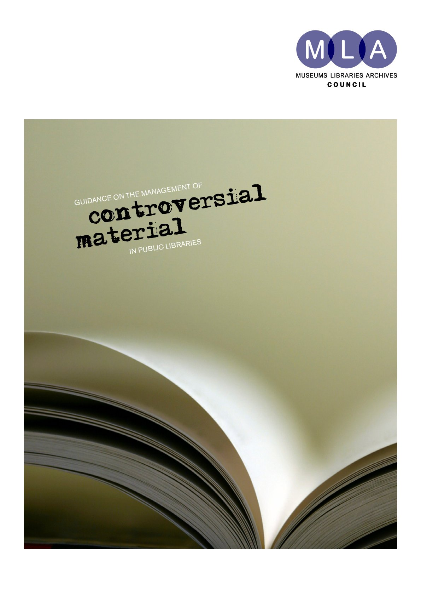

<!-- PAGE: 1 -->

# Guidance on the Management of Controversial Material in Public Libraries <!-- PAGE: 2 --> 1 Background
In November 2007 the Government commissioned the Museums,
Libraries and Archives Council (MLA) to produce guidance for
public libraries on the management of controversial material.1
Until now, the most frequently cited source for guidance on this topic is the
Chartered Institute of Information and Library Professionals (CILIP) policy statement
on “Intellectual Freedom, Access to Information and Censorship”, published in 2005.
This states clearly that:
“Access [to information] should not be restricted on any grounds except that of the
law. If publicly available material has not incurred legal penalties then it should not
be excluded on moral, political, religious, racial or gender grounds, to satisfy the
demands of sectional interest.”
with the Museums, Libraries and Archives Council to agree a common approach to deal with the inflammatory and extremist material that
some seek to distribute through public libraries, while also of course protecting freedom of speech.”

<!-- PAGE: 3 -->

**1.** Background
While this statement holds true, the cultural, political and social climate is continually
evolving, and a need has been expressed for more explicit guidance on the provision
of library stock that may be considered controversial in nature, ie. inflammatory and
extremist. It recognises that dealing with controversial material is a perennial problem
for library staff and has therefore positioned the debate on inflammatory and
extremist material within that context.
Notwithstanding the CILIP policy, and considerable good work by librarians2 in this
area, MLA’s discussions with library managers and sector bodies have demonstrated
a desire for guidance providing good and consistent practice around:
the selection and management of stock •
the provision of information and learning resources •
best practice within a context of local independence and accountability •
This guidance recognises that making confident and appropriate decisions
about selection, access and promotion of stock is about exercising informed and
professional judgement within the context of a strong collection development
policy. It is aimed at supporting policy makers and managers in local authority public
library services who are responsible for collection development policy and stock
management. It should also assist suppliers and other partners in the selection
process. Case studies have been included to highlight best practice in tackling some
of these issues (see Appendices B/C).
Operating within the law as they do, library authorities will consider for purchase any
publication which has not incurred penalties under current UK legislation. In support
of this guidance therefore, Appendix A provides an outline, for reference, of the
current legislation that may impact on the public library responsibility for the selection
and provision of information. This Appendix does not constitute legal guidance.

<!-- PAGE: 4 -->

**2.** Introduction
The British public library tradition supports the principles of
intellectual freedom; free access to diverse information, ideas and
knowledge; free expression; and democratic dialogue. To fulfil the
library’s democratic traditions of freedom of access and expression
within a diverse, multi-faith, and increasingly secular society, libraries
must enable access to a wide spectrum of opinions and belief both
in on-site resources and globally through information technologies.
Public libraries in England house millions of publications that reflect experienced and
expert approaches to the selection of resources, from material published in the UK
and overseas, to meet the needs and interest of local communities.

<!-- PAGE: 5 -->

Each local library authority selects library material, subject to local
consultation and accountability, within its statutory duty to provide
library services. The library has a responsibility to the local community
to actively and positively promote resources for learning, education,
cultural inspiration and community cohesion. It is important that all
sectors of the community feel able to play a full part in community
life and not feel intimidated, marginalised or ignored.
Libraries operate within the law to provide free access to a diversity of information,
opinion and ideas in a neutral and hospitable environment. Paramount is the
requirement to respond comprehensively and non-judgementally to the needs of
learners and researchers. Occasionally libraries will provide access to material
regarded by some as culturally or morally extreme. Each library authority must be
able to justify such action to their communities within the democratic principles of
free access that are the foundation of the public library purpose.

**3.** First principles <!-- PAGE: 6 --> IFLA3 has recently published a statement on the responsibilities of library providers
in a multicultural society4. At the opening of the section on Principles it states:
“Each individual in our global society has the right to a full range of library and
information services. In addressing cultural and linguistic diversity, libraries should:
serve all members of the community without discrimination based on •
cultural and linguistic heritage
provide information in appropriate languages and scripts •
give access to a broad range of materials and services reflecting all •
communities and needs.”

**3.** First principles of the guidance
library and information services and their users.

<!-- PAGE: 7 -->

**4.1.** Collection Development Policies
All library authorities should have a publicly available and up-to-date Collection
Development Policy that responds to the demography and needs of the community
and the library’s role to promote information, ideas and the cultural experience. This
should inform all aspects of stock management, from selection through access and
promotion to eventual disposal. Good practice will recognise:
personal and academic freedoms •
the rights of individual citizens to access published material •
the neutrality and responsibilities of the librarian. • <!-- PAGE: 8 --> A robust Collection Development Policy provides a solid framework for balanced
and informed decision-making. It should reinforce the expert role played by library
staff, and support them in dealing with potentially controversial items, responding to
challenges in relation to items selected (or not selected), and in deciding whether or
not to accept donated items. At the same time, it should make it clear that the ultimate
test against which potentially controversial material should be judged is that of its
legality. The outline of legislation provided in Appendix A will be helpful in this respect.
It should be noted however that this is intended to be used as an outline for guidance
purposes only, and not as a substitute for tailored legal advice. The law reflects the
tension between the need to safeguard national security (including the attempt to
tackle terrorism) on the one hand, and the need to discourage discrimination and
protect human rights on the other. As a result, in deciding whether or not to stock a
particular publication, competing interests may have to be considered.
Extracts from some typical good local Collection Development Policies are included
as Appendix B of these guidelines. For instance, the Bolton policy states:
“The library service may purchase any publication which has not incurred penalties under
current UK law. Material that is defined by UK legislation as obscene or blasphemous,
or which incites religious or political hatred, cannot be stocked or displayed.”
and
“We will not add, or remove, any item from our shelves solely at the request of an
individual or group… We acknowledge that on occasion individuals may find items
in our collections “offensive”. However, we do not label items to warn customers of
potentially ‘sensitive’ content and would only restrict access to material in order to
protect it from damage or theft, not as a form of censorship.”
A case study in Appendix C (section 1.4) shows why such policies should not be
treated as static documents.

<!-- PAGE: 9 -->

As local authority services, public libraries are obliged to abide by any authority
policies relating to the promotion of political or religious views. These may
occasionally restrict the presentation of stock, events or the use of community
facilities but should not conflict with the selection and provision of legal publications
for the library. The library service may wish to consider challenging any such
policies which are felt to be overly restricting or damaging to its ability to provide a
comprehensive range of materials.

**4.2.** Stock selection
Library stock is selected from all published material in print plus other media
including audio-visual. Material should be chosen for its literary, cultural and
recreational relevance or for its information and learning value reflecting the
objectives of the Collection Development Policy. Librarians should aim for a library
stock that ensures:
a range of material that reflects the demography of the area and the policy •
priorities agreed for the library service
a diversity of information, opinion and inspirational literature on any topic from the •
material available.
The quantity of any one publication should be managed with reference to a balance
between demand and the need to reflect the widest range of interests across the
total stock.
Stock should be selected objectively according to the Collection Development Policy,
not determined by the personal view of library staff, suppliers or other partners.
CILIP’s Ethical Principles5 offer guidance on the responsibilities of librarians. In
order to capture the diversity of language, culture and belief in Britain today, library
managers and staff should be trained in and alert to professional ethics and
established codes of conduct.6 <!-- PAGE: 10 --> These principles apply regardless of who is doing the selection. Where it is
outsourced, eg. to suppliers, other authorities or community groups, those doing
the selection should be bound by the same ethical principles and should receive
adequate support, guidance and training in applying them.

**4.3.** Controversial subjects
In the interest of intellectual freedom, material should not be rejected solely because
it is considered controversial. A good library should encompass controversial issues
and different perspectives in the interests of democracy and discovery. Challenges to
selection decisions should always be considered with reference to these principles
and to the library’s Collection Development Policy. Examples of such challenges are
included within the case studies in Appendix C.
Over time publications covering controversial subjects may become matters of
historical interest. Catering for future historical significance will require:
a comprehensive Collection Development Policy •
the inclusion of current accounts of history •
alternative ways of providing equal access to material that some may •
regard as controversial
the contribution of national, academic and larger public reference libraries •
providing on-site, lending and digital access to historic resources.

**4.4.** Involving others
In the selection of stock, as in all other aspects of library service provision, librarians
are encouraged to work in partnership with others, including:
non-library partner agencies that have an insight into community cultures, •
needs and interests
local residents, community groups and representatives •
stock suppliers with a language or cultural expertise responding to an •
informed brief from the librarian
regional, national or specialist consortia. • <!-- PAGE: 11 --> All partners must be made aware of the legal obligations of the library authority and
agree to comply with the library service’s Collection Development Policy.
Community engagement in stock selection helps the local authority fulfil its duty
to involve (as established by the 2007 Local Government & Public Involvement in
Health Act) by encouraging the closer involvement of local people in library choices.
It needs to complement the Collection Development Policy, increasing the sensitivity
and insight with which stock is chosen and allowing users and the community to
understand the rationale behind stock selection and to influence the choices made
on their behalf. This can add to the library’s standing in the community and support
positive community engagement and cohesion.
In all circumstances Collection Development Policy remains the responsibility of the
library authority. Librarians should be alert to the potential for material to contravene
policy and delegate choice with care in order to fulfil their overall accountability for
the collection. As with all forms of engagement, they should also be conscious of the
need to ensure that a full range of community views is heard and represented, not
just those of a small vocal minority.

**4.5.** Access to library material
All material should be catalogued, and information about holdings made available
through the catalogue both in-library and remotely, accessible to all.
Inter-lending facilities and the library network allow for a book to be requested at
any library and supplied from other public, college and university libraries, or the
British Library. The British Library’s valuable policy on lending and public access to
its collections sets out its practice7 but liaison between library sectors is essential to
promote a common understanding of stock policies and systems.
collections. Very occasionally, works within the Library’s collections are found to be illegal (under criminal and/or civil law). In such cases,
the Library will retain the work but it is suppressed until such time as legitimate access may be given”.

<!-- PAGE: 12 -->

**4.6.** Presentation and promotion of stock
Libraries may actively promote holdings on topics of current interest to raise
awareness, encourage understanding, improve accessibility and increase library
usage. This is not to promote a particular belief or opinion but to enable people to
follow an interest in a topic using library resources, to be exposed to new ideas and
encouraged to debate and at times challenge them. The Sandwell case study in
Appendix C (section 3.1) demonstrates the role author events can play in bringing
communities together and encouraging debate.
Librarians should be alert to local and wider sensitivities. While they may highlight a
spectrum of views, they must not knowingly incite a person to undertake an illegal
activity. All library managers and staff should have access to policy and/or legal
advice to resolve uncertainty (see Appendix A). Librarians should, on legal advice,
withhold from public access, material which in case law is proven to be instrumentally
linked to unlawful activity and declared illegal.

**4.7.** Donations
Donated material should be subject to the same Collection Development Policy,
with donors advised of the criteria. Any decision on the acceptance, display and
promotion of specific publications should remain with the responsible staff. All staff
should be made aware that occasionally people may want to use the library as a
route to the distribution of material that supports their own views and beliefs, or that
is disrespectful of those of others. Such material may contravene the Collection
Development Policy, which should be the benchmark for all decision-making. Staff
should also be alert to the possibility that material may be distributed by simply
leaving it in the library without reference to them.

<!-- PAGE: 13 -->

The prime focus of these guidelines is on the selection and
management of printed materials in public libraries, rather than on
Internet provision. Nevertheless, the Internet is now both integral
and essential to the purpose of libraries in providing access to
e-government, information, learning and community cohesion, and
the particular challenges it presents cannot be totally ignored here.
Many of the same principles will apply in considering policies for the Internet;
however it is global and, essentially, self-regulating. The library provider’s
responsibility is to enable access. The responsibility for the interpretation and
use of the information accessed through the Internet rests with the user.

**5.** The Internet <!-- PAGE: 14 --> IFLA and UNESCO recognise the status of public libraries in the information society
and in relation to democracy and human rights:
The concept of freedom of access to information and freedom of expression is clearly
outlined in Article 19 of the Declaration of Human Rights (UN, 1948):
“Everyone has the right to freedom of opinion and expression; this right includes
freedom to hold opinions without interference and to seek, receive and impart
information and ideas through any media and regardless of frontiers.”
In providing Internet access libraries should:
provide Internet access in accordance with the principles of freedom of thought •
and expression to all regardless of their background
respect the privacy of users •
enable users to make the most of the Internet for information, learning •
and communications for citizenship, e-governance and innovation through
assistance and training
provide an Acceptable Internet Use Policy advising users of their responsibility to •
act within the law when using the Internet (see example from Suffolk Libraries in
Appendix B, section 9.2)
provide a published policy on use by children and young people which also advises •
parents of their responsibility for children’s use of and safety on the Internet
be pro-active in drawing users’ attention to these policies and educating them •
about acceptable internet use.
Library authorities may also adopt filtering technologies to restrict access to certain
kinds of information. In doing so they should:
make this known to users and provide the opportunity for them to challenge •
particular instances of blocking or request the adjustment of blocking criteria
recognise that such techniques are imprecise and aim to minimize restrictions and •
avoid inadvertent blocking of legitimate resources.
Library staff may be instructed to intervene if they are aware of apparent illegal
activity, and managers should provide clear and accountable procedures for staff to
deal with such occurrences.

<!-- PAGE: 15 -->

Selection, provision and access to library material is informed by
legislation on terrorism, race relations, equality, local government,
freedom of expression and human rights. Appendix A outlines current
relevant legislation for reference only. Local Authorities should seek
legal advice as necessary to address specific incidents.

<!-- PAGE: 16 -->

MLA will review this guidance in consultation with other key
partners as necessary.
Notwithstanding the CILIP policy, and considerable good work by librarians in this
area, MLA’s discussions with library managers and sector bodies have demonstrated
a desire for guidance providing good and consistent practice around:
the selection and management of stock •
the provision of information and learning resources •
best practice within a context of local independence and accountability. •
This guidance recognises that making confident and appropriate decisions
about selection, access and promotion of stock is about exercising informed and
professional judgement within the context of a strong collection development policy.
It is aimed at supporting policy makers and managers in local authority public library
services who are responsible for collection development policy and stock management.
It should also assist suppliers and other partners in the selection process. Case
studies have been included to highlight best practice in tackling some of these issues.

**7.** Monitoring and
 reviewing this <!-- PAGE: 17 --> 1. Introduction
This note summarises the key legislation affecting the provision of extremist
publications in public libraries. It is hoped that it will help libraries identify the
key areas of risk and decide whether further legal advice is needed. Please note,
however, that this document will not cover legislation relevant to every issue, and it is
intended to be used as an outline for guidance purposes only, and not as a substitute
for tailored legal advice.
The law reflects the tension between the need to safeguard national security
(including the attempt to tackle terrorism) on the one hand, and the need to
discourage discrimination and protect human rights on the other. As a result, in
deciding whether or not to stock a particular publication, competing interests may
have to be considered. To be weighed up are:
the general obligation to “a comprehensive and efficient library service” •
(section 2.1 below)
the risk, perhaps small, of commission of an offence under the Terrorism Acts •
2000 and 2006 (section 2.2 below)
the requirements of race relations legislation (section 2.3 below) •
the impact of the Human Rights Act 1998 (section 3 below) •
the involvement of local persons under the Local Government and Public •
Involvement in Health Act 2007 (section 4 below)
Appendix A: Relevant legislation
(Appendix A has been prepared by Farrer & Co LLP)

<!-- PAGE: 18 -->

**2.** General Legislative Framework

**2.1.** Duty of Library Authorities
Public Libraries and Museums Act 1964
Section 7(1): General duty of Library Authorities to provide a ‘comprehensive’ library
service for those living, working and being educated within the area.
Section 7(2)(c): Specific duty to provide a sufficient number, range and quality
of books (and other library materials) “to meet the general requirements and any
special requirements of adults and children”.
If local residents want their library to stock particular literature, the library may be •
bound to do so to ensure a ‘comprehensive’ service.
Obligation can be interpreted stringently: In R v London Borough of Ealing and •
others ex parte Times Newspapers Ltd and others (1987) the decision of several
libraries to ban The Times on political grounds (specifically, in support of print
workers in an industrial dispute) was held to be an unlawful abuse of the libraries’
powers granted under the 1964 Act.
However, key legislation has been implemented since this case and the 1964 •
Act (including in particular the Human Rights Act 1998 and the Terrorism Act
2006). Library authorities and librarians now have to bear in mind other competing
considerations.

**2.2.** Terrorism
Terrorism Act 2006

**2.2.1.** Who can commit an offence
Section 18: Offences under the Act can be committed by the library authority as
a “body corporate” if the offence is committed with the consent or connivance of a
director, manager, secretary or other similar officer of the body corporate. Both this
individual and the body corporate would be guilty of the offence.
Individuals involved in the decision making process relating to publications (such •
as librarians themselves), could also be found guilty of an offence, whether or not
the corporate body is liable.
In this document, “Librarians” shall refer to any individual who might be liable for •
the offence, whether in their own capacity or as part of a body corporate.

<!-- PAGE: 19 -->

**2.2.2.** The Section 2 offence: ‘Dissemination of Terrorist Publications’
Librarians run a greater risk of committing the section 2 offence than the section 1
offence (encouragement of terrorism, which is consequently dealt with below).
(i) Definition of “Terrorist Publication”
Section 2(13): A “publication” includes matter to be read, listened to, looked at or
watched. In other words, it is not confined to books.
Section 2(3): Defines a “terrorist publication”. Broadly speaking, this will include
matter that is likely (a) to be understood as a direct or indirect encouragement or
inducement to commit, prepare or instigate terrorist acts; OR (b) to be useful to
those ends and to be understood as such.
Section 2(4): Describes matter that is likely to “indirectly” encourage terrorism. This
includes the glorification of terrorism (whether in the past, future or generally) from
which a person could reasonably be expected to infer that such conduct should be
emulated in existing circumstances.
Section 2(5): Explains that the question of whether a publication is a terrorist
publication must be determined at the time and in the circumstances it is
disseminated, and with regard to the contents of the publication as a whole.
Section 2(7): Explains that it is irrelevant whether a person is in fact encouraged
or induced to commit, prepare, or instigate acts of terrorism by the publication, or
actually uses the publication to do so. The focus is therefore on the content of the
publication, not its actual effect.
Although the whole publication need not be dedicated to the encouragement •
of terrorism etc. in order to be a “terrorist publication”, it is clear that the relevant
‘matter’ will be examined in context.
Similarly, it seems that historical accounts that could be interpreted as glorifying •
terrorism may be stocked if there is little or no possibility that a current reader
would try and emulate the acts described.

<!-- PAGE: 20 -->

(ii) Definition of “dissemination”
Section 2(2): Lists the ‘conduct’ which will count as dissemination. This includes
lending or offering a terrorist publication for loan, providing a service to others that
enables them to read, listen to or look at such a publication, transmitting its contents
electronically, and even possession of such a publication with a view to making it
available in the ways listed.
(iii) State of mind of Librarian: Intention and recklessness
Section 2(1): Broadly speaking, the offence will only be committed if a Librarian
intends the dissemination to encourage, induce or assist in acts of terrorism or is
reckless as to whether it has such an effect.
Recklessness in this context is not the same as carelessness or negligence. It •
means taking an unreasonable risk of which the risk-taker is aware.
(iv) Possible sanctions
Section 2(11): The offence carries a maximum prison sentence of 7 years
and/or a fine.

**2.2.3.** The Section 1 offence: Encouragement of Terrorism
Section 1(1) and 1(2)(a): It is a criminal offence to publish, or cause another
to publish a statement that is likely to be understood as a direct or indirect
encouragement or inducement to commit, prepare or instigate acts of terrorism.
Section 20(4): “Publishing a statement” includes providing access to the statement,
or making available any electronic service by which the public can access it, (for
example, internet access or a search engine).
Section 1(2)(b): As for the section 2 offence, the Librarian must also intend or be
reckless as to the effects of publishing the statement.
Section 1(3) – 1(5) and 1(7): These set out the definition of “indirect”
encouragement etc., the context in which the statement must be read, the focus on
content rather than effect, and the possible penalties. They mirror similar provisions
in the Section 2 offence (see 2.2.2 above).

<!-- PAGE: 21 -->

In providing library users with computers that have internet access, for example, •
Librarians may well be “publishing” statements. In particular, allowing library users
access to “terrorist” sites could be construed as “reckless”.
Although there may be scope for commission of the section 1 offence in this way, •
the prosecuting authorities are in practice likely to focus on the actual source of
publication, rather than intermediaries (such as Librarians), who are unlikely to
have intended to encourage terrorism.

**2.2.4.** Defence to Section 1 and Section 2 Offence
Sections 2(9) and 2(10), and Section 1(6): A Librarian who did not intend to
encourage terrorism may have a defence to both the Section 1 and Section 2
offences, if the terrorist publication or statement did not express their views or have
their endorsement, and it was clear in all the circumstances that it did not.
Section 2(10)(a): In the case of the Section 2 Offence, the defence can only be
used where the publication is of the type that encourages or induces terrorist acts. It
is not available if the publication in question is of the type that might be useful in the
commission or preparation of terrorist acts.
So, for example, a book which glorifies a historical act of terrorism might be •
covered by the defence, but a practical manual on how to make a device would not.
Section 3: If the dissemination or publication has been done electronically, the
defence will not be available if the individual has not complied with ‘Section 3 notice’.
A Section 3 notice is a declaration by a police constable that the statement, article, •
or record is unlawfully terrorism-related.
When the notice is issued, the person to whom it is addressed must, within 2 •
working days, stop making the matter available to the public (for example, block
an offending website), or modify it so it complies with the Act
If this is not done, that person will be deemed to have endorsed the matter in •
question, and the defence will be unavailable.
Therefore, as a provider of Internet access within a library, the Librarian and/or •
library authority will have to be vigilant to ensure that if a notice is issued, it is
complied with.

<!-- PAGE: 22 -->

**2.2.5.** Collection of Information
Section 58(1): It is a criminal offence to collect or make a record of information of
a kind likely to be useful to a person committing or preparing an act of terrorism; or
even to possess such a document or record. A “record” includes a photographic or
electronic record.
Section 58(3) An individual who does so will have a defence if they can show that
there was a reasonable excuse for the action or possession.
The offence carries a maximum of 10 years imprisonment and/or a fine. A court •
may also order forfeiture of any document or record caught by the act.
“Reasonable excuse” is not defined in the Act, and has not been tested by the •
courts in the context of librarians. Recent case law suggests however that a
person will have a ‘reasonable excuse’ provided that the information is possessed
for a purpose other than to assist in the commission or preparation of an act of
terrorism (R v K, 2008).
[It seems likely therefore that librarians could rely on the defence if the •
information had been collected/stocked inadvertently. It is less clear whether the
fulfilment of the general duty of library authorities (see section 2.1 above) would
of itself amount to a “reasonable excuse”].

**2.3.** Racial Discrimination
Race Relations Act 1976
(added to and amended by the Race Relations (Amendment) Act 2000)

**2.3.1.** Who can commit an offence
Section 32(1): An offence committed by an employee in the course of his
employment (except for specific offences) is done by his employer as well as by him,
whether or not it was done with the employer’s knowledge or approval.

**2.3.2.** General prohibitions on racial discrimination which are relevant to Library
Authorities and Librarians
Section 19B: A ‘public authority’ (or persons carrying out functions of a public
nature) must not racially discriminate.

<!-- PAGE: 23 -->

Section 20(1): A person who provides (for payment or otherwise) goods, facilities
or services to the public must not discriminate against anyone who seeks to obtain
them by (a) refusing or deliberately omitting to provide the services; or (b) by refusing
or deliberately omitting to provide the same goods, facilities or services as are normal
in relation to other member of the public.
Section 28: Details further discriminatory practices.
By “banning” certain extremist publications from libraries, Librarians and library •
authorities could be behaving in a racially discriminatory manner and/or operating
a racially discriminatory practice (but see the Section 42 disclaimer below).
Section 42: Nothing in the sections described above will be unlawful if it was done
to ‘safeguard national security’, provided the act was justified by that purpose.
If therefore, Librarians are acting (for example) in order to avoid commission of •
the offences created by the Terrorism Act 2006, this will override the prohibitions
on discrimination outlined above.

**2.3.3.** Further statutory duty of “specified authorities” to have due regard
to racial discrimination
Schedule 1A: “Specified authorities” includes local authorities and hence public
libraries operated by them, entities which fall under the heading of “Libraries,
Museums and Arts” (including The British Library), educational institutions, and The
Museums, Libraries and Archives Council itself.
Section 71: “Specified authorities” must have “due regard” to the need (a) to
eliminate unlawful racial discrimination; and (b) to promote equality of opportunity
and good relations between persons of different racial groups
This duty is NOT subject to the Section 42 disclaimer. •
However, “giving due regard” to these factors does not mean that a decision must •
be made subject to them. It is valid to take account of competing considerations
(including for example the Terrorism Act 2006) even if these might not promote
good relations between persons of different racial groups.

<!-- PAGE: 24 -->

**2.4.** Racial and Religious Hatred
Public Order Act 1986 (as amended by the Racial and Religious Hatred Act
2006 and the Anti-Terrorism, Crime and Security Act 2001)

**2.4.1.** Who can commit an offence
Section 28 and 29M: both the Library Authority (as a “body corporate”) and any
officer of the body who consented to the decision can be liable for the offence.

**2.4.2.** Meaning of “racial and religious hatred”
Section 17: Racial hatred means hatred of a group defined by reference to colour,
race, nationality (including citizenship) or ethnic or national origins.
Section 29A: Religious hatred means hatred against a group of persons defined by
reference to religious belief or lack of religious belief.

**2.4.3.** Relevant Offences (Racial Hatred)
(i) Section 18: Display of written material
Section 18(1) Displaying written material which is threatening, abusive or insulting
will be an offence if (a) the person displaying the material intends to stir up racial
hatred; or (b) having regard to all the circumstances, racial hatred would be likely to
be stirred up.
Section 18(5) An individual who did not intend to stir up racial hatred will not be
guilty of an offence if they did not intend the written material to be threatening,
abusive or insulting, and was not aware that it might be.
(ii) Section 19: Publication or distribution of written material
Section 19(1): Publication or distribution of written material which is threatening,
abusive or insulting will be an offence if racial hatred is intended or likely to be
stirred up (as per (a) and (b) in the Section 18 offence).
Section 19(2): An individual who did not intend to stir up racial hatred will have
a defence if they can prove that they were not aware of the content of the material
and did not suspect (and had no reason to suspect) that it was threatening, abusive
or insulting.

<!-- PAGE: 25 -->

(iii) Section 23: Possession of racially inflammatory material
Section 23(1): Possession of written material, or a recording of visual images or
sounds, which is threatening, abusive or insulting with a view to its being displayed,
published, shown or played (as relevant) will be an offence if racial hatred is intended
or likely to be stirred up (as per (a) and (b) in the Section 18 offence).
Section 23(3): An individual who did not intend to stir up racial hatred will have a
defence if they were not aware of the content of the material and did not suspect
(and had no reason to suspect) that it was threatening, abusive or insulting.
Even if stirring up racial hatred was not intended, it is possible that extremist •
literature might be found to be likely ‘in all the circumstances’ to have this effect.
However, Sections 19(2) and 23(3) effectively provide an ‘innocent dissemination’ •
defence, if (for example) a Librarian who had inadvertently stocked “threatening,
abusive or insulting” material was not aware of its content, and had no reason to
suspect its nature.

**2.4.4.** Relevant Offences (Religious Hatred)
Sections 29B, 29C and 29G: These contain offences which mirror the relevant racial
hatred offences, except that they require actual intention to stir up religious hatred.
There is no ‘secondary form’ of intention for the religious hatred offences that •
takes account of the surrounding circumstances.
As actual intention is required, these offences are unlikely to be applicable to •
Librarians and library authorities.

**2.4.5.** Sentencing
Section 27(3) and 29L(3): All the offences described carry a maximum penalty of 7
years’ imprisonment, or a fine, or both.
Section 27(1) and 29L(1)): Proceedings for all the offences can only be brought by,
or with the consent of, the Attorney General.

<!-- PAGE: 26 -->

**3.** Freedom of Expression and Other Human Rights

**3.1.** Human Rights Act 1998
Section 6: Public authorities (and public librarians themselves when carrying out
functions of a “public nature”) must act in accordance with the rights set out in the
European Convention on Human Rights (“ECHR”).
Section 3: All newly enacted legislation must be interpreted as far as possible in
accordance with the Act.
Library authorities (and most academic libraries) are “public authorities” for the •
purposes of the Act and will have to consider human rights when making decisions.
However, Section 3 means that subsequent legislation (such as the Terrorism Act •
2006) which prohibits the dissemination of certain publications can be assumed
to be compatible with the ECHR and must be adhered to.

**3.2.** Freedom of Expression: Article 10 ECHR
Article 10(1) (and the common law): Describes the right of freedom of expression.
Article 10(2): qualifies the right by making it subject to a number of competing
interests, such as national security
Everyone has the right, without interference by a public authority, both to receive •
information (e.g. individual reader or learner in the community) and to impart
information and ideas (e.g. authors).
However, the right is not absolute. It may be validly be restricted (e.g. in the case •
of obscene or pornographic material, or material which is excluded as a result of
the legislation described above), provided that any restriction is proportionate.
Applying the right is therefore a balancing act. For example, in Otto E R A Remer v •
Germany (1995) the applicant’s right to ‘freedom of expression’ (which he wished
to exercise by denying the gassing of Jews in Nazi Germany) was outweighed by
the need to protect the rights and reputation of people of the Jewish faith.
Article 10 does not guarantee a right to access information (R (Persy) v Secretary •
of State for the Environment (2002)). Neither does it impose an obligation to
supply information (Leander v Sweden (1987)).

<!-- PAGE: 27 -->

**3.3.** Freedom of Thought, Conscience and Religion: Article 9 ECHR
Article 9(1): Details the right to freedom of thought, conscience and religion,
including freedom to ‘manifest’ a religion or belief.
Article 9(2): States that this right is subject to limitations prescribed by law and
necessary in a democratic society in the interests of public safety, for the protection of
public order, health or morals, or for the protection of the rights and freedoms of others.
‘Banning’ extremist publications may arguably restrict freedom to ‘manifest’ a •
religious view or belief.
However, as with Article 10, this right can be validly restricted, for example in •
accordance with the anti-terrorism legislation.

<!-- PAGE: 28 -->

**4.** Relationship with Local Government Legislation
Local Government Act 1999 (as amended by the Local Government and Public
Involvement in Health Act 2007)
Section 3: ‘Best value authorities’ (which includes Local Authorities) have a duty
to make arrangements to secure continuous improvement in the exercise of their
functions, having regard to a combination of economy, efficiency and effectiveness.
Section 3A(1): From April 2009, if a ‘best value authority’ considers it appropriate,
it must take steps to involve representatives of local persons in the exercise of its
functions (e.g. by providing them with information or consulting them)..
Section 3A(2)(b): There will be no obligation to take any step which conflicts with
the authority’s other legal duties (for example, their duty to comply with the terrorism
legislation described above).
May lead to Library Authorities involving members of the local community in stock •
selection (though only if the Authority ‘considers it appropriate’).
If a decision is made to involve members of the local community in this way, care •
should be taken to ensure that stock selected by such individuals does not expose
the library (or the individuals themselves) to liability under any of the legislation
described above.
Farrer & Co LLP (Ref: JPW/RXC)

**28.** July 2008 <!-- PAGE: 29 --> Extracts from local authority stock policies (quoted with permission):
BOLTON
Key principles
Public libraries are an integral part of any community and their collections should
reflect the ideas and views of that community. In doing this the service will hold items
which some individuals find challenging and controversial.
Bolton Libraries follows the Chartered Institute of Library and Information
Professionals’ guidelines for stock management which states:
“The function of a library service is to provide, so far as resources allow, all books,
periodicals, etc. other than the trivial, in which its readers claim legitimate interest. In
determining what is legitimate interest the librarian can safely rely upon one guide
only – the law of the land. If the publication of such matter has not incurred penalties
under the law it should not be excluded from libraries on any moral, political, religious
or racial ground alone, to satisfy any sectional interest.
The public are entitled to rely upon libraries for access to information and enlightenment
upon every field of human experience and activity. Those who provide library services
should not restrict this access except by standards which are endorsed by law.”
In line with this statement the library service may purchase any publication which has
not incurred penalties under current UK law. Material that is defined by UK legislation
as obscene or blasphemous, or which incites religious or political hatred, cannot be
stocked or displayed.
The library service does not knowingly purchase such material and if any item becomes
subject to legal proceedings it will be removed. We will not add, or remove, any item
from our shelves solely at the request of an individual or group.
A representative range of political and religious materials is held across all libraries in
the Borough and made available through the normal reservation system.
Sacred texts purchased by the library service are managed in the same way as other
stock items and they may be withdrawn or replaced as part of the routine stock
management processes.

<!-- PAGE: 30 -->

We acknowledge that on occasion individuals may find items in our collections
“offensive”. However, we do not label items to warn customers of potentially “sensitive”
content and would only restrict access to material in order to protect it from damage
or theft, not as a form of censorship.
LONDON BOROUGH OF CAMDEN

**5.1.** Criteria for selection

**5.1.1.** General aims
Library stock is chosen by professional librarians in accordance with the aims
and objectives set down at the start of the stock policy document and within
budgetary limits:
in accordance with any stock plans or profiles •
to reflect community needs •
without personal bias •
considering the following criteria. •

**5.3.** Censorship
The public library, free at the point of use, is a guarantee that alternative and minority
views are accessible to all.
The Library Association’s Policy Statement on Censorship (1989) says, “The function
of a library service is to provide as far as resources allow, all books, periodicals and
other materials, except the trivial, in which its readers claim legitimate interest. In
determining what is a legitimate interest the librarian can safely rely upon one guide
only - the law of the land. If the publication of an item has not incurred penalties
under the law it should not be excluded from libraries under any moral, political,
religious or racial ground alone, to satisfy any sectional interest. The public is entitled
to rely upon public libraries for access to information and enlightenment upon every
field of human experience and activity.”
Camden Libraries supports the above and will therefore stock material which, within
the law, challenges established views and may be of a controversial nature, although
it will not be held or displayed in a way that unreasonably offends a section of the
community. Material thought likely to offend a substantial section of the community
will be held in Reserve Stock.

<!-- PAGE: 31 -->

BLACKBURN WITH DARWEN

**3.1.** The public are entitled to rely upon libraries for access to information and
enlightenment in every field of human experience and activity. Resources
purchased will reflect the range of formats, topics and viewpoints which are of
interest to this community.

**3.2.** Those providing library services should not restrict this access except by standards
which are endorsed by law. In fulfilling our legal obligations we adhere to the CILIP
guidelines on Intellectual Freedom and Censorship.

**3.3.** Items which have not incurred any penalty under the law will not be excluded merely
because they are controversial, but will be evaluated and judged by the standards
and criteria listed here.

**3.4.** The obligation to facilitate the flow of information and ideas within the limits of
the law is summarised in CILIP’s Code of Professional Practice for Library and
Information Professionals which states that librarians will “defend the legitimate
needs and interests of information users, while upholding the moral and legal rights
of the creators and distributors of intellectual property”. CILIP members are advised
to “avoid inappropriate bias or value judgements in the provision of services”.

**3.5.** Some older works, which we may wish to retain for a variety of reasons (see Reserve
Collections Policy) may, by current standards, seem controversial, but yet reflect
the morals and social attitudes of their day. Adults who use this stock can make a
reasonable and critical evaluation of the opinions expressed and the librarian is not
at liberty to censor this material.

<!-- PAGE: 32 -->

WARWICKSHIRE

**6.** Censorship
Censorship will only be exercised when required by the law. This is embodied in a
policy statement by the Library Association, now endorsed by the Chartered Institute
of Library and Information Professionals.
“The function of a library service is to provide, so far as resources allow, all books,
periodicals, etc. other than the trivial, in which its readers claim legitimate interest. In
determining what is a legitimate interest the librarian can only safely rely upon one
guide only – the law of the land. If the publication of such matter has not incurred
penalties under the law it should not be excluded from libraries on any moral, political,
religious or racial ground alone, to satisfy any sectional interest. The public are
entitled to rely upon libraries for access to information and enlightenment upon every
field of human experience and activity. Those who provide library services should not
restrict this access except by standards which are endorsed by law.”
Controversial material will be evaluated according to WLIS selection guidelines – see
9.2. and criteria – see 9.4. Decisions are based on the assumption that the adult
reader is capable of making his/her own critical and reasoned evaluation of views
and opinions expressed in the item. Where appropriate the selection process will
enlist the help of community representatives. In cases where the Buying Team has
concerns, WLIS will seek further advice via relevant external specialists and advisory
groups, for example, the Warwickshire County Council Equality Officer and Race
Equality Officer, and the National Literacy Trust.

**9.2.** Stock Selection Guidelines
Buying Teams, county-wide specialists and Divisional staff use the following
guidelines and criteria in the selection of stock:
Only books and other media that are legally available will be considered for •
purchase. Material that promotes racism or prejudice against any social group
must be avoided. However, stock selection decisions will be made on the
assumption that adults are able to make a reasonable and critical evaluation of
the views and opinions expressed in an item of stock.
Qualitative judgements are made to assess how well items meet identified •
customer priorities and community needs set out in service objectives, as WLIS
cannot buy everything that is published, apart from local studies material where
we do aim to buy everything for our catchment area (ie. Warwickshire).

<!-- PAGE: 33 -->

SUFFOLK
Extracts from:
Policy on internet access in libraries and record offices
Internet access is filtered and monitored to block inappropriate and illegal web sites
or pages. Children and teenagers have different and stricter levels of filtering to
adults. We expect parents to take responsibility for their children’s internet browsing
in the library, and can block this at a parent’s request.
Filtering can never be 100 per cent foolproof so library and record office staff are
also watchful and will remind people who look at offensive content that this is not
appropriate and that, if they do not stop, they may have their sessions closed down,
and in some cases have their internet access taken away for a time.
Before an internet session begins, customers will have to read and agree to our
acceptable use policy. This informs them what we expect from them, what the county
council’s responsibilities are, and what the consequences may be if they do not
follow these conditions. It also requires of them that they do not access web pages
or web sites, which involve
illegal material or activities •
pornography •
•	 racism, hatred and intolerance
•	 violence
security risks and computer misuse. •
What happens when someone breaks these conditions of use
Anyone who breaks the conditions will first be asked to stop by a member of
staff. If they stop, the incident will be over. If they persist, they will receive another
warning, and if they still do not stop, the staff may end their session and in extreme
circumstances may remove their right to use the internet in any Suffolk library or
record office for 24 hours.
Sometimes customers report to staff on suspected web misuse by other customers.
We expect library and record office staff to investigate these incidents and then
follow them up if there are concerns about computer misuse or unacceptable
content. If any of these were serious cases and there were extreme concerns we
would consider removing that customer’s right to use the internet for a longer period
of time up to a year.

<!-- PAGE: 34 -->

This appendix uses case studies from several authorities to illustrate
good practice in how library services deal with particular challenges
in this field, including the selection of materials in languages not
spoken or understood by staff, the handling of complaints, policies
on donated materials and the presentation of religious texts.

**1.** Selection and management of materials:

**1.1.** Example of how inter-library cooperation can enable more informed provision
of community language materials
The Chinese Library Subscription Service, set up by Westminster Libraries in 1992,
was the first of its kind for Chinese language materials in the UK. It provides a
Chinese book loan and support service for other local authorities on payment of a
subscription (currently £500 per annum). Books published in mainland China and
Hong Kong are selected by Westminster Libraries’ Chinese team, who manage
Westminster’s own Chinese collection at Charing Cross Library, five minutes from
London’s Chinatown.
The majority of the stock is selected through contracted suppliers (currently, one
based in China, the other in the UK. for Hong Kong publications). Through the
subscription service, other library authorities, who may not have Chinese speakers on
their staff, are able to buy in the expertise of the Chinese team at Charing Cross.
Subscribers receive 100 items (adult fiction, non-fiction and children’s materials) per
subscription, which is exchanged once a year.
Professional advice covering sources of supply, classification, and audio-visual
materials is provided and there is also a Chinese translation and desktop publishing
service. Subscribers can use this service to publicise their Chinese collections.

**1.2.** Supply of Asian stock in Leicester City
Up to five years ago the main providers of Asian stock to Leicester City were
suppliers associated with CILLA (Co-operative of Indic Language Library
Authorities), a national organisation established in 1980. Suppliers have to pass a
quality assessment to be part of this organisation and transliterations, annotations
and MARC records are assessed for public library use by language specialists.

<!-- PAGE: 35 -->

In Leicester’s experience, no material bought from this source has ever been identified
as controversial or inflammatory. However five years ago the authority decided to buy
more material from outside the CILLA process for the following reasons:
stock appeared to be cheaper •
it would be possible to widen the type of material provided to customers •
the authority would be supporting local businesses •
it was felt that staff had the appropriate language skills to select the “right stock”. •
However, it was discovered that any savings made were a false economy when the
service took into account the entire administrative costs associated with book supply.
They found that it took longer to catalogue non-CILLA material as it didn’t have
records. It was also necessary to process material locally, and the service was unable
to guarantee that no inflammatory material was being bought. Local suppliers did
not always know, or understand, the controversial nature of the material they were
supplying. Staff may have had the language skills but they didn’t have the time to
read every item bought to ensure that it was suitable for stock.
Several months after this new system of purchasing material was implemented, it
emerged that the authority had put into stock Islamic books that were condoning
violent action against non-Muslims. These books were quickly removed from stock.
The policy of buying from local suppliers has now been reversed. Nearly all Asian
stock, and now also Polish stock, is purchased via CILLA. Other foreign language
material tends to be purchased from a specialist established supplier such as Grant
& Cutler. Leicester does not now use small local suppliers. In many ways this is
unfortunate but they now get very few complaints about “unsuitable” stock.

**1.3.** Rethinking stock provision for young people in Birmingham Libraries
In Birmingham Libraries, the graphic novel and manga collections, whilst popular,
were concerning staff. This concern was about age-appropriate material, as some
of the collections were in adult sections, whilst others were in children’s or young
adult sections. In particular, there was a focus on purchases of material for Children’s
Services which, on arrival, appeared to be aimed at older readers.
The solution was to invite a comic specialist in to run training about understandings
of these materials. The training explored the perception of the comic strip as a
medium predominantly addressing children as an audience, although it can and has
been used to create texts aimed at adults.

<!-- PAGE: 36 -->

As staff from both Adult and Children’s Services attended, the trainer was able to
facilitate discussion about what should become of the more “adult” material that had
been bought for Children’s Services. This led, in turn, to a more extensive discussion
during the training about creating a working group from both sides of the service to
reorganise the stock and, most significantly, to create a fund for graphic novels and
manga which would buy for the whole authority, thus allowing decisions about the
location of materials to be taken at a later stage. This was actioned with the support
of senior staff, thus ensuring more effective use and circulation of funds and stock,
whilst also developing staff understanding of the medium.

**1.4.** The importance of ensuring that stock policies are not static documents
In the mid-1990s the emergence of the Black Lace series, and other similar erotic
fiction aimed specifically at women, provided a new selection dilemma for public
libraries. In one large English county, some areas bought these titles, viewing them
simply as a racier version of the long established Mills & Boon romances, and
reflecting a general, wider tolerance of sexual matters. Other areas saw the series
as little more than pornography and did not feel that public money should be spent
on items of little intrinsic literary merit. In those areas that bought the series the
books issued well, but there were some public complaints about the sexual content
of the books.
There was a clearly a dilemma here: was this series part of a wider change in public
mores and tolerance, legally published that people wanted to read or were they of too
little worth for public money to be spent on? The authority’s stock policy might have
provided those making purchasing decisions with clear guidelines on these matters,
although it had been written in 1981 and had not been significantly revised over the
ensuing 15 years. It spoke clearly of the duty of libraries to provide any item that was
lawfully published and for which there was a public demand. However, there was no
specific guidance on erotic fiction as this had not been part of mainstream publishing
at the time of writing. Equally, however, there was no specific guidance on which might
constitute literary quality, since that is beyond the scope of such a document.

<!-- PAGE: 37 -->

Staff who had decided to purchase Black Lace titles felt the stock policy justified
their decision, as the material clearly met the criterion of being lawfully published,
and the fact that they issued well suggested that there was public demand. The
management team however felt that the perceived poor literary quality of the books
made it very difficult not to uphold the complaints received, and so decided that
no more titles in the series should be bought at that time. It may be argued that
sexual content was the actual reason for this decision being reached, particularly as
Mills and Boon titles (less explicit, but possibly of similar literary merit) were widely
bought. However, the decision to purchase other more controversial titles - such as
Madonna’s “Sex” - taken by the same management around the same time suggests
this may not have been the case.
An updated and more comprehensive stock policy might have helped prevent
different decisions being taken across the authority, and to have made it easier to
come to a more open and defensible decision about Black Lace. Equally, however,
it is not possible to anticipate every change in circumstances. Stock policy has to
be able to provide broad sustainable guidelines while being sufficiently dynamic
to reflect changing fashion and opinion. This is a difficult balance, and this case
demonstrates that detailed policies require continuous adaptation and input,
informed by individual decisions about specific titles, to work successfully.

**2.** Handling complaints

**2.1.** A complaint received by Westminster City Council
The complaint related to:
holdings in the City Council’s Libraries of books by Sayyid Qutb, an Islamic writer •
no longer living
a perceived prominence being given to the Bengali collection at a particular library •
The customer complained that the library service should not be stocking titles by
Sayyid Qutb because in his view his writings promoted jihad or holy war.
In its reply the council referred the customer to Westminster Libraries Stock policy
which states that:
“for all library stock, material held and supplied is only restricted by the law of the
land. Within this constraint, library stock should offer the greatest possible freedom
of choice and reflect all points of view, and be accessible to all sections of the
community. No library materials should be excluded because of the race, nationality,
social, political or religious views of the author”.

<!-- PAGE: 38 -->

The reply pointed out that the works of Sayyid Qutb are available, not only in libraries,
but from bookshops and online from Amazon, and that they will be of interest to
people for many reasons. Historians, journalists, researchers, for example, will require
access to his books to help them understand the current, very complex, world situation.
The council also argued that the works reflect one view of Islam and that it was
important that the city’s libraries provided balanced collections to ensure that
different viewpoints are available for library users. This was the aim of the library
service, and managers would be reviewing stock in this area to ensure that enough
books were stocked to reflect the views of moderate Muslims, and would purchase
more titles if necessary.
The customer also expressed concern that the Bengali language stock was displayed
separately. The council’s response explained that there is a significant Bengali
community in Westminster. After a survey of the Bengali community, a Bengali
Outreach Worker had been appointed to promote social inclusion and encourage
Bengali residents to use the library. By shelving the collection separately, the
council was not giving prominent public display to any particular view, but was rather
encouraging people who may not be in the habit of using libraries to become library
members by showing them that libraries have books in their own language, and in
English, which reflect their culture and interests. Westminster Libraries do the same
for other communities, eg. through the provision of a Chinese collection at Charing
Cross Library. The council also tries to ensure that the Bengali language stock
includes sufficient books on subjects such as health, cookery, language courses etc,
as well as books on Islam itself.
The customer was also concerned about the balance of books between Islam and
other faiths. Library managers checked the acquisitions for that year and were able
to tell the customer the number of titles in English ordered on Christianity, Islam,
Judaism, Hinduism, Buddhism, etc.
On receipt of the council’s letter, the customer did not take the complaint any further.

<!-- PAGE: 39 -->

**2.2.** A complaint about graphic novels received by Northumberland Libraries
Northumberland Libraries, on launching a series of graphic novels collections across
the county, received a complaint from one user about both the collection and the
readers of the material in a particular service point. The argument was that both
readers and graphic novels were inherently problematic. As the reader articulated it,
these were neither the people nor the stock one would want in a library.
The staff understood that graphic novels, comics and manga are materials that are
often seen as controversial within a library setting but they were clear that they
should form part of any collection. After some discussion, a meeting was arranged
with the complainant to discuss the issue and to explore sensitively what troubled
them about graphic novels and their readers.
This reader identified seeing groups of young men reading graphic novels in the
library as the key. As discussion progressed, authority policy was explained with
regard to attracting young adults into libraries and with regard to developing young
adult related collections that covered, amongst other materials, graphic novels. A key
point was that services should address all the community and that, further, the young
people, in engaging in reading, were using those services appropriately.
The complaint was not pursued. In addition, staff consequently held a book event in
the library about the medium. This event talked about understandings of the form
and publicised the collection.

**3.** Stock promotion

**3.1.** An event in Sandwell Libraries to promote understanding of culturally
diverse material
Promoting reading and discussion of controversial ideas can be a key role for the
library as Sandwell Library found. A consortium called Reading Partners, involving
nine major UK publishers, from Penguin to Random House and run by The Reading
Agency has been developed. It’s aim is to encourage readers to widen their reading
horizons and to help publishers and libraries understand how to reach and serve
BME communities better. A Rageh Omaar event in Sandwell is a good example of
what can be achieved through this library/publisher partnership.

<!-- PAGE: 40 -->

Penguin would never normally tour Rageh to library venues, but because of the
Reading Partners were happy to send him to West Bromwich to talk about his new
book. The library service organized an event attracting 246 local people around half
of whom were from local BME communities (mainly Muslim), and Rageh was thrilled
not to be talking to just a literary – in-crowd. The audience and council officers were
particularly pleased by the debate that ensued, led by Rageh, about what it means to
be a Muslim in today’s Britain. Approaching the topic from a cultural/ literature angle
made for a very balanced debate, with a genuinely mixed audience.

**4.** Donated materials

**4.1.** Handling donations in Leicester City
Leicester City Libraries report that in their view this is the area where problems
are most likely to be encountered. One particular library in the city serves a very
mixed community including many Muslims. On a number of occasions, customers
have brought in newspapers and magazines, (mainly Islamic in Arabic), which have
been purchased by them or produced locally. If counter staff do not know what
these newspapers/magazines contain, the items are forwarded to be looked at by a
member of Leicester City Council staff who has applicable language skills. If items
are just left in libraries without being checked first, they are discarded.
From time to time donations have also been sent by organisations in this country and
outside the UK. These are usually accompanied by a letter or email asking the library
service to say that the items have been received, and to state which libraries items
have been added to. These letters usually have a very dictatorial tone. Experience
has taught Leicester not to accept this material and in common with most other local
authorities, these items are discarded.
In one particular incident, a copy of “Ghetto Kingz – life as we know it” by Don C.
Anozie was donated to the service. The author of this book had killed a young person
in the locality and the family of the person killed mounted a campaign to have the
book banned. This campaign was not directed at the library service but the authority
considered that this book should not be in stock and the donation was refused.
The service is frequently asked to take donated books but now has a policy of
not accepting donations unless the item meets the authority’s selection criteria, is
considered essential to stock and has been looked at first by someone with the
appropriate language skills.

<!-- PAGE: 41 -->

**5.** Stocking of religious texts

**5.1.** Leicester City policy on the shelving of the Koran and other religious texts
Some libraries in Leicester have received complaints about the Koran not being
placed on the top shelves in libraries. Some customers go along the shelves and
place the Koran so it is shelved higher than other books. This action arises from the
practice in many Muslim homes of the Koran being placed on a high shelf above
commonplace things, as it is the word of God.
The authority consulted the Federation of Muslim Organisations in Leicester about
this matter, and they advised that all religious texts should be kept on a top shelf
together. This meant that no offence is caused, as the scriptures of all the major
faiths are given respect in this way, but none is higher than any other.

<!-- PAGE: 42 -->

Leading strategically, we promote
best practice in museums, libraries and
archives, to inspire innovative, integrated
and sustainable services for all.
MLAPOL0409
Museums, Libraries and Archives Council
Wellcome Wolfson Building, 165 Queen’s Gate,
South Kensington, London SW7 5HD
T: 020 7273 1444 E: info@mla.gov.uk
www.mla.gov.uk
Registered Charity No: 1079666

## Footnotes

[^1]: Extract from the Prime Minister’s National Security statement, 14 November 2007: “The Secretary of State for Culture, Media and Sport is working with the Museums, Libraries and Archives Council to agree guidance for local authorities to help them to take action if they are concerned about the spread of extremist messages in local libraries.”
[^2]: “Librarians” is used throughout this document to denote all public library staff with a role in the selection and/or management of stock.
[^3]: IFLA (The International Federation of Library Associations and Institutions) is the leading international body representing the interests of library and information services and their users.
[^4]: See *The Multicultural Library – a gateway to a cultural diverse society in dialogue*: <http://www.ifla.org/VII/s32/pub/MulticulturalLibraryManifesto.pdf>
[^5]: CILIP Ethical Principles and Code of Professional Practice: <http://www.cilip.org.uk/policyadvocacy/ethics>
[^6]: IFLA Committee on Free Access to Information and Freedom of Expression (FAIFE): <http://www.ifla.org/faife/>
[^7]: Extract from British Library policy: “The Library exercises no censorship or moral view of what its readers access or borrow from its collections.”
[^8]: See the IFLA/UNESCO Internet Manifesto Guidelines: <http://www.ifla.org/III/misc/im-e.htm> and <http://www.ifla.org/faife/policy/iflastat/Internet-ManifestoGuidelines.pdf>
