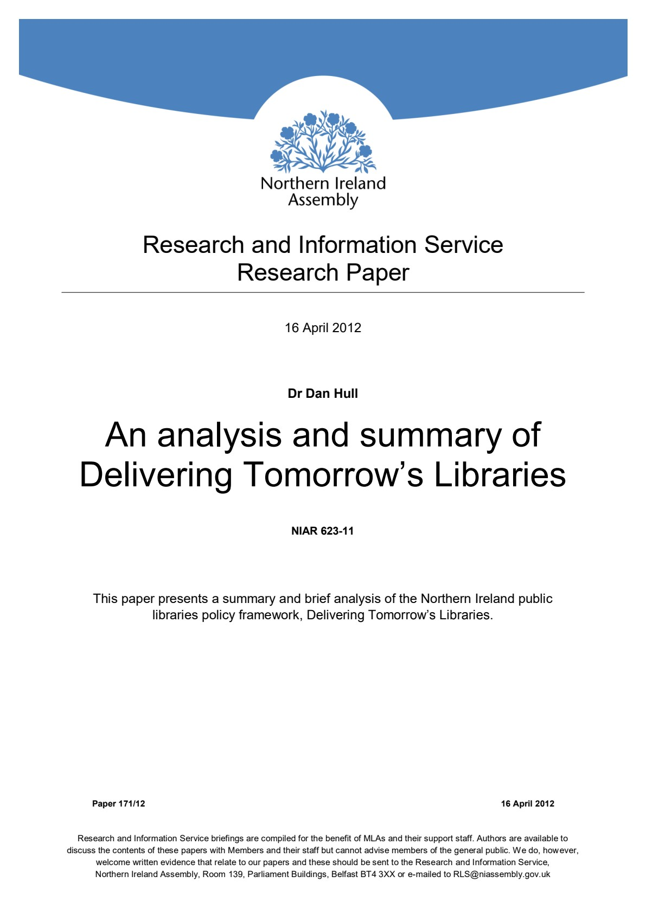

<!-- PAGE: 1 -->

# Research and Information Service Research Paper

*Research and Information Service briefings are compiled for the benefit of MLAs and their support staff. Authors are available to discuss the contents of these papers with Members and their staff but cannot advise members of the general public. We do, however, welcome written evidence that relate to our papers and these should be sent to the Research and Information Service, Northern Ireland Assembly, Room 139, Parliament Buildings, Belfast BT4 3XX or e-mailed to RLS@niassembly.gov.uk.*

**16 April 2012**

**Dr Dan Hull**

# An analysis and summary of Delivering Tomorrow’s Libraries

**NIAR 623-11**

*This paper presents a summary and brief analysis of the Northern Ireland public libraries policy framework, Delivering Tomorrow’s Libraries.*

**Paper 171/12**

<!-- PAGE: 2 -->

*(This page is intentionally blank in the original document)*

<!-- PAGE: 3 -->

# Key issues for consideration

- Across the UK, the total number of book loans from libraries has fallen from around 650 million a year in the 1980s to fewer than half this number in the past four years, with an average annual decline of 3.4%.
- A recently published survey of public library authorities in England, Wales and Northern Ireland by the Chartered Institute of Library and Information Professionals (CILIP) has concluded that over 2,000 staff posts have been removed and 3,000 opening hours a week cut from public library services in the financial year 2011/12.
- The current policy framework covering the provision of public libraries in Northern Ireland is *Delivering Tomorrow’s Libraries*. This was published in 2006 during a period of direct rule and prior to the creation of the libraries body, Libraries NI.
- Since the publication of *Delivering Tomorrow’s Libraries*, Libraries NI has launched three consultations resulting in the closure of ten libraries in Greater Belfast, two outside Belfast, and the reduction of opening times overall by 238 hours per week.
- A number of the partnerships and case studies cited in *Delivering Tomorrow’s Libraries* were current in 2006, but may now no longer be of relevance.
- It is not clear to what extent the Public Library Standards are still appropriate in their current form. Indeed, DCMS Public Library Standards, issued for public libraries in 2006, 2007 and 2008, have since been abolished in England.
- It is not clear whether performance assessment is still being carried out in the manner originally specified in *Delivering Tomorrow’s Libraries*.
- A number of developments which are cited in the document as forthcoming have now occurred. For example, Libraries NI was created in 2009; to what extent has the creation of a single library authority created a need for a different set of library standards?
- *Delivering Tomorrow’s Libraries* states that the creation of this body ‘will provide the opportunity to achieve a strategic approach’ to a number of issues. However, it is not clear what the strategic approach now is to issues such as the unified planning of capital expenditure, staff development, or research into user requirements.
- Stages one (in 2010) and two (in 2011) of a public libraries review resulted in the closure of 12 libraries in all. Although these two previous consultations made reference to *Delivering Tomorrow’s Libraries*, a number of additional documents and factors were also cited as influential and relevant, including the Libraries NI corporate plan, the Investment Strategy for Northern Ireland, the Libraries NI vision, as well as the ‘evolving political, social and economic landscape’.
- Comparisons with other jurisdictions reveal significant pressure on resources elsewhere, particularly in England and Wales. Estimates of the number of local libraries closing in England range between 400 and 1000.

<!-- PAGE: 4 -->

*(This page is intentionally blank in the original document)*

<!-- PAGE: 5 -->

# Executive Summary

This paper presents a summary and brief analysis of the Northern Ireland public libraries policy framework, *Delivering Tomorrow’s Libraries*.

Across the UK, the total number of book loans from libraries has fallen steadily from around 650 million a year in the 1980s to fewer than half this number in the past four years, with an average annual decline of 3.4%.

A smaller proportion of the population holds a library card, and there are fewer public libraries, than four years ago. In 2007, there were 111 libraries in Northern Ireland with 49% registered as a member, compared with 101 libraries and a 37% registration level in 2011[^1]. However, recent research has shown that the social contact, events and wider services offered by libraries are valued highly by users, especially those from vulnerable groups and disadvantaged communities. Use of libraries by children is particularly high.

Northern Ireland spends below the UK average on its library provision, and has a markedly lower proportion of active borrowers than England, Scotland or Wales. It also has fewer libraries per person than anywhere else in the UK. However, the proportion of the population visiting a library has risen steadily in Northern Ireland between 2008/09 and 2010/11.

The Northern Ireland Library Authority (Libraries NI) is an Executive Non-Departmental Public Body, established under the Libraries Act (Northern Ireland) 2008. It began operating in 2009/10, replacing the previous structure whereby libraries were managed through five Education and Library Boards.

In response to the Comprehensive Spending Review, the final 2011–2015 budget allocation from DCAL outlined an increase in the budget allocation for Libraries NI of £2m of additional resource and £1.8m in capital over the four years. However, taking inflation into account, the real-term resource budget for Libraries NI will reduce by 7.4% over four years.

*Delivering Tomorrow’s Libraries* was published by the Department of Culture, Arts and Leisure (DCAL) in 2006. It represents the only policy framework produced specifically for the development of public libraries in Northern Ireland. A vision is outlined:

> ‘A flexible and responsive library service which provides a dynamic focal point in the community and assists people to fulfil their potential.’

Three priorities for action are identified: customer focus, targeted support, and innovation and efficiencies. Ten Public Library Standards (PLS) are set out to ‘determine the baseline of service which should be available to all people in Northern Ireland’, to ‘maintain a continuous and measurable improvement in the quality of the public library <!-- PAGE: 6 --> service’, and ‘ensure value for money is provided’. It is stated that ‘performance will be assessed against the standards every year and a report placed on the DCAL website’. However, it is not clear at the present time whether such assessments are available for recent years.

Of the ten Public Library Standards, the research which is available permits a partial assessment of their current success. For example, for PLS2, a NI Assembly research paper suggests that coverage of static and mobile libraries falls slightly short of the 85% target at 84%, or 74% if Belfast is excluded. For PLS4, stock expenditure is below the 2008/09 target of £2.50 per capita, at £1.93 in 2010/11, an estimated £2.20 in 2011/12, and an initial budget for 2012/13 of £1.51 per capita. For PLS6, on the basis of current population estimates, it is likely that there are 7.35 public access workstations per 10,000 population, exceeding the target of at least six. For PLS8, the findings of the 2010/11 Continuous Household Survey indicate that 32% of respondents visit a library at least once a year, well below the target of 45%.

In the light of these developments, it is not clear to what extent the Northern Ireland Public Library Standards are still appropriate in their current form. Indeed, the DCMS Public Library Standards, issued for public libraries in 2006, 2007 and 2008, have since been abolished in England.

Comparisons with other jurisdictions reveal significant pressure on resources elsewhere, particularly in England. Some of the options being considered in the Future Libraries Programme in England include shared services, merged functions, staffing across authorities, support from volunteers and use of other community buildings. Estimates of the number of local libraries closing in England range between 400 and 1000.

<!-- PAGE: 7 -->

## Contents

- [Key issues for consideration](#key-issues-for-consideration) 1
- [Executive Summary](#executive-summary) 3
- [Contents](#contents) 5
- [1 Context: Overall use of libraries](#1-context-overall-use-of-libraries) 7
- [2 Libraries NI](#2-libraries-ni) 8
  - [2.1 Overview and functions](#21--overview-and-functions) 8
  - [2.2 Budget](#22--budget) 8
  - [2.3 Legislation](#23--legislation) 9
- [3 Delivering Tomorrow’s Libraries](#3-delivering-tomorrows-libraries) 10
  - [3.1 Customer focus](#31--customer-focus) 11
  - [3.2 Targeted support](#32--targeted-support) 11
  - [3.3 Innovation and efficiencies](#33--innovation-and-efficiencies) 12
- [4 Library standards](#4-library-standards) 12
  - [4.1 Summary of public library standards](#41--summary-of-public-library-standards) 12
- [5 Recent developments](#5-recent-developments) 13
  - [5.1 Strategic review of libraries](#51--strategic-review-of-libraries) 13
  - [5.2 Review of Opening Hours](#52--review-of-opening-hours) 14
  - [5.3 Investment in libraries](#53--investment-in-libraries) 14
  - [5.4 Programme for Government and Investment Strategy commitments](#54--programme-for-government-and-investment-strategy-commitments) 15
- [6 Other jurisdictions](#6-other-jurisdictions) 15
  - [6.1 Recent developments](#61--recent-developments) 15
  - [6.2 England](#62--england) 16
- [Annex 1: Summary of Public Library Standards](#annex-1-summary-of-public-library-standards) 19

<!-- PAGE: 8 -->

*(This page is intentionally blank in the original document)*

<!-- PAGE: 9 -->

# 1 Context: Overall use of libraries

Across the UK, the total number of book loans from libraries has fallen steadily from around 650 million a year in the 1980s to fewer than half this number in the past four years, with an average annual decline of 3.4%[^2].

A smaller proportion of the population holds a library card, and there are fewer public libraries, than four years ago. In 2007, there were 111 libraries in Northern Ireland with 49% registered as a member, compared with 101 libraries and a 37% registration level in 2011[^3]. However, recent research has shown that the social contact, events and wider services offered by libraries are valued highly by users, especially those from vulnerable groups and disadvantaged communities. Use of libraries by children is particularly high[^4].

Northern Ireland spends below the UK average on its library provision, and has a markedly lower proportion of active borrowers than England, Scotland or Wales. It also has fewer libraries per person than anywhere else in the UK[^5]. It is not necessarily the case though that a low number of libraries results directly from less spending, which in turn leads to low levels of use. Wales spends the least per head in the UK and yet achieves the greatest levels of provision and use. Indeed in recent years Welsh public libraries have seen a bigger percentage increase in visitors and book issues than in any other UK jurisdiction[^6]. In 2008/09 there were 13.96 million visits to Welsh libraries, an increase of 3.7% on the previous year. This compares with a year-on-year decrease in England of 1.4%, a decrease of 4.1% in Northern Ireland and an increase of only 0.4% in Scotland for the same period. However, the proportion of the population visiting a library has risen steadily in Northern Ireland between 2008/09 and 2010/11[^7].

### Table 1: Profile of library use and expenditure[^8]

| Jurisdiction | Active borrowers | Active borrowers per 1,000 population | Revenue spending per capita | Population per public library |
|:---|---:|---:|---:|---:|
| **Northern Ireland** | 296,597 | 169 | £16.28 | 17,414 |
| **England** | 10,619,110 | 208 | £17.03 | 15,458 |
| **Scotland** | 1,053,683 | 205 | £22.18 | 9,509 |
| **Wales** | 638,344 | 214 | £15.55 | 9,312 |
| **UK** | 12,607,734 | 207 | £17.37 | 14,289 |

<!-- PAGE: 10 -->

# 2 Libraries NI

## 2.1  Overview and functions

The Northern Ireland Library Authority (or Libraries NI) is the public library service for Northern Ireland. It is an Executive Non-Departmental Public Body, established under the Libraries Act (Northern Ireland) 2008. Libraries NI began operating in 2009/10, replacing the previous structure whereby libraries were managed through five Education and Library Boards. Libraries NI is overseen by the Department of Culture, Arts and Leisure, and currently operates 97 branch libraries in Northern Ireland, two specialist libraries, and 28 mobile libraries.

Libraries NI aims to ‘provide and promote a range of high quality library and information services for everyone in Northern Ireland’[^9].

## 2.2  Budget

Libraries NI is the largest of DCAL’s nine arms-length bodies in terms of budget.

In its initial proposal for budget reductions, presented to the CAL Committee in January 2011, DCAL outlined a reduction to the Libraries NI allocation of £2.99m over the next four years. Libraries NI stated of this proposal that when capital and current budgets are combined and inflationary pressures taken into account, the proposed reductions would mean an overall reduction of £10.3m. Libraries NI prepared a plan to absorb these reductions through cuts to staffing, opening hours and book stock:

### Table 2: Savings plans proposed by Libraries NI in response to the draft budget, January 2011[^10]

| Area of expenditure | 2011/12 (£m) | 2012/13 (£m) | 2013/14 (£m) | 2014/15 (£m) | Total (£m) |
|:---|---:|---:|---:|---:|---:|
| Staff savings: HQ, administration & management restructuring | 0.286 | 0.636 | 0.700 | 0.700 | 2.322 |
| Administrative non-staffing reductions | 0.050 | 0.070 | 0.070 | 0.070 | 0.260 |
| Frontline staff savings through review of library opening hours | — | 0.812 | 1.890 | 1.890 | 4.592 |
| Reductions to the stock budget | 0.205 | 1.400 | 2.700 | 2.340 | 6.645 |
| **Total savings** | **0.541** | **2.918** | **5.360** | **5.000** | **13.819** |

However, in the final budget allocation, DCAL stated that Libraries NI has been allocated an additional £2m of additional resource, an uplift of £880,000 to their <!-- PAGE: 11 --> baseline, and £1.8m in capital over the four years, allowing the planned cuts to the book stock budget to be revised, and for a smaller reduction in opening hours to be implemented[^11].

Taking inflation into account, the real-term resource budget for Libraries NI will reduce by 7.4% over four years[^12]:

### Table 3: Outline resource baseline allocations for Libraries NI, 2011/12 to 2014/15

| Budget category | 2011/12 (£m) | 2012/13 (£m) | 2013/14 (£m) | 2014/15 (£m) |
|:---|---:|---:|---:|---:|
| Resource allocation | 30.730 | 29.835 | 30.137 | 30.569 |
| Capital allocation | 3.666 | 3.300 | 2.500 | 2.500 |
| **Total baseline** | **34.396** | **33.135** | **32.637** | **33.069** |

Libraries NI has committed to achieving frontline savings through a review of opening hours. The final report of this review was published in March 2012, with the proposed changes taking effect in May 2012. It concludes that overall, opening times across Northern Ireland will be reduced by 238 hours per week, representing a 6% cut across the network[^13].

## 2.3  Legislation

Public library services in Northern Ireland are governed by the Libraries Act (Northern Ireland) 2008.

Section 1(1) of the 2008 Act places a statutory duty on Libraries NI:

> ‘It shall be the duty of the Authority to provide a comprehensive and efficient public library service for persons living, working or undertaking courses of education in Northern Ireland.’

In fulfilling this duty, the Authority must have regard to:

- (a) the desirability of securing that facilities are available for the borrowing of, or access to, library materials sufficient in number, range and quality to meet the general requirements and any special requirements both of adults and children; and
- (b) the need to secure that, so far as practicable, the development of the service keeps pace with progress in any other field of knowledge and also with technical developments.

Section 2 empowers Libraries NI to make charges for services, provide ancillary facilities, and enter into arrangements with other bodies.

<!-- PAGE: 12 -->

# 3 Delivering Tomorrow’s Libraries

*Delivering Tomorrow’s Libraries* was published by DCAL in 2006[^15]. It represents the only policy framework produced specifically for the development of public libraries in Northern Ireland. A vision is outlined:

> ‘A flexible and responsive library service which provides a dynamic focal point in the community and assists people to fulfil their potential.’[^16]

It is also stated that the ‘value of libraries arises from their staff, the stock, the buildings, and the activities developed from them’, and three priorities for action are identified:

- **1.** Customer focus;
- **2.** Targeted support;
- **3.** Innovation and efficiencies.

Ten Public Library Standards are set out to ‘determine the baseline of service which should be available to all people in Northern Ireland’, to ‘maintain a continuous and measurable improvement in the quality of the public library service’, and ‘ensure value for money is provided’.

It is stated that ‘performance will be assessed against the standards every year and a report placed on the DCAL website’.

## 3.1  Customer focus

The document states that customer focus must be at the heart of public library services. Key elements include:

- Understanding customer needs through research, consultation and survey data;
- Meeting expectations for opening hours, access, environments and quality of book stock;
- Ensuring that customer care and staff training equip staff to deliver a modern, welcoming service;
- Providing modern information and communication technology (ICT) to enhance learning and digital skills.

## 3.2  Targeted support

*Delivering Tomorrow’s Libraries* emphasizes the role of libraries in tackling social exclusion, supporting education and skills development, and contributing to wider public policy priorities. It stresses that libraries should direct resources to support:

- Children and young people, particularly through early literacy, homework clubs and summer reading initiatives;
- Adults lacking basic skills, through adult literacy and ICT support;
- Socially excluded groups, older people, and people with disabilities;
- Disadvantaged communities and rural areas, ensuring equitable access through branch networks and mobile library provision.

<!-- PAGE: 13 -->

## 3.3  Innovation and efficiencies

The framework highlights the need for continuous innovation in service delivery, exploitation of new technologies, and efficiency savings. It specifically anticipated the restructuring of public library management from the five Education and Library Boards into a single regional authority (Libraries NI), arguing that a single body would:

- Enable strategic, region-wide planning of capital investment and branch refurbishment;
- Eliminate administrative duplication across five separate boards;
- Facilitate unified procurement of book stock, digital resources and IT infrastructure;
- Allow consistent staff development, training and flexible deployment across Northern Ireland.

# 4 Library standards

## 4.1  Summary of public library standards

*Delivering Tomorrow’s Libraries* established ten Public Library Standards (PLS) for Northern Ireland. These standards were designed to drive service improvements and provide clear benchmarks for performance assessment.

Table 4 summarises the ten standards and outlines available evidence on performance against them:

<!-- PAGE: 14 -->

### Table 4: Summary of Public Library Standards in Northern Ireland

| Standard | Target | Status / Assessment |
|:---|:---|:---|
| **PLS 1** | Percentage of users reporting (a) staff knowledge and expertise and (b) staff helpfulness as very good or good: 95% of adults (over 16) and 95% of children (16 and under). | Surveys consistently report user satisfaction with staff knowledge and helpfulness exceeding 90–95%[^17]. |
| **PLS 2** | Percentage of households living within a specified distance of a static library or scheduled mobile stop: 85% within 2 miles. | An Assembly RaISe research paper indicates coverage currently stands at 84% across NI, falling to 74% if Belfast is excluded[^18]. |
| **PLS 3** | Opening hours outside the working day: Larger libraries open at least two evenings per week to 8pm and all day Saturday; smaller libraries at least one evening to 8pm and part of Saturday; all static libraries minimum 7 hours outside 9am–5pm Monday–Friday. | The March 2012 Opening Hours Review concluded that opening hours will be reduced by 238 hours per week across the network, reflecting localized patterns of use[^19]. |
| **PLS 4** | Annual stock budget per head of population: £1.50 (2006/07), £2.00 (2007/08), £2.50 (2008/09). | Actual expenditure: 2009/10: £1.90 per capita; 2010/11: £1.93 per capita; 2011/12: £2.20 per capita[^20]; 2012/13 initial budget: £1.51 per capita[^21]. Below the £2.50 target. |
| **PLS 5** | Time taken to replenish lending stock on open access or available on loan: 8.5 years. | Stock replenishment cycles have lengthened due to constrained stock purchase budgets. |
| **PLS 6** | Electronic workstations with Internet access per 10,000 population: at least 6 public access workstations per 10,000 population. | With 1,323 public access terminals across NI, provision is estimated at 7.35 workstations per 10,000 population, exceeding the target[^22]. |
| **PLS 7** | Timely supply of requested items: 50% met within 7 days, 70% within 15 days, 85% within 30 days. | Centralized catalogue and reservation systems implemented by Libraries NI support timely reservation fulfillment. |
| **PLS 8** | Increase library visits and borrowers: increase visits by 1% p.a.; increase active borrowers by 1% p.a.; increase library users to 45% of population by 2008. | The 2010/11 Continuous Household Survey found 32% of respondents visit a library at least once a year[^23], below the 45% target. |
| **PLS 9** | Increase use of public access computers: increase aggregate hours public computers are in use by 1% per annum. | Public computer usage remains a core demand across urban and rural libraries. |
| **PLS 10** | Overall user satisfaction: 95% of users (children and adults) view library service as very good or good. | Overall satisfaction remains high among active users, though participation rates across the wider population have fallen. |

<!-- PAGE: 15 -->

# 5 Recent developments

## 5.1  Strategic review of libraries

Libraries NI has undertaken a multi-stage review titled *Meeting the Demands of a Modern Public Library Service*:

- **Stage One (Greater Belfast, 2010):** Consultations resulted in the closure of ten branch libraries across Greater Belfast (including Andersonstown, Ballymacarrett, Belvoir Park, Central Lending, Dundonald, Gilnahirk, Ligoniel, Oldpark, Orangefield and Whiteabbey).
- **Stage Two (Outside Belfast, 2011):** Consultations concluded in October 2011 with decisions to close two branch libraries: Moy and Moneymore[^24].
- **Stage Three (Mobile Provision):** A strategic review of the 28 mobile library routes and fleet operations across Northern Ireland is planned.

Criteria applied during these reviews included visitor numbers, book issues, physical condition of buildings, accessibility, proximity to alternative libraries, and local demographic trends.

<!-- PAGE: 16 -->

## 5.2  Review of Opening Hours

In March 2012, Libraries NI published the final report of its comprehensive *Opening Hours Review*[^25]. Following public consultation, the review implemented a standardized band system for library opening hours based on level of use and community need. The net effect was a reduction of 238 opening hours per week across the public library network (a 6% overall reduction), structured to minimise impact on peak morning, after-school and weekend usage periods.

## 5.3  Investment in libraries

Despite revenue budget pressures, capital investment has continued to support significant library modernisation projects in Northern Ireland:

- **Belfast Central Library:** Major redevelopment and refurbishment plans prepared;
- **Lisburn City Library:** Major refurbishment and modern extension completed;
- **Newcastle Library:** New library facility constructed;
- **Carrickfergus Library:** Comprehensive refurbishment completed, re-opened March 2011;
- **Dungannon Library:** Refurbishment work commenced[^26].

<!-- PAGE: 17 -->

## 5.4  Programme for Government and Investment Strategy commitments

The Northern Ireland Executive’s *Programme for Government 2011–2015*[^27] and the *Draft Investment Strategy for Northern Ireland 2012–2021*[^28] recognise libraries as key community assets. Priorities include:

- Enhancing community cohesion and shared spaces;
- Supporting child and adult literacy programmes;
- Providing digital access and assisted digital training;
- Delivering energy efficiency and sustainability improvements across public sector estates.

# 6 Other jurisdictions

## 6.1  Recent developments

Public library services across the UK and internationally have experienced substantial structural and financial pressures. The 2012 CILIP survey *The eye of the storm?* revealed widespread cuts to library opening hours, staff posts and acquisition budgets across England, Wales and Northern Ireland[^32].

At the same time, academic and user research emphasizes that public libraries remain among the most trusted public institutions[^33]. Public demand has broadened from book lending to encompass digital access, free Wi-Fi, community meeting space, early years learning, health information and local heritage research[^34].

<!-- PAGE: 18 -->

In Scotland, the publication of *Ambition & Opportunity: A Strategy for Public Libraries in Scotland 2015–2020* and the quality framework *How Good is Our Public Library Service?* established national benchmarks focused on social outcomes, learning culture and digital inclusion.

In Wales, the Welsh Public Library Standards (WPLS) frameworks provide statutory assessment mechanisms overseen by the Welsh Government, with annual performance reports published for each of the 22 local authorities.

<!-- PAGE: 19 -->

## 6.2  England

In England, public library services are delivered by 151 local library authorities under the Public Libraries and Museums Act 1964[^38]. In the absence of statutory national standards (following the abolition of DCMS Public Library Standards), library services have been subject to severe budget reductions, leading to extensive branch closures, reduced hours and transfers to volunteer-managed community groups[^35].

Significant legal challenges have arisen regarding local authorities’ compliance with Section 7 of the Public Libraries and Museums Act 1964 (the statutory duty to provide a ‘comprehensive and efficient’ service):

- **Wirral Inquiry (2009):** The Sue Charteris local inquiry into proposed library closures by Wirral Metropolitan Borough Council established that an authority must have robust, empirical evidence of local needs before making closure decisions[^39].
- **Gloucestershire and Somerset (2011):** The High Court ruled in November 2011 that decisions by Gloucestershire County Council and Somerset County Council to withdraw funding and close libraries were unlawful due to failure to comply with the Public Sector Equality Duty under Section 149 of the Equality Act 2010.
- **Surrey (2012):** In April 2012, campaigners successfully challenged Surrey County Council’s decision to staff ten libraries entirely with volunteers without sufficient equalities impact assessment[^40].
- **Brent (2011):** A legal challenge against the closure of six libraries in the London Borough of Brent was dismissed by the High Court in October 2011[^41].

The House of Commons Culture, Media and Sport Select Committee initiated an inquiry in 2012 into ‘library closures and what constitutes a comprehensive and efficient library service for the 21st century’[^43].

<!-- PAGE: 20 -->

These developments highlight the complex legal and policy tensions between fiscal austerity, statutory duties, public consultation requirements, and the evolving role of public libraries.

For Northern Ireland, the single-authority structure under Libraries NI provides a coordinated, strategic mechanism for managing service adaptations, though questions remain regarding the long-term sustainability of branch networks, stock acquisition targets, and the revision of the 2006 *Delivering Tomorrow’s Libraries* framework.

<!-- PAGE: 21 -->

# Annex 1: Summary of Public Library Standards

### Delivering Tomorrow’s Libraries: Summary of Public Library Standards

| Standard | Target |
|:---|:---|
| **1** | Percentage of users reporting (a) staff knowledge and expertise and (b) staff helpfulness as very good or good: **95% of adults (over 16) and 95% of children (16 and under)** who are surveyed each year. |
| **2** | Percentage of households living within a specified distance of a static library or a scheduled mobile stop offering a range of library services open to the general public: **85% of households should have access to a library within 2 miles**. |
| **3** | Opening hours outside working day: **Larger libraries** serving significant population centres should be open at least two evenings per week to at least 8pm, and all day Saturday. **Smaller libraries** should be open at least one evening per week up to at least 8pm, and at least part of Saturday. All static libraries should be open for a minimum of seven hours weekly outside 9am to 5pm Monday to Friday. |
| **4** | Annual stock budget per head of population: • 2006/07: **£1.50** • 2007/08: **£2.00** • 2008/09: **£2.50** |
| **5** | Time taken to replenish the lending stock on open access or available on loan: **8.5 years**. |
| **6** | The total number of electronic workstations with access to the Internet, including the libraries catalogue (including both static and mobile provision) available for users per 10,000 population: **At least six public access workstations per 10,000 population**. |
| **7** | Requested items will be supplied in a timely manner: (i) **50%** of requests for books met within 7 days (ii) **70%** of requests for books met within 15 days (iii) **85%** of requests for books met within 30 days. |
| **8** | Increasing number of actual visits per 1,000 population: • Increase by **1% per annum** the numbers of visits to libraries • Increase by **1% per annum** the numbers of active borrowers • Increase percentage of library users to **45% of population** by 2008. |
| **9** | Increasing the use of public access computers: **Increase by 1% per annum** the aggregate number of hours the public access computers are in use. |
| **10** | Percentage of library users (children and adults) who view their library service as very good or good: **95% of adults (over 16) and 95% of children (16 and under)** who are surveyed each year. |

## Footnotes

[^1]: The number of libraries has since been reduced to 99.
[^2]: Chartered Institute of Public Finance and Accountancy (CIPFA) public library statistics; cited in Cooper, Gill & Cooper, Genevieve. 2011. *Public Library Closures*. House of Commons Library Standard Note SN/HA/5875.
[^3]: The number of libraries has since been reduced to 99.
[^4]: Boughey, A. & Cooper, M. 2010. ‘Public libraries: Political vision versus public demand’, *Aslib Proceedings: New Information Perspectives*. Vol 62(2) p189.
[^5]: This calculation was made in March 2011, and does not reflect recent library closures in, for example, NI and England.
[^6]: Welsh Assembly Government. 2.6.10. ‘Wales leads the way in public library usage’: http://goo.gl/8Qp7G
[^7]: Information from Continuous Household Surveys: the proportion of respondents who said they had visited a library in the last 12 months has risen from 26% in 2008/09 to 29% in 2009/10 and 32% in 2010/11.
[^8]: These figures derive from CIPFA public library statistics, and were compiled in March 2011 – they do not reflect recent library closures in, for example, England and Northern Ireland.
[^9]: Libraries NI website: http://www.librariesni.org.uk Accessed 13.9.10.
[^10]: Libraries NI. 7.1.11. Submission to Culture, Arts and Leisure Committee on the implications of Draft Budget 2010: presented to the CAL Committee 13.1.11.
[^11]: DCAL. 25.5.11. Final budget allocations and consultation responses (Table D): written submission to the CAL Committee for meeting on 2.6.11.
[^12]: DCAL. 25.5.11. Final budget allocations and consultation responses (Table D): written submission to the CAL Committee for meeting on 2.6.11; the actual allocations will differ slightly from these outline figures for various reasons: for example, the DCAL Minister announced additional resources for Libraries NI in January 2012.
[^13]: Libraries NI. March 2012. *Opening Hours Review: Final Report*: http://nia1.me/u6 p15.
[^14]: Ibid: p12.
[^15]: Department of Culture, Arts and Leisure. 2006. *Delivering Tomorrow’s Libraries: Principles and priorities for the development of public libraries in Northern Ireland*: http://nia1.me/gp.
[^16]: Ibid: p9.
[^17]: DCAL response to Assembly information request, 11.4.12.
[^18]: Boyle, L & Hull, D. 2012. *Analysis of Public Library Standard Two (PLS2)*. Northern Ireland Assembly Research and Information Service Briefing Paper NIAR 622-11.
[^19]: Libraries NI. March 2012. *Opening Hours Review: Final Report*: http://nia1.me/u6 p52.
[^20]: From LNI – may be subject to amendment (information provided by DCAL in response to an Assembly information request 11.4.12).
[^21]: Planned – as set out in draft LNI Business Plan 2012-13.
[^22]: Libraries NI. (no date). ‘Public access terminals (PATs) in libraries’: http://nia1.me/u3.
[^23]: *Experience of Library Usage in Northern Ireland: Findings from the Continuous Household Survey*. DCAL Research Findings 2/2012: http://www.dcalni.gov.uk/libraries_chs_201011_bulletin_.pdf.
[^24]: Libraries NI. *Meeting the Demands of a Modern Public Library Service within Northern Ireland – Stage 2*: http://goo.gl/uK5ro p3.
[^25]: Libraries NI. March 2012. *Opening Hours Review: Final Report*: http://nia1.me/u6 p52.
[^26]: DCAL website. ‘Future building projects’: http://nia1.me/u2 Accessed 3.4.12.
[^27]: Northern Ireland Executive. 2012. *Programme for Government 2011–2015*: www.northernireland.gov.uk/pfg.
[^28]: Northern Ireland Executive. 2011. *Draft Investment Strategy for Northern Ireland 2012–2021*: http://goo.gl/ZKsxY.
[^29]: Ibid: p25.
[^30]: Ibid: p22.
[^31]: Assembly Research and Information Service Briefing Paper. 10.6.11. *Background briefing: Northern Ireland Library Authority (Libraries NI)*. NIAR 259-11: http://nia1.me/ua.
[^32]: Chartered Institute of Library and Information Professionals. 2012. *The eye of the storm? A survey of public library authorities in England, Wales and Northern Ireland 2011/12*: http://nia1.me/u5.
[^33]: Boughey, A. & Cooper, M. 2010. ‘Public libraries: Political vision versus public demand’, *Aslib Proceedings: New Information Perspectives*. Vol 62(2) pp196-197.
[^34]: Ibid: p197; also Museums, Libraries and Archives. 2010. *What do the public want from libraries? User and non-user research: full research report*: http://nia1.me/u4.
[^35]: Cooper, Gill & Cooper, Genevieve. 2011. *Public Library Closures*. House of Commons Library Standard Note SN/HA/5875.
[^36]: CILIP Press Release. 2011. ‘Public libraries being failed by lack of leadership from Westminster’.
[^37]: Voices of the Library. ‘Campaigns’: http://www.voicesforthelibrary.org.uk/wordpress/?page_id=265 Accessed 5.4.12.
[^38]: Public Libraries and Museums Act 1964: http://www.legislation.gov.uk/ukpga/1964/75.
[^39]: Department for Culture, Media and Sport. 2010. *A local Inquiry into the public library service provided by Wirral Metropolitan Borough Council*: Led by Sue Charteris; cited in Cooper & Cooper 2011, p12.
[^40]: The Telegraph. 3.4.12. ‘Judge rules against council plan to staff libraries with volunteers’: http://www.telegraph.co.uk/news/politics/9184218/Judge-rules-against-council-plan-to-staff-libraries-with-volunteers.html.
[^41]: BBC News. 14.10.12. ‘Brent library campaigners lose court bid against closures’: http://www.bbc.co.uk/news/uk-england-london-15285836.
[^42]: This is Gloucestershire. 16.11.11. ‘Victory for Gloucestershire library campaigners’: http://goo.gl/P5Hp3.
[^43]: Committee for Culture, Media and Sport: http://goo.gl/VSlZo.
