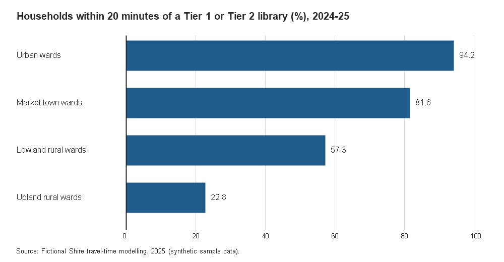
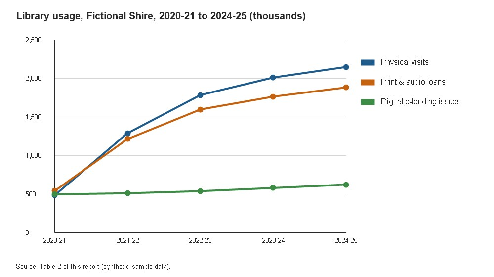

<!-- PAGE: 1 -->

# Demonstration Public Library Review

## Statutory Provision, Community Access, and Digital Infrastructure in Fictional Shire

Presented to the Secretary of State for Public Culture and Local Services by the Independent Advisory Panel on Shire Library Standards, January 2026.

**Notice of Fictional Status:** This document is a synthetic canonical sample created exclusively for the *UK Public Library Policy Archive* to demonstrate diplomatic Markdown transcription, page boundary markers, tables, figures, footnotes, citations, and provenance metadata without incorporating third-party copyrighted text.

Crown Copyright 2026. Published by the Department for Public Culture and Local Services, Whitehall, London. Licensed under the Open Government Licence v3.0 (OGL-UK-3.0). Publication Reference: DPCLS-LR-2026-001.

### Contents

- **1. Executive Summary and Terms of Reference** — Page 2
- **2. Statutory Framework and Service Standards** — Page 2
- **3. Branch Network Provision and Catchment Analysis** — Page 3
- **4. Digital Infrastructure and Usage Trends** — Page 4
- **Appendix A: Summary of Consultation Submissions and References** — Page 5

<!-- PAGE: 2 -->

## 1. Executive Summary and Terms of Reference

In March 2025, the Secretary of State appointed the Independent Advisory Panel to examine the resilience, accessibility, and statutory compliance of public library services across the unitary and county authorities of Fictional Shire. The review was commissioned in response to shifting demographic patterns, rural transport constraints, and increasing reliance on public library premises for digital government access.[^1]

Across the twelve months of evidence gathering, the Panel received 148 written submissions from local library authorities, parish councils, literacy charities, and professional librarians, alongside site inspections of twenty-four central, town, and community-managed branches.

The Panel concludes that public libraries remain foundational civic infrastructure. Where authorities integrate physical book stock renewal with reliable broadband connectivity and professionally trained library staff, active borrower participation increases measurably across all age cohorts.

## 2. Statutory Framework and Service Standards

Under Section 7(1) of the Public Libraries and Museums Act 1964, every library authority in England and Wales is under a statutory duty to provide a "comprehensive and efficient library service for all persons desiring to make use thereof".[^2] In executing this duty, Section 7(2) requires authorities to have particular regard to keeping adequate stocks of books and other printed matter, pictures, gramophone records, films, and other materials in sufficient number, range, and quality to meet general and special requirements of both adults and children.

Furthermore, when considering any significant alteration to opening hours, mobile library routes, or static branch locations, library authorities must comply with their public sector equality obligations under Section 149 of the Equality Act 2010 and conduct transparent, evidence-based consultations with affected communities.[^3]

The Panel recommends that local needs assessments be published at least twelve weeks prior to any cabinet decision affecting statutory branch provision, accompanied by travel-time modelling for households without access to private motor vehicles.

<!-- PAGE: 3 -->

## 3. Branch Network Provision and Catchment Analysis

Between 2016–17 and 2024–25, the total number of static library service points in Fictional Shire remained stable at forty-two branches, though the operational delivery model shifted across four rural parishes following the introduction of co-located community hubs. Table 1 summarises statutory service indicators by tier of service point across the shire for the financial year ending 31 March 2025.

### Table 1. Statutory Service Point Indicators in Fictional Shire, 2024–25

| Service Point Tier | Number of Branches | Mean Weekly Opening Hours | Total Book Stock (Volumes) | Annual Physical Visits | Annual Issues (Loans) |
| :--- | ---: | ---: | ---: | ---: | ---: |
| Tier 1: Central & Principal Libraries | 4 | 54.0 | 284,500 | 742,100 | 618,400 |
| Tier 2: Market Town Libraries | 14 | 38.5 | 392,000 | 891,450 | 784,200 |
| Tier 3: Neighbourhood & Rural Libraries | 20 | 24.0 | 218,300 | 412,800 | 369,150 |
| Tier 4: Co-located Community Hubs | 4 | 18.0 | 34,200 | 58,900 | 49,800 |
| Mobile Library Fleet (3 Vehicles) | 3 | 30.0 | 28,600 | 44,250 | 62,100 |
| **Fictional Shire Total** | **45** | **32.9** | **957,600** | **2,149,500** | **1,883,650** |

*Source: Fictional Shire Combined Library Authorities Annual Return, 2024–25 (CIPFA / DPCLS Benchmark Dataset).*

Spatial catchment analysis demonstrates that 94.2 per cent of urban households in Fictional Shire reside within a twenty-minute walk or public transport journey of a Tier 1 or Tier 2 library. In upland rural wards, the mobile library fleet provides fortnightly stops for sixty-eight villages located more than five miles from the nearest static branch.

*Figure 1. Proportion of Households Within Statutory Travel-Time Thresholds by Ward Classification, 2024–25*

Where public bus frequencies have declined since 2020, evening opening hours on at least two weekdays per week at Tier 2 market town libraries proved essential for working commuters and secondary school pupils requiring quiet study space.

<!-- PAGE: 4 -->

## 4. Digital Infrastructure and Usage Trends

Following the completion of the Shire Public Network Fibre Upgrade in November 2024, all forty-two static library buildings now provide gigabit-capable Wi-Fi and free public-access desktop terminals. Total public computer reservations rose by 14.8 per cent year-on-year, driven primarily by universal credit applications, telehealth appointments, and small business research.

*Figure 4. Library Usage Trends*

As illustrated in Figure 4, physical visits and print loans recovered steadily between 2021–22 and 2024–25 alongside sustained growth in e-book, e-audiobook, and digital periodical borrowing. Far from displacing physical branch attendance, digital lending expanded participation among housebound residents and shift workers.

### Table 2. Multi-Year Comparison of Physical and Digital Service Metrics (2020–21 to 2024–25)

| Financial Year | Active Registered Borrowers | Physical Visits | Print & Audio Loans | Digital e-Lending Issues | Public Wi-Fi Sessions |
| :--- | ---: | ---: | ---: | ---: | ---: |
| 2020–21 | 112,400 | 486,200 | 542,100 | 498,300 | 94,100 |
| 2021–22 | 134,850 | 1,290,400 | 1,215,000 | 512,600 | 248,500 |
| 2022–23 | 156,200 | 1,784,900 | 1,598,400 | 539,800 | 389,200 |
| 2023–24 | 169,100 | 2,012,300 | 1,764,900 | 581,200 | 462,700 |
| 2024–25 | 178,940 | 2,149,500 | 1,883,650 | 624,500 | 531,400 |

Historical microfiche returns from the North Vale District archive for the baseline year 1998–99 record 1,912,400 [UNCERTAIN] annual print issues across the predecessor district councils prior to local government reorganisation.[^4]

The Panel recommends that capital grant allocations for 2026–29 ring-fence funding for assistive technology workstations, screen-reading software licences, and acoustics upgrades in neighbourhood branches.

<!-- PAGE: 5 -->

## Appendix A: Summary of Consultation Submissions and References

The Independent Advisory Panel records its gratitude to all local authorities, community groups, and residents who contributed evidence between April and October 2025. Table A1 classifies the 148 formal responses received during the public consultation period.

### Table A1. Consultation Responses by Respondent Category

| Respondent Category | Submissions Received | Percentage of Total (%) |
| :--- | ---: | ---: |
| Local Library Authorities & Parish Councils | 36 | 24.3 |
| Public Library Staff & Trade Unions | 28 | 18.9 |
| Schools, Colleges & Early Years Providers | 22 | 14.9 |
| Friends of Libraries & Community Groups | 19 | 12.8 |
| Individual Library Users & Residents | 43 | 29.1 |
| **Total Submissions** | **148** | **100.0** |

All non-confidential written evidence papers have been deposited in the Departmental Registry under reference series `DPCLS/LIB/2025/EVID`.

### References and Statutory Citations

1. **Public Libraries and Museums Act 1964**, c. 75 (London: HMSO, 1964).
2. **Local Government and Housing Act 1989**, c. 42, s. 154 (Library charges regulations).
3. **Equality Act 2010**, c. 15, s. 149 (Public sector equality duty).
4. **Department for Culture, Media and Sport**, *Comprehensive, Efficient and Modern Public Libraries: Standards and Assessment* (London: DCMS, 2001).
5. **Department for Culture, Media and Sport**, *Framework for the Future: Libraries, Learning and Information in the Next Decade* (London: DCMS, 2003).
6. **Department for Public Culture and Local Services**, *Terms of Reference: Fictional Shire Public Library Review* (London: DPCLS, 2025).

## Footnotes

[^1]: Department for Public Culture and Local Services, *Terms of Reference: Fictional Shire Public Library Review* (London: DPCLS, March 2025), pp. 2–4.
[^2]: Public Libraries and Museums Act 1964, c. 75, s. 7(1).
[^3]: Equality Act 2010, c. 15, s. 149.
[^4]: North Vale District Council, *Annual Report of the Borough Librarian 1998–99* (North Vale: NVDC, 1999), p. 14; microfiche scan legibility is partially degraded on the thousands digit.
