<!-- PAGE: 1 -->

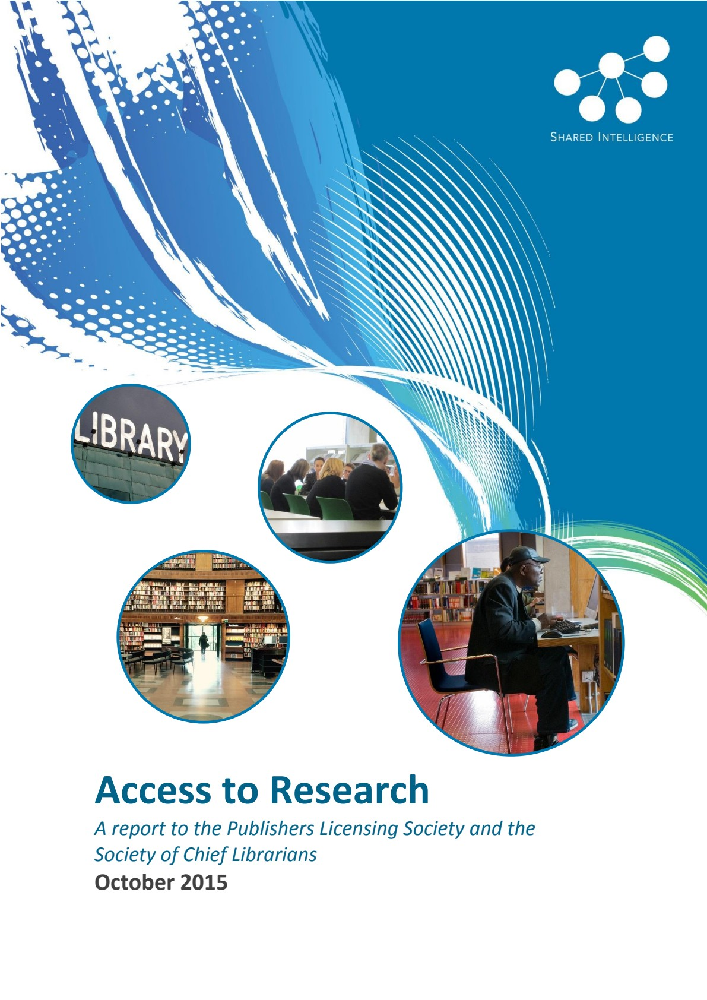

# Access to Research: Final Report

### A report to the Publishers Licensing Society and the Society of Chief Librarians

**Shared Intelligence**  
**October 2015**

<!-- PAGE: 2 -->

## Contents

- **1. Executive summary** (page 2)
- **2. Introduction** (page 4)
- **3. Stakeholder Perceptions** (page 6)
- **4. A2R user journey** (page 11)
- **5. Users and usage – web analytics** (page 15)
- **6. Users and usage – staff and public surveys** (page 23)
- **7. Conclusions and Recommendations** (page 40)
- **Annex – notes on web analytics** (page 44)
- **Annex – breakdown of usage by library authority** (page 46)

*Cover images (clockwise from top left): Peckham Library by Ellen Forsyth on Flickr; Westminster Academy (author’s own); Idea Store by Museums Galleries and Archives Council; Stockholm Library (author’s own).*

<!-- PAGE: 3 -->

## 1. Executive Summary
-  Satisfaction with Access to Research is high and users are finding what they need
-  It is being used for a wide range of purposes, and users are searching a great many
topics
-  Most research is for personal or academic interest rather than for professional
interest
-  Usage varies greatly among participating library services and more could be done to
increase use, including enabling library staff to tell more people about it

**1.1** Access to Research (A2R) is an innovative service jointly developed between public libraries and
academic publishers. It allows public library users to access licensed (i.e. charged-for) academic
journal articles from leading publishers for free, via public-access computers in local public libraries.
The pilot stage ends in December 2015 and this study was designed to inform the future
development of the initiative.
Stakeholder views

**1.2** National level stakeholders we spoke with were very positive about the way A2R has developed, and
its future potential, although many were anxious to see take-up increase. Some also saw potential
to link A2R with the public library national Learning Offer, due to launch in late 2015.
How much is it used and by whom?

**1.3** Between January 2014 and July 2015, there were 87,313 visits to the main A2R website. The
Summon database (through which searches are conducted) recorded 34,276 visits and 170,771
individual searches in that period. Typical users are those who already use public libraries. Users
come from all age groups and all educational levels but are more often older and degree educated.
Many are from the most affluent postcodes.
What is it used for?

**1.4** Our user survey found the most common reason given for using A2R was for “academic
interest/research” (55%) followed by “personal interest” (53%). People are motivated to use A2R for
a host of reasons. We heard examples of people seeking information to help them set up a social
enterprise, to help with their volunteering, as part of researching creative works, and we also heard
from independent inventors. Search term data shows users are searching for articles on a vast range
of subjects. But the most frequent subjects researched relate to medicine, health, and history. Social
sciences, law, politics, philosophy and religion are also frequently searched subjects.

<!-- PAGE: 4 -->

### User satisfaction

**1.5** Users are very satisfied with the service with 90% indicating the information they found through A2R
was useful and 77% saying they found what they were looking for (Figure 2). Survey comments also
indicate that A2R often surprises users with the sheer quantity of content, and wider potential.
“I was quite surprised how much material was made available.” [Service user]
“It makes the public library look a more happening place.” [Service User]
Awareness and use

**1.6** Some library services have made significant efforts to promote A2R proactively, but many users are
discovering and learning to use A2R by themselves. There is a very wide variation in levels of use
across participating library services. Web analytics data shows that in some library services up to
5,000 searches have been made by A2R users to date, but in many others it is under 1,000. This
indicates significant potential to increase use overall. A2R training for library staff is continuing but
72% of staff we surveyed have yet to receive training.
Recommendations

**1.7** Our findings fully support the continuation and development of A2R and indicate wide and varied
use. Our report also suggests the following actions to develop and enhance the service, in order that
it can maximise its impact:
-  Finding out from those library services with the highest levels of use, about the approaches
they have taken in order to assist those with lower use
-  Providing public library services with more detailed monthly data on A2R use including
national breakdowns showing patterns and trends by service and over time
-  Greater and targeted marketing aimed at increasing use to ensure all stakeholders remain
confident about growth of the service
-  Providing additional training for library staff so that more staff can explain the service clearly
to the public and encourage people to try it
-  Reviewing and fixing minor issues with the service platform which could be hampering both
accurate monitoring of use and user experience
-  Harnessing the expertise of those library staff who are already championing the service to
support future development
-  Harnessing the expertise of highly-engaged ‘super users’ to help develop and promote the
service
-  Looking at the potential for out-of-library use (in which features are limited) to be used to
drive full-featured in-library use.

<!-- PAGE: 5 -->

## 2. Introduction

**2.1** Access to Research (A2R) was launched as a two-year trial in January 2014 in response to
recommendations from a committee convened by the UK Government to explore how access to
publicly funded research could be expanded. One of the main recommendations of this committee
(The Finch Group) was that the major academic publishers should devise a scheme under which
public libraries could provide free access to licensed journal content.

**2.2** A2R is a unique collaboration between public libraries and the Publishers Licensing Society. It means
publishers now provide access, via computers in libraries, to over 8,000 journals and 10 million
articles across a wide range of subject areas.

**2.3** National stakeholders from publishing and from public libraries have welcomed A2R. In terms of use
by the public, this is building steadily but not as quickly as some had hoped or expected. In part this
is due to the fact that A2R was simply not available in all library services on the day of launch in
2014, and the process of getting library services signed up has been gradual. But even now with the
vast majority of library services signed up, there are challenges in terms of marketing the service.

**2.4** With the end of the trial period approaching PLS along with the Society of Chief Librarians and Arts
Council England jointly commissioned this study to understand the extent A2R has added value for
the public – including looking at who has been using the service, for what purposes, their experience
of using it, and what difference it has made for them.

**2.5** In particular this study set out to understand:
-  How many and what kinds of people are using the service
-  What A2R is being used for and why
-  If and how A2R is providing benefit and value to users or more widely

**2.6** In the course of undertaking this study we have also looked at A2R from the perspective of public
library users who are not using the service in order to understand the extent of wider demand for
A2R.

**2.7** In order to answer these questions we have undertaken a number of different research activities:
-  A survey of A2R users which achieved 455 responses
-  Ten in-depth interviews with users of A2R
-  A survey of non-users which achieved 99 responses
-  A survey of public library staff which achieved 612 responses
-  Conversations with 10 individuals from stakeholder organisations
-  Analysis of the web analytics of the A2R homepage and the A2R version of the Proquest
Summon discovery service via which journal articles are searched and served-up.

<!-- PAGE: 6 -->

**2.8** This report sets out the findings from the different research strands and provides our conclusions
and recommendations including how the service might be developed beyond the trial period.
-  Chapter 3 presents the findings from our stakeholder conversations
-  Chapter 4 discusses the user journey
-  Chapter 5 presents the evidence we have analysed on usage, the user profile and what
people are using the service for
-  Chapter 6 presents evidence from the staff and public surveys
-  Chapter 7 presents our conclusions and recommendations

<!-- PAGE: 7 -->

## 3. Stakeholder Perceptions

**3.1** Early on in our fieldwork we carried out 10 interviews with stakeholders. Stakeholders were selected
from a range of organisations, mainly on the advice of the PLS and SCL. Many had been involved
with A2R since the very beginning. The stakeholders were senior employees or officers of:
-  Publishers Licencing Society (PLS)
-  Elsevier
-  Wiley
-  Society for Chief Librarians (SCL)
-  The British Library
-  Research Information Network
-  Department for Business, Innovation & Skills (BIS)
-  Department for Culture, Media & Sport (DCMS)

**3.2** The main lines of enquiry were:
-  Awareness of/interaction with A2R
-  Expectations of A2R
-  Perceptions of A2R
-  Questions for this evaluation

**3.3** The findings of the stakeholder interviews are summarised in the next section. In order to preserve
anonymity we have not attributed quotes to individuals.
Awareness of and interaction with Access to Research

**3.4** There was a high level of awareness of the scheme among interviewees, many of whom had been
directly involved either with the A2R Steering Group or with the BIS-funded Working Group on
Expanding Access to Published Research Findings (commonly known as the ‘Finch group’) from
which the idea of A2R originated. Some stakeholders, specifically those from government
departments, had had less direct involvement and as a result were less aware of the detail.

**3.5** In recalling the original Finch group discussions stakeholders made reference where A2R sat in
relation to the wider context of open access, with which much of the Finch group discussions had
been concerned. In this context a few stakeholders referred to initial debates over whether A2R
might be a “distraction” from “more radical discussion of open access [to academic articles]”. One
stakeholder, described the inclusion of the A2R concept in the Finch group’s report as something
which was pragmatic, and achievable; it was seen as “low key and publishers thought it would be
seen as a real step forward”.

<!-- PAGE: 8 -->

**3.6** Some stakeholders were keen to ensure A2R was not conflated with open access per se, describing
A2R as “public access to licensed content” with restrictions on what content you can access and
where it can be accessed from (i.e. only from within public libraries). Nonetheless, the benefit of a
service based on in-library access was that it was acceptable to all parties (including publishers),
whereas other routes to opening up content would be seen as more controversial. As one
stakeholder from a publisher added:
“I know that one of the criticisms is the lack of remote access [from outside a
library] – but this would be too far for some of our societies.”

**3.7** As such a number of stakeholders identified A2R (i.e. access to already published content) as a step
in the direction of open access: as supportive of the overall open access movement, although not
open access per se. However, the benefit, as a number of stakeholders reflected, is that it widened
content access overnight “at a stroke”.

**3.8** Moreover, there was a sense from the public library perspective that although “at first this didn’t
look like a big deal”, “it became clear fairly early on that what was on offer was actually very
interesting” due to the breadth of content on offer and it being made available specifically through
public libraries.

**3.9** Thinking about the period after the idea had been taken on board, and work had begun towards
implementation, stakeholders reflected positively on the partnership working that enabled it to be
quickly developed as a functioning service. Indeed, active collaboration between organisations was
seen as an important enabling factor in the development of A2R, as is reflected in the quotes below
from members of the steering group:
“I think it was a terrific achievement that it got off the ground. It worked from
very good chemistry SCL and PLS that were involved in the steering group.”
“Then the steering group was set-up...Really positive even though there could
have been tensions, between publishers and librarians, maybe even between
the publishers”
Expectations of Access to Research and how it would be used

**3.10** In terms of expectations for A2R, stakeholders thought the main purpose of A2R is that it should
make available to public library users or to their communities “material they would either find hard
or impossible to access otherwise”. This can help bridge an “access gap for members of the public
that want access to journal literature” which was felt to exist currently.

**3.11** Stakeholders clearly felt A2R offered value to the public in so far as there is a “tremendous amount
of content on offer”.

**3.12** However, stakeholders had mixed views and expressed a high degree of uncertainty over expected
usage and use cases. For instance, while some stakeholders suggested there may be significant
untapped demand, it was also suggested by some of the same stakeholders that there is “probably <!-- PAGE: 9 --> quite a low demand [for A2R]”; their linked assertion being “many of the journals are deeply
impenetrable”.
“Publishers don’t feel an overwhelming pull from members of the public to get
access. But that doesn’t mean there aren’t members of the public that
couldn’t benefit.”

**3.13** There were a range of views on the types of information likely to be of greatest interest or most
easily consumed by the public through A2R. Generally, social science or history articles were
considered likely to be more accessible than subjects such as engineering and physics, which were
thought likely to require greater technical knowledge to understand.

**3.14** In terms of how or why information obtained via A2R might be used, stakeholders suggested the
scheme may be of interest to “people who are researching courses or career options or have a
business idea” or someone with a medical condition who wants to find out more. More in-depth use
may be seen coming from “citizen scholars”, that is people “who can potentially move science
forward, but are not affiliated to universities”. However, it was felt that people who were currently
students would likely have access to academic journals via subscriptions provided by their further
education institutions and were therefore unlikely to need A2R.

**3.15** That said, stakeholders remained open-minded (or indeed unsure) about what types of use would
prove popular or compelling among users, and several asked us what insights this research had
generated so far about use-cases and the apparent motivations of users.

**3.16** In addition to benefits for the public and library users, stakeholders also reflected on benefits to
publishers and public library services. From the publisher perspective the incentives were not seen
as directly commercial – nor were there any significant risks for publishers. Instead for publishers the
most significant benefits, and incentives for supporting A2R come in terms of reputation and being
able to demonstrate in a practical way their commitment to expanding access and unlocking wider
social benefits:
“…there are reputational benefits. There is also the awareness of bringing
benefits to wider society – so ordinary people can access research as well as
academics and students.”

**3.17** For public library services, library stakeholders saw A2R as providing “another selling point for
libraries”, one that might also potentially help broaden the range of funders at the local and national
level:
“…broadening out and not just having DCMS on the side of libraries, but
having BIS on the side of public libraries as well”

**3.18** Stakeholders from government reported that A2R, in view of the government’s support for greater
access to publicly funded research, contributes to a national objective to “facilitate sharing of
knowledge and through that to realise social and economic benefits”.

<!-- PAGE: 10 -->

Perceptions of Access to Research

**3.19** In terms of how A2R is working now, as the end of the trial approaches, stakeholders were pleased
that there had been a number of successes. Among these are getting most local authorities signed
up and having all the major publishers on board.
“I think now that numbers have got to most authorities, that critical mass is
important.”

**3.20** In addition, the A2R Summon discovery service (a variant of the widely used ProQuest Summon
service) that has been developed for A2R was considered significant in terms of making the scheme
accessible and usable.
“One of the things that made it work well, is having the summon interface… it
wouldn’t have been workable without that interface.”

**3.21** However, there was disappointment that low take-up had emerged as the main challenge.

**3.22** Views of stakeholders differed about the scale of use A2R had potential to achieve. Some felt that
the material being made available had potential to attract very widespread use. Others felt
academic journal material was by nature difficult and that A2R would never appeal beyond a
specialist audience.

**3.23** But despite these different views, stakeholders overall felt that current use was well below what
they had expected and hoped for. In terms of attracting more users (or unlocking more of the latent
demand) the challenge was viewed by stakeholders as primarily one of awareness raising and
promotion via public library services.

**3.24** A number of stakeholders clearly felt the service had fallen short in terms of marketing. There was a
strong sense that A2R had not been as well promoted in public libraries as it could have been, and
that promotional activity should have reached many more people who would potentially be
interested:
“It’s the local libraries where the challenge is – the marketing. Not as well
promoted as it could have been.”

**3.25** A number of stakeholders felt that taking the lead in marketing and promotion was public libraries’
side of the deal. PLS and their publishers on the other hand (in consultation with the Publishers
Association and the Association of Learned and Professional Society Publishers) had taken the lead
role in facilitating implementation of A2R by ensuring the service was developed collaboratively,
agreeing conditions of use with publishers, working with ProQuest to implement the Summon
service, and persuading the vast majority of publishers and local authorities to participate.

**3.26** Furthermore, PLS has continued to shoulder managerial and financial responsibility for hosting the
service and providing day-to-day technical support.

<!-- PAGE: 11 -->

**3.27** Marketing might be quite general, such as promoting the service within public libraries, or it could
be more targeted e.g. seeking to tie-up with groups such as local history societies or with Higher
Education institutions. However, the sense from many stakeholders was that far more could be
done of either.
“In the very early days we had much more active communications – social
media for instance. We saw spikes in usage following twitter chat because it
raised awareness among local communities about what is available.”

**3.28** Linked to this, a second identified issue was that public library staff may not have had sufficient
training on the service in order to feel confident promoting it. To promote it effectively public library
staff need to be confident themselves in making searches and accessing documents, and confident
about the intended purpose of the service and the conditions of use. A few stakeholders noted that
the material in question is often complicated and public library staff may need support to help the
public understand the difference in how to use information from journals compared to other form of
written information:
“A lot of people in libraries wouldn’t have used these kinds of resources since
University.”

**3.29** One interviewee suggested there should be a “training pack” for staff (n.b. PLS have in fact provided
training packs).
Role of this study

**3.30** Reflecting on what this research project could deliver itself, the main sense from stakeholders was
that it could provide a much better understanding of use of A2R. It was also suggested that positive
practical examples of how A2R was being used would help build enthusiasm around this project –
and help motivate more effort around active promotion.

**3.31** This was considered important in terms of demonstrating the value of A2R generally, but also to
maintain the enthusiasm behind the project, both from the perspective of existing stakeholders and
in order to attract more publishers. Again it is evidenced that the service is valued that was
considered most important.
“… if it isn’t valued then we need to think. But if it is worthwhile and useful,
then that will inform how the publishers look at the future.”

<!-- PAGE: 12 -->

## 4. A2R User Journey

**4.1** Figure 1 below attempts to describe in a simplified fashion the intended journey of users of the A2R
service. It assumes the goal of the service is to enable users to access journal articles (from a public
library computer) for free – something they could not do without the A2R service.
Figure 1

**4.2** This is what we believe to be the journey as intended by those who set up the service. In reality
however, as we describe in more detail in the following sections of this report, there are several
points where it appears A2R ‘loses’ many potential users for a variety of reasons.
Start of the user journey - hearing about the service

**4.3** The first step in the user journey is when someone finds out about A2R. But this is also one of the
biggest challenges. As our non-A2R-user survey found (completed by 99 public library users), two-
thirds of public library users surveyed were unaware of A2R. Of these, 18% said they would be keen
to find out more and perhaps use it. If this percentage were applied across England it would be
equivalent to 5.3 million of England’s 8 million active public library borrowers having yet to

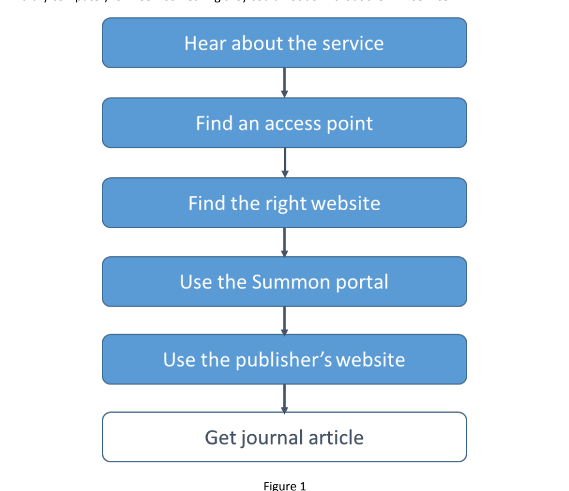
*Figure 1: User journey map*

<!-- PAGE: 13 -->

encounter A2R, of whom 1.4 million might perhaps try using it. Even as a very broad indication, this
suggests significant potential to find a bigger audience for the service.
Find an access point

**4.4** Once users know the service is available and decide to access it, they next need to discover how
exactly to access it from within their local public library. Arrangements differ for each library service.
Typically access will be through specific public access computers (sometimes referred to as ‘People’s
Network’ machines) which have full access to the service i.e. the ability to download journal articles
for free. These will be computers of which the IP addresses have been added to the database of IPs
authorised to use A2R, which is a fundamental element of the A2R system. Some library services
have set up IP authorisation so that any public-access library computer can be used. In some cases
public library services have authorised IP addresses which relate to Wi-Fi access points to which
public library users can connect their own devices.

**4.5** Ideally access to A2R via computers or Wi-Fi access points will be easy for the public to identify, with
help from staff or signage.

**4.6** Without clear help or signage however, we would imagine some library users might set about trying
to access A2R from a computer which does not provide full access. We raise this because our survey
results (reported in Section 4) found that 38% of public library staff who responded to the survey
indicated their knowledge of A2R was limited or that they would not feel confident explaining it to a
public library user. While some of these answers may have come from staff who do not deal
routinely with the public, it raises the challenge of ensuring staff understand how to explain the
mechanics of accessing the service, not just the general thrust of its purpose.
Find the right website

**4.7** Many public libraries have posters on walls, or hyperlinks on PC desktops providing the URL of the
landing page for A2R. However, it is likely some users will remember part of the URL and simply
search for it using Google or another search engine. If they do, they are likely to see two A2R
websites listed:
-  (1) http://accesstoresearch.pls.org.uk/ - search activated site intended as landing page for in-
library users
-  (2) http://www.accesstoresearch.org.uk/ - a promotional microsite

**4.8** The two websites are similar, but a crucial difference is that (1) has a prominent search bar which
instigates searches via the A2R Summon discovery service (i.e. the underlying search directory for
journals and articles) whereas (2) does not have a search box. In fact, (2) is designed primarily to
promote and explain A2R and not to enable searches. It has also been optimised for search engine
results as part of ensuring the service has good online visibility, consequently it tends to show as the
first result on Google, Bing, and Yahoo. Users of (2) can still reach the A2R Summon service via a link
on the FAQ page which reads ‘how can I use the service’ which takes them to (1), but this convoluted
route does not seem intended as a main route of use. The FAQ list on website (2) also includes an
index of hyperlinks to the journals available through the A2R service, but not the ability to search <!-- PAGE: 14 --> those journals. The existence of the non-searchable website may cause confusion for some would-
be users and may be another point where A2R loses potential users.
Use the Summon discovery service

**4.9** Submitting a search term via the A2R landing page (1) takes the user away from the landing page to
the A2R Summon search platform - http://pls.summon.serialssolutions.com/. Version of Summon
are used worldwide. It is a powerful discovery and search system optimised for searching academic
journals. Besides basic searches, Summon also supports advanced searches (e.g. narrowing by date
range, publication title, ISBN), and results filtering by publication date, language, and more detailed
search terms.

**4.10** The A2R Summon service presents a search results list consisting of links to the journal articles which
meet the search criteria. At this point what users see is similar to other ProQuest Summon-powered
discovery services provided to staff and students at many universities and other institutions. But in
this case rather than seeing the name of a university, users see the A2R logo at the top of the page.

**4.11** A common issue raised by A2R users and public library staff is that items in the search results can
include articles which turn out not to be available to download for free. However we understand
that successive improvements to A2R Summon search results means users should now find less than
5% of articles in results pages are outside A2R and not available for free. It is also possible that some
reports of being unable to download full articles are due to A2R users attempting to use the service
from a computer which for one or other reason does not have an authorised IP address.
Use the Publisher’s Website

**4.12** A2R Summon results pages consist of links directly to the relevant article on a publisher’s website.
Clicking a link takes the user away from A2R Summon to a page on a publisher website which will
usually display the abstract for the article, and somewhere on the page a link to download or view
the full article. As long as the user clicks through to an article directly from an A2R Summon search
results list, the publisher website will recognise A2R Summon as the referring website (or more
accurately it will recognise the A2R Summon proxy server) and allow access to the article. This final
step can be considered the practical end-goal of the A2R project; to enable a user to download and
read a full journal article for free, which would otherwise have required a journal subscription.
Conclusions

**4.13** We should also explain at this point that both A2R portal websites (1) and (2) are accessible from any
computer with internet access, not just computers in participating public libraries. Outside of a
participating library it is still possible to enter search terms on the search activated landing page and
be served an A2R Summon search results list. But when a user clicks through to a publisher website
and attempts to download a full article, they will usually be asked for a subscription login, or
payment. The exceptions are where publishers have already decided to make an article available for
free to everyone, irrespective of the A2R service.

<!-- PAGE: 15 -->

**4.14** In many ways the A2R user journey and the systems which enable it to work, represents an
ingenious solution to a daunting task. It uses a version of the tried and tested ProQuest Summon
system used by millions of users and the world’s leading publishers. In this case PLS, rather than say
a university, provides its own Summon service through which its users can access licensed publisher
content. However, instead of relying on personal user accounts, login credentials, or student IDs to
enable the A2R Summon service to know which users have the right to access content, the Summon
service relies instead on a list of authorised IPs provided in advance by public library services and
added to a database by PLS. The result is that any member of the public can sit down at a public
library computer and within seconds be accessing journal articles with no need to register for the
A2R. All it requires is that their library service has signed up to the service, and provided IP
addresses of some or all of their computers or Wi-Fi access points to PLS.

**4.15** But this system also presents some challenges, which in turn may be holding back use.

**4.16** To start with it means the A2R user journey is a potentially confusing experience for users with less
knowledge of internet technology generally, or less confidence with web-based discovery tools.
There are points where first-time users might be discouraged from proceeding further or simply lose
their way. Whilst there are some elements outside the control of PLS and SCL (notably the publisher
websites), more could be done to explain the user journey on the A2R landing page and provide
some simple ‘how-tos’ on accessing articles or basic explanations of ‘how A2R works’. Simply
merging the non-searchable promotional microsite (1) with the search enabled A2R landing page (2)
could also simplify the user experience.

**4.17** Secondly, whilst there are obvious benefits in users being able to go through the A2R user journey
and get search results or view abstracts without needing to go to a public library, it is also potentially
a point of confusion if users do not understand ‘up-front’ that they need to be in a public library to
access the full service, or that the main method of authentication is IP address. This does not mean
we are suggesting there should be measures to deter out-of-library access. Our view is quite the
opposite, we anticipate significant potential for out-of-library access to be a route for drawing in
new users to the full service; e.g. by highlighting the benefits of coming to a public library to
complete research begun remotely. If there were some way to save searches or articles which could
be instantly retrieved once a user reached their public library (similar to click and collect in retail)
then this might create real added-value – especially given the time limits in place on computer use in
many public libraries.

<!-- PAGE: 16 -->

## 5. Users and Usage – Web Analytics

**5.1** In this section we discuss our analysis of web analytics data bring to look at levels of usage based on
evidence of user behaviour; who might be using the service and where, and what they are using the
service for.

**5.2** Unless we indicate otherwise, the reference period being discussed in this section is 28 January
2014, the date the service was first used, to 19 July 2015, the date we extracted analytics data for
this project, a period of around 19 months.

**5.3** One of the key aims of our work on the analytics was to explore observational data on usage of the
service (i.e. objective records about user behaviour) to compare with user-reported data (i.e. the
user survey responses). A range of data has been collected throughout the pilot using Google
Analytics data (i.e. data collected by Google on usage by web page) from the two A2R landing pages
(which we referred to as (1) and (2) in the previous section) and from the A2R Summon service.

**5.4** In analysing the Google Analytics and Summon data we asked three main questions:
-  What does the data say about the user journey?
-  How many sessions are really occurring each month?
-  What do users appear to be searching for?

**5.5** Inevitably this is an iterative process. There will always be further questions we could ask, some of
these are highlighted in the text below.

**5.6** The key source used for this analysis was usage data accessed via the administrative panel of the
Summon database which includes the external IP addresses of computers or Wi-Fi routers through
which A2R has been accessed. We also had access to data collected by Google Analytics for two
sites; the A2R landing page containing the search box (and identified by Google analytics as UA-
47180925-2), and the A2R microsite (lacking a search box) with background information about the
pilot (and identifies by Google Analytics as UA-47180925-1). This did not include IP addresses.

**5.7** This data is valuable because it provides the best view of the numbers of people using the service,
though it is not without challenges. The IP data we analysed did not enable us to identify unique
users of A2R nor did it allow us to ascertain the identity of individual users. Detailed notes on the
analytics data are provided as an annex to this report.
Understanding the user journey

**5.8** One of the first pieces of analysis we undertook was to consider the levels of use and flow of users
across different stages of the typical user journey. To help us understand this we mapped key data
from the web analytics onto the user journey as we understood it. This produced the diagram
shown as figure 2 below, the ‘Annotated user journey’.

<!-- PAGE: 17 -->

**5.9** This shows that during our reference period there were 87,313 sessions recorded on the A2R landing
page. In the same period we also see 34,276 visits (or sessions) recorded on the A2R Summon
search service, which are associated with 170,771 individual Summon searches (or hits).

**5.10** One striking feature of the data in terms of user journey is an apparent drop-out from 87,313
sessions recorded (by Google Analytics) on the A2R landing page and 34,276 sessions recorded by
A2R Summon. One interpretation of this is that many people who visit the A2R landing page do not
go on to enter a search term and hit ‘search’. Given that the page is geared very strongly towards
that one course of action – i.e. typing a search term and hitting ‘search’ – the drop-off is interesting.
IP addresses of computers logged as having accessed A2R Summon

**5.11** Turning to the IP addresses recorded as having accessed Summon we found the majority of visits
appear to have been from ‘library IPs’, i.e. library-based computers (or in some cases WiFi routers)
using an IP which appears on the authorised list provided by participating public library services to
PLS. There were 327 of these ‘library IPs’ i.e. IPs we were able to match to the PLS record of IPs
from participating public library services. We could also see that these 327 public library IPs were
associated with 139 participating public library services1.

**5.12** However, although ‘library IPs’ generated the majority of visits there is a very long tail of ‘other IPs’
logged as having searched on the A2R Summon service but which are not on the IP list provided by
participating library services.

**5.13** In fact during the reference period Summon recorded 10,308 ‘other IPs’ addresses making searches
on A2R Summon in addition to the ‘library IPs’. Most of these ‘other IPs’ register low use, but a few
of these ‘other IPs’ register high usage and this might warrant further investigation. Might they be
public libraries not currently involved in the pilot, or other organisations using A2R Summon as a
research tool?

**5.14** So while only 3.1% of the IP addresses accessing A2R Summon in the reference period belong to
participating public library services these ‘library IPs’ generated just over 94,000 searches, or 55.1%
of total searches in the reference period.

**5.15** We should also add that we have assumed users accessing the Summon service from any ‘other IPs’
were able to view lists of search results, and see abstracts on publishers’ websites. However we
have assumed these out-of-library users would have been unable to download full journal articles
(unless they had a subscription or paid for access by some other means).

**5.16** We were able to conduct some basic investigation of some of the high-use ‘other IPs’ using an IP
look-up service. We found one high-use ‘other IP’ which appeared to be from a participating public
library service (perhaps a simple administrative error in notifying PLS?). Other prominent IPs
appeared to belong to institutions which could have some link to public libraries. We also used IP
look-up services to check for evidence among these IPs that they might be automated ‘ghost hits’
but found nothing to suggest this, e.g. none of these IPs were based in non-English speaking
countries. What we did discover was that many of these IPs were in use by UK-based institutions,
[^1] As noted in section 6, 11 of the library/library services involved in the national pilot have yet to register any
usage. This adds up to the total 150 public library services involved in the pilot.

<!-- PAGE: 18 -->

for example, IP: 91.235.65.22 and IP: 85.12.68.100 were prominent ‘other IPs’ and using the WHOIS
look-up tool, we found the first belonged to Manchester City Council, with a similar IP address to the
one being used for their A2R pilot. The second belonged to “Bedford Schools NATs Broadband
Network”. Another IP, 85.12.76.65, points to “Suffolk School NATs”. It could be worth exploring how
and why they are using A2R. Do they provide Internet connectivity for their local libraries or is it an
indication that local schools are using the service independently - have some teachers become
enthusiasts?

<!-- PAGE: 19 -->

Figure 2

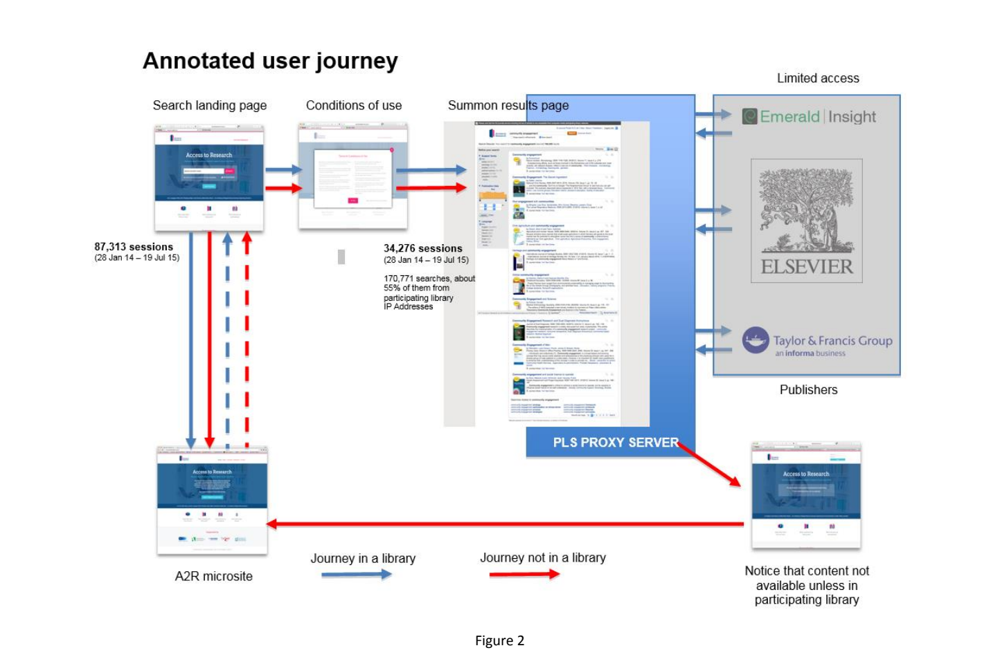
*Figure 2: Searches and article requests over time (April 2014 – June 2015)*

<!-- PAGE: 20 -->

Usage of access to research – when and where

**5.17** Throughout the pilot, PLS has been providing participating public libraries with monthly
spreadsheets of the number of searches recorded on A2R Summon. PLS provided us with this data
for 15 complete months from April 2014 to June 2015 inclusive. From this we produced a ‘heat
map’2 of month-by-month usage for all participating library services as an Excel spreadsheet – an
image of which is included in the annex to this report.

**5.18** Our heat map shows (with dark-red colour-coding) which libraries generated the highest levels of
monthly usage and which (with pale-blue colour-coding) generated the lowest levels of use. An
image of the spreadsheet has also been included in the annex dealing with the web analytics.

**5.19** During this period we see 89,869 Summon hits recorded in the PLS monthly spreadsheets from
participating public library services. In the same period, taking data directly from Summon we see a
total of 155,616 hits. We assume therefore that the remaining 65,747 hits (42% of the total) were
from ‘other IPs’, which is validated by our own analysis described above of the split between ‘library
IPs’ versus ‘other IPs’.

**5.20** So just dealing with the 89,869 PLS-recorded hits over 15 months, we see that eleven of the 150
participating public library services in the pilot did not record any hits on Summon at all. Of the
remainder, 30 registered less than 100 hits, whilst 34 achieved over 750 hits. Twenty-six library
services recorded use of between 1,000 and 4,800 Summon searches in the period. One conclusion
we draw from this very wide range of use levels is that in broad terms, there is significant potential
to increase use of A2R. The reasons for this wide variation from zero to 4,800 need to be properly
understood, as do the approaches taken by the 26 library services which achieved those very high
levels of usage. Nonetheless, could we suppose that usage of at least 2,000 hits per year for an
average-sized public library service is achievable? Indeed if all 150 participating public library
services achieved that level of use then annual hits from ‘library IPs’ would be running at around
300,000 – triple the 89,869 seen over 15 months.

**5.21** In addition, the monthly totals show the number of monthly searches from ‘library IPs’ built up from
launch to a peak in October 2014 and have been lower since.

**5.22** At the level of individual public library services, there are some patterns which could be worth
exploring:
-  High users overall (twenty six, headed by Birmingham, West Sussex, Hampshire, Derbyshire,
Brighton and Hove): What are these library services doing, what could others learn from
their approaches, and have their approaches differed according to factors such as size,
rural/urban etc?
-  Consistent high users (e.g. Birmingham, West Sussex): What did they do to encourage users?
What have they done to maintain levels of usage?
2 This period is obviously shorter than the reference period used in the previous section, but is based on the
data provided to us by PLS.

<!-- PAGE: 21 -->

-  Sudden starts (e.g. Norfolk, Blackburn with Darwen): Were there technical problems at the
start? Did someone on the library staff do training and/or take a particular interest?
-  Sudden peaks (e.g. Derbyshire, Brighton & Hove): Was there a particular event initiative,
national or local, that prompted increased use?
-  Seasonal patterns (e.g. Oxfordshire, Carillion Services in W London): What might be the local
reasons for a peak or trough during August?
-  Non-users (e.g. Merton, Wakefield): Are there particular reasons why A2R hasn’t taken off?
-  Outsourced providers of services to multiple boroughs (e.g. Carillion Services): What data do
they keep on levels of usage across the public library services they manage?

<!-- PAGE: 22 -->

What are users searching for?

**5.23** Search terms are a difficult area to explore because so many unique search terms have been entered
by users. For the analysis that follows, we return to the original 19 month reference period. We have
adopted a similar approach to that outlined in Sarah Faulder and Shinwha Cha’s article documenting
the initial stages of the pilot3. The main difference is that we have focused on the top 500 search
terms from 28 January 2014 – 19 July 2015. The analysis has been carried out in three stages:
-  Manual categorising of search terms (broadly to into the categories used for title searches,
with a few additional categories added)
-  Word count of search terms (as suggested by Faulder and Cha)
-  Search for use of Boolean terms in searches (again, as suggested by Faulder and Cha).

**5.24** We have manually categorised the top 500 search terms in the table below. The vast majority of
search terms in the top 500 were single words or pairs of words: 347 of the search terms, 14,972 of
the searches. The longest search term was 23 words long.

**5.25** Very few Boolean search terms were found (e.g. ‘Or’, ‘And’ and ‘Not’). Most of those that were
found were ‘And’ and formed part of a sentence, rather than a search string. The most obvious
search string use was probably by a librarian – current or past: ‘game OR gaming AND Library OR
Libraries’. It is probably not unsurprising that few Boolean searches were found in the top 500 as
they are likely to be more specific. Perhaps more likely to appear lower down in the rankings.
Figure 3: Frequency of search terms.
Category4 Searches % of total 28/1/14 – 19/7/15
Blank 2,632 1.54%
Default search text 791 0.46%
Medical 3478 2.04%
History 2479 1.45%
Health & Biological Sciences 1,229 0.72%
Other 1,157 0.68%
Place 1,066 0.62%
Person 1,021 0.60%
Magazine or Book 900 0.53%
Art, Architecture & Applied Arts 816 0.48%
3 Sarah Faulder and Shinwha Cha, Access to Research: the experience of implementing a pilot in public
libraries, Learned Publishing Vol.27 No.2, April 2014
4 Allocation to categories is not exact. Some could have been allocated to more than one. Some were so vague
that could be have been allocated to any, or required some guesswork. Table intended more as a prompt for
discussion.

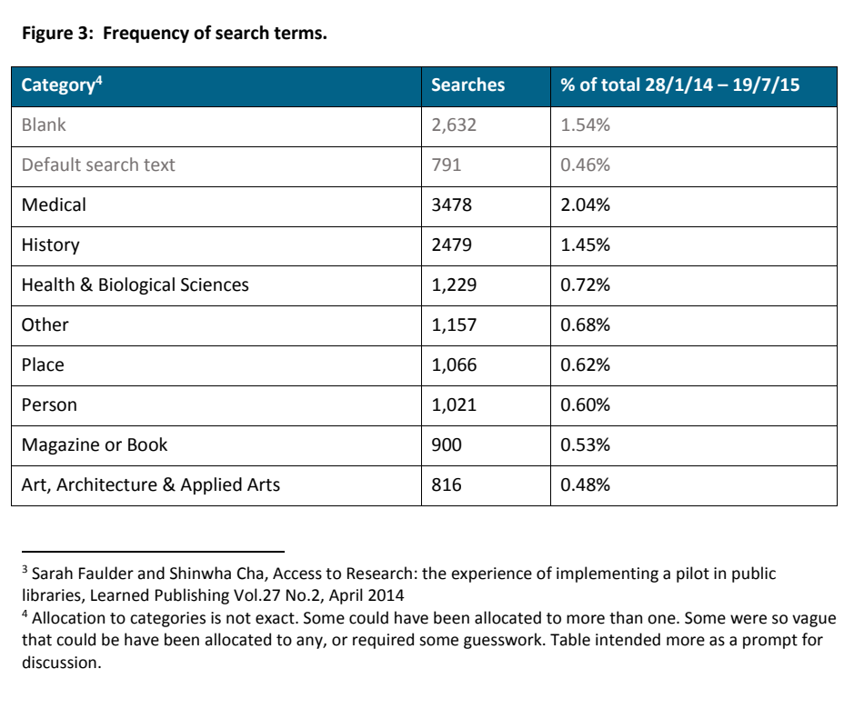

<!-- PAGE: 23 -->

Category4 Searches % of total 28/1/14 – 19/7/15
Earth & Environmental Sciences 743 0.44%
Social Media (e.g. Hotmail; Facebook) 703 0.41%
Business & Economics 666 0.39%
Libraries 621 0.36%
Law, Politics & Government 572 0.33%
Social Sciences 555 0.32%
Food & Cooking 540 0.32%
Engineering & Applied Sciences 501 0.29%
Family History 433 0.29%
Child Development 430 0.25%
Philosophy & Religion 339 0.20%
Languages and Literatures 281 0.16%
Music, Dance, Drama & Film 260 0.15%
IT and Computing 242 0.14%
Careers 217 0.13%
Physical Sciences & Mathematics 159 0.09%
International Affairs 130 0.08%
Education 98 0.05%
Research 90 0.05%
Reference 31 0.02%
Total searches (using top 500 terms) 23,130 13.60%

**5.26** The headline message we take from this is that people are using A2R for a massive range of subjects.
Even grouping the top 500 search terms into these 30 broad categories only accounts for 13.6% of all
searches. We also see that searches relating to medical subjects, history and general health are the
top categories – although these still only account for a very small proportion of all searches.

**5.27** The results also give the impression that some people using A2R may not fully understand what they
have encountered with the service; what it is for or how to use it. For instance a large number of
searches were performed with the text box left blank, or using the default text which reads “search
author name, title, or subject”. Some may not have realised realise they were searching a database
of articles rather than a more general internet search engine or indeed a social media website.

**5.28** We explore user searches in more detail in the next section by drawing on survey results.

<!-- PAGE: 24 -->

## 6. Users and Usage – Staff and Public Surveys
Users of Access to Research

**6.1** This section draws heavily on the Service User survey, which had a total of 385 responses at the time
we extracted response data. The survey appeared on the A2R homepage as a ‘pop-up’; one
implication of this is that the survey features a mix of those arriving at the website for the first time
(those who are ‘about to use Access to Research’), as well as experienced users returning to the site.

**6.2** Among the survey respondents, a majority were first time users (280 respondents, 73%); conversely,
a minority (105 respondents, 27%) had used the service previously. The survey was routed
differently for these two groups.
Access to Research User Profile compared to typical public library users

**6.3** National data from the DCMS Taking Part survey5 provides useful demographics on those who say
they have used a public library in the past year. This data can be manipulated to produce a profile of
public library users.

**6.4** By asking comparable questions in our own A2R user survey we were able to compare the
demographic of respondents with that of public library users generally. What this shows is that
respondents to the user survey came from all age ranges, economic backgrounds, and included
roughly equal proportions of men and women. However, they tended to be older than ‘typical’
library users, and less likely to be working. In terms of ethnicity, there was little difference with
typical library users. In terms of gender however, they were more likely to be men.
Figure 4: Comparing the age range of public library users nationally, with that of A2R users
45%
40%
35%
30%
25%
20%
15%
10%
5%
0%
16-24 25-44 45-64 65-74 75+
Among library users nationally Among A2R respondents
[^5] Based on DCMS Taking Part survey 2014-15 Q3 data https://www.gov.uk/government/publications/taking-
part-201415-quarter-3-statistical-release

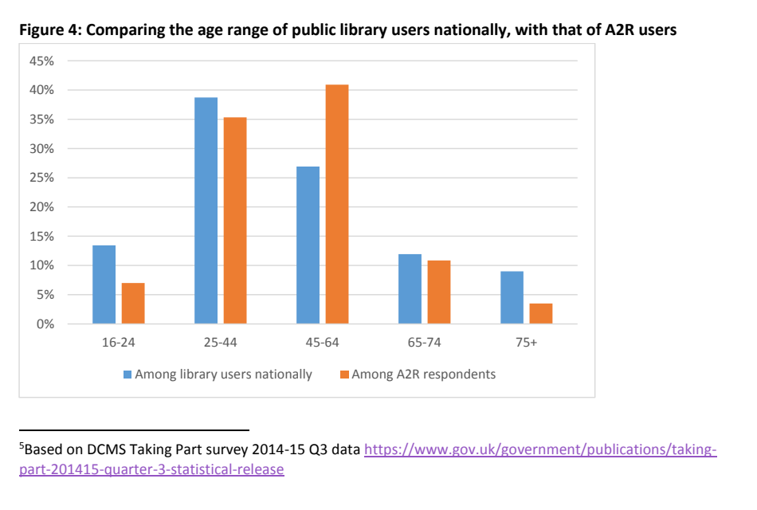

<!-- PAGE: 25 -->

Figure 5: Comparing employment status and gender of public library users nationally, with A2R
users
70% 70%
60% 60%
50% 50%
40% 40%
30% 30%
20% 20%
10% 10%
0% 0%
Not working Working Male Female
Among library users nationally Among library users nationally
Among A2R respondents Among A2R respondents
Demographics

**6.5** Survey respondents are notably those who use the library frequently, with the single biggest group
being the 134 respondents (41%) who reported using the library at least once a week, followed by
the 94 respondents (29%) that reported using it at least once a month.

**6.6** Survey respondents are from a range of age cohorts, with the single biggest group those aged 45-64
(113 respondents, 41%).

**6.7** Respondents were split evenly by gender: 47% male, and 51% female (a further 2% preferred not to
say).

**6.8** In terms of ethnicity, the single biggest group is those who reported being ‘White/White British’ (261
respondents, 80%). This was followed by ‘Asian/Asian British’ (16 respondents, 5%) and
‘Black/African/Caribbean/Black British’ (13 respondents, 4%).

**6.9** A notable characteristic of A2R user-survey respondents was their reported level of educational
attainment. Over three quarters reported their highest level of attainment as degree level or more
(249 respondents, 77%); representing a far larger proportion of degree holders than in the general
population.

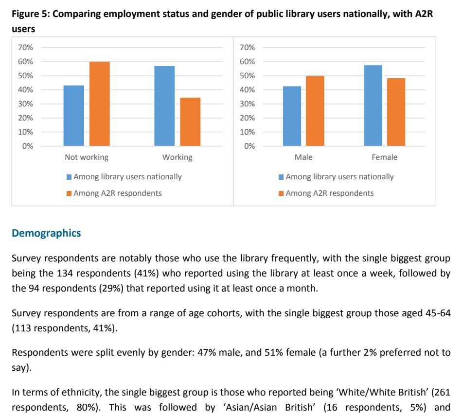

<!-- PAGE: 26 -->

Figure 6: What is your highest level of educational attainment?
2% 3%
4%
7%
7%
77%
No qualifications HNC Prefer not to say GCSE A-levels Degree or higher
N=324

**6.10** Most respondents were in employment (including self-employment). A total of 193 respondents
reported this being the case (60%), compared to 112 respondents (35%) who said they were not –
the rest (19 respondents, 6%) preferred not to say.

**6.11** We also asked for respondents postcodes to enable analysis by area of deprivation6. Analysis of this
data shows that while a third of respondents live in the 20% least deprived neighbourhoods, there is
a relatively even split between respondents who live in other areas including the 20% most deprived
neighbourhoods.
Figure 7: Survey respondent postcodes matched to Index of Multiple Deprivation quintiles
35%
30%
25%
20%
15%
10%
5%
0%
1st 2nd 3rd 4th 5th
IMD quintile: 1 = least deprived 5 = most deprived
N=169

[^6] Valid English home postcodes could be gathered from 169 respondents and these have been matched to
Index of Multiple Deprivation (IMD) quintiles (where the first quintile represents the least deprived English
neighbourhoods).

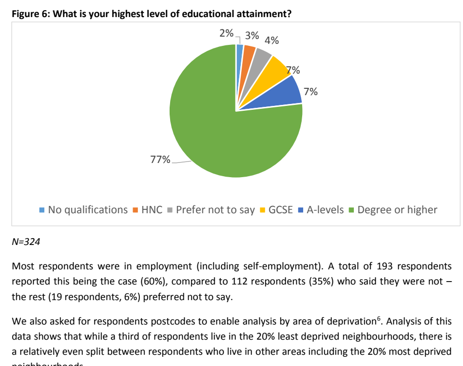

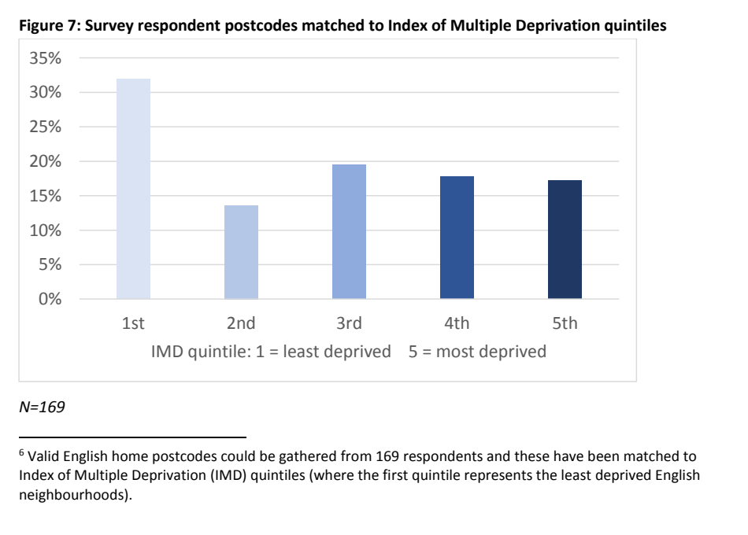

<!-- PAGE: 27 -->

Reasons for using Access to Research

**6.12** The main reason for using A2R as reported by service users was for academic interest / research
(204 respondents, 55%) followed by personal interest (197 respondents, 53%). However, 26% (95
respondents) mentioned professional/business/occupational interest.
Figure 8: What are you using Access to Research for? (Tick all that apply)
Academic interest/research 55%
Personal interest 53%
Professional/business/occupatio
26%
nal interest
Other 5%
0% 20% 40% 60%
N=372

**6.13** Among those who had used the service before, asked which topics they had searched, the most
popular reported included ‘History & Archaeology’, ‘Health and Biological Sciences’, ‘Social Sciences’,
‘Law, Politics & Government’, and ‘Philosophy and Religion’.
Figure 9: Top 5 areas of interest (What areas or topics have you searched on Access to Research?)
History & Archaeology 34%
Health & Biological Sciences
31%
(including medicine)
Social Sciences 28%
Law, Politics & Government 21%
Philosophy & Religion 19%
0% 10% 20% 30% 40%
N=88/105

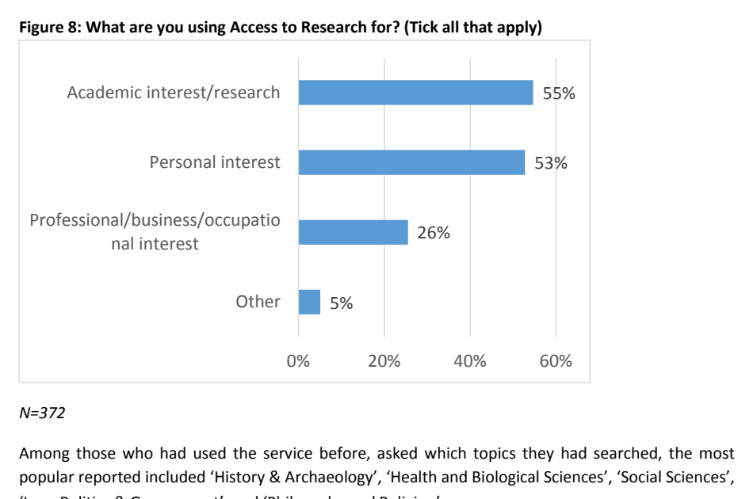

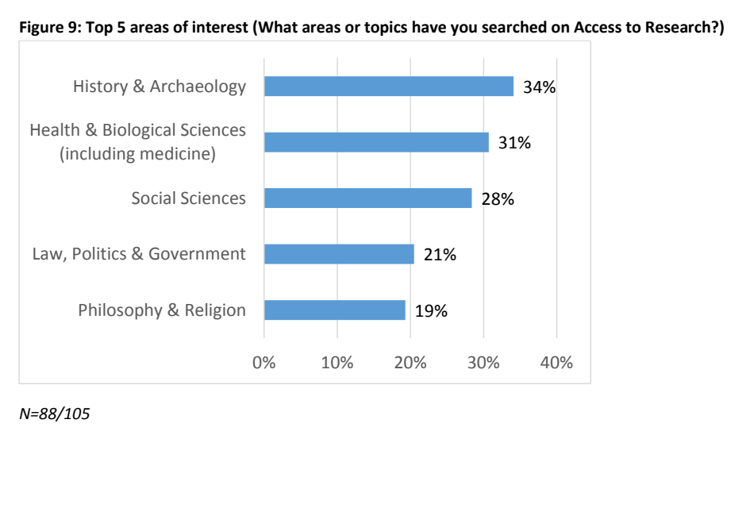

<!-- PAGE: 28 -->

**6.14** Among those about to use A2R, the main topics people intended to search are broadly similar to the
user group above, for instance the top five main topics similarly includes ‘History & Archaeology’,
‘Social Sciences’, Health and ‘Biological Sciences’.
User experience

**6.15** This section similarly draws heavily on the service user survey. It covers: awareness of the service
and how people found out about it; whether users received any support or guidance; and, for those
who has used it prior to the survey, their reflections on their experience of using the service.
Awareness of Access to Research

**6.16** Among the 385 users who responded, a majority had heard of A2R via the library services home
page (198 respondents, 53%).

**6.17** This was followed by 75 respondents (20%) who said they had heard about it from a member of
library staff. Other methods, such as posters or leaflets in libraries, were reported by fewer
respondents (for posters/leaflets: 21 respondents, 6%).
Figure 10: How did you hear about Access to Research?
From library services home page 53%
From members of library staff 20%
Other 16%
Poster/leaflet in library 6%
Recommendation/word of mouth 5%
College/University/Education
5%
Institution
0% 20% 40% 60%
N=374
Support and guidance

**6.18** When asked if they had received any guidance or support in using A2R, a clear majority said they had
not (250 respondents, 68%)

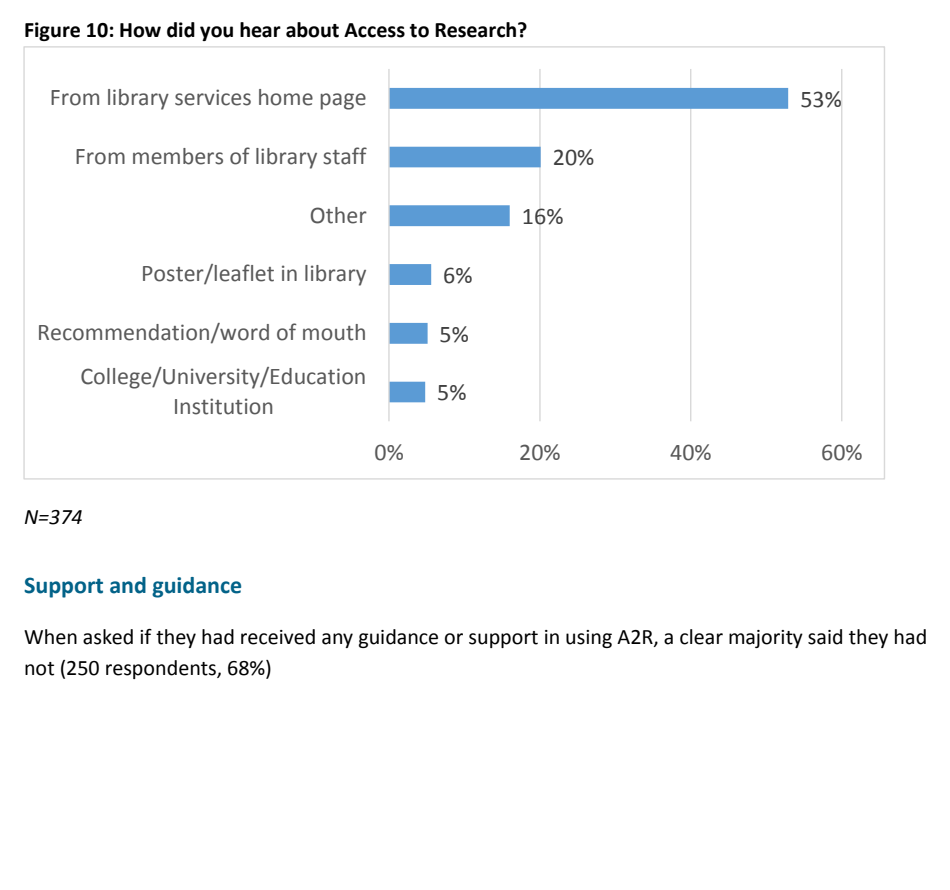

<!-- PAGE: 29 -->

Figure 11: Have you received any guidance or support from library staff for using Access to
Research?
No –I have not received any
68%
guidance or support
Yes, help accessing Access to
14%
Research home page
Yes, information about it (e.g. a
14%
leaflet about Access to…
Yes, help searching or finding
8%
articles
Yes, other (please specify) 1%
0% 20% 40% 60% 80%
N=366

**6.19** A total of 51 respondents (14%) reported that they had received help accessing the home page and
with information about A2R. A total of 30 respondents (8%) had received help searching or finding
articles on A2R.
Experience using Access to Research

**6.20** Among those who had used the service before7, the main place service users reported having used
the website was from a public library (84%), although a further 35% reported using it at home and
12% reported using it at work. From comments given in the survey, it is known that some people use
A2R in other locations (outside of their public library) to identify papers before accessing them in the
library.

**6.21** Some users had used the service intensively, with 27% responding that they had used A2R more
than ten times, a further 30% said they had used it up to ten times, with the same figure (30%)
saying they had used it a few times.

**6.22** There is some evidence from the survey, however, that some users had not used the service to its
full extent. Asked which ‘features’ they had used, 93% (82 respondents) reported searching for
articles, but just 73% (64 respondents) reported reading or printing a full article.

**6.23** Asked a series of questions about A2R, respondents most frequently agreed or strongly agreed that
it was easy to use (75%); that they were able to find the information they were looking for (77%);
and that the information had been helpful (90%). This implies a very positive experience of the
service. Only the 105 respondents who had used A2R on a previous occasion were shown this
question.
7 This section draws on the 105 survey respondents who had previously used the service before completing the
service user survey.

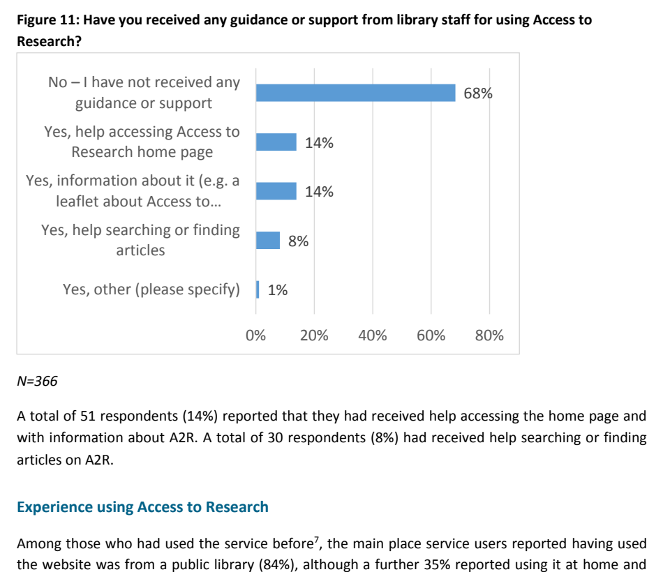

<!-- PAGE: 30 -->

Figure 12: On a scale of 1-5, to what extent would you agree with the following statements?
1 - 2 - 3 - 4 - Agree 5 - Not sure
Strongly Disagree Neither Strongly / Don't
disagree agree know
Access to Research was easy 5% 10% 11% 45% 30% 0%
to use
I was able to find the 5% 7% 11% 60% 17% 0%
information I was looking for
The information I found has 5% 1% 2% 56% 34% 2%
been useful/helpful
N=90/105

**6.24** It is worth noting a possible bias in responses here; namely that those users who return to use the
service again may be more likely to have enjoyed a more favourable experience first time round.

**6.25** Respondents were also asked whether they had found any aspects of the service difficult. The main
difficulty identified by the 69 respondents who found at least one aspect of A2R difficult was
‘accessing the articles I found’. This may relate to issues discussed elsewhere in this report relating
to users being unable to download articles in full. There are various possible explanations for this,
some of which could be about user understanding of the service, and some about Summon
displaying search results which include material from publishers who have not signed up to A2R (an
issue PLS have subsequently addressed).

**6.26** The next most cited issue was ‘finding articles I wanted’ (21 mentions).
Figure 13: What aspect(s) of the service, if any, did you find difficult? (Tick all that apply)
Accessing the articles I found 31
Finding articles I wanted 21
Downloading/printing articles 15
Browsing journals 13
Finding the webpage 8
Other 5
Navigating home page 3
0 5 10 15 20 25 30 35
N=69/105

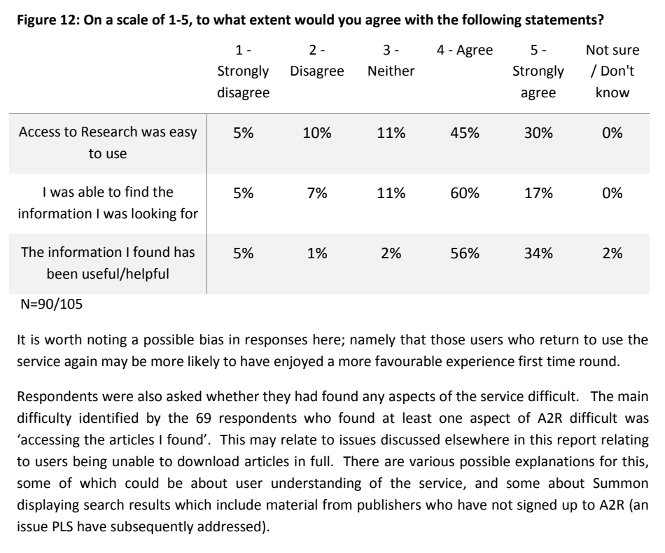

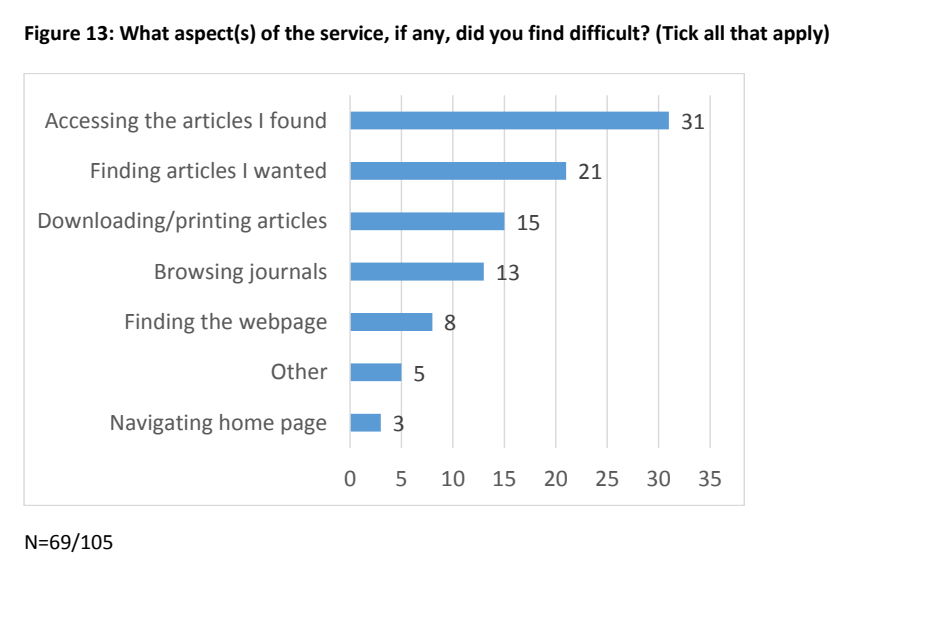

<!-- PAGE: 31 -->

Staff views and experience

**6.27** The staff survey was in the field from 17 July to 17 August 2015. In total there were 612 responses
from library staff. Over 70% of those who responded said dealing directly with the public was their
main role, or that they dealt directly with the public every day.
Awareness of Access to Research

**6.28** Among the 612 respondents, 73.5% (450 library staff respondents) answered that they had heard of
A2R and 26.5% (162 library staff respondents) said they had not heard of it.

**6.29** Respondents were routed differently through the survey depending on whether they responded
‘yes’ or no’ to this initial question.

**6.30** The 73.5% who were already aware of Access to Research were asked to clarify the extent of their
awareness and the answers they gave indicate a wide range of awareness:

**6.31** 42% (175 respondents) from the ‘aware’ group said they ‘know what it is and would feel confident
recommending to library users’ and another 19% (80 respondents) from the ‘aware’ group said they
were ‘very aware’ and promoting or supporting use of A2R is part of their role

**6.32** 27% (100 respondents) of the ‘aware’ group said they ‘know what it is, but would not feel confident
recommending the service’ and 13% (53 respondents) responded ‘heard of it, but not sure what it
is’.
Figure 14: Which of the following best describes your level of awareness of Access to Research?
Know what it is and would feel
confident recommending it to library 42%
users
Know what it is, but would not feel
confident recommending it to library 24%
users
Very aware, part of my role is
19%
promoting/supporting its use
Heard of it, but not sure what it is 13%
Other 1%
0% 10% 20% 30% 40% 50%

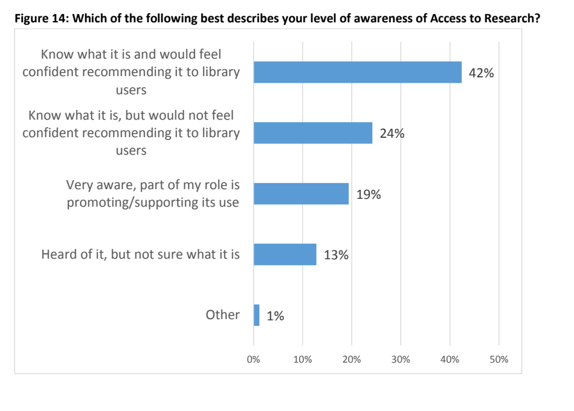

<!-- PAGE: 32 -->

N=413

**6.33** An inability or lack of confidence in promoting the service is at least partly reflected in the numbers
who had received training in A2R.
Figure 15: Have you received any training around Access to Research? [Tick any that apply]
Nothing at all 37%
No, but have researched or taught it
35%
to myself
Yes, local training 18%
Yes, national training 5%
Yes, other 3%
Not yet, but have arranged/booked to
3%
go on training
Yes, webinar 1%
0% 10% 20% 30% 40%
N=406

**6.34** In total just 27% (110 respondents) reported having received local, national, webinar or other
training, meaning the clear majority (73%, 322 respondents) had not received any training. However,
35% (140 respondents) said that while they had received no training, they had taught themselves
how to use A2R.

**6.35** Asked how helpful the training was on a scale of 1-5 (not at all helpful – very helpful), ‘national
training’ was seen as the most helpful, with 47% of respondents who had taken part in this form of
training describing it as ‘very helpful’, compared to 19% of those who had taken part in local
training.
Views on level of use and user experience

**6.36** Asked their views on the level of use in their public library, the single biggest response from staff was
that A2R is being used ‘rarely / a few people’ (39%, 145 respondents).

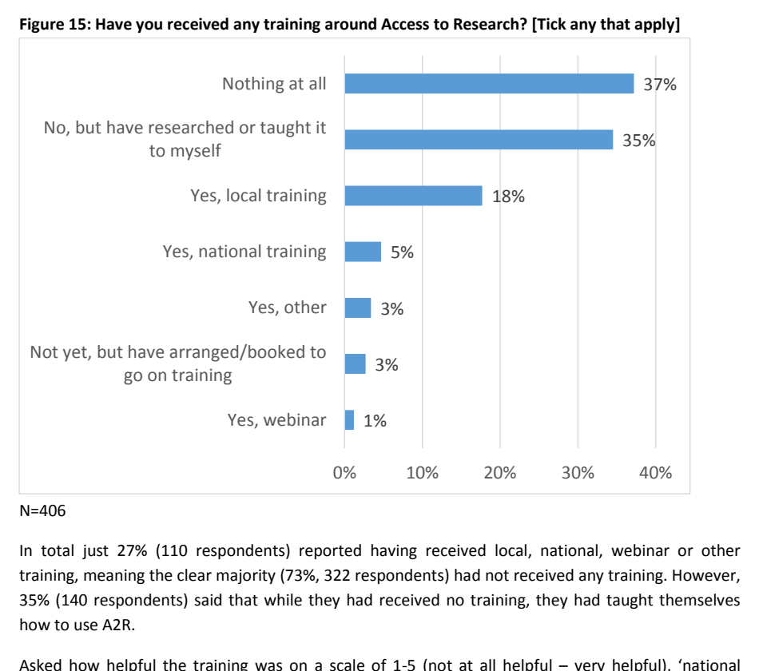

<!-- PAGE: 33 -->

Figure 16: To what extent, as far as you are aware, would you say Access to Research is being used
by the public in your library?
Not sure / Don't know 24%
Often / a lot of people 2%
Some people 23%
Rarely / a few people 39%
Never 12%
0% 10% 20% 30% 40% 50%
N=372

**6.37** This was followed, first by those that weren’t sure, then by those who said it was used by ‘Some
people’ (23%, 85 respondents) and ‘Never’ (12%, 44 respondents). Just 2% said it was used ‘often / a
lot of people’.

**6.38** Asked if they had helped anyone use A2R, most (52%, 194 respondents) said they had not.
Furthermore, among those who said they had helped, the biggest group was those who ‘told people
the service was available’ (32%, 120 respondents) as opposed to those offering more intensive
support.
Figure 17: Have you ever helped anyone to use Access to Research? [Tick all that apply]
No, I have not supported anyone
52%
using Access to Research
Yes, other 4%
Yes, responded to questions 16%
Yes, helped people get started 22%
Yes, told people that the service
32%
is available
0% 10% 20% 30% 40% 50% 60%
N=375

**6.39** Asked to give their views on the user experience of A2R, most respondents said they were unable to
give an answer (‘Not sure / Too few to say’: 52%). Excluding those responses, overall respondents

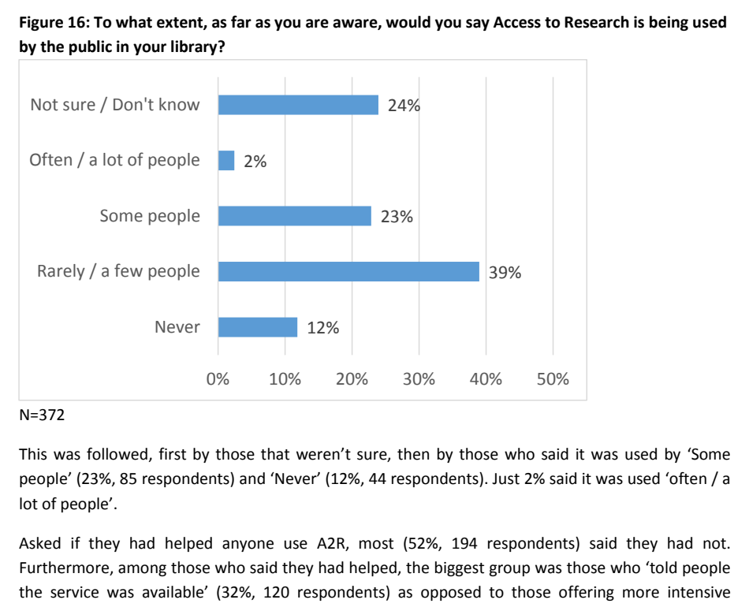

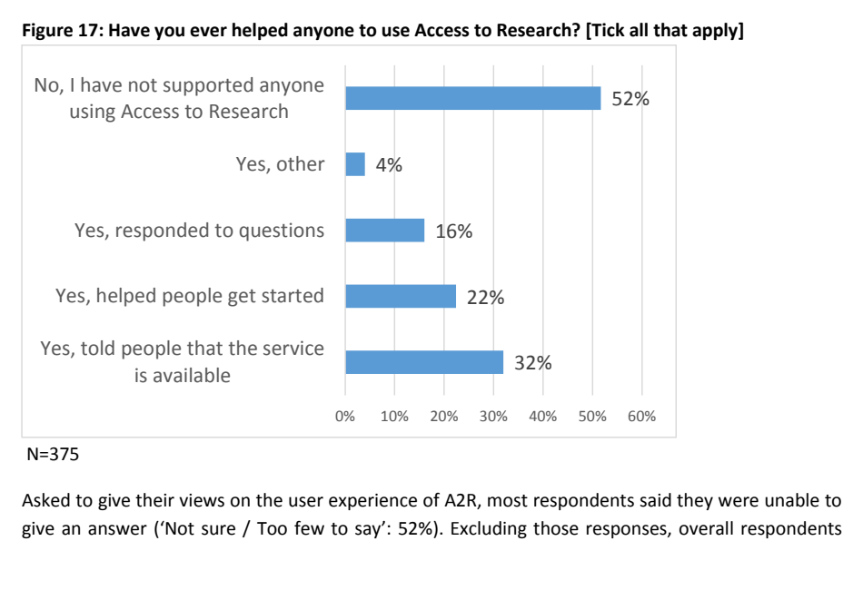

<!-- PAGE: 34 -->

were more positive that users ‘had been able to find what they are looking for’ than that they ‘found
A2R easy to use’, although the general pattern of responses is similar.
Figure 18: Now we want to ask you about the reactions to Access to Research that you have
encountered. On a scale of 1-5, to what extent would you agree with the following statements?
50%
44%
41%
40%
40%
35%
30%
18%
20%
12%
10% 6%
3%
1% 1%
0%
1 - Strongly 2 - Disagree 3 - Neither 4 - Agree 5 - Strongly
disagree agree nor agree
disagree
Users found Access to Research easy to use
Users have been able to find what they were looking for from Access
to Research
N=160; 169
Promoting Access to Research and finding out more

**6.40** Staff suggested a number of ways to promote A2R (196 responses in total). More training was clearly
desired, with ‘training’ mentioned in 42% of responses (83 occurrences). Other often cited responses
included more ‘promotion’ (34 occurrences, 17% of responses) and ‘publicity’ (30 occurrences, 15%
of responses).

**6.41** Bringing together responses from survey questions indicates that Investment in training staff would
probably be effective as, among respondents, those in receipt of training are more likely to say that
they feel confident enough to recommend the service (or that supporting/promoting use is part of
their role).

**6.42** Staff were asked to give any other thoughts on the service that they wanted to share. In total 85
staff responded. One of the most frequently alluded to issues is that some articles are not actually
available, as may have been understood. For example staff said:
“Many articles that come up on results list are not actually available to view
which can be rather frustrating and put me off using it, never mind general
public.” [Public library staff]

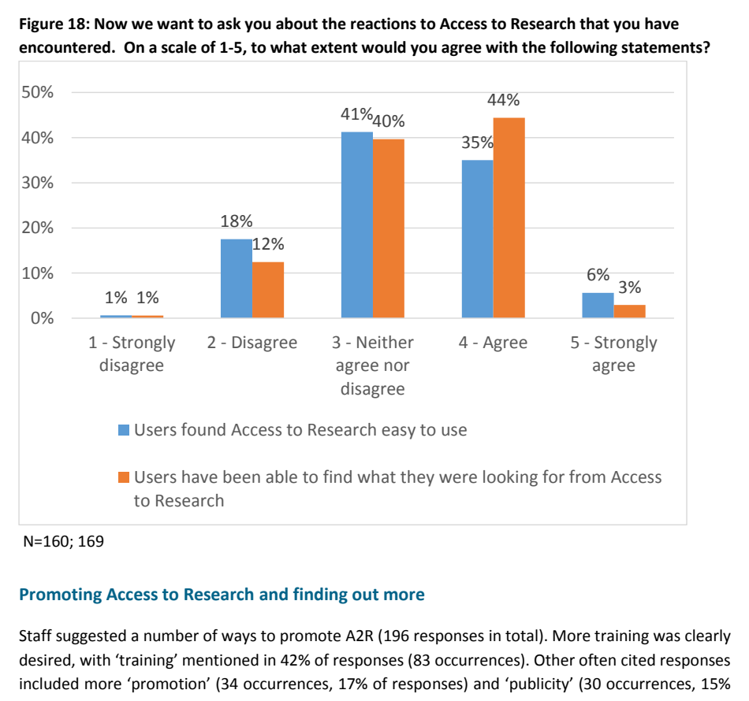

<!-- PAGE: 35 -->

“Some article titles are displayed but the text is not available for public to
read. This can lead to disappointment as results of a search look impressive.”
[Public library staff]

**6.43** This was a clear source of frustration and risked discouraging use. Staff were also clear that the
service needed to be promoted more vigorously:
“We should promote it on our website in a bold and prominent spot!...and
encourage all library staff to promote it.” [Public library staff]

**6.44** Those respondents that responded in the negative to the first question and who were unaware of
A2R, were asked to suggest ways to raise their level of awareness. In total there were 110 responses.
The most commonly cited method of raising awareness was ‘email’, mentioned 45 times (41% of
responses). This was followed by ‘training’ (19 occurrences, 17% of responses) and posters (15
occurrences, 14% of responses).
User case studies

**6.45** As part of the user survey we also asked respondents whether they would be willing to be
interviewed so that we could explore their use of A2R in more depth. We had a number of positive
responses and were able to conduct detailed interviews with eight users of A2R whose experiences
we have documented in the following case studies. These reinforce the general impression of the
public finding a very wide range of uses for A2R, driven by an equally wide range of motivations.
Tom is hoping to set up a social enterprise. He is using A2R to conduct market research that can
inform the business case for this.
Tom is interested in addressing skills gaps around digital skills, particularly among harder to reach
groups, and is using A2R to find out more about how this is measured at present and what is
currently being done. He also thinks there is scope to develop solutions for older people that are
infirm and need support around their health that prevent them moving into care homes.
He wouldn’t have had to use A2R until recently, but feels now that in order to develop a business
plan “you have to get your hard-core research in there”. Tom was really impressed to find this
service available in his local library. He feels this is another important part of what libraries have
to offer and should be marketed more.
“I think for libraries it is really my finding out what they have to offer, I’m not sure many people
know just how much they have to offer.”
Melanie graduated in July with a PhD in Archaeology and has now gone into commercial
archaeology. As she has finished her studies, her university credentials that granted access to
academic journals expired. However, she has been able to continue using academic journals
through A2R.

<!-- PAGE: 36 -->

Melanie is excited to be able to continue her research and welcomes the freedom that A2R
affords. She feels that because those undertaking research in academic institutions have to attract
funding, this may skew the types of research which get approved, whereas A2R is a great way, she
argues, to let “less fundable topics be explored”.
“I wasn’t expecting to have the same level of access as university, but considering it is a free and
public resource it has been very helpful.”
Gideon is a studying for his MBA at an English university, but travels there from his home town in
Wales. When he is home he likes to use the library as a place to study and found out about A2R
from his local library staff.
“It hasn’t been long since I realised that I could get access to this kind of academic journals. I
thought I could only get access from universities.”
A2R is complementing the journals he can access via his university and is helping him to properly
reference and back-up his assignment. The kinds of topics he is searching are service marketing,
marketing, and accounting.
Gideon thinks A2R has a wealth of interesting material that could be useful to businesses if they
knew more about it.
Simon is using Access to Research to research his book on ‘comedy and caricature’ in English and
Greek literature. He had previously been a university professor, but not now being affiliated with
a university welcomes the access that the scheme gives him.
“You do start to feel you a more of an insider again [being able to access academic journals], you
can feel marginalised and as though you are an outsider.”
He found A2R very easy to use and in particular appreciated the convenience and the breadth of
content. He reflected that in the past he would have had to travel to the British Library or Boston
Spa for the depth and quality of content that is now available through his local library. Moreover,
Simon noted that paying for journal access would otherwise be prohibitively expensive.
“I was quite surprised how much material was made available, some subscription services exclude
some journals. I was surprised to find some that I wasn’t expecting to find.”
Brian, a retired factory health and safety inspector, uses A2R primarily to learn about subjects
which are of interest to him. He is a member of an Industrial Archaeological Society, and uses A2R
to do background reading in advance of any talks put on by the society.
He has also recently taken an interest in photography, and has used A2R to look into the history of
various terms and theories of photography.

<!-- PAGE: 37 -->

“I use Access to Research to help me understand the jargon and the origins of different terms and
techniques … I’ve been looking for instance at Retinex Theory.”
Brian is a member of various library support groups, and has used A2R to help him prepare
arguments for the advocacy of public libraries and to understand the historical opposition to
them. He shares his learning with other members of the support groups and has been
encouraging them to do their own research using A2R.
Brian sees value in A2R, and is particularly keen for others to benefit from it. He often shares his
experience with others and helps them to gain access to material which is of interest to them,
particularly those who feel that they would be unable to engage with academic material.
“I’ve met a lot of people who think ‘academic literature is not for me’. I helped one chap use it who
had an interest in cricket. I helped him find a paper on the history of cricket and he found it very
interesting and easily accessible, even though he’d never read an academic journal before.”
Martin volunteers at a stately home run by the National Trust.
He is currently doing some research around the reign of Mary I and Phillip of Spain in England,
with particular reference to aspects of Tudor government and portrayals of the Monarchy at the
time.
Martin has primary access to original documents from the period, and was inspired to research
the subject further after seeing the letters patent to the property, which were granted by Mary
and Philip at the time. He plans to write a report which will be shared via an electronic journal
published by the National Trust. He hopes that his work will encourage further discussion and
research in the area.
As a new user, Martin has found A2R easy to use, and notes that without access to such a tool, he
would have had to visit many different libraries and other places housing relevant research, but
with A2R he can access it in one location.
He already has plans for a future project looking into what has been written on the naval history
of the stately home, and building further on that.
“Without Access to Research I would have had to go to various libraries with collections as
opposed to doing it online. Having it available locally is very important.”
Viktor is a professional composer, session and live musician.
Viktor developed an interest in the compositions of Dutilleux and wanted to learn more about his
composition process. His membership at the University of Bristol library had expired so he went to
his local library, after finding out about A2R online. He used the articles he found on A2R to inform
his own writing process.

<!-- PAGE: 38 -->

“I wanted to find out the nuts and bolts of how he writes music – I wanted to know about the
exact processes involved … you could say it was professional development. Turns out that a lot of
doctoral papers been written about this guy.”
The articles would have cost him around £100 if bought privately, but through A2R, Viktor was
able to access these for free. Viktor hadn’t visited the library for several years, and had a negative
perception of them, but visiting a library to use A2R gave him a fresh perspective.
“It makes the public library look a more happening place. I hadn’t been for years but it was now
full of students and felt lively. There’s always a perception that libraries can be depressing but it
was nice to see that there is something going on there.”
Fred, is retired and used to work as a scientist for the Natural Environment Research Council.
He has a wide range of hobbies which include mathematics and science, and is an amateur pilot
who flies a Cessna and a Gyrocopter. He also runs a website where he publishes his own research.
“I’ve been using Access to Research to study things and to inform my own research which I publish
on my website – it’s quite heavy mathematical and scientific stuff.”
Fred uses A2R for a number of purposes. For instance, he has recently used it to research an
article he is writing about changes in the jet stream. Fred has also been trying to come up with a
design for a new type of Gyrocopter, and has used A2R to find articles to help him with his
designs.
In the past, Fred would have asked at his local library or paid for access to journals. Now he gains
access at his local library as part of his daily trip into town. Fred points out that using A2R is easy
enough to use and is similar to using any other search engine.
Views of non-users of A2R

**6.46** Our non-user survey was completed by library users who had not yet used A2R. Members of the
public were encouraged to complete the survey on paper or online by staff in those library services
who had agreed to assist with our research. Ninety-nine individuals completed the survey. Over 90%
of them described themselves as regular library users tending to cite as their main reasons for library
use (they could choose more than one) as; use of IT facilities (67%), book-borrowing (55%), study or
work (35%), and reference and newspapers (22%).

**6.47** The first thing we see in the survey of non-users of A2R is that just under half were aware of A2R
even though they had never used it.

**6.48** We also introduced a screening question to ask if respondents had used A2R previously, and those
who said they had were directed to the user survey and no further questions were asked of them.
These results therefore only consider responses from actual non-users.

<!-- PAGE: 39 -->

Figure 19: If you have not used Access to Research, which of the following best describes why you
have not used it?
Not aware of it
Aware of it and interested, but haven’t
had a reason to use it
Not aware of it previously –but I would
be keen to find out more / use it
Aware of it and interested, but haven’t
had the time to use it
Aware of it but not interested
Other
0% 10% 20% 30% 40% 50% 60%
N=68

**6.49** Although 48% of respondents were simply not aware of it, 45.5% showed some degree of interest in
A2R. This included around 18% who had not been aware of it but would be keen to find out more,
alongside 19% who were aware and interested, but without the time to use it.
Figure 20: How often do you use the library?
At least once a week
At least once a month
3-4 times a year
Prefer not to say
Have not visited in the past year
1-2 times a year
0% 10% 20% 30% 40% 50% 60% 70%
N=88

**6.50** As we would expect, many of the respondents were frequent users of a public library, with 61.4%
visiting at least once a week, most commonly to use IT and computer facilities, but also to borrow
books or study. This broadly matches the type of public library user who has tried A2R, i.e. regular
users, who come to the library to use computers and other IT.

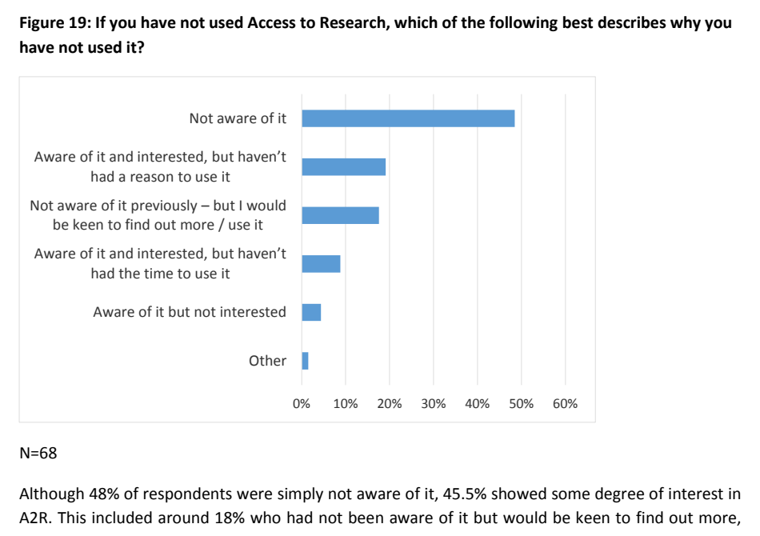

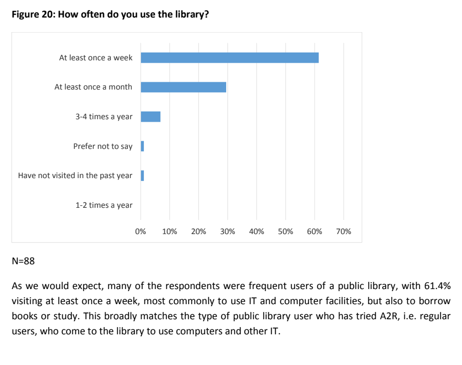

<!-- PAGE: 40 -->

Figure 21: What are the main reasons you use the library? (Tick all that apply).
IT facilities (computers, WiFi, internet)
Borrowing books
For study or work
Reference section or newspapers
Borrowing CDs or DVDs
Other
Activities held at the library (e.g. rhyme
times, classes)
0 10 20 30 40 50 60 70
N=88

**6.51** These figures confirm our other findings that promotion by public libraries has been very variable
and a large number of public library users still do not know about A2R; yet many would potentially
be interested. To put this in the context of public library use overall, out of England’s 8 million active
library borrowers this suggests up to 5.3 million may not know A2R exists, and 1.4 million might be
interested in finding out more.

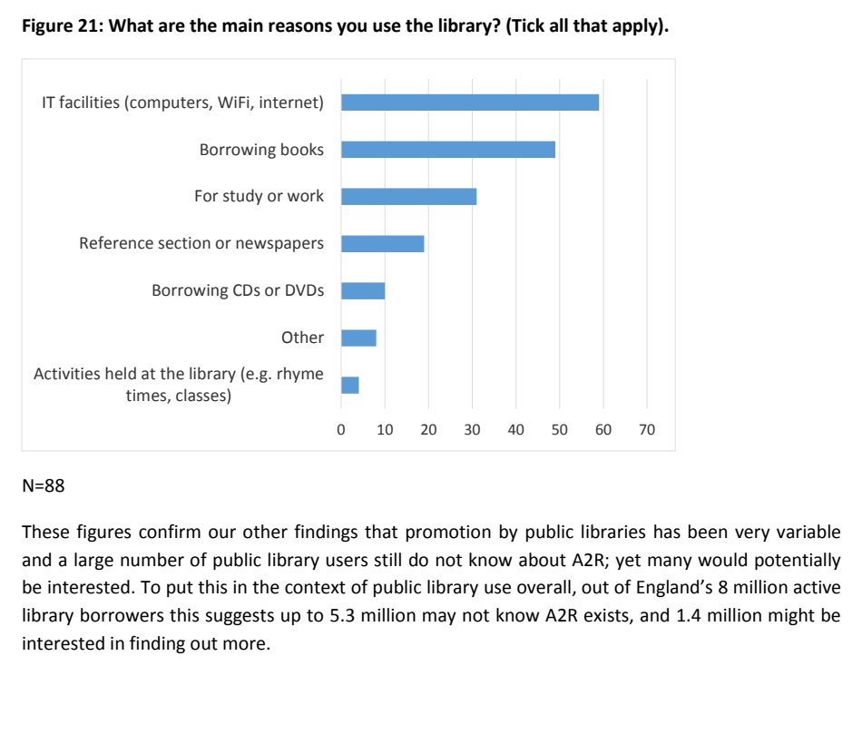

<!-- PAGE: 41 -->

## 7. Conclusions and Recommendations

**7.1** A2R is a genuinely innovative and exciting concept, with significant potential for attracting public
use, but it is still in its infancy. As a technical solution to a complicated problem it is clever,
ingenious even. But it is also a system which needs constant monitoring to ensure it is delivering the
intended service consistently across 150 public library services. There also needs to be good
accurate promotion so the public find out about it, and understand the basics of using it.
Learning from libraries’ intelligence

**7.2** Since the launch of A2R in January 2014 use had grown and participation by public libraries and
publishers has grown. Our survey of existing A2R users indicates high satisfaction rates; 75% saying
it is easy to use, 77% saying they found what they were looking for, and 90% saying the information
they had obtained was helpful.

**7.3** But there are significant expectations upon it from those who generated the original idea, worked it
up as a service, and played a part in implementing it. In particular usage levels during the first 19
months have been lower than many stakeholders had hoped. Yet if all participating library services
were achieving usage levels of the kind being seen in Birmingham, West Sussex, Hampshire,
Derbyshire, or Brighton and Hove – then usage would be running at over 300,000 searches per year;
some might still expect more, but it would be a leap forward. A key question we would want to ask
next is, what can we learn from these public library services in particular? The next question would
be to find out which other library services want to achieve similar results.
Recommendation: SCL and PLS should ask those library services with the highest use what they
have done which others might emulate in order to increase use of A2R.
Recommendation: SCL and PLS should seek out those library services who want to set themselves a
goal of increasing A2R usage (say to 3,000 searches pa) and offer some form of additional support
to them (e.g. training resources, recognition scheme).

**7.4** Even though some of the raw data presents challenges for interpretation (e.g. matching IPs with
participating public library services) a large amount of data is already being collected which could
provide a great deal of usable insight. It could be used far more intensively by participating public
library services to guide action and monitor the effects of action. Our ‘heat map’ shows how simple
manipulation of the date can provide actionable insights.
Recommendation: SCL and PLS should amend the format of the monthly usage reports to follow
the ‘heat map’ format used in this report.

**7.5** There are some aspects of how the service is being used in real life by real users which would benefit
from deeper understanding. Better understanding of the ‘other IPs’ for instance; what kinds of users
do these represent, and could this significant mode of use could drive use within libraries? The same
goes for the apparent drop-off between those accessing the A2R landing page and those performing
an A2R Summon search. There are also some elements of the current user journey which may <!-- PAGE: 42 --> confuse or lose potential users. We suggest the development and improvement of A2R will be
helped by gaining a deeper understanding of user journeys and by smoothing out obvious issues.
Recommendation: SCL and PLS should improve the accuracy or IP records including investigating
the circumstances around high use ‘other IPs’.
Recommendation: SCL and PLS should investigate further the possible reason for the large
difference in visits to the landing page compared to the A2R Summon page.
Recommendation: SCL and PLS should combine the two A2R websites in order to drive all traffic to
the search enabled website http://accesstoresearch.pls.org.uk/
Who What and Why?

**7.6** A2R is being used by all kinds of people, although they tend to be existing public library users. It is
being used by people of all ages, from different ethnic backgrounds, with different levels of
educational attainment, and by people from wealthy and from poor neighbourhoods. That said,
while current users are diverse they are somewhat skewed towards over 45s, and people with a
degree education; the typical A2R user is educated and digitally savvy. A2R is also being used more
by those who have prior experience (often recent) of using journal literature than those with no
prior experience of journal research.

**7.7** The range of subjects being searched for is incredibly broad, indicating a wide range of motivations
for use. This is confirmed by the user survey and the in-depth interviews with seven individual users
featured in the previous section. The most common types of information being sought relate to
medicine, history, and general health but these only account for a tiny proportion of all searches.

**7.8** Users report many reasons for wanting to use A2R spanning work and professional interests, study,
and personal or leisure interests. Some A2R users may be visiting the library specifically to use A2R,
but it appears the majority of users are regular public library visitors already and many of these are
individuals are also regular users of public access computers in libraries.

**7.9** In terms of motivations and ‘use cases’ a number of interesting examples have emerged including
social activism and supporting one’s own community, research by a privateer inventor, and enabling
self-directed professional learning and development.

**7.10** This wide range of uses, and motivations for use, shows that demand so far for A2R is not from an
esoteric niche but is very broad – in fact it mirrors the way the public use public libraries generally.
That said, while some public library services have made significant efforts to promote A2R, many
users are discovering A2R themselves, and learning how to use it themselves – around half the
public library staff responding to our survey did not feel confident explaining A2R to the public.

**7.11** While some respondents to the user survey made clear they did not need or want help to use A2R,
this needs to be seen in the context of users tending to be older, degree educated, library regulars. It
could be worth testing whether younger people including those without degree educations, would
be attracted to A2R if they were introduced to it with more proactive advice and support. There also
seem to be a number of inconsistencies with user experience which may be discouraging or
preventing users from getting beyond the landing page and initial search results pages. This may be <!-- PAGE: 43 --> exacerbated by the low-key way staff in many public library services signpost A2R. Presumably this
will be more of a disincentive for people with lower levels of digital confidence.
Recommendation: SCL and PLS should actively test interest in A2R among library users who are not
currently using A2R, especially demographics groups using it least for instance those under 45
years and not degree educated.
Wider social value

**7.12** For those who have been part of creating A2R the initiative serves a number of purposes and adds
value in several ways. For PLS and the publishers it enables them to take a very tangible step which
supports the principles of open access; something which they, and Government want to build. For
BIS it has potential (especially if usage were higher) to contribute to increasing higher level skills and
knowledge in the general population, as well as supporting innovation and business creation.

**7.13** Some types of usage (the interest in medicine and general health) also point to potential for A2R to
support health literacy and health activation in the general public, although levels of use and the
examples of use so far would need to increase. There might be overlaps here with activities libraries
are leading or hosting, e.g. groups interested in improving their health and well-being, craft or hobby
groups, history or heritage societies.

**7.14** Recommendation: SCL and PLS should test levels of interest and promote A2R to library-hosted
groups and clubs e.g. relating to health, hobbies, of local history groups.

**7.15** For public library services there is clear value in A2R, and some public library services appear to have
recognised this and acted upon it. The initiative expands their information offer in an innovative but
low-cost way. It is certainly enabling them to offer more to existing users, and may in some cases be
attracting new users who visit specifically to use A2R. It is also clear from public library sector
stakeholders that A2R is seen as a starting point for public libraries acting jointly to undertake
further strategic endeavours with publishers.
What next for the A2R service?

**7.16** Broadly speaking A2R is working the way it was designed, and the public are using it for a wide range
of reasons, although not as many as hoped. Stakeholders are happy with it too, and will continue to
support it provided usage can be increased. There is therefore nothing fundamental we have
encountered in our research to suggest anything in the core concept needs to change dramatically.

**7.17** But in our view the next steps must be about growing use – this is urgent. The overt message from
stakeholders and project sponsors is that A2R is heading in the right direction but absolutely must
attract more users. The less overt message, is that many stakeholders believe the onus is now on
public libraries to capitalise on the opportunity A2R presents, in particular by stepping up proactive
marketing, increasing staff awareness, checking functionality more routinely from a range of public
library locations, and ensuring staff skills are in place to help drive up use of A2R.

**7.18** It barely needs saying however, that this is an extremely difficult period for England’s public library
services who are struggling with declining budgets, and declining use. To invest leadership energy, <!-- PAGE: 44 --> let alone time and money in A2R may seem too far beyond the absolute necessities for some heads
of service. Yet frustratingly, A2R has potential to help re-build public library use and visit levels, and
also to make a stronger case to funders about the impact libraries make for the money they cost to
run. The key will be to take an iterative and evidence based approach to promotion, by planning
actions which are based on clear logic models and hypotheses, then watching the data for impacts,
and then improving and repeating over time.
Recommendation: SCL and PLS should create a short, focused national A2R awareness campaign,
with some easy to copy materials sent to participating libraries – the impacts of which would then
be monitored via Summon and Google analytics.

**7.19** Awareness and publicity for the 15,000 or so people who work in public libraries should continue to
be a priority. This may not be as hard as it seems. Staff clearly want to know more as evidenced by
the survey responses, and we have seen frequently how other messages about digital services have
been promulgated throughout the sector quickly and easily. We also suspect from the informal
conversations we had to administer the surveys, that there may be a number of digitally-literate
public library staff who could act as a dispersed A2R expert network – checking functionality, and
helping suggest improvements to the service.
Recommendation: SCL and PLS should ensure all frontline public library staff understand the basics
of how A2R operates including the fact it can only be accessed via specific IPs and that they know
how to direct the public to these – this could be achieved via the existing training programme.
Recommendation: SCL and PLS should seek a network of frontline public library staff to actively
monitoring how user experience in participating libraries matches the intended experience. This
could be done with a common set of checks issued by PLS and carried out by local library staff.
Potential longer term developments

**7.20** The success of using a pop-up prompt on the landing page to gather responses for the user survey,
suggests there may be ways to drive engagement using the design of the landing page itself. This
could be linked to efforts to understand whether use of A2R from outside public libraries can be
used to drive use inside libraries – e.g. through a click and collect or click and retrieve type model.
Recommendation: SCL and PLS should investigate the relationship between out-of-library use and
in-library use, in particular whether the former can help drive the latter and the potential for
functionality which could enable browsing of search results and abstracts at home or while mobile,
and then simple retrieval of saved articles once arrived at a participating library.

**7.21** The user survey response also suggest there is a small but growing community of highly engaged
users who are happy to answer detailed questions, publicise their use of A2R via Twitter or via other
social media – SCL could reach out to this community both to help promote A2R, and also to
discover how the system can be improved.
Recommendation: SCL and PLS should investigate functionality which might enable highly engaged
users (inventors, citizen scientists, expert patients) to contribute to the growth and development of
A2R in a structured way – e.g. through user forums, expert user groups, or social platforms.

<!-- PAGE: 45 -->

## Annex: Notes on Web Analytics
In order to make the most of the IP data, PLS also provided a list of the IP addresses submitted to
them by participating public libraries to become the authorised access points for A2R. This list
included IP addresses submitted by 150 public library services in England, Scotland and Wales. These
IP addresses has been supplied as a mix of individual IP addresses (e.g. Derby 85.8.202.81) and IP
addresses with a subnet range (e.g. Devon 159.15.129.64/28 – which represents a range of
individual IP addresses in use by Devon libraries). As the data exported from Summon included
individual IP addresses, all the subnet ranges were converted to individual IP addresses to enable us
to match use indicated by the Summon data with those library services participating in A2R
(conversion was carried out with the help of a web-based subnet calculator8).
Whether or not a library service has submitted one or multiple IP addresses, it was assumed that in
many cases individual IP addresses could in practice be assigned to different physical machines on a
library network. So usage attributed to an individual IP address might not necessarily describe use
via the same computer every time. We also noted the possibility that some library services might
have included both internal and external IP addresses in the details provided to PLS.
In interpreting the data, particular reference has been made to both the analysis undertaken by
CIBER Research Ltd for PLS in May 20149 and the article about the pilot phase of A2R in Learned
Publishing written by Sarah Faulder and Shinwha Cha10.
One issue we encountered in relation to IPs is that some IP addresses on the authorised list we
received do not include the name of the library service to which they relate. For example an IP on
the ‘authorised’ list with one of the highest use levels is labelled “Unknown04” another is labelled
“Fujitsu”. No doubt these are genuine authorised IPs, but it would be helpful to fill these gaps.
Notes on data terminology
Google Analytics and Summon use slightly different terms when quantifying use: users, visitors,
visits, sessions, hits and searches. For the purpose of this analysis a number of assumptions have
been made about these terms and the relationships between them:
-  User (Google Analytics): Google Analytics puts a cookie on a web browser which stays active
for two years. For computers used by just one person this is a good way of understanding
how many individuals are visiting repeatedly. However, for shared or public-access
computers it simply means the same computer was used. This is further obscured by the
fact some public library computers are set-up to clear cookies and other user data from the
browser every time someone new books a computer.
[^8] http://www.subnet-calculator.com/cidr.php [Accessed 18 August 2015]
[^9] CIBER Research Ltd, Access to Research Web Metrics, May 2014
[^10] Sarah Faulder and Shinwha Cha, Access to Research: the experience of implementing a pilot in public
libraries, Learned Publishing Vol.27 No.2, April 2014.

<!-- PAGE: 46 -->

-  Session (Google Analytics): A ‘session’ for Google Analytics is ‘a group of interactions that
take place on your website within a given time frame’. A session comes to an end after
inactivity of 30 minutes. This means that on a public access computer a single session could
potentially include searches made by more than one person.
-  Pageview (Google Analytics): A ‘pageview’ is recorded every time a page is loaded by a user,
including hitting ‘back’ or ‘refresh’. In the context of A2R a pageview could be recorded as a
user arrives on the A2R website, as they navigate around different FAQ pages, or when they
hit ‘back’ to get back to the search box.
-  Visitor ID (Summon): This appears to be the same as ‘user’ in Google Analytics.
-  Visit (Summon): This appears to be the same as ‘session’ in Google Analytics.
-  Search (Summon): Through some purposeful sampling, it appears that a ‘search’ is recorded
when a user loads a page of search results. Loading a second page of search results counts
as a second search, etc.
-  Hit (Summon): ‘Hits’ in Summon appear to be generated by the same actions as ‘searches’
and therefore appear interchangeable.
The relationship suggested above between Summon terminology and Google is supported by the
fact that logging in Summon derives from Urchin, which was acquired by Google when it created
Google Analytics11. So, the approaches can be expected to share common concepts and
methodologies.
Whilst the original intention may have been that users would only carry out searches and download
articles in public libraries, we have seen that in practice it is only access to full articles that requires
the user to be in a participating public library and using an authorised IP. Furthermore, it seems that
all searches and subsequent requests to publisher websites for full article downloads are channelled
through a PLS Proxy Server (which we understand is the way Summon is provided by other
organisations). Presumably the alternative would have required each publisher to set up their server
to manage requests from each participating public library and maintain a database of eligible IP
addresses. Instead all the publishers need to do is configure their own systems to accept requests
from the PLS Proxy Server, and it is the Proxy server which has checked whether the requests came
from an IP address which is on the PLS authorised list.
Heat map of A2R usage based on PLS monthly reports
We were able to create a ‘heat map’ using the PLS monthly usage reports which were produced for
participating libraries. This was created as an Excel spreadsheet which has been shared with PLS for
them to continue using with subsequent usage data. Dark-red colour-coding denotes libraries which
generated the highest levels of monthly usage and pale-blue denotes the lowest levels of use. Below
is an image of the spreadsheet (i.e. a screenshot of the spreadsheet with no functionality).
[^11] CIBER Research Ltd report for PLS - Access to Research Web Metrics, May 2014.

<!-- PAGE: 47 -->

Apr-14 May-14 Jun-14 Jul-14 Aug-14 Sep-14 Oct-14 Nov-14 Dec-14 Jan-15 Feb-15 Mar-15 Apr-15 May-15 Jun-15
Library Hits Hits Hits Hits Hits Hits Hits Hits Hits Hits Hits Hits Hits Hits Hits Total Hits
Birmingham 296 408 493 261 444 180 799 300 257 203 367 274 311 144 70 4807
West Sussex 276 234 333 341 398 302 399 273 357 424 326 206 211 261 191 4532
Hampshire 849 750 1070 185 97 161 149 88 81 155 109 188 110 219 128 4339
Derbyshire 237 212 134 183 159 155 232 94 175 141 334 735 162 187 104 3244
Brighton and Hove City 139 129 252 207 92 126 132 225 97 846 334 149 129 71 93 3021
Carillion services (not council) 52 94 148 184 87 265 226 119 135 187 160 280 203 302 6 2448
Somerset 343 89 166 134 74 101 359 110 84 173 188 40 121 241 82 2305
Blackburn with Darwen 0 0 0 0 0 143 229 222 172 179 336 218 266 288 243 2296
Oxfordshire 102 75 126 354 477 216 155 59 167 125 99 140 0 0 0 2095
Hertfordshire 143 50 19 58 176 323 337 119 120 73 132 141 94 156 89 2030
Unknown04 163 96 104 96 192 215 151 83 55 213 136 64 63 33 237 1901
Suffolk 242 122 170 299 227 112 114 94 50 28 17 36 34 51 80 1676
Unknown03 (poss York) 153 79 89 85 165 196 79 56 53 172 113 61 58 27 233 1619
Fujitsu (not council) 0 1 0 15 4 110 257 176 141 217 185 159 99 147 54 1565
N
Li
o
n
r
c
t
o
h
ln
Y
s
o
h
r
i
k
r
s
e
hire 16
1
9
2
1
9
3
8
2 4
7
2
3
2
1
1
0
0
6
1
2
9
4
1
5
8
6
5
5
5
2 11
9
3
5 6
6
8
7
13
4
4
2
11
4
1
3
2
1
1
2
9
0 33
4
1
6
23
5
8
9 16
1
8
7
1
1
5
3
4
9
5
2
Aberdeenshire 0 48 170 76 49 80 122 93 244 246 26 55 36 31 111 1387
Edinburgh 6 12 41 187 114 137 135 249 0 0 94 93 103 126 50 1347
Cheshire West and Chester 159 194 127 52 109 41 80 65 22 94 118 70 84 33 35 1283
Manchester City 130 63 15 13 11 133 272 154 243 68 15 48 30 25 21 1241
Devon 32 146 45 45 239 128 44 31 18 68 58 110 118 51 87 1220
Westminster (library-uncertain) 0 0 0 0 126 125 54 284 92 152 32 131 89 39 85 1209
Doncaster 57 149 69 76 177 93 112 44 20 83 20 52 125 46 61 1184
Leicestershire 91 10 149 77 55 85 22 18 36 93 34 41 99 128 205 1143
Swansea 40 146 94 14 44 41 128 148 6 15 39 169 8 9 126 1027
N
W
o
a
r
r
f
w
ol
i
k
ckshire 39
0
90
0
255
0
80
0 0
6
1
2
6
4
2
2
9
7
187
4
1
2
0
1
5 12
4
5
5
8
8
7
0
12
1
4
8
1
1
2
5
3
9
9
6
2
4
12
8
7
2
10
9
1
9
5
4
Cambridgeshire 0 1 0 68 143 103 136 175 30 61 74 87 48 31 10 967
Unknown05 52 94 148 141 82 248 201 966
Newcastle 90 95 134 84 125 20 74 41 62 10 14 27 47 4 87 914
Buckinghamshire 80 23 25 53 94 121 117 79 54 32 27 74 22 41 42 884
Powys 107 90 68 30 51 79 42 20 29 51 77 2 10 10 198 864
Bristol Central 0 67 44 41 58 86 116 77 80 50 27 71 40 38 39 834
Gloucestershire 1 5 21 63 48 103 93 76 9 61 28 140 56 5 124 833
Cumbria 59 70 26 44 72 47 132 30 59 97 12 99 30 18 33 828
South Gloucestershire 31 133 14 28 46 25 38 91 32 68 140 83 40 38 18 825
S
S
h
u
e
rr
f
e
fi
y
eld
121
0
26
1 11
4
8
1
2
5
1
2 13
5
5
2
58
6
53
3 2
7
7
9
1
1
4
3
5
1
7
9
25
1
37
6
13
2
7
1
14
6
6
9
9
3
8
4
7
7
4
2
2
8
Royal Borough of Windsor and Maidenhead 36 35 9 18 32 55 23 23 29 36 170 145 78 19 10 718
Bury 124 103 87 45 9 20 26 27 9 84 41 73 25 27 16 716
East Riding of Yorkshire 33 89 160 55 57 83 80 31 20 8 8 46 26 16 0 712
Unknown10 0 3 92 16 21 52 88 71 16 15 33 71 37 156 31 702
Liverpool City 9 57 46 47 112 76 10 99 13 13 4 85 55 9 58 693
Kensington and Chelsea 0 0 0 9 50 120 215 69 40 43 0 21 32 37 54 690
Tower Hamlets 0 46 12 103 6 50 40 19 14 68 98 2 82 57 45 642
Bath and North East Somerset 51 12 57 48 28 9 45 94 62 4 35 28 15 28 123 639
Wrexham 0 0 5 58 36 0 17 22 239 28 149 44 5 7 14 624
Southwark 0 18 0 243 8 0 11 39 46 55 56 34 5 58 13 586
Darlington 54 40 30 98 57 23 15 27 36 53 36 9 12 16 73 579
Unknown11 0 18 12 103 2 50 40 15 11 68 98 0 82 33 38 570
Leicester 80 37 21 46 17 47 47 35 25 17 38 35 19 94 12 570
Northamptonshire 0 0 107 67 23 13 65 16 27 79 14 27 22 7 82 549
Essex 54 64 140 29 11 65 11 93 6 2 1 12 1 8 2 499
Southend-on-Sea 0 5 49 102 30 92 22 61 45 14 15 15 9 15 13 487
Plymouth 28 78 7 11 75 7 33 56 1 12 62 11 83 16 5 485
Lancashire 0 0 0 0 0 105 111 74 3 82 25 26 23 14 12 475
Leeds 13 64 34 0 18 16 13 52 15 32 45 46 91 25 8 472
Nottinghamshire 13 64 34 0 18 16 13 52 15 32 45 46 91 25 8 472
Rhondda Cynon Taf 0 0 16 0 0 73 31 162 9 15 16 17 45 14 10 408
Calderdale 114 11 9 0 9 17 29 0 0 33 66 91 0 2 13 394
Neath and Port Talbot 0 0 0 0 0 2 12 0 31 98 36 58 147 0 10 394
Vivacity (Peterborough) 5 43 37 32 50 18 27 14 38 25 34 33 3 18 14 391
Kent 68 92 79 12 29 6 7 11 14 12 14 0 5 37 3 389
I
M
nv
il
e
to
rc
n
l y
K
d
e
e
ynes
0
0
0
0 11
0
26
0 0
1
209
0
4
3
2
7 58
3 4
8
4
4 63
4
30
4 5
2
3
3 24
1 10
3 11
7 3
3
7
7
7
1
Kirklees 0 0 95 33 72 59 2 3 13 26 2 3 4 0 44 356
North Tyneside 9 0 0 66 84 19 3 10 6 17 13 25 50 50 2 354
Staffordshire 0 0 0 0 0 0 98 65 15 11 15 8 121 4 11 348
Lewisham 36 12 9 20 5 31 5 18 69 23 9 14 28 11 57 347
Unknown12 0 0 0 0 0 167 177 1 0 0 0 0 0 0 0 345
Hackney 0 0 0 0 2 4 19 11 19 13 15 244 3 12 0 342
Stoke 0 1 48 61 5 4 21 21 79 31 15 14 7 0 17 324
Shetland 0 0 0 0 0 27 39 113 15 30 8 19 22 29 18 320
Brent 3 100 37 44 59 13 29 6 3 2 0 8 13 1 0 318
Y
W
o
i
r
r
k
ral
70
4
11
0
13
0 120
8 4
5
0
9
1
1
0
4
1
1
7
6
1
1
7
1
9
0 29
9 3
1
0
5
15
7
4
1
8
1
12
5 15
1 3
3
1
0
0
6
Hull 0 0 10 38 0 8 9 32 20 38 8 33 58 20 19 293
Bolton 0 0 2 0 0 65 63 37 21 16 18 1 2 6 55 286
Islington 0 11 27 41 30 39 31 0 14 14 13 0 40 8 15 283
Herefordshire 1 0 0 77 37 24 17 5 43 19 5 13 2 4 34 281
Swindon 30 14 36 3 9 9 33 4 84 38 5 9 6 0 0 280
Unknown09 27 46 46 32 6 23 41 0 0 0 22 2 15 6 10 276
Solihull 0 0 0 0 28 75 82 40 13 23 0 1 9 2 0 273
East Sussex 84 140 44 0 0 0 0 0 0 0 0 0 0 0 0 268
Life Cultural Trust 0 0 0 0 0 1 0 0 2 148 34 75 0 1 0 261
D
Te
u
l
n
fo
d
r
e
d
e
and Wrekin 11
0
113
0 0
6 11
0 1
2
2
1
13
4
92
2
1
1
2
8
20
0
8
3
5
4
5
1
2
1
9
3 15
1 2
0
15
0
2
2
5
5
9
8
Unknown01 32 19 64 41 8 4 35 14 2 18 2 0 2 2 12 255
Derby 27 60 21 6 0 21 61 13 10 1 0 3 25 0 1 249
Falkirk Community Trust 27 18 0 14 1 2 1 26 5 2 6 16 101 0 23 242
Bridgend 8 20 10 0 61 36 21 6 14 4 6 3 2 43 3 237
Culture NL (Motherwell Library) 0 0 10 15 3 7 31 19 0 7 47 24 3 22 19 207
Medway 2 17 13 87 13 3 28 11 4 10 0 0 0 10 9 207
North Somerset 30 24 9 10 20 27 6 10 9 0 23 2 13 6 17 206
Stockton 2 12 2 15 41 10 32 4 37 0 20 0 0 9 20 204
Pembrokeshire 55 57 33 40 0 0 0 1 0 0 7 0 4 0 0 197
Shropshire 19 7 55 33 0 0 4 22 2 19 0 23 0 0 0 184
Stockport 10 23 4 31 5 42 0 28 2 10 3 7 0 7 4 176
Newport 2 4 8 24 6 7 78 10 10 0 9 0 0 12 4 174
Nottingham City 13 7 13 50 21 8 6 12 18 17 0 0 5 1 1 172
Cornwall 0 0 18 15 46 3 7 10 9 41 1 14 0 4 3 171
Clackmannanshire 0 0 0 0 0 32 0 30 41 22 9 1 1 1 3 140
West Lothian 9 0 1 0 3 11 114 0 0 0 0 0 0 0 0 138
Gateshead 4 33 41 11 1 6 13 3 0 15 0 0 6 0 0 133
Kingston 31 0 1 0 0 0 0 0 18 0 70 0 5 0 0 125
Crosby (poss Sefton Council) 0 0 0 0 23 0 24 2 13 39 4 3 8 0 5 121
Scottish Borders Council 0 0 4 0 0 0 19 24 5 37 8 1 0 22 0 120
North East Lincolnshire 7 22 0 90 1 0 0 0 0 0 0 0 0 0 0 120
Poole 10 25 6 0 1 0 0 0 0 9 8 12 19 12 1 103
Bedford 0 0 0 1 42 0 16 20 0 0 1 4 0 14 2 100
East Dunbartonshire 0 0 0 0 3 2 0 0 9 12 62 2 0 6 0 96
North Lincolnshire 18 0 30 29 4 0 1 0 0 0 0 0 0 0 2 84
Reading 47 2 0 0 0 0 0 0 0 0 2 1 2 1 25 80
Dudley 25 0 7 0 0 4 0 2 0 18 1 16 1 1 0 75
Slough 0 0 0 0 0 0 0 2 0 0 0 66 4 2 0 74
Trafford 0 0 14 3 0 5 16 3 0 31 0 0 1 0 0 73
Waltham Forest 0 10 0 0 0 0 2 0 8 20 21 0 0 6 1 68
Unknown02 19 0 0 0 0 4 0 1 0 18 1 16 1 0 0 60
Lambeth 0 0 2 34 8 0 10 0 0 0 3 0 0 0 0 57
Tameside 3 2 8 5 0 0 3 0 19 0 3 14 0 0 0 57
Merthyr Tydfil 16 3 5 9 2 0 2 6 3 1 3 0 0 0 1 51
Warrington 2 0 0 1 0 0 0 0 0 0 0 0 0 44 0 47
Coventry 7 0 8 11 0 0 0 18 0 0 0 0 0 0 0 44
B
W
a
o
rn
k
s
in
le
g
y
ham
23
5
7
3
1
1
1
2
0
3
0
3
0
0
0
0
0
0
0
6
0
0
0
2
0
2
0
0
0
2
2
4
4
4
3
2
Middlesborough 0 0 13 1 1 3 1 3 8 3 1 3 4 1 0 42
Monmouthshire 2 21 0 0 0 2 0 0 0 0 0 0 0 16 0 41
Conwy 0 0 0 0 0 0 0 0 0 0 0 0 23 12 5 40
Glamorgan 0 0 8 1 0 3 4 0 13 0 6 0 0 0 5 40
Sandwell 0 0 8 0 0 0 0 0 0 2 4 0 0 0 24 38
Torbay 0 0 8 0 0 0 0 10 14 0 0 0 0 0 0 32
East Renfrewshire 1 29 0 0 0 0 0 0 0 0 0 0 0 0 0 30
Hammersmith and Fulham 0 0 0 0 3 4 2 20 0 0 0 0 0 0 0 29
Oldham 0 6 1 0 0 0 0 0 17 0 0 0 4 0 0 28
S
B
o
la
u
e
t
n
h
a
T
u
y n
G
e
w
s
e
id
n
e
t
0
0
19
0
0
0
0
0
0
0
0
0
0
0
0
0
0
0 14
0 0
0
0
4
0
0
0
0
0
0
1
1
9
8
Argyll and Bute 0 0 0 0 13 0 0 0 0 0 0 0 0 0 0 13
Wandsworth 1 2 0 0 0 0 0 0 0 0 4 3 0 0 0 10
Worcestershire 0 0 3 7 0 0 0 0 0 0 0 0 0 0 0 10
St Helens 0 0 0 0 3 0 0 0 2 0 0 0 0 0 0 5
Enfield 0 0 0 0 0 0 0 0 0 0 0 0 0 0 0 0
Wakefield 0 0 0 0 0 0 0 0 0 0 0 0 0 0 0 0
Bishopbridge 0 0 0 0 0 0 0 0 0 0 0 0 0 0 0 0
Denbighshire 0 0 0 0 0 0 0 0 0 0 0 0 0 0 0 0
Merton 0 0 0 0 0 0 0 0 0 0 0 0 0 0 0 0
Richmond upon Thames 0 0 0 0 0 0 0 0 0 0 0 0 0 0 0 0
Aberdeen City 0 0 0 0 0 0 0 0 0 0 0 0 0 0 0 0
Wood Green Central (Haringey council) 0 0 0 0 0 0 0 0 0 0 0 0 0 0 0 0
Bexley and Bromley 0 0 0 0 0 0 0 0 0 0 0 0 0 0 0 0
South Ayrshire 0 0 0 0 0 0 0 0 0 0 0 0 0 0 0 0
Sunderland 0 0 0 0 0 0 0 0 0 0 0 0 0 0 0 0
5685 5811 6701 6272 5975 6557 8198 6175 4903 6670 5851 6391 5370 4648 4662 89869

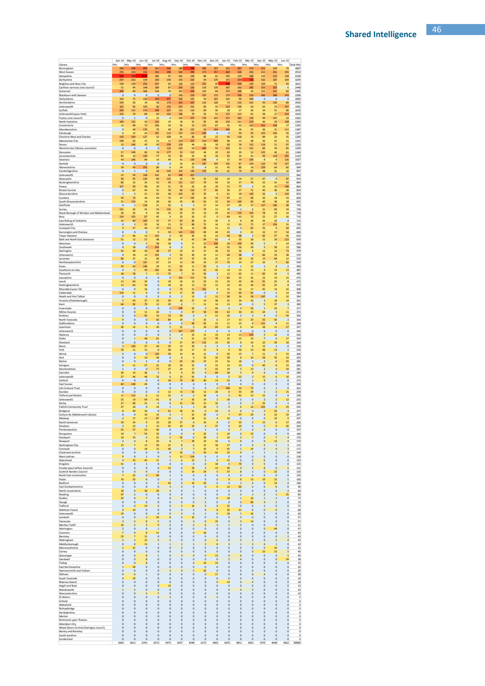
*Annex Table: Monthly hits by participating public library authority (April 2014 – June 2015)*

<!-- PAGE: 48 -->

1 Naoroji Street, London WC1X 0GB
020 7756 7600
www.sharedintelligence.net
solutions@sharedintelligence.net

## Footnotes

[^1]: As noted in section 6, 11 of the library/library services involved in the national survey were outside of England.
[^2]: This period is obviously shorter than the reference period used in the previous section, and because the user survey was launched some months after the start of A2R, this should not be taken as a comment on the relative usefulness of the service in its first few months compared to later.
[^3]: Sarah Faulder and Shinwha Cha, *Access to Research: the experience of implementation in UK public libraries*, Learned Publishing Vol.27 No.4, October 2014.
[^4]: Allocation to categories is not exact. Some terms could have been allocated to more than one category; for instance 'climate change' could be classified under 'science' or 'environment'.
[^5]: Based on DCMS Taking Part survey 2014-15 Q3 data: [https://www.gov.uk/government/publications/taking-part-201415-quarter-3-statistical-release](https://www.gov.uk/government/publications/taking-part-201415-quarter-3-statistical-release).
[^6]: Valid English home postcodes could be gathered from 169 respondents and these have been matched to Index of Multiple Deprivation (IMD) quintiles (where the first quintile represents the least deprived English neighbourhoods).
[^7]: This section draws on the 105 survey respondents who had previously used the service.
[^8]: CIDR subnet calculator: [http://www.subnet-calculator.com/cidr.php](http://www.subnet-calculator.com/cidr.php) [Accessed 18 August 2015].
[^9]: CIBER Research Ltd, *Access to Research Web Metrics*, May 2014.
[^10]: Sarah Faulder and Shinwha Cha, *Access to Research: the experience of implementation in UK public libraries*, Learned Publishing Vol.27 No.4, October 2014.
[^11]: CIBER Research Ltd report for PLS – *Access to Research Web Metrics*, May 2014.
