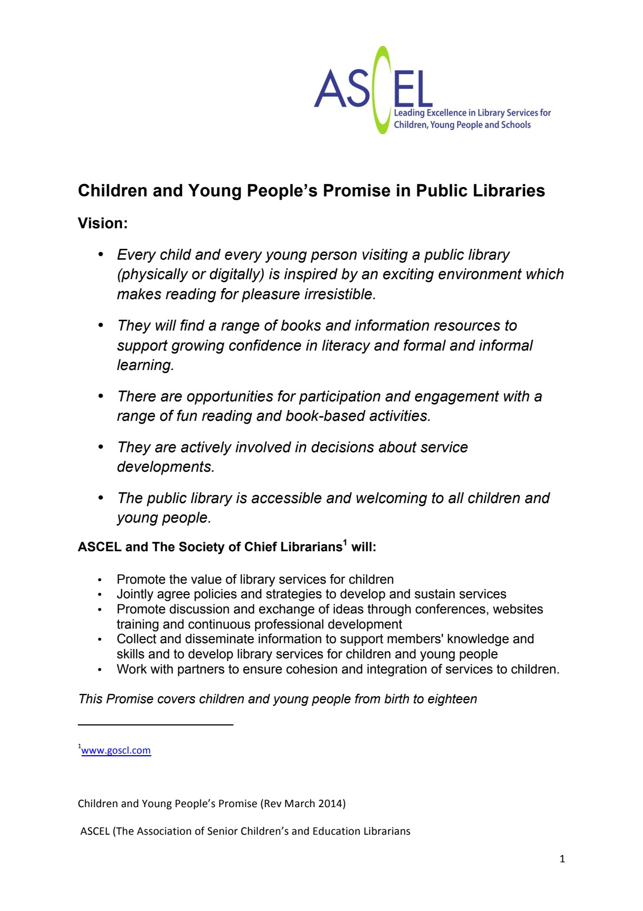

<!-- PAGE: 1 -->

# Children and Young People's Promise in Public Libraries

**ASCEL (The Association of Senior Children's and Education Librarians)**  
**The Society of Chief Librarians**

*Revised March 2014*

## Vision

* Every child and every young person visiting a public library (physically or digitally) is inspired by an exciting environment which makes reading for pleasure irresistible.
* They will find a range of books and information resources to support growing confidence in literacy and formal and informal learning.
* There are opportunities for participation and engagement with a range of fun reading and book-based activities.
* They are actively involved in decisions about service developments.
* The public library is accessible and welcoming to all children and young people.

### ASCEL and The Society of Chief Librarians[^1] will:

* Promote the value of library services for children
* Jointly agree policies and strategies to develop and sustain services
* Promote discussion and exchange of ideas through conferences, websites training and continuous professional development
* Collect and disseminate information to support members' knowledge and skills and to develop library services for children and young people
* Work with partners to ensure cohesion and integration of services to children.

*This Promise covers children and young people from birth to eighteen.*

---

<!-- PAGE: 2 -->

## How the Children's Promise links to the Universal Reading Offer in libraries

| SCL/ASCEL expects every Public Library Service to provide: | SCL/ASCEL encourages every Public Library Service to provide: |
| :--- | :--- |
| * Physical spaces for children which capture their imaginations and which meet children's changing needs as they grow and those of their parents and carers  * High quality book stock for all ages and abilities and reading interests stimulating children's desire to read  * Books and promotional images which reflect the diverse community in which children grow up  * Book and reading focused promotion activity for under-fives and older children as part of the Universal Reading Offer:   - Summer Reading Challenges   - Bookstart  * Staff who have a general knowledge of children's books and can signpost children and their parents to appropriate stock and who are confident dealing with children's enquiries | * Free and targeted regular reader development campaigns  * Reading Groups for children and young people  * Staff who can provide specialist guidance on books to help children practise reading skills or expand their reading repertoire  * Opportunities for children and young people for participation and engagement within library services including the schools library service where relevant, for example by offering volunteering opportunities and consultation activities and the development of a year round volunteering offer  * Partnerships with agencies who support children and young people to ensure all children have equal access to library services |

---

<!-- PAGE: 3 -->

## How the Children and Young People's Promise links to the Health Offer in libraries

| SCL/ASCEL expects every Public Library Service to provide: | SCL/ASCEL encourages every Public Library Service to provide: |
| :--- | :--- |
| * A clear safeguarding/child protection policy and procedures in place to ensure all staff are aware of their responsibilities  * Information to support parenting and caring for children and young people  * Health information for children and young people to support healthy lifestyles  * Fiction and non-fiction explaining difficult situations to children and young people  * Promotion of reading for pleasure to children and young people as a way of improving well-being and reducing stress  * Opportunities for children and young people to socialise | * Partnerships with agencies to support children and young people's health and well-being including specific health and well-being projects for parenting; language development |

---

<!-- PAGE: 4 -->

## How the Children and Young People's Promise links to the Digital Offer in libraries

| SCL/ASCEL expects every Public Library Service to provide: | SCL/ASCEL encourages every Public Library Service to provide: |
| :--- | :--- |
| * Digital spaces for children which capture their imaginations and which meet children's changing needs as they grow and those of their parents and carers  * Free and safeguarded access to the internet and IT applications  * Staff trained in internet safety for children and young people with knowledge of local safeguarding policies and procedures  * Safe family friendly facilities and equipment  * Access to age and ability appropriate online information and learning opportunities  * Ability to request and renew items remotely via online catalogues | * Opportunities for children to access e-books and e-audio and other online reading resources  * 24/7 access to service through a virtual library presence  * Safe social networking interaction/engagement opportunities  * Access to local information and where appropriate access to digitised local archive and local history resources |

---

<!-- PAGE: 5 -->

## How the Children and Young People's Promise links to the Information Offer in libraries

| SCL/ASCEL expects every Public Library Service to provide: | SCL/ASCEL encourages every Public Library Service to provide: |
| :--- | :--- |
| * Information and signposting to families to make them aware of opportunities for learning and skills development and fun activities clearly displayed and easy to access  * Access to local information for children and young people and their parents and carers  * Information, promotion and signposting to schools and pre-school groups and teachers to make them aware of the services provided by the public library services | * Information and signposting to schools and pre-school groups and teachers to make them aware of the services provided by schools library services in the region |

---

<!-- PAGE: 6 -->

## How the Children and Young People's Promise links to learning and cultural provision in libraries

| SCL/ASCEL expects every Public Library Service to provide: | SCL/ASCEL encourages every Public Library Service to provide: |
| :--- | :--- |
| * Access to range of good quality information for all ages and abilities  * An offer to schools and other children's and youth groups to visit the library with staff trained to deliver quality reading, learning and information skills sessions. Partnership activities with school library services  * Staff knowledgeable in retrieval skills for children and young people  * Provision of space for young learners | * Opportunities for children and young people to take part in quality cultural activities with authors and other artists  * Homework support |

### Arts Council England Quality Principles

The vision of the Children and Young People's Promise also reflects the principles of Arts Council England's 7 Quality Principles for work with children and young people:

* striving for excellence
* emphasising authenticity
* being inspiring, and engaging
* ensuring a positive child-centred experience
* actively involving children and young people
* providing a sense of personal progression
* developing a sense of ownership and belonging

---

## Footnotes

[^1]: [Society of Chief Librarians](http://www.goscl.com)
