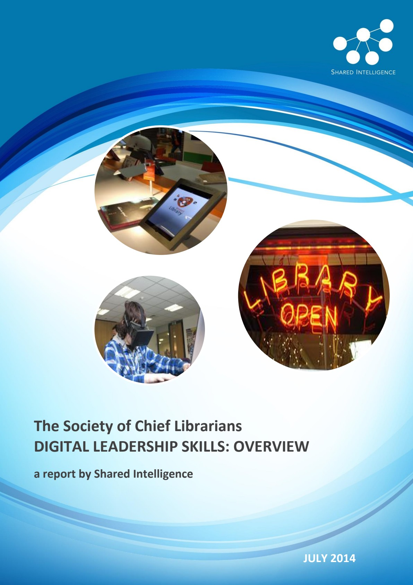

<!-- PAGE: 1 -->

# Digital Leadership Skills: Overview Report

### The Society of Chief Librarians

**A report by Shared Intelligence**

**July 2014**

<!-- PAGE: 2 -->

## Contents

- **1. Introduction** (page 2)
- **2. Process and method** (page 2)
- **3. Headlines from the horizon scanning** (page 5)
- **4. SCL member views on digital** (page 6)
- **5. Skills audit of SCL and aspiring leaders** (page 7)
- **6. Conclusions** (page 9)
- **7. Recommendations to SCL** (page 10)

*SCL Digital Leadership Skills — Shared Intelligence*

<!-- PAGE: 3 -->

## 1. Introduction

**1.1** In March this year we were appointed by SCL (the Society of Chief Librarians) as an expert partner in exploring digital leadership skills for public library services. SCL’s aim was to understand what opportunities and challenges are likely to emerge over the coming years and to ensure library leaders and aspiring leaders understand and have the skills to work in this emerging digital landscape. The task we were set was to:

- Identify the significant digital developments on the horizon and identify the digital leadership skills and competencies which library staff will need to respond effectively and appropriately to this changing landscape.
- Complete an audit of the digital awareness and skills set of the existing leadership / aspiring leadership of the sector.
- Recommend how to address the gaps.
- Report back to SCL’s annual seminar in June 2014.

## 2. Process and method

**2.1** The methods we adopted were designed to enable the research to be completed in a short period of time (about 10 weeks). We also planned for it to be a close collaboration with SCL reflecting their term ‘expert partner’. For us a collaborative style of working is the preferred manner in which we conduct all our work, characterised by joint decision-making on key issues, and regular exchange and discussion of emerging findings.

**2.2** The sequence of our research was as follows:

- Horizon-scanning review carried out as a desk study
- Online survey of SCL members using SurveyMonkey seeking their views of ‘significant’ digital developments
- Webinar workshop (repeated 3 times using CISCO WebEx) to test the draft findings from the horizon scanning and digital developments survey
- Online skills audit
- Presentation back to the SCL steering group of the work to date and to begin testing possible conclusions
- Webinar workshop (also repeated 3 times) this time to test the findings from skills audit and seek views on what actions SCL might want to take as a result
- Presentation of draft findings and a first cut of recommendations to the SCL Executive on the eve of the annual SCL seminar – followed the next day by a workshop for seminar participants.

<!-- PAGE: 4 -->

**2.3** Alongside this process we also created a private group on LinkedIn on which we have posted our working papers. The aim has been to share them online, in such a way that SCL members can read them then leave comments which other SCL members can see. Currently 23 people have joined the group and our intention is for someone from SCL to take over the admin role for the group once our work is complete.

**2.4** We were also very mindful that any proposals for action which resulted from this work would need the confidence of those who need to act i.e. SCL members. So our methodology was designed to involve SCL members in interrogating findings, and had us publishing findings as we went. Most of all we wanted as many SCL members as possible to be part of the process themselves and be able to see some of their own views reflected in the research outputs.

**2.5** In terms of differentiating “digital leadership skills” from “digital skills” per se, we decided this would mean putting emphasis on issues such as:

- Leaders having an affinity with technology and an understanding of their strategic potential, not simply technical ability to use those technologies.
- Being able to convey a message about the role of digital technology in libraries and how it relates to the overall mission of public libraries which cuts through the ambiguity created by more practical discussions about firewalls, risks, and legacy systems.
- Having the capacity and knowledge to challenge and rethink processes and working practices, not just in libraries, but in partners and suppliers.
- Being able to model, and encourage, positive cultures and behaviours.
- Leading change and taking people with you.
- Supporting staff development and building capacity.
- Negotiating and influencing.

**2.6** In summary, we have defined “digital leadership” as being about skills to:

- Lead change
- Shape culture
- Connect with partners
- Support staff development
- Understand the strategic potential of digital

**2.7** In terms of response to our research:

- 40 SCL members completed the online survey on ‘significant digital developments’ (representing over a quarter of all library services in England, Wales and Northern Ireland)
- 49 SCL members and aspiring leaders completed the online skills audit
- 30 people attended the webinars (many attending twice)
- 40 people attended the workshop at the SCL annual seminar.

**2.8** SCL members who took part in the webinars and the workshop at the annual seminar were universally welcoming of the opportunity to contribute and commented on how valuable they found it to engage with issues which they rarely had time to think through in their day-to-day work.

<!-- PAGE: 5 -->

**2.9** We also wanted the project itself to enable SCL members to begin exploring and learning more about these issues, and if possible to introduce some new technology of practical use. For these reasons we included webinars in our process using Cisco WebEx, and hosted a private LinkedIn group. For some of the participants this was the first time they had used webinar technology and in the third webinar in each round we actively encouraged participants to take turns in leading the webinar and speaking online to the other participants. In this way the project was able to directly demonstrate the potential and accessibility of online tools, and help SCL members gain practical experience of using them.

**2.10** There were however some practical problems with local IT systems which prevented a few SCL members from taking part in the webinars (for instance some firewalls blocked Cisco WebEx, or local network speeds were too slow to support audio streaming). These issues are themselves symptomatic of the digital challenges which library services face, and are reflected in our findings and recommendations.

<!-- PAGE: 6 -->

## 3. Headlines from the horizon scanning

### Speed and scale of change

> *In an increasingly digital world, physical spaces for sharing become more needed and more precious*

**3.1** Our first main stage of research was to undertake a horizon scanning review of digital developments. The aim was to scan the horizon beyond the immediate library world, to identify wider technological and societal trends and examine what they mean for public libraries.

**3.2** We structured our horizon scanning around six core themes:

- **Hardware and devices:** Continued explosion of smartphones, tablets, wearable tech, and the Internet of Things. Handheld devices are becoming the primary gateway to the internet for the majority of the population.
- **Content and platforms:** Shift from physical ownership to streaming and access models (music, video, books). Rise of self-publishing, open educational resources, and Massive Open Online Courses (MOOCs).
- **Social interaction and community:** Social media as the primary communication and organizing medium; digital civic engagement; crowd-sourcing and collaborative consumption.
- **Making, creating and computing:** The maker movement, 3D printing, fab labs, coding clubs, and the new school computing curriculum. Libraries transitioning from passive consumption to creative production spaces.
- **Data and intelligence:** Big data, predictive analytics, open data, privacy, personal data tracking, and algorithmic curation.
- **The digital divide and digital welfare:** Universal Credit and the "digital by default" agenda for public services. The persistent challenge of the "final fifth" who lack digital skills or connectivity, where public libraries serve as the primary safety net.

**3.3** A recurrent message from the horizon scanning is that the speed and scale of technological change is not slowing down; if anything it is accelerating. However, technology does not replace the need for physical space; on the contrary, as more interactions move online, physical community spaces where people can meet, learn together, and receive face-to-face support become more valuable than ever.

<!-- PAGE: 7 -->

## 4. SCL member views on digital

### For library leaders the biggest digital issue is a skills issue

**4.1** Alongside our horizon scanning review we also surveyed SCL members asking what they believed were the most significant digital developments relevant to libraries over the next 3–5 years.

**4.2** Key themes emerging from the member survey included:

- **E-books and digital lending:** The urgent need for a viable, comprehensive, and sustainable national e-book lending solution that meets user expectations and resolves publisher restrictions.
- **Public Wi-Fi:** High demand from users for reliable, high-speed public Wi-Fi in every library branch, enabling people to bring their own devices (BYOD).
- **Assisted digital and welfare reform:** The huge influx of citizens needing help with online welfare claims (Universal Jobmatch and Universal Credit), placing immense pressure on frontline staff and library IT.
- **Staff skills and digital confidence:** Members overwhelmingly identified frontline staff skills and digital literacy as the single greatest barrier and priority. Staff need to move from basic IT troubleshooting to being confident digital navigators and coaches.
- **Corporate ICT constraints:** Widespread frustration with local authority corporate ICT departments, including restrictive security policies, firewalls blocking useful platforms (e.g. YouTube, social media, coding tools), and inflexible legacy infrastructure.
- **Library Management Systems (LMS):** A shared recognition that legacy LMS platforms are outdated, clunky, and fail to offer modern discovery interfaces or seamless digital integration.

<!-- PAGE: 8 -->

## 5. Skills audit of SCL and aspiring leaders

### Skills around managing change are a strength but library leaders recognise many other skills need to be increased

**5.1** The last main stage of research was a skills audit of SCL members and aspiring library leaders. The audit explored self-assessed confidence across strategic digital leadership competencies, practical knowledge of emerging technologies, and familiarity with digital policy issues.

**5.2** Key strengths identified in the audit:

- **Change management:** High confidence in managing organisational change, restructuring, and adapting service models under financial pressure.
- **Commitment to the library mission:** Deep dedication to public service values, social inclusion, and community engagement.
- **Enthusiasm for technology:** Over 90% of respondents viewed technology as an exciting opportunity rather than a threat.

**5.3** Areas of lower confidence and acknowledged gaps:

- **Technical affinity:** Understanding the strategic architecture of modern web technologies, APIs, cloud services, and open data.
- **Supplier negotiation:** Commercial confidence and leverage in negotiating digital contracts with major software vendors and publishers.
- **Emerging learning platforms:** Very low familiarity with MOOCs (Massive Open Online Courses) and their relevance to public libraries.
- **Maker technologies:** Limited practical knowledge of coding clubs, Raspberry Pi, 3D printing, and STEM engagement.

<!-- PAGE: 9 -->

- There was a stronger response around knowledge of handhelds and tablets from non-SCL respondents and the non-SCL respondents rated themselves as more confident with social media and in supporting colleagues on this.
- When we asked “Do you consider yourself to have a track record for stimulating innovation?” a higher proportion of SCL members than non-SCL members felt this was a strength.
- And finally SCL did better in the digital general knowledge and picture round than non-SCL (despite it being the non-SCL group who scored as more knowledgeable based on the self-assessed questions).

**5.7** Other notable findings and patterns included:

- Understanding demand for digital services among those who rarely use library services was seen as a weak-spot across the board, as was knowledge of who in the local community cannot access the internet due to cost or know-how.
- The weakest responses across the board were around knowledge of MOOCs, self-publishing, and Wi-Fi regulations (although knowledge of Wi-Fi functionality was stronger).

<!-- PAGE: 10 -->

## 6. Conclusions

### The best library services are meeting digital challenges brilliantly, and have the skills and knowledge, but half the challenge is this needs to be shared

**6.1** As we were working on this research, key figures in SCL were also continuing to build new opportunities relating to digital leadership and libraries. These included discussions with Arts Council England about new digital initiatives and potential applications for funding, advocacy work connected for instance with the Sieghart review of libraries, and discussions with prospective new national partners. SCL have also been developing their own website to enable it to reinforce digital leadership messages. So in producing recommendations we have tried to extrapolate our own findings into suggested actions, but also to reinforce and complement actions SCL are already taking.

**6.2** Our first recommendation is the most important in our view: to articulate the role and purpose of digital technology in public libraries, and how it relates to the overall mission of libraries on a national scale. We call this recommendation “0” to denote the fact we see it as a precursor to everything that follows. This is not new in itself. In our discussions with the steering group and other SCL members, it was clear there is already consensus about what this vision is; it is about public libraries as gateways to knowledge, as institutions which create opportunities through reading, learning, lending and sharing. It traces back directly to the mission of the UK’s first free lending libraries. We would add it is also about libraries as physical spaces in which technology becomes the focus of social and communal experiences and counteracts the potential for isolation. But this vision needs to be developed and codified and stated through the SCL leadership for the benefit of SCL’s wider stakeholder group, many of whom we know full well, do not see it as clearly as they do.

**6.3** What we have after that are thirteen recommendations to SCL under three broad categories. We hope these are specific enough and achievable for an organisation which has only a skeleton executive staff, and relies heavily on its leadership group and members who are full-time senior managers. Because of this our recommendations err towards more practical actions than grandiose goals, but we hope readers will also see they chime with a consistent strategic view of the role of digital, of libraries, and of SCL. Many of our recommendations also aim to marry the implications of this research with existing opportunities SCL has created, and with discussions which began during the research process, and to balance these with new ideas too.

**6.4** As a coda, in a side note to SCL we have suggested some very practical steps to commence a programme of digital leadership skills development activities. This is only intended as the start, but again it aims to build on actions, ideas and opportunities which have already been discussed within SCL. We strongly suggest that developmental activity wherever possible is visible, open and peer-led, ideally using online channels. Not just because this will be easier for people to access, but because it will convey the message that despite the scale of challenges (technical, managerial, political, financial), the best public libraries are already leading brilliant, innovative and purposeful digital library services, and much of the skills and knowledge needed already exist. Half the challenge is this need to be shared.

<!-- PAGE: 11 -->

## 7. Recommendations to SCL

### Summary Table of Recommendations

| Issue | Evidence | Recommendation |
| :--- | :--- | :--- |
| **A vision for digital in libraries** | | |
| **Vision and ambition:** What is SCL’s over-arching goal and ambition, their vision, for the role of digital in public libraries? | Implicit in all the work and findings from this research.  SCL Executive felt it was essential to state this as a clear item for action. | **0 SCL’s vision for the role and purpose of digital in public libraries.**  That SCL articulate what they believe is the role and purpose of digital technology in public libraries and how that relates to the overall mission of the institution of public libraries on a national scale.  This needs to be articulated on a national scale in a way which is specific enough to have meaning, to guide and to inspire, but broad enough to enable individual authorities to set their own direction in creative ways which have meaning for their own communities. |
| **Strategic actions** | | |
| **Horizon scanning:** How can library leaders individually and as a group stay on top of these issues and avoid ending up with duplicative local horizon-scanning initiatives? | **Horizon-scanning desk study** – emphasised pace / scale of change and the need to keep watch.  **Horizon-scanning survey** – significant number of respondents did not feel knowledgeable.  **Webinars** – participants said this exercise provided vital new insight/info. | **1 Ongoing SCL horizon-scanning.**  SCL to develop its own digital horizon-scanning capability which would build on this project every 6 months with updates.  This could be a distributed task with several SCL members or future leaders identifying and logging examples and evidence (perhaps using an online clipping or tagging platform), which a smaller group or single individual would periodically synthesise and report on. |

<!-- PAGE: 12 -->

| Issue | Evidence | Recommendation |
| :--- | :--- | :--- |
| **Knowledge-sharing:** How can library leaders open up and share knowledge of examples of library services successfully meeting some of the practical digital challenges – so that sharing practical examples becomes more commonplace and can be multilateral rather than bilateral? | **Previous research** – Envisioning and Carnegie Enterprising Libraries shows there are many UK libraries innovating, but awareness of these is low.  **Webinars** – participants expressed desire to have more web-based knowledge sharing. | **2 Online channel of Library How To videos.**  All heads of libraries to begin contributing to a channel of short (e.g. 3–5 minute) Library How To videos featuring practical methods they have developed to tackle the major digital challenges. E.g. “Bristol: How to create a digital arts project like Book Hive”, or “Devon: How to create a Fab Lab”, or “Gateshead: How to organise an e-Day” etc.  The videos would all use one Web platform (probably YouTube or Vimeo) and would be uploaded to a single channel or account curated by SCL – an initial 6 videos would be sufficient to launch a channel.  The Library How To channel could be embedded in the SCL homepage and create the foundation for an open-access learning exchange which would benefit all libraries in the UK and even internationally. The “Tinder Trainers” process could provide a model for supporting those who want to learn more about creating online videos. |
| **Encouraging affinity with technology:** How can public library leaders set the tone and encourage all public library managers to develop an affinity with digital technology and its potential to help libraries meet their social mission? | **Webinars (and Steering Group discussions)** – participants expressed view that library leaders must understand potential of technology and model its use even though they don’t need to be technical experts in everything they manage. | **3 Explore potential of big data in three ways.**  SCL should explore three different ways in which the Big Data already held by libraries could bring potential benefits: 1. For improving services for users; 2. For opening up the data as an open public data initiative; 3. For generating revenue which could be reinvested in libraries. |
| **Big data:** Exploiting potential of big data already held by libraries – on demographics of users, patterns of user behaviour, usage stats on specific items/titles/services. | Discussion with SCL Executive at June 2014 seminar. | *(Addressed in Recommendation 3 above)* |
| **Externally focused actions** | | |
| **Dialogue with ICT managers:** How to have a more focused dialogue between library leaders and local government ICT corporate managers? | **Horizon-scanning survey** – core theme of responses was challenges relating to corporate ICT systems. | **4 Engage with SOCITM on issues including PSN.**  Use the outputs of this research as the basis of a discussion between SCL lead members and SOCITM about how to maximise the opportunities for library services to exploit digital technology. |

<!-- PAGE: 13 -->

| Issue | Evidence | Recommendation |
| :--- | :--- | :--- |
| **New LMS products:** How to encourage LMS providers to accelerate the development of new products and services which meet the increasingly complex wants and needs of libraries and their users? | **Horizon-scanning survey** – core theme.  **Webinars** – participants expressed desire to be more proactive and set agenda with LMS providers, and to do so jointly. | **5 Become more organised/co-ordinated around LMS contract renewal.**  Compile a national list of when individual contracts are up for renewal, to be shared among SCL members to enable them to collaborate at a national level in seeking better solutions from LMS providers. |
| **Public Wi-Fi:** How to capitalise on the groundswell of interest in library-led public Wi-Fi, and also improve knowledge of public Wi-Fi provision among library leaders especially surrounding regulatory obligations? | **Previous research** – Envisioning and *What the Public Want* both highlighted need for Wi-Fi and public demand for it.  **Horizon-scanning survey** – core theme around Wi-Fi in public spaces.  **Webinars** – confirmed this theme, but also raised issues around regulatory framework.  **Skills audit** – gap between operational knowledge of Wi-Fi and knowledge of regulatory framework / responsibilities of providers.  **SCL seminar** – the Minister clearly signalled his interest. | **6 Wifi – raise awareness of public Wi-Fi regulatory obligations.**  Deliver awareness-raising/training sessions in the regulatory and technical frameworks and obligations regarding public Wi-Fi provision by libraries.  **7 Wifi – articulate a national project with Ministerial appeal.**  Quickly establish an SCL working group to define what an ambitious national library-led Wi-Fi project would look like. What would it look like to members of the public? What equipment would be needed and at what cost? What would be the practical steps and timescale to implementation? What would be the benefits? What would be SCL’s role? |
| **Access to digital services and Universal Credit:** How to enable libraries to maximise their potential in assisting access to digital welfare, in particular Universal Jobmatch and Universal Credit? | **Horizon-scanning desk study** – identified growing challenges around digitised welfare and digital divide.  **Horizon-scanning survey** – digital divide was core theme.  **Webinars** – participants confirmed this as an issue, but also expressed concerns that role currently played by libraries was not recognised by DWP or Universal Credit pilots. | **8 SCL members from UC pilot areas to share experience and learning.**  Arrange for those SCL members in areas where Universal Credit has been piloted to share their learning nationally through teach-ins or webinars, and for those same SCL members to work with the SCL Executive on engagement with DWP, GDS, and the LGA. This learning should inform the further development of the SCL ‘Information Offer’. |

<!-- PAGE: 14 -->

| Issue | Evidence | Recommendation |
| :--- | :--- | :--- |
| **e-Book lending national offer:** How to begin working towards a national e-Book lending offer? | **Horizon-scanning desk study** – growth of e-reading and handhelds was major theme.  **Horizon-scanning survey** – confirmed this as major theme, and highlighted appetite for a national platform.  **Arts Council England response to Sieghart Review of eBook lending** also supports – “Arts Council England strongly supports the development of a comprehensive eBook lending offer…” | **9 Create an opportunity for an SCL member who is passionate and enterprising, to take the lead.**  SCL should look within its membership for a member with sufficient knowledge and passion to begin working up a viable and enterprising proposition which would most likely begin by seeking out a software developer (from the commercial or social sector) who is also excited by the potential of a national e-Book lending platform. |
| **Internal / workforce actions** | | |
| **Realising potential of MOOCs:** How to raise skills and knowledge around MOOCs so that libraries can support their communities generally in using MOOCs but also to pave the way for a strategic collaboration with Open University and their Future Learn platform? | **Horizon-scanning desk study** – identified MOOCs as major development affecting libraries.  **Skills survey** – showed this as an area SCL members are less confident about.  **Steering Group discussions** – confirmed importance, also highlighted potential of a partnership with Open University’s Future Learn, and the need to connect with colleagues in academic libraries to learn of their experiences. | **10 SCL to engage with other library professionals exploring MOOCs, and SCL members to familiarise themselves with MOOCs generally.**  As part of the emerging discussion with OU about Future Learn, lead SCL members should also take soundings from those in the academic library sector who are also trying to realise potential from MOOCs e.g. SCONUL, JISC, and OCLC (who organised the July 2013 MOOCs and Libraries conference).  SCL could also ask the OU Future Learn team to run a webinar/workshop to promote their learning platform to library leaders, explaining how it works, technical requirements, and the potential it offers around lifelong learning for all ages.  SCL should encourage all its members to engage with MOOCs either personally, or through staff within their service. |

<!-- PAGE: 15 -->

| Issue | Evidence | Recommendation |
| :--- | :--- | :--- |
| **Schools and computer science:** How to raise skills and knowledge around the new national curriculum for Computer Science and the inter-relationship the curriculum now has with the kinds of computer clubs, makerspaces, and computer coding which libraries are increasingly looking to host? | **Previous research** – Carnegie Enterprising Libraries shows there is significant potential for libraries to play key role in turning around Computer Science and STEM takeup.  **Horizon-scanning desk study** – identified STEM and Computer Science skills as major issue for UK economy and education.  **Skills survey** – showed this as an area SCL members are less confident about. | **11 Computer Science – Those with experience to share their learning.**  SCL should arrange webinars/workshops led by those library practitioners who are already leading activities which link library-led activities (such as code-clubs) with Computer Science in schools, e.g. libraries who run activities in schools, or who run events in libraries for teachers and educators. |
| **Using local socio-economic data to understand digital needs among library users and non-users:** How to build skills and knowledge around using local socio-economic data (i.e. at ward or SOA level) to understand local digital needs e.g. helping the ‘final fifth’? | **Typical socio-economic profiles** of individuals least likely to be online is well-documented yet research in libraries sector consistently shows socio-economic profiling of community needs is persistent challenge.  **Horizon-scanning desk study** – also identified digital divide and supporting the ‘final fifth’ as major challenge, alongside access to digitised welfare.  **Skills survey** – showed this as an area SCL members are less confident about. | **12 Skills development on using local socio-economic data and matching this to library user data to understand who or where libraries can help most in terms of digital divide.**  SCL should arrange skills sessions on using local level socio-economic and geographic data, matched to library user data, to build profiles of digital access in their community among current users and non-users with the aim of building a picture of who they can benefit most, and what interventions will be most useful.  This should be linked to the existing work already underway as part of the Information Offer (e.g. involving same library staff/SCL members, involving same leadership). |
| **Community-building through events and activities:** How to raise skills and knowledge around using library spaces to host group activities and community-building activities based around technology? | **Previous research** – Carnegie Enterprising Libraries shows there is significant potential for libraries to host activities in which technology is used socially.  **Skills survey** – showed this as an area SCL members are less confident about.  **Webinars** – participants identified major gap between ‘rows of Peoples Network PCs’ and the social interaction with digital that would help communities in self-led learning. | **13 Community building – those with experience to share their learning.**  SCL should arrange webinars/workshops led by library practitioners who are already leading these kinds of activities as well as individuals from other sectors who manage similar group activities (e.g. organisers of technology focused activities or events in museums, or those run by third sector organisations). |

<!-- PAGE: 16 -->

## Supporting Documents

Supporting documents also produced as part of this research:

- Horizon scanning report
- Report of SCL survey on ‘digital developments’
- Report of SCL skills audit
- Suggested programme of skills development

*SCL Digital Leadership Skills — Shared Intelligence*

<!-- PAGE: 17 -->

## Publisher Information

**Shared Intelligence**

1 Naoroji Street, London WC1X 0GB  
Telephone: 020 7756 7600  
Website: [www.sharedintelligence.net](http://www.sharedintelligence.net)  
Email: [solutions@sharedintelligence.net](mailto:solutions@sharedintelligence.net)
