# Essential Digital Infrastructure for Public Libraries in England: A plan for moving forward

<!-- PAGE: 1 -->

Essential Digital Infrastructure
for Public Libraries in England
A plan for moving forward.
“My dear, here we must run as fast as we can, just to stay in place.
And if you wish to go anywhere you must run twice as fast as that.”
### Commissioned by
The Society of Chief Librarians
in collaboration with
The Reading Agency
With funding from
Arts Council England <!-- PAGE: 2 --> Prepared by
BiblioCommons
November 24, 2015 <!-- PAGE: 3 --> Abstract
This report argues that a standards-based digital platform is the only
viable technology for realising recent strategic goals articulated by
leaders for England’s public libraries. The platform would allow
libraries and their partners to innovate, collaborate and share in ways
they cannot now do. The report further argues that the primary mode
of service on this platform must be co-production -- among library
authorities, and among library staff, national and local partners, and
importantly, end users. We show how new digital divides have made
the mission of libraries -- literacy, learning, and community inclusion --
as relevant as it ever was. And that in order to provide an energetic
response, libraries must invite their users into their digital spaces: their
catalogues, their websites, their ebook readers, their online events
calendars. We argue that these two measures, a standards-based
digital platform and co-production of services, will reinvigorate libraries
and create substantial, tangible outcomes in literacy, digital and social
inclusion, health, education, and economic participation.

<!-- PAGE: 4 -->

### Contents
# Overview
## 1 Executive Summary 6
## 2 Background 18
# Findings
## 3 Library Users: Digital disruption has changed both what 27
users can find at libraries and what they need from
libraries
## 4 Managers: Stagnant IT stifles response & raises costs 52
## 5 Partners: Fragmented IT stifles mutual support 66
## 6 IT Ecosystem: An ineffective ecosystem 77
# Recommendations: Strategies
## 7 Users: The affordances of the social web are key to 81
making libraries relevant and visible online
## 8 Managers: Enabling best practices with IT 199
## 9 Partners: A standards-based platform enables shared 106
content, programming and metrics
## 10 IT Ecosystem: From monoliths to modules 110
# Recommendations: Tactics
## 11 Software design principles 119
## 12 Architecture and components 125
## 13 Project and Ecosystem leadership 132
# Conclusion <!-- PAGE: 5 --> ## 14 Costs and benefits of going forward 138
## 15 Costs of standing still 144
Appendices 147
# Appendices
for Overview
### I Past library reports
### II Stakeholders consulted
for Findings
### III Jobs to be done and new divides
for Recommendations: Strategies
### IV Digital solutions for the “negative image” of public
libraries
### V Digital solutions for operational effectiveness in libraries
### VI Digital solutions for activating existing library assets
for Recommendations: Tactics
### VII Options considered for national integration
### VIII Suite of recommended components
### IX Sample procurement criteria
for Conclusion
### X Benefits
### XI References <!-- PAGE: 6 --> ### XII Presentation from the Digital Presence Workshop at the
British Library <!-- PAGE: 7 --> # Overview <!-- PAGE: 8 --> ## 1 Executive Summary
### Digital changes everything:
### Challenges and possibilities
### Diverging Perspectives on Libraries
“Waste of money.
“A library in the middle of a
No need for libraries nowadays,
community is a cross between an
just google what you want.”
emergency exit, a life raft and a
Reader response to story about Birmingham
festival.
libraries, Mail Online (2015)
“They are cathedrals of the
mind; hospitals of the soul; theme
"I'm not attacking libraries, parks of the imagination. [ T]hey
…
### I'm attacking the concept behind are the only sheltered public
libraries, which is no longer spaces where you are not a
relevant." consumer, but a citizen, instead.
Author Terry Deary, The Guardian “A human with a brain and a
(quoted in Flood 2013b)
heart and a desire to be uplifted,
rather than a customer with a
“Close The Libraries And credit card and an inchoate ‘need’
Buy Everyone An Amazon Kindle for ‘stuff.’”
Unlimited Subscription” Caitlin Moran, Huffington Post (2012)
Tim Worstall, Forbes (2014)
### Digital technologies have disrupted everything, for better or for worse.
This digital disruption has made some organisations succeed (Uber,
Youtube, Airbnb) and others fail (Kodak, Borders, HMV, Blockbuster).
And it has done so in months and years, not decades. Digital
disruption has affected every market in which we create and exchange
value -- changing what people need and want, and how those
demands are met.
### Digital disruption creates new challenges for society as workforce
needs and social life rapidly shift. At the same it, it creates new
opportunities for broadening social inclusion, increasing literacy and
learning, and enhancing health and economic opportunity.

<!-- PAGE: 9 -->

While libraries are themselves challenged by digital disruption, they are
also uniquely positioned to meet emerging public needs -- if, and only

if, they are given the digital tools required to do so. These digital tools
should not replace library branches or staff but can activate and
complement them in new ways. A digital presence should not supplant
print books -- still the leading draw to the library today -- but should
be an energizing complement to them: a digital pathway to books; and
a site of conversation about books, and a source of helpful context for
books.
Just as the library has long been a place of refuge and learning offline,
so can it become a safe space for personal and community growth
online by mobilising the voices, expertise and experiences of users,
partners and staff -- in a way that, on many dimensions, only libraries
can do. And, through an interweaving of online and offline offerings, it
can create synergies -- between national and local content, between
online and offline services, between authoritative and community
voices -- that make the whole greater than the sum of its parts.
The fundamental need that libraries serve has not gone away. If
anything, literacy, learning, and community inclusion occupy a more
central role in public policy today -- in domains as diverse as
education, productivity, and health and well-being. Libraries will need
to take a systematic approach to digital technology to effectively
realise this mission in the 21st century.
The first steps on that path can be taken in a matter of a years, and at
a cost of £20M over three years. Annualized, this is about 1/36th the
annual cost of building and maintaining library buildings in England.[^1]
As we will show, even this ratio is far below benchmarks in other
sectors, both public and private.
### DIgital inclusion: closing new divides
As so much of our economy and daily interactions shift online, two
levels of digital divides have emerged.
The first-order divide is between those who can access the Internet
and those who cannot. And it is rapidly closing. Mobile phones are
## 1 The figure is per CIPFA data for public libraries in England, averaged over the last three years
(20122014).

<!-- PAGE: 10 -->

driving down the cost of access, and only 3% of British households
say they are unable to afford a connection (UK ONS 2014). Libraries
continue to play a role in eliminating this divide by offering computers
and WiFi in branches.
The second-order divide, however, is between those who can
effectively use digital technologies to their advantage and those who
cannot -- and this divide is becoming ever more significant (e.g.
Hargittai 2002). Libraries have yet fully to embrace a role in closing this
divide, but doing so represents one of the greatest ways they can
serve society today. They can do so not only through digital skills
training, but also, and in a more scalable way, by providing online
services that enable self- and peer-led learning and digital
engagement.
These second-order digital divides in the capacity to make use of the

### Internet once a person has access to it are new manifestations of
problems the library has long tried to solve. The library has always
worked to support literacy, lifelong learning, and social inclusion -- but
in order to serve the needs of people today, it must also work to
support digital literacy, focus and cognition online, and social
participation online (see for example Hargittai 2002).
The main digital divides we believe the library can help close are:
- Cognitive divides between those overwhelmed by the

superabundance of information and those empowered by it
- Focus divides between those distracted by digital media and

those inspired by it
- Social-capital divides between the connection-poor and the

connection-rich
- Participation divides between passive consumers and

confident contributors.

<!-- PAGE: 11 -->

Serving those who choose, in order to serve those who need
### I felt a certain level of dignity and self-respect at the library. It was
about being around other people who looked like they were
being productive. They must have thought that I, too, was being
productive. Why else would I be there? What a great feeling!
(Reyes-Gavilan 2014)[^2]
Bridging these divides requires that the library continue the
fundamentally social practice it has always followed: bringing together
people on each side of divides by creating an attractive, neutral space
in which the practice of reading and learning are modelled and
valorised, and in which recommendations and insight are shared.
The success of this work depends upon the library’s continuing ability
serve those who choose the library in order to serve those who need

the library. Libraries must not become soup kitchens for the written
word -- stigmatised spaces used only by those with no alternative.
However, while today, library use is evenly distributed among each
income quintile in England, in recent years people in the top 80% of
income segments have begun to leave the library (our analysis of
### DCMS 2014 data).
Serving those who choose as well as those who need the library is in
turn dependent on coordinating the unique assets and community of
the library in compelling user experiences. We argue that both the
coordination and the user experiences are unachievable in 2015
without a standards-based digital platform.
We show in this report that libraries have unique assets from which to
mount a compelling response, in all segments of society, to the
challenges we describe here.[^3] Moreover across the spectrum of
stakeholders we have spoken to,[^4] there is excitement about the
potential to make libraries, through digital channels, popular hubs for
learning, discovery and conversation -- in realms as diverse as
combatting depression, finding a great new author, or starting a
business.

<!-- PAGE: 12 -->

### Digital disruption has not been kind to libraries. It has fundamentally
changed how people find things -- for example in retail, 80% of offline
purchases are made only after a person goes online first (Rueter 2012).
And digital disruption has changed what people want and need -- for
example people peer reviews have become an essential ingredient for
decision-making. Yet libraries have not as yet been able to adapt.
They remain difficult to find online, and difficult to use.
The desire for change among libraries, partners, users
England’s libraries have shown surprising inventiveness in the face of
the limited resources and siloed digital infrastructure that they have.
And our interviews with library leaders have revealed both an
awareness of the opportunity for coordinating their work on a common
digital platform, and a consensus that it is worth trading some local IT
autonomy for the new capacity enabled by such a platform.
There is also a potential ecosystem of third-sector and government
partners waiting for the opportunity to engage with the public library’s
large audience -- especially those with needs in high-priority policy
domains such as:
- Education, training, and lifelong learning,
- Literacy,
- Digital skills,
- Social inclusion, and
- Health.
Fortunately, library users are also ready.
As we argue in this report, one of the greatest assets of the public
library today is the affection and goodwill of its active users -- who are
still legion, numbering at 8 million in the last year. This affection is
particularly strong among well-read segments of society -- library
users still account for nearly half of all books read in England.[^5] The
kind of enduring goodwill that users feel for their libraries is the dream
of any marketing professional. In this world of digital networks, the
potential to harness this goodwill in the service of our communities is
enormous.
5 In our calculation, the number of books “read” is the sum of all issues and all
purchases. For further citation and the trend, see the CIPFA v. market data
comparisons in Section 3.3.2.

<!-- PAGE: 13 -->

And many of these users are already waiting online. Even as library
websites today offer user experiences that are often exasperating on
desktop computers, and unusable on mobile devices, in aggregate
local library sites still receive an estimated 3 million unique visitors
monthly (per data shared from individual libraries and SimilarWeb).
### In other words, the problem is not that public library users are leaving
the library as their lives move online. It’s that the library is not showing
up to meet them there. As a result, public libraries are failing to serve
those who need them most, and losing the interest of those who have
the luxury to choose to go elsewhere -- for some of what they sought

at the library.
### In leveraging the power of this community and the offers of these
partners, public libraries could emerge as a definitive digital public
space for readers and learners, whether they are borrowing from the
library, buying through retail channels, or simply connecting with other
readers and learners.
To do so, libraries must coordinate their resources to create spaces
online that reflect the experience long present in branches. As Stephen
Fry relates:
“Libraries still for me have this extraordinary charge when I get in
one; I feel this buzz, it is almost sexual. Behind these bound
copies are voices, people murmuring to you, seducing you,
dragging you into their world” (2011).
A need for operational change
### In addition to the lost opportunity to better serve all segments of their
communities, and to create value for their partners, the absence of a
coordinated, standards-based digital platform for libraries is creating
waste and preventing desperately needed innovation in the day-to-day
operations of public libraries.
Under the current model, each library service expends effort trying to
deliver basic services from library management systems (LMSs) that
weren’t designed for those purposes. And this wasted effort is

replicated across the many flavours of LMS in 151 library authorities.

<!-- PAGE: 14 -->

For example, close to 200 FTEs across England today are working to
secure basic reports needed for management or authority reporting.[^6]
### In today’s diverse IT environments, templates developed by one
authority cannot be used by others. Ideas are shared, but
implementation work cannot be shared.
### It is not just the waste of staff effort that is at stake. Many of the
library’s investments, from collections to programming, are
underutilised owing to the lack of visibility and connection within the
current digital silos, and to poorly designed display environments. At
the most fundamental level, many libraries cannot display ebook
holdings from their central catalogues; users must know to look
elsewhere. The library’s investments in community programming are
similarly buried; very few libraries offer even an online calendar of
events. Libraries rate themselves poorly in user awareness of online
services, giving themselves a 1.9/5 (Reading Agency 2011). Many
users regularly suggest “improvements” of functionality or services
that in fact already exist -- thanks to poor usability, they simply didn’t
know where to find them (e.g. ability to place requests from home, as
per Macdonald 2012).
The standards-based digital platform proposed in this report would
reduce these frustrations. With shared data standards and APIs, £1-2
million worth of staff time now spent on basic reporting each year
could be avoided, and that time could be reapplied to social returns:
for example, this technical foundation would enable staff to delve more
deeply into service analytics in order to iteratively refine offers that
help to bridge divides.
### Change is within reach
With an investment of £20 million over three years,[^7] England’s public
libraries could change the existing narrative about libraries. They could
reactivate their branches and play a central role in connecting
communities of culture and learning online.
This is no trivial sum in times of austerity, but it is small by comparison
with investments other countries are making. Denmark and Sweden,
both smaller than England, are spending £2-3 million annually on <!-- PAGE: 15 --> subsets of the technology changes we recommend here. In the United
States, the New York Public Library alone will spend $10 million next
year on digital initiatives.
The initial 3-year investment of £20 million is dwarfed by the amount
that England’s libraries spend on branch visits. Branches are the
backbone of the public library, but as our users live more and more
online, public libraries will need to find a balance between investments
in the physical and digital domains.
Benchmarks in other sectors and regions indicate that England’s
libraries have seriously underinvested in user-facing digital services.
### Digital visits to public libraries often exceed physical visits in North
America, while in England, in spite of higher digital activity in society at
large, a meagre digital presence has meant that digital visits to the
public library are substantially lower.[^8] In spite of the potential parity in
physical and digital gate counts, only about £6 pounds is spent on
digital visits for every £100 pounds spent on offline visits.[^9] In retail by
comparison, with respect to capital costs, it is increasingly normal to
invest about £1 pound in online or omnichannel endeavors for every
three pounds in offline endeavors (Murphy 2015).
### More generally, the initial £20 million is a small cost for the measurable
benefits it will return. A preliminary estimate of this potential based on
a survey of current digital-related expenditures and associated staffing
is detailed in Appendix X Benefits. While some of the benefits will be
longer term, direct cashable benefits by the end of the 3-year
timeframe are estimated at £2 million annually, and non-cashable staff
allocations, which can be re-directed to other tasks at £6 million.
And finally, the cost of “renovating” digital, while not trivial, is nowhere
near the cost of renovating an aging and extensive branch network. In
8 Online generally, 73% of England’s adults are online daily, compared to 71% of
US adults (comparing UK ONS data and Pew data). Then, with respect to libraries,
there are roughly 2 online visits per capita in England (using CIPFA 2014 data), or
perhaps as low as 0.8 or 0.6 online visits per capita (respectively using SimilarWeb
or Google Analytics data for local sites and scaling to the national population). By
contrast, North American libraries receive roughly 15 online visits per capita (using
PLDS 2012 data).
9Estimated 30M visits online, per local-level and SimilarWeb data extrapolated
nationally, and 300M visits offline, per CIPFA; estimated £15M IT expenses, per
BiblioCommons survey of library heads of service, and £240M building costs, per
### CIPFA.

<!-- PAGE: 16 -->

2006, a study of public libraries in England found that the cost to make
all service points “fit for purpose” was £950M+ (adjusted for inflation
to 2015 pounds from 2006 pounds; Information Daily Staff Writer

2006).[^10]

Sustainable change: ongoing funding for a standards-based

digital platform
The initial three years will need to be funded by a one-time investment
secured nationally in order to allow time for library authorities to realise
benefits and to re-direct spending accordingly. The Leadership for
### Libraries Taskforce has had early discussions with various potential
funders both inside and outside government.
Following this initial investment, England’s library authorities and the
government agencies that fund them should aim to increase annual
spending over the next five years in support of the online user
experience (above and beyond spending on the LMS) to 5% of their
total operating expenditures.
Ultimately, public library authorities must find a way to balance
spending between their physical and digital channels. Over the past
decade, industries hit hardest by digital disruption have had to make
massive adjustments to their staffing and investment models. Some
retail sectors have reduced their physical footprints by 20-30%; in
journalism, news organisations were forced to cut 25%+ of costs. In
both sectors, these cuts have been made while making large
investments in digital infrastructure. For libraries, it is not a question of
either online or offline. The key lesson is that the digital and the
physical must be balanced and can be mutually reinforcing. As retail
sector reports have shown, the online experience is absolutely critical
to driving footfall to physical locations (UK BIS 2013, Lobaugh et al
## 10 To size these estimates by back-of-the-envelope maths: making a modest effort
to paint and add more comfortable chairs and other superficial improvements at
£15,000 per location would across 3,000 library service points still cost nearly
£50M, or more than 2x the initial costs of the proposed platform. To go further and
bring major central service points to contemporary building standards is even more
expensive: if we estimate a need across England’s 151 library authorities for just 2
more large new buildings (£60M each) and 150 Dorset-sized new or substantially
renovated buildings (£6M each), we face a billion-pound problem, or 500x the initial
costs of this platform.

<!-- PAGE: 17 -->

2015).
### If public libraries are to avoid the kind of drastic adjustments made in
retail and journalism, they cannot afford to wait any longer to make a
more significant investment in digital infrastructure.
### Managing risk: a technology strategy that is new to libraries, but
common elsewhere
Not all readers of this report will choose to delve into the details of the
recommended technology strategy. For those who do not, the
important point to emphasise is that the strategy we recommend is not
high-risk. Each element of the technology strategy laid out below is
considered standard practice in other sectors (e.g. Baldwin and
Woodard 2008), even if public libraries have been slow to adopt them.
We are recommending that library authorities and the agencies that
fund them work together to build:
- Library automation middleware that uses open standards to

normalise the business logic and data of legacy software

systems, allowing them to interoperate with new user-friendly
applications
- A national aggregation service that coordinates conversations,

offers, and enhanced materials around the titles in the collections
of 151 library authorities
- Standards-based APIs[^11] that support collaboration among
libraries, with national and local partners, and with vendors
- A suite of core applications built on this platform, using a
modular or “pluggable” architecture in place of a more traditional
monolithic design. These core applications are user-facing, and
comprise the basic tools of the trade for any online retailer or
service provider (including community engagement services). In
order to enable economies of scale and rapid innovation, we
recommend a core-services delivery model that allows shared
innovation on a single, configurable code base, as opposed to
locally installed and customised software.
Given the maturity of these service models in other markets and the
depth of experience of existing vendors, we believe it will be possible
## 11 APIs or application program interfaces, allow application programs to interact with each other and
share data.

<!-- PAGE: 18 -->

to achieve fundamental, systemic change within two years of selecting
a provider. Once the platform is in place and made available to other
providers and national partners, a much faster rate of innovation and
experimentation will be possible.
The immediate impact of this investment is outlined in more detail
within the report, but can be grouped in these domains:
- Operations - modernising digital operations and reporting, areas

in which substantial resources are being wasted
- User experience - enabling libraries to bring their web presence

into the 21st century while maintaining local content and
branding at each of 151 local authorities
- Co-production through a social layer - enabling users and

partners, alongside staff,[^12] to co-produce content that addresses
the new divides in literacy, learning and community engagement,
and enabling them to make libraries more visible across the web,
while also creating tangible value for segments of society that
may have left or be tempted to leave the library
- Shared best practices - a platform for sharing best practices,

applications, content, and programming, used by a critical mass
of users (readers, reviewers, and mentors)
- Partner ecosystem - collaborating at scale with the many

national and local partners, such as The Reading Agency and the
BBC, who are eager to connect with library audiences online
These measures will in turn create important, tangible outcomes in
literacy, digital inclusion, social inclusion, health, and education,
training and lifelong learning.
Not a new strategy for user experience -- just new capacity
### In many ways, the central recommendation of this report -- to build the
capacity for communities of readers and learners to come together to
help each discover and engage more deeply with the ideas,
information and stories that are at the heart of the library’s collections
-- is not new. It is a digital lens on what many past reports have
described as a critical element of the path forward for public libraries:
## 12 William Sieghart in his 2014 report called for staff to step into the role of

“community Impresarios”.

<!-- PAGE: 19 -->

deeper and more sustained engagement of our communities. The
vision for libraries, as described in the Arts Council of England’s 2013
visioning work, “The Library of the Future” is exactly this:
Public libraries are trusted spaces, free to enter and open to all.
### In them people can explore and share reading, information,
knowledge and culture.
What is new is the possibility of delivering on this vision -- affordably,

at scale, and in timeframes that are measured in short years, not
decades.

<!-- PAGE: 20 -->

## 2 Background
This report aligns with past findings
but proposes a new path to action.
### 2.1 The brief: a digital strategy for libraries
“Is your corporate strategy is fit
for a digital world?”[^13]
The Society of Chief Librarians (SCL), with funding from Arts Council
England and in collaboration with the Reading Agency, commissioned
this work to plot a digital roadmap for the public libraries of England.
### In addition to the terms set out in the invitation to tender, this strategy
document was required to meet challenges identified in the
### Independent Report on Public Libraries, and to further its three major

recommendations:
1. Provision a national digital resource for libraries.
2. Set up a task-and-finish-force to provide a strategic framework
and help with implementation.
3. Work with local authorities to improve local library services,
encouraging appropriate community involvement.
These requirements were distilled into a brief for a digital strategy to
support libraries in:
- Fostering literacy and digital literacy, learning, and social and
economic inclusion in their communities
- Coordinating access to national and local resources, physical
and digital library services, online partner offerings, and ebooks
- Achieving greater visibility for libraries nationally and locally, and
attracting new users
- Managing cost efficiencies, interoperability, the sharing of best
practices, and responsiveness to rapidly changing technology
and customer need.

<!-- PAGE: 21 -->

This report argues that the only viable technological means for
successful digital strategy for England’s public libraries is a
standard-based digital platform[^14] that allows libraries and their
partners to effortlessly collaborate and share. It further argues that the
primary mode of service on this digital platform must be co-production
-- among library authorities, and among library staff, national and local
partners, and importantly, end users. In order to be vibrant and
relevant, libraries must invite their users into their digital spaces -- their
catalogues, their websites, their ebook readers, their online events
calendars -- to make library services visible, authentic and responsive
to community needs -- and desires.
### 2.2 Previous attempts: a national website is not
enough
England’s libraries need a foundation on which national
services can be integrated with local websites and
catalogues.
Bookmark Your Library, the previous national website, had as many
visitors in England in a year as the library catalogue in Doncaster had
in a month, which is to say: not many.
The Society of Chief Librarians found that its mistake was in
attempting a side solution to a core problem. As the president, Ciara
Eastell, said, “We can no longer think of a digital offer as something
optional or separate; it needs to be central to our thinking, as part of
every offer going forward.” An underlying digital infrastructure is
needed.
### 2.3 Past reports - strong analysis, no path towards
change
14 See Section 10.3 and 10.4 for discussion of platforms, and Section 12 for an overview of the
recommended components.

<!-- PAGE: 22 -->

### More than 20 reports, like The Future of Libraries in

2015 (from 2005), have documented decline and

proposed service improvements.
For a list of past reports and summaries of their insights, please see
### Appendix I. In summary, the reports document:
- Declining visits
- Declining issues
- Inability to adopt best practices or innovate
- Overextension of staff and resources
Their recommendations can be summarised as follows:
- Change the narrative of decline and revive appreciation for
libraries
- Create national services to bring coherence and
cost-effectiveness to libraries
- Refocus (rather than reinvent) the library mission, creating new
approaches to literacy and lifelong learning
- Involve the local community in co-producing engaging services
We will show in the next chapter how a profound digital disruption of
the habits of consumers and library users is correlated with the trends
identified by 20+ years of reports.
### Libraries lack neither the ideas nor the leadership required to
overcome these trends -- indeed, they have shown a strong capacity
to collaborate. What they lack instead are the digital tools required to
act, both individually and collectively. We will argue in Section 3 that
digital infrastructure -- or its absence -- is key to understanding the
trends identified over the last fifteen years, and to providing solutions
to the problems those trends pose. Our conclusion is that the rebirth
envisioned by each report was never achievable without strong digital
foundations.
### 2.4 Methods: approach to design
This report develops a digital roadmap
●Inspired by user observations and interviews <!-- PAGE: 23 --> ●Checked by data trends and environmental scans
●Calibrated for requirements from stakeholders
#### 2.4.1 Gathered insights from users and non-users of libraries
We developed the digital strategy presented here through the methods
of empathetic design. Users help propose the problem to be solved
(their wants, needs, and frustrations), though not necessarily the
solutions (library services or programs). This method was developed
by innovators seeking transformational change that answers deep user
needs with new products and services, rather than incremental
improvement that acts only on what users can imagine given the
products and services they know today.
The main steps of empathetic design include:
1. Observing behavior, and context of users (Leonard and Rayport
1997)
2. Exploring in interviews the needs, limits of users (Ulwick 2002)
3. Analysing findings for “jobs to be done” by users (Christensen,
as described in Nobel 2011)
4. Synthesising these “jobs to be done” to develop services
For a more detailed discussion of the design research and a list of the
resulting jobs to be done and insights, please see Appendix III.
#### 2.4.2 Checked against data and reports, including digital
disruption
To test and develop the insights gleaned from users and later staff, we
also analysed:
- Trends in libraries
- Trends in comparative industries
We assessed:
- Local library data from 4 authorities (data was limited without
standards-based services)
- Local library survey data from 38 responding authorities
- National library data over 20 years
- Bookseller data over 20 years
- Government data on people and community participation

<!-- PAGE: 24 -->

- Overall economic and consumer data over 20 years
- Industry and government reports on digital transformation,
particularly the need for omnichannel retail (the use of one or
more digital channels, such as mobile, to complement a
customer’s online or offline transaction)
- Non-profit and government reports on literacy, learning, social
inclusion, health, and other public benefits.
We also looked at the People’s Network project of 2000, conceived to
provide online access in libraries, as a precedent for the investment
we propose in this report. The People’s Network was a
government-funded library investment, delivered within timescale and
budget, with broad positive impact (Big Lottery Fund Research 2004).
### In an era where access to the Internet was creating a social divide, the
People’s Network started many on the journey towards digital
inclusion. Fifteen years later, libraries are well positioned to support
the next leg of this journey by helping users in need overcome new
cognitive, social-capital, participation and attention divides that now
impede literacy, learning and community.
For a list of past reports and summaries of their insights, please see
### Appendix I. For questions about the data, please contact the authors
of this report.
#### 2.4.3 Interviewed stakeholders from libraries, nonprofits,
government, and the private sector
We consulted stakeholders to ensure the digital strategy that works for
users also works with:
- Library staff workflows
- Library budgets
- Partner and funder needs and priorities
We interviewed:
- Library management and staff teams at 6 library site visits
- Heads of library services and senior staff at 20+ authorities
- National partners representing 5 nonprofits
- Publishers and publisher organisations from 5 entities
- Vendors of library IT and digital content from 5 companies
- Public leaders from 5+ organisations or offices

<!-- PAGE: 25 -->

- Consultants and professional services firms who work with
libraries
- UK experts in marketing and digital development
To clarify the cost and use of digital services in libraries, we surveyed
heads of library services and IT managers, with 38 responding
libraries.
For a list of those interviewed, please see Appendix II.
### 2.5 Overview of the remainder of this report
This report is divided into six further sections that lay out findings and
recommendations -- both strategic and technical -- for bringing
England’s libraries into the digital age. This is followed by a
cost-benefit analysis for implementing those recommendations, and
finally, our concluding reflections on the cost of failing to act soon.
### In Findings, we lay out the challenges that surfaced during our

interviews, literature review, and data analysis. Digital disruption
makes users:
- Unable to find and use library resources online, and therefore
offline, and
- Less incentivised to take advantage of them.
### Meanwhile, libraries have been unable to respond because of they
lack the right IT.
- Libraries and partners are unable to collaborate
- Library IT ecosystems are unable to evolve without a concerted
intervention.
Alarming trends in library use force us to reconsider how libraries must
meet the demands of a changing user base. And the inability to
respond so far forces reconsideration of the technology required to
improve operations, innovate new services, and partner at a national
scale.
### In Recommendations: Strategies, we lay out a vision for a library

system powered by a standards-based digital platform.
Recommendations include:
- For users:

<!-- PAGE: 26 -->

  - Using digital tools to reactivate underutilised spaces offline
  - Leveraging a standards-based platform to create new
spaces online
  - Inviting community co-production by making use of
volunteers and partner organisations
  - Providing tools that will allow users and staff to create a
much bigger profile for libraries online
- For libraries and partners:
  - Implementing digital tools to support shared content,
practices, reporting tools, partnerships and applications
- For library IT
  - Using middleware today to migrate towards a
standards-based ecosystem that fosters interoperability

and innovation
  - Establishing an agency to oversee the development of the
standards-based modular ecosystem in collaboration with
partners and vendors,
  - We also share recommendations for the near-term
procurement process.
### In Recommendations: Tactics, we explore the more specific

technical requirements for the standards-based digital platform.

Recommendations include:
- Software principles of design:
  - Guiding insights to practically translate library strategies
into achievable code, including:
■ Leaving local audiences and local inventory in place,
yet building middleware to connect and normalise
them as a common foundation;
■ Building national applications with shared investment
on top of this common foundation;
■ Sharing these applications back into local
environments where they can benefit from national
resources and local configuration
- Architecture and components:
  - Parts of the modular ecosystem that must be built for
libraries to move forward
  - Key parts include the middleware, data aggregation and
normalisation, and modules
- Project and ecosystem leadership:
  - Appropriate leadership and project phasing to complete
the project and sustain future innovation.

<!-- PAGE: 27 -->

### In the Conclusion, we review the costs to implement the

standards-based digital platform and the benefits it will yield if

executed properly:
- Costs are on the order of £20M over three years
- Benefits are on the order of £2M cashable savings, £6M in staff
time liberated for higher-value tasks, and £100M+ in other kinds
of benefits in increased outputs and value to other partners.
We end by considering The Costs of Standing Still. England’s

libraries face great risk if those with responsibility for libraries fail to
act, or if they choose to make improvements only at the margins. If the
libraries are to restore the vibrancy and community-centered impact
they once had, decisions -- and investments -- must be made now.

<!-- PAGE: 28 -->

# Findings <!-- PAGE: 29 --> # Findings
## 3 Library Users - Digital disruption

has changed both what users can
find at libraries and what they need
from libraries
### Digital disruption in society at large, more than any
other factor examined, has changed:
●How people access books (they start online)
●What they value and need most to become literate,
learn, and engaged in their communities (they need
not just access to books but social context in
which to unlock the value of books), and
●The library’s role in serving them.
### 3.1 The use of libraries is still massive, but declining
A decline in borrowing can be explained neither by
library budgets nor changes in consumer appetites for
books. The best explanation is the shift of people to
discovering books online -- and then acquiring them
there. But the library has not shifted with the people.
Because of inadequate IT infrastructure, the library is
not easy to find or use online, nor (as yet) uniquely
valuable online.

<!-- PAGE: 30 -->

### Issues have fallen more than other services (e.g. CIPFA 1998-2014). In
fact, each visit to the library can no longer be explained by a book
issue -- so readers are leaving while others stay.

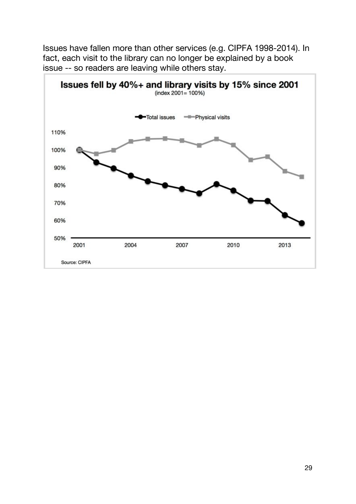

<!-- PAGE: 31 -->

This poses risk to losing all categories of customers, all of whom cite
books as their top reason for visiting.
### 3.2 Explaining the decline in use: discarded
hypotheses
#### 3.2.1 Factors endogenous to libraries such as budgets do not
explain the decline in use
Several suspected explanations are not the primary cause, though
they may be contributing causes.
An examination of factors within libraries showed that these factors
did not track consistently downward (or inversely) with issues across
the last fifteen years (all data for England’s libraries, from CIPFA
2000-2014):
- Library expenditures have not declined for all years: on an
inflation-adjusted and per-capita basis, operating expenditures
were 15% higher in 2010 than in 2000, even as issues continued
to decline.

<!-- PAGE: 32 -->

- Service point (branch) locations have not declined on an
absolute basis for all years, and on a per-capita basis they have
decreased less dramatically than issues: in fact, there were more
service points open in England in 2010 than in 2000.
- Staff members in post have not declined for all years: between
2003 and 2007, staff FTEs increased on a per-capita basis (so
also on an absolute basis), even as issues continued to decline.
- While book stock has declined for all years, it appears that
issues prompted library staff to decrease book stock rather than
the other way around. Furthermore, stock turns[^15] have declined
33% in 15 years, suggesting that the number of items on the
shelf is not the only driver of decreased issues. (In addition, other
factors correlate more strongly to issue decline, as we will see.)
- Finally, new acquisitions, which tend to be the stock most
frequently circulated, have not declined in number for all years: in
fact, on a per capita basis, acquisitions were up by 10% in 2010
compared to 2000, even as issues continued to decline.

<!-- PAGE: 33 -->

Even decline in book stocks cannot explain the decline in issues
completely.
- While some have correctly noted that book stocks and issues
both decline with high correlation
…
- ...When using one variable to predict the other over time, the
data is most consistent with the story that issues declined in year
one and staff then reduced book stocks in the following year.

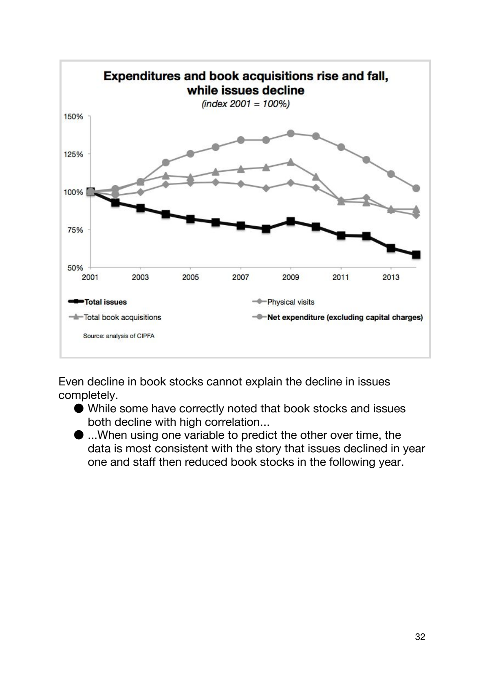

<!-- PAGE: 34 -->

While this may contribute to a downward spiral, where book stock
reductions in turn possibly result in greater issue decline (Grindlay and
### Morris 2004), the primary trendsetter seems to be issue decline. And
the decline in issues in turn seems even more tightly associated with
what we believe is the first driver: the rise of the Internet and
corresponding digital disruption, and the failure of libraries to respond
to this challenge.
#### 3.2.2 Certain exogenous factors such as the demand for books
also fail to explain the decline in use
We looked at factors outside of libraries to explain the decline in use.
- Book purchases by consumers have not declined (Nielsen
Bookscan 2014), and in fact Amazon has risen as a worldwide
company on the strength of interest in print books.

<!-- PAGE: 35 -->

- Reading books remains a top hobby in the UK and a top draw
(as shown above) for those still going to libraries (Santander
2013).
- Median household income -- which might influence whether a
person might prefer to buy or borrow a book -- grew from 2000
to 2010 before slipping thereafter (UK ONS), even as issues
declined across the whole period.
### 3.3 Digital disruption is the best fit for explaining
decline in the use of libraries
Our research indicates that digital disruption is a better fit than the
factors discussed above for explaining the decline in library use.
Authors of previous reports on the library sector, including the
### Department for Culture Media and Sport, make the same conclusion.

<!-- PAGE: 36 -->

“Digital disruption” is a term used to describe the seismic impact of
new digital technologies on the value proposition of existing goods
and services -- especially since the widespread adoption of the
### Internet. Libraries, like nearly every other sector, have been profoundly
affected.
#### 3.3.1 Channel Shift - digital disruption has changed how
people find and use content
People across all income levels are rushing online (UK ONS 2014).
- The number of households with access to the Internet has
increased ten-fold, from 9% to 84% (1998-2014).
- Only 3.6% of households cite cost as barrier to web access
(2014).
- The percentage of adults who go online daily has more than
doubled, from 35% to 76% (2006-14).
- The percentage of adults using mobile phones for Internet has
doubled, from 24% to 58% (2010-14).
Given access to the Internet, users are finding and obtaining books
differently than they did before: online.
- Books became the #1 item bought online in the UK in 2008
(BBC).
- Books bought online doubled from 21% to 48% of all books
bought between 2009 and 2013 (Booksellers Association 2015,
quoting Books & Consumers).
- Ebooks rose from 0% of books sold to roughly 25% of the
market in a few years after the Kindle’s 2009 UK launch
(Andrews 2009; Nielsen Books & Consumers 2014).
- 80%+ of consumers go online before going to buy something in
person (Rueter 2012).

<!-- PAGE: 37 -->

This rush online is the best predictor of decline in issues -- more than
library funding, library bookstock levels, personal income, or any other
variable tested.
As an example, the following graphs compare on the one hand what
each year’s household Internet access rate predicts for the next year’s
issues, and on the other what each year’s bookstock predicts for the
next year’s issues, and on the other hand what. The former (lefthand
graph) is a better fit.

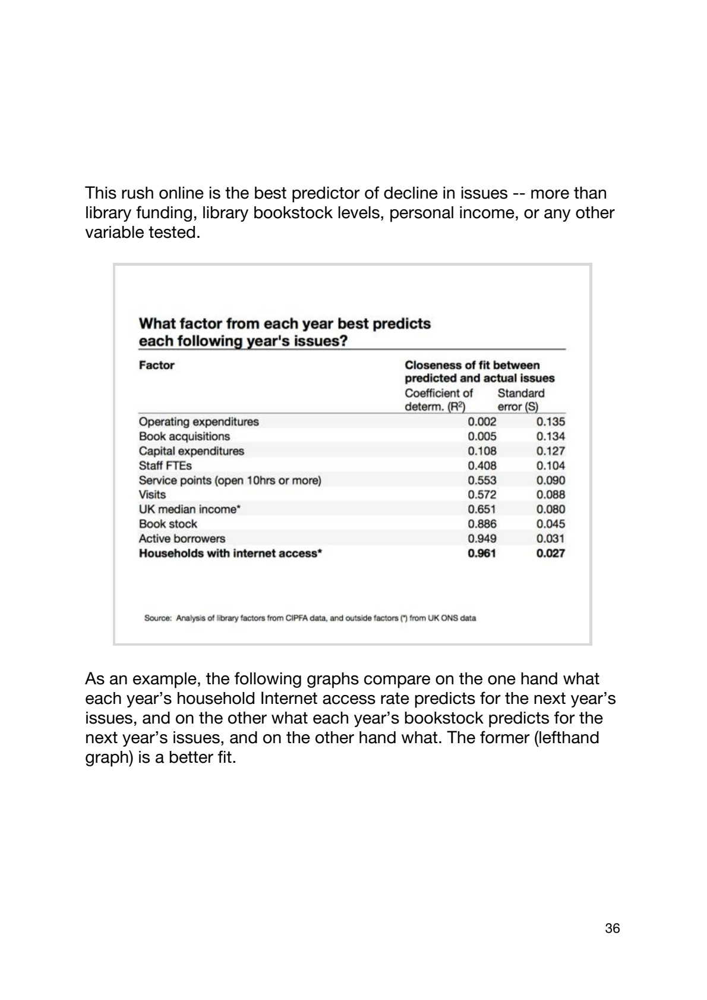

<!-- PAGE: 38 -->

#### 3.3.2 Needs Shift - digital disruption has changed the needs that
people can uniquely address at the library
### Digital production, digital retail and digital fulfillment afford new
convenience and cheaper prices, reducing the relative value of “free”
library content. In our interviews with lapsed library users and non
library users, those who are readers cited the fact that “books are
cheap” as their primary reason for not using the library.
Falling prices and rising wages mean that access to books is no longer
so expensive as to drive people to the library:
- When founded in the 1850s, the price of a new edition of a
popular Dickens title (not serialised, and with no advertising) was
roughly two and a half weeks of the average labourer’s salary.
- Today, even a newly released hardcover costs just one or two

<!-- PAGE: 39 -->

hours of work at minimum wage.
### Indeed, the dramatic reduction in effective price (also enabled by the
end of the Net Book Agreement in 1997, as described by Fishwick
2008), has prompted disbelief among longtime industry watchers:
- Author Tiffany Reisz said that “paying the writer enough to keep
her from starving to death is the reason why not every book can
be 20p or the more common 99 cents in America's Amazon
Kindle store” (Flood 2013).
- The charts editor of Bookseller has said that pricing is now

“ridiculously cheap” online (Flood 2013).
As a result, there is a growing gap in public library use today between
those who need the public library (cannot afford books) and those who

choose to use it (those who can afford books, which is 80%+ of the

population):

<!-- PAGE: 40 -->

To be clear, books remain the main draw for people who do go to the
library -- others have simply left) -- and books remain a potential
cornerstone of a new strategy for libraries. But just handing out books
is no longer enough.
The result of the changing patterns of discovery of books (whether
print or ebooks) and the ability to then buy them cheaply has turned
offline customers into omnichannel customers, and shifted customers
from borrowing to buying. This chart shows a stable industry overall,
but a substitution away from libraries towards online buying.
### It is worth noting that this shift from accessing books at libraries to
buying them is already happening for access to computers, as well.
The declining price of technology (cheap smart phones and cheap
laptops) means that an ever-smaller number of people are compelled
by necessity to access it at the library.

<!-- PAGE: 41 -->

### 3.4 Libraries have not responded to the channel
shift: they remain both hard to find and hard to use
online
### Libraries are not visible online, even to those just
looking to find their locations. Overall, IT expenditures
(meaning software and online websites, not computer
kit) have remained steady or declined for 60% of
libraries surveyed .
#### 3.4.1 Libraries are hard to find online
People find what they’re looking for offline by going online first, and
today’s library websites are too hard to find. Where they could be the
beginning of a journey to a branch, instead they are falling off the
mental map of relevance for the majority of people whose opinions are
shaped by what they see online -- including influential policy makers.
Because few people find library websites, few people use them to find
branches or books:
- Libraries rate themselves poorly for visibility of resources online,
giving themselves a 1.9 / 5 (Reading Agency 2011);
- Less than 50% of library customers interviewed were aware
library websites existed;
- The number for non-customers would be smaller still.
The Carnegie Trust (Macdonald 2012) reported that many users said
placing requests from home “would make [them] use the library more,”
more than would coffee sales or longer opening hours. Despite this,
they were unaware that this service was already available.
The reason why few people find library sites is that libraries fail to
follow widely used good practices. Our review of 50 English library
web services revealed that:
- Search-engine optimisation of the library’s services is poor --
they rarely if ever appear in a search for reviews, local access or
discussion of any book.

<!-- PAGE: 42 -->

- Because library websites are buried in council websites, they are
difficult to find and navigate.
- Social referrals into library websites are low because they do not
have social tools integrated with websites for users to effectively
create and share content, and often lack static URLs.
- There is no marketing of the library offering as a product in itself
-- for instance, no way to share a book record from the library to
blogs across the web, so that those blogs might point back to
the library site.
We discuss the causes and strategies to address each of these
deficits in Section 7.
Few libraries attempt to answer the search-engine optimisation
problem. And while some libraries attempt to solve for the social
referral and online marketing problems by creating separate Twitter or
Facebook accounts, this does not solve two core challenges:

<!-- PAGE: 43 -->

- The division of these channels from the context of the library
catalogue diminishes the number of current library users who will
see that social activity and share into it and out from it to their
networks;
- The inability to share specific content from the library, and
user-generated content across the web, makes it less likely that
individuals will want to share and then will be able to “convert” a
person who sees a tweet or post into a new library user, simply
because there is nothing enticing like a self-made list of books to
share out and then click back to the library to view.
This returns us to the point that marketing online today is about
sharing the product, not telling about the product. Libraries have long
done this offline -- for instance displaying books on tables in the
library, or more dramatically taking books across the city in mobile
vans partly as a way to advertise the branches -- yet they have not
begun doing so online, as they could by similarly displaying books on
their sites and creating links from books across the web back to library
websites.
The consequence, we believe, is that libraries are falling out of view
among both would-be customers and major decision-makers. Library
staff interviewed were frustrated that many people, community
leaders, and national decision-makers were unaware of the depth and
breadth of services offered by the library. National library reports have
also found this to be true:
- Envisioning the Future found “long-standing frustrations about

the ineffectiveness of library marketing and promotion to the
public” and that, “despite the public’s special affection for
libraries, stakeholders saw too few examples of effective
promotion and communication” (ACE 2012, 15).
- The Independent Library Report for England found that “not

enough decision makers at national or local level appear
sufficiently aware of the remarkable and vital value that a good
library service can offer modern communities of every size and
colour” (UK DCMS 2014, 4).
Other organisations weathering digital disruption have invested more
online. In the UK, a government report advising High Street retailers
urged their use of websites so that their brick-and-mortar
establishments could still be “on the map” of even local buyers (UK
### Dep. for Business Innovation and Skills 2013). Organisations of all <!-- PAGE: 44 --> kinds, serving people of all kinds, have sought to move spending to
digital channels. Libraries must follow suit.[^16]
3.4.2 Libraries are hard to use online. They do not match the
basic convenience of other sites in delivering current offers.
People use websites today because they are convenient and
enjoyable, and library websites are neither a smooth pathway to an
offline resource nor an attractive destination in themselves.
Using a library website is difficult and unenjoyable:
- Less than 30% of library customers use library websites,
including many who know about them yet cite their difficulty to
use or lack of quality.
- The number for non-customers would likely approach 0% (an
assumption).
The difficulty of using library websites comes from things that
especially affect low-literacy and low-skilled users at the core of the
library target demographic, such as:
- Remembering 14-digit barcodes;
- Search that requires special inputs rather than natural language;
- Pages that lack contemporary conventions of modern websites
like icons and button types;
- Fragmentation of content (such as separate ebook and print
catalogues) across sites with different branding, styles, and
functional pathways.
### In interviews with staff and directly with low-literacy patrons, and in
observations, we found that low-literacy patrons in library branches
were often able to navigate YouTube -- but not the library catalogue.
For instance,
one construction worker interviewed in Islington admitted openly
to not having sufficient literacy to read books from the library,
but was stopping by to use Google Maps to plot out his course
through town to buy new video games. The library could be
doing more to capture his attention when he logs on and to
usher him through to opportunities to gain greater literacy -- in a
passive way, or in a more decisive and active way.

<!-- PAGE: 45 -->

The difficulty of use is even worse on mobile, which affects both
low-income and young demographics tremendously:
- Low-income people increasingly rely on mobile phones for
day-to-day Internet tasks, as they may lack desktops or laptops
(see US-based reports on the “Smartphone-dependent
population”, e.g. Smith 2015).
- “Nearly 55% of millennials say a poor mobile app experience
would make them less likely to use a company’s products or
services” (Bloomberg 2015).

For low-income users who may have a smartphone but not a desktop,
and who may be literate but have much lower literacy in English -- a
notable portion of those we spoke with in our interviews in library --
the lack of a translated catalogue can be a barrier. For instance,
one Russian-speaking low-level service worker came to the
### Islington’s main library to download Russian documents from her
email account and print them out, and said in broken English that
while she was a passionate reader of Russian literature she relied
on her mother to send her books and found the library hard to
use and lacking in books in her language. Better IT could enable
easier translations for web pages and help highlight applicable
resources for that user base.
The mobile phone experience is bad both for mobile apps (important
for retaining heavy users) and for mobile browsers (important for
gaining new users, who are less likely to download apps):
- Mobile apps used by libraries may reformat for a different screen
size, yet none fixes underlying problems listed above like search
relevance, or fragmentation of content like ebooks and print
books across different programs or screens.
- Web pages used by libraries are not usually responsive,
particularly not the catalogue, so they do not work well on a
phone.
Aside from failing the absolute basics, libraries fail to meet
contemporary standards of online services, and this especially affects
people more experienced online who might support libraries or
volunteer for them, such as:
- Browsing and exploring functionality they find and enjoy on sites
like Amazon,
- User recommendations,

<!-- PAGE: 46 -->

- Creative learning activities or group activities built around the
books.
This lack of user-friendliness drives users elsewhere. A general finding
that likely applies to libraries as well is this:
- 89% of consumers surveyed began doing business with a
competitor following a poor customer experience (Salyer 2014)
### In the words of an Islington woman in her late 50s,
“Sometimes I go to Amazon to check on the specific name of a
title, or maybe to see what else they’re recommending next for a
book I enjoyed...and then to be honest, sometimes, once I’m
there, I just decide to just buy it there if it’s not too expensive.”
Another man’s comments also stand out. He did not use the public
library, yet his wife and daughters did. He later emailed in follow-up:
“When I got home I checked with my family and none of them
were aware that [our local, large urban library] was on-line.
Having now logged on to their site I can see why they need your
help!”
### 3.5 Libraries have not responded to the shift in
needs: they are failing to uniquely serve online both
those who need the library and those who would
choose it in place of commercial sites because of
the library’s unique assets
### Libraries have not responded to the shift in value and
needs. Free access to books is no longer the greatest
barrier to literacy, learning, and community
participation. Libraries are not emphasising the
opportunity to engage others in unlocking the value
books hold -- online and offline.
Public libraries aim to help people become literate, learn, and so
participate in economic and civic life. However, as discussed above, <!-- PAGE: 47 --> digital disruption has reduced the barrier that mere access to books
poses poses to this aim. With the price of books reduced, the relative
value of borrowing books is also lower. The Department for Culture,
### Media, and Sport summarises this change (2009):
“Reading is still a treasured national pastime and the most widely
practised leisure pursuit – 64% of adults read for pleasure. But
printed books are cheaper and more accessible than ever and
retail models like Amazon make book buying much simpler for
the consumer. [...] The library service is diversifying its service in
response to this transformation in demand. Whilst access to a
wide range of up to date reading material is still the primary
reason given for engagement with libraries, on its own this is no
longer enough.” (4)
Yet digital disruption has also raised new barriers to literacy and
learning. The challenges of “information overload” and “distraction”
are only becoming harder for those who need the library; and the
“decision anxiety” of choosing what to read next amid a sea of
possibilities (as well as “distraction”) is only becoming more
unsatisfying for those who might choose the library. Engagement in
communities around books can help solve both issues. Yet libraries
have not shifted their digital presence to serve these new needs
effectively.
#### 3.5.1 Libraries are failing to serve those who choose the
library - a vital constituency
Free borrowing is no longer a compelling draw for those who choose
the library, and libraries are not distinguishing themselves by providing
a richer experience.
For the transaction of getting a book, commercial sites are now
superior: they are convenient and cheap. Libraries are by contrast hard
to find online (inconvenient) and hard to use online (therefore costly in
time and effort). It is unlikely that libraries will be able to compete in
this area, and it is not core to the public purpose libraries serve to
subsidise this part of the transaction.
But libraries could differentiate themselves from commercial sites for

the experience before, during, after, and around the reading of a book.
Unfortunately, they do not. No site now provides a rich experience <!-- PAGE: 48 --> around books that adds to and captures the value of that book for
individuals, culture, and society. The library does not provide:
- Ability to give back to the library - creating lists or guides, tags
and metadata, mentoring
- Recommendations from the library community
- Ability to share enthusiasms with others
- Ability to connect with others around reading or learning goals
- Ability to plan meet-ups or plan to attend an event at the library.
As a result of failing to engage those who choose the library, this
group is leaving the library fastest (see chart above).
There are two reasons this matters:
- First, they support the libraries both politically and financially;
- Second, they support the libraries through the environment and
services they help co-produce.
Politically and financially, as William Sieghart has said,
“Socio-economic groups A and B don't visit libraries. But because
they run the country and the media and much else, that means they
think that libraries are a thing of the past” (Farrington 2015).

<!-- PAGE: 49 -->

### In terms of the environment and services they help create, the
presence of users across all income segments reduces stigma and
creates opportunities for sharing between people who have skills and
connections and those who do not (for instance, see Smith 2012 for an
account by the author Zadie Smith). Even with the large declines in
use by all but the 20% most deprived, the remaining users are still
drawn from all income segments. But this diversity is at risk.

<!-- PAGE: 50 -->

#### 3.5.2 Libraries are failing to serve those who need them
For those who need the library, new barriers to literacy, learning, and
community now include (e.g. Hargittai 2002):
- Motivation to read books and learn;
- Capacity to read books and learn;
- Role models and peers who read books;
- Encouragement and support for reading and understanding
books.
The chart that follows outlines new divides created in our age of digital
abundance: cognitive divides, social capital divides, attention divides,
and participation divides. The dissolution of these divides can and
should serve all. In both their physical and digital spaces, libraries
must stand out as cultural institutions that help communities create
and share human capital. As a complement to well-trained staff, <!-- PAGE: 51 --> libraries must enlist and serve those who choose the library in order to
serve those who need the library.
### Digital shifts have created new divides
### Divide Digitally Digitally Proposed bridge
vs
challenged enabled using library digital

Given digital abundance...
### Cognitive The The Co-Production,
divides information information passively and
overwhelmed empowered actively
“The now have with too Community- and
challenge too much many staff-led curation for
becomes, not information options to those with low
finding that to make make a information literacy
scarce plant sense of satisfying by those with high
growing in the choice -- information literacy
desert, but often rely on
finding a a narrowing Volunteer matching
specific plant set of between high-skilled
growing in a bestsellers and low-skilled
jungle” Neil readers with similar
Gaiman (2013) interests
Given digital network dynamics...
Social capital The The New outside
divides connection connection connections
- poor - rich
Online social now have now find The collections can
networks build fewer their act as an
on offline ones connections connections “interest-graph” --
-- increasing relative to no longer an alternative to the
the gap others, and span social “social graph” --
between are falling class and connecting
those who further viewpoint community <!-- PAGE: 52 --> know many behind spectra members not
and those around who they are

know few (e.g. but what they like to

Shirky 2003) read, learn, and talk
about
Given countless novel digital tools to participate...
Participation The silent The A more welcoming
divides consumers confident space
vs
contributor
s
Participation are not shape The library can use
is hard, confident popular its unique assets to
especially online, and conversation create a uniquely
when tools are it’s often and agendas supportive digital
new and related to more than space, as no other
40%+ of low socio- others entity can. The
### Internet users economic (Sunstein library can foster:
have been status 2001) - more voices, with

abused online (Hargittai ~1 in 6 Britons
(Dugan 2014) 2008) already visiting the
library offline
(CIPFA), and more
diverse voices, with

equal distribution of
visitors by income
(DCMS 2014)
- a safer feel: users

linked to library
cards act more
tolerant than users
without real-world
### ID
- a more open

environment: the
threshold to get a
library card is lower
than to get other IDs
- a more supportive

<!-- PAGE: 53 -->

environment, as
staff and public
funding enable
experiences
commercial sites
cannot
- generosity:

interviews revealed
a desire to be
helpful
Given digital proximity to everything...
Attention The The Norms and
divides distracted inspired nudging
Old temporal "Despite Even lifelong Tools to help users

and the learners face set and keep goals,
geographic educational little barrier to find others who
limits that potential of starting a share them, and to
helped us computers, course be encouraged
focus are their use online, but
…
gone. The for huge Websites with user
apps on our education challenges in interfaces that focus
devices ... is retention towards goals rather
exploit this minuscule (e.g. Farr than distraction can
fact (e.g. compared 2013) become imbued
“How to to ... use for with productivity.
check if your pure Branches already
app is entertain- give “dignity and
addictive ment” self-respect” and
enough to (Richtel make one feel “I,
make money” 2012) too, was being
Abel 2014) productive. Why
else would I be
there? What a great
feeling!”
(Reyes-Gavilan
2014)
### 3.6 Conclusion
The public need for public libraries remains great, but the needs are <!-- PAGE: 54 --> shifting. Just as digital technologies have created new abundances,
they have also created new scarcities -- like the capacity for attention
-- and new challenges. The public library is uniquely positioned to
meet these needs, apart from its current lack of digital infrastructure to
do so.

<!-- PAGE: 55 -->

# Findings
## 4 Library Managers
Stagnant IT stifles response &
raises costs
### Inadequate digital infrastructure in libraries has made
them more expensive to administer, and less
responsive to their communities. Weak digital
foundations hinder the ability of library managers to
increase:
●The visibility of libraries online
●The usability and enjoyment of their online services
●Adoption of the best practices among libraries
●Performance management and cost reduction in
both online and on the floor
●Innovation.
### 4.1 Context: Strong existing library assets, weak
library IT
### Libraries have unique assets from which to mount a
compelling response to these challenges, yet they have
been held back by dependence on old IT -- a
foundation that cannot easily hold a contemporary
service.

<!-- PAGE: 56 -->

#### 4.1.1 Strong existing library assets
The library has assets, described below, that other organisations
would like to use, or else develop for themselves. The following chart
reviews key library assets and existing challenges. A fuller analysis of
these issues additionally shows how digital tools can help reinvigorate
(Appendix IV) and leverage (Appendix VI) these assets.
Quality Quantity (as applicable)

### Values
Open to all, for all they aspire to
- Safe
  - Youth say “parents were happy with them spending time in
the library, not only because of its association with
education and learning, but also because parents ‘trust’ the
library” (ACE 2012, 8)
- Open to all
  - 74% say libraries are important to their community
(Macdonald 2012)
- Free to choose all aspirations
  - Philip Pullman: “The blessed privacy! [...N]o-one else even
knows what’s going on in that wonderful space that opens
up between reader and book” (quoted in Overbey 2011).
- Internally motivated
  - Zadie Smith: “There’s no point in goofing off in a library:
you are acutely aware that the only person’s time you’re
wasting is your own” (2012).
- Not pressured to make purchases (not commercial)
- Not judged (not central government, which users seem to
suspect would be interested to leap to conclusions about them
based on questions or interests)
  - Bob Gann, NHS: “We found the non-judgmental space of
libraries uniquely enables people to feel comfortable
seeking help.”
### Challenges <!-- PAGE: 57 --> - Online websites reflect “transactional” culture and not these
richer values (missing IT to support richer online experiences that

embody these values)
### Community
### Many, diverse, readers
- Goodwill ● Large audience
  - Pro bono outreach like online
“Premiere League Reading ○ ~4M visit
Stars” is unmatched by library
competitors websites each
- Diverse month
  - Equal use by top 20% of wealth ○ <1M visit
and bottom 20% of wealth (UK Waterstones
### DCMS 2014b) and ~2M visit
- Readers Goodreads[^17]
  - A person’s reading frequency ● 1/6 visit to borrow
predicts library use (Macdonald ○ ~8M
2012) borrowed last
- Children, Parents, and Retirees year in
  - Key and complementary life England
stages represented (CIPFA 2014)
- ~18M visited
libraries last year in
England (UK DCMS
2014b)
### Challenges
- Perception that they are increasingly ● Indeed, trends
used only by the poor (missing IT to show diversity of

enable social sharing that reveals to income is declining
the wider web the broader base of (DCMS 2014b)
library users and gives reasons to
return to the library)
### Collections
Tell us about the world, and the world about us <!-- PAGE: 58 --> - Can be part of a larger activity ● ~50% of books
  - Learning read in UK issued
  - Self-help by library (Nielsen
  - Exploration BookScan 2014 and
- Can lead to connections CIPFA 2014)
  - Excuse to meet people ○ Nearly 70% of
  - Relevance of services reads in early
- Free access and desired serendipity 2000s,
  - Free means lower penalty for possible to
bad choice regain ground
  - “Let’s see what they have ● ~78M books in
about ” stock
…
  - Greater willingness to wait for
exact match
- Children’s Books
  - Huge, persistent demand
  - Brings young parents of all
incomes into library
### Challenges
- Difficulty to maintain depth and breadth of collections now
discoverable online (missing IT to support data for print and

ebook collection development, and user experiences to improve
curation and discovery)
Buildings
### Local, neutral, safe places for meeting (though too many service points
becomes burdensome)
- Embedded in local community fabric ● 3,000+ service
- Often in places most central to life of points (CIPFA 2014)
community ● As many as Costa
### Coffee (Wood and
Bowers 2011)
### Challenges
- Not as attractive on exterior or interior as commercial sites -- and
hard to find (missing IT to support online discovery of locations,

community events calendars, reservation abilities, and other ways
to show what takes place inside and motivate visits)

<!-- PAGE: 59 -->

Staff
Helpful and at their best as “community impresarios”
- Patient and people-oriented ● 16,000 full-time
equivalent staff in
England (CIPFA
2014)
- Also 32,000
volunteers in
part-time work
(CIPFA 2014)
### Challenges
- Increasingly seen as “stern” or “unapproachable” by library users,
and as less professional with recommendations (missing IT to

provide staff profiles to humanise them online before patrons
meet them offline, and to allow them to showcase and share
expertise)
- Often feel overwhelmed by range and complexity of questions
asked (missing IT to provide community co-production so staff

can connect users to others who know the answer, rather than
always having to provide it themselves)
### Library card and identity
Easy to get, holds people accountable, lets people explore  even kids
- Civic and Universal ● ~30M estimated
  - No commercial use library card holders
  - No cost barrier in England (based
- Independent on US ratios &
  - Shielded from probing CIPFA data)
government use ○ v. ~20M credit
  - Can maintain privacy card holders
- Accountable (UK Cards
  - Not anonymous Association
  - Tied to a real name 2014)
  - Checked by staff
  - Anonymity of other online IDs
like emails linked with rise in
abuse online (Dugan 2014)
- Exploratory

<!-- PAGE: 60 -->

  - Can be pseudonymous
  - Can hide from others as
barcode or username
  - Pseudonymity linked with
moving beyond stereotypes
and stigma (Kaste 2011)
- Linked between parent and child
  - In-branch process to monitor
use of material
### Challenges
- Can require several steps to obtain, not nationally scaled and not
accepted elsewhere, so value is reduced (missing IT to ease and

scale library card)
Online library catalogue
The seeds of something good: It holds many users, who express their
intentions through search, while logged into an ID -- potentially
allowing services to make dynamic connections and personalisations
- Where users express intentions ● ~70%+ of time
  - Searching for books indicates a online at library is in
need catalogue (based on
- Where users express ID comparing local
  - Logged-in state indicates a pageviews across
history of interests or other website and
details that can be used to catalogues)
develop services with user
permsision
- Where users express location
  - Looking to place requests at
select locations
- Search is basic and contemporary to
web world
  - Google search results and
Amazon search results are
fundamentally similar
### Challenges <!-- PAGE: 61 --> - The user experience of most catalogues today not only fails to
take advantage of these assets -- for instance it does not use
search intentions to promote events or partner services related to
the search -- but it also often fails at the fundamentals: with
confusing interfaces, small fonts, and an antiquated look and feel
(missing IT underlying this interface to improve it and leverage

value in various ways)
4.1.2 An Achilles’ heel: poor library IT
Holding back the full use of these assets, and a response to the
emerging challenges of digital divides, is the library IT.
Here, we will provide an overview of what this legacy IT entails. The
digital foundation of each library is the Library Management System
(the “LMS”) -- a system architected 30+ years ago as a tool to track
print materials. Like other software designed at that time, the LMS is a
single integrated code-base (monolithic), rather than a set of loosely
joined components (modular). Because none of its features can be
unplugged or replaced, it is difficult to change, integrate, or enhance.

<!-- PAGE: 62 -->

Today’s Library IT
What it is How it is used
(by admin or by library users)
### Library ● An enterprise Primary functions include:
### Management resource ● Acquisitions
System planning ● Cataloguing
(LMS) system ● Issues or circulation
- The OPAC (see below)
Online ● Public online ● Search and request books
Public catalogue ● 70% user web activity, or
Access about 40M visits annually
### Catalogue ● About ⅓ of resulting
(OPAC) pageviews are account
pages where items a user
has requested or is
borrowing can be seen
EBook and ● Catalogue for ● Often a separate
other digital ebooks (or environment to search
content silos other content) and request content - little
or no visibility of library’s
other offers
- Often a separate user ID
and separate lending rules
### Mobile App ● App for ● Though mobile access will
catalogue exceed desktop, apps
provide only a subset of
the OPAC features
### Library ● Library ● Often complicated CMS
landing website - rules and approvals from
pages points to Council IT
catalogue ● Library users sometimes
find location information,
event calendars, and info
### Council ● Council’s ● Library admin has little
landing public website control over site
pages - points to ● Library users have little to
do here -- click through <!-- PAGE: 63 --> library website
National ● Partner- ● Users can participate in
partner and controlled programming created by
application public website partner
silos ● Fefers to ● Limited interaction with
(like content but library
Bookmark does not ● Subset of users active
Your Library, contain it
or sites of ● No live
Reading connection to
Agency) local LMS
UnityUK ● Partner- ● Check interlibrary loan
National controlled content as library admin
### Catalogue public website or expert user
- Refers to ● Subset of users active
inventory of
separate
libraries yet
does not
contain it
- No live
connection to
local LMS <!-- PAGE: 64 --> ### 4.2 Libraries cannot respond to channel shift
because of the monolithic nature of legacy IT
### In retail, digital platforms with modular design have
enabled quickly-evolving omnichannel user
experiences. In libraries, however, the reliance on
monolithic, locally-installed library IT has deadened
innovation.
### In response to declines in use outlined above, libraries
have tried to improve their websites, to share best
practices, and to partner nationally on programs related
to health and literacy. Yet they have often been unable
to coordinate and share these efforts. And they have
been unable to feature national offers in their
catalogues -- where an estimated 70%+ of online traffic
occurs[^18] and where the search box and transactions
provide rich signals of users’ needs and interests.
#### 4.2.1 Unable to make themselves findable
### Libraries struggle to make their offerings visible despite having two key
ingredients for successful marketing:
- Compelling content, and
- Committed community.
What is missing is a shared strategy and tools for leveraging those
assets online.
### Legacy IT has limited the visibility of libraries by curtailing these key
ingredients:
- Search engine optimisation (SEO) -- with ~50% of reads

originating in the library (see above chart), libraries should be a
## 18 Based on comparing local catalogue pageviews to local website pageviews for

several libraries.

<!-- PAGE: 65 -->

dominant presence in search-engine results on the Internet for
any book title. Yet they are virtually invisible. At a high level,
search engines promote pages that are referenced by the
greatest number of other pages -- and users. Among the many
factors that impact SEO, then, current LMS interfaces prevent:
  - Other sites from creating inbound links to the library and
catalogue - many catalogue pages do not support static
links (the links are generated on each user session)
  - Multiple library silos and multiple library sites from counting
as the same entity for purposes of referencing, which can
be achieved technically even without merging them from
the user experience point of view
  - Link sharing on social media
- Social discovery -- more library users are discovering content

through social media today than through search engines. And
yet catalogues, account pages and e-readers lack the most
rudimentary social-sharing tools.
- Shareable content - more content is being shared across the

web, providing value to other websites while providing marketing
for the originator of the content. YouTube, for example, enables
videos to be embedded across the web. The library does not
now act as an originator for any dynamic, shareable content
around books, such as:
  - Embeddable book widget with title and author information,
a jacket image, as well as ratings and reviews (as might be
used by bloggers or reviewers)
  - Book lists (as might be used by other organisations
creating lists, journalists, teachers, bloggers, and others)
Other organisations are building these kinds of digital tools, while
libraries fall behind:
- Envisioning the Library of the Future found libraries “fall behind

many other user-facing organisations (like leisure centres,
cinemas or high street retailers) in exploiting the [digital] tools
now available to generate visibility, attract new users and
maintain relationships with the public” (2013, 16)
#### 4.2.2 Unable to make themselves usable
The LMS is still the base for the public library’s current digital
presence. An online catalogue was added on top of this inventory <!-- PAGE: 66 --> system by vendors in the 1990s, enabling users to place requests for
books from home. Over 70% of library pageviews are now in this
online public access catalogue (OPAC). The Reading Agency has
found that “online library catalogues are the gateway to users’ digital
engagement” (2011). Yet in most cases the user-experience is at least
a decade out of date in comparison to the retail sites that library users
are familiar with.
The centrality of the catalogue to library services, and yet the severe
limits of the catalogue’s current functionality and extensibility (the
ability to plug in new applications), make it a constant breaking point
for new applications. An example below shows a new website and a
new app that both break for usability as soon as the reader actually
wants to acquire the book.

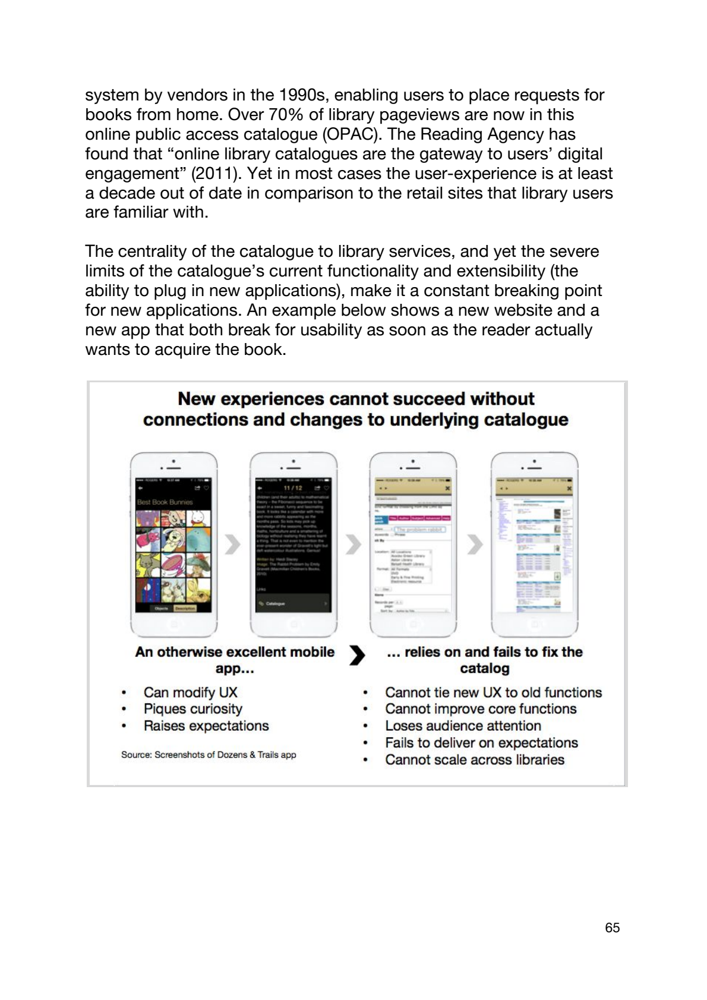

<!-- PAGE: 67 -->

### 4.3 Libraries are unable to make other
improvements and save other costs across their
services for lack of shared IT
#### 4.3.1 Unable to manage operations effectively
### Libraries waste time and resources compensating for poor IT. They are
also unable to leverage IT to monitor and optimise their other
resources across the library system broadly, for example in managing
collections.
### Managing a legacy IT environment consumes almost as much time for
libraries as does creating library programming and events that could
potentially distinguish libraries from commercial alternatives:
- 800 full-time equivalents in English libraries work with legacy IT
- 1200 full-time equivalents in English libraries work on
programming and events <!-- PAGE: 68 --> What takes so much time?
### Inefficient staff workflows consume time and impose costs. While this
expense is hard to measure, it comes across in common complaints:
- Staff complained of “extra windows” and “clicks,” often resulting
from the way systems are cobbled together
- One manager said changing vendors was “no longer a serious
option due to staff and volunteer retraining costs"
### Data extraction is also time-consuming, and it prevents libraries from
measuring progress and improving
- 150 FTEs are used in data extraction across England’s library
authorities.
- 20% of library IT staff cite this burden as a primary shortcoming
of their existing tools
Even once data is extracted and manipulated, it is not easy to
compare to data from other libraries, and is not timely enough for
decision-making.
### Integrating new technology offerings with the legacy IT is
time-consuming as well. This relates, as described above, to the
challenge of integrating an LMS-based environment with local
offerings like ebook catalogues and national offerings like partner
resources. For example:
- 140 FTEs are dedicated to manually updating catalogue
information to UnityUK and OCLC for interlibrary loan.
### In addition to consuming staff time directly, the bad IT also consumes
it indirectly. In program development, for instance, staff may need to
create lists of books that they then work to post online.
### If libraries are to use data to improve organisational effectiveness and
impact, a national standards-based platform is essential. From
performance management to best practice sharing, partnerships to
marketing, little can be done without it. Once implemented, a platform
for national data collection and sharing will be a basis for enhancing
staff skills and developing higher value-added analytics work. It will
also create value for partner agencies, and the publishing[^19] and
education sectors.

<!-- PAGE: 69 -->

<!-- PAGE: 70 -->

# Findings
## 5 Library Partners
Fragmented IT stifles mutual
support
### Libraries cannot respond to the shift in needs because
they lack the digital foundations to enhance their sites
in partnership with each other, national organisations,
and publishers.
### 5.1 Limited Collaboration between libraries
The divergent data models and business logic of five LMS systems
(along with divergent versions and configurations) confound the
sharing of content, practices and innovation across libraries. It is as
though each library speaks a different language.
As a result, for example, libraries cannot easily:
- Share catalogue-embedded[^20] materials such as lists, tweets,
public conversations and reviews, crowd-sourced metadata,
advertisements for upcoming “National Moments” or other
campaigns, omnichannel events, partner and publisher[^21] content;
- Exchange programming ideas around a shareable list of
resources;
- Share their readers’ advisory work;
- Share best practices for the use of a common CMS; or
- Share mobile apps and website applications.
20 Catalogue-embedded because the catalogue receives an estimated 70%+ of
online traffic. The Reading Agency has found that “online library catalogues are the
gateway to users’ digital engagement” (2011).
21 See for example quote from Stephen Page of Faber and Faber in Section 5.3.1:
“If publishing were to partner with the library service to create certain kinds of
technological solutions or best practices, it’s much heavier lifting .”
… <!-- PAGE: 71 --> For best practice sharing, it is:
- Easy to share general ideas,
- But hard to share actionable specifications and completed work,
such as a finished software application or even digital lists of
books.
As a case in point, a dissertation written in review of the SCL & The
Reading Agency’s well-conceived “Books on Prescription” scheme
said that inconsistency across library websites limited the program’s
effectiveness:
The "results of the desk research demonstrated the need for
consistency and standardisation in the contents and procedures
of BOP schemes across different library authorities," as this
"might be affecting wider promotion.” A better web presence in
general would "make the scheme more accessible for both
casual and referred users" (Furness 2012, 336).
As for creating new national programs, it is:
- Easy to build separate applications and content silos,
- But hard to build national content that is integrated
systematically into the local catalogues, where existing users
already come in droves.
These silos weaken the uptake and usefulness of the national
resource. The Bookmark Your Library site, for instance, had one tenth
as many visits in a year (~30,000 in 12 months) as a typical library
does in a single month (~300,000 in 1 month), in part because of its
isolation from the traffic of the catalogue. As John Usher of Islington
### Library noted, there were no connections:
- For audiences -- from where users and staff are in library sites
today -- to the new site, limiting user and staff awareness and
use of the site
- For resources -- to the real-time availability of books in the local
catalogue -- to the new site, limiting the usefulness of the site
These links to current user journeys and live collections would have
made the site more successful, but are not possible without shared
digital infrastructure connecting all libraries.

<!-- PAGE: 72 -->

### Connecting partner resources to the library’s resources and users is not feasible
today.
A national website solves one problem but creates another: it reaches almost none
of the 3.3M active monthly users across England’s public library catalogues.

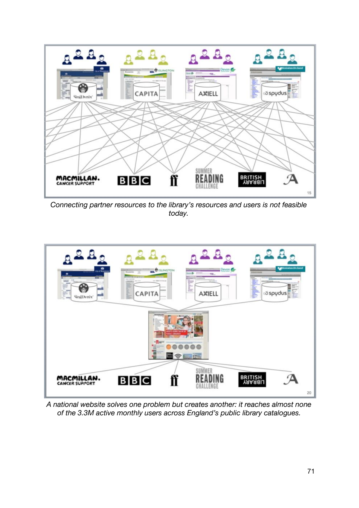

<!-- PAGE: 73 -->

A national standards-based platform would allow libraries and their partners to
innovate, collaborate and share in ways they cannot now do - and allow partners to
connect with library users on their home turf -- in the catalogue, and other library
digital spaces.
### 5.2 Limited digital collaboration with national
partners
### Libraries also struggle to collaborate efficiently and effectively with
national organisations because of their monolithic legacy IT. National
stakeholders are eager to collaborate with public libraries given their
overlapping audiences and missions. But there are few means by
which to do so.
As a consequence, partners invest extra money in distributing print
materials, and in digital programs that share neither infrastructure with
nor links to the library’s digital services. For example:
- The Reading Agency’s online literacy offers are well-designed,
but are not visible from the library’s online environment, while the
physical branches contain more expensive (and labour-intensive)
printed posters and pamphlets. While print materials are
preferred by some, and have achieved solid results, there are no
notices or links visible to the sizeable audience in the library
catalogue to any of the following -- each exists in a silo:

<!-- PAGE: 74 -->

  - The “Reading Group” tool for adults -- no link to the
audience of libraries;
  - The “Reading Ahead” tool for finding a next read -- no link
to checking out the book in a library;
  - The “Summer Reading Challenge” site and tools for
children -- no links to the branches and spaces where
young children and their parents might meet to read books
together; and no links from the bibliographic record pages
of children’s books nor their personal library-account
pages.
- The BBC’s online literacy and learning resources are also as yet
not linked, though in 2015 a broad range of literacy and cultural
partners have held a series off meetings with the BBC to explore
better integration. BBC resources that remain unlinked to the
library catalogues that millions use include:
  - Open Book, Radio 2, Radio 4, and World Book Club pages
-- no link to checking out the books, or adding to a
library-based for-later list;
  - Books at the BBC pages -- no link to the library;
  - iWonder pages -- no link to resources to learn further in the
library, to peers from local branches to study with, or to
spaces to meet in local branches: and no links from related
titles in the library to the iWonder pages.
- QuickReads resources are not leveraged effectively
  - Registration page -- no way to log in with an existing
library card or library ID
  - Book pages -- no link back to the library to request the
book
These are just a few examples.

<!-- PAGE: 75 -->

These connections could not be made using today’s library IT because
the cost of integration from each partner to each local library would be
too great; there is not sufficient standardisation to make this practical.
Each of the above organisations has varied programs that are
assembled from similar elements:
- Audiences,
- Books (with title, author, image),
- User-generated content (reviews, tags, and so on),
- And actions.
These elements are made anew on each site, rather than borrowed
from the library environment. Rather than put up their posters on the
walls of the virtual library, these organisations are in a sense building
their own library walls and their own library posters online. This means
that in addition to the sites not mutually reinforcing one another, they
are also costing more money to build in aggregate. It would improve
the user experience and reduce cost if the library instead could

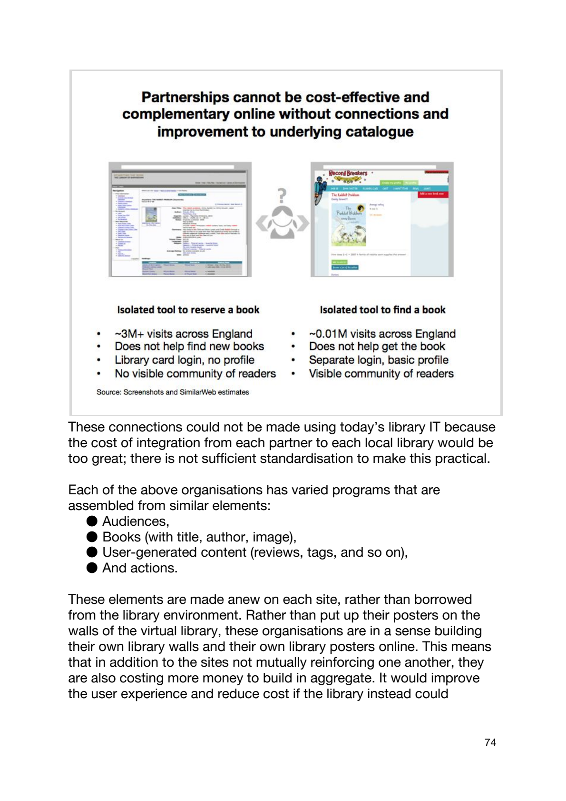

<!-- PAGE: 76 -->

support these organisations by providing digitally extensible resources
like APIs and widgets that would allow those partner websites to:
- “Pull” resources and audiences from the library -- for example to
bring book titles into their pages as a listing in a blog or program,
or to validate registered users against the list of library card
holders;
- “Push” new value created back to the library -- like the book
lists, new registrations, videos, and so forth.
Without that kind of shared infrastructure, however, as one senior
manager for the BBC told us:
“We get together quarterly, all with the best of intentions. We
leave with lots of great ideas. And nothing ever gets done. Or at
least, not at anywhere close to the scale we’d all hoped for.”
### 5.3 Limited digital collaboration with publishers
The increasing concentration of consumer data and engagement
channels in the hands of one retailer presents a unique opportunity for
libraries to create a valuable partnership with publishers. Publishers
need reliable, scalable channels through which they can establish and
extend their relationships with readers.
#### 5.3.1 Publishers want to collaborate yet have limited means
Helping reader to discover the right book is a fundamental challenge
for publishers:
- Joanna Prior of Penguin Random House explains, “Authors are
still the beating heart of what we do... What has changed... is
how we make the connection between that talent and the reader.
This is what we are all grappling with on a daily basis.... The
challenge is cracking the code of discoverability” (2014).
### Libraries can play a more central and measureable role in connecting
readers with the books produced by publishers:
- “[P]ublishers need a better way to capture consumers’ attention”
(Harvey 2015)
- Libraries are seen by publishers as key to “monetising the

<!-- PAGE: 77 -->

backlist” (Aydt 2014).22 The belief is that libraries can generate

buzz for old titles, and some who pick up on the buzz will buy
the book -- not just borrow it. While libraries lack the data to
robustly validate that this is possible, publishers believe it can
be, and in limited cases where data is available it has been born
out.
And libraries can help to deepen readers’ relationships to books and
authors:
- “We want to build up the [fiction] author’s personality and create
a relationship between the reader and the author as a person .”
…
[^23]
- “Key to marketing and selling books direct is seeking out
platforms where readers are having meaningful conversations
around relevant topics and joining in. And that’s quite often not
an ecommerce site . Whatever the vehicle, the interaction
…
should be based around a content area that people are
passionate about . Simply putting a catalogue online is not
…
enough.”24
Publishers also want insights from reading data, a commodity that is
increasingly controlled by one company:
- “[T]raditional publishing is using trend information discovered
through data collection and reader feedback to make informed
decisions on their publishing program” (Donovan 2015)
However, for publishers, partnering with libraries to gain this value is
difficult:
- “There is no single place to go and have a conversation with
libraries. If publishing were to partner with the library service to
create certain kinds of technological solutions or best practices,
it’s much heavier lifting than my consumer marketing department
engaging through social media on our behalf There is an
…
impediment here that is structural. We needed to be able to
engage singularly.”25
22 “Rekindle your romance with libraries . They’re not your enemy; they’re your
…
friends.” is the advice from a panel of publishing executives (Aydt 2014).
## 23 Heather Fain, SVP, director of marketing strategy at Hachette (Harvey 2015)
## 24 Rick Joyce, CMO of The Perseus Books Grou (Harvey 2015)
## 25 Stephen Page in a panel discussion with Nick Stopforth, Head of Doncaster

### Libraries; Liz McGettigan, Libraries and Information Services Manager at The City of <!-- PAGE: 78 --> #### 5.3.2 Libraries have strong assets to offer publishers
### Libraries have many readers:
- Today nearly 50% of reads originate in public libraries[^26]
- Heavy readers are over-represented among library users
compared to the general population, as reading frequency
predicts library use (Macdonald 2012)
These readers are already online with libraries, despite poor websites:
- While publishers dream of building online communities
independently, libraries already have those audiences:
Edinburgh Council and Bill Thompson, journalist and commentator and Miranda
### McKearney, CEO of The Reading Agency (Reading Agency 2013)
26 44% is the 2013 share of CIPFA issues in an overall book market that also
includes offline- and online-sourced print purchases (Nielsen Books & Consumers)
and online ebooks purchases from major- and self-publishers (Nielsen Books &
### Consumers).

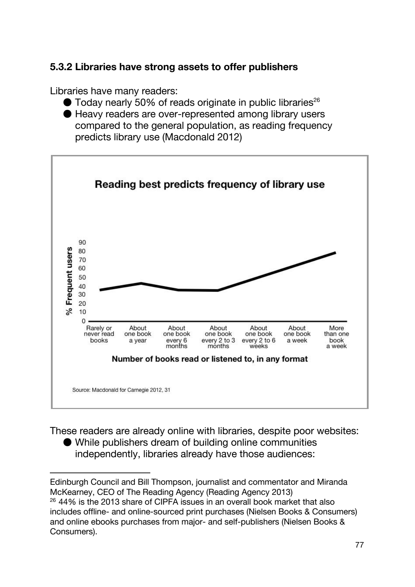

<!-- PAGE: 79 -->

Birmingham Library’s website alone has more monthly
pageviews than the UK’s Penguin-Random House site (per
SimilarWeb)
And they are open to new choices:
- Book borrowers bring more open minds to their selections than
do book buyers -- they are willing to try something new.[^27]
- Library staff still handsell books and host book-groups and
readings even as independent bookstores disappear from the
High Street. Indeed, “Librarians are the word-of-mouth gurus”
(Aydt 2014)

### If libraries are to consolidate and enhance their role in the publishing
ecosystem, and win the ear of publishers in discussing licensing
models, they must provide an efficient, nation-wide platform for
information sharing with their (eager) audiences; and for capturing and
aggregating anonymized reader data. See strategy recommendations
in Section 9.2.1 below.
### 5.4 Unable to support authors
#### 5.4.1 Authors are struggling because of a lack of balance in the
industry
Fewer authors are able to make a living in the midlist, or those books
below the bestseller list.
- The typical income in 2013 for a professional author was
£11,000, £5,000 less than the an acceptable standard of living
(Flood 2014)
- Only 11.5% of professional authors in the UK—defined as those
who dedicate the majority of their time to writing—earned their
income solely from writing, down from 40% in 2005 (Flood 2014)
- Roly Keating reflected on this phenomenon in his remarks at the
the 2015 Hay Festival.
The impact of digital technologies on the book market has contributed
to this situation in two ways:

<!-- PAGE: 80 -->

- Content has proliferated with the increasing ease of production
- There has been a net loss of discovery pathways for readers as
digital retail (now accounting for roughly two-thirds of all sales)
has supplanted the traditional.
  - “Even Amazon’s algorithms are just not good enough to
make new books as discoverable as they once were in a
bookstore. And Amazon doesn’t have anyone who knows
you or your kids and can recommend books you’ll like”
(Rasenberger 2015)

A blockbuster economy has resulted, in which "[t]he mid-list,
publishing's experimental laboratory, is being abandoned" (Robinson

2014).
#### 5.4.2 Libraries have much to offer
Because libraries account for nearly half of the reads in the UK, they
could help develop reader attention for new authors. Readers at the
library both borrow books and buy them (Reading Partnership
[Reading Agency] 2000), and they also tend to be among the major
trendsetters for reading: in one focus group we held in Islington, the
heaviest library user was also be a columnist who reviews books for a
major newspaper. The library can help draw the attention of these

readers to authors, whose books they may borrow, buy, and promote
to other buyers.
At present, however, for all of the reasons described, libraries lack the
ability to build compelling user experiences and cultivate relationships
with authors at scale. See strategy recommendations in Section 9.2.2
below.

<!-- PAGE: 81 -->

# Findings
## 6 Library IT
An ineffective ecosystem
The development of a robust IT infrastructure is blocked
by architectural inefficiencies and underinvestment.
The deficiencies of current library IT in England have been well
documented:
- Reports over several decades show consensus on what is
missing -- chief among these is user-generated content and
user-led experiences and activities
- IT vendors interviewed cite the difficulty of integrating new
products with the many flavours of LMS in England’s public
libraries
- IT staff in libraries have made remarkable progress despite this
difficult environment.
Yet this shared insight about legacy IT systems has not resulted in
changes at scale. The poorly developed ecosystem for library IT has
two causes:
- Insufficient investment on the part of libraries in their digital
services as compared their physical plant
- Structural inefficiencies that limit the impact of the spending that
libraries do incur
### 6.1 IT Spending
### Libraries spend too little on their digital environments -- totalling about
£15M per year including LMS expenditures (based on our survey of
heads of library services). Consumer expectations for digital
experiences are set on the web at large, by companies that spend <!-- PAGE: 82 --> much more than libraries, even on select areas of the library service
offering such as information and education:[^28]
- Information-seeking:
  - Wikipedia: £50M
- Learning tools:
  - Kahn Academy: £133M
- Writing and publishing tools to support amateur authors:
  - Wattpad: £46M
- Events information
  - Eventbrite: £133M
- Meeting tools to join people with similar interests in an offline
location:
  - MeetUp: £12M
### 6.2 A fragmented market for library IT
The structural inefficiencies of the ecosystem for library IT has several
causes. Because of the LMS fragmentation noted above, libraries are
not able to focus spending to promote focused, broadly-compatible
products. In the absence of a modular ecosystem, vendors must use
the revenues they receive from libraries replicating technical
capabilities that are often the same from one vendor to the next,
instead of focusing on more specialised innovation[^29]
Furthermore, much of the library IT budget is spent on “brownfield”
work maintaining old foundations and integrating new functionality on
top of them -- whereas the above commercial comparisons are for
“greenfield” work building contemporary applications on modern
foundations. We propose below a middleware solution to refresh the
library IT with similar modern foundations.
### In addition, buyers of library IT are often unable to affect supply
because of their own fragmentation. Uncoordinated procurement
introduces two problems:
28 All per CrunchBase for the lifetime of the products.
## 29 If the market were modular, vendors would be more free to focus on any one

module and develop extraordinary capabilities there, while the library could buy the
other module from another vendor. This would shift the market from vertical and
closed architecture to horizontal and open architecture.

<!-- PAGE: 83 -->

- More costs for vendors in sales, legal, and administrative tasks,
which takes away from the resources that could be put into
building better products; and
- Less leverage for libraries to demand better products.
Where libraries have come together to coordinate priorities and
purchases in other service areas, like the Oxford University database
framework agreement (where over 90% of libraries purchased the
services after having agreed to a common set of terms; there was no
greater technical integration), they have saved upwards of 50% (Taplin
2015).
The monolithic nature of existing library IT and the lack of
interoperability is also a key factor, forcing vendors to replicate and
maintain comprehensive services, rather than focusing investment on
unique functionality. This means that the money spent by libraries
does not go as far as it might; there are many gains to be made
through specialisation and collaboration.

<!-- PAGE: 84 -->

# Recommendations: Strategies <!-- PAGE: 85 --> # Recommendations: Strategies
## 7 Library Users
The affordances of the social web
are key to making libraries
relevant and visible online
What libraries can best offer users today in response to
digital disruption is similar to what they have historically
offered: support for literacy, lifelong learning, and
community inclusion. Digital technologies have only
deepened these needs. But they also provide solutions
-- key among these are the affordances of the social
web.
### 7.1 Address the new divides by building from the
library’s collections
As access to books and information is no longer the greatest obstacle
to meeting the goals of literacy, learning, and community, the library
must turn to address new divides. Many of these are digital divides.[^30]
The library’s collections -- activated by a national social catalogue and
digital platform -- are a way to bridge these divides in new ways.
#### 7.1.1 Literacy
The inspiration, support, focus, and time to read remain as barriers to
literacy. Many sites on the Internet have done more to distract than
they have to help (Richtel 2012). Because sustained reading is in their <!-- PAGE: 86 --> blood, libraries are uniquely positioned to develop an alternative to the
distraction economy that dominates much of the Internet
(Chamorro-Premuzic 2014).

The library’s online services can help address barriers to reading by:
- Featuring peer voices in the catalogue. It is essential that

reluctant readers hear voices like their own in the library.
- Creating new pathways into reading, such as by building links

to celebrity reading programs like that of the Premier League.
This program and others like it must be featured on every
appearance of the featured titles in the library’s catalogue,
websites and apps. And England’s libraries should provide to
these partners book- and list-widgets, linked through the
national digital platform, that guide potential readers to
accessing and discussing those titles in the digital environments
of each library authority.
- Recommending books for the choice-overwhelmed, as does

The Reading Agency’s Book Sorter. Free from commercial
imperatives, libraries have a unique value proposition to bring to
book discovery tools. The number and goodwill of readers in the
library can also be tapped to provide a unique source of
human-created evaluative data, which alongside the
bibliographic metadata that is native to libraries, provides the
raw material to build a unique and valuable discovery
environment. But as with the other digital offers discussed in
this report, if this service is to be usable and robust, it must be
designed, built and maintained with the economies of scale that
come from concerted effort.

<!-- PAGE: 87 -->

### Links to the library
### Links in the library
#### 7.1.2 Learning
### Digital technologies provide England’s public libraries an opportunity
to become the hub for informal learning in their communities.
### Motivation and social context remain key constraints to learning. While

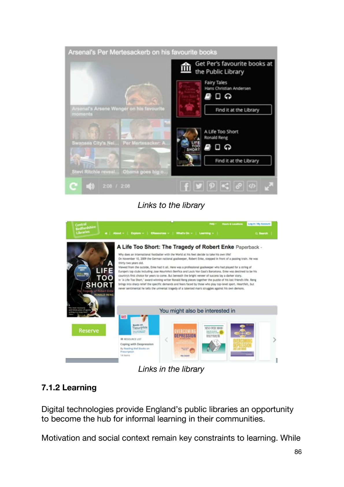

<!-- PAGE: 88 -->

many may borrow a textbook, buy it on Amazon or sign up for a
course on Coursera, few find peers or a community to carry them
forward in their project. Many do not continue with goals that are set
with the best of intentions, as demonstrated by the high attrition rates
in online learning sites (Farr 2013).
The books in the library’s collection are an ideal point of connection
for building social support for learning. Support from one’s library
community can be triggered, for example, by:
- Allowing library users to record what they have read and learned.
A badging service, for example, like the Open Badging Initiative
developed by the Mozilla Foundation, would find a strong anchor
in the authenticated user ID of the library’s digital space.
Badging can be motivating for children; but can also serve as a
kind of informal credential for adults who are trying to upgrade
their skills or employability.
- Allowing library users to connect with like-minded readers (on an
opt-in basis) -- or indeed with those of a differing perspective.
- Allowing community members to opt in and be screened and
trained as learning mentors, matched to learners on the basis of
an interests profile or a mentor’s “Books Completed” shelf.
Finally, every library authority should have an online events calendar in
order to make their learning programmes visible to the web; and linked
and discoverable in their catalogues. Once established, the library’s
events service, in combination with its existing volume of users --
many of whom declare their interests in the catalogue’s search box,
becomes a natural hub for educational events throughout the
community.[^31]
#### 7.1.3 Community inclusion
The library’s digital public space should enable groups within a
community to connect both online and off.
For example, the library’s digital service should:
- Enable people who share learning goals (perhaps indicated by a
shared interest in a book) to form peer learning groups,
## 31 This model was adopted, for example, by Learning City in Vancouver, whose educational offerings

from many participating agencies can be discovered in the library’s events service, or filtered by
proximity to library branches.

<!-- PAGE: 89 -->

organised online but supported in the physical realm with online
booking and invitation tools;
- Encourage and invite volunteerism by providing tools to organise
and recognise their efforts;
- Give exposure to local authors and cultural institutions by
promoting their content digitally in the context of relevant
searches and bibliographic record pages.
- Making it easy for people with a book in common on their “For
### Later” shelves to form a reading group, building on the ideas of
reading group development recommended by The Reading
Agency (2004).
There are other good reasons to build social functionality into the very
foundations of the digital library:
- Social content such as reviews is one of only two reasons to visit
a library online, as cited by users, that has seen growth year over
year. (Pew Research Center)
- Social functionality is what all young and many middle-aged
users expect of the web -- and of their library if it is to be on the
web.
- Social functionality provides an onramp to the wider social web
for reluctant and older digital citizens. In the hands of the library,
the resulting connections can play an important role in
addressing loneliness, a key health issue affecting the elderly.

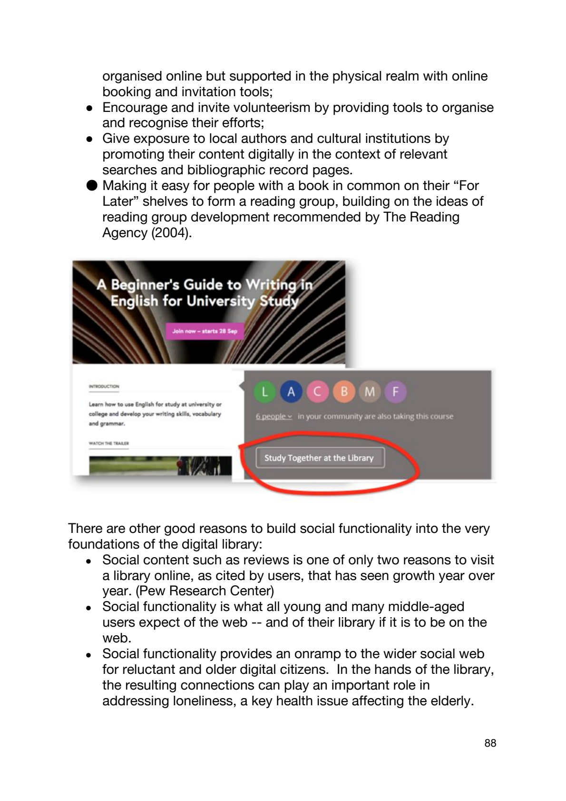

<!-- PAGE: 90 -->

7.2 Allow the library’s digital public spaces to
reflect the unique value of libraries
#### 7.2.1 Create new digital spaces, distinct from commercial
environments, as neutral ground for literacy, learning, and
community
The safe, non-commercial nature of the public library was cited in
interviews as a key point of appeal. Libraries were described as
spaces where:
- People are citizens first and consumers second, which can be
supported online with:
  - Recommendations and displays that are not shaped by
commercial interest
  - Agreed upon principles of privacy
  - Digital spaces for reviews and conversation, to which users
bring the civility and goodwill that the library uniquely
inspires.
- People are connected by shared interests or sensibilities, which
can be supported online with:
  - Following, viewing a profile, or other connection with others
with similar interests -- particularly successful where these
connections reach beyond our traditional “bonding capital”
(Putnam 2000) -- linking us to people and communities
beyond our circles of family and friends.
  - A digital space for conversation around every book
  - Collaborative lists -- for titles in the same micro-genre, for
further reading, or for an opposing point of view
  - The opportunity to learn with and from people facing the
same challenges
  - The opportunity to give back in new ways -- that draw on
professional and personal expertise
  - The opportunity for a user to share what she or he enjoys.
- People are encouraged to linger for discovery, reflection, or
discussion, and be challenged; which can be supported online
with:
  - User-driven affirmations including a ‘like’ of someone
else’s contribution
  - Nudges or shared work space that help people stick to
goals they have defined or challenges other users have <!-- PAGE: 91 --> recommended for them[^32]
- People share physical community, which can be supported
online by providing:
  - Online connections that resolve to meetups or events in
physical library spaces.
### Digital public space in the library would be a welcome alternative to
existing websites that, by contrast often:
- Grant access only in exchange
  - For a fee, or
  - For targeted advertising (and about half of users cannot
discern from unpaid content even in Google search results
(“Google Ads and the War on Free Clicks" 2012), or
  - For personal information that can be sold to advertisers.
- Connect people only by
  - Existing social networks
  - Existing political or ideological viewpoints.
- Do not encourage lingering and instead
  - Drive people towards quick transactions
  - Drive people towards average and easy choices.
### Digital public space in the library can also be extended across the web
for use by partners in literacy, learning, and community inclusion.
### Libraries should be the hub for informal learning

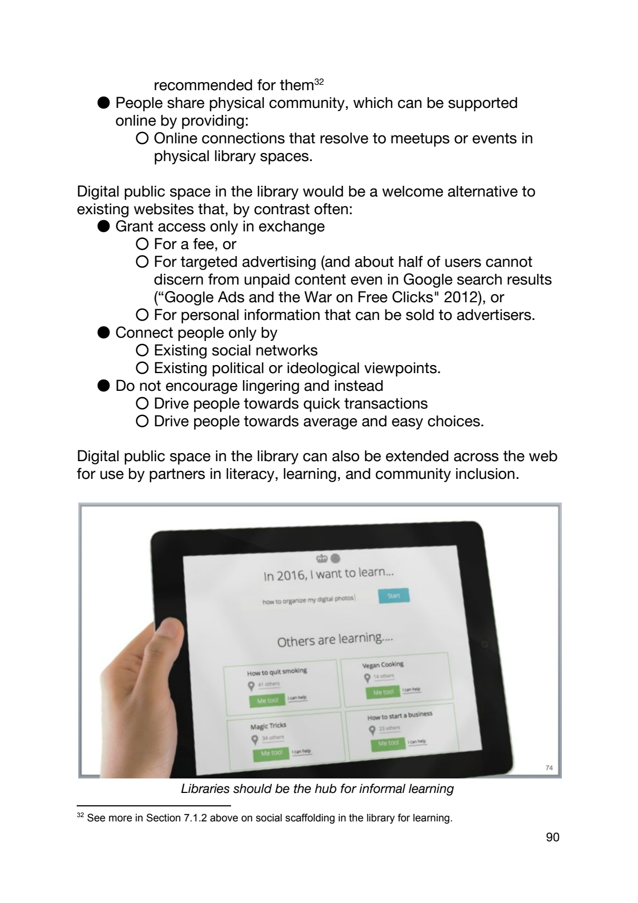

<!-- PAGE: 92 -->

#### 7.2.2 Energise library spaces through digital co-production --
bringing together national and local users, and bringing together
those who need and those who choose the library
### In addition to the individual motivations to participate that are
described above, there are three key structural ingredients for
co-produced community to succeed in the spirit of the public library:
- Bring national and local communities together to create a critical
mass while preserving responsiveness to local needs
- Bring those who need and those who choose the library together
to enable social-capital exchange
- Bring staff and users together to moderate and energise the
community while enabling diversity and unpredictability
7.2.2a Bring together national and local users
The library’s digital spaces must be at-once:
- National in scale for success online
  - To populate the space with activity, even around obscure
titles, and encourage others. Heavy contributors and niche
contributors are a small portion of the overall population
yet will provide most of the benefit to the rest of the users
(for example, Wikipedia’s contributors represent less than
1% of their viewers).
  - To amass data needed to improve a service to the level
users now expect -- online social networks and search
sites are improved by insights from millions of users.
- Locally rooted to the physical locations the library serves:
  - To continue to serve local needs and local taxpayers
  - To differentiate the library online space from the rest of the
web.
7.2.2b Bring together those who choose and those who need the

library
### In diversity, library communities need at once to engage those who
can choose in order to serve those who need, because:

<!-- PAGE: 93 -->

- To co-produce literacy requires people who are literate and
people who are not
- To co-produce learning requires experts and novices
- To co-produce community inclusion requires people “in” and
“out” of various cultural and ethnic communities, especially so
no space becomes stigmatising
Those who choose to use the library are more volatile than those who
need the library: they are the segment that is leaving the library most
quickly.[^33] Yet as we argue here, they are essential to creating digital
services for those who need the library. Our interviews with users
indicated that the following activities are among the most appealing to
those who choose:
- Parents and Children:
  - People from all socioeconomic statuses tend to come to
the library when they have children -- a visit can be an
event in itself. Issues of children’s books have remained flat
even as adult issues have declined. Shared digital spaces
will offer many opportunities to engage parents, as well as
their children as they start to gain autonomy
- Readers:
  - Heavy readers are social readers. The Reading Agency
research found that these readers enjoy sharing
recommendations with others and discussing books (e.g.
Reading Agency 2004). In our research, we found this
group had an appetite for digital, non-commercial ways to
find books and talk with others about them.
- Volunteers:
  - A desire for the opportunity to give back was raised by
people who said they otherwise would not visit the library.
An online service could help match volunteers, for instance,
by building on common interests in books.
7.2.2c Bring together staff and regular users
William Sieghart’s research commission wrote that “The 21st century
librarian will need to be more of a community impresario ... who can
champion their communities’ needs and generate new business and
audiences for the library” (UK DCMS 2014).

<!-- PAGE: 94 -->

Online, library staff should strive be first-among-equals in a community
that exemplifies the norms that define libraries offline. They can:
- Create reusable readers’ advisory lists or topic guides in an
environment in which those guides will be instantly visible to
those users who view related titles or search results
- Share an authentic voice on titles in which they have a genuine
interest
- Welcome new users upon registration
- Curate content for low-literacy individuals
### Digital services can also help empower staff in the branch. Staff
should be able to:
- Use online tools to help coordinate offline groups with shared
interests, in some cases shifting the staff person from the giver
of help to the facilitator
- Create a profile to share nationally a unique passion for a
subject, with staff thereby freeing one another across England
from being, at times, unwilling generalists
- Create a profile that helps library users approach staff in branch.
Said one immigrant student in his 20s in Islington, “You should
show their names in the branch or online so you know how to
reach out to them.”
### In short, online and offline, the digital library can enable library staff to
be stewards of a space that solves “second order divides” that are the
focus of UK Government digital inclusion strategy: motivation, skill,
and trust (Hargittai 2008; Cabinet Office and Government Digital
Services 2013).
#### 7.2.3 Leverage national partners to be major co-producers as well
### Library partners could integrate their materials into this new digital
space.
To add value to the library site, and to add visibility to the partner
resources, library partners should be able to post information within
the library’s digital public space just as they do offline. For example:
- If offline library staff place Books on Prescription posters next to
displays of the dementia-related books on those lists, then online
the reading lists should also be co-located next to these books <!-- PAGE: 95 --> in the library’s digital space, such as by intelligently highlighting
the list whenever such a book comes up in search results, or on
the bibliographic-record page
- If offline library staff place partner information on career
guidance next to books on professional development, again the
same should be true in the library’s digital space.
### 7.3 Make libraries visible and usable
#### 7.3.1 Make physical library spaces and resources visible online,
and reactivate them with online engagement before, during, and
after use
### Libraries must immediately adopt tested strategies for visibility online:
7.3.1a Search engine optimisation (SEO)
With 50% of reads originating in the library and massive existing web
traffic, libraries together should be a prominent presence in Google
search. A search for any given book title should produce an entry for
England’s public libraries on the first page of results. But this is not the
case today. To achieve a greater presence, libraries require a digital

infrastructure that enables:

- Inbound links to static URLs;
- Traffic aggregation across editions and formats within the library
using FRBR[^34];
- Traffic aggregation across library authorities, using for example
canonical URLs that enable a reference to one book in one
library and a reference to the same book in another library to
count together for SEO purposes;
- The capability to share to social media from any library catalogue
links that can be resolved to the holdings of any English public
library;
## 34 FRBR is an entity relationship model, developed by the International Federation of Library
Associations and Institutions, that can be used to associate various editions and formats of a title
(“manifestations”) to the concept of a single work.

<!-- PAGE: 96 -->

- Many, many inbound links from social media to the catalogue.
Their volume is an important key to the ranking algorithms that
search engines use to sort results.
However while the measures listed above will help libraries appear as
an option in Google, SEO is in some ways yesterday’s game.
7.3.1b Social discovery
Social media now drives one third of all referral traffic, and continues
to grow in importance (DeMers 2015). More Internet users are now
discovering content through social media than through search
engines. If England’s libraries are to build visibility and participation in
their communities, they must develop strong strategies and tools for
social-media-based discovery.
### Many make the mistake of assuming that social-media strategy for
libraries should focus on a library Facebook page or Twitter account.
However those tactics preach to the converted. Far more valuable to
libraries is tapping into the activity, networks and loyalty of their
existing users -- as a springboard to non-users.

<!-- PAGE: 97 -->

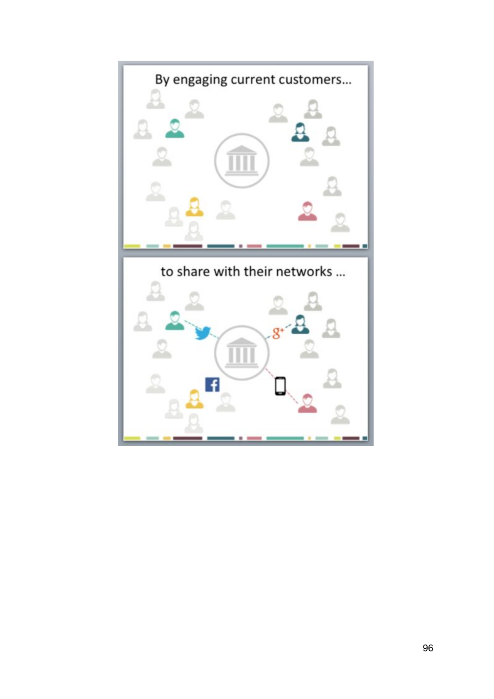

<!-- PAGE: 98 -->

### Libraries must ensure that they provide:
- Tools that make it easy for library users to create commonly
shared content that is related to books and other library content,
such as lists, quizzes and quotations.
- Tools that allow library staff and partners to create shareable
content of a similar nature.
- Tools that make it easy for library users to share content out to
their own networks with hashtags and links that point new users
back to the library.

<!-- PAGE: 99 -->

### Libraries can increase social sharing and social referrals by offering
dynamic, relevant content that brings existing users back to the
library’s digital spaces. Staff could never manage this challenge alone.
But by enabling their users, and local and national partners as
co-producers of content that points back to the library site, and
sharing content among libraries, they can achieve the necessary
impact.
Sharing to social networks from within the library’s digital spaces
should be supported at scale across all of England’s libraries by
combining two ingredients:
- A national social catalogue service (built on the digital platform)
- The work of a few content strategists, either embedded within
some of the local library authorities, or co-ordinated on behalf of
England’s libraries by the national library digital services agency.
[^35]
for example:
- Allowing users to tweet a quotation to friends from within a
library-centric ebook reader.
- Prompting a person who just returned a book to write a
140-character review that is shared simultaneously in the
catalogue and via Twitter.
- Enabling the sharing of “likes” and ratings to social media
streams, using a universal bibliographic record that can be easily
resolved to any English library.
- Ensuring that people who view any shared content can click
back to the library.
- A global book widget supplied by England’s public libraries (like
Amazon’s) could allow users to blog or post a title with jacket
image that links back to a local English library.
- Build digital tools that are social for groups of people who both
use the library and social media heavily, especially young
parents (who are among the heaviest users of both), such as by:
- Book club features: lists, voting, discussion.
- “What are you reading with your kids?” -- enabling parents to
post a book + activity in a way that can be shared on social
channels and in the library online.

<!-- PAGE: 100 -->

7.3.1c Content-as-marketing across the web
A third major way successful sites and companies market today is to
let their content and offerings speak for themselves by extending out
across the web, often with the proviso that this reference create a link
back to the site.
### Libraries can increase content-as-marketing across the web by:
- Enabling the library as the reference point for all mentions of
books across the web, such as by:
  - Providing tools for other sites to embed lists of books or
titles of books that bring the value of user reviews or
images as well as links back to the library.
- Enabling the library card as the ID for literacy, culture and
learning across the web, such as by:
  - Creating “social login” functionality - so a person can join
third-party learning sites with an alternative to commercial
### IDs like those of Google, Facebook, or LinkedIn
The library ID should be
a key to culture and learning in England <!-- PAGE: 101 --> 7.3.1d Direct online users to the branch intelligently
As the library becomes more visible online, the pathway and
motivation to visit the branch must also be clear. Just as retailers
move users between “channels” -- their online presence, for example,
and bricks-and-mortar locations -- public libraries must allow their
users to move nimbly from digital to physical and back. Local public
library instances on a national standards-based platform are key to
bridging these worlds -- and to remaining responsive to local need.
### Intelligent personalisation is an excellent vehicle with which to develop
omnichannel experiences.
- Use online behaviour to recommend offline events and
resources. For example:
  - A user searches for children’s DVDs and learns that there’s
a kids’ movie matinee at a local library branch every
Saturday;
  - A user who searches for materials related to diabetes can
view a notice of an upcoming session on managing
diabetes at their nearest library location or health agency;
  - A user browses for job search self-help books and learns
that they can reserve one-on-one resume and cover letter
help.
- Provide online tools to find library locations by services and
facilities available, such as:
  - Search by geography, open hours, facility services (wifi,
parking, computer lab).
- Connect a user’s online transaction to the physical space by
introducing additional resources to explore in the physical library.
For example:
  - A search for a title reveals special collections or exhibits
related to the materials.
- Connect a user’s expected journey back to a preferred library
branch with event announcements, such as:
  - A parent checking due dates sees in the account window a
notice of a children’s reading group the same day the book
is due and at her preferred branch.

<!-- PAGE: 102 -->

#### 7.3.2 Make the online library usable
### Libraries serve a range of demographics including low-digital-literacy
individuals -- children, adults and seniors -- and low-income
individuals with access to the Internet mostly through mobile phones.
Strong user-experience design is essential. Yet because good
user-experience design is research based and iterative, it can be
prohibitively expensive without economies of scale. England’s public
libraries should invest together in engaging, pleasing user experience
design that can be configured from a central code base and branded
for use at every library authority.
Strong usability design will:
- Reduce barriers for first-time and casual users
- Reduce what must be read with strong visual design
- Reduce what must be learned by adopting web conventions and
user-centered design
- Adopt responsive design principles to deliver excellent user
experiences on smartphones and tablets
### Libraries can play a large role in driving forward digital literacy in their
communities. Go ON UK and Government Digital Services have
identified additional “usability” concerns that libraries can uniquely
address, such as (UK Gov 2014):
- Motivation
  - Provide experience pathways that build from personal
interests toward larger goals and engagement
  - Cultivate diverse, authenticate peer voices to encourage
those who may not have seen themselves reflected the
library.
  - Give staff tools to curate, feature and encourage the
activity and communities that evolve in their online
environments
- Trust
  - Allow the library’s digital spaces to serve as a safe onramp
for new users of the web
  - Provide terms of use that, as compared to commercial
sites, place more control in the hands of users <!-- PAGE: 103 --> # Recommendations: Strategies
## 8 Library Managers
Enabling best practices with IT
### 8.1 To respond to the channel shift
To realise the strategic opportunities highlighted above will require a
more sophisticated IT.
#### 8.1.1 Make libraries easier to find online
As outlined in Section 7 above, if libraries are to attract new users and
build a community of co-producers, they must include new criteria in
their IT procurement. Library managers must include requirements
such as:
- Enhance search-engine optimisation (SEO);
- Increase social sharing and referrals.
#### 8.1.2 Make libraries easier to use online
To overcome the barriers to ease of use across the library experience,
and to integrating and managing legacy IT, libraries must move:
- Away from monolithic stacks of software
- Towards modular and interoperable software.
The strategy allows libraries to choose the best component for each
function, and at a later date, swap in any better version of that <!-- PAGE: 104 --> component that should be on offer in the market. Modularity should
reduce dependencies that prevent libraries from switching vendors,
and should reduce the costs of integrating new modules.
### In Section 12 we recommend that England’s libraries, in order to give
this new platform ecosystem strong start, acquire on a national scale a
suite of core components for an initial period of three to five years.
### 8.2 To improve other services and value for money
#### 8.2.1 Overview of tools
A number of tools are needed to improve operational effectiveness for
libraries. These are described throughout, and in Appendixes V and VI,
yet will be summarised to highlight their relevance here. They include:
- Tools to broaden and deepen the use of the library:
  - Marketing tools, particularly those related to findability
above in SEO optimisation and social referrals
- Tools to reactivate the use of library buildings:
  - Location and room reservation systems, in conjunction with
learning and reading group applications, to help draw
people into the space
  - Event calendar tools
- Tools to leverage staff time:
  - Tools that enable staff to share programming across all
libraries in their system and across all libraries nationally --
such as sharing book lists and associated activities
- Tools to leverage library community time:
  - Tools to facilitate volunteer management, such as
registration and volunteer matching software
  - Tools to enable co-production
### In addition to the above overview (see also Appendixes V and VI), two
opportunity areas are worth exploring in detail:
- Tools for data aggregation and performance management
- Tools for collection management, which can be enabled
particularly through merging e- and print book catalogues.

<!-- PAGE: 105 -->

#### 8.2.1 Data aggregation and performance management
To validate the library’s expenditures and help make improvements
will require data that is
- Comprehensive
- Comparable
- Actionable.
Aggregating this kind of data requires the building of a data
warehouse, which again raises a number of features about the overall
library IT environment that must be changed:
- To be comprehensive:
  - Data from multiple services must be able to be abstracted
and then brought together in a common data warehouse,
implying that separate service modules will be
interoperable
- To be comparable:
  - Data must be able to be linked by user or user attributes,
implying an ID module and ID standards (while respecting
the principles of user privacy)
  - Data about books or activities must have common
identifiers, implying a canonical (FRBR-based) work ID
  - Data across libraries must be comparable and brought
together, implying data standards
  - Data must be stored across time and comparable across
time
- To be actionable:
  - Data must be collected without manual effort, implying
standard APIs and machine-driven rather than manual data
management
  - Data must be live-streamed or synchronized on a short
cycle
  - Data must be able to be quickly reported on, implying the
development of reporting modules that are easy to use and
evolved for library needs
  - Data must be acted upon without manual effort where
possible, implying that data inputs help drive what is, for
instance, presented in the catalogue to a particular user
To achieve the above will require moving away from monolithic
architectures where data is not comprehensive, comparable, or <!-- PAGE: 106 --> actionable to modular architectures where it can be leveraged at a
national scale.
#### 8.2.2 Implement an ebook service that optimises collections
budgets and intensifies use of the library’s physical and digital
spaces
The emergence of ebook lending in England’s public libraries presents
two opportunities: the optimisation of collections budgets and the
intensification of use of the library’s physical and digital spaces.
To ensure the best use of collection budgets, especially as ebooks are
adopted by libraries, will require tools that help manage demand and
inform acquisition decisions. A key strategy for achieving this is
unifying ebook and print discovery in one catalogue.
Ebook lending has been slow to start in the UK, yet publishers now
seem poised to expand ebook lending through libraries with the
proviso that licenses be sold to individual authorities or consortia,
rather than nationally.
As they prepare for growth in ebook lending, English libraries should
learn from mistakes in North America. North American libraries often
have separate ebook and print lending environments, which causes
two problems:
- Readers may queue for a more expensive ebook edition even if a
cheaper print edition is available and they would be willing to
take it.
- eBook readers lose touch with other library offers, which are not
visible in an ebook silo. Discovery, account pages, and the
e-reader are all touch points with the library user. They should
not be ceded to the branding and business models of third
parties. This point becomes more evident when one considers
that ebook borrowing removes any need to visit the library’s
physical spaces -- and the notices, encounters and chance
discoveries that those spaces offer.
Publishers have already to begun to charge more for ebooks. For
example, the largest publisher selling to libraries charges for an ebook
license three to four times the price of a hardcover edition. At the
same time the great majority of ebook borrowers are happy to take
books in any format available. To the extent that users are directed to <!-- PAGE: 107 --> ebooks instead of their print counterparts, library budgets will suffer
needlessly. Libraries should think of ebooks as a complement to,
rather than a substitute for print, and should design interfaces that
deflect users to available editions, e or p, rather than building up
queues and invoices for ebooks.
Siloed lending and reading environments tend to pull users away from
the library community.
- With print books, the journey to the library exposes customers to
events, to serendipitous decisions to borrow another book or
enroll in a community class or even volunteer. The local library’s
branding also builds loyalty to the library.
- With ebooks, there is a risk that users may become more
isolated from the library and develop a much more consumptive
relationship.
As a result, libraries need to actively work to engage ebook readers in
their communities.
But to manage costs and engage readers, they need an interface that
combines ebook and print. In England, libraries could achieve this by
situating all ebook discovery in the local library's catalogue -- with no
silos:
- Demand for the more expensive ebook format can be diverted to
print, which users are just as willing to read (evidence includes
Amazon’s demonstration in recent disputes with publishers that
it can change algorithmic and UX elements to shift demand for
certain items; Barrett 2014)36; and
- Ebook users will always be exposed to the full range of the
library’s offerings and community (as presented in part through
catalogue-embedded search engine marketing).
### In addition to the unified ebook and print discovery, and for similar
reasons, libraries need to have library-branded, library-centric
e-readers, to:
- Draw users into conversations around books
## 36 In the library, this might take the form of pairing a search result for a bestseller

that has no available copies with a list of recommended alternatives and, if desired,
a note calling users to enjoy the full breadth of the collection to help the library
make its budget go furthest.

<!-- PAGE: 108 -->

- Integrate these conversations about ebooks into conversations
around print books and the library community
- Develop data insights for better serving their customers.
Users would be willing and often grateful for multi-format discovery
and library-branded e-readers:
- Among readers generally,
  - The vast majority of readers of ebooks are also readers of
print books, and are willing to accept both formats (per a
study conducted by BiblioCommons and Chicago Public
### Library)
  - E-book sales are continuing to level off, and were even
down last year (Alter 2015)
- Among library borrowers,
  - Even more open to accepting different formats,
  - More open to trying new authors and content: the attitude
is “Let’s see what they’ve got” (as highlighted in the results
of the Publisher Association’s 2014-15 ebook lending pilot)
This points to a larger strategy for sustainable and distinct collections
development in libraries. Libraries need to offer choices they can
afford to provide, and choices that distinguish their value proposition
from commercial options.
### Libraries will be best positioned to sustainably contribute to England's
book culture, then, with discovery interfaces that allow:
- Nudging users toward available titles
While many elements of a discovery interface can help accomplish
those goals, all of these will depend on some common capabilities
outlined below:
- Capacity to index availability across all formats on a near-time
basis
- A FRBR edition-matching service to ensure that libraries can
always direct attention to either print or physical editions in their
search and discovery interfaces
- A single publisher interface for the distribution of metadata and
extended content (author videos and interviews, sneak previews)
to readers
- A social layer that crowd-sources discovery data that go beyond
traditional metadata, such as tags for topics and micro-genres <!-- PAGE: 109 --> - A search service that combines and indexes publisher,
crowd-sourced and MARC metadata to create discovery
pathways; and that provide near-real-time availability across all
formats and content silos
- A library-centric e-reader service that extends the library offer
and brand, and focuses and reflects dialogue and engagement
around a title back into the library’s digital space
- An ebook lending service with the capacity for experimentation
with flexible licensing models and full reporting capabilities to
enable the assessment of the results of experiments in
collaboration with publishers.

<!-- PAGE: 110 -->

# Recommendations: Strategies
## 9 Library Partners
A standards-based platform
enables shared content,
programming and metrics
### 9.1 Allow third-sector partners to share resources,
reach audience
The public library serves audiences that many cultural institutions and
agencies find difficult to reach. Many see the power of libraries to
reach new audiences, including migrants and lower-income
households.
Past reports have indicated the need to join resources across the
disparate institutions supporting culture and the arts in England. The
public libraries of England are uniquely positioned to provide this
infrastructure, enabling:
- Greater visibility of all offers and programming to millions of
library users
- Cross-agency offers -- and the resulting data for research
purposes to support the Shared Framework which the Reading
Agency has advanced
- The cost efficiencies of easy access to book metadata provided
by a centralised library data service.
A standards-based digital platform would allow libraries to collaborate
more efficiently with partner organisations.
- “Pull” resources and audiences from the library -- for example to
bring book titles into their pages as a listing in a blog or program
using a platform-based book widget or list widget, or to validate
registered users against the list of library card holders;
- “Push” new value created back to the library -- such as the book
lists, new registrations, videos.

<!-- PAGE: 111 -->

A platform that serves as a single point of integration between England’s public
libraries and its partners
### 9.2 Enable contributions to publishers, retailers,
authors, and England's book culture as a whole
#### 9.2.1 Provide new channels to publishers, and engagement and
enriched content to readers
The potential for libraries to collaborate with publishers depends on
the perception that libraries are net contributors to the publishing
ecosystem. There are three ways in which libraries create value for
publishers:
- Provide discovery channels for new authors and titles
- Generate reader engagement around a known author or series
- Gather data
A standards-based digital platform would help to make the value of
libraries more clear to publishers.
England’s libraries must work together to:
- Provide a single interface through which publishers can share
book-related assets and offers with library users
- Provide to library users content and points of connection through

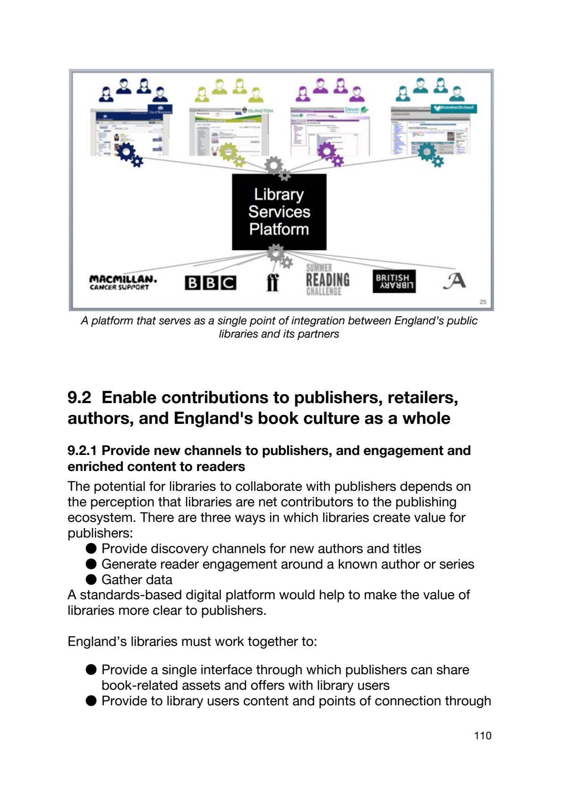

<!-- PAGE: 112 -->

which they can discuss and more deeply engage with books,
authors, series, imprints and publishers
- Provide a discovery system that allows libraries to shape
demand, distributing users’ attention across frontlist, midlist and
backlist works
- Provide digital tools at a national scale for curating and
merchandising books in library digital spaces, allowing libraries
“to do for books what BBC did for music” (Ellison 2015)
- Allow users to opt in to the sharing of their reading profiles with
publishers in exchange for recommendations, previews/galleys,
event notices, etc.
- Enable a national data repository of transactions (issues) and
reading data that will allow publishers to identify consumer
trends (including a user-permission and data-aggregation system
that protects the reader’s right to privacy)
- Explore economic models that would allow libraries to recover
some of the value they create for publishers through these
means
### If these tools are to be effective and efficient they must be
implemented using digital systems on a national scale. By allowing
publishers to gain insight and cultivate potential customers, libraries
will create value for their users, publishers and themselves.
#### 9.2.2 Build a national system for the discovery of authors
England’s authors play a vital role in her creative economy. In order to
enhance the discovery of authors at scale, libraries must give their
users and staff tools that:
- Give exposure to new authors and works in the mid- and
back-lists, especially through curation that is supported by the
personal voice of library staff and users
- Add to traditional descriptive metadata on all works
- Create relational metadata - qualified linkages between works to
aid discovery
- Allow users to explore the long tail of indie content.
### Like many of our recommendations, if these tools are to be effective
and efficient they must be implemented using digital technologies on a
national scale. Only a standards-based digital platform could bring <!-- PAGE: 113 --> together the libraries, audiences, content, authors, and user-interfaces
necessary for success.

<!-- PAGE: 114 -->

# Recommendations: Strategies
## 10 IT Ecosystem
From monoliths to modules
### Libraries will need to respond to the challenges listed
above by:
●Investing more
●Focusing buyers through library leadership
●Focusing builders through partnerships and
standards
●Moving towards a modular, standards-based
ecosystem by way of middleware
### In the following section, we will describe the strategic
pathway to the desired innovation through modular
standards-based IT. The most pragmatic transitional
step is through middleware -- a way to translate from
diverse proprietary standards of monolithic LMS to a
common layer of data standards and business logic.
### 10.1 Invest more
To improve the library digital infrastructure will require more funding.
This funding will support:
- Creating user experiences online of comparable quality to
commercial experiences that customers are used to
- Developing performance management capabilities that can
increase outputs (e.g. deepen customer use of other library
assets, as measured traditionally by increasing visits to branches
and increasing book issues, and through new metrics such as
community participation rates, partner engagement and “clicks”)

<!-- PAGE: 115 -->

- Develop better architectures to reduce costs (as by reducing
ongoing maintenance and integration costs in the future, and
ensuring competitive markets).
Other observers have called for governments in general to spend more
on their IT given its crucial importance today:
“ICT spending accounts for just 3–6% of a typical local
authority’s budget. Instead of focusing on making their IT
cheaper, the priority for local authorities should be to procure the
right technology (and the right technical advice via consultants
and other external experts) that enables them to deliver savings
in the other 94–97% of their budgets.” (Copeland 2015, 25)
English public libraries spend even less than authorities on digital
infrastructure: between 1-3% of their resources based on a survey of
heads of library services.
By contrast, the New York Public Library currently spends ~4% of its
operating budget on digital development every year. And among
higher education institutions, the common benchmark is 4.5% of
operating revenues (although this is not necessarily the desired target
for libraries) (Higher Ed CIO 2012).
Other benchmarks come from the private sector. While “retailers tend
to hold their IT budget spend close to the vest because they don’t like
rivals knowing how much they spend” (Boulton 2013), companies have
made occasional public announcements to reassure investors they are
covering this critical area:
- To play catch-up on the capital side:
  - A survey of CEOs suggested an average of 29% of their
capital budgets would be devoted to continued
omnichannel improvements (Murphy 2015)
  - For example, Kohl’s announced in 2015 they would spend
$350M of their $800M capital budget on “initiatives that
integrate its brick-and-mortar stores” with its online
business (Ramakrishnan 2015)
- And to continue investing every year on the operating side:
  - A survey of over 150 CIOs suggested an average of 5% of
their operating budgets devoted to IT (for retail and
consumer products companies) (Corporate Executive

Board Company 2013)

<!-- PAGE: 116 -->

Based on the 29% number for capital infrastructure infusions and the
4%-5% number for operating expenditures at NYPL, educational
institutions, and commercial retail; public libraries in England should

contemplate:
- A near-term large infusion of spending on their user-facing digital
infrastructure
- An ongoing increase of two times or more to reach 5% of their
operating budgets dedicated to digital expenditures.
### 10.2 Focus buyers through library leadership
To ensure that whatever money is spent goes as far as it can, libraries
will need to focus their priorities and their spending as a group. This
can reduce costs and make the library-IT marketplace more capable
of delivering high-quality products.
### Coordinated procurement will likely require the formation of an
autonomous, national, library digital services agency. This digital
services agency would set consistent priorities for key vendors and,
over time, help guide the marketplace towards a new structure -- one
that is open in its standards and modular in its architecture.
The framework agreement for the Oxford English Dictionary database
provides an example of concerted procurement. The agreement for all
libraries in England reduced costs to sell and manage the product, and
this savings was passed on to libraries at an overall savings of 50%
(Taplin 2015). However the economy of scale required for a
standards-based digital platform and core applications for England’s
public libraries indicate a different model: we recommend procurement
at full scale of services that would be available to each of 151 library
authorities in England.
A number of voices have begun to note the problem with current IT
procurement models in libraries. For example:
- On the need to centralise decision-making to improve the quality
of what is asked for, Oskar Laurin, coordinator of national library
infrastructure in Sweden, pointed out that “Not every library can
be a good IT buyer”
- On the barriers to improving products, Ben Lee (2014) noted that
libraries also need to put pressure on vendors by coordinating
their ITTs.

<!-- PAGE: 117 -->

### 10.3 Focus builders by moving IT from monolithic to
modular, by way of middleware
England’s libraries need to take a bold step in reframing their IT
environment as a digital ecosystem that supports innovation,
sustained enhancement and interoperability, by:
- Focusing their collective buying power on fewer bigger bets with
vendors, choosing at the outset one best-in-class supplier for
each component of a core suite of user-facing applications -- we
list the proposed components of this core suite in the next
section;
- Requiring that all new products conform to modular architecture
and the open standards and APIs of a platform, thereby reducing
barriers to innovation and switching costs (a.k.a “vendor lock-in”)
for all;
- Encouraging vendors of existing products to cooperate with
middleware integration;
- Forming a multi-year agreement with a single provider that can
deliver middleware, aggregation services and an initial
complement of modular applications as a foundation for the
ecosystem, to provide a viable pathway from the status quo
towards open alternatives.
The result will be an ecosystem that allows innovation, wherever it
occurs, to be supported with the right inputs and integrated easily with
other systems in 151 library authorities.
10.3.1 What is a modular standards-based platform?
A modular platform is a coherent service made of multiple parts that
are complementary and where any of those parts can be readily
replaced with a similar service from another supplier. Coherence is
established through the standard way in which the components
interact -- through standards-based APIs. The standards define a
common language for data and business logic. The platform is defined
by the standards -- embodied in the APIs -- along with the principle of <!-- PAGE: 118 --> modularity. Flexibility and innovation are enabled by the relative
independence of each component.
Traditionally, a platform evolves around a centralised service layer that
does the heavy-lifting of managing common tasks and utilities, and
coordinating the access of users of various types. Around that service
layer is a constellation of applications that, unencumbered by
underlying infrastructure, can be nimble, innovative, and highly
user-centric. It is important to note that the platform need not be tied
to any one service provider. Rather, the platform is embodied by the
standards. And if the standards are open, the principle of modularity
ensures that any one service provider can be unplugged and replaced
as required.
The popular app stores for Android and iOS provide a good illustration
of the distributed creativity enabled by platform ecosystems. An
underlying operating system provides common functionality and
coherence, and countless innovators then build apps on top that add
invention and utility, releasing countless new apps every month that
amuse, entertain and service millions of users.
Such platform ecosystems are developing in other areas of software,
including for enterprise software. A number of authors[^37] have
suggested the need for governments to move towards platform
architectures in their work as well; in many ways the work of
Government Digital Service has focused on this goal for national
government services in the UK.
What is essential is the stability of the APIs, the interfaces that allow
applications to take advantage of information or services held within
the aggregation service or other applications. The completeness of
the APIs, their adherence to open standards, and the modularity of the
services and applications will require leadership and vigilance from the
library digital services agency.[^38]
#### 10.3.2 How would a modular standards-based platform
benefit libraries and IT builders and buyers?

<!-- PAGE: 119 -->

### If they are to serve efficiently and evolve, England’s libraries require a
modular IT ecosystem that sits on a standards-based platform. This
means that the core functions of the library system must be built on
common APIs as discrete interoperable components.
For libraries and IT buyers, standardised APIs between the modules
would provide standard data and business logic across all library
authorities, resolving the current integration challenge across the many
flavours of LMS in England’s public libraries. This new architecture
would also reduce barriers to switching from an inferior component to
an improved component.
For IT builders and innovators, adherence to these standards would
enable interoperation with any other component supplied by any
vendor. The barrier to entry for innovators would also be reduced;
APIs and modularity will allow them to build applications with the kind
of narrowly-focused, lightweight innovation that we see in app stores.
A library app store, benefiting all parties, could also be created -- a
place where library buyers can discover and rate compatible modules
and apps. The store might be managed by the national library digital
services agency. Common standards in the store would reduce costs
and elevate the level of service. These would include:
- The API standards discussed in this report
- Standard contracts and terms for sale to libraries, reducing
transaction costs
- User-facing standards for privacy, the protection of children, and
the intellectual property rights of users and publishers, which
would be an outgrowth of the standards implemented in the
social-catalogue application.
The library sector lacks such a marketplace today.

<!-- PAGE: 120 -->

### 10.4 Bring a new platform ecosystem to life by
procuring middleware, aggregation service and core
applications
### Modular platform ecosystems require a number of players to come
together around a common set of open standards, modular
architecture and foundational applications. To seed this ecosystem,
we recommend that an agency representing England’s public libraries
procure from a private sector partner a foundational system of
middleware, an aggregation service, and an initial set of core modules
[^39] - all built using open standards that others can build into and upon.
User-facing services could be live in less than eighteen months. By
this time robust APIs will start to be available so that a second phase
of applications from any supplier can be implemented. At the end of
the three-year period, as the APIs at each interface in the foundational
system are hardened, any component in the system will replaceable
individually, such that this initial keystone supplier becomes one
supplier among the many.
The modular standards-based platform we propose requires deep

integration into existing library management systems (the “LMSs”,
which will be unaffected by this initial phase of work) using
middleware. This middleware could in theory be replaced by APIs built
individually to common standards by each existing LMS supplier.
However eighteen months would be an extremely challenging delivery
date for every LMS vendor, and failure or delay on this mission-critical
component would be catastrophic.[^40] Thus in September, 2015 the task
force convened a group of technical advisors who agreed with our
recommendation to seek a middleware solution across all LMSs from
a single supplier.
Nonetheless in the long run, the middleware itself will define de facto a
new LMS API standard for England’s libraries, which will eventually
remove the need for the middleware. The digital services agency,
working closely with the library authorities and using standardized
39 All described in Section 12.
40 See Section 11.1 for further discussion of a standardsbased approach to creating LMS
interoperability <!-- PAGE: 121 --> procurement criteria as a means, must play a role in ensuring that this
### LMS API standard for England’s libraries is universally adopted over
time.

<!-- PAGE: 122 -->

# Recommendations: Tactics <!-- PAGE: 123 --> # Recommendations: Tactics
## 11 Software design principles
### In order to add visibility, usability, and value to the
library’s offerings, and create an agile and sustainable
### IT environment for England’s public libraries as outlined
above, we recommend the following design principles:
●Use middleware to quickly create standards-based
interoperability
●Focus change on the local catalogue, where at
least 70% of online library traffic is today
●Create a modern social catalogue module funded
nationally and deployed and configured locally in
each library authority
●Complement this enhanced catalogue with a new,
library-specific, public-facing website module (a
“CMS”) funded nationally yet configured and
populated with content locally
●Invite communities to co-produce the experience
of the catalogue and website
●Aggregate and connect community contributions
across all libraries in the catalogue and CMS
●Invite partners to build on top of and into this

modular platform
### 11.1 Add middleware to enable timely change at
scale <!-- PAGE: 124 --> Add middleware to enable timely change at scale, in order to:
- Enable building new modules that benefit from national
investment and nationally aggregated data
- Enable new modules to stand on top of existing local LMSs, to
preserve staff workflows and tailor to local community and
collections.
Of the five approaches we considered, this was the only approach to
improving the library digital experience that met all criteria. Our
analysis of these approaches is summarised in this table, and detailed
in Appendix VII.
### Deploy in Enable Support IT Near-term
and improve national ecosystem achievable
local user modules & for ongoing
experience other sharing innovation
UX Utility UX Utility
## 1 Lightweight
Apps (local ✓ ✓
website)
## 2 Extension of
Bookmark
Your Library ✓ ✓
(national
website)
## 3 Middleware-
based Inter-
operability ✓ ✓ ✓ ✓ ✓ ✓
with
applications
## 4 LMS-based
### Inter-
operability ✓ ✓ ✓ ✓ ✓
with standard
APIs <!-- PAGE: 125 --> ### Lightweight Apps and the Extension of Bookmark Your Library (FAB
### LIbraries) fail to meet the digital strategy requirements outlined in
above sections. In particular, each one fails to implement foundational
infrastructure that would make libraries more:
- Findable
- Useful
- Valuable.
### In other words, they provide new paint, but no new plumbing.
A standards-based approach to creating LMS interoperability would
work on all counts except timeliness. The LMS systems are in most
cases two “generations” away from being able to support standard
APIs:
- A modular architecture would need to be implemented in each
### LMS
- The standardised APIs would need to be implemented for each
module.
These steps could take years to implement.
A national LMS fails to solve almost every problem except aligning the
back-end utilities. Defining a single LMS and moving all libraries to it
would be a disruptive and slow process for staff. One library authority,
for example, reported, "In the current financial circumstances
migration is no longer a serious option due to staff and volunteer
retraining costs." And, even once complete, this step would still leave
libraries just “ready” for changes to the user experience -- without
having undertaken those changes.
### Middleware therefore has the best likelihood of enabling
transformation at scale in the near term. And, in the long term, it can
also enable the standardisation of the LMS in England.

<!-- PAGE: 126 -->

### 11.2 Focus change on the local catalogue
Focus change on the local catalogue in order to:
- Connect with the large existing audiences in the local
catalogues, and access user ID, search intentions, and other
in-context information that users provide
- Preserve the staff workflows in the LMS.
Audience is the most important factor for success on the web, and the
hardest factor to control. The greatest risk in a new project is not that
the technology will fail, but that no one will come to use it. Past
strategies for a national digital presence for libraries created national
websites apart from local catalogues and hoped local users would
follow. But they did not.
### Large audiences already exist in local catalogues (OPACs). Despite
difficult user experiences, England’s catalogues already enjoy 3+
million unique users each month. We must embed national offerings

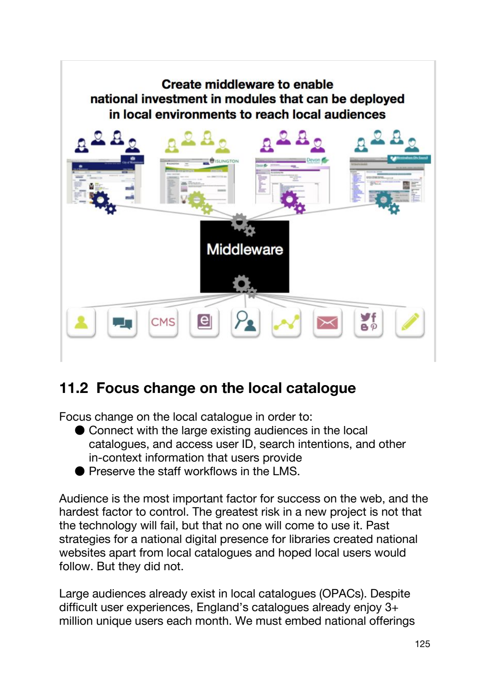

<!-- PAGE: 127 -->

and national conversations within the local catalogue to serve and
build upon this existing audience.
### Leaving alone the back office systems of the library (the LMSs) will
allow libraries to focus on the changes that matter most: their
user-facing services. At the same time, preserving the back-end of the
local catalogue can benefit change management. The LMSs have
many existing dependencies in libraries that would be implicated with
change.
### 11.3 Create a modern catalogue module funded
nationally and deployed and configured locally in
each library authority
### Create a new, exceptional catalogue module (OPAC) funded nationally
and deployed locally, in order to:
- Conform to modern web conventions to better serve those who
need the library -- and leverage the library’s unique assets to
serve those who choose the library
- Supplement today’s catalogue-search results and customer
account views with pathways that, building on search intention
or customer personalisation, lead to new recommendations,
partner resources, events and opportunities in-branch
- Sustain the library’s operating model by combining ebook and
print editions in the catalogue (using FRBR) and directing users
to available formats.
### 11.4 Invite communities to co-produce the
experience of the catalogue and website
### In Section 7 we enumerated the ways in which the affordances of the
social web are key to making libraries relevant and visible online.
### Libraries must invite their communities to co-produce the experience
of the catalogue, enabling the library to realise its mission of literacy,
learning and community-building by:
- Addressing new divides
- Reflecting the unique assets and values of libraries
- Making libraries visible and usable online.

<!-- PAGE: 128 -->

### 11.5 Aggregate and connect community
contributions across all libraries in the social
catalogue
Aggregate and connect community contributions across all libraries in
the catalogue and CMS, in order to achieve the above strategies:
- To create breadth on the web outside the library, maximising
pathways into it
- To add depth when displayed within each locally configured
environment
- To aggregate data from all libraries to lead management insights
in each one.
### 11.6 Invite partners to build on top of and into the
modular standards-based platform
### Invite partners to build on top of and into this modular platform, in

order to achieve the above strategies:
- To pull content, community, and utilities from the library for use
across the web
- To push content into the library for use by library audiences
- To build complementary national modules.

<!-- PAGE: 129 -->

# Recommendations: Tactics
## 12 Architecture and
components
### 12.1 Overview of a modular platform architecture
for libraries
We recommend for England’s public libraries a software ecosystem to
be comprised of modular components that allow them to achieve the
strategic goals outlined above. To move the ecosystem forward
requires new middleware -- mostly invisible infrastructure -- and new
core modules that serve public library users, partners and staff with
services that are staples in the retail IT sector. All staff-facing LMS
functionality would remain in place unchanged for the foreseeable
future until it is itself modularised.

The minimum viable suite is as follows:

**1.** Existing Library Management Systems (LMS) - to remain in

place unchanged initially

**2.** Library Automation Layer - to be supplied by one vendor.

### Includes:
  - Library Automation Middleware with APIs
  - Aggregation Service

**3.** Suite of Core Modules - to be supplied by one vendor for each

module (with some grouping of modules at the outset based on
the required competencies, as outlined in the section entitled
Procurement). The modules are as follows:
  - Identity service
  - Branding service
  - Social Catalogue
  - Content management system (CMS)
  - Library ereader
  - Events and bookings service
  - Marketing automation service
  - Customer or constituent relationship manager (CRM)

<!-- PAGE: 130 -->

  - Centralised analytics service and data warehouse
Each of these components is described in greater detail below.
#### 12.2.1 Library Automation Layer
"One thing I’ve learned about the tech side of libraries is to build services not
websites."
Nick Poole, Chief Executive Officer at CILIP
Strategic Purpose: The library automation layer provides a unified,

comprehensive set of APIs for for all patron-facing data and
transactions at all libraries, regardless of underlying limitations or
variations of each LMS, or custom configurations at each local library.
#### 12.2.1 Middleware
Provided by LMS vendors in the form of APIs that conform to a single
standard or through standards-based middleware.
#### 12.2.2 Data Aggregation Service
A central index of bibliographic and crowd-sourced data that can be
normalised and enhanced for use across other modules.

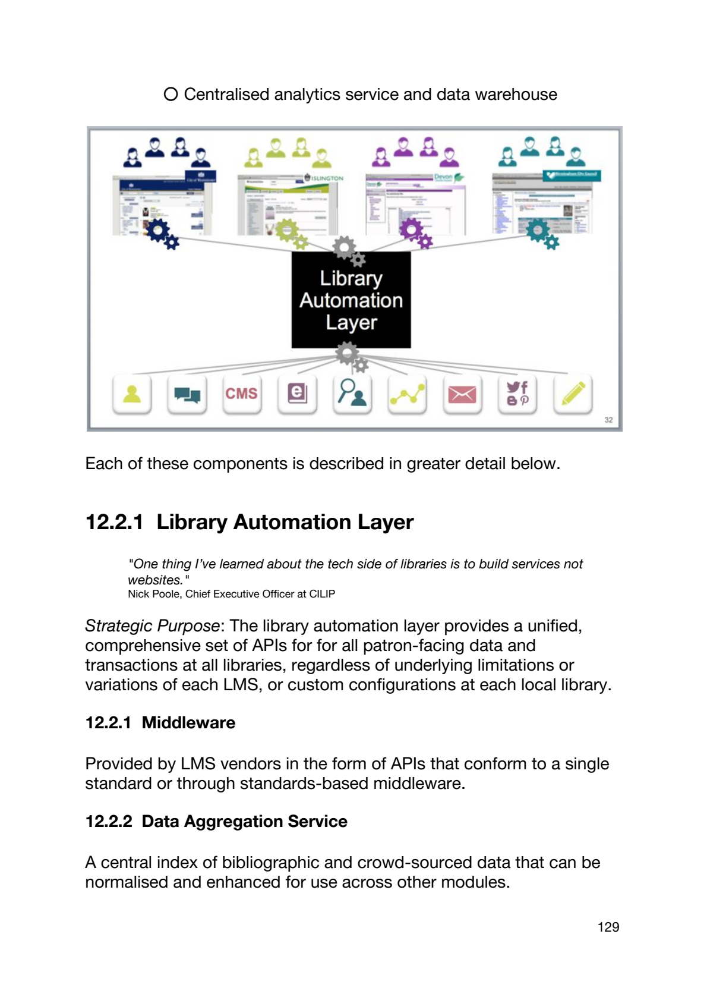

<!-- PAGE: 131 -->

### 12.3 Suite of core modules
A full discussion of the proposed components is presented in the
### Appendix VIII. What follows is an overview of the strategic purpose of
each component.
#### 12.3.1 Identity service
Strategic Purpose: As device and channel fragmentation increases, it’s

important to identify customers across devices, build rich customer
profiles and provide more personal experiences across channels. The
identity service must provide APIs to deploy a secure, standardised
registration, authentication, and profile management experience
across all web properties, mobile applications and partner and
community integrations.
This identity service could be a council-picked commodity solution so
long as it meets these requirements. However, in the first three years
of the digital service we have recommended that provision of the
identity service be bundled and procured with the middleware and
aggregation service in a library-automation layer.
#### 12.3.2 Branding service
“I can’t remember the last time I borrowed a book. But I often go to a library - it is
an institution, civic and enlightening - that I want to be a part of.”

User interview
Strategic Purpose: If libraries are to nurture an ecosystem of

interoperable service providers to deliver best-in-class functionality for
each component, a branding service is required to allow libraries to
configure their branding assets once, and have those assets rendered
in every user-facing module on all devices.
The local face of the community library was identified in user research
as an asset with the potential to draw lapsed users back to the library.
This point was underscored in conversations with representatives of
local government, who emphasised the importance of local identity in
service delivery.

<!-- PAGE: 132 -->

#### 12.3.3 Social Catalogue
“The knowledge was in the community, not in the books. Staff became librarians of
the knowledge in the community.”
Tim Ahrensbach, coordinator of Library Lab on Williston Green

Strategic Purpose: The catalogue is the foundation of an online

services provider in any sector that manages an inventory of objects,
whether goods or media, whether for loan or for sale. In the
ecommerce world the catalogue component consists of two basic
components: the product database and Order Management. The same
is true for the library.
Social functionality encompasses a spectrum of user engagement. A
small but significant percentage of users will fully engage in creating
written content or content lists. Many more will rate content, “like,” or
engage in personal record-keeping on virtual bookshelves. Nearly all
users will passively benefit from reading reviews, or discovering new
content through lists and read-alike recommendations.
#### 12.3.4 Content management system
Strategic Purpose: A Content Management System allows multiple

people to create, publish, and edit content using a centralised
web-based user interface. Using a content management system,
content creators can publish not only documents, such as articles,
blogs, or pages, but also assemble chunks or fragments of content in
different ways that are pushed out across multiple channels and
instances to ensure that content is kept timely and relevant to visitors.
### Content management systems provide content creation tools that do
not require specific technical expertise to use.
This CMS will not likely be successful if the same commodity solution
used for other services in the local council is also used here. In
contrast to the transactional and didactic needs of a council site, the
needs of a library site are experiential and social.

<!-- PAGE: 133 -->

#### 12.3.5 Library ereader application
“Libraries must be able to choose content, devices and apps from any provider or
from multiple providers, without bundling that limits a library’s ability to serve
content they purchase on platforms of their choice.”
ReadersFirst
Strategic Purpose: Control of ebook workflows should be a part of a

library’s digital strategy. Both discovery and reading experiences
should be optimised for ease-of-use, response and engagement, and
providing discovery pathways to a customer’s next read. The e-reader
is an important extension of the library brand. The configuration of
both the e-reading and e-discovery experiences determine the degree
to which e-borrowers are exposed to the full scope of the library’s
offer.
#### 12.3.6 Events and bookings service
Strategic Purpose: Libraries in England run thousands of events every

month, yet they are hard to find on the Internet. An Events module
would expose events on the web and display them intelligently in the
catalogue alongside related searches and books. The module could
also be used for discovery of events hosted by community partners or
cultural agencies, making the library a hub for the discovery of local
events.
This component could be a local council’s choice for other services as
well, provided standardised APIs are available that the CMS and
catalogue can read and write back into.

#### 12.3.7 Marketing automation service
Strategic Purpose: Marketing automation software enables

organisations and marketers to more effectively promote products and
services across multiple online channels, including email, social media
properties, websites, and mobile applications. Marketing automation
aims to provide prospects with personalised, useful content to help
move prospects to customers or customers to engaged customers.
### Marketing automation combines tools to automate repetitive tasks and
also to analyse the efficacy of different campaigns. Marketing <!-- PAGE: 134 --> automation tools can be used for both inbound and outbound
marketing strategies.
This component requires specific functionality not found in
off-the-shelf services, yet these functionalities could likely be built on
top of a standardised API-enabled service used council-wide.
12.3.9 Customer/Constituent relationship management (CRM)
Strategic Purpose: Customer/Constituent Relationship Management

(CRM) software is used to help an organisation create a “360 view” of
its customers or constituents. The organization can then use this
information to connect with current and future constituents in order to
acquire, retain, and engage those customers and constituents. CRM
tools enable organisations to gather information about individual
prospects or existing constituents across multiple touchpoints, and in
turn provide those customers with tailored communications, services,
and products.
### In the library context, CRM tools enable:
- Library members to specify content and programs of interest and
receive automated updates on those interests
- Library members to opt in to library personalisation services
made possible through the tracking of activities such as events
attended or items borrowed
- Library staff to add constituent information during telephone,
in-person, and online interactions
- Libraries to seek out specific groups of constituents or
individuals for input on specific services
- Analysis of trends in constituent behaviour and target initiatives
to encourage or discourage those trends
- Provision of additional opportunities to capture constituent
activity and sentiment from multiple touch points (social media,
in-library interactions, telephone interactions, online feedback)
- Libraries to feed this data into marketing and communication
programs to cross-promote content, programs and services.
A library CRM would therefore require specific functionality not found
in off-the-shelf CRMs, yet these functionalities could likely be built on
top of a standardised API-enabled CRM used council-wide.

<!-- PAGE: 135 -->

#### 12.3.10 Centralised analytics service and data warehouse
Strategic Purpose: Online service providers must track detailed

transactional data about their products and customers, and use that
data to inform business decisions, and to optimise customer
experience and ROI. This is only possible if transactional data can be
normalised, aggregated and accessed by business intelligence and
data analytics tools. A unified analytics and data warehouse provides
these functions, and enables integration with a broad range of BI and
data analytics solutions.
A further description of these components is available in Appendix VIII.
### 12.4 A Thousand Flowers
### In addition to the library automation layer and core application
modules, we encourage libraries to plan for a series of innovative,
low-cost apps and products, scaled nationally, that take advantage of
the new platform API. Providers might offer specialised reporting
analytic capabilities, for example, or mobile apps that replace the need
for self- check machines, or that allow users to browse shelves
virtually on the basis of nearby near-frequency geolocation
transmitters (such as ibeacons) and in so doing, to explore the full
range of related library materials -- ebooks, events, items that are
currently on loan, but available soon -- as they wander the stacks.
These apps and products could be built by vendors, library staff,
partners, and the general public.

<!-- PAGE: 136 -->

# Recommendations: Tactics
## 13 Project and Ecosystem
### Leadership
to complete the project and to
enable continued innovation
### 13.1 Establish an agency to coordinate partner and
vendor relationships -- and shareable content
We recommend that an autonomous agency be established in
England, with a budget of £1.5M over the first three years, to provide
strategic leadership for the standards-based digital platform.
The agency would:
- Provide the specialised skills required to oversee the
implementation of the platform
- Develop more streamlined, forward-looking relationships with
national vendors and partners
- Coordinate shared programming and shareable digital content
on the platform among libraries around national offers
- Curate and highlight the stream of co-produced content from
users and partners.
To accomplish this, the agency should engage a team of experts that
spans many areas. This agency must draw upon insights from the
consumer sector, which like libraries must create engaging user
experiences that go beyond the transactional and didactic
requirements of most government websites. At the same time, this
agency must stay close to the mission of public libraries and librarians

(as distinct, for example, from academic libraries, which deal with
substantially different user stories).
### It would therefore be wise to have the proposed agency report to an
independent board that provides for a mix of voices. These voices are <!-- PAGE: 137 --> recommended to be in 13 in number, with the following distribution:
- Libraries (3)
- Funding bodies that work with libraries (2)
- Unaffiliated experts in consumer digital experience:
  - Technology (1)
  - Product (1)
  - Content strategy (1)
- Stakeholders building on top of and into the public library
platform:
  - Technology partners (1)
  - National cultural organisations (1)
  - National literacy organisations (1)
  - Community partners (1), and
  - Publishers (1)
There are several existing agencies that might step into the lead role --
whether the SCL (which initiated this project), the Reading Agency, the
Arts Council or a new group within the British Library. Regardless, that
lead agency should convene a diverse board such as the above to be
successful.
### 13.2 Procurement - Finding Technology Partners
England’s libraries need a partner as they prepare to establish a
standards-based platform and build a core set of modular
components. At the outset, we recommend that both of these briefs
be assigned to a single supplier for a period of at least three years.
The supplier would build and maintain a middleware foundations,
aggregation services and APIs -- establishing a platform on which an
ecosystem can be built -- i.e. a system of systems supplied by
vendors, local and national partners, libraries and their staff, and the
public.
#### 13.2.1 Pre-project development
Because of the uncertainty of funding, the best basis for such a
partnership may be an agreement that is conceived in two phases, but
awarded to a single supplier. The first phase of work, with a smaller
fee, would focus on researching, preparing materials for, and
participation in fundraising. The deliverables and payment for a <!-- PAGE: 138 --> second phase of work would be contingent on success in the first, and
focus on building and maintaining both the library-automation layer
and a bundle of core modular components (bundle “A” below) over 3-5
years.
#### 13.2.2 Bundling components
A modular interoperable architecture means that all of the components
could in theory be supplied by separate vendors at the outset.
However the cost and time to market will be faster if some core
components are bundled for delivery, to modular interoperable
standards, by a single supplier in the first 3-5 years. In subsequent
periods the contracts for every module could be awarded separately
to the most compelling supplier.
#### 13.2.3 Phasing, Sourcing, and Cost of Components
The first phase of proposed work encompasses a suite of components
that comprise a minimum viable digital presence for libraries.
Subsequent phases of work enumerated here are essential in the
medium term if libraries are to benefit fully from a digital platform.
However work could be delayed a year or two if the agency feels that
a phased approach is desirable. Our recommendation for bunding and
phasing are as follows.
Procurement details Can this be
procured
off-the-shelf?
Bundle Phase Cost Cost Library-specific
/ yr / 3yr (LS) or Commodity
(£M) build (C)
### Components (£M)
### Library automation A 1 1.6 4.9 LS
layer
- Middleware
- Data aggregation
- Identity
- Branding
Social Catalogue A 1 1.6 4.8 LS
### CMS B 1 1.2 3.6 LS <!-- PAGE: 139 --> ### Library e-reader C 1 0.5 1.5 LS or C
Events and bookings D 1 0.4 1.2 C
### Marketing automation E 2 ? ? C
### CRM F 2 ? ? C
### Centralised analytics G 2 ? ? C
£16M
Other project costs
Agency Budget A 1 0.66 1.5 [NA]
### Implementation Fee A 1 0.83 2.5 [NA]
£4M
#### 13.2.4 Selecting a vendor and mitigating project risk
The basis for procurement should be the problems and opportunities
outlined in the findings of the report. Because of the complexity of the
project and the degree of innovation required, we recommend a
competitive dialogue procurement procedure.
The selection criteria should be framed with a relationship of 3-5 years
in mind. We do not imagine a turn-key solution. Rather, libraries would
invest in a hosted service that would be delivered over a period of
time, starting with an initial build and implementation of 1-1.5 years
followed by ongoing maintenance and iterative enhancement,
including extensive user testing and consultation with stakeholders on
the platform on the implementation of mature APIs. Libraries should
expect continuous iteration and innovation in the user-facing services,
ensuring that England’s libraries lead, rather than follow, in setting a
standard for usability and engagement in the cultural sector -- both
public and commercial.
The design of the library-automation layer and catalogue modules
described here poses risks that can be addressed in a competitive
dialogue process. These risks include:
- Ensuring a balance between the efficiencies and innovation of a
centralized, agile code-base and the need for local configurability
and content in each library authority
- Vendor lock-in
- The risk of project delays - England’s libraries must act quickly to
establish a convincing presence online.

<!-- PAGE: 140 -->

The design and implementation of the middleware in particular will
require domain-specific expertise and tooling:
- To deliver integrations that are complete, efficient and correct
- To work with local staff to understand local cataloguing rules and
map them to a normalised schema.
### LMS products lack comprehensive APIs, making integration difficult;
while some of this can be overcome by interfacing with lower-level
interfaces such as the relational database management system
(RDBMS) and legacy online public access catalogue (OPAC), existing
expertise in this effort limits project risks.
To manage a resilient cloud architecture and deploy code into
heterogeneous hardware, software and networking environments
requires:
- A dedicated deployment team
- Code which interfaces with on-premise systems that is as
lightweight as possible
- Primary data storage and business logic residing in a shared
cloud service
- Comprehensive data-center planning to scale the service, as well
as load testing with live data sets.
To ensure future modularity without dependence on the
middleware/aggregation service or any one module, requires:
- Interoperable data formats and APIs between the
middleware/aggregation service and each module
- Leadership to progressively build APIs from the LMS services to
meet those same endpoints
- Leadership to build a partner ecosystem with many active
contributors
A sampling of more specific criteria that should be used to procure
such a partner is presented in Appendix IX.

<!-- PAGE: 141 -->

# Conclusion <!-- PAGE: 142 --> # Conclusion
## 14 Costs and benefits of going
forward
### 14.1 Costs
Our goal here is to outline costs by order of magnitude in anticipation
of a tendering process in which they can be specified more precisely.
The expected range for work outlined here over the first three years is

~£20M. These cost can be broken down roughly as follows:
- Library Automation Layer: ~£5M
- Social Catalogue: ~£5M
- Other Components: ~£6M
- Agency Costs: ~£1.5M
- Implementation Costs: ~£2.5M
To put these costs in perspective, per library this is equivalent to:
- Less than £45K per library authority per year
- Less than 1% of library expenditures per year
- Less than the cost of renovating a single large library branch
While the digital platform presents an “invest to save” opportunity, not
all costs will be cashable to libraries. A portion of the costs must
therefore be seen as an “invest to transform” opportunity; an
opportunity not to reduce inputs but to regain relevance and to
produce enhanced outputs in all other areas of service, and against
public policy objectives in the fields of literacy, digital and social
inclusion, health, education, and economic participation. .
### In this light, looking at the costs of IT alone provides an incomplete
picture. As one policy analyst suggests,
“ICT spending accounts for just 3–6% of a typical local
authority’s budget. Instead of focusing on making their IT
cheaper, the priority for local authorities should be to procure the
right technology (and the right technical advice via consultants
and other external experts) that enables them to deliver savings <!-- PAGE: 143 --> in the other 94–97% of their budgets.” (also quoted above in
Section 10.1. Copeland 2015, 25)
Today, libraries spend even less than authorities overall: between
1-3% of their resources based on a survey of heads of library services.
### Meanwhile, as a point of comparison, many retailers are investing
about 30% of capital budgets on improvements to omnichannel digital
offerings, and are spending 5% of annual operating expenditures on IT
(Corporate Executive Board Company 2013; Murphy 2015).

And among users, 97% of Britons say they can afford home Internet
and 73% are online every day -- and most have the Internet in their
pockets, as well (UK ONS 2014). The prevalence of digital affects their
lives on the ground, too: more than 80% of in-person retail purchases
begin by browsing on the Internet first (Rueter 2012).
Without investment in the digital branch and the digital pathway to the
physical branch, libraries will continue to be nearly invisible.
### 14.2 Benefits
A standards-based digital platform for libraries in
England will have far-reaching benefits, both for
libraries’ coffers and for the community.
While this investment is foundational, it will not by itself be fully
transformative. The suite of components prioritised with these
recommendations will advance libraries towards the present by two
decades; it won’t necessarily propel them to the future. These are the
basic foundations that any retailer, online or offline, would require just
to survive.
But the transformative power -- the power that allows libraries not just
to catch up, but to leap-frog -- will come from the capacity the
platform creates for others to innovate in years ahead. Costs to future
development will be reduced by the investments in this common
digital foundation - enabling rapid lightweight innovation, iterative <!-- PAGE: 144 --> improvement, and the sharing across all library authorities (made
possible by platform interoperability).
For the purposes of this report, benefits for this foundation have been
sketched to provide an order-of-magnitude estimate.
Financially, over £100 M+ in annual benefits are anticipated across
two categories:
- £2 M in reduced annual financial inputs (£2 M in cashable

technology and content savings)
- £111 M+ in increased annual non-financial outputs (£61 M in
avoided capital and programming costs for libraries, £6M in staff
time liberated to refocus on other tasks, £18 M in avoided costs
for partners)
- Other public benefits such as for literacy, economic participation,
social inclusion, and health that have not been monetised in this
model.
### More thematically, the benefits emerge by:

**1.** Increasing how many people use the library (£80 M+)

**2.** Increasing how much each individual uses the library (£67 M+)

**3.** Reducing wasted staff time messing with bad IT, enabling that

time to be spent on other IT tasks or elsewhere (£6 M+)

**4.** Reducing technical and contract costs given national scale (£2

### M+)

**5.** Providing partners with access to audience, infrastructure (£18

### M+)

**6.** And providing lifelong benefits to the individuals and

communities who access library services (not quantified).
A more detailed explanation of these estimates is provided in
### Appendix X. What follows is a summary.
The first benefit is increasing how many people use the library. The
digital platform can change perceptions, and make libraries easier to
find and use online -- and these make libraries more likely to be used
offline as well. As the Independent Library Report for England found

(2014), “Libraries often present a negative image of being
old-fashioned places that have little relevance in today’s society.”
### Changing this is possible online:

<!-- PAGE: 145 -->

- As noted above, more than 80% of retail customers today go
online to look at items before going into physical stores to buy
them (Rueter 2012)
- The online look and feel is the leading factor in judging an
organisation’s credibility, with nearly 50% of those surveys
mentioning this in free response (Fogg et al 2002).
The digital platform will also help make libraries easier to find and use,
online and then offline, by:
- Focusing on search engine optimisation (SEO) and social
referrals nationally to bring traffic to the websites
- Making websites and catalogues attractive and easy to use
- And making library locations and event calendars easy to find
online.
These elements of an improved web presence can generate the
equivalent web traffic and foot traffic of £53M in marketing annually.[^41]

£53M would also be the approximate annual cost to generate the
same increase in foot traffic through renovations.[^42]
The second benefit area is in deepening the use of library assets by
each person. Getting more people in the door is only as useful as their
ability to take advantage of the services the libraries offer.
Encouraging better use also means finding ways to increase the
efficiency of the provision of those services. For example, £1.4M in
annual acquisition of new books can be avoided by redirecting only
10% of demand for bestsellers (which are bought at great expense
and then discarded shortly thereafter), in favour of alternative titles
suggested through improved discovery and staff and user
recommendations.[^43]
The third benefit area is redirected staff time. With the technology
systems in place at library branches, many staff members spend
significant time on tasks that would be eliminated with a
41 Equivalence is from a combination of pay-per-click and direct mail costs; see

### Appendix X for full method of estimation and sourcing.
42 Equivalence is based on industry standards from retail; see Appendix X for full

method of estimation and sourcing.
## 43 General evidence of being able to divert attention away from bestsellers comes
from Amazon’s efforts to suppress key titles sold by Hachette during their dispute
(Barrett 2013). This might take the form of pairing a search result of a bestseller that
has no available copies with a list of recommended alternatives and, if desired, a
note calling users to enjoy the full breadth of the collection to help the library make
its budget go furthest. For more sourcing, see Appendix X.

<!-- PAGE: 146 -->

standards-based digital platform, freeing them to focus on more
value-adding and enjoyable projects, such as service design and
analytics, and the role of “community impresario.” (Seighart 2014)
### Improving the ability for customers to use self-service features and
allowing for the prepopulation of fields, for example, have the
combined potential to free up £1.7M in staff time now spent doing
these routine tasks.[^44] By implementing a national set of records,
national reporting tools and nationally comparable data, an additional
£2M in staff time may be saved, while creating and improving access
to actionable insights.
Fourth, a standards-based digital platform can also reduce direct
costs, given that it will allow libraries nationwide to be served in the
same way, increasing their bargaining power with vendors and
reducing the vendor cost of providing software and e-content. This
gives libraries both the leverage and the rationale to reduce cost of
service, as occurred with the national agreement for Oxford University
digital offerings (Taplin 2015). Existing, smaller contracts for things like
data reporting can be eliminated, with those functions absorbed by the
platform instead, for an estimated saving of over £3M.[^45] Additional
cost savings are likely over time as libraries can use apples-to-apples
data to manage their performance and cut services that do not return
value.
A fifth and crucial benefit is that a standards-based digital platform will
provide partner organisations a link to an audience they desire to
serve. Increasingly, growing audience online is too expensive and too
difficult; after all, it can be said that Google, Facebook, Twitter, and
### Instagram are all in one business -- advertising -- and to extract value
they have imposed pay walls for even nonprofits to put messages in
front of their followers (Leonard and Taylor 2014). The library’s key
value proposition to partners, then, is audience. On a standards-based
digital platform with a partners’ interface, trusted partners should be
able to log onto the platform to manage partner pages and identify
content that would be featured with relevant title-record pages and
44 Staff time based on survey of libraries by BiblioCommons; see Appendix X for
more on methods and sourcing.
45 Based on survey of libraries by BiblioCommons; see Appendix X for more on
methods and sourcing.

<!-- PAGE: 147 -->

search results. We estimate the value of this in-kind advertising in a
library-centric digital public space at £10M+.[^46]
Sixth, a standards-based digital platform will be able to support the
national goals libraries are founded to serve. One of the platform’s
greatest contributions will be its ability to support scalable applications
that foster literacy, a lifelong good that stands to increase an
individual’s personal fulfillment and employment prospects.
Also important in a rapidly changing economy, the platform will
support lifelong learning, especially through connecting peer groups
and connecting mentors to protégés (this need is discussed in Young

2013, 25, and UK Dept. Innovation & Skills 2009, 4-6). Finally, literacy

is a precondition for digital literacy and social inclusion (Macdonald
2013). The core applications should be designed to provide the
motivation, trust, and support[^47] needed for reluctant web users to
explore and experiment on a web application. Bridging digital divides
should be a key objective of the core applications.
All told, a standards-based digital platform can be expected to have
direct annual IT cost savings in the £1M range, and annual liberated
staff time equivalent to £5-10M, as well as added use value in the
range of £100Ms annually.
Benefits will also accrue by positioning libraries for a more agile
response to future developments in the digital landscape. A
standards-based digital platform is the only via means to enable
libraries to respond nimbly, inexpensively and quickly to new needs
and opportunities.

<!-- PAGE: 148 -->

# Conclusion
## 15 Costs of standing still
Our field research, evaluation of past reports and technical analysis
indicates that the causes of decline in public library usage over the last
three decades are digital transformations outside of libraries, and
digital stagnation within libraries. There is clear evidence that this
imbalance cannot be addressed by innovation at the margins -- the
cost would be too great, and the pace of change too slow.
Ready to evolve
### Libraries, of course, are not alone in facing dramatic change brought
on by digital disruption. Other industries and sectors that are now
transitioning have been forced to simultaneously reduce traditional
expenditures and invest massively in digital -- both digital in its own
right, and digital as a complement to their offline businesses. Those
that have not made these transitions -- Borders, Blockbuster, HMV --
are visible reminders of the potential peril of under-investing in digital,
or of doing so too late. Again, the solution is not as simple as replacing
print books with ebooks, or creating a standalone website and
standalone branches. Only a platform ecosystem, can enable the

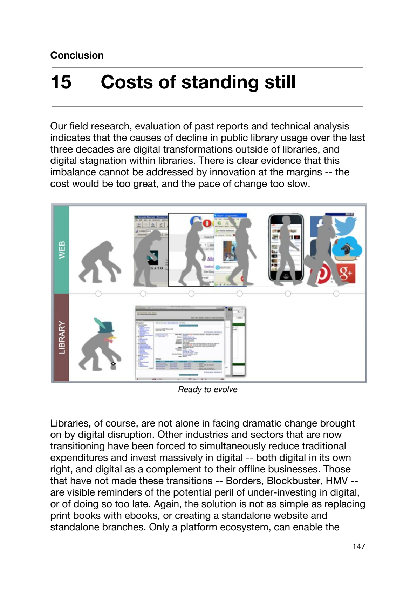

<!-- PAGE: 149 -->

critical mass of users, staff, partners and vendors, collaborating at a
national scale, that is required to allow England’s libraries to survive --
and thrive -- through the next decade.
An investment in a standards-based digital platform is the only
affordable path to engaging lapsed users and even non-users in a
revitalised, contemporary service; and to realise the insights of so
many past reports. To date there has been fervent agreement on the
path forward, just no capacity to execute at scale. But today there is
no need for wishful thinking. Libraries have tremendous assets to build
upon. These include enviable existing traffic and an army of virtual
volunteers waiting to be called upon. Perhaps most importantly, the
leaders of England’s library authorities and those responsible for
funding libraries in England have shown a will to collaborate that, in
our experience in North America, is unprecedented.

<!-- PAGE: 150 -->

# Appendices

## Footnotes

[^1]: The figure is per CIPFA data for public libraries in England, averaged over the last three years (2012–2014).
[^2]: Edited for clarity.
[^3]: See a complete discussion of library assets in Section 4.1.1 of this report.
[^4]: See Section 2.4.3.
[^5]: In our calculation, the number of books “read” is the sum of all issues and all purchases. For further citation and the trend, see the CIPFA v. market data comparisons in Section 3.3.2.
[^6]: Extrapolated from survey of SCL leadership, with 38 authorities responding.
[^7]: This figure is broken down in Section 13.2.
[^8]: Online generally, 73% of England’s adults are online daily, compared to 71% of US adults (comparing UK ONS data and Pew data). Then, with respect to libraries, there are roughly 2 online visits per capita in England (using CIPFA 2014 data), or perhaps as low as 0.8 or 0.6 online visits per capita (respectively using SimilarWeb or Google Analytics data for local sites and scaling to the national population). By contrast, North American libraries receive roughly 15 online visits per capita (using PLDS 2012 data).
[^9]: Estimated 30M visits online, per local-level and SimilarWeb data extrapolated nationally, and 300M visits offline, per CIPFA; estimated £15M IT expenses, per BiblioCommons survey of library heads of service, and £240M building costs, per CIPFA.
[^10]: To size these estimates by back-of-the-envelope maths: making a modest effort to paint and add more comfortable chairs and other superficial improvements at £15,000 per location would across 3,000 library service points still cost nearly £50M, or more than 2x the initial costs of the proposed platform. To go further and bring major central service points to contemporary building standards is even more expensive: if we estimate a need across England’s 151 library authorities for just 2 more large new buildings (£60M each) and 150 Dorset-sized new or substantially renovated buildings (£6M each), we face a billion-pound problem, or 500x the initial costs of this platform.
[^11]: APIs or application program interfaces, allow application programs to interact with each other and share data.
[^12]: William Sieghart in his 2014 report called for staff to step into the role of “community Impresarios”.
[^13]: Ernst and Young 2015.
[^14]: See Section 10.3 and 10.4 for discussion of platforms, and Section 12 for an overview of the recommended components.
[^15]: Stock turns are the number of times an item is borrowed in a given period.
[^16]: See strategies in Section 7.
[^17]: Both numbers based on SimilarWeb data.
[^18]: Based on comparing local catalogue pageviews to local website pageviews for several libraries.
[^19]: See discussion of value creation for the publishing sector in Section 5.3.
[^20]: Catalogue-embedded because the catalogue receives an estimated 70%+ of online traffic. The Reading Agency has found that “online library catalogues are the gateway to users’ digital engagement” (2011).
[^21]: See for example quote from Stephen Page of Faber and Faber in Section 5.3.1: “If publishing were to partner with the library service to create certain kinds of technological solutions or best practices, it’s much heavier lifting….”
[^22]: “Rekindle your romance with libraries…. They’re not your enemy; they’re your friends.” is the advice from a panel of publishing executives (Aydt 2014).
[^23]: Heather Fain, SVP, director of marketing strategy at Hachette (Harvey 2015).
[^24]: Rick Joyce, CMO of The Perseus Books Group (Harvey 2015).
[^25]: Stephen Page in a panel discussion with Nick Stopforth, Head of Doncaster Libraries; Liz McGettigan, Libraries and Information Services Manager at The City of Edinburgh Council and Bill Thompson, journalist and commentator and Miranda McKearney, CEO of The Reading Agency (Reading Agency 2013).
[^26]: 44% is the 2013 share of CIPFA issues in an overall book market that also includes offline- and online-sourced print purchases (Nielsen Books & Consumers) and online ebooks purchases from major- and self-publishers (Nielsen Books & Consumers).
[^27]: This finding emerged in our interviews and in the 2015 e-lending pilot.
[^28]: All per CrunchBase for the lifetime of the products.
[^29]: If the market were modular, vendors would be more free to focus on any one module and develop extraordinary capabilities there, while the library could buy the other module from another vendor. This would shift the market from vertical and closed architecture to horizontal and open architecture.
[^30]: See Introduction and Section 3.3.2.
[^31]: This model was adopted, for example, by Learning City in Vancouver, whose educational offerings from many participating agencies can be discovered in the library’s events service, or filtered by proximity to library branches.
[^32]: See more in Section 7.1.2 above on social scaffolding in the library for learning.
[^33]: See user-segmentation analysis in Section 3.1.5.
[^34]: FRBR is an entity relationship model, developed by the International Federation of Library Associations and Institutions, that can be used to associate various editions and formats of a title (“manifestations”) to the concept of a single work.
[^35]: See Sections 10.2 and 13.1 for discussion of the agency.
[^36]: In the library, this might take the form of pairing a search result for a bestseller that has no available copies with a list of recommended alternatives and, if desired, a note calling users to enjoy the full breadth of the collection to help the library make its budget go furthest.
[^37]: E.g. Dunleavy et al. 2005, Fishenden and Thompson 2012, Copeland 2015.
[^38]: See also Section 13.1 for discussion of the proposed library digital services agency.
[^39]: All described in Section 12.
[^40]: See Section 11.1 for further discussion of a standards-based approach to creating LMS interoperability.
[^41]: Equivalence is from a combination of pay-per-click and direct mail costs; see Appendix X for full method of estimation and sourcing.
[^42]: Equivalence is based on industry standards from retail; see Appendix X for full method of estimation and sourcing.
[^43]: General evidence of being able to divert attention away from bestsellers comes from Amazon’s efforts to suppress key titles sold by Hachette during their dispute (Barrett 2013). This might take the form of pairing a search result of a bestseller that has no available copies with a list of recommended alternatives and, if desired, a note calling users to enjoy the full breadth of the collection to help the library make its budget go furthest. For more sourcing, see Appendix X.
[^44]: Staff time based on survey of libraries by BiblioCommons; see Appendix X for more on methods and sourcing.
[^45]: Based on survey of libraries by BiblioCommons; see Appendix X for more on methods and sourcing.
[^46]: Based on industry standards; see Appendix X for more on estimation methods and sourcing.
[^47]: Identified as greater barriers to use of the Internet than affordability, per Go ON UK 2012.
