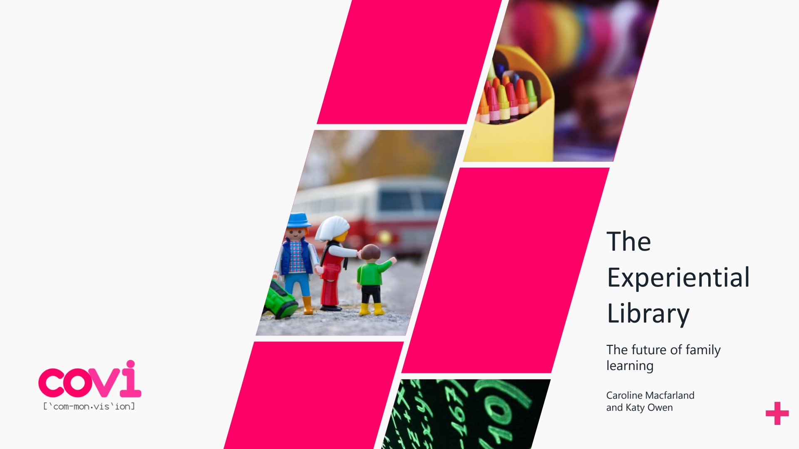
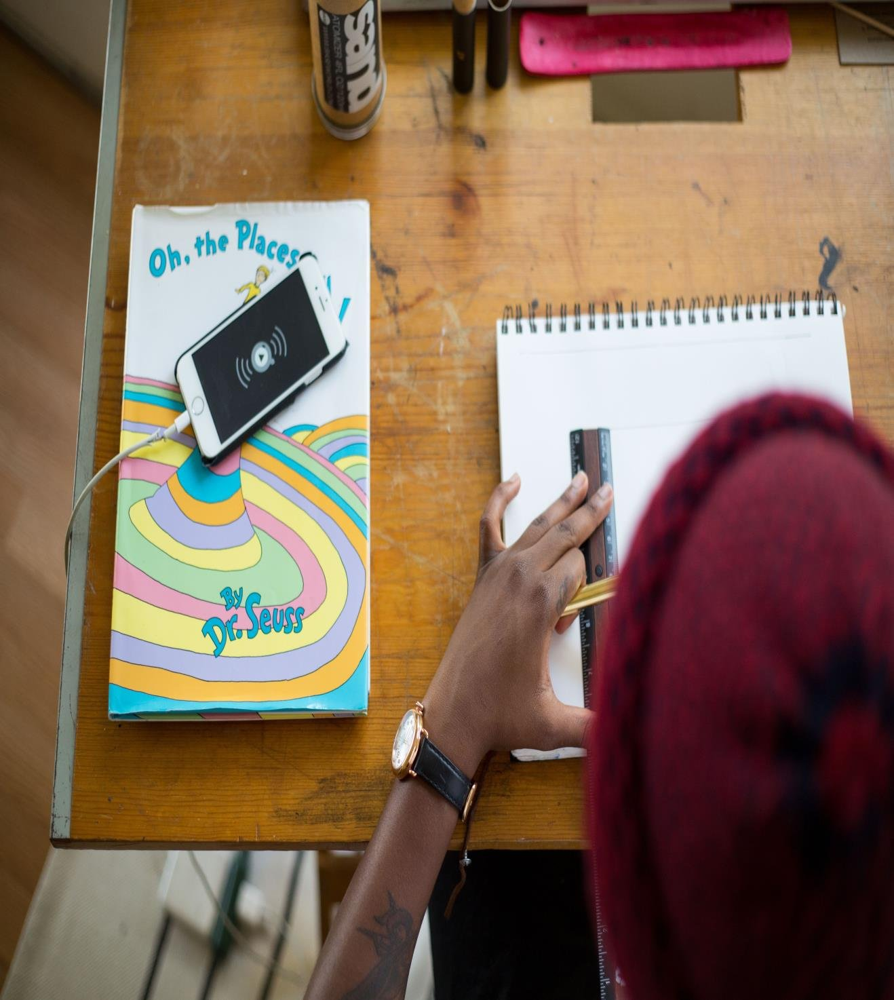

<!-- PAGE: 1 -->

# The Experiential Library

## The future of family learning

**Caroline Macfarland and Katy Owen**

A research and scoping report by **Common Vision (CoVi)** for the **Society of Chief Librarians (SCL)**, supported by **Arts Council England**.

**October 2017**

---

<!-- PAGE: 2 -->

## Contents

 AboutCommonVision(CoVi)www.covi.org.uk Common Vision (CoVi)is an independent, not-for-profit think tank launched in 2014.We look at issues which require long-term, intergenerational solutions and which reach Foreword by Neil MacInnes 2 beyond conventional partisan debates or sector-driven interests. We use creative and Executive Summary 4 crowdsourced methods to promote civic engagement and policy understanding beyond

**1.** Introduction 10

a politically active minority, and help build a vision of society based on the common good. 2. Defining family learning 22

**3.** The impact of family learning 34

AbouttheSocietyofChiefLibrarianswww.goscl.com

**4.** Family learning in libraries 41

The SocietyofChief Librarians(SCL) leadsandmanagespubliclibrariesinEngland,Wales and Northern Ireland. It is made up of the head of service of every authority and takes a 5. Designing family learning for the next generation 51 leading role in the development of public libraries through sharing best practice,

**6.** Summary and six steps for family learning practitioners 61

advocating for continuous improvement on behalf of local people and leading the References 72 debateonthefutureofthepubliclibraryservice. Acknowledgements 78 AboutArtsCouncilEnglandwww.artscouncil.org.uk Arts Council Englandchampions, developsand invests inartistic andcultural experiences that enrich people’s lives. It supports a range of activities across the arts, museums and libraries – from theatre to digital art, reading to dance, music to literature, and crafts to collections. Between 2015 and 2018, it plans to invest £1.1 billion of public money from government and an estimated £700 million from the National Lottery to help create theseexperiencesforasmanypeopleaspossibleacrossthecountry.

---

<!-- PAGE: 3 -->

## Foreword

### By Neil MacInnes, President, Society of Chief Librarians

impact on children’s education. If parents approach new concepts with excitement, children are more likely togrow upwith a thirst for knowledge. Family learning can take many forms. We regularly see families working on  homework together after school—often multiple generations. Grandparents and grandchildren visit the library to take part in music sessions, playing instruments side by side. Carers and parents join children in coding and innovation labs. Creative writing, mosaics, dance, recording—these are just a few examples of family activities that libraries encourage and facilitate. Space affects how we think, grow and create. It can nurture and nourish us, or stifle Learning underpins all of the Universal Offers which the Society of Chief us. Libraries have always understood the importance of physical space and tried to Librarians has identified as services which are essential to a 21st century library create environments where people of allagesare inspired to read, learn and reflect. service: Reading, Digital, Information, Health and Culture. This report will help shape our thinking on how more family learning opportunities can be created in libraries, Libraries are open, well-lit, comfortable and, above all, staffed by people who care and new waysthat libraries can foster learning and skills development. about knowledge. This report highlights how public libraries nurture not only individual learning but also learning and growth as a family. Why is this important? Neil MacInnes Because studies show that parents and carers have the most direct President, SocietyofChiefLibrarians

---

<!-- PAGE: 4 -->

## Executive Summary

 In a time of limited state resources, creative thinking about the > “enabling” activities that institutions can provide - using the resources, assets and relationships that are already available – to support local people is vitally important to future social prosperity and community wellbeing. Family learning isone such opportunity. As a term, > “family learning” broadly describes activities where different generations of a family are present, and where both adults and children benefit from learning. In practice, > “family learning” is not used as a phrase to promote or market activities. Rather, it is an approach applied to lots of different workshops, classes and community eventsdelivered by a variety of

---

<!-- PAGE: 5 -->

local agents including libraries, schools, museums and arts and cultural places. We think this is the case – not least because institutions and public spaces organisations, digital and maker spaces and sports and leisure facilities, as well as cannot survive by solely being repositories of information or goods in local places – formal learning and skills providers such as community colleges. to remain relevant to citizens and communities they must host valuable experiences and cultivate relationships with the community. This is what we mean by the Our working definition of family learning for this project was > “activities outside of “experiential library”. a formal education setting, undertaken by members of two or more generations who have a family, guardianship or caring relationship.” It is Libraries have long done certain types of family learning – even if they don’t label important to note that this is not solely about adults teaching children, or adults activities as such. There are clear opportunities, particularly as public libraries being present when children learn. Family learning describes when adults and continue to reflect on their purpose and offer to local communities, to shape and children learn new things or develop softer skills and behaviours alongside each frame many more activities so thatthey contribute tofamily learning outcomes. other. This piece of work used case studies from libraries, developed from qualitative Whilst family learning is sometimes seen as synonymous with early years activities, depth interviews with librarians, as well as a review of literature and impact studies this definition does not do justice to an approach which can be applied much more relating to a variety of family learning activities from different sectors. This broadly. We draw on examples of family learning approaches applied to other age helped develop a typology of family learning described in chapter two. Rather groups and life stages, including families with children at primary and secondary than specific activities which were labelled > “family learning”, we set out to find school ages, andindeed teenagers and young adults. whether there are distinctive characteristics to a family learning approach to delivering activities andservices, and what family learning outcomeslook like. Family learning enjoyed a period of policy focus and government funding a decade ago. The main purpose of this scoping study is to examine how activities are As discussed in chapter three, many of the definitions we have examined make currently delivered in public libraries and other community spaces, and whether the explicit that family learning should be assessed in terms of the learning outcomes social outcomes of these activities mean they continue to be important in local for both adults and children when they learn together. We have viewedlearning

---

<!-- PAGE: 6 -->

outcomes through three lenses – the knowledge and skills that are taught through technology toadd value to, and improve the experience of face-to-face learning. the learning activities (from literacy and numeracy to skills such as cooking or arts), the behaviours and changes in attitudes that result from the learning interactions We emphasise that while some activities require dedicated space or professional (suchas parenting or other interpersonal skills), andthe additional benefitsby virtue facilitation, there are many outcomes that can be achieved by > “lighter touch” of learning in a community setting (such as increased engagement with the host methods. Planned family learning need not seek to replace what families already do organisation). together – but provide tools to enhance what already happens. Activities can be run by community partners, volunteers, or indeed can be self-facilitating, such as In chapter four we discuss how family learning dovetails with recent policy through treasure trails or other > “gamification” approaches. discussions about local libraries. Family learning is not only a key element of the unique ‘cradle-to-grave’ service for lifelong learning that is recognised as core to Finally, in chapter six, we describe a six step approach to thinking about family public libraries, it is an approach which can underpin other aims and outcomes. learning, intended as a provocation for local organisations and groups who would These include those set out by the 2016 Ambition strategy and the four key areas of like todevelop and embed family learning intoexisting and new activities. service known as the Universal Offers, defined by the Society of Chief Librarians (SCL) together with Arts Council England (ACE) and The Reading Agency. We identify how a better understanding and measurement of family learning could help strengthen the > “Learning” Offer in libraries, but as an approach this is equally relevant to eachof the other UniversalOffers. In chapter five we consider the opportunities to extend impact: by tailoring activities for audiences and family members who do not usually engage in conventional family learning; by applying a family learning approach in conjunction with cultural, arts, digital or health initiatives (amongst others); and by using

---

<!-- PAGE: 7 -->

interaction, the ways in which we form and strengthen relationships, and experience our local places and neighbourhoods are very different totwo decades ago. This has key implications for the role of local institutions. In the age of the internet, adding value and purpose to physical spaces and structures is both a challenge and 1.Introduction an opportunity. Just as high street shops must look beyond being > “places to buy things”, libraries are no longer repositories for books, museums for artefacts, or town halls for public records. Wellbeing and strong community relationships in local places is a topic of keen Public libraries – which have provided many of the case studies and insights for this interest for policy makers and civil society alike. It is often the small scale or work – have had to respond to challenges in terms of budget cuts and service informal activitiesthat lay the foundations for healthy, resilient communities. closures, and continue toreflect, adapt and redefine theirrole inlocal communities. Why is family learning important in this context? There are a number of the relationship between the state and society reasonswhy it isusefultoexamine the activitiesthat helpmake placessafe, fun and conducive to improved relationships within families, and amongst the There is widespread recognition of the impact of the family on social and economic communities in which families live. Not least because of a number of trends outcomes. The family is a structure where the things that are learned range from and developments regarding the shape and dynamics of thefamily unit. social behaviours to soft and hard skills, which are passed down to further generations. changing community life The importance of family circumstances on early years child development (the period The make-up of communities is changing on a local level. With the decline of from birth to school age) remains a key focus area in children and education policy, the traditional town centre and new forms of technology facilitating social having risenin prominence since the 1990s. interatio 11

---

<!-- PAGE: 8 -->

Beyond early years policy however, the family is also an institution that is often assumed to be > “out of bounds” for direct state intervention. In what may often be described as the more individualistic society that we live in today, but certainly one in which state resources are more stretched, an > “enabling” approach has been described as one where instead of traditional > “top down” approaches to social needs, national and local government plays a more facilitative role, providing opportunities for people to take control over their wellbeing.1 changing family roles and structures The family itself is changing. The generation now becoming parents, otherwise known as the > “millennial” generation (those born from around 1982-2000), experience key differences in family structure and experience to the generation of parents before them. Young children are more likely than ever to have both parents in full time work, and there are some key differences in the divisions of caring responsibilities between mothers and fathers, and other family members too. Grandparents are also living longer and healthier and often take on caring responsibilities for grandchildren whilst the parents are in work. This generation of new parents are also digital natives, arguably often more attuned to the online world and the connections this provides than the physical structures and services in thelocal neighbourhood.

---

<!-- PAGE: 9 -->

All these factors contribute to our vision of the experiential community. If local Family learning is sometimes described as a subset of lifelong learning, that is, places are to thrive as they did three decades ago, then local institutions and > “purposeful” learning activity that improves the knowledge and skills of people on government have a role to facilitate opportunities to bring people together. In an ongoing basis, at any life stage. While the family is a structure in which learning doing so they can achieve wider social goals such as encouraging cultural mixing or happens for a lifetime, framing it in this way this is perhaps misleading in two ways. combatting issuessuch as loneliness and isolation. Often lifelong learning focuses on the educational and skills journey and achievements of the individual, more likely than not in a formal setting, rather than However it is perhaps easy to think of these roles in overly simplistic, or > “fluffy” locating the individual in the networks and relationships in which most people live terms. Creating positive experiences which strengthen relationships and wellbeing their lives and assessingthe impact on both the individualand their family members can be intentionally planned and programmed in different ways. and wider communities. We have lookedat family learningasan effective example ofwhere local institutions Our working definition for this project, was > “activities outside of a formal can increase their impact by facilitating experiences for people to come together education setting, undertaken by members of two or more generations who and improve wellbeing at important life stages. have a family, guardianship or caring relationship.” Rather than specific activities which were labelled > “family learning”, we set out to find whether there are distinctive characteristics to a family learning approach to delivering activities and what is family learning? services, and what family learning outcomeslook like. Family learning is a term that has come to broadly refer to activities where different generations of a family (such as parent and child) are present. NIACE (now the As a concept, family learning was used as a term from the 1990s onwards.3 It Learning and Work Institute) describes family learning as an > “intergenerational enjoyed a period of increased focus by government and policy makers in the 2000s. teaching and learning approach” rather than a particular curriculum area.2 In This attention culminated in the Family Learning Impact Programme, a joint venture chapter two we interrogate these definitions and produce a typology of different delivered by the Department for Children, Schools and Families (now DfE), the family learning approaches. Department for Innovation, Universitiesand Skills (now BEIS),the Learning and Skills

---

<!-- PAGE: 10 -->

## 1. Introduction

Council (now the Skills Funding Agency), the Learning and Skills Improvement don’t specifically refer to activities as > “family learning” (sometimes deliberately so), Service (LSIS) and the National Institute of Adult Continuing Education (now the many libraries demonstrate effective family learning approaches and there are Learning and Work Institute). Involving 136 providers, the programme ran from opportunities, particularly as libraries continue to consider their purpose and offer 2008-2011, and aimed to strengthen the effectiveness of family learning to local communities, to shape and frame many more activities so that they programmes by increasing opportunities and access to schemes, and improving contribute tofamily learning outcomes. progression, particularly for disadvantaged families. methodology family learning in libraries and other local spaces This is a scoping study which reviews the definitions of and approaches to family learning, and provides an analysis of its current application in local ommunities Family learning encompasses a range of activities which are complementary with today, making recommendations for ways to increase the impact of family learning the aims oflocal, place-based> “anchor” institutions such aslibrariesandschools. The in the future. When commencing the work we set out the following questions: sorts of agentswho deliver family learning activities include:

* How is family learning defined by different stakeholders at a policy and delivery

* Libraries

level?

* Schools

* How are family learning approaches applied to specific opportunities and

* Museums, and other artsand cultural organisations

challenges in local communities?

* Formal learning and skills providers such ascommunity colleges

* What types of planned family learning activities exist, within libraries and other

* Digital andmaker spaces

local hubs?

* Sports and leisure facilities and groups

* What best practice exists amongst community anchors and local groups who

* Faith institutions

deliver family learning? We have examined family learning activities using libraries as our primary source of *  Specific to libraries, are there opportunities to develop family learning provision case studies. Libraries have long done certain types of family learning. Even if they in conjunction with wider strategic development?

---

<!-- PAGE: 11 -->

Our research methodology comprised four stages. education, employment and training; and covering authorities who self-reported undertaking lotsor some family learning activities. These were: Lambeth, Kirklees, The background literature and policy review drew onexistingresearch into family Coventry, Norfolk and Bournemouth. learning, including a review of government policy and evaluation of schemes such as the Family Learning Impact Fund Programme (2008-2011) a joint venture We conducted semi-structured interviews by telephone with librarians at each of between government departments and skills agencies. We also looked at a range of the five local authorities. These interviews covered the themes of development of recent literature on the purpose, direction and perceptions of the role of libraries in activities, their delivery, partnerships, marketing, evaluation and lessons learned. local communities, to define where family learning overlaps with the direction of travelon that basis. A full bibliography can be found in theAnnex. Important caveats to this research methodology are that the findings cannot be taken to be representative of all libraries and library authorities in England, but We then conducted a survey of library authorities and librarians about their rather a demonstrative sample ofsome of the activities that are beingundertaken. It views and experiences of family learning. This survey was shared via the Society for isalsoworth notingthat there isa limited amount of evidence about family learning Chief Librarians, CILIP, ASCEL and the Libraries Taskforce and through social media in general, particularly by way of detailed longitudinal studies or analysis of impact channels. The survey received thirty responses from librarians. Survey questions are beyond individual child or adult attainment. When it comes to family learning in available in the Annex. We also engaged with other stakeholders from outside libraries in particular, the existing literature is very limited. It is hoped that this the library sector on their views of family learning and what role libraries play in report will contribute towards the development of this important and interesting this. field of work. From these responses, five library authorities were selected across the variables of The scope of the case studies in this project was limited to England. However, the geographic diversity, including covering five different NUTS 1 statistical regions of background and policy review draws on work from around the world. Likewise, England; diverse socioeconomic make-up, including covering regions with many of the findings will be relevant for the other nations of the United Kingdom significantly different average wages and numbers of 16-and-17 year olds not in and indeed internationally.

---

<!-- PAGE: 12 -->

A primary focus of family learning activities is summary of case studies to ensure early years and pre-school aged children develop key skills. This is done in a Kirklees aim to integrate a family element to all their activities, and Kirklees range of ways, from using tablets for toddler programme family learningaround nationaldatesand key messages. Activities learning to storytelling sessions focused on often evolve from partnerships with schools or family groups, specific interest promoting social cohesion and cultural groups such as code clubs or maker spaces, or community initiatives such as diversity. Librarians plan the activity and the Kirklees Dementia Action Alliance. Some sessions are run by professionals, outcomes, and use anevaluation process. others are programmed and delivered by volunteers or staff. Norfolk Coventry makes use of the library’s space to bring people together for open Coventry events and activities. Family learning is a key part of this and a way to signpost families to local groups, societies and activities. Lambeth The goal of family learning activities is to encourage children into a lifelong library Lambeth libraries developed their family learning offer habit, and engaging the parents to make this happen. All children’s activities will largely through their early years team, as many activities welcome parents and provide tips for how adults can recreate the activities at home. for young children intended to model parenting skills Early years activities are successfully co-ordinated by a dedicated staff member, and and behaviours. They have since expanded to including other partners such as health visitors, physiotherapists and local cultural other activities such as coding, and tailored approaches organisations also contribute tothe design and development of specific activities. to address cultural and social integration. Most activities Bournemouth in Lambeth libraries tendtobe informally programmed.

---

<!-- PAGE: 13 -->

## 2. Defining Family Learning

 There have been several definitions set by academics, government departments and non-governmental organisations since the appearance of family learning on the policy agenda towards the end of the last century. Most definitions of family learning include a nod to the intergenerational nature and require that participants of all ages achieve learning outcomes of some description. The differences tend to come down to how tight the definition is both in terms of process and the learning outcomes. In terms of process, some government definitions such as that of Ofsted have required that by definition the activities must be planned, while others have been WHAT THEY much broader, to the extent of including any learning that takes place within any important kinship or friendship relationship. SAY ABOUT In terms of outcomes, some analysts have reviewed family learning when the skills that are learned relate to parenting or have implications for familial relations, whereas others encompass a range of learning outcomes as long as they stem US from a situation where the family wastogether.

---

<!-- PAGE: 14 -->

How family learning has been defined… Buffton (1999) defined family learning is that which > “supports efforts to raise children’s achievement levels, raises expectations and aspirations of both children and adults, promotes active citizenship Titus Alexander and Peter Clyne in their 1995 piece Riches and, as the family group is the microcosm of the community, is beyond price identify five different aspects of family learning: community capacity building at its best.” Buffton suggests that family informal learning within the family; family members learning learning should incorporate tackling individual learning needs, together; learning about family roles, relationships and parental learning about issues pertinent to the family, two or more responsibilities (including parenting education); learning how to family members learning about the same topic independently, two or understand, take responsibility and make decisions in relation to more family members learning together, and, two or more family wider society, in which the family is a foundation for citizenship; members learning together withprogression routes.7 and learning how todeal with agencies that serve families.5 1995 1999 1997 2000 Titus Alexander in 1997 report for Demos defined family The Campaign for Learning’s 2000 manifesto takes this definition and adds learning more succinctly as > “the vast amount of learning to it slightly, saying that family learning might involve any combination of: that takes place in and around families, from personal informal and formal learning within the family; family members learning development, language acquisition and hobbies to the together; learning about the roles, relationships and responsibilities in process of becoming a teenager, parent, stepparent or relation to the stages of family life, including parenting education; learning grandparent, or taking other family responsibilities.”6 how to understand, take responsibility and make decisions in relation to wider society, inwhichthe family isa foundation forcitizenship; andlearning how todeal withagencies that serve families.8

---

<!-- PAGE: 15 -->

…in literature and research studies Rachel Spacey (2006) In 2007, Briony Train defined describes family learning as family learning as > “parents and In their study (2005) of the experience of young parents in “differentiated by the fact other adults having the family learning, Linda Smith, Jeanne Haggart and Yanina that it allows adults and opportunity to develop their own Dutton defined family learning as “of learning where young children to learn together learning alongside that of young parents learned jointly with their children through everyday and involves explicit people, asafamily”.13 activities, as well as through planned and purposeful learning outcomes for programmes.”11 both”.12 2005 2006 2007 2000 2013 Ofsted (2000) uses the definition In 2012 and 2013, NIACE (now the Learning and Work Institute) undertook > “learning which brings together different an inquiry into Family Learning in England and Wales. In the resulting report, family members to work on a common “Family Learning Works”, family learning is described as > “any learning activity theme for some, if not for the whole, of a that involves both children and adult family members, where learning planned programme.”9 Jeanne Haggart (2000) describes family outcomes are intended for both, and that contributes to a culture of learning learning as: > “what people outside the inthe family”. The report also notesthat family includes any intergenerational family do to enable and facilitate the relationship based on parental responsibility or kinship, including foster learning thatgoes on within families.”10 parents, carers and grandparents. 14

---

<!-- PAGE: 16 -->

Topic Structure Audience In practice, the phrase > “family learning” has become shorthand for certain types of Family Literacy, Language and Numeracy (FLLN) planned activities or programmes, that are designed by those outside the family in order toencourage family learning within it. Improving the basic skills of Usually a planned Families literacy, language and programme of where both When we commenced this project, our initial working definition was > “activities numeracy. multiple weeks. adults and outside of a formal education setting, undertaken by members of two or more children have generations whohave afamily, guardianship or caring relationship.” low levels of skills This definition was useful because of its broad, encompassing nature which allowed attainment. interviewees and participants to identify existing activities which they perhaps had not considered to be family learning. However it is also important to differentiate Wider Family Learning (WFL) family learning interms of how activities are planned and delivered. Learning about topics other Either a planned or All families family learning delivery models than language, literacy or regular activity, or and wider numeracy. (e.g. languages, standalone activities/ kinship and sciences, history, geography, or community events or friendship Historically, the most common planned family learning activities have had basic learning about different festivals which relationships skills such as literacy and numeracy and these are still the most often encountered in formal literature.15 There are also a significant number of activities focused on a cultures and faiths) and > “wider encourage family beyond direct wider curriculum including digital skills, arts and crafts, cookery, music and dance. skills”: such as sports, arts and members to learn or caregiving. These are typically distinguished as Family Literacy, Language and Numeracy (FLLN) crafts, digital making and try something new. and Wider Family Learning (WFL)respectively.16 coding, music, gardening, and cooking.

---

<!-- PAGE: 17 -->

Many Wider Family Learning activities may not be exclusively structured as family Another distinction that practitioners seem to make is between family learning for learning activities. Furthermore, some learning objectives may be embedded in early years children (aged 0-3) and their parents, and learning within families other activities. Providers of the 2008-2011 Family Learning Impact Programme with older children and teenagers. Particularly prevalent in the literature on early noted literacy, language and numeracy objectives in other practical activities, such years family learning is the idea that learning outcomes stem from what the as finance, health, sport, science and technology, ICT and creative crafts. Projects childrenlearnand whattheparentslearnabout supportingtheirchildrentolearn. and courses such as ‘New Techno Families’, ‘Rowdy Robots’ and ‘Money, Money, Money’ were proven to engage families more successfully than standard literacy There is a wealth of evidence on how parental involvement during the early years and numeracy courses.17 NIACE acknowledged in its 2013 report that learning in affects the cognitive development and other capacities of the child, impacts on the family can take place almost anywhere including informal gatherings, watching their happiness and wellbeing, and has implications for development and socio- television, parent and toddler groups and event through children supporting their economic achievement in later life. Anand and Roope (2016) list a number of parents with new technology. Yet there is something more specific about > “family examples of active parenting activities and their impacts. Reading, telling stories, learning programmes” which draw on adult literacy, community development, and singing songs have a positive impact on talking capabilities. Singing (with hand school improvement and parental engagement traditions.18 A Manifesto for Family actions), painting, and arts and crafts have a positive impact on the development of Learning19 separates the support for family learning into three categories: > “Formal movement skills.20 For this reason, many activities defined or recognised as family initiatives” such as Family Literacy and Parenting Education programmes; > “Broader learning have a focus on young children either in early years or in primary school. Initiatives” such as Books for Babies and Sure Start; and > “informal family learning However, given that families are lifelong relationships, family learning methods opportunities” such as through television, the Internet and the media, at museums, which apply to older children and otherlife stagesare just asimportant. libraries, sports and leisure facilities. Whilst it is useful to attempt to categorise different approaches to planned family learning activities, this specific typology is It is therefore perhaps unhelpful to categorise learning activities by content. not particularly helpful for our purposes. By putting libraries, museums and other Instead, using the interviews, secondary case studies and wider literature we have community activities in the same category as television and the internet, this identified a spectrum into which different definitions of > “family learning” fall doesn’t allow for> “broader initiatives” oreven> “formalinitiatives” that are carried out according to the balance of tailored support and learning objectives for inby theselocal anchors. participants of different ages.

---

<!-- PAGE: 18 -->

typology of family learning Type Description Examples Objectives Adult learning which impacts on Formal educational or skills activities for adults, Classes run by/ in schools, colleges, The learning outcomes for the parent lead to wider family wellbeing not suitable for children, such as financial community facilities family wellbeing and resilience capability, IT, or specific parenting skills such as antenatal classes > “Family friendly” adult learning Skills development for parents, with provisions Classes run by/ in Schools, colleges, The parent gains independent benefit and is for their children in a crèche facility community facilities supported with parental duties while doing so. Leads to wider family wellbeing and resilience > “Family friendly” learning spaces Family groups use the same space or resources An open facility such as libraries, Adults and children have different learning to do separate activities, without involvement museums, sporting and leisure facilities outcomes, but may have improved relationships and from facilitators/ programmers communication with each other as a result Families learning together: Community activities which are aimed at adults Arts and craft classes with no minimum Specific learning objectives for the adult, and non- > “children welcome” or children, but which others could also partake age limit, or where adults are welcome to planned learning outcomes for younger family bring their children or grandchildren members Families learning together: Community activities which are aimed at A class designed to improve literacy, Specific learning objectives for children; may be new > “parents welcome” children, but which encourage adults to be language and numeracy amongst knowledge, skills or behaviours for parents; may present in the learning experience of the child children, with parents in attendance to encourage intra-generational learning ie. children to their can oversee and assist child’s learn from one another and parents to learn from learning one another Families learning together and Community activities targeted at, and with Workshops facilitating direct and targeted Encourage family members to interact with and learn from each other apportioned learning outcomes for, both adults skills improvement across generations from each other, both at the activity and beyond at and children home

---

<!-- PAGE: 19 -->

However, in practice this element is often lost, possibly because it is harder to both plan for and evaluate. Thus measures of the outcomes of family learning tend to focus on the individual improvements in children’s or parent’s attainment, and possibly non-cognitive traits. The 2009 Ofsted report on family learning found that in > “almost all” of the providers surveyed, adults were improving skills, behaviours and parenting attitudes or were achieving success in gaining qualifications. Wider benefits for adults included The impact of increased involvement in school life, gaining employment, and an increased social network. For children, improved behaviours included participating better in the classroom, improved relationships with peers and teachers, and improved family learning communication, interpersonal skills and self-confidence.22 Many family learning interventions, even if nominally targeted at children, aim to Many of the definitions we have examined make explicit that family learning change the behaviours of the adults present, by modelling parenting behaviours such should be assessed onan interactive, inter-encouragingbasis rather thansimply as how to communicate with children, or encouraging increased engagement with individuals learning separately but inthe same place.21 the delivery organisation, such as taking more of an active interest in the children’s homework, or visiting the library more. In other words, if a child and an adult attend a class about cookery together, they should be helping and encouraging each other to learn rather than We have viewed learning outcomes through three lenses – the knowledge and skills independently gaining skills. that are taught through the learning process, the behaviours and changes inattitudes that result from the learning interactions, and the additional benefits to the learning outcomes that are delivered by virtue of being held inacommunity setting.

---

<!-- PAGE: 20 -->

## 3. The Impact of Family Learning

### Outcomes Framework: For Children and Adults

| Dimension | For Children | For Adults |
| :--- | :--- | :--- |
| **Knowledge and Skills** | * Improving basic literacy, language and numeracy * Improving other subject knowledge including languages, sciences, history, geography, or learning about different cultures and faiths * Language development / English language * Social and life skills such as sports, arts and crafts, digital making and coding, music, gardening, and cooking | * Improving the basic skills of literacy, language and numeracy * Improving other subject knowledge including languages, sciences, history, geography, or learning about different cultures and faiths * English language * Social and life skills such as sports, arts and crafts, digital making and coding, music, gardening, and cooking |
| **Soft Skills Development** | * Improved communication, interpersonal skills and creativity * Children learn soft skills from their parents / older relatives * Improved learning confidence outside of a formal education setting * Improved early years / childhood development * Improved self-confidence and wellbeing * Relate better to teachers / other authority figures | * Develop communication and self-confidence * Improved employability skills * Relate better to teachers / other professionals who might be perceived as authority figures * Sharing experiences and discussion around specific issues (e.g. foster carers, parents of children with autism) |
| **Situational Outcomes** | * Increased parental involvement in children's school lives supports attainment * Progression to other learning, training or community based activities | * Reduced loneliness and isolation amongst parents, carers and grandparents * Progression to other learning or community based activities |

---

<!-- PAGE: 21 -->

### Outcomes Framework: For the Whole Family and the Wider Community

| Dimension | For Family Life | For the Wider Community |
| :--- | :--- | :--- |
| **Knowledge and Skills** | * Learn parenting techniques and knowledge of child's early years development and health * Families learn activities which can be replicated elsewhere including at home together * People get to know each other and build relationships | * Learning opportunities for people of all ages * New and increased delivery partnerships between community groups, facilities and local anchors * Increased visibility of other community activities amongst user groups |
| **Soft Skills Development** | * Adults improve parenting techniques and observe "modelled behaviour" from other parents * Adults provide bespoke support to help children learn and support their development and confidence | * More people involved in learning, training or community based activities * Volunteering opportunities for family learning activities |
| **Situational Outcomes** | * More active relationship between family members in the home environment * Progression as a family to other learning or community based activities * Progression within family (i.e. parent may do same activity with a younger sibling) | * More active relationship between family members outside the home * Improved intergenerational mixing * Community integration and cohesion * Reduced isolation of different ethnic groups / migrants and refugees |

---

<!-- PAGE: 22 -->

In terms of the third, > “situational”, lens, a key measure of success that came through in both the interviews and the secondary case studies we looked at is where family learning activities lead to the adult or child’s progression to another Family learning in activity or service. Some > “follow on” activities are signposted, such as an adult learning course on child development that displays a poster outside the weekly meeting place for the parent and toddler > “stay and play” session. A new activity may be especially attractive ifdelivered in a known and trusted environment. local libraries Beyond the individual impact on children and adults, and the impact on family life, we also consideredthe benefits tothe wider community ofthese types ofactivities. > “I think that libraries have probably been doing family learning for a It is clear there are many aspects of family learning which encourage people to get really long time but not calling it and perhaps not recognising it as to know each other, share common experiences, build relationships, and develop family learning.” greater community ownership of local facilities and services. – Abibat Olulode, Development Librarian, Lambeth Council Libraries have long done certain types of family learning. They often do not refer to activities as > “family learning”, either deliberately because the phrase does not appeal to the intended audience, or because the shared impact on both adults and children isa > “by-product” rather thana planned outcome.

---

<!-- PAGE: 23 -->

## 4. Family Learning in Libraries

The NIACE description (2011) of family learning as an > “intergenerational teaching As we have discussed above, family learning is not only one element of the unique andlearningapproach” rather thana curriculumarea23 is one whichisechoedinthe ‘cradle-to-grave’ service for lifelong learning which local libraries provide24, it is an findings of our research. When the library practitioners we spoke to considered approach which can underpin other library aims and outcomes. what made the activities they put on family learning activities, it wasn’t necessarily easy to define exactly what a family learning activity was and wasn’t. Instead, family The Libraries Taskforce, comprised of representatives from local authorities, Arts learning was described in terms of the approach to given activities, or even to the Council England, the Department of Culture, Media and Sport, BBC, Public Health running of a service asa whole. England, British Library, CILIP, SCL and the Reading Agency amongst others, was set up in 2015 to produce a national strategy for public libraries in England. Published As libraries continue to consider their role in, and offer to, local communities, there in December 2016, the taskforce's final report on the Ambition strategy sets out a is the potential to more purposefully shape and frame many more activities so that vision for libraries as a ‘national network that delivers transformation and progress they contribute tofamily learning outcomes. for people, communities and nation’. The Ambition report describes the seven outcomes which libraries support as reading and literacy, digital inclusion, cultural In his speech launching the Society of Chief Librarians’ Universal Learning offer in and creative enrichment, helping everyone achieve their full potential, healthier and November 2015, Ed Vaizey MP (then Minister for Culture, Communications and happier lives, greater prosperity, and stronger, more resilient communities. We Creative Industries) said > “Libraries can make an important contribution to bridging found examples of family learning initiativescontributing toall theseoutcomes. the skills gap particularly in a growing and changing economy. Their historic role as centres for lifelong learning - alongside the fact that they are seen as safe, trusted, free and open spaces for everyone to use across the country - offers a huge opportunity to provide new skills and learning to people who may not access other education and training and to contribute significantly to us become a learning nation.”

---

<!-- PAGE: 24 -->

improved digital skills and access Increased reading and literacy Norfolk ran a Family Digital Literacy course for children aged 3-4 years and accompanying adults, using learning resources available on the CBeebies In Bournemouth, the goal of family activities are website. The aim of the course was to support parents and carers to to get the children into a lifelong library habit. encourage early digital literacy and use apps and screens as a learning tool Involvingthe parentsin formingthese habitshave rather than solely for entertainment purposes. Each adult brought their own clear benefits. Flouri and Buchanan found that iPad or Android or borrowed one from the library to use with the child, and parental involvement in their child’s literacy were signposted to digital resources on early learning parenting, and child practices is more important than other family development, andgiven advice about how touse digital sources safely. background variables, such as social class, family size and level of parental education. Furthermore, the earlier parents become involved in children’s healthier and happier lives literacy practices, the greater and the longer lasting the effects.25 Parents are key in determining whether or not their children will be Bournemouth wanted to address the issue that children are not as physical library users.26 asthey usedto be – they are often taken fromthe buggy orcarseat straight into the house then sit down. In response, the library worked with physiotherapists to create Storycise sessions, where parents and children do movements and actions to a story. Health Visitors help advertise the sessions.

---

<!-- PAGE: 25 -->

Cultural and creative enrichment The libraries service in Kirklees worked with local artist Fabric Lenny to run drawing workshops for families as part of the Big Draw programme. Across seven workshops held at different library and community centre locations, over 50adults and children learnednew drawing techniques together. stronger, more resilient communities In Lambeth, the library made a connection with a local Polish community group to address isolation and improve access to council services. They set up a Polish- speaking Storytime in one of the libraries in an area of the borough with a high Norfolk held a session focused on promoting social cohesion and Polish population. This led to them extending and improving other offers and cultural diversity. This involved a puppet show and storymaking activities targeted at the Polish community. As well as extra shelving and books workshop for children and their families. This was a one-off session in in Polish within the library, they have held events and activities, including an partnership with New Roots, a local charity that promotes social inclusion Eastern European cultural day in one of the libraries which included a craft fair, and developing capacity. Women told traditional stories in their mother food tasting, bands and author talks. tongue and the children translated themand wrote themdown. The libraries with the most successful family learning programmes make use of partnerships with other local community organisations in order to achieve their goals, from working with an active autism parent group in Norfolk to a collaboration between libraries, local shops and Kirklees Dementia Action Alliance around dementia-friendly activities for families.

---

<!-- PAGE: 26 -->

greater prosperity Whilst all families can benefit from planned family learning activities, Family Literacy, Language and Numeracy (FLLN) activitiesinparticular tend helping everyone achieve their full potential to be targeted at families who live on low incomes and where adults have poor academic attainment.27 Often the adults in these families have negative experiences and perceptions of learning associated with unhappy Generally, when family learning is explicit in library service provision, the memories of formal education, negative attitudes towards particular reference is to early years learning activities for parents with children subjects, or don’t associate learning with leisure but with work.28 under five years. Across a number of activities, a key objective for the activitiesthemselvesis encouraging parentsto interact with their children. For many parents, wanting to help their children can be the motivation to Through > “Rhyme time” activities for example, the library staff are overcome these psychological barriers to learning29 and in doing so they modelling to parents how to engage with their children and different may improve their own education and employability skills. Many of the waysof engaging. libraries we surveyed focus their family learning activities on areas of deprivation for this reason and because lower income families are also We have discussed the benefits of early years interventions in chapter those who may needmore early years support. two. This is supported by learning from libraries. An evaluation one of the libraries in Norfolk’s Bounce and Rhyme sessions found that 90% of parents indicated that their child’s communications skills – babbling, talking and singing and expressing themselves, paying attention – are supported by thesesessions.

---

<!-- PAGE: 27 -->

Doing something with families is always a good way to get people involved in the service more generally. Clark and Hawkins (2011) found that the most common reason for not using public libraries given by 8 to 16 year olds was that their family Designing family did not go to the library. Libraries add a family learning element to their activities so that parents will be motivated to bring their children to the library.30 Sometimes activities will be framed as an activity for children, when there are planned learning learning for the outcomes for adults that are more > “covert”. We also know that children can be a driver of increased library usage among adults. next generation The Department for Culture, Media and Sport (DCMS)’s regular Taking Part survey reveals that adults who live with children are significantly more likely to have used public library services at least once a year.31 When asked, those adults whose use of libraries had recently increased, were most likely to give > “encouraging a child to “If you say ‘learning’ to people, some people will go ‘oh yeah that’s read” as their answer.32 great, I love learning’. Other people will think ‘Oh god that sounds hard work, I don’t want to do that on my day off.’” – Sorrelle Clements, Coventry City Council Libraries There were a number of similarities between the library case studies we examined, providing insights into best practice in libraries in terms of programming and planning activities, developing delivery partnerships, promoting activities, and monitoring and evaluating impact.

---

<!-- PAGE: 28 -->

## 5. Designing Family Learning for the Next Generation

To have a broader understanding of innovative approaches to family learning, and was delivered in the early evening at primary schools. One father commented, > “I how they are organised and publicised, we also reviewed family learning thought I’d come to a robot-building session, but it’s not building robots, it’s approaches in other learning environments such as museums and schools, and for- building families”.36 profit activities and services. We found a number of models that are as yet seen as niche or under-explored. This may be due to resource constraints, but may equally These sorts of descriptions of > “male” activities may seem clichéd or stereotyped – be due to assumptions of what family learning is and should entail. Here we take a but with increasingly shared parenting responsibilities between > “millennial” mothers > “blue skies” approach, outlining key opportunities to develop and broaden the and fathers, there may be a new > “market” for dad-friendly family learning activities. scope of family learning could consider. Furthermore, the family changing and increasingly differs from the traditional opportunities to target different audiences concept of the > “nuclear family” – a mother, father and 2-3 children. Not all families will consist of traditional > “mother” and > “father” roles. Grandparents are now living longer and healthier and often take on caring responsibilities for grandchildren Past research has found that men are much less likely to participate in family whilst the parents are in work. When designing family learning activities we should learning than women.33 This may well be because outreach to men has sought to bear in mind that grandparents, guardians, childminders, foster parents, older integrate fathers and other male family members into existing activities, rather than siblings, uncles, aunts and even neighbours or family friends may be the most more effectively tailoring programme design with activities and language that relevant adults to which they’retargeted. appeal to men.34 The BIS report on the Family Learning Impact Fund found a number of ways to engage male family members including: designing creative, The Campaign for Learning’s 2000 > “Manifesto for Family Learning”, which was adventurous marketing of courses such as ‘The Great Outdoors’; developing male- developed in conjunction with NIACE, Scottish Council Federation, Community only courses such as ‘Man and Boy’, ‘Dads and Kids Photography’; using male Education Development Centre and Education Extra, takes a > “broad and inclusive” teachers; and offering practical learning, for example about football, sport, the definition of both family and family learning. It includes the > “broader caring and outdoors, science and technology.35 A 2009 Ofsted report covered an event series friendship networks that people rely on” as well as > “the diverse forms of modern aimed at men called “Rowdy Robots”. Each event typically involved over 50 fathers, kinship relationships”.37 grandfathers, uncles and older brothers, with children, in a technology project that

---

<!-- PAGE: 29 -->

It is also clear from a review of both the existing literature and current practice that opportunities for intergenerational learning it is not only the adult in the family who is subject to assumptions. Certainly within the libraries we surveyed, family learning is often seen as synonymous with activities As discussed in chapter two, many family learning practitioners and researchers designed for early years children (aged 0-3). This is perhaps because of the obvious alike focus on activities which support early years development and parents of issue that children of this age will often need to be accompanied by a parent or young children. However, there are other activities which have productive learning carer – but also because many librarians are confident working with early years opportunities for both adults and children in different ways. A creative approach in families. In a 2015 ASCEL survey the majority of respondents felt that the main thisregard could look atdeveloping programmes around: interaction libraries should have with children is at pre-school age. Support at this life stage was seen as particularly useful in order to support child development, support parents and the whole family, and create reading habits.38 *  The sorts of skills and knowledge which children may have which adults don’t, for example confidence using some forms of technology, or English Therefore early years family learning may be an opportunity for a > “core offer” which language skills which their parents lack (as the with Norfolk and New Roots alllibraries could subscribe to. project described inchapter four);

* Activities which both adults and children have no prior knowledge of and so

However, there is clear potential to extend the provision of family learning beyond both learn new knowledge at the same time, in subjects such as coding, that scope, to other age groups and life stages, including children at primary and gardening or informal science; secondary school ages, and indeedteenagers and young adults. *  Skills and learning which could be helpful for multiple generations, such as CVbuilding sessions for young people andtheir adult relatives.

---

<!-- PAGE: 30 -->

opportunities for gamification In the case studies we reviewed we found three broad types of family learningactivity:

* Facilitated workshops, led by a practitioner or subject expert;

* Open events encouraging family members to experience new activities

together;

* Gamification experiences, such as worksheets or > “treasure hunts” which

familiescouldundertake either on a specific day or in their own time. The latter approach is vastly under-utilised, and could be a much more focused (and often lighter-touch) form of family learning. Increasingly popular as a leisure pursuit (for example Pokemon Go-type apps and locked room games) gamification techniques have been applied to town centres and for tourism purposes. For example, an experiential company called Casebook Events designed a > “live adventure mystery” aiming to increase footfall within town centres. The trail lead participants to over a dozen secret locations including local businesses, museums and attractions. Staff and locations can contribute to the game by giving clues and simple information

---

<!-- PAGE: 31 -->

information to players. The game was piloted in Norwich last year and is being This approach actually been used in libraries for decades – many of us will have rolled out inLeamington Spa, Lincoln, Mansfield, Rugby and Stratford-upon-Avonin fond memories of participating in thesummer library reading challenge aschildren.

**2017.** A children’s mini game was also provided to be played alongside the

mystery.39 Game dynamics can increase library users’ engagement with library resources and services, by making the process enjoyable and interactive.41 These approaches may Another organisation, Global Treasure apps, has designed location based trails and also help with resource constraints, as in its simplest form, activities can make use of interactive guided tours around visitor attractions and tourist destinations in available space and do not need significant facilitation. In other forms there is Edinburgh, Glasgow, Dublin, London, Oxford, and Cambridge. potential tointegrate technology intothe physical spaces. Gamificationgenerallyserves four purposes: To reward To encourage peer To raise awareness of To integrate with a loyalty marketing services specific learning activity Location-based apps can be used to By encouraging users to This entails > “treasure hunt” Finally, specific tasks can encourage repeat visits by using rewards like check into spaces and style introductions to be overlaid with game badges, points, rankings, and statuses. An activities via social media, products and services on techniques, for example by example is the Librarygame app, which syncs online platforms and apps offer. An example is where integrating a point-scoring to the library software so that whenever a make use of social networks trails are used for student framework into learning to user borrows or returns an item the app is and peer-to-peer referrals orientation session in libraries make activities more fun. updated and generates points and badges. around activities. inthe UnitedStates.40

---

<!-- PAGE: 32 -->

## 6. Summary and Six Steps for Family Learning Practitioners

 learning practitioners In this report we have highlighted some of the social outcomes which can be achieved by applying a family learning approach to the design and delivery of existing and activities. As discussed, this can encompass a range of different workshops, classes and community events – many of which will be seen as social, fun opportunities for families to come together rather than formal educational processes. Whilst that is a benefit for those who deliver and promote family learning, it may also mean that formally monitoring impact and building the evidence base isa challenge.

---

<!-- PAGE: 33 -->

In this scoping study we have not sought to curate and define a rigorous case for to thinking about family learning. This is intended to be an initial provocation as family learningin terms of nationalandlocal government policy – ratherwe hope to opposed to acomprehensive guide or toolkit. have inspired practitioners and people with the capacity to lead family learning initiatives withinlocal institutions and spaces. 1) identify the need In the case of libraries, operating in the age of the internet where books, reference materials and software are all readily available online, fostering learning and skills Impact can be increased by being responsive to local needs and working with development in a shared environment is a unique and vital aspect of what libraries partners to identify these. For example in Bournemouth, the council had identified do. Other local facilities and services provide learning opportunities, but few have a goal of improving communication between parents and young children. the unique blend of access to knowledge and information, physical spaces to Bournemouth libraries now have specific activities to develop these skills, as well as facilitate learning, and community outreach that libraries offer. a > “tip of the month” such as > “get down the child’s level when you’re speaking to them” or > “take thechild’s dummy out”. As local libraries respond to the Ambition strategy, and other frameworks for service delivery, there is a clear opportunity to position themselves at the heart of thinking As we have seen from the case studies, family learning approaches are relevant to about learning, not just in the traditional sense, but how it intersects with place culture exchange and social integration, digital inclusion, health and wellbeing making and family wellbeing in the current context. For the Society of Chief objectives and employability skills, amongst others. These often intersect. An Librarians, our partners on this research, we recommend that family learning is seen example profiled in the 2008-2011 Family Impact Fund evaluation was a financial as an approach which not only underpins their Learning Offer but underpins the capability course and ‘Cake Stall’ whereby families made and sold cakes. By other universal offers of Information, Health, Reading, Digital, and Culture. shopping and budgeting for ingredients, working out costs and selling cakes to teachers, families and friends at school, the learning outcomes cut across numeracy, For library practitioners and other individuals and organisations involved with the soft skills and social engagement. design and delivery of community activities, we have developed a six step approach

---

<!-- PAGE: 34 -->

designers knew from research that men favour active learning and competition so boys were sent home with books and sports equipment to practice with their Dads 2) adopt a family learning approach to existing activities which ended in a competition based on games and answering questions about the books.42 Librariesalready provide many activitiesthat could be part ofa family learningoffer. A more conventional learning activity for children or adults can at its most simplest 3) define the outcomes adopt a family learning approach by planning outcomes for other family members, who may already be present during the activitiesbut only engaging passively. As described in chapter three, family learning need not be a specific set of activities, but rather an approach that is taken to plan the outcomes of existing or future Family learning doesn’t have to be about the family just because it is experienced by activities. Although family learning does not have to be used as a promotional term, the family. Family learning approaches are often integrated with community events it presents a way to evaluate impact on adults, children, the family as a unit, and the and > “hooks” already taking place such as Science Week, the Big Draw, or the wider community. Summer Reading Challenge for example. Outcomes may be a blend of the taught knowledge and skills, the behaviours Activities do not needtobe labelledas> “family learning” as thisisn’t alwaysthe most developed through learning activities, the effect on the relationships between adult effective promotional technique! Instead using phrases like > “families welcome” or and child participants, progression to other activities, and the wider impact on the > “for allthe family” indicate where adults and children can have ashared experience. community. We also would encourage practitioners to gather evidence on family learning where possible and within reason, as the evidence base particularly in In some cases, some family members may not need to be physically present. recent yearshasbeen fairly light. Lancashire County Council Library Services put on a > “Dads and Lads Programme” which was devised to encourage fathers to read with their pre-school sons. The

---

<!-- PAGE: 35 -->

primary school entry transition, transition to secondary school) are helpful here. At each stage it would be useful to think about how parent and carer journey can 4) tailor activities to the audience dovetail with this. We would also advocate the addition of a stage where young people are transitioning out of school45 and therefore may benefit from similar employability skills development totheirparents. There is still a risk of targeting a narrow audience based on unconscious assumptions about who makes up > “the family”. Specific activities may be best refined and tailored to suit the audience. 5) take an asset based approach to programme delivery Although men are vastly less likely to take part in planned family learning activities than women43, successful schemes have engaged male relatives through targeted activitiesandtopics. In itssummary paper of the Family Learning Impact Fund2008- Programming and planning family learning will inevitably vary and require different 2011, the Department for Business Innovation and Skills (BIS) found that many resources depending on the nature of the activity, the audience and the partners providers found ways to engage > “hard to reach” families in family learning including involved amongst other factors. We would emphasise that while some activities teenage parents, traveller families, homeless families, young lone parents, parents in require dedicated space or professional facilitation, there are many outcomes that prison, newly arrived families and parents of children with special needs. can be achieved by > “lighter touch” methods. Approaches included introducing more flexibility in the times and locations of courses; creating partnerships with organisations already working with target In Kirklees, when running activities, there’s a three tier approach. First, a small groups; including employability skills in adult sessions; and training teachers and number of sessions are commissioned to and run by a professional, or by the other staff tothink creatively about new approaches.44 Librarian Outreach Team. Those sessions tend to be hosted by libraries in deprived areas where the sessions are going to be the most beneficial. Off the back of this, Designing activities will undoubtedly depend on the age of the child participants the programme lead will then produce a plan for that activity that anyone else can also. ASCEL’s insights into children’s library journeys (pre-natal to birth, pre-school, run. Thiscan be taken onby volunteers, Friends of the Library, or frontline staff if

---

<!-- PAGE: 36 -->

they have the capacity. A worksheet or trial will be produced – either within programme for children. Parent volunteers benefit from learning outcomes and we the library or even in surrounding spaces such as shop windows - which can be would encourage service delivery organisations to think of volunteer run or used by families without any involvement from volunteers or staff. This is a way of supported activities asfamily learning opportunities. having something going on in each library in school holidays, even when resources are constrained. 6) use technology In this sense, it is important to avoid the > “deficit model” that characterises some aspects of service provision or work with disadvantaged families.46 Rather than focusing on problems and how to eradicate them, an > “asset based” model looks at When thinking about the experiences which local institutions such as libraries and how to enhance or make the most of what already exists. Families already learn museums offer, it would be simple to view these as an alternative to, or > “trade off” together in many different settings – and a planned family learning need not seek with online activities. Many commentators have expressed concerns about the way to replace what families already do together – but provide tools to enhance what in which television and radio subsumed reading as a means of gathering already happens. What can members of communities teach each other, whether this information.47 But these challenges also give way to opportunities, to use entails formal delivery partnerships with local organisations, or learning through a smartphone and generalinternet use toadd value toand improve the experience of more > “open space” approach? Treasure trails which encourage families to talk to face-to-face learning. and learn from each other, for example, may be a way to encourage community generated exchange. There is an obvious role for technology to help promote and increase awareness of activities. Coventry put together a video of RhymeTime to show parents people Finally, in most of this report we have looked at activities with outcomes for both what the activities are like rather than simply telling them. There are opportunities adult and child participants. In reviewing the literature we have not found much to make more use of online marketing channels to promote family learning events, which considers the impact on parents if they volunteer with the delivery of a whether on sites such as Meetup or Eventbrite, or social networking platforms such asFacebook.

---

<!-- PAGE: 37 -->

More importantly,, family learning can be used to address digital divides – not only the divide between those who have access to digital technologies and the internet and those who don’t, but the divide between how people use technology. Studies have suggested that many people, particularly those on lower incomes, are not using the technology in their palms to expand their skills but as a form of entertainment or distraction. In their report on digital infrastructure for public libraries in England, BiblioCommons referred to another digital divide as being between those who can effectively use technologies and those who can’t. This divide wastypified as covering cognition, focus, social-capitaland participation. Put simply, some people are empowered by the wealth of information they have access to, connected to numerous people and confident to contribute to the digital space. Others, however, feel intimidated by the > “superabundance” of information available at the touch of a finger and are unable or insufficiently confident to contribute content.48 In this sense, learning which is integrated with the use of technology, can be responsive to how people are increasingly living their lives, enhance learning outcomes, and increase widerconfidence and social inclusion.

---

<!-- PAGE: 38 -->

## References

1. John Elvidge (2012) *The Enabling State: A discussion paper*, Carnegie UK Trust, [Carnegie UK Trust](http://www.carnegieuktrust.org.uk/project/enabling-state/)
2. NIACE (2011) *Family learning and museums, libraries, archives and the cultural sector: Embedding a strategic approach to working together*, NIACE
3. Rachel Spacey (2006) 'We are family: family learning and public libraries', *Public Library Journal*
4. Titus Alexander and Peter Clyne (1995) *Riches Beyond Price*, National Institute of Adult Continuing Education
5. Titus Alexander (1997) *Family Learning: The Foundation of Effective Education*, Demos
6. J. Buffton (1999) *Family Learning: Taking the Work Forward*, Working paper, Second Report of the National Advisory Group for Continuing Education and Lifelong Learning
7. Campaign for Learning (2000) *A Manifesto for Family Learning*, NIACE and Scottish Council Foundation
8. Jeanne Haggart (2000) *A Guide to Family Learning*, NIACE
9. Ofsted (2000) *Family Learning: a survey of current practice*
10. Linda Smith, Jeanne Haggart and Yanina Dutton (2005) *Family learning: Does that include us? Young parents’ experiences of family learning*, YALP
11. Rachel Spacey (2006) 'We are family: family learning and public libraries', *Public Library Journal*, 21:3 (pp. 29-32)
12. NIACE (2013) *Family Learning Works: The Inquiry into Family Learning in England and Wales*, NIACE
13. Jeanne Haggart (2002) *Learning Legacies: A Guide to Family Learning*, NIACE
14. Angela Brassett-Grundy and Cathie Hammond (2003) 'Family Learning: What Parents Think', *The Wider Benefits of Learning Papers* No 4, Institute of Education
15. Ofsted (July 2009) *Family learning: An evaluation of the benefits of family learning for participants, their families and the wider community*, Ofsted
16. Department for Business Innovation & Skills (2013) *Family Learning Impact Fund 2008-2011 Summary Paper*, BIS
17. NIACE (2013) *Family Learning Works*, NIACE
18. Campaign for Learning (2000) *A Manifesto for Family Learning*
19. Paul Anand and Laurence Roope (2016) 'The development and happiness of very young children', *Social Choice and Welfare*, Springer-Verlag
20. Ofsted (2009) *Family learning: An evaluation of the benefits of family learning for participants, their families and the wider community*

---

<!-- PAGE: 39 -->

21. NIACE (2011) *Family learning and museums, libraries, archives and the cultural sector*
22. Department for Culture, Media & Sport (2016) *Libraries Deliver: Ambition for Public Libraries in England 2016 to 2021*, DCMS
23. Eirini Flouri and Ann Buchanan (2004) 'Early father's and mother's involvement and child's later educational outcomes', *Oxford Review of Education*
24. Arts Council England (2014) *Evidence review of the economic contribution of libraries*, Arts Council England
25. Ofsted (2009) *Family learning: An evaluation of the benefits of family learning for participants, their families and the wider community*
26. Sarah McNicol (2002) 'Learning in libraries: lessons for staff', *New Library World*, Vol 103, No 1178/1179 (p. 253)
27. NIACE (2013) *Family Learning Works*, NIACE
28. Christina Clark and Lucy Hawkins (2011) *Public Libraries and Literacy: Young People's Reading Habits and Attitudes to Public Libraries, and an Exploration of the Relationship between Public Library Use and School Attainment*, National Literacy Trust
29. Department for Culture Media & Sport (2016) *Taking Part focus on: libraries*, DCMS
30. Ibid.
31. Fiona Macleod (2008) 'Why fathers are not attracted to family learning groups?', *Early Child Development and Care*, Vol 178, Nos 7/8, Routledge (p. 781)
32. Department for Business Innovation & Skills (2013) *Family Learning Impact Fund 2008-2011 Summary Paper*, BIS
33. Campaign for Learning (2000) *A Manifesto for Family Learning*, NIACE and Scottish Council Foundation
34. Laura Crossley (2015) *Children’s Library Journeys: Libraries Background Research Report on behalf of ASCEL*, Association of Senior Children's and Education Librarians
35. Casebook events, *Casefile*, 2017
36. Libraries Transform (2017) *Gamification*, American Library Association
37. Bohyun Kim (2012) 'Why gamify and what to avoid in Library Gamification', *ACRL TechConnect*

---

<!-- PAGE: 40 -->

38. Jeanne Haggart (2002) *Learning Legacies: A Guide to Family Learning*, NIACE (p. 29)
39. Ofsted (2009) *Family learning: An evaluation of the benefits of family learning for participants, their families and the wider community*
40. Department for Business Innovation & Skills (2013) *Family Learning Impact Fund 2008-2011 Summary Paper*, BIS
41. Laura Crossley (2015) *Children’s Library Journeys: Libraries Background Research Report on behalf of ASCEL*
42. Briony Train (2007) 'Research on family reading: an international perspective', *Library Review*, Vol 56 No 4 (p. 293)
43. Jim Agee (2005) 'Literacy, aliteracy and lifelong learning', *New Library World*, 106: 1212/1213 (pp. 244-252)
44. BiblioCommons (2015) *Essential Digital Infrastructure for Public Libraries in England: A plan for moving forward*, Society of Chief Librarians

---

<!-- PAGE: 41 -->

## Acknowledgements

 We would like to thank Alison Frost and Jan Holden of Norfolk Library and Information Service; Amy Hearn, Kirklees Libraries; Shirley Kersey and Val O’Sullivan, Bournemouth Libraries; Sorrelle Clements, Coventry City Council Libraries and Information Services; and Abibat Olulode, London Borough of Lambeth, for sharing theirexperiences and insights. We are grateful to the Libraries Taskforce, CILIP and ASCEL for sharing the survey with their networks, and the individuals who contributed their thoughts to our survey of library authorities and other organisations. Special thanks to Julie Griffiths and the Society of Chief Librarians. We’d also like to thank Arts Council England for funding thisresearch. WHAT THEY CarolineMacfarlandand KatyOwen, October 2017 SAY ABOUT US

---
