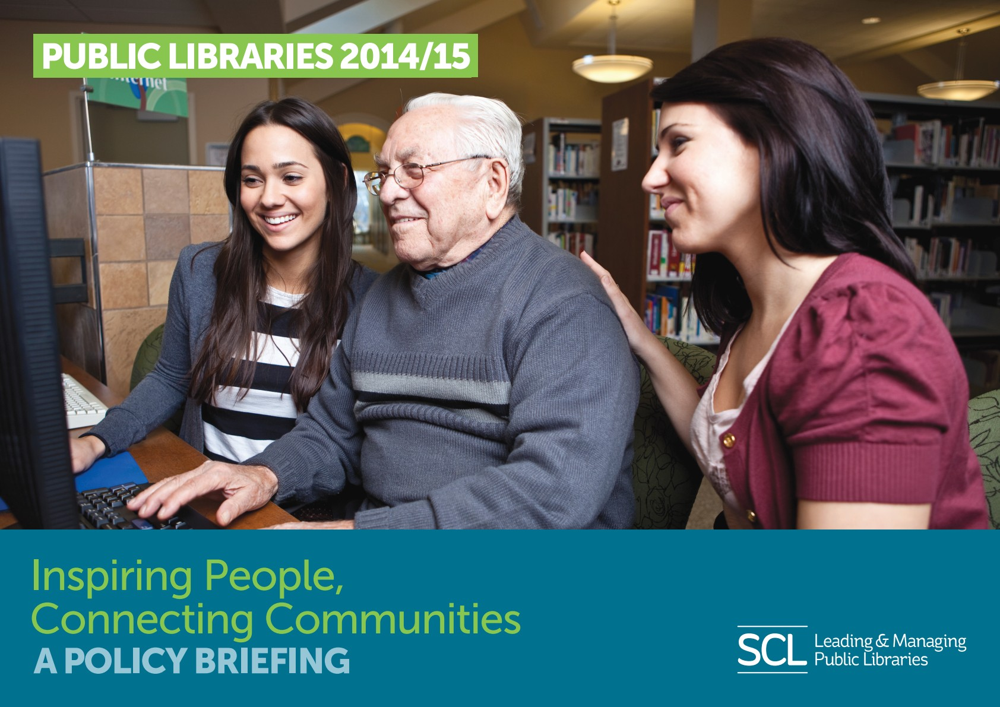
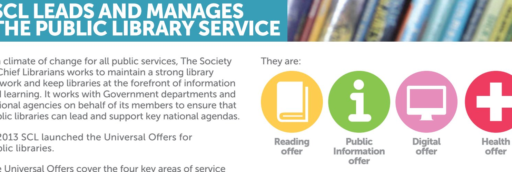
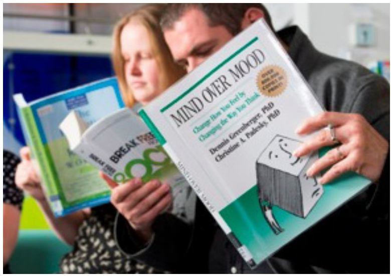
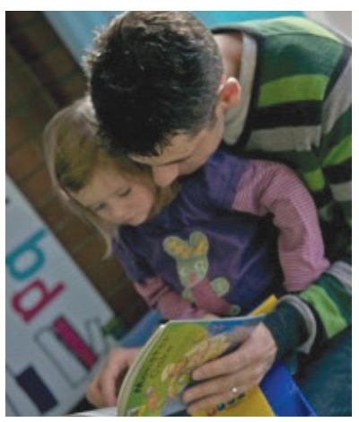
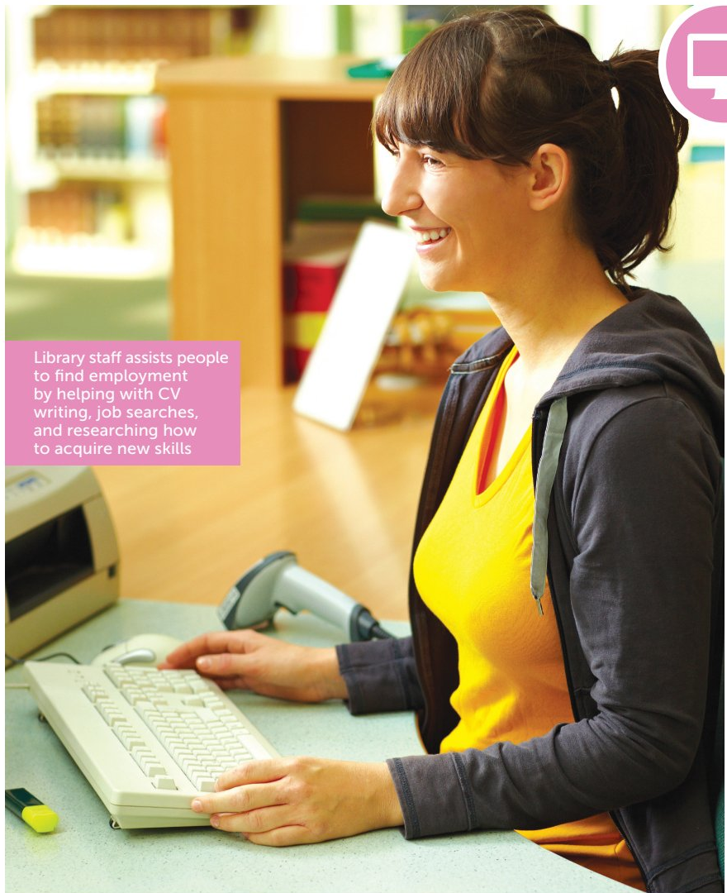
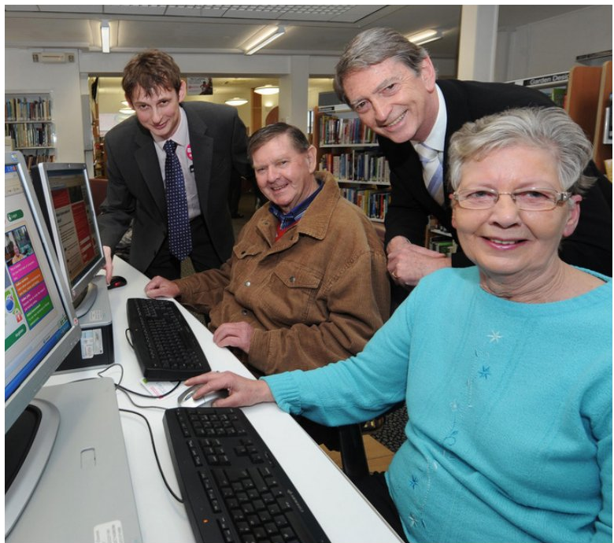
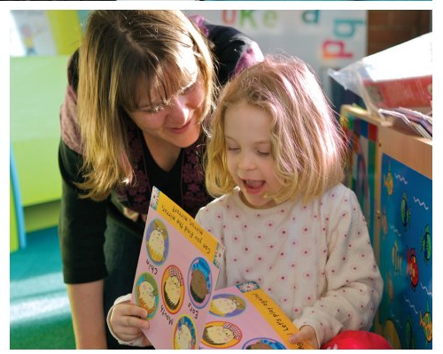
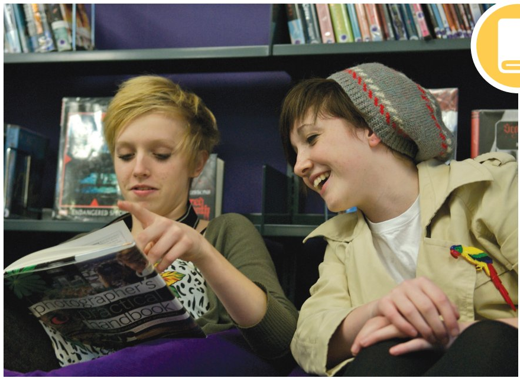

<!-- PAGE: 1 -->

# Public Libraries in 2014/15: Inspiring People, Connecting Communities

### A Policy Briefing

<!-- PAGE: 2 -->

## Public Libraries at a Glance

| Metric | Value | Detail |
| :--- | :--- | :--- |
| **Libraries in England** | 3,000 | More than 3,000 libraries in England |
| **Operating cost** | 5p | Libraries cost 5p per person per day to run |
| **Annual visits** | 300m | More than 300 million visits to public libraries each year |
| **Free computer terminals** | 43,365 | 43,365 free computer terminals with internet access and library catalogue |
| **Website visits** | 98m | 98 million visits to library websites |
| **Reading attainment** | 2X | Children who use the library are twice as likely to be above average readers |

<!-- PAGE: 3 -->

## Libraries Are Essential

> "Almost everything I am I owe to libraries."
> — Stephen Fry

- **Libraries connect communities:** Libraries are neutral venues providing a free, open and welcoming space.
- **Libraries inspire people:** Libraries offer creative learning and reading opportunities for every age group, with guided help to access resources.
- **Libraries provide essential service for vulnerable members of society** – the isolated, unemployed, elderly and people with disabilities.
- **Libraries are fun!** Children and young people learn from an early age that they can explore every character and idea through books, DVDs, story times, music, art and computers.
- **Libraries Build Literacy:** Libraries support people to learn to read or expand and improve their reading and digital literacy skills.
- **Libraries provide information that enables people to change their lives:** Improve health, find a job, upgrade skills, learn a new language, travel, learn a new skill, share in the digital world, open a business, succeed in education.
- **Libraries enable people to access digital benefits:** Libraries give people free access and support in using digital and Internet services.

<!-- PAGE: 4 -->

## SCL Leads and Manages the Public Library Service

In a climate of change for all public services, The Society of Chief Librarians works to maintain a strong library network and keep libraries at the forefront of information and learning. It works with Government departments and national agencies on behalf of its members to ensure that public libraries can lead and support key national agendas.

In 2013 SCL launched the Universal Offers for public libraries.

The Universal Offers cover the four key areas of service which our customers and our partners see as essential to a 21st century library service.

They are:
- **Reading offer**
- **Public Information offer**
- **Digital offer**
- **Health offer**

The Offers are a positive and proactive response by SCL to the challenges that local authorities and public libraries in particular are currently facing.

<!-- PAGE: 5 -->

## The Universal Health Offer

National strategy expressing public library contribution to the health and well-being of local communities.

- **Books on Prescription** has a core list of books on mental health issues (stress, depression, compulsions) recommended by leading experts. In the first six months of the launch over 100,000 people read the books. In 2014 the scheme will be extended to include supporting young people with mental health issues and those suffering from dementia.
- Provides a network of local hubs offering non-clinical community space where health and well being groups can engage with the community.
- Community outreach supporting vulnerable people.
- Reading has been proven to help people relax and understand themselves and their communities.
- Assisted online access to key health information sites.

*Above: Libraries offer a vast range of informal and formal learning opportunities for all ages (Photo: The Reading Agency)*

*Left: 'The library not only gives access to a great range of books for free, it offers a shared reading space away from the distractions of home' — Dad, Paul, with Millie, aged 2*

<!-- PAGE: 6 -->

## The Universal Digital Offer

*Library staff assists people to find employment by helping with CV writing, job searches, and researching how to acquire new skills*

Recognises that the development of digital services, skills and access underpins so much of a 21st century library service – and it supports and enables the delivery of all of the Universal Offers.

- Free access to the Internet for every customer (for a minimum period of time).
- Clear and accessible online library services including access to ebooks.
- Staff trained to help customers access digital information, especially those who do not have access or the skills to use IT.
- 24/7 access to services through a virtual library presence.

<!-- PAGE: 7 -->

## The Universal Information Offer

The focus of the offer is in supporting people to access information and services online in life-critical areas such as careers and job seeking, health, personal financial information and benefits. Central to this offer is helping people to use vital government online information and services. This supports the Government’s Assisted Digital agenda to help people access national and local Government services.

- Brings together government and non-governmental sources of information, which have been researched by information professionals in public libraries, giving a level of quality assurance to the user.
- Ensures that public library staff and volunteers are continually developing their skills to provide help to people accessing information and services.
- **Access to Research** gives free, walk-in access to a wide range of academic articles and research in public libraries across the UK.

*Above: Gordon Burns of BBC's North West Tonight news joined an Ormskirk Library initiative to encourage people to make the most of the internet*

*Right: 'The library is a stimulating environment for Alice to play and learn independently' — Mum, Louise, with Louise, aged 4*

<!-- PAGE: 8 -->

## The Universal Reading Offer

*Above: 'Chilling out over a good book with your best mate, What could be better?' — Best mates, Millie and Frankie aged 16 and 15*

The Reading Offer sets out what public libraries will offer in order to provide a modern reading service within a local community.

- Builds on public demand for a lively and engaging reading setting with reading groups, challenges, promotions and author events, alongside public engagement opportunities services for specific audiences such as families and the blind and partially sighted.
- Offers free books and reading resources.
- Excites children and their parents about reading. 810,000 children took part in the Summer Reading Challenge in 2013.
- Offers free community space.
- Provides services for vulnerable people and works closely with communities, schools and learning centres.

<!-- PAGE: 9 -->

## Reach and Usage of Public Libraries

| Metric | Value | Detail |
| :--- | :--- | :--- |
| **Library card holders** | 34m | More than 34 million people, 60 per cent of the UK population, have a library card. |
| **Monthly visitors** | 35% | 35% of the population visits public libraries at least once a month. |
| **Book stock** | 92m | There are more than 92 million books in UK public libraries. |
| **Internet access hours** | 60m | Libraries provide over 60 million hours a year of high-speed internet access. |
| **Bridging the digital divide** | Digital | Libraries bridge the digital divide and are, for many people, the only point of access to online knowledge resources. |
| **Information enquiries** | 60m | Library staff answers 60 million enquiries a year. |

<!-- PAGE: 10 -->

## Acknowledgements

Website: [www.goscl.com](http://www.goscl.com)

Thanks to Nottinghamshire and Lancashire Libraries and to The Reading Agency for images.

<!-- PAGE: 11 -->

## Back Cover

**PUBLIC LIBRARIES 2014/15**

*Inspiring People, Connecting Communities*
