<!-- PAGE: 1 -->
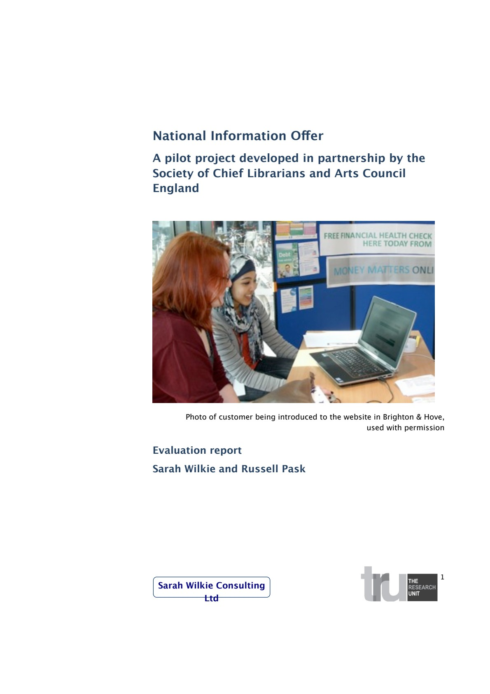

# National Information Offer

## A pilot project developed in partnership by the Society of Chief Librarians and Arts Council England

### Evaluation report

**Sarah Wilkie and Russell Pask**  
*Sarah Wilkie Consulting Ltd*  
**June 2012**

---

<!-- PAGE: 2 -->

## Contents

| Section | Page |
| :--- | :--- |
| **Executive summary** | 3 |
| Context | 3 |
| Aims and objectives | 3 |
| Outcomes | 4 |
| Summary of recommendations | 5 |
| **1. Background** | 8 |
| 1.1 Project development | 8 |
| 1.2 Context | 9 |
| 1.3 The pilot projects | 10 |
| **2. Logic model** | 19 |
| **3. The websites** | 21 |
| **4. User surveys** | 22 |
| 4.1 Methodology | 22 |
| 4.2 Findings | 22 |
| **5. Staff** | 34 |
| 5.1 Training | 34 |
| 5.2 Staff survey | 36 |
| **6. Partnerships** | 43 |
| 6.1 Local partnerships | 43 |
| 6.2 National support for partnership working | 45 |
| **7. Case studies** | 46 |
| **8. Conclusions and recommendations** | 51 |
| 8.1 Website and infrastructure | 51 |
| 8.2 Workforce development | 52 |
| 8.3 Partnerships | 54 |
| 8.4 Advocacy | 55 |
| 8.5 Summary of recommendations | 56 |
| **Appendix A: The websites** | 59 |
| **Appendix B: Training materials and methodologies** | 76 |
| **Appendix C: Project team and pilot leads** | 83 |

---

<!-- PAGE: 3 -->

# Executive Summary

## Context

The government has set a goal to revolutionise the broadband infrastructure of the UK by 2015 to ensure we have the best superfast broadband network in Europe. Go ON UK, the successor to Race Online 2012, has set the vision to make the UK the most digitally capable nation by 2020 with every person and every organisation fully benefitting from the opportunities to improve lives and livelihoods. Government Digital Services is transforming the way government delivers. All information will be published on a single 'gov.uk' domain name by the end of 2012 and the government will move to a 'digital by default' approach to its transactional services by 2015. Assisted Digital services will be put in place to help people who need support, and local authority channel shift strategies are seeking to secure similar efficiencies and service improvements. The National Information Offer project grew from the conviction of all the partners involved that public libraries have a key role to play in supporting people to use online public services, as part of this shift to digital by default for online government services. It was developed by the Society of Chief Librarians and funded by Arts Council England to demonstrate the capability of libraries to perform this function. Their track record in supporting people to build digital skills, their expertise in helping people manipulate online information, and their network of over 30,000 public access PCs puts them at the heart of service delivery that is to be “digital by default”. The project has reinforced the above, and also provided an opportunity to demonstrate the levels of trust that citizens put in information accessed through libraries, mediated by library staff. This key finding, that level of trust in which the public hold library staff, further confirms that libraries are poised to play a critical role in securing the digital future envisaged by Martha Lane Fox, the UK Digital Champion, and the government. At the same time the project has helped those managing services to identify the further development activity that would be needed to strengthen the library’s information offer, building on the existing skills of staff and creating accessible routes into online resources.

## Aims and objectives

The aims of the project were to:

---

<!-- PAGE: 4 -->

* enhance the pilot libraries’ role as trusted information, advice and

guidance hubs in their local communities

* enhance the pilot libraries' role in supporting customers to develop skills

and confidence in accessing and using digital information resources and undertaking online transactions

* further develop the role of library staff as digital champions and trusted

intermediaries, confident and skilled in using and supporting others to use digital resources

* further develop library collaboration with local and national partners

* identify examples of best practice that can be used to develop the model

for a national information offer, including productive and sustainable partnerships, effective staff learning programmes and innovative digital resources The intention was to demonstrate why libraries should be one of the partners delivering online services, based on their traditional role in providing information at a very local, accessible point of contact; the skills of library staff in assessing the quality of information offered and in supporting users to access it; and the national support available to them through established collaborative working under the aegis of the Society of Chief Librarians and Arts Council England.

## Outcomes

The project has reinforced and provided some evidence for the partners’ belief in the capability of public libraries to support the assisted digital agenda, and at the same time has provided an opportunity to demonstrate the levels of trust that citizens put in information accessed through libraries, mediated by library staff. The user surveys undertaken as part of this evaluation have shown that customers value the resources offered, find them helpful and relevant to their lives, and welcome the support offered by library staff. While reinforcing messages about the helpfulness and knowledge of library staff however, the project has also helped those managing services to identify the further development activity that would be needed to strengthen the library’s information offer, building on the existing skills of staff and creating accessible routes into online resources. Perhaps inevitably, given the short timescale of the project, much of the activity within the pilot authorities focused on what was being provided rather than for whom. A lot of energy went into creating portals and websites to link the themed resources, and into determining what resources would be the most

---

<!-- PAGE: 5 -->

useful for customers. The training available to staff seems mainly to have focussed on introducing them to the new resources, rather than on strengthening their skills in specifically helping those who most needed assistance to access and understand information provided online. The evaluation of the pilot resources and how they were used has shown that a mix of local and national resources would be necessary in order to provide access to the fullest possible range of information for users. Individual public library services, as part of the local authority and having the expertise to assess information sources for accuracy, reliability and relevance, are ideally placed to broker the local level gathering of appropriate information resources. But, in scaling this project up to cover the whole country, it will be important to develop a framework that allows for national support and quality control alongside that flexibility to determine and provide local resources to meet local needs. The pilot projects have all sought, mainly successfully, to work with partners at a local level. Some new partnerships have been formed and existing ones strengthened. It is evident that partnership working adds real value to the library service’s provision of online information. It ensures that what is offered is much more than a simple list of links by helping to build a local framework and context for the links. Partners have also been involved in assessing the choice of resources, providing training for library staff, promoting the resources and running in-library events such as Job Clubs. Libraries have been seen to be supporting the delivery of partners’ own priorities. It is not yet evident that a real understanding has been developed of the value of this work to the partner, which it is important to do within the context of strategic commissioning. Public library service leaders need to be clear about the cost of such activity (using a robust activity-based costing methodology) and its value, and to work within a commissioning framework to identify sources of funding for the activity.

## Summary of recommendations

For the Society of Chief Librarians and Arts Council England Advocacy

* Develop a programme of advocacy for the role of public libraries in

delivering trustworthy information, building on the evidence from this study that users: otrust library staff more than most other providers

---

<!-- PAGE: 6 -->

ooverwhelmingly said that they would recommend the library’s online information to other people osaid the online support had improved their level of understanding (over 80%) and that the online information had improved their knowledge and skills (almost 70%)

* Use this to communicate with national government and national partners;

provide support to and encouragement of advocacy at regional and local authority level, including the development of shared messages

* Consider commissioning further work to provide more evidence of digital

champion role of library staff in supporting others to use digital resources, including qualitative research into the impact on the end user

* Work with national partners, including the Government Digital Service,

Broadband Delivery UK (BDUK) and Go ON UK, to position public libraries as one of the key consortium partners in delivering the government’s digital strategy and support for Assisted Digital

* Work with national partners to advocate to government for the

development of a delivery and funding model to support people through Assisted Digital to use online government services Supporting users

* Commission further work focusing on identifying and helping

the “coulds” (those identified as being capable of using digital services if offered such support, but not currently doing so) to overcome barriers to them accessing online information

* Undertake a skills needs assessment to define the skillset needed by

library staff, volunteers and partners in order to equip them to support those users who most need assistance in accessing and understanding information provided online

* Develop a package of training, probably online, based on the above to

support the roll-out of the national information offer Information resources

* Develop a framework of content that allows for national support and

quality control to determine and provide local resources to meet local needs

* Identify the technical requirements and platform to deliver the above

---

<!-- PAGE: 7 -->

* Develop guidelines for the development of information portals that take

into account the needs of more reluctant and less experienced users of digital services for: oclarity and ease of navigation ouser-friendly presentation of information oclear communications about the range of information available in libraries and how to access it

* Work with OCLC to explore the potential of the development of a “single

digital presence” for libraries to act as the portal for the National Information Offer For local authorities and local library services

* Identify and work with local partners to build an understanding of the

most useful and accessible online resources to meet local information needs

* Set out clear parameters for partnerships, including clarity about the

roles and responsibilities of each partner

* Involve frontline staff from both the library service and its partners in

areas of work such as the identification of local information resources, development of websites and communication of the offer to potential users

* Investigate the opportunities created by the transfer of responsibility for

public health to local authorities

* Work with national partners to ensure the development of online

resources is appropriate to and compatible with local IT capacities and needs

* Work with national partners to ensure the development of an online

training package is compatible with local training programmes and needs; commit to embedding this training within programmes for staff development

* Build the dissemination of the online information offer into marketing

strategies and communications plans

---

<!-- PAGE: 8 -->

# 1. Background

## 1.1 Project development

The National Information Offer project was developed by the Society of Chief Librarians and funded by Arts Council England. The aims of the project were to:

* enhance the pilot libraries’ role  as trusted information, advice and

guidance hubs in their local communities

* enhance the pilot libraries' role in supporting customers to develop skills

and confidence in accessing and using digital information resources and undertaking online transactions

* further develop the role of library staff as digital champions and trusted

intermediaries, confident and skilled in using and supporting others to use digital resources

* further develop library collaboration with local and national partners

* identify examples of best practice that can be used to develop the model

for a national information offer, including productive and sustainable partnerships, effective staff learning programmes and innovative digital resources The intention was to demonstrate why libraries should be one of the partners delivering online services, based on their traditional role in providing information at a very local, accessible point of contact; the skills of library staff in assessing the quality of information offered and in supporting users to access it; and the national support available to them through established collaborative working under the aegis of the Society of Chief Librarians and Arts Council England. The project supported eight pilots which were set up with the aim of helping people effectively navigate the range of national information sources available online. These pilot projects together involved more than 60 public library authorities in England. The Society of Chief Librarians and Arts Council England worked with national partners to develop tools to help people navigate their way around information sources on the web. Four priority areas were identified in a national survey:

* Careers and job seeking: users reported difficulties using websites,

creating CVs and filling in online application forms.

* Health: finding good information and contact details for sources of help

was reported as a problem.

---

<!-- PAGE: 9 -->

* Personal financial information: customers reported a need for simple,

free information.

* Benefits advice: many had difficulty finding easy to use information and

contact details of other agencies. The pilot projects were also asked to deliver a training framework to help library staff show customershow to navigate through online information, which might later be applied to all library authorities as needed. The anticipated outcomes were:

* increased customer and stakeholder awareness of libraries’ core role as

key information, advice and guidance hubs in local communities

* increased library customer ability and confidence to use online

information and undertake increased online transactions

* increased library staff knowledge of national and local information

resources

* increased library staff skills and confidence in information, advice and

guidance, coaching and supporting library customers to access and use online information and signposting them to other agencies and resources for further support

* sustainable national and local partnerships established

* the toolkits, content and learning developed embedded as part of the

core library information offer through a national roll out

## 1.2 Context

The government has set a goal to revolutionise the broadband infrastructure of the UK by 2015 to ensure we have the best superfast broadband network in Europe. Go ON UK, the successor to Race Online 2012, has set the vision to make the UK the most digitally capable nation by 2020 with every person and every organisation fully benefitting from the opportunities to improve lives and livelihoods. Government Digital Services is transforming the way government delivers. All information will be published on a single 'gov.uk' domain name by the end of 2012 and the government will move to a 'digital by default' approach to its transactional services by 2015. Assisted Digital services will be put in place to help people who need support, and local authority channel shift strategies are seeking to secure similar efficiencies and service improvements.

---

<!-- PAGE: 10 -->

This project grew from the conviction of all the partners involved that public libraries have a key role to play in supporting people to use online public services, as part of this shift to digital by default for online government services. If the objective of the government’s “digital by default” agenda is to ensure that service users are able to self-serve using end-to-end digital services, then it is first necessary for government departments to design and deliver services that are fully digital. Where there is a good fully digital service on offer, the Assisted Digital programme needs to focus on helping people who:

* Should use the online service (but don't), to use it

* Could use the online service, to overcome their barriers to using it

* Support those who cannot use digital services

Public libraries have the capacity to support the “Could” category in particular; they have the local infrastructure and network of access points, there is a natural fit with their traditional information role, and they have staff trained in evaluating information sources and in supporting users. The project has reinforced the above, and also provided an opportunity to demonstrate the levels of trust that citizens put in information accessed through libraries, mediated by library staff. At the same time it has helped those managing services to identify the further development activity that would be needed to strengthen the library’s information offer, building on the existing skills of staff and creating accessible routes into online resources.

## 1.3 The pilot projects

The selected pilot projects focused on one or more of the above themes, and ranged from single authority projects, through small consortia to whole region groups. They were: Employment and careers Kensington and Chelsea Libraries (with Hammersmith and Fulham, and Westminster) This online resource aimed to gather together a range of sources of information for jobseekers in the area.  This was to include downloadable guides on related subjects such as social networking, CVs and interview techniques; discussions and interviews with local jobseekers or those in related fields; reading lists and links to the catalogue; and a gateway to useful resources. Resident-led and locally provided content was an important part of these resources, in addition to offering links to national services. The

---

<!-- PAGE: 11 -->

authorities aimed to build on existing partnerships with local organisations, including the local adult education college, recruitment agencies, local charities and community groups and other council partners. The following principles were adopted in the development of the resource:

* To involve service users and local partners in the creation and direction

of the resource as much as possible

* To use clear, jargon-free language, with images and logos for ease of

use for those who find it more difficult to read perhaps English or from a screen

* To make the resource broad enough for a range of information-seekers

to find it useful The project came at a good time for the service. The introduction of a Triborough library service meant that the information offer would have a potentially much broader scope, and provided opportunities for joint working including writing the bid together with colleagues from other authorities. The service also welcomed the opportunity to explore on a small scale at least the impact of providing a uniquely online resource, given financial pressures and the increasing costs of traditional hard-copy formats. Working in partnership with local organisations was a key theme from the start. The pilot lead, Cecilia Bethencourt-Dunning, says: “Speaking to their service users (i.e. ESOL learners; career changers; those who were job-seeking) was enlightening and informative. A different approach was needed: many were uncertain about what they would be expected to provide and not very confident in their abilities to provide it. Reassuring them that, again, they could contribute as little or as much as they wanted, in an extremely informal setting (chatting, rather than an interview), that I would do all the writing if they wanted me too, allowed them to really open up and talk about their experiences. They shaped the direction of the resource: for example, a recurring trend was ladies who had had children and found it very hard to re-enter work, so “Returning to work” was an obvious choice for an information page.” While formal training was limited (as many were undergoing a process of interviews, redeployment or potential redundancy as part of the Triborough project), staff were well-informed about the project and kept up to date with its progress. They reported appreciating the ease of access to lots of resources in one place, finding it extremely easy to guide customers to the information, and they liked the language, layout and the look of the downloadable guides.

---

<!-- PAGE: 12 -->

Manchester Libraries The pilot aimed to establish a model for increasing use of employment and careers websites. The aim was to provide effective signposting to relevant local and national resources, supported by trained staff able to confidently demonstrate the benefits and uses of these sites. By offering a simplified route to employment information and support it was hoped to increase customers’ opportunities to improve their economic wellbeing and job opportunities. The pilot achieved the following:

* Created an online toolkit offering information and links about job-

seeking and careers

* Added the toolkit to the “Ask About Business” website, a regional service

offering business and job-seeking information for 14 local authorities in the North West

* Trained staff to enable them to support customers better, and Digital

Champions to support them after the pilot ends They are starting to offer job-seeking drop in sessions using the pages at local libraries, and implementing a marketing plan to raise awareness of the mini- site. Marketing undertaken to date includes digital (through authority websites and social networking sites), People’s Network links, the Neighbourhood Services Bulletin and through job-seeking drop in sessions in libraries. The pilot engaged with a number of agencies offering information and advice relating to employment and careers options. The challenges identified included the ambitious timescale for the pilot and the need to ensure the content remains current. However, they have seen large increases in traffic to the website (e.g. a 150% increase in page views compared to the same period last year) and have had positive feedback from partners such as the Economic Development Unit. Finance Brighton and Hove Libraries This project aimed to identify the best financial advice content on the internet and establish links to local sources of information, advice and support relating to financial inclusion issues. The pilot explored the best options for sharing sources of information online through the development of a local portal for easy shared access. Focusing on financial inclusion, the project also looked at how to involve socially excluded groups.

---

<!-- PAGE: 13 -->

The authority developed the Money Matters Online website to host links to the various resources, strongly influenced by the concept of financial inclusion. The following issues were identified for the “financially excluded”:

* no bank account

* no access to affordable credit

* low household income

* no insurance

* debt, including rent arrears

* fuel poverty

* no access to money advice

* limited financial awareness

* no savings

* lack of confidence, aspiration, mobility

Frontline staff were trained either in staff meetings, small groups of between four and six or one to one (or two) in the community libraries. The training was linked to other work that the service does to support digital inclusion, giving staff a local context in addition to that of the national project. The project was publicised through a variety of methods (events in libraries, posters, social networking sites and local community radio – see photo), and (in addition to this national evaluation) Google analytics used to measure use of the site. Partners from the local voluntary sector, accessed through the Brighton & Hove Advice Partnership (a partnership of local voluntary sector organisations that provide information, advice & guidance services) supported the project by advising on resources, which user groups to target, and publicising the initiative. The exchange of information about the work of libraries and that of the voluntary sector bodies helped to raise the profile of all the services

---

<!-- PAGE: 14 -->

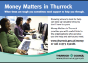

concerned and increase awareness of the range of support available in the local area. Thurrock Libraries The “Money Matters in Thurrock” project was designed to focus on helping residents in Thurrock get financial information and advice, using the Money Advice Service’s health-check resource. This project was led by Thurrock Library Service, partnered with:

* Essex Savers Credit Union;

* The Money Advice Service (to help residents manage their personal

finances and make informed choices);

* Thurrock Councils Web and Communications Teams (to implement the e-

resources and disseminate the information across Thurrock);

* Thurrock Community Development Team to support outreach work

A focus group was planned to road test the health-check, looking at all possible scenarios for next steps on customer journeys. The project came at a time when Thurrock Libraries (and indeed several of the other pilots) were going through a major reorganisation. Some of their objectives were, as a consequence, not fully achieved. However they did successfully set up the Money Advice website, promoting it through local community forums and to attendees at their regular Wiser4It training sessions. They also created postcards to advertise the site which were distributed across the borough through libraries, the Active Citizen Entitlement partnership and the Community Engagement team. They found that money was, unsurprisingly, rather a sensitive subject and residents were unwilling to ask for help accessing the website and discussing personal debt; this emphasises the need for staff to be able to make referrals to other services, such as the Citizens’ Advice Bureau, rather than thinking that they have to do everything themselves. There was also very limited take up of the training course on offer to the public. This is in some contrast to the experience of other pilots, e.g. Kent where the established Job Clubs are well attended, and may be due to a number of reasons:

* a general lack of interest in attending such courses in Thurrock

---

<!-- PAGE: 15 -->

* the above-mentioned sensitivity of the subject

* some challenges faced by the service in delivering the project at a time of

change, e.g. engaging fully with partners who might have helped to publicise it Health Lincolnshire Libraries (with Nottinghamshire and Leicestershire) Lincolnshire led a joint pilot with Nottinghamshire and Leicestershire libraries to help the public access digital information about health and social care. The project worked with health partners to support the information accessed through the NHS Choices website. The pilot project, involving six libraries (two from each authority), aimed to establish the type and level of training that frontline library staff need to help people access and use health websites. A “health button” on every library computer would lead users directly to NHS Choices and local health and social care websites. The partner authorities worked closely with NHS colleagues, with a training day for senior staff on Essential Public Health being delivered by the latter, and cascaded to staff in each of the participating libraries. Each authority developed its own area of the People’s Network to host the links to the resources (resulting in a mixed approach as described in Appendix A). The initiative was promoted with posters as well as online, and one library ran a promotional event. Some challenges were experienced with the IT (e.g. it was not found possible to restrict the resources to the pilot libraries alone, and the library IT wasn’t always up to the task of delivering certain pieces of content such as NHS training videos in Quicktime). Some staff were unsure at first, expressing concerns that they might be expected to diagnose conditions, but were reassured by the training and by the messages that their role was to focus on signposting. Overall the project opened doors to new partners, NHS and Public Health, who had not previously seen libraries as providers of health information.

## West Midlands Libraries

---

<!-- PAGE: 16 -->

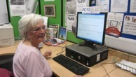

This project looked to extend joint working between all the West Midlands library authorities and the NHS West Midlands organisation. The project was developed with three interlinked strands aimed to improve links to online health information, in particular what is provided by or through NHS, for people who access library and local authority web-pages. A partnership was set up to achieve this between the library authorities and NHS West Midlands to develop the content; and with the established Patient Information Forum for the purposes of evaluating content and online “routes”. Librarians from the pilot authorities worked in partnership with an NHS Health Information Co-ordinator to identify the resources to be highlighted and develop the ideas for the website. It was intended to be an example of stripping down a page to give a streamlined look without too many options vying for a user’s attention. It was felt that the page’s content could potentially sit behind a National Information Offer page or platform. The idea was to avoid “news” items, health promotions and the emphasis on certain conditions as is naturally evident on NHS websites, and to focus on routes into information. One means that was explored for this was a syndication arrangement on elements of NHS websites, thereby drawing the key elements through and reducing the work of updating items and checking links, but there was not time to explore this during the pilot period. They have found that the page is helping raise awareness of NHS partnering with public libraries and have had very positive feedback from partners and users. Multiple themes / general digital literacy

## Kent Libraries

Kent Libraries planned to expand existing library expertise and partnerships both within and outside of Gateway (a Kent County Council scheme that makes it much easier for people to access a range of public and voluntary services, from libraries and adult education to council housing and benefits advice). The pilot focused on the most frequently asked questions and queries of the service and created online toolkits to make the information more accessible to customers and improve existing sections of the Kent Libraries website for remote users. One challenge in Kent resulted from the corporate development

---

<!-- PAGE: 17 -->

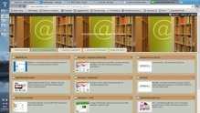

(in accord with council initiatives such as Supporting People and Backing Kent Business) to develop themed sections very similar to the areas the Information Offer was targeting. As a result the library service was unable to host the selected resources within the Libraries page; it would have duplicated some of the information on the corporate pages and could have confused users. However, what seemed at first to be a threat to the project became in some ways an opportunity. The library service was able to work with the corporate team to suggest appropriate links (often ensuring that these were more helpfully deeply embedded in the partner’s pages rather than taking an inexperienced user to a main landing page). The exercise helped raise awareness among council colleagues of the library service’s role in identifying and making available good sources of information. The service used work clubs, Health on the Web sessions, business evenings and other IT awareness sessions (e.g. those set up for Spring Online, ITea and biscuits, UK Online campaigns) to promote the new/enhanced online pages. Kent worked with a number of partners to deliver the project. Gateway partners could not be as involved as initially anticipated; however, Supporting Independence colleagues, a local NHS librarian, NextStep, CABs, the local representative for the Money Advice Service and the SE Financial Capability Forum contacts were all really helpful. Knowledge from previous partnership work (e.g. with Trading Standards colleagues, Chambers of Commerce etc) was also put to good use. Yorkshire Libraries This pilot aimed to address the lack of IT literacy that is preventing people from making government transactions online. Two working groups planned to develop training resources and improve signposting to help people easily find and use websites like NHS Choices and Directgov. The pilot aimed to create a portal for a range of evaluated websites that support both teaching and learning of basic ICT skills. Led by Kirklees libraries, 15 Yorkshire and Humber library authorities took part: Bradford, Barnsley, Calderdale, Doncaster, East Riding, Hull, Kirklees, Leeds, North East Lincolnshire, North Lincolnshire, North Yorkshire, Rotherham, Sheffield, Wakefield and York. The project was led by a development team taken from seven of the 15 authorities involved. One of the benefits identified by the group was the opportunity the initiative had presented to work together in this way, sharing skills, knowledge and best practice. Unlike some of the other consortia, the region developed a single website to host the resources, using

---

<!-- PAGE: 18 -->

Googlesites (a free resource). The website was branded with the logos of all the participating authorities and was titled “Yorkshire and Humber Libraries Online Learning”. Netvibes was used to bring together websites and resources of interest under a common theme. The two primary objectives of the site were to:

* address the lack of IT literacy skills that are preventing people from

making government transactions online; and

* create a portal for a range of evaluated resources that support both the

teaching and learning of basic ICT skills

---

<!-- PAGE: 19 -->

# 2. Logic Model

The following logic model was developed for the evaluation, after consultation with all partners (and based on the Local Government Group’s logic model, adopted and developed by the Reading Agency for the reading offer). Generic Library Offer Generic Information Offer Service

## Outcomes

Benefits to Local People EvidenceStrategic

## Outcomes

for LA Strategic

## Outcomes

for LA

---

<!-- PAGE: 20 -->

The elements of the logic model highlighted in yellow were those considered most important to the evaluation and formed the basis for the surveys of both users and staff. Some of these proved easier to evidence in the limited time period than others. The surveys certainly provided evidence of the trust placed in libraries and library staff, and an appreciation of their helpfulness and skills. Some local partnerships pointed the way towards increasing an awareness of libraries’ role in providing access to information and support for users. However more time, and/or a more qualitative study, would be needed to test some of the other outcomes. Partnerships have indeed been formed, at both national and local level, but only time will tell if these are sustainable. While users have accessed the resources and pronounced them helpful, there is no way of ascertaining in the context of this study whether using the resources has led to, for instance, increased qualifications, better management of finances or increased confidence in carrying out online transactions. This pilot project and its evaluation have, however, created a good platform on which to build further work, and further evaluation of that work.

---

<!-- PAGE: 21 -->

# 3. The Websites

A detailed review of each of the websites that hosted the online resources is provided at Appendix A. This review demonstrated that, while each pilot was contributing to this national initiative, many of the design and content decisions were taken at a local level. This is true even of some of the multi- authority consortia – for instance, Lincolnshire, Leicestershire and Nottinghamshire each developed their own website even though they were working together. The reasons for this local development are likely to include

* The need to reflect local council branding and design

* The need to work closely with in-house IT teams

* A desire to reflect local priorities and include local resources

* The opportunity to work with particular partners and link to their

websites or online resources The evaluation found that there are both strengths and weaknesses to this approach. When, as is planned, the information offer is rolled out nationally, it will be important to develop a framework that allows for national support and quality control alongside the flexibility to determine and provide local resources to meet local needs. A brief “mystery shopping” exercise was undertaken on each of the websites for which links were provided to the team. One constraint to be aware of is this was necessarily undertaken outside the library venue and without the support of library staff, and therefore does not necessarily accurately reflect the experiences of in-library customers. However it threw up some valuable pointers regarding usability and access. Our mystery shopper identified a number of “dos and don’ts” to facilitate access to and use of the resources, which are included as part of Appendix A.

---

<!-- PAGE: 22 -->

# 4. User Surveys

## 4.1 Methodology

The public were invited to take part in a web survey accessed through a web link on the landing page for the individual National Information Offer pilots. The number of surveys received varied considerably, in relation to the traffic and positioning of our link on the pilot sites and the level of staff engagement in encouraging the public to take part.  This led to widely disparate survey outcomes between the pilots, an issue which should be considered in future evaluation work of this nature. Responses would tend to indicate that many of those participating in the survey might be considered on the whole to be those more comfortable with using online resources (around half had previously used those provided in the library, for instance). A more qualitative study, involving focus groups of targeted less confident users, would help to develop further evidence regarding the nature of the support needed to help the “coulds” (those identified as being capable of using digital services if offered such support, but not currently doing so) as well as the potential of public libraries to provide it. We received 474 responses in total but these were skewed towards a couple of library services. In order to give a more balanced account of the performance of all the pilots, we re-weighted the data making the weighted responses 50 from Brighton, Kent, West Midlands and Yorkshire and Humber, and combining the remaining pilots for a final 50 block of weighted responses. This gives the results an effective sample size of 250 (five times 50 blocks) and the overall results have a margin of error of approximately + 6%.  This means that if 50% of respondents were satisfied with online services, the true population results would lie between 45% and 55% nineteen out of twenty times.

## 4.2 Findings

The key findings that emerged from the surveys were:

* These online services have made a very positive contribution to

respondents’ understanding, knowledge and skills

* Where there were difficulties in accessing information, these tended to be

around navigation rather than content

* Almost a third of users, including many who describe themselves as

web-literate, said that they would need help to use this online

---

<!-- PAGE: 23 -->

information again, suggesting that the online information could be presented in a more user-friendly manner

* About a third of respondents were helped by staff to use the online

resources, and found them largely helpful and knowledgeable; this emphasises the need to ensure staff are properly trained

* Library staff are second only to doctors in terms of the trust placed in

them by seekers of information, which again demonstrates the need for these staff to be effectively trained in order to deliver the safe, quality service people expect These findings have informed many of the recommendations of this report, including:

* Develop guidelines for the development of information portals that take

into account the needs of more reluctant and less experienced users of digital services for: oclarity and ease of navigation ouser-friendly presentation of information oclear communications about the range of information available in libraries and how to access it

* Undertake a skills needs assessment to define the skillset needed by

library staff, volunteers and partners in order to equip them to support those users who most needed assistance in accessing and understanding information provided online

* Develop a package of training, probably online, based on the above to

support the roll-out of the national information offer

* Involve frontline staff from both the library service and its partners in

areas of work such as the identification of local information resources, development of websites and communication of the offer to potential users Accessibility About six in ten (58%) respondents said that they already knew that the library offered information like this online.  Positively, almost nine in ten respondents said that it was easy to access the library’s online information.  Just 3% of respondents expressed difficulty here.

---

<!-- PAGE: 24 -->

## Range of information

Respondents were very positive about how easy it was to see the range of materials available on the library pilot platforms. More than eight in ten respondents said that there was a good range of information available for users.

---

<!-- PAGE: 25 -->

## Finding information

While respondents are generally positive about accessing the online resource and the variety of materials available as part of the offer, there were more challenges around being able to find the information that respondents were looking for using the resources.  Six in ten disagreed that they had any difficulties, but this left a significant proportion who did have some issues finding what they were looking for. Just 16% seemed to find it very easy to find what they were looking for. Having said this, three-quarters of respondents were able to find what they were looking for.  These findings together would tend to suggest that there were issues around navigation rather than content. Usability Significantly, about three in ten respondents said that they would need help to use this online information again. It is also worth adding that those in this group overwhelmingly describe themselves as ‘web literate’ (only 4% of respondents describe themselves as not being very confident using online information).  This would again suggest that the online information could be presented in a more user-friendly manner. Bearing in mind the aim of evidencing the role that libraries can play in supporting those who “could” use online services but currently face barriers (real or perceived) to doing so, this question of usability, and the related one of finding information above, are critical. It seems that to some extent at least the pilot services have been more successful in identifying and collating good

---

<!-- PAGE: 26 -->

sources of information than in presenting them in the way that is most accessible for this user group. In developing a national offer the needs of these more reluctant and less experienced users of digital services need to be at the forefront of website development, both at local and national levels. User recommendation Overwhelmingly, respondents support the National Information Offer concept. Almost nine in ten (88%) said that they would use this kind of online information service again and 84% said that they would recommend the library’s online information to other people. This is a ringing endorsement for the potential of libraries to provide this kind of information service.

---

<!-- PAGE: 27 -->

## Library online services: usage and perceptions

About half the survey respondents had used the library online services before and about half the respondents were using them for the first time.  This suggests that there are two distinct groups using this information: new users who have either found or been directed to this information, and people who already have significant insight into a wide range of services offered by libraries, including online services.  In other research we have conducted in a number of library authorities, users who use library online services tend to have a very detailed understanding of what libraries offer and how they can interact with those services. Or, put another way, where pilots have been encouraging people to use these online services, the uptake would appear to have broadly doubled. In addition, perceptions of seasoned library online service users are that these are now better than they were a year ago. Six in ten respondents in this group said that the services had improved. Again, the National Information Offer communications will have played a part in this improvement.

---

<!-- PAGE: 28 -->

## Types of search

The main drivers for search appeared to be the practical need to ‘find something out’ and looking to improve skills. In a sense, what we are witnessing here is the translation of the key traditional reasons for search from one medium to another. In other words, users are searching for information on the same topics for which they have always searched, despite the move to digital provision. Where pilots were focussed on specific policy areas, we found that health and healthy lifestyles featured more prominently, followed by learning opportunities, money management and work opportunities all on a similar level. In these findings, we would add the caveat that respondents’ selections here are in part driven by what particular services are available. Consequently, the prominence of health might be driven to some extent by the number of pilots having this as a feature and fewer having some of the other alternatives.

---

<!-- PAGE: 29 -->

## Impact

Despite the note of caution above, perhaps one of the most powerful findings of this research is the extent to which these online services have made a positive contribution to respondents. Over 80% of those learning about IT said the online support had improved their level of understanding and almost seven in ten said that the online information had improved their knowledge and skills. Respondents were least likely to say that the online information had improved their knowledge of volunteering or money management. As volunteering appears not to have been covered on any of the pilot websites, it is less surprising that users did not feel that they had learned anything about it.

---

<!-- PAGE: 30 -->

## Staff involvement

Just under half the respondents said that they had been encouraged to use the online materials by staff (46%). Amongst this group, we observe that staff are very likely to help these members of the public use the online resources – about three-quarters of this group received help from staff.  However, overall, about a third of respondents are helped by staff to use the online resources. This is a sizeable number and emphasises the need to ensure staff are properly trained, not only in understanding the information resources themselves but also that they have the necessary skills to support these less confident users.

---

<!-- PAGE: 31 -->

Where respondents did seek support from member of staff, they found them largely helpful (94% agree) and knowledgeable (95% agree). Overall satisfaction 85% of the users of the National Information Offer were very satisfied with the service. Almost half (48%) of respondents were very satisfied with what they found, which suggests that the pilots have achieved strongly in delivering this National Online Offer to the public. Just 3% of respondents expressed dissatisfaction. Areas for improvement The main areas for improvement identified by the public are to raise awareness of what is on offer, improve the design ‘look and feel’ of the sites and improve navigation in the websites. These are reflected in the recommendations below. This wordle is illustrative of the key issues for the public:

---

<!-- PAGE: 32 -->

## Trust

As part of the public survey, we also wanted to investigate the extent to which the respondents viewed librarians as trusted intermediaries by comparing them to other professions and institutions. With respect to providing high quality information, we find that librarians come second only to doctors in terms of being trusted a great deal in the sample of jobs and institutions presented here. As well as this important finding, it is also worth noting that this group see the internet itself as an important source of high quality information and advice. This is a significant finding. It indicates the potency of the role libraries can play in helping to get information to citizens in a way that will be well received, while at the same time evidencing the need for staff to be effectively trained in order to deliver the safe, quality service people expect.

---

<!-- PAGE: 33 -->

---

<!-- PAGE: 34 -->

# 5. Staff

## 5.1 Training

The pilot projects used a variety of methods to brief and train staff, ranging from online briefings using YouTube to webinars to face to face training days. One pilot, in the East Midlands, involved NHS staff in delivering training on Essential Public Health, which was thought to be particularly effective, with staff finding the sessions “informative and enjoyable”. Whatever the format however, the training seems mainly to have focussed on introducing staff to the new resources, mirroring a general trend throughout the pilot of focusing perhaps a little too much on what was being provided rather than for whom. Given the ambition of the project to position public libraries within the Assisted Digital agenda, more could perhaps have been done to stress the importance to project leads of providing training and support for staff in specifically helping those who most needed assistance in accessing and understanding information provided online. This should be addressed in any national rollout. An overview of each project’s approach is provided at Appendix B. The majority of staff who received training valued it and thought it was effective, regardless of the methodology employed. By allowing local autonomy in determining the best training methodology and materials, the pilot project has been able to explore the different impacts of a variety of approaches, from the very thorough to the (almost) non-existent. It isn’t clear from the user survey results to what extent a more thorough training programme might have contributed to public perceptions of staff knowledge, nor whether such training helped staff to feel more confident. It may well be that using these resources is something that staff would in any case have felt comfortable in doing, based on previous training and experience of helping customers with online resources. It may also be the case that, as in previous research studies, the customers were pre-inclined to take a positive view of staff helpfulness and knowledge. It is important, however, to recognise that the survey was simply a snapshot of customer views, taken at the point immediately after they had interacted with the service. A small study such as this one does not have the capacity to provide a longer term view of the impact of the interaction. There is no way of determining whether the customer’s view of the knowledge and helpfulness of staff remained positive over the period of time in which the information received was put to use. Did the help in writing a CV lead to an increase in

---

<!-- PAGE: 35 -->

invitations to interview? Did the online guidance on managing the household budgets help a family to afford a small holiday? Did the customer who found out about a local support group for their health condition join it, and find it helpful? A longitudinal study exploring the impact of the library service’s information provision would provide valuable insights and evidence, but is outside the scope of this report.

---

<!-- PAGE: 36 -->

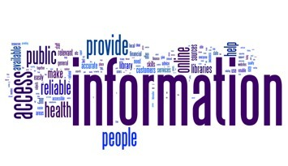

## 5.2 Staff survey

Methodology Staff involved in the pilots were sent an e-survey to feedback their experiences of taking part in the pilot. Like the public surveys, there were different levels of engagement between the pilots. The responses to the staff survey predominantly came from the Brighton pilot, the Lincolnshire, Leicestershire and Nottinghamshire pilot, the West Midlands pilot and the Yorkshire and Humber pilot. There were 84 responses in total. This gives the overall results a margin of error of approximately + 12%. Goals of the National Information Offer Staff involved in the pilots had a good understanding of the goals of the National Information Offer. They tended to see the resource as offering an online information service on ‘life-essential’ subjects and that as a resource it would also be a reliable source of information. There was maybe less of a perception however that the resources, and their own support, were being specifically targeted at less confident users of online information. The wordle below captures the flavour of feedback regarding the goals from staff:

---

<!-- PAGE: 37 -->

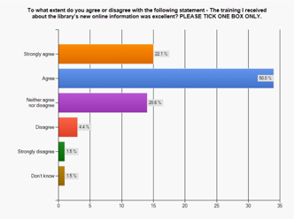

## Staff training

Two-thirds of staff said that they had received training about the National Information Offer. Amongst those who had received the training, almost three- quarters said that the training was excellent. Just 6% of those that received the training disagreed. The kinds of training that staff said they had received reflected the focus on the particular pilots where staff provided feedback and where there were shared themes. Consequently, health and finance scored especially well. Staff were also asked whether there were any other areas where they felt it would be particularly useful to have further training. In response to this, and reflecting the current economic climate, library staff responded by highlighting training around employment opportunities and business information. These themes should be included in the development of any further training packages, whether national or local. Emma Franklin Jun 15, 12:07 PM Added Text

---

<!-- PAGE: 38 -->

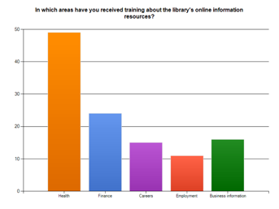

## Staff perceptions

Three-quarters of staff responding to the survey felt well-prepared to communicate the library’s new online offer and even more said that it was easy to access and log on to the pilot’s online pages (83%). However, this does indicate that around 25% felt under-prepared. In addition, almost one in five staff identified issues with the library service’s computer equipment, which could mean that it was difficult to get online.

---

<!-- PAGE: 39 -->

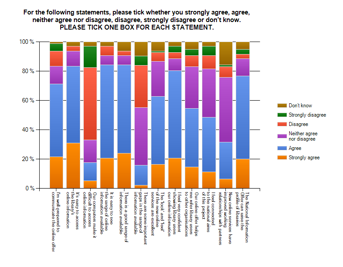

Like the members of the public, staff felt overwhelmingly that it was easy to see the range of online information available and that there was a good range of online information available (84% of staff agreed to each of these questions). Importantly, the majority of staff feel confident showing library users how to use the library’s online information, with 80% of them agreeing with this statement. However, that leaves a significant 20%, a fifth of the workforce, who feel less confident and who would therefore need further training and/or support to deliver the national information offer. On the more open question about whether there were important gaps in the current range of information being provided by the pilot libraries, staff were more circumspect with 40% of them neither agreeing nor disagreeing. In line with public feedback, staff are less supportive of the ‘look’ and ’feel’ of the new online offer, with only six in ten agreeing they are excellent. This suggests that staff see that there is a potential for improvement in this area. It must be acknowledged that the websites were developed within a very limited time period, but more could be done to improve their appearance and usability in the future. Staff are also less positive as to what extent their involvement with the National Information Offer has connected them with staff in other service areas, with

---

<!-- PAGE: 40 -->

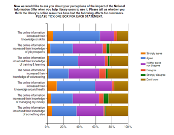

partners and with the national aims of the project.  These three areas can be critical in building the profile of the library service and connecting with larger government agendas.  In developing the offer further it will be important to create further practical relationships with partners, so that staff engage with this important area of work, as well as with the wider social good that can arise from libraries’ work in this field. However, it is important to see this feedback in context, and the vast majority of staff in the pilot authorities think that their library online offer has improved in the last twelve months. Three-quarters of staff think their online resources have improved during this period. Staff perceptions of impact The public have already said that they are most likely to be using the pilot information to increase their knowledge and skills and seven in ten of this group said that the pilot online information had an impact.  Mirroring this finding, library staff are most likely to identify this as an area of impact (about two-thirds of them do so). The second area which is identified by library staff as having an important impact is ‘health and healthy lifestyles’ information, with over half saying that this information had an influence on their interactions with the public about these matters.

---

<!-- PAGE: 41 -->

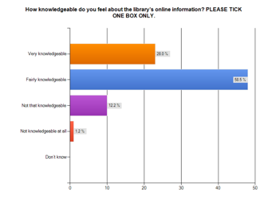

Another significant but expected finding is that staff often say they cannot know whether these interactions have had an impact because they are unable to follow up with customers. They rarely get feedback beyond the initial interaction, and cannot therefore see the outcomes arising from information provision and how this interplays with other factors. Staff perceptions of their own knowledge Library staff have been providing information via the internet for many years now and it is a core part of their skillset. In line with their confidence about providing information and advice about online information, 85% of library staff perceive themselves as knowledgeable about the library’s online offer. Where staff felt less knowledgeable, this might be attributed to the short timescale of the project, as some pilots found it difficult within that time to brief all staff who might need to be informed. Overall staff perceptions of online information 88% of staff are satisfied with their library’s online information, and just 4% are dissatisfied with it.  These positive findings closely match the public’s satisfaction levels with their experience of using the pilot online information offer.

---

<!-- PAGE: 42 -->

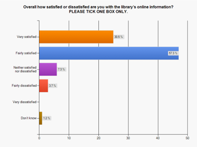

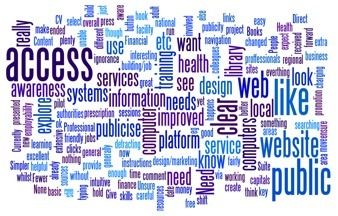

## Staff areas for improvement

The main areas for improvement identified by staff mirror those of the public: raising awareness of what is on offer, improving the web design and improving navigation to and in the sites. The wordle below is illustrative of the key issues for the staff: .

---

<!-- PAGE: 43 -->

# 6. Partnerships

6 Partnerships

## 6.1 Local partnerships

Many partnerships were involved in the delivery of the projects at local level. These tended to be a mix of existing partnerships, which were very often strengthened by the opportunity to work together on this project, and new ones developed specifically to support it. A variety of approaches meant that some pilots, for example Yorkshire and Humber, focused primarily on partnership working across the library authorities involved, creating opportunities for networking and sharing of expertise among staff. Others worked with partners, e.g. from the voluntary sector, to shape the information offer (see the example of Brighton & Hove below) or to communicate it (e.g. Thurrock, also below), and still others involved partners in aspects of the delivery, for instance in Kent where partners such as Job Centre Plus, Next Steps, and Connexions support the delivery of the Work Clubs hosted in nine libraries. Whatever the partnerships entered into for this project, all were critical to the shaping of the direction of the respective pilots and the outcomes. Some examples include: Brighton & Hove worked primarily with voluntary sector partners through the Brighton & Hove Advice Partnership of local voluntary sector organisations that provide information, advice & guidance services (16 organisations in all). The partners were able to exchange information about their respective services, and many provided feedback on the website, both content and structure. The library service found that partners were “surprised and delighted” to find out about libraries’ information offer and how it could support their work. Manchester engaged with a number of agencies offering information and advice relating to employment and careers options, including self-employment, Ask About Business members, Blue Orchid, EDU, JobCentre Plus, and regeneration areas. They received very positive feedback and are committed to maintaining the contact. The project was felt to have strengthened relationships with partners, for example the Economic Development Unit: “Integrating the new job seeking pages with the Ask About Business service will make for an even better resource that will help providers of skills, employment and business start up services to signpost and refer our residents to the support they need at a time they need it”.

---

<!-- PAGE: 44 -->

Teun Van Rooj, Regeneration Officer, Manchester City Council Thurrock worked closely with the authority’s community development team and the local Active Citizen Entitlement partnership to promote the website and develop a training programme, although on-going restructures in those teams as well as that in the library service did present some challenges. Kent worked closely with their existing Work Clubs partners (e.g. Job Centre Plus, Next Steps, and Connexions) to promote the use of the resources during sessions. They also worked with local authority colleagues to develop the portal to the online resources, suggesting appropriate links, and with a wider group (including NHS, CAB, SE Capability forum and Money Advice colleagues) to ensure that obvious resources were not overlooked. This partnership approach appears to have raised the profile of the library service, and its role in identifying and making available good sources of information, among council colleagues. A stakeholder workshop held towards the end of the pilot identified the following challenges for partnership working experienced by the participating authorities:

* Partners may have different agendas that do not always match your own

* Many have misconceptions of what libraries actually do that have to be

overcome before joint working can be progressed

* There can be tension if partners feel that the library service is trying to

take over their role or duplicate their efforts

* It is essential that partnerships are embedded between organisations, not

individuals; if between the latter, they collapse when that individual changes role or moves on

* Today’s partners may be tomorrow’s competitors, especially in the

context of the rush for funding under strategic commissioning

* Partnerships that work at a national level do not always work locally;

messages may not have been disseminated downwards, or may conflict with local priorities Many, if not all, of these challenges can be overcome with good planning, good communications and a collaborative mindset, but that does not mean that they should be underestimated.

---

<!-- PAGE: 45 -->

## 6.2 National support for partnership working

National support can play an important part in encouraging local partnership working through the clear communication of information about national partnerships and guidance on how these can be pursued locally (despite the final bullet point above), and through advocacy about the role of libraries – see 8.4 below. There is also a role for national advocacy for the importance of partnership working at a variety of levels (national, local strategic, local frontline) in the delivery of this as, in many other services and projects. Perhaps the most important partnership that underpinned the delivery of this pilot study was that between national bodies (the Society of Chief Librarians and Arts Council England) and local (library authorities and consortia). This has demonstrated that:

* National support is important to the success of local initiatives, adding

capacity and facilitating the sharing of experiences and learning

* National bodies can offer local authorities a framework for advocacy,

developing messages that are applicable across the public library network and giving structure to an advocacy campaign

* Local library services have appreciated the structure and support that

having a project manager has brought to the initiative

* Working together, national and local partners have been able to identify

where national support could most add value to the provision of the proposed National Information Offer at local level, through: oa framework for the online portal oidentification of national resources to be highlighted odevelopment of an online training package odevelopment of strong national partnerships oongoing advocacy for the role of libraries in this field

* The need for local branding has to be considered and built into any

future framework or portal

* Use of the resources will need to be measurable at a local level, e.g.

through website hits, page views etc.

---

<!-- PAGE: 46 -->

# 7. Case Studies

7 Case studies It was perhaps unsurprising that some customers preferred to use the resources unaided, given that many deal with quite sensitive subjects. However there were others happy to have their story told, although their real names have not been used. Trudy (Brighton & Hove) Trudy was visiting Jubilee Library to find books on green energy and being an ethical consumer. Trudy is in her mid 30s and, though she has a computer and internet access at home, she uses the library to do research as getting out of the house helps her focus and avoid distractions. She got talking to a member of staff and complained of her frustration with mainstream banks and the economy in general. She was finding the recent rises in fuel costs challenging and was interested in finding out if green energy could be a cheaper option. The member of staff showed Trudy the Money Matters Online pages and she was surprised to see the range of resources that could help her with her enquiry. These pages have a financial inclusion focus but the issues that affect financial inclusion are varied. Debt management and welfare benefit information is important, but not everything. Even those (like Trudy) who manage their mortgage and credit card payments well, gain from information about finding an appropriate bank account and managing their utility bills. They looked at the Savings, Money and Banking pages for information on ethical banking, and the Consumer Advice pages to find a variety of information on switching energy supplier and advice on what help is available to install green energy alternatives. While Trudy didn’t start the online process in the library, she was pleased that she would be able to re-find all the links at home easily from the library home page. She now knows how and where she can compare bank accounts to find one that’s ethical and plans to switch her energy supplier and add more insulation to her home. Trudy said: “It’s really useful having all this information in one place; I think I’ll be able to make real savings.” Justine (Brighton & Hove) Justine was visiting Jubilee Library to meet a friend. She works nearby and finds it easy to meet friends there as it is central and the café is nice. A member of staff was in the foyer launching the new Money Matters Online pages and

---

<!-- PAGE: 47 -->

approached her in passing to show her the online Financial Health Check from the Money Advice Service. The stand in the foyer had lots of information from local advice services, posters and leaflets, and had laptops available to show passing library users the Money Matters Online Pages and the Financial Health Check. Justine stopped when she was offered a leaflet and agreed to take the test. The Financial Health Check gives independent, free and unbiased advice to help you make decisions about your money. You don’t need any paperwork and it only takes 10 minutes to get a personalised step by step plan. The Financial Health Check is linked on the first page of Money Matters Online, as it was thought the 10 minute test would be a good introduction for those who weren’t really thinking much about finances. If they were intrigued enough to take the test, they would be pleased to find all the other online resources close by, especially if they were prompted to act on the plan they were given. Justine was interested to see what the results would be. She’s not yet 19 and has just started her first job after college. The test encouraged her to think about building up some savings. She said: “I think it’s good; they didn’t teach us much at school about finances and I’ll definitely look at this again if I have any questions.” Charlotte (Kensington & Chelsea) Charlotte is in her mid-30s and has not worked for several years after starting a family. She has recently started looking for part-time work. However she feels a little unconfident and out of the loop, despite knowing how to use computers. She has been using her free time to look for job vacancies and information on the computers in Kensington Central Library as she doesn’t currently have PC access at home. Charlotte feels comfortable in the library and has visited it frequently for a while so is happy to spend time there as it is a friendly environment. She is aware that she can ask staff for help if she needs extra support and was referred by a member of staff to the jobseekers resource when she told them she was looking for work. She liked the lists of useful websites because otherwise she spends a lot of time looking on Google for information, and she was also pleased to be able to print guides and take them home to read. She had been concerned that her skills might be too out-of–date, but was pleasantly surprised to see,  after reading the appropriate guide, that she had plenty of “employability skills”  to go with her previous experience. She trusted the resources presented to her on the website and was happy to use them as part of her job-seeking “package” to give the information and advice she

---

<!-- PAGE: 48 -->

needs.  She feels it has increased her employability skills and she is more confident looking and applying for jobs now. The member of staff who had helped found the experience equally positive: “It’s useful to be able to point a customer towards one resource for jobseekers help rather than try and find them lots of different resources” Bill (Kent) Bill is in his early 50s and has been unemployed for 6 months. He was made redundant after working in an administration post for 11 years with the same employer. He has attended the Ramsgate Work Club regularly for six weeks. This is one of nine Work Clubs held in Kent Libraries. These provide:

* basic help with on-line job searching, creating or updating CVs,

application form assistance

* a regular meeting place for members of the public seeking employment

* a comfortable relaxed opportunity to meet people in the same situation

* a welcome pack including memory stick and detail of the library offer

* use of public computers; free printing, photocopying and postage (for

applications); stationery and refreshments

* opportunities for interventions from partners e.g. Job Centre Plus, Next

Steps, Connexions (depending on local arrangements) They were set up with some funding from Job Centre Plus and the help of staff from Kent County Council’s Supporting Independence Team. Bill was referred to the Club by the local Job Centre Plus. He came looking for information on local training courses and current vacancies. He finds the library a nice, welcoming environment and the staff (in practice a mix of staff, partners and volunteers) very knowledgeable. The combination of good resources, informative staff and help in producing a strong CV have really boosted his confidence and self esteem after struggling for so long on his own. Bill has said that “without the support” he has at the Club, he does not believe he “would be attending an interview tomorrow”. Other users have been equally positive: “I [learned] how to apply for jobs on computer via online at my local library” “I feel I have support where before I felt so alone”

---

<!-- PAGE: 49 -->

I “get support with the computer and develop new skills when using web to search for employment. I will apply for more varied jobs, and be more confident about my abilities” I am “using the computer skills I have learned to work on my own job searches” "I learnt more in my first 2 hours here than all of my visits put together at the job centre" Ali (Leicestershire) Ali is in his 70s and under investigation by his doctor for blood pressure concerns. He wanted to know more about the condition and what it could mean to his way of life. As a volunteer in the library he was made aware of the fact that health information could be found online by way of the advertising campaign in the library. He decided to investigate more about the condition using the online web resource to help him gain more understanding about high blood pressure and what it would mean to him. Ali was told how to access the resource by a member of library staff. He doesn’t usually use the public computers in the library because he’s too busy with his volunteering responsibilities, but he does have access to the internet at home. This was the first time he had tried to access health information over the web. The website took him to the NHS Choices website where he found the information he was looking for: the range that blood pressure should be within, what he can do to help control his blood pressure levels and what it would mean for his everyday activities. The website contained the information he was looking for and he found he could access this without having to use a search engine. He felt the information could be trusted as he had been directed to it by the library service and also because it was from a NHS site. He said that, “the information I found was useful and helped me feel more confident in understanding what the doctor was telling me”. George (Greater Manchester) George had been made redundant from a job after 23 years in employment and as a 50+ man felt completely out of his depth job hunting.  He has been a regular user of library IT 1-to-1 lessons, and working on improving his computer skills so that, in his own words, he “can keep up with the youngsters”. George feared he was outdated as he had never written a CV and was painfully aware that the jobs market had changed considerably since he was last out of work. George wanted help creating a new CV and needed unbiased

---

<!-- PAGE: 50 -->

straightforward information enabling him to be self sufficient and not have to ask for too much help.  When job hunting, he was worried about going to recruitment agencies, and he also wanted to know if his 20 years of work experience translated into relevant job skills for today's market. Research shows that a person is more likely to find employment within 6 months of redundancy.  The chances of finding work are significantly reduced the longer a person is out of work. George knew this and felt waiting for an appropriate course or appointment with an advisor was taking up important time.  Having immediate access to online resources and help to start his CV straightaway gave George a greater sense of control over his future. George definitely now feels “up to scratch”, especially after taking time to complete the Skills Health Check on the National Careers Service website, and he realises he is employable. Being able to find these jobseekers’ resources has made George feel more empowered and he is now able to independently email and upload his CV to apply for jobs. He also feels far more confident about attending interviews. “Having all this stuff in one place makes it so much easier than having to go on different websites that might not be as easy to use.  It’s great especially as I can use it in the library and know that the staff will help if I get stuck.”

---

<!-- PAGE: 51 -->

# 8. Conclusions and Recommendations

8 Conclusions and recommendations This evaluation aimed to identify to what extent the projects piloting the National Information Offer demonstrated some of the outcomes of the logic model (section 2). As indicated in that section, the limited scope and timeframe of the study meant that some have proved easier to evidence in the limited time period than others. There is more work to be done on evaluating the impact of access to these resources on users, through a qualitative study of some user experiences, and on further developing the advocacy messages. It is important to remember that this pilot project was just that – a pilot. A major aim was that the initiatives supported would demonstrate how they could be scalable to national level to support the delivery of a public libraries’ National Information Offer. One of the key areas of learning has been around the nature of which elements of such an offer could indeed be national, and which are best provided locally. The following conclusions and recommendations are presented through the lens of that local / national debate.

## 8.1 Website and infrastructure

The evaluation of the pilot resources and how they were used has shown that a mix of local and national resources would be necessary in order to provide access to the fullest possible range of information for users. Individual public library services, as part of the local authority and having the expertise to assess information sources for accuracy, reliability and relevance, are ideally placed to broker the local level gathering of appropriate information resources. But in scaling this project up to cover the whole country, it will be important to develop a framework that allows for national support and quality control alongside that flexibility to determine and provide local resources to meet local needs. The experience of Kent Libraries also demonstrates the way in which a library service can work alongside corporate partners to bring the skills of library staff to bear on the selection of local online resources whether or not these are to be presented through a library-specific portal. It would also be extremely helpful for support and guidance to be given to each authority or consortium regarding the nature of that local content proven (through this pilot) to have been of most value to users. That guidance should also set out good practice in the design and presentation of the online resources, including the need to:

* avoid acronyms and jargon

---

<!-- PAGE: 52 -->

* use clear English

* ensure all links work, and lead to the resource that they are described as

leading to

* be easy to navigate, especially for inexperienced users of online

resources

* use colour and other design features to enhance clarity but not to over-

complicate the pages

* provide clear, succinct descriptions of each resource that guide users

easily to the ones most appropriate to their needs

* make evident the role of the library service in providing the information

and offer pointers to other sources of support offered by the service and partners At both national and local levels, the capacity has to be identified to maintain the content, reviewing it regularly for accuracy and checking all links work. The latter could be supported through good partnership working, with partners primed to inform the library service of changes to their own websites that will impact on the information offer portal. Libraries should also consider opportunities to enter into syndication arrangements, e.g. with elements of NHS websites. This would draw the key elements of these sites through to the library portal and reduce the work of updating items and checking links. Examples of how this might work were identified by the West Midlands pilot, and include:

* providing access to NHS Local Services and Support Groups through a

“Near Me” link to http://nhslocal.nhs.uk/

* providing access to http://www.nhs.uk/Pages/HomePage.aspx which

would support users in checking symptoms and understanding other health issues The Society of Chief Librarians has an opportunity to explore the potential of the development of a “single digital presence” for libraries by OCLC to act as the portal for the National Information Offer. It is recommended that this is pursued to identify to what extent it could provide the framework that this evaluation has shown to be necessary.

## 8.2 Workforce development

The user survey has highlighted the high levels of trust placed in library staff (and by extension, in volunteers), and confidence in their skills and expertise.

---

<!-- PAGE: 53 -->

It is essential therefore that those leading the development of this offer, at local and national levels, are clear themselves, and ensure that staff are clear with users, what they are able to deliver themselves, and what services they are also able to refer people to.  Workforce development therefore needs to focus on:

* developing this clarity about the offer among staff and volunteers

* ensuring that they know and can use the resources on offer (paying

particular attention to those subject areas highlighted by staff in the survey such as employment and finance)

* ensuring that they have the necessary skills to support users

A wide variety of training methodologies was used by the pilots, including face to face training sessions and briefing, and online tutorials, webinars and video clips. It is impractical to suppose that face to face training could be provided on a national scale, so it is recommended that an online package of training be developed which could allow for and be supplemented by face to face sessions locally if required. Past research (into the Frontline training developed by Branching Out) indicated that as a group, library staff were more receptive than the average to online training methodologies. Before developing this package, work should be undertaken to define the skillset needed. This should include the identification of clear parameters as to what is appropriate for the role (signposting towards information, support in using online resources, identification of trustworthy sources) and what is not (diagnosis of health conditions, advice on issues of money management or debt). Those developing it need to start from a consideration of the skills that a user needs to develop in order to move from being offline through to being online and thence to being able to conduct transactions online. From this will emerge a clearer idea of the skills library staff need to have if they are to support this journey. Other areas to be covered are likely to include customer care, the enquiry interview, and awareness of individual resources (for example, staff in this study indicated that they would welcome further training on employment opportunities and business information). Once the skillset is clearly defined, a survey of existing staff skills could usefully identify which of these skills needed to support the delivery of the National Information Offer are already well embedded within the workforce, and which would benefit from further development. Training activity needs to involve volunteers and partners as well as library staff, and be accessible and realistic for those working limited part-time hours. Consideration should also be given to making some elements of the online package available to the public as part of the guidance on using the resources.

---

<!-- PAGE: 54 -->

Any online training should, wherever possible, be augmented by local face to face training and embedded in broader workforce development activity covering (but not limited to) customer care and general IT skills. As with the online resources framework, the challenge will be to do at national and local level what works best at each, and build into national activity the flexibility to accommodate local difference.

## 8.3 Partnerships

The pilot projects have all sought, mainly successfully, to work with partners at a local level. Some new partnerships have been formed and existing ones strengthened. It is evident that partnership working adds real value to the library service’s provision of online information. It ensures that what is offered is much more than a simple list of links by helping to build a local framework and context for the links. Partners have also been involved in assessing the choice of resources, providing training for library staff, promoting the resources and running in-library events such as Job Clubs. Libraries have been seen to be supporting the delivery of partners’ own priorities. It is not yet evident that a real understanding has been developed of the value of this work to the partner, which is important within the context of strategic commissioning. Public library service leaders need to be clear about the cost of such activity (using a robust activity-based costing methodology) and its value, and to work within a commissioning framework to identify sources of funding for the activity. The pilot projects working on health information have identified a particular opportunity linked to the transfer of responsibilities for public health to the local authority. This could open up new doors for library service involvement in this field which should be pursued. It is important that clear parameters are established with potential partners. They may have concerns that the library service is trying to take over their role, for instance in providing advice, and library managers need to make clear the distinction between the library skills of assessing information resources, signposting and supporting, and the acknowledged specialist advice and guidance skills within the different sectors, e.g. health and money management. At a national level, there is still more work to be done to develop partnerships between library services and those who lead or support them (including the Arts Council and Society of Chief Librarians) with Government Digital Services, Broadband Delivery UK and others, although this project does appear to have opened a few doors; Arts Council England have already established a

---

<!-- PAGE: 55 -->

partnership at national level with the Government Digital Service to look at the potential for libraries to contribute to online delivery of government services and Assisted Digital, and this will be an important foundation in taking this work forwards. All of the above points towards the importance of partnership working at a variety of levels (national, local strategic, local frontline) in the delivery of this, as in many other services and projects. This pilot project has identified some potential partnerships, but there remain many more to be explored and developed in order to make the National Information Offer a success.

## 8.4 Advocacy

This pilot has demonstrated the role of public libraries in providing access to trusted sources of information. It has also emphasised the need to advocate for that role in a world where online access to information can mean that less experienced users of the internet in particular find it difficult to weed out those they need (and can trust) from the overwhelming number of resources delivered to them in response to a general search. For such advocacy to be effective, it is essential that key audiences are identified and targeted with appropriate messages. The audiences will include:

* government, both national and local

* potential partners, again both national and local

* other providers of information

* library staff, especially those delivering the offer

* users and potential users, especially those most in need of the support

offered by the library, i.e. the “coulds” in the term used by the Assisted Digital programme The advocacy messages should be shaped around the following points; many of these are not new, but bear repeating in the current context:

* Public libraries provide an extensive local network with an existing

customer base, easily accessible to most households in the country

* They provide excellent value for money as much of the infrastructure

(buildings, IT, staff) is already in place to support the delivery of information on a national and local scale, and indeed is already doing this

---

<!-- PAGE: 56 -->

* This research has confirmed the findings of previous studies, that

libraries are viewed as a trusted source of information by a large majority of the general public, and noticeably higher than other such sources

* Librarians have the necessary skills and knowledge to identify trusted

sources of information and present them in an accessible way

* Library staff have the necessary skills and experience to be able to

support members of the public in accessing these resources, including those with limited digital skills In advocating for the role of public libraries in delivering this agenda, links should be made to strategic commissioning. Those leading public library services need to be clear in saying that an important service is being delivered, and it has a real value.

## 8.5 Summary of recommendations

For the Society of Chief Librarians and Arts Council England Advocacy

* Develop a programme of advocacy for the role of public libraries in

delivering trustworthy information, building on the evidence from this study that users: otrust library staff more than most other providers ooverwhelmingly said that they would recommend the library’s online information to other people osaid the online support had improved their level of understanding (over 80%) and that the online information had improved their knowledge and skills (almost 70%)

* Use this to communicate with national government and national partners;

provide support and encouragement to advocacy at regional and local authority level, including the development of shared messages

* Consider commissioning further work to provide more evidence of digital

champion role of library staff in supporting others to use digital resources, including qualitative research into the impact on the end user

* Work with national partners, including the Government Digital Service,

Broadband Delivery UK (BDUK) and Go ON UK, to position public

---

<!-- PAGE: 57 -->

libraries as one of the key consortium partners in delivering the government’s digital strategy and support for Assisted Digital

* Work with national partners to advocate to government for the

development of a delivery and funding model to support people through Assisted Digital to use online government services Supporting users

* Commission further work focusing on identifying and helping

the “coulds” to overcome barriers to them using online information

* Undertake a skills needs assessment to define the skillset needed by

library staff, volunteers and partners in order to equip them to support those users who most needed assistance in accessing and understanding information provided online

* Develop a package of training, probably online, based on the above to

support the roll-out of the national information offer Information resources

* Develop a framework of content that allows for national support and

quality control to determine and provide local resources to meet local needs

* Identify the technical requirements and platform to deliver the above

* Develop guidelines for the development of information portals that take

into account the needs of more reluctant and less experienced users of digital services for: oclarity and ease of navigation ouser-friendly presentation of information oclear communications about the range of information available in libraries and how to access it

* Work with OCLC to explore the potential of the development of a “single

digital presence” for libraries to act as the portal for the National Information Offer For local authorities and local library services

* Identify and work with local partners to build an understanding of the

most useful and accessible online resources to meet local information needs

---

<!-- PAGE: 58 -->

* Set out clear parameters for partnerships, including clarity about the

roles and responsibilities of each partner

* Involve frontline staff from both the library service and its partners in

areas of work such as the identification of local information resources, development of websites and communication of the offer to potential users

* Investigate the opportunities created by the transfer of responsibility for

public health to local authorities

* Work with national partners to ensure the development of online

resources is appropriate to and compatible with local IT capacities and needs

* Work with national partners to ensure the development of an online

training package is compatible with local training programmes and needs; commit to embedding this training within programmes for staff development

* Build the dissemination of the online information offer into marketing

strategies and communications plans

---

<!-- PAGE: 59 -->

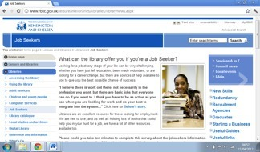

# Appendix A: The Websites

### 1. Employment and Careers: Kensington and Chelsea Libraries (with Hammersmith & Fulham and Westminster) This provides a really strong example of an evident partnership between the library and another service – it is immediately clear that it is embedded within the library service from the menu on the left and the presentation of text within the first and third paragraph to link library services with job-seeking resources is extremely effective. The layout is also clear and very user-friendly with bold and non-bold text deployed to draw attention to different sections. The case study with picture is relatable and provides a good early hook for reading on further, and the placing of these case studies throughout the site is interesting and appealing. The main page offers clear headings in bold, with obvious hyperlinks underneath and short descriptions as to how each would appeal to a jobseeker. It would be useful for the text to make specific reference to the links on the right for further information, as these can get slightly lost due to the fact that there is enough content on the page to ensure scrolling down and therefore losing the links. At the bottom of the page is a great example of an inviting link

---

<!-- PAGE: 60 -->

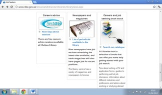

that relates each resource back to how the library can help, so that the library remains at the heart of this project all the way down the main page: When using the links on the right, it was slightly disorientating that on each new page, the order of this menu changed quite considerably. It would also be helpful for a user if the jobseeker section of the menu contained the word “home” or “home page”, particularly if the menu order cannot be rearranged to be the same on each page, as it is otherwise confusing to navigate back to the home page without resorting to the back button. Additionally, the heading “recruitment agencies” does not adequately suggest how useful this page is, in that it contains very local information; perhaps the heading could be changed to “local recruitment agencies”. Overall, the site consistently makes reference to how the library can help with all the different aspects of job-seeking and does an excellent job of publicising the information offer. Manchester Libraries Whilst the tagline “Libraries supporting businesses, jobseekers & consumers across the North West” appears on the home page of this site, it is not repeated on this page and it would be very relevant to have this reminder. Additionally, the library, and its role in supporting jobseekers, is not referenced at all on the home page, which seems a missed opportunity.

---

<!-- PAGE: 61 -->

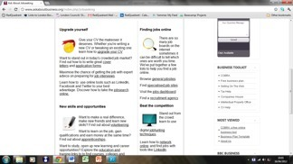

The business bookmarks on the right of the page are difficult to read as they are not separated from each other in a clear layout and the titles are not particularly informative. The top one currently reads “[to read] 6 Habits of True Strategic Thinkers | Inc.com” and it is not evident as to why this might be a useful resource for a jobseeker – interesting, but possibly not immediately or obviously helpful. Similarly, the bookmarks further down the page do not refer directly to job-seeking, but seem more pertinent to other sections of the site. It would be useful to have “most viewed” at the top, but also to have some more specific links to job sites  such as JobCentre Plus. However, these are the constraints inherent in being part of a wider website (Ask About Business) and the benefits of this outweigh these downsides. The visuals on the page break up the text and are attractively colourful, although the pictures are not necessarily relevant to the sections e.g. a picture of a medal does not suggest writing a CV. There is good use of videos throughout the site, which look engaging and are easy to follow. Whilst the text itself is kept very compact within its table, which is useful as it is not overwhelming in volume, the layout is not intuitive to navigate and can prove somewhat confusing. The section headings are not informative – “upgrade yourself” means very little – and the several links that are currently underlined leads to a proliferation of information that does not appear very well- organised. This is a shame, as the links themselves are extremely helpful, and the layout on the click-through pages is actually far better than on the home page, with their use of colour for the links and the line separations between them. The home page would benefit from a slight reshuffle, either utilising bulleted lists or incorporating more space between links and using more colour.

---

<!-- PAGE: 62 -->

The information on the click-through pages is pertinent and with a well- presented tone; and the home page should be modelled on these. The page on CVs makes reference to the library, which should definitely also be the case on the home page and elsewhere on the site. Showcasing a picture of the books available provides a really good visual aid to connect the site back to the physical library, and this would be useful to have on all applicable pages. The choice of tools to include within the site is extremely impressive and shows real creativity and thought as to what is most useful for the customer. Particularly notable is the section around online privacy on Facebook when thinking about applying for jobs, which is a very relevant issue and helpful for jobseekers who may not have considered this as a potential problem. On the page for preparing interviews, there is also a handy tool for working out how long it takes to travel to interview locations; again showing great resourcefulness in what might be most useful. These are the kind of links that should be pushed on the home page – instead of stating the somewhat unoriginal “maximise the chance of getting the job with expert advice on preparing for job interviews”, this could be marketed as a separate section on the home page rather than under the generic “Upgrade yourself” umbrella, e.g. Job interviews FAQs [link] – learn how to ask for a higher salary and what to say if you haven’t worked for a while Pre-interview checklist [link] – questions to ask in advance and thinking about what to wear Plan your journey [link] – don’t stress about being late to your interview; have a look at our handy travel guide and work out travel times This clarity of presentation should also be extended to the jobs page so that these guides are heavily emphasised as “Guides to…”with the separate links beneath. 2. Finance Brighton and Hove Libraries This page is very clearly embedded within the library service and the first line of text states that all links are vetted by the library; this is strong linkage. There are clear links to follow, though it would be helpful for each link to sit alongside a one-line summary as to what is available e.g. in the Children and Young People section, there is also information for parents and students, who may assume from the title that this section would not contain anything specifically relevant to them.

---

<!-- PAGE: 63 -->

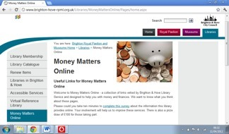

On the click-through, navigation might be made easier by ordering the information by separate headings for the different groups. Similarly in the debt section, a table would be valuable to order links by energy bills, mortgage, loan repayments, help-lines, general debt advice etc., so that a user can easily see at a glance which might be most applicable for them. The information and links could be better tailored for an average user – for example, in the benefits section, there could be more of an explanation about what each link can offer “you”. Assumptions are made that reference to “Direct Gov” will be universally understood and likewise with the acronym MACSS. Similarly the FSA is not explained, nor is the potential usefulness of knowing whether or not an adviser is FSA registered. An indication as to how each of these services could help in individual situations would improve the user experience considerably. There is a good example of such an explanation pitched at an appropriate level in the tax section: TaxAid is a charity that helps people on low incomes with their tax affairs. TaxAid helps people to understand the bits of the tax system that apply to them (safely ignoring the confusing 98% that don’t) pay only the right amount of tax and help them resolve crises when things go wrong. There is lots of good information hiding within the links that the landing page could usefully profile e.g. the money saving expert website, U-Switch services and money facts. Such information is useful for everyone, rather than just customers who are looking for specific topics. Profiling such general, but informative, links on the landing page is more likely to grab the average user,

---

<!-- PAGE: 64 -->

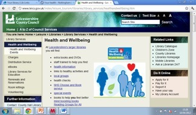

who may ignore links entitled “debt” or “benefits” because they are not immediately applicable. The page could contain more links to further support available at the library – even if it is just the addition of library staff to the “local face to face help” section to encourage anyone unsure about the links or how to navigate to ask library staff. 3. Health Lincolnshire Libraries (with Nottinghamshire and Leicestershire) The three participating East Midlands authorities each developed their own website: Leicestershire This landing page offered the best introduction of any to the fact that this is a library and health services partnership; the links at the top and side clearly show “health and wellbeing” as one of the “library services”, so that a new user is immediately aware of this connection, and the text also supports this. Particularly effective was the simple logo which neatly binds the two together and announces this as a partnership.

---

<!-- PAGE: 65 -->

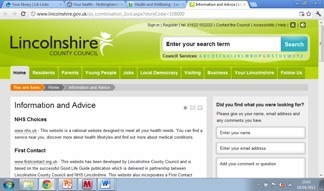

In terms of the offer, further elaboration on the “extra books and DVDs” would be useful, particularly if this was linked more specifically with health, as this would then reinforce the positive messages on the landing page. The hyperlinked words take the user to different sections on the same page, rather than separate pages, which is convenient, and shows how much of the relevant information one needs can be contained to a single (simple) page. The table identifying the three recommended sites was easy to navigate and it was helpful to have a short précis of each site. This could be improved further by incorporating more specific examples. The Infolinx site delivers extremely relevant and valuable information in a very simple format: the name of the group, the location, a description and contact details. The description is the most informative; for many people searching for support, the description will be the deciding factor as to whether they should call or attend a session. This section offers all the information one would need to make this call. The search interface for Infolinx is a little unwieldy with perhaps too many search options. This distracts from the very small “search” button and is not very valuable; most data necessary to find a suitable group is inputted into the main section. The section on HealthSpace on the landing page could be made more relevant with a few examples of what it offers, such as “keep track of your current medications” or “reminders so you don’t miss an appointment”. As a general rule of thumb, the language in the Infolinx and HealthSpace sections could be slightly friendlier / less impersonal than it is currently, by providing some

---

<!-- PAGE: 66 -->

specific examples, or even, in the case of Infolinx, offering some message of support on the theme that sometimes one just needs a helping hand or similar. At the bottom of the main page, the text states “All the county’s libraries have a good range of health resources and information”; this offers a fantastic and under-utilised opportunity to shout about such resources. It would also be a good space to say what one should do in the event of there not being the right resources (i.e. ask library staff) and therefore close the text with a reminder about how this ties into the physical space of the library setting. Lincolnshire

As a first impression, there is nothing about the headings or links to connect this page with health services or the library – the title “information and advice” is too general to suggest any such links. The layout is also very linear and monochromatic, which is not particularly appealing or intuitive to a new user, and attention is not likely to be grabbed by anything in particular. The information around First Contact is likely to be of little interest to most service users – the relevance of its evolution is far less than that of its actual offer, and there are four lines of text about its context before it is specified that it is for people over 60. This should be more immediately prominent, and the text should focus on what this service is offering, to whom it is offering it and why it is on this page. This is similarly the case with the social care section, which currently offers only a link – looking at it, it is not clear why a user should want or need to look for further information by clicking through. Both of these sections should contain simple explanatory text so that a user is quickly appraised as to whether or not the click-throughs will be of use to them. The current headings are very lengthy and should be shorter so as not to be overwhelming in the multitude of large bold text on the page. To compensate for this, the text following each heading should provide slightly more description and examples of specific services as to what might be useful and to whom, rather than just a link. An example of one heading that is rather wordy is: Advice for Careers (sic) and the services that are available to them NHS careers (sic) advice www.nhs.uk/carersdirect/Pages/CarersDirectHome.aspx - NHS Choices Carers Direct information, advice and support for carers.

---

<!-- PAGE: 67 -->

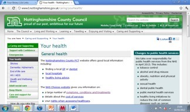

And the other problem with this section is that it is unlikely to get many click- throughs from carers, as the current typos indicate this is a section for employment within the NHS! Apart from the First Contact section, there is little information that is local on this page and no further signposting to the role that libraries could take in supporting a user further. The text could be greatly improved by adding more personal information to each link, such as specific examples of how each link may be useful, and further information that libraries can offer would reinforce the message that this is a partnership between libraries and health service. At the moment, there is nothing to suggest such a partnership. Nottinghamshire At first glance, there is nothing on this first page of Nottinghamshire’s website to suggest the connection between the library and the health service, nor that this is a pilot project; something to connect the two would be useful in raising the library’s profile. In terms of usability, the Nottinghamshire County PCT page is much stronger and more engaging; it might be an option to form a partnership with the local PCT around this initiative so that its landing page could incorporate more library-specific information around health and then be used as the main landing page for the library instead. It seems to have most of the information that is also on the current landing page and would provide a far more obvious link between the library and health services.

---

<!-- PAGE: 68 -->

The page could be presented in a much more user-centric style; for example there is currently no support offered if a user is unsure about computers or would like to know who to speak to for further library resources. Navigation is clunky, with the menu on the left offering choices that do not seem to fit together and are rather too specific to be very helpful. It may be better to give further thought to what links may be more useful, such as a link through to the NHS choices webpage, which provides condition-specific information in a much more user-friendly fashion. The information to the right of the page does not seem especially relevant or useful to the average user; whilst it may need to be somewhere on the page in accordance with council policy, it should be at the bottom or on a further click- through. The headings are very broad-based and as such, are not very useful in ordering the page into clear sections; instead of “General health” as a section, the text could provide an introduction to the library’s new partnerships with health, the existing links on the site already and further information that can be accessed through the library. The information underneath the heading “Specific conditions” could also become part of this main text, as a list of conditions can never be all-inclusive and the current selection looks somewhat limited. When clicking through to learn more about the information prescription service, there is not a great deal to explain what this service is. Additionally, the click-through website itself does not seem to be extremely well populated – a search under Nottingham Information 4U in the first five areas in the drop- down menu (Ashfield – Mansfield) brought up only the statement “Sorry no results have been found.” While other areas of the site offered more information, this statement, particularly when no further suggestions are offered as to finding further information, could mean it is dismissed as a resource by a user. If this cannot be addressed in the prescription site itself, perhaps the landing page that points toward it could make recommendations as to which sections contain most useful information and for which user groups.

## West Midlands Libraries

The landing page for the West Midlands is very clean and well laid-out, so that it is easy to navigate and clear to a new user. The short and snappy headings with further explanatory text mean that the page navigation is very intuitive. The colours of the page, whilst uniform, and therefore contributing to the overall clean lines, are almost entirely grey, with some blue, which does appear

---

<!-- PAGE: 69 -->

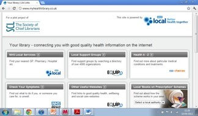

slightly less friendly than perhaps a brighter colour would. Logos are well represented, and of an appropriate size, so that they can be easily identified without detracting from the text in the boxes. Although the Society of Chief Librarians’ logo and the library’s participation in this pilot project is evident, the number of NHS logos means that the page looks very NHS-based and it is less obvious than it might be that the library service is promoting a link between itself and local health services. One suggestion might be to have an additional box detailing some of the resources available from the library around commonly searched conditions or something similar. The emphasis on providing “good-quality” information was understated but reassuring at the same time. This seems to be a good strap-line to use when publicising the information offer; i.e. a user should not expect to source everything in the local area, but only tried and tested sources. The YouTube guides need to be more prominent on the page, as well as more clearly explained – it isn’t easy to see, from the link, for which sections of the website they would be useful. It may even be useful to include the links within the boxes to which they refer; e.g. the guide to Books on Prescriptions could sit in the relevant section. The YouTube links could also open in a separate window, and warn the user they will do so, to minimise disruption to the landing page and facilitate comparisons between the video and the actual page.

---

<!-- PAGE: 70 -->

The section on the Books on Prescription service needs perhaps to introduce the concept in greater detail, as it is not clear why this might be interesting to a user. Compare the following, which is from Coventry’s website: The scheme enables doctors and other health professionals to "prescribe" self- help books that may help you with a range of common problems, including depression, anxiety, stress and panic attacks. The self-help books have been carefully chosen by health professionals. Each title is tried and tested and has been found to be effective by other people. Clicking through on the area-specific links to the Books on Prescription service, the first option, Birmingham, links to an empty council page, which is off- putting, especially if one clicks on this to get an overall sense of what this new service is. Similarly, the links for Sandwell, Shropshire, Staffordshire, Stoke on Trent and Telford click through to generic council pages rather than anything about the Books on Prescription service. We understand that once all the authorities have developed this service, the links will be updated, and in time this will present a useful link between libraries and the health service. Overall, the site is well-presented and easy to use, but it does seem that there might be more about the library service and its relationships with the health service. This could include greater representation at the top of the page, alongside the Society of Chief Librarians’ logo, or feeding into the boxes such as the Books on Prescription service, or a visible reminder about the additional health-related resources libraries can offer. 4. Multiple themes / general digital literacy

## Kent Libraries

Taking into account corporate constraints, this page is colourful and attractive, with clear links to exploring the offer further. The “Get online” section links through to “Our IT offer” which is explained in a friendly tone and contains several useful links, focused on how the library can help.

---

<!-- PAGE: 71 -->

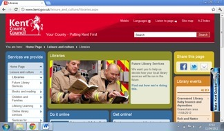

Only the website for external use was reviewed, not the front-end provided on public access computers1. This is aimed at a home user investigating what a library can offer and acts as an introduction to booking computers, renewing books, accessing online reference resources, etc. As a result, the job seeker, health and other relevant sections are hidden, and a user might only happen on it by accident, which, whilst the result of happenstance for this report, also highlights the difficulty that a home user might encounter if attempting to access this information at anything other than a library computer. As a result of this, the job seeker section is hidden, and a user might only happen on it by accident through clicking the link on the home page to register interest in becoming a computer buddy. It would seem very unlikely that an unconfident user would click on a link to become a volunteer helping other people with computers, so that the connection through to services such as job seeker support may not be happened upon. Perhaps the link to becoming a volunteer on the home page should refer directly to the job seeker section and this section also placed in the sub-menu for libraries on the left of the page. The reference to Work Clubs on the main job seeker page, as well as a list of libraries and times, is very useful and provides a good link back to the library’s support function. However the introduction to this page is very specific in that it discusses looking at the financial viability of companies with whom one may 1 A different desktop and browser front-end would be seen by a user in a library setting. These sections were not those developed as part of the National Information offer work. As previously mentioned in this report, those could not be sited within the library section and had to be merged into the structure of the council website. The ‘Signpost’ link from the Libraries homepage and Online Reference library page were missed and the content consequently was not reviewed

---

<!-- PAGE: 72 -->

be interested in working. This seems an odd way to start the page, as it only appeals to certain people. It would be far more effective to keep this as a specific section below, and to begin the section instead with more general information on skills and learning or help with CVs that would appeal to a broader base of users. Whilst the resources are useful, there are currently several grouped together which do not seem to sit with each other very comfortably, including preparation for the citizenship test, resources for teachers and a driving theory test. These either need to be linked more clearly to other sections – e.g. in a specific skills/CV section, there could be a line saying “does a job require you to drive? Click here for support with your theory test” – or need to sit as separate from the job seeker section. Perhaps the bundle of “careers, job seeking and learning” does not work as a single unit and the three should be split into distinct sections under an umbrella of “employability skills” or something similar. Splitting into sections would give each area a narrower focus, which would be extremely valuable to a user and would make the site far easier to navigate.

## Yorkshire and Humber Libraries

The Yorkshire and Humber website makes it immediately clear that this section is part of the libraries’ online learning offering and the information is sufficiently spaced and categorised into sections so as to be easy to navigate. It is, however, very monochromatic without any visual cues except the mouse, which indicates a link, so that, although the text is simple to understand, it does not seem very appealing to a visual learner. Apart from the well-placed title, there is then nothing further on the website to highlight the link between this site and the physical library space. It would be particularly pertinent, given the national agenda to promote digital inclusion, if the link between libraries and the promotion of digital literacy could be stressed to emphasise the library’s role within this agenda. There are several opportunities to do this, e.g. in the family history section, reference could be made to the sections in a library that might be helpful or ways in which library staff could offer support with related research.

---

<!-- PAGE: 73 -->

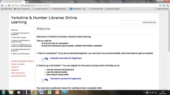

Having clicked through to the first link for exercises for beginners, the instruction is excellently clear and simple for a first-time or unconfident user – “Click anywhere on the image above to go to 'Absolute Beginners'. This will then open in a new computer window.” The inclusion of the link back to the home page at the bottom of the click-through page also really aids navigation. Unfortunately, the existing link to assistance with employment – “How to use Directgov to search for jobs” – currently takes one to the link for researching family history, which could be very off-putting for an unconfident user and is perhaps not very reassuring on a website promoting digital literacy! It also misses a valuable opportunity to publicise additional support with job-seeking through the library2. When clicking through to the section on accessing health information, the video alone does not offer a great deal to the user; it would be helpful to have a link to the NHS Choices website as well as a little more information from the library site as to what a user can expect. Overall, the site could be made more appealing to a customer by the use of a more informal tone and highlighting what may be relevant to a customer on the links e.g. the section linking to Directgov currently states: 3. To learn some basic computer skills whilst searching for a job How to use Directgov to search for jobs 2 Links have been corrected since this exercise was undertaken

---

<!-- PAGE: 74 -->

It may be more helpful to situate this section as: 3. Online help with employment/training Search for jobs online by clicking on this link: [Directgov link] Need help writing your CV? Ask a member of library staff to point you towards our employment section, where we’ve got lots of books to give you ideas, or click here for further online help: [link to CV writing site] Further information would be very valuable and would certainly improve the customer experience. Including more visual aids would also be beneficial; these could even take the form of logos for Directgov or NHS around the relevant sections and would both break up the black and white text at the same time as providing a point of reference as to what this site signposts towards. Summary The “mystery shopping” exercise identified a number of “dos and don’ts” helpful to facilitate access to and use of the resources. Do:

* Use colour, boxes or other formatting tools to help make your pages

easier to navigate

* Include reasons as to why a user might find certain links helpful – event

just one line of explanation helps

* Check that there are no typos and that all your links work – not all do!

* Make the link between the page and the library really clear – emphasise

the point of the information you’re displaying

* Keep the information relevant - tailoring searches to the local area or

highlighting interesting facts works really well

* Offer continuous suggestions as to how the library can support follow-up

work, through jobs in the local paper or information on health clinics

* Use a friendly tone throughout – being too formal can be off-putting

* Tell your users what to do if they don’t understand – ask a friendly

member of the library staff! Don’t:

* Hide the library away under general council information or in the midst of

third party sites/blogs etc

---

<!-- PAGE: 75 -->

* Assume everyone knows what acronyms are

* Be passive in promoting the various things in the local area – simply

hosting hundreds of links is not engaging to the customer

* Avoid pictures – visual learners will not enjoy blocks of monochromatic

text

* Bundle “leftover” information under a heading such as “general

information” – it doesn’t suggest anything worth clicking through to

* Leave your customers stranded without the comfort of an obvious

“home” button, or way back to the main section

* Use lengthy headings – keep your headings snappy and informative, with

further explanations underneath

---

<!-- PAGE: 76 -->

# Appendix B: Training Materials and Methodologies

### 1. Employment and Careers: Kensington and Chelsea Libraries (with Hammersmith & Fulham and Westminster) As in Kent, training in Kensington and Chelsea was delayed by a restructure, as part of which everyone in the service was re-interviewed and either given new roles or made redundant. However, staff did benefit from a programme of staff training on the council’s website which encompassed using the new job- seekers section, and there were also regular reminders to use the toolkit. The training on using the job-seekers section will clearly have been of some benefit in supporting staff delivering this project. It explained the purpose of the website (“built for service-users looking for information and advice on a number of job and careers advice topics”) and provided a useful overview of the resources and links available. There were also three questions to test staff in using the various resources, covering:

* Directing a customer who needed information and advice after being

made redundant

* A guide to writing a CV

* A list of financial advice agencies

Manchester Libraries A presentation entitled “Ask about Jobseeking” was supplied to all the members of Ask About Business (13 local authorities plus Manchester), and was also made available on the internal intranet site. The aim of this was to improve staff skills and knowledge in assisting customers looking for work or training information. The objectives were:

* To learn how to use the online toolkit

* To be able to effectively suggest appropriate websites to jobseekers

* To be able to confidently guide customers to find help jobseeking

including improving skills and CVs The presentation provided an overview of the online resources, with plenty of screenshots to guide staff around the website. It explained the main content in each section and included additional ideas for staff such as “But don’t forget to

---

<!-- PAGE: 77 -->

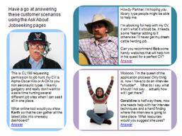

suggest borrowing a library book about CV writing too!” and “RSS feeds are like news headlines from the BBC – constantly updating with live information.” Staff were encouraged to try out the video clips with links embedded in the presentation. They were also encouraged to spend more time in certain areas of the website to familiarise themselves with them, e.g. the “Finding jobs online” section. But despite this, and despite the attractive presentation of the slides, it’s not clear whether this alone would have been enough to stimulate staff in all the authorities to spend the necessary time familiarising themselves with the resources. To mitigate this, the final slide has three fictional characters at various stages of the job-seeking process, each with a question and a click- through to the correct answer. Staff could use this to test their knowledge after working through the presentation, although it would really only test their memory of what resource to point people towards for each situation, and not their ability to navigate the website at any detailed level. 2 Finance Brighton and Hove Libraries Brighton ran a series of awareness raising sessions as part of staff team meetings or on an ad hoc basis with small groups of staff. Sessions lasted between 10 and 25 minutes, and were backed up with a detailed email that provided an overview of the resources available, clarity about the role staff were expected to take (information rather than financial advice), and urged staff to encourage users to complete the survey. The briefing sessions covered the following:

---

<!-- PAGE: 78 -->

* links to existing skills and other digital inclusion work in the service

* national context for the pilot

* overview of the web page and resources

* boundaries between information and advice and staying safe

* importance of survey completion

3 Health Lincolnshire Libraries (with Nottinghamshire and Leicestershire) The East Midlands held a training day for senior staff in December 2011, with the intention that they would then be able to cascade down what they have learnt to staff at their libraries. The agenda for the day included an introduction to essential public health issues as well as practical training on navigating the NHS Choices website. The aims were to:

* increase knowledge of public health issues in Lincolnshire (this was the

primary goal but staff were also directed towards information sources in the other areas)

* increase understanding of your role in public health

* improve confidence and knowledge to address lifestyle issues through a

“health chat” The essential public health session was considered very helpful in creating an understanding of the issues that can cause health concerns. It helped identify the national concerns such as smoking, alcohol, obesity and sexual health. However it was recognised that further work would be needed in each authority to identify and inform staff about more specific local issues, e.g. Lincolnshire has an aging population so has a focus on the various health problems associated with age. This session was very well received and the people on the course commented on how they could use this within the libraries in which they work. With three different authorities attending, the afternoon session concentrated on showing how to access the training that is provided on the NHS Choices website. This showed how to access the video links for the different tutorials. The authorities then split into three to explore the websites that each authority would use in their local areas. The afternoon session also provided an opportunity for the staff from the different authorities to talk about and share ideas on health promotion within their libraries.

---

<!-- PAGE: 79 -->

The staff that attended indicated that they were given enough knowledge to be able to cascade the training down to their staff.

## West Midlands Libraries

In the West Midlands, staff were briefed using YouTube clips embedded in the website. These were developed with the dual purpose of supporting the general public as well as staff, and provided a general overview of the information available on the website and the resources available. Each of the 14 authorities had a lead member of staff to promote the site and encourage staff to view the videos. Some but not all had short training times for staff in which to do this. A team briefing was held in March, although the site was not live at this stage and the videos not yet available – instead a test site, and scripts from the videos had to suffice. Once the site did go live, there was a follow-up email to all staff, cascaded via the authority leads, which introduced the project, provided an overview of the resources and asked staff to support the evaluation by encouraging users to complete the survey. Phrases like “to help you, or the person you are assisting,” and “as a member of library staff or volunteer” emphasise the dual audience, but it is not clear whether combining the two in this way is an effective way of training staff, who may need more encouragement to actually go into each resource and explore it further. It is also not clear from the links on the landing page what each video covers, but it is possible that staff were given more information at the training times (where available) to support them in choosing the right one. All the videos are brief and do not explore any one resource in depth, but they would be sufficient to help a user or member of staff understand which resource to use for which purpose. They all start identically, with some general information about the portal (about 40 seconds). This was a deliberate decision taken by those leading the pilot in order to provide a standard explanation of why the resource exists and how it could be used, with the aim of raising awareness. It could be confusing for some viewers, who might perceive that they have erroneously clicked on the same one twice and not proceed. However, it was hoped that staff would understand the rationale for this approach and soon learn to skip the general introduction, while the public might well be focusing on just one area of the website. The videos do then go on to give a bit more detail about the specific resources covered in each, so anyone who does get through (or skip) the introduction should find them helpful. 4. Multiple themes / general digital literacy

## Kent Libraries

---

<!-- PAGE: 80 -->

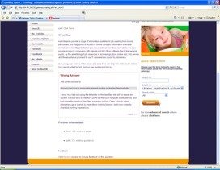

Kent used an online system, Taktix, which was developed in partnership with Kent Gateways. The intention is to use this beyond the life of the project to deliver training to Libraries, Registration and Archives (as well as Gateway) staff in Kent. An internal review and restructure led to a delay in implementing the training, but the system was tested with various groups of staff for structure and usability. The feedback was very positive, with many of the staff saying how they felt that beyond the training element, the system would help support staff and develop services. The system uses a series of multiple choice questions to test staff knowledge. As a trainee works through the questions, any incorrect answer results in a clear explanation of why an alternative solution would be better. Whether correct or incorrect, the trainee is offered additional resources and links to further their knowledge of the topic. The resource can also be used by staff as an aide memoire when helping library users. After each phase of the training the trainee takes an online test, with twenty randomly selected questions to be answered in a limited period of time. Alongside this, the authority is developing a series of webinars for staff, which will eventually be rolled out to the general public. One of these deals with search engines, two with business resources and two with e-books.

## Yorkshire and Humber Libraries

---

<!-- PAGE: 81 -->

In Yorkshire it was decided that the resource itself would form the staff training materials. No formal training was planned to take place until the project had moved out of the pilot phase and a decision made about its future. However all staff across the region were sent a site plan and some overview documentation. A sample extract from the former shows that it only provided staff with a top- level outline of the website: https://sites.google.com/site/nioportaltest/ or search for: Yorkshire & Humber libraries online learning Welcome Introduction, description and survey 1. Computer exercises for beginners Individual webwise exercises 2. Free short courses GoOn and Webwise courses 3. How to use Directgov to search for jobs Outline and screencast The overview document (two sides) introduced staff to the project and its aims: “The aim of our regional pilot is to create a portal for a range of evaluated websites that support both teaching and learning of basic IT skills.” Staff were urged to:

* Visit the portal using the link or a web search

* Spend some time having a look around (the sitemap document will give

you a good idea of what’s there) and using the resources that can be found there.

* Complete the users’ survey on the Welcome page.

* Encourage all staff delivering BITS or any other form of IT tuition to visit

our site and also to take the survey

---

<!-- PAGE: 82 -->

The remainder of the document provides background to the National Information Offer project. It is not clear why staff were being encouraged to fill in the user survey rather than the staff one, nor is there any encouragement to actually get users involved with the resources.

---

<!-- PAGE: 83 -->

# Appendix C: Project Team and Pilot Leads

The evaluation team would like to thank the project team and pilot leads for their support of this research: Sally McMahon Head of Libraries & Information Services, Brighton & Hove Chris Fardon Relationship Manager, Arts Council England Eve Jarvis Project Manager, National Information Offer Susy Baker Project Officer - Financial Inclusion, Brighton & Hove Libraries Cecilia Bethencourt- Dunning Information Services Librarian, Kensington & Chelsea Christel Pobgee Information Services Manager, Kent Libraries & Archives Jonathan Platt Head of Libraries and Heritage Economy and Culture, Lincolnshire Jonathan Ebbs Service Development Manager, Manchester Library & Information Service Alan Medway Library Service Development Manager: Learning & Resources, Staffordshire Library & Information Service John Burton Quality and Standards Manager, Thurrock Rosalyn Jones Strategy and Development Manager (Libraries), Thurrock Kathryn HarrisonArea Manager, Library and Information Centres (Central Kirklees) Kevin John Librarian, Huddersfield Reference Library Alison Bramley Executive Officer, Society of Chief Librarians

---
