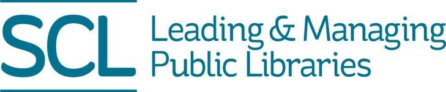
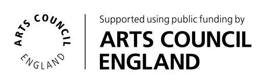

<!-- PAGE: 1 -->

# Review of Reader Development Activities in Libraries and Training Needs

**Society of Chief Librarians**

**February 2017**

<!-- PAGE: 2 -->

# Contents

- **1. Executive Summary** (page 4)
- **2. Introduction** (page 6)
  - 2.1 Background and objectives (page 6)
    - 2.1.1 Background (page 6)
    - 2.1.2 Objectives (page 6)
    - 2.1.3 A note on terminology (page 6)
  - 2.2 Approach (page 7)
    - 2.2.1 Reader development round table (page 7)
    - 2.2.2 Reading activities survey (page 7)
    - 2.2.3 Informal discussions with library services (page 8)
    - 2.2.4 Call for case studies (page 8)
- **3. Main findings** (page 9)
  - 3.1 Findings from the reader development roundtable (page 9)
    - 3.1.1 Principles of reader development (page 9)
    - 3.1.2 Assessing reader development work (page 9)
    - 3.1.3 Priorities for reader development (page 9)
  - 3.2 Reading activities survey (page 11)
    - 3.2.1 The importance of reading development in the library service (page 11)
    - 3.2.2 Reading activities in libraries (page 12)
    - 3.2.3 Audiences for reading activities (page 13)
    - 3.2.4 Outreach work (page 15)
    - 3.2.5 Reading partnerships (page 16)
    - 3.2.6 Who is supporting reading in libraries? (page 18)
    - 3.2.7 Evaluating reading activities in libraries (page 19)
    - 3.2.8 Marketing and promoting reading activities (page 19)
    - 3.2.9 Training currently provided in reading development (page 21)
    - 3.2.10 Training needs (page 22)
    - 3.2.11 Possible pilot project areas (page 23)
  - 3.3 Informal interview about volunteer-run libraries (page 24)
  - 3.4 Case studies (page 25)
    - 3.4.1 Overview of case studies received (page 25)
- **4. Conclusions and recommendations** (page 28)

<!-- PAGE: 3 -->

- **Appendix 1: Online survey** (page 30)
- **Appendix 2: Case studies** (page 34)
  - Case study 1: Kirklees Libraries “Beyond Words” (page 34)
  - Case study 2: Rochdale Libraries “Generation Z” (page 35)
  - Case study 3: Medway Libraries “Year 2 Book Groups” (page 36)
  - Case study 4: Somerset Libraries and BBC Radio Somerset “Love to Read” Book Group (page 37)
  - Case study 5: Somerset Libraries “Yeovil Literary Festival 2016” (page 38)
  - Case study 6: Cheshire West and Chester Libraries “Thick as Thieves” (page 39)
  - Case study 7: Kent Libraries “Get Kent Reading” (page 41)
  - Case study 8: Cumbria Libraries “Sharing Stories” (page 42)
  - Case study 9: Cumbria Libraries “Borderlines Festival” (page 44)
  - Case study 10: Cumbria Libraries “Poetry by Heart” (page 46)
  - Case study 11: Cumbria Libraries “Seven Stories” (page 47)
  - Case study 12: Staffordshire Library and Arts Service “J.R.R. Tolkien in Staffordshire 1915-1918 Touring Exhibition” (page 49)
  - Case study 13: Coventry Libraries and Information Service “World Book Night” (page 51)
  - Case study 14: Bolton Library & Museum Service “Making it REAL Literacy Project” (page 52)
  - Case study 15: Tameside MBC Libraries “Theatre Tracks” (page 54)
  - Case study 16: Wirral Libraries “Facilitating the Reading Ahead Scheme to encourage reading” (page 55)
  - Case study 17: Suffolk, Norfolk and Cambridgeshire “Brave New Reads” (page 56)
  - Case study 18: Leicestershire “Make Friends with a Book” (page 58)
  - Case study 19: Blackburn “Community Living Rooms” (page 59)
  - Case study 20: Solihull “Silent Reading Café” (page 61)
  - Case Study 21: Dudley Library Service: Books into Art (page 62)
  - Case Study 22: Dudley Libraries Walking Book Club (page 63)

<!-- PAGE: 4 -->

# 1. Executive Summary

Reader development is a high priority for most public library services. The research has shown a wealth of established current practice, mature partnerships and examples of great expertise in reading development within the public library sector which may not be fully appreciated at local or national level. However, in parallel with this impressive track record and body of existing practice there is a lack of current training, especially external training. Less than half (45%) of all library services responding to the survey had any form of training and 77% wanted more training.

The research was commissioned by the Society of Chief Librarians (SCL) to explore:

- What reader development training is currently provided in public library services
- What the training and support needs of public libraries are in relation to reading for pleasure
- How library services are engaging with harder to reach audiences and non-readers
- What case studies of good practice exist across public libraries in England

The research combined a roundtable with key national stakeholders, an online survey distributed to library services across England (with 95 responses representing more than one-third of library authorities), informal interviews, and a call for case studies which elicited 22 detailed submissions.

Key findings include:

- **High strategic priority:** 88% of responding library services rated reader development as a 4 or 5 out of 5 in terms of priority, with an average score of 4.3 out of 5.
- **Breadth of activities:** Library services offer an average of 11 different reading promotion activities from a list of 16 common formats. 100% provide book displays, book groups/reading groups, and author talks, while 99% offer Summer Reading Challenge and Rhymetimes.
- **Audiences:** Library services focus on an average of 7 distinct audience groups. Core focus areas include adults in general (99%), early years 0–5 (96%), children 5–12 (95%), and families (77%). Conversely, 18–24 year olds (31%), adults with learning disabilities (25%), and specific BME communities (18%) were least likely to be targeted.
- **Outreach and non-readers:** Over 4 in 5 services (83%) deliver reader development activities outside the library building, and 71% undertake specific work targeting non-readers.
- **Staffing and volunteers:** 86% of services deploy specialist librarians to support reading activities, but volunteers are now the second most common human resource (77%), ahead of frontline customer service staff (75%) and managers (71%). Self-organised reading activities by library users occur in 69% of services.
- **Evaluation gap:** While 73% of services evaluate reading promotion, over one in five (21%) do not. Most evaluation relies on locally administered attendance counts and satisfaction feedback questionnaires, with very little structured outcome monitoring or standard evidence frameworks.
- **Training deficit:** Only 45% of library services provide any reader development training (internal or external), yet 77% explicitly state they need more training. The primary barrier is cost and staff time.

<!-- PAGE: 5 -->

The survey shows that social media and marketing approaches in libraries are increasingly sophisticated, but some case studies provide ideas for further refinement in this area (Kent Libraries, Case study 7) and for more innovative approaches to using local media to promote reading (Somerset Libraries, Case study 4). The use of case studies and information sharing on marketing and promotion activities may be more useful than specific training in this area and a specific call for this type of case study could be made via the Society of Chief Librarians (SCL) network and the Library Innovators Basecamp.

While there was relatively little spontaneous mention of new models for delivering reading activities in the survey, this was a key focus of the reading roundtable. When it was prompted in the survey as a possible topic for training it was very positively received, with 65% saying it was needed in their library service. Some of the case studies showcased new models for delivering reading activities, especially Cheshire West and Chester (Case study 6), Staffordshire (Case study 12) and Wirral (Case study 16).

There was a strong response to the call for case studies and there appears to be an appetite to share practice. The 22 case studies submitted as part of this research provide a solid basis for a case study database, but the SCL website does not currently have database facilities and it is also not clear whether this would be well-used by the library community.

### Recommendations

The evidence suggests that the priority areas for developing reader training in libraries are:

- Outreach and non-readers
- Volunteers and community-run libraries
- Making the case for reading promotion/evaluation training
- ‘Soft’ skills such as having conversations about reading with the public

There is some evidence that existing reading development training may not be suitable for volunteers and community-run libraries because it does not employ suitable language/approaches or delivery mechanisms. A co-created approach may need to be undertaken to develop training for community-run libraries to ensure it is relevant and taken up.

More work may need to be done understand exactly what type of training would be suitable to support library services in refining their outreach work and work with non-readers. It may be that a community of practice with library staff and national bodies already engaging with these groups would be a good way to explore which essential skills are required and how this type of training could be delivered. Certain other priority areas may be more suited to case-study and information sharing rather than formal training, these include:

- New delivery models
- Marketing and promotion approaches, including social media
- Combined arts and culture approaches to reach new audiences for reading

<!-- PAGE: 6 -->

# 2. Introduction

## 2.1 Background and objectives

### 2.1.1 Background

- The Society of Chief Librarians (SCL) has identified the need to develop skills to support reading for pleasure in the library workforce.
- There has not been a workforce training programme to develop the skills and confidence in promoting and enabling reading for pleasure in libraries for some time.
- There is a need to update general practice to support reading for pleasure in libraries so that it reflects new approaches to working with communities and supporting self-directed learning groups.

### 2.1.2 Objectives

The overall objectives of the reader development training project are to:

- Understand what is good and innovative practice in supporting reading for pleasure.
- Develop training and examples of good practice to support reading for pleasure in libraries across England.
- Create a new universal standard for supporting reading for pleasure in libraries that can underpin the Reading Offer.

This report has been commissioned to help the Books and Reading Group:

- Understand what current good and innovative practice exists in public libraries and elsewhere to support reading for pleasure.
- Explore future needs in relation to promoting reading activities.
- Understand how reading activities are currently targeted, promoted and carried out in libraries and by whom.
- Understand the training needs that library services identify for their staff and volunteers.
- Gain examples of existing practice that can be used to support the development of the sector.

### 2.1.3 A note on terminology

Throughout this report the terms “reader development”, “reading development”, “reading promotion” and “reading activities” are used interchangeably. All of these terms are understood by participants in the research to mean the active promotion of reading and/or activities and experiences rather than simply making reading materials available.

<!-- PAGE: 7 -->

## 2.2 Approach

A number of different data collection approaches were employed to understand the current landscape in reader development and explore future needs. These include:

- A round table discussion with key stakeholder organisations.
- A reading activities survey distributed to library services across England.
- A call for reader development case studies.
- An informal conversation with Leicestershire Library Service about the reader development training needs of its community run libraries.

### 2.2.1 Reader development round table

The Reading Offer group invited a number of key stakeholders to a reader development roundtable on 6th September 2016, which was hosted by Debbie Hicks from the Reading Agency. The following organisations attended:

- Apples and Snakes
- The Reading Agency
- Society of Chief Librarians
- Kirklees Library Service
- Suffolk Libraries IPS
- The Reader
- Opening the Book
- Time To Read
- Spread The Word
- The National Literacy Trust
- The Writing Squad

The round table covered the following topics:

- **Topic 1: What does good reader development with adults look like?**
  - Principles for reader development work
  - How to assess reader development work
- **Topic 2: Taking reader development through libraries into the future**
  - Needs and opportunities in reader development now and in the future
  - Discussion of how this could be applied in libraries
  - How organisations and individuals at this meeting could support new/pilot activities in libraries

### 2.2.2 Reading activities survey

An online survey was drafted in October 2016 (see Appendix 1). It was piloted with the Time to Read Group in the North West of England between 18th October 2016 and 24th October 2016. The survey was refined and circulated via the Books and Reading group and the main SCL mailing list to library <!-- PAGE: 8 --> services in England and was live between 25th October 2016 and 17th February 2017. 95 valid responses to the survey were received in total.

### 2.2.3 Informal discussions with library services

Following an expression of interest in conducting pilot work with the Society of Chief Librarians, an informal telephone interview was held with Leicestershire Libraries about need for volunteer training in community run libraries on 3rd October 2016.

### 2.2.4 Call for case studies

A case study template was drafted and a call for case studies was circulated via the Books and Reading Group and the SCL newsletter on 25th November. For the case study template please see Appendix 2. A total of 22 case studies from 19 library services were received.

<!-- PAGE: 9 -->

# 3. Main findings

## 3.1 Findings from the reader development roundtable

### 3.1.1 Principles of reader development

The following principles of reader development were developed during the round table discussion:

- **Organisation**
  - A locally sensitive approach that is relevant to local people and contexts.
  - Quality staff interaction: knowledge, skill and competence.
  - Explore new business models for the culture sector.
  - Reader development needs to run through the whole of the service.
  - Identify the different needs and the opportunity to meet them.
- **Characteristics of activities**
  - Put the reader at the centre.
  - Provide the widest possible range of materials “right book, right reader, right time”.
  - Build a strong community of readers and strong partnerships.
    - Having a collaborative approach with partners.
    - Support people to share reading experiences.
  - Fun, creative and interesting and exploring opportunities for reading promotion outside the library space.

### 3.1.2 Assessing reader development work

The group identified the following outcomes as important for reader development work:

- Increase people’s skills, enjoyment and confidence.
- Open up choices in reading.
- Define community benefits.

In order to measure the outcomes they felt it would be important to:

- Understand what is being measured and why, what standard of evidence is required.
- Understand what is actually measurable and know what tools are available e.g.
  - Arts Council Quality Metrics.
  - Longitudinal information e.g. teaming up with a university (University of Liverpool “Quills” programme mentioned).
- Ensuring evidence gets to the right people and is widely known (e.g. by building a good relationship with the media).

### 3.1.3 Priorities for reader development

During the round table the following priorities were identified for reader development in libraries:

- **Staff training:** <!-- PAGE: 10 -->
  - Basic reader development knowledge and skills for frontline staff and volunteers.
  - Project management skills.
  - Event management skills.
  - Creating community around the project – shared ownership and learning from each other.
  - Online training in short quick bursts for staff, with consistency across library services was thought to be the most feasible.
- **Leadership buy in.**
- **Thinking beyond the current library user** – bring new people in and engage new people.
- **New business models for activity.**

Some of these findings informed the development of the quantitative survey with libraries which will form the main body of the report findings.

<!-- PAGE: 11 -->

## 3.2 Reading activities survey

A range of library services across England completed the reader development survey, including large county authorities and metropolitan services, a wide range of geographical locations and, judging from the responses to the survey, a selection of different local needs and demographics. 95 valid responses were received in total, which represents over 1/3 of library services in England.

### 3.2.1 The importance of reading development in the library service

In general, reading development is seen as a high priority by most library services. 88% scored a 4 or 5 out of 5 on a scale of 1-5 when asked how high a priority reader development is to their library service. This gives an average score of 4.3 out of 5, which suggests that a focus on reader development is very relevant for library services at the moment.

**Priority of reading development in library services (Scale 1–5):**

| Priority Score (1=Very low, 5=Very high) | Percentage of Library Services |
| :--- | :--- |
| **Score 1 (Very low priority)** | 0% |
| **Score 2 (Low priority)** | 1% |
| **Score 3 (Moderate priority)** | 11% |
| **Score 4 (High priority)** | 47% |
| **Score 5 (Very high priority)** | 41% |

*(Base: 95. Average score = 4.3 out of 5)*

When asked to provide verbatim comments about the reason for their score respondents typically mentioned:

- Reading activities and experiences being a core part of an ‘excellent’ library service and/or stated outcomes and a renewed focus on reading in some authorities.
- The need to build future audiences for library services and reading.
- The importance of reading in supporting better life chances and economic resilience, mental health and social connections.
- Staff and budget limitations and efficiency pressures sometimes reducing the focus on reading.

<!-- PAGE: 12 -->

> “We need to build our audiences of tomorrow now and the best way of doing that is through great reader development events and activities.”

> “One of the library service outcomes is for more people to enjoy a vibrant and dynamic reading experience”

> “The service is re-investing in children's reader development with the appointment of specialist children's and young people's staff.”

> “Reading is at the heart of our service, and reading for pleasure underpins our children and young people's activities. We recognise the vital role reading plays in improving life chances and wellbeing.”

> “Budget cuts and staff reductions mean that specialist reader development posts have been lost, and frontline staff have less time to dedicate to reading promotion.”

### 3.2.2 Reading activities in libraries

Respondents were asked which reading promotion activities they support or provide in their library buildings from a prompt list of 16 common activities.

<!-- PAGE: 13 -->

**Reading activities supported or provided in library buildings:**

| Reading Activity | Percentage |
| :--- | :--- |
| **Author talks** | 100% |
| **Book groups/reading groups** | 100% |
| **Book displays** | 100% |
| **Summer Reading Challenge** | 99% |
| **Rhyme time** | 99% |
| **Library staff recommendations** | 80% |
| **Writing workshops** | 78% |
| **Reading Partners publisher promotions & book prizes** | 67% |
| **Theatre/dramatisations of texts** | 59% |
| **Literature Festivals** | 57% |
| **Spoken word performances** | 55% |
| **Reading Ahead (formerly Six Book Challenge)** | 54% |
| **User generated book recommendations** | 52% |
| **Reading Hack** | 50% |
| **Chatterbooks groups** | 47% |
| **Film of the book screenings** | 27% |

*(Base: 95)*

Overall, library services offer an average of 11 different reading activities from the above list. The fewest number of activities offered was 3, by only one library service, while three library services offered all 16 of the activities in the list above.

Library services were also invited to describe any activities they undertake which are not included on the list above. Activities mentioned included arts and crafts, book crawls, Big City Reads, literary quizzes, book shadowing, local radio book clubs and author book fairs.

> “We promote a wide range of activities from storytime to lego clubs to author events and literary festivals.”

The responses to this question suggest that library services are very active in delivering a wide range of reading activities.

### 3.2.3 Audiences for reading activities

All of the library services who responded to the questionnaire said they supported reading activities for adults in general. 94% also said they targeted activities for 0-5 year olds while 90% target 5-12 year olds. Nearly 4/5 of library services also said they offer reading activities for families (79%).

The least common target audiences were specific BME communities (13%) – which may reflect the demographics of the local community in some areas. In addition less than a quarter of library services offered reading activities for adults with learning disabilities (23%). Among the age groups <!-- PAGE: 14 --> identified in the survey, adults aged 18-24 were least likely to be targeted with only 35% focussing on this age group specifically.

**Audiences targeted for reading promotion activities:**

| Audience Group | Percentage |
| :--- | :--- |
| **Adults in general** | 99% |
| **0–5 year olds (Early years)** | 96% |
| **5–12 year olds (Children)** | 95% |
| **Families** | 77% |
| **13–17 year olds (Teenagers)** | 71% |
| **Adults with low literacy** | 61% |
| **Older people** | 59% |
| **People with other disabilities and long-term conditions** | 42% |
| **ESOL readers** | 37% |
| **18–24 year olds (Young adults)** | 31% |
| **People with learning disabilities** | 25% |
| **Specific BME communities** | 18% |

*(Base: 95)*

On average library services reported focussing on around 7 different audiences, with only three respondents reporting that they only focus on adults in general. 10 respondents (just over 10%) reported focussing on all 12 audiences. Library services also identified additional audiences of specific focus in their verbatim responses, including:

- LGBTQ readers
- Blind and partially sighted readers
- Looked After Children
- Reading groups for people from different national/language groups including Romanian, Polish etc.

> “We have recently launched a 'Different ways of reading' webpage which pulls together all materials of interest to those who do not read standard print and also includes Quick Reads and Fresh Start”

The evidence suggests that most library services target a broad range of audiences with their reading activities, with some groups with specific needs being identified and supported by most services.

<!-- PAGE: 15 -->

### 3.2.4 Outreach work

A large majority of the library services who responded to the survey were undertaking reader development activities outside of the library building. Over 4 in 5 library services (83%) engage in reader development outside of the library. In addition, nearly three quarters of library services (71%) undertake reader development with non-readers.

**Outreach work:**

| Outreach Category | Percentage |
| :--- | :--- |
| **Reader development outside of the library building** | 83% |
| **Reader development with non-readers** | 71% |

*(Base: 95)*

When asked where they undertake reader development work the most common places were:

- Home Library Service
- Children’s centres and youth clubs
- Prisons
- Schools, colleges and adult learning centres, freshers fairs, ESOL centres
- Voluntary organisations and community groups such as University of the 3rd Age, the Women’s Institute, churches
- Health and wellbeing organisations such as postnatal groups, MIND, hospitals
- Care homes, residential homes and sheltered housing
- Literature festivals and other festivals
- Shopping centres, super markets, shops and cafes
- Pop-up libraries and book boxes in a variety of locations
- Theatres, cinemas and local arts groups
- Parks, public spaces, beaches
- Radio

> “The Theatre Tracks project was based around the novel the Railway Children. The children came to the library for workshops but also went to the Theatre to see the Railway Children on the stage and went on a trip on a steam railway. We are also doing An Audience Without Alan Bennett outside the library building <!-- PAGE: 16 --> and I am working with a local community Theatre Group to read the parts and help with the production.”

In terms of specific projects to engage non-readers in reading, respondents mentioned a wide range of initiatives including:

- Work with prisons
- Using initiatives such as Reading Ahead (Six Book Challenge) with adult learning providers and workplaces
- Targeted family literacy programmes in areas of high deprivation (such as Making it REAL)
- Word on the Street / Pop-up library stalls in markets, high streets, and community centres
- Partnership working with youth offending teams, housing associations, and homeless shelters

### 3.2.5 Reading partnerships

Partnership working is fundamental to public library reading promotion. Over 9 in 10 responding library services (92%) report collaborating with local or national partners to support reading activities.

<!-- PAGE: 17 -->

**Partnerships supporting reading activities:**

| Do you work with any local or national partners? | Percentage |
| :--- | :--- |
| **Yes** | 92% |
| **No** | 6% |
| **Don't know** | 2% |

*(Base: 95)*

Some respondents provided detail about the partnerships they engage in, which are many and varied and include:

- **Local partnerships:** schools, children centres, charities supporting adults with learning disabilities, community colleges, local book shops, local authors, local businesses, early years teams, prisons, care and residential homes, pre-school groups/early years settings, addiction charities, mental health charities, homeless charities, local theatres, ESOL and adult literacy course providers, local reading charities and volunteer groups, churches, mandirs, temples and mosques, local dementia friends groups, GP surgeries, parish and town councils, health visitors.
- **County and/or regional partnerships:** literary festivals, local radio, arts organisations, health organisations, Rugby League clubs, Time to Read, Read Regional, New Writing North, NHS education TRACKS, Arts Services.
- **National partnerships:** SCL, ASCEL, Radio 2 Book Club, BBC Love to Read, BookTrust, The Reading Agency, CILIP, Alzheimer’s Society, Authors Aloud, Reading Partners, National Literacy Trust, Publishers Association, specific publishing houses, Age UK.

Many of the library services who responded to the survey have a very wide range of partnerships, which are deployed to support different types of reading activities with different audiences. Some are reliant on a small number of national partnerships and/or initiatives to support their reading activities but many have developed a range of locally appropriate partnerships in their communities.

<!-- PAGE: 18 -->

### 3.2.6 Who is supporting reading in libraries?

The majority of library services still have a specialist librarian supporting reading activities. 86% of respondents said that specialist librarians supported reading in their libraries. However the next most commonly deployed resource for supporting reading was volunteers, with 77% of library services saying their volunteers support reading. Managers and frontline staff are both likely to support reading activities in libraries, at 71% and 75% respectively, or just over 2/3 of responding services. Members of the public were less likely to be undertaking self-supported reading activities, however they were mentioned by 69% of library services, which is just over 2/3 of all respondents.

**Human resources supporting reading activities in libraries:**

| Staffing / Volunteer Category | Percentage |
| :--- | :--- |
| **Specialist librarians** | 86% |
| **Volunteers** | 77% |
| **Frontline customer service staff** | 75% |
| **Managers** | 71% |
| **Members of the public (self-supported reading groups/activities)** | 69% |

*(Base: 95)*

In the verbatim comments, several library services mentioned that supporting reading was important for all of their staff and volunteers and that it is a core pillar of their service delivery.

> “All our staff, including frontline and management get involved in Reader development.”

<!-- PAGE: 19 -->

### 3.2.7 Evaluating reading activities in libraries

Most library services do evaluate their reading activities, however over one in five (21%) say that they do not.

**Do you evaluate your reading promotion work?**

| Evaluation Undertaken | Percentage |
| :--- | :--- |
| **Yes** | 73% |
| **No** | 21% |
| **Don't know** | 6% |

*(Base: 95)*

When asked what kind of evaluation they undertake, there were two main forms of evaluation:

- Nationally co-ordinated evaluation programmes e.g. for the Summer Reading Challenge.
- Locally administered ‘feedback questionnaires’.

Quantitative evaluation tends to focus on attendance figures and enjoyment of activities, while qualitative evaluation is more usually related to continuous improvement of events and activities. Only one respondent referred to outcomes frameworks e.g. the generic learning outcomes. From this analysis it is possible to conclude that library staff could benefit from evaluation support and expertise in measuring the impact their reading activities have.

### 3.2.8 Marketing and promoting reading activities

Reading activities are widely marketed and promoted by library services. The questions in the survey asked specifically about social media and newsletters or e-newsletters, but library services also mentioned other marketing channels. Of those specifically prompted for, social media was the most popular with 94% of respondents reporting that they promote their reading activities via social media while nearly two thirds (64%) use newsletters or e-newsletters. In addition, many library services use a range of local media to promote their activities, including newspapers, magazines and local radio. Several also mentioned schools as a key audience and communication channel.

<!-- PAGE: 20 -->

**Communications channels for reading promotion:**

| Channel | Percentage |
| :--- | :--- |
| **Social media** | 94% |
| **Newsletters / e-newsletters** | 64% |
| **Local papers and magazines** | 52% |
| **Communications to schools** | 28% |
| **Local radio** | 23% |

*(Base: 95)*

The most commonly used social media to promote reading activities was Facebook and Twitter. Some library services have individual library Twitter and Facebook accounts, while others co-ordinate social media activity at service level. Some library services also use Instagram, Google+, Pinterest and YouTube to publicise their reading activities. Overall it appears that social media is widely used by public libraries these days and is overtaking more traditional forms of communication with the public.

In terms of the other media used to promote reading events, library services mentioned co-ordinated press releases and ongoing partnerships with local media outlets. This suggests a strategic and sophisticated approach to publicising activities in some library services. This may have been supported by the national media packs that were distributed by the Society of Chief Librarians for Love to Read weekend and the Shakespeare Anniversary Celebrations. Such packs could both help library services to publicise specific activities and show a template of good practice in publicising library activities with local media.

Schools are a key communication channel and partner for library services, as other answers to the questionnaire demonstrate. The fact that only around a quarter (28%) of library services mentioned regular communications through and with schools may suggest that support and advice on how to effectively communicate with schools about reading activities may be welcome.

<!-- PAGE: 21 -->

### 3.2.9 Training currently provided in reading development

Despite their strong focus on reader development, fewer than half (45%) of the library services who responded to the survey provide any kind of specific reader development training. This includes both external and internal training. Some library services responded in the verbatim comments section that they provide ‘ad hoc’ and ‘on the job’ training. For the purposes of this survey that training has not been considered to be training, as it is unclear what these terms mean and whether they constitute any verifiable training programme.

However, most library services also recognise that they are not able to provide the training they would like. Just under 4 in 5, or 77% of those responding felt that their service needs more reader development training.

**Reader development training in libraries:**

| Training Status | Percentage |
| :--- | :--- |
| **Need more reader development training** | 77% |
| **Library services currently undertaking reader development training** | 45% |

*(Base: 95)*

The only external reader development training packages mentioned by respondents in the survey were Frontline training, by Opening the Book, and the Summer Reading Challenge training. None of the library services mentioned the more advanced reader development training available from Opening the Book. In the detailed responses, only five library services mentioned purchasing Opening the Book Frontline training, with a further two saying they had previously bought and used this training but were not currently using it. Some mentioned this training package as the kind of training they would like to be able to afford for their library staff.

However, given the high numbers of volunteers mentioned as supporting reader development in libraries, very little mention was made of current programmes of volunteer training in the survey. Four library services specifically mentioned volunteer training programmes, with one mentioning the Summer Reading Challenge volunteer training and three mentioning in-house training that has been <!-- PAGE: 22 --> developed. This may be because the survey did not specifically ask about volunteer training at this point and therefore only those who have volunteer training top of mind mentioned it.

One library service mentioned a reader development video they have produced which they use to train new staff members and volunteers:

> “We ran a session with Nick Bottomley, Mr B, for all staff and use the video of the session that he ran to work with new staff and volunteers”

### 3.2.10 Training needs

Respondents identified engaging non-library users in reading and engaging non-readers as their top priority for training. Over 4 in 5 of respondents requested both these types of training. This is not surprising given the prevalence of outreach work among the services responding to the survey, especially as this type of work can require specialist skills and knowledge.

Making the case for reading promotion was also a high priority, with over two thirds of respondents (68%) requesting this. This type of training would require a greater understanding of how to collect and use evaluation data, which responses to previous questions demonstrate is not always employed by library services in relation to reader development work. However fewer than half (47%) requested evaluation training, which suggests that the link between evaluation data and making the case for reading promotion is not always well understood.

New delivery models was also a high priority for library services, with 68% requesting this type of training. However, more basic training was also requested, with over half (57%), feeling that training on engaging customers in conversations about reading would be beneficial.

Supporting volunteers was not a high priority for all library services, with fewer than half (44%) requesting more volunteer training. However, given the prevalence of volunteers in delivering reading promotion activities, this result may be under stating the real need for volunteer training.

Stock related reader development training was a lower priority (29% mentioned it) than space management (mentioned by 68%).

There was some interest in training in new media and ways of reading (56%) and social media (54%). The survey appears to show that most libraries are relatively familiar with social media to market reading activities and have a wide range of partnerships, therefore while these are a high priority library services appear to be developing their own skills and these may be less urgent areas of focus for training.

<!-- PAGE: 23 -->

**What kind of reading training does your service need?**

| Training Area | Percentage |
| :--- | :--- |
| **How to engage non-library users in reading** | 84% |
| **How to engage non-readers** | 81% |
| **How to make the case for reading promotion** | 68% |
| **How to manage the library space to promote reading** | 68% |
| **New delivery models for reading promotion activities** | 65% |
| **How to engage customers in conversations about reading** | 56% |
| **New media and reading promotion** | 56% |
| **Social media and reading promotion** | 54% |
| **Evaluation** | 47% |
| **How to develop partnerships to support reading** | 45% |
| **Supporting volunteers to engage in reading promotion** | 44% |
| **Stock display and selection** | 29% |
| **Supporting community-run libraries in reading promotion** | 22% |

*(Base: 91)*

### 3.2.11 Possible pilot project areas

Finally, respondents were asked whether they would be interested in participating in a pilot project. 16 library services expressed interest in a pilot. Among these 16 services, half proposed one or more specific areas of focus, these were:

1. Adults and children with lower levels of literacy.
2. Engaging lapsed and non-readers and lapsed and non-library users in reading.
3. A specific project to engage parents who are non-library users to use the library with their children.
4. Targeting families within schools for reading development projects.
5. Reading for wellbeing or mental health.
6. Engaging NEET young people.
7. Engaging homeless people.
8. Reading groups for people with disabilities.
9. New media and social media as platforms for reading promotion.
10. Partnerships with archives and museums to unlock new genres of reading.

<!-- PAGE: 24 -->

## 3.3 Informal interview about volunteer-run libraries

Leicestershire Library Service expressed interest in the pilot phase of the project and also requested an informal interview to discuss the reader development training needs of volunteer-run libraries. Despite the low levels of interest in training for community-run libraries in the quantitative questionnaire, the interview with Leicestershire Library Service suggests that this may become a much bigger area for development in the future.

Leicestershire Library Service has twenty three community-run libraries which are managed by over 1,000 volunteers. Most volunteers have no prior experience of working in a library. They are motivated by supporting their community but they may not have any awareness of the term ‘reader development’ or how to do it. Without support the community-run libraries may struggle to meet local people’s reading needs and in particular to appeal to less confident readers or those who do not currently read or use the library regularly.

Leicestershire Library Service has identified that community libraries would need training in:

- Stock management, editing and presentation
- Softer skills such as how to give reader recommendations and engage the public in conversations about reading
- Information to explain why reader development is important and helpful to their community and their library.

There are certain logistical challenges around delivering reader development training in volunteer-run libraries:

- They may not want to use an online training package: both because of IT skills needs and also because they may not like a one-to-one training experience
- They prefer the support of being with other volunteers
- Library staff can deliver face-to-face training (and currently do) but this is time intensive and expensive to deliver

One solution proposed by Leicestershire Library Service to this issue is to identify a leader within each community managed library who could deliver training to other volunteers, however this training would need to be co-created with the library volunteers so that it is developed using the right language and approaches to engage volunteers. It was suggested that existing training is either not pitched at the right level for volunteers or uses languages, delivery methods and approaches that are inappropriate with this group.

<!-- PAGE: 25 -->

## 3.4 Case studies

### 3.4.1 Overview of case studies received

The full case studies are available in Appendix 2.

| Page | Library Service | Region | Target Audience | Status | Description |
| :--- | :--- | :--- | :--- | :--- | :--- |
| **34** | **Kirklees** | Yorkshire & Humber | People with learning disabilities and/or dementia | Ongoing | ‘Beyond Words’ aims to re-define how high quality literature can be ‘read’ and who is able to read it. Developing an immersive cross-arts approach to engaging people with learning disabilities and/or dementia in arts and culture. |
| **35** | **Rochdale** | Yorkshire & Humber | Young people aged 14–25 | Ongoing (Oct 2017) | Engaging 14–25 year olds in reading through Rochdale Literature and Ideas festival. Improving engagement with this age group and sustain growth in future years by developing a relationship with this audience. |
| **36** | **Medway** | South East | Children exceeding their reading levels | Ongoing | The aim of the ‘Year 2 Book Groups’ is to provide children whose reading levels have exceeded for their year group, an opportunity to further develop their reading and literacy skills in a library setting. |
| **37** | **Somerset** | South West | Lapsed and non-readers, lapsed and non-library users | Ongoing | The Love to Read Book Club is a partnership between BBC Radio Somerset and Somerset Library Services, broadcast on a weekday between 10am and 11am. The aim is raise awareness of the library service across the county and to encourage listeners to read for pleasure and try something they wouldn’t normally pick up. |
| **38** | **Somerset** | South West | Lapsed and non-library users | Ongoing (Oct 2017) | The Yeovil Literary Festival uses a ‘Discovery Ticket’ to encourage people to try new things. The evaluation suggests it has brought people into the library that hadn’t been in for years, or even at all, and given the library a presence in the town. |
| **39** | **Cheshire West and Chester** | North West | Traditional library users engaging in new cultural activities | Completed | Developing new delivery models and partnerships – hosting theatre productions in small libraries, exploring new charging models and appetite for this kind of product in different communities. |

<!-- PAGE: 26 -->

| Page | Library Service | Region | Target Audience | Status | Description |
| :--- | :--- | :--- | :--- | :--- | :--- |
| **41** | **Kent** | South East | Non-library users, particularly young children, older teenagers and young adults | Completed | Using MOSAIC data to target reader development activities, using new marketing strategies specifically designed to appeal to those audiences. |
| **42** | **Cumbria** | North West | Families in areas of social deprivation and with low literacy skills | Ongoing | Outreach work in children’s centres with specially selected families to develop confidence in reading and enjoyment of family reading. |
| **44** | **Cumbria** | North West | Lapsed and non-library users | Ongoing (Oct 2017) | Borderlines Book Festival: As a venue for festival events the library is visited by people who may not have previously used the building or our services. Themed stock displays in the run up to the event allow us to showcase the range and variety of our holdings and tempt library users to try something new. |
| **46** | **Cumbria** | North West | 14–18 year olds | Possibly ongoing (depends on DfE tender) | Co-ordinating the Poetry by Heart competition in Cumbria, building links with secondary schools and raising the profile of the library service among schools and young people. |
| **47** | **Cumbria** | North West | Primary school aged children, adults with mental health issues, older people with dementia, people affected by stroke | Completed | Collaborating with Prism Arts to develop a creative reading workshop schedule that involved young students from three local primary schools, adults with mental health issues, older people with dementia and those who have been affected by stroke. |
| **49** | **Staffordshire** | West Midlands | All audiences | Ongoing | A cross-disciplinary travelling exhibition on Tolkien in Staffordshire led by the library service and hosted in 4 libraries in Staffordshire. |
| **51** | **Coventry** | West Midlands | Lapsed and non-readers, adults with low literacy | Completed | As part of the World Book Night event, Coventry libraries teamed up with the Learning Unison representatives to support learners at the site. |
| **53** | **Bolton** | North West | Families with low literacy levels and in areas of high deprivation | Ongoing | Bolton Library & Museum Service were approached by Bolton Council’s Early Years and Childcare Team to be involved in Making it REAL, to promote family literacy activities. |
| **54** | **Tameside** | North West | Young people and Looked After Children | Ongoing | To develop a connection between Looked After Children and libraries, encourage young people to utilise the library, and raise self-esteem by gaining an award. The project involved using theatre to bring books to life. |

<!-- PAGE: 27 -->

| Page | Library Service | Region | Target Audience | Status | Description |
| :--- | :--- | :--- | :--- | :--- | :--- |
| **55** | **Wirral** | North West | Adults with low literacy levels, non-readers | Ongoing | Formed a partnership with Wirral Life Long Learning Services and Unison to deliver Reading Ahead. Encouraged learners who attend basic Mathematics and English courses within the library environs to take on the Reading Ahead Challenge. |
| **56** | **Norfolk, Suffolk and Cambridgeshire** | East of England | Adults in general | Ongoing | A regionally branded reading campaign and infrastructure within libraries to encourage and support bold, confident, and adventurous reading (Brave New Reads). |
| **58** | **Leicestershire** | East Midlands | Older people, people with dementia | Ongoing | The Reader facilitated shared reading groups. |
| **59** | **Blackburn** | North West | Older people | Ongoing | Community Living Rooms: Arts and reading extension activities to improve health and wellbeing. |
| **61** | **Solihull** | West Midlands | Adults aged 25–40 | Ongoing | Silent Reading Café: Concept providing dedicated space for distraction-free reading. |
| **62** | **Dudley** | West Midlands | Children and Adults | Ongoing | Books into Art: A new arts space and participatory activities in Kingswinford Library. |
| **63** | **Dudley** | West Midlands | Adults | Ongoing | Walking Book Club: A walking reading group in partnership with Age UK and National Trust. |

<!-- PAGE: 28 -->

# 4. Conclusions and recommendations

- Reader development is considered to be a core element of public library services and as such it is a mature area of activity with a wealth of existing practice.
- All of the public library services who responded to the survey reported undertaking a minimum of 3 specified reader development activities with at least one specific audience. The average number of activities undertaken was 11 and the average number of specific audiences engaged was 7.
- The audiences most likely to be targeted in public library reading activities were adults in general and children aged 0-12. The audiences least likely to be targeted were BME communities, adults with learning disabilities, ESOL readers and young adults aged 18-25.
- The types of activities most likely to be offered by library services were author talks, rhyme times, the Summer Reading Challenge, book and reading groups and stock displays. The types of activities least likely to be offered were film screenings, Chatterbooks groups and dramatisations of texts.
- Many library services offer reading activities outside of the library building and over two-thirds also support reading for non-readers.
- Partnerships to support reading are well-developed in many library services and several reported constructing different partnerships to support different types of reading promotion activity.
- Several public library services have strong strategic approaches to marketing and promoting their reading activities and social media is an increasingly important part of this.
- A large majority of public library services still have specialist librarians supporting reading, however the second most commonly employed resource to support reading is volunteers, above frontline and managerial staff. Self-directed activities among the general public in the library are also supported in over two-thirds of library services.
- The highest priorities identified by library services for training are outreach work and work with non-readers, followed by making the case for reading in libraries and support to develop new delivery models. Basic ‘soft skills’ training in engaging people in conversations about reading were also considered to be important and needed.
- Evaluation was considered to be less important than making the case for reading in the survey, despite the reading roundtable emphasising the importance of effective and appropriate evaluation approaches to convince decision-makers of the importance of reading activities.
- The lowest priorities for training are stock management, community-run libraries and managing library space. Community-run libraries are not identified as a high priority, despite the fact that some informal evidence suggests they have specific needs in relation to reading development training and may also be difficult to reach with that training.
- Although many library services use volunteers to support reading activities, they are not identified as a high priority for new training.
- The case studies submitted broadly reflected the concerns of the library services as outlined in the survey. In particular, several case studies explored ways of engaging audiences that are less <!-- PAGE: 29 --> often targeted with reader development activities, including adults with learning disabilities and young adults aged between 18-25.
- The case studies also reflected a focus on outreach and non-readers, with 11 out of 18 case studies explicitly focussing on these areas.
- Marketing and promotion were strongly featured in the case studies, with some innovative approaches outlined. However there was a lack of information about social media strategies and new ways of reading, which is a strong focus for many library services who responded to the survey.
- Combined arts approaches also featured strongly in the case studies – this is an area where services are less likely to focus their activities at present. This type of approach is often linked in the case studies to reaching new audiences and helping non-readers to connect with reading.

### Recommendations

The evidence suggests that the priority areas for developing reader training in libraries are:

- Outreach and non-readers
- Volunteers and community-run libraries
- Making the case for reading promotion/evaluation training
- ‘Soft’ skills such as having conversations about reading with the public

There is some evidence that existing reading development training may not be suitable for volunteers and community-run libraries because it does not employ suitable language/approaches or delivery mechanisms. A co-created approach may need to be undertaken to develop training for community-run libraries to ensure it is relevant and taken up.

More work may need to be done understand exactly what type of training would be suitable to support library services in refining their outreach work and work with non-readers. It may be that a community of practice with library staff and national bodies already engaging with these groups would be a good way to explore which essential skills are required and how this type of training could be delivered.

Certain priority areas may be more suited to case-study and information sharing rather than formal training, these include:

- New delivery models
- Marketing and promotion approaches, including social media
- Combined arts and culture approaches to reach new audiences for reading

<!-- PAGE: 30 -->

# Appendix 1: Online survey

**Questions for SurveyMonkey Reading Promotion survey**

### Section 1: Details

**1.** Select library service from drop-down list.

**2.** Name of person filling out survey.

**3.** Job title.

**4.** Email address.

### Section 2: Overarching questions about priority of reader development/reading activities

**5.** Is reading and reader development a high priority in your library service at present? YES/NO
- a. Why/why not?

**6.** Does your library service undertake specific reading promotion activities? YES/NO

**7.** If so which of the following do you support/provide in your library buildings?
- a. Book displays
- b. Library staff recommendations
- c. User generated book recommendations
- d. Book groups/reading groups
- e. Rhyme time
- f. Summer Reading Challenge
- g. Reading Ahead (was the Six Book Challenge)
- h. Chatterbooks groups
- i. Reading Hack
- j. Author talks
- k. Spoken word performances
- l. Theatre/dramatisations of texts
- m. Writing workshops
- n. Reading Partners publisher promotions and book prize promotions
- o. Literature Festivals
- p. Film of the book screenings
- q. Other (please write in details of activities not mentioned above)

**8.** Which audiences do you currently focus your reading activities on (please tick all that apply)?
- a. 0-5 year olds
- b. 5-12 year olds <!-- PAGE: 31 -->
- c. 13-18 year olds
- d. 18-24 year olds
- e. Adults
- f. Adults with low literacy
- g. Families
- h. Older people
- i. People with learning disabilities
- j. People with other disabilities and long term conditions
- k. Specific BME communities (please specify)
- l. ESOL readers
- m. Others (please specify)

### Section 3: Communications channels and reader development

**9.** Do you use your library newsletter or e-newsletter to promote reading? YES/NO
- a. Please provide details of type of reading promotion featured in your newsletters

**10.** Do you use social media/online platforms to promote reading? YES/NO
- a. Please provide details and/or links to social media accounts/websites focussed on promoting reading

**11.** Do you use any other communications channels to promote reading? YES/NO
- a. Please provide details (e.g. local paper, school newsletters etc)

### Section 4: Engaging new audiences in reader development

**12.** Do you do any reader development work outside of the library building? YES/NO
- a. If ’yes’ please provide details of activities and locations

**13.** Do you do any work to engage non-readers in reading?
- a. If ‘yes’ please provide details of activities and locations
- b. If ‘yes’ please name any partner organisations you work with on this

### Section 5: Staff/volunteer involvement in reader development

**14.** Who is involved in reading activities in your library service? (tick all that apply)
- a. Specialist librarians
- b. Customer service staff
- c. Managers
- d. Volunteers
- e. Library users (self-organised activities) <!-- PAGE: 32 -->
- f. Other (please also use this box to explain any specific ways in which different people are engaged in reader development activities if relevant)

### Section 6: Partnerships for reading development

**15.** Do you work with any local/national partners to support and promote reading? YES/NO
- a. Please provide details of partnerships and activities supported

### Section 7: Measuring effectiveness of activities

**16.** Do you formally evaluate your reading activity? YES/NO
- a. Please provide details of how you evaluate your reading activity

### Section 8: Areas that need more focus/development

**17.** What reader development activities would you like to try or do more of, if any? (open text question)

### Section 9: Training and support needs

**18.** What, if any reading training and or support is currently offered to staff and volunteers in your library service?

**19.** Do you think there is a need for more/different reading training in your library service? YES/NO
- a. If yes please provide details of what other reading training you would like

**20.** Which of the following areas would you like to receive more support or training in to develop your reading offer?
- a. How to engage customers in conversations about reading
- b. How to manage the library space to promote reading better
- c. Stock display and selection
- d. How to engage non-readers
- e. How to engage non-library users in reading
- f. How to develop partnerships to support reading
- g. How to make the case for reading with funders and decision-makers
- h. New delivery models for reader development activities
- i. Supporting volunteers to engage in reader development
- j. Supporting community-run libraries to engage in reader development
- k. New media and reader development
- l. Evaluation <!-- PAGE: 33 -->
- m. Social media (e.g. twitter bookclubs / promotions / tag campaigns)
- n. Other (please specify)

### Section 10: Open comments section

**21.** Please use this text box to provide any other thoughts/comments about reading activities in public libraries today.

<!-- PAGE: 34 -->

# Appendix 2: Case studies

## Case study 1: Kirklees Libraries “Beyond Words”

### What is the aim of this project?

‘Beyond Words’ aims to re-define how high quality literature can be ‘read’ and who is able to read it. By developing an immersive cross-arts approach to engaging people with learning disabilities and/or dementia we want to increase participation in arts and culture and achieve high quality artistic outcomes for hard to reach communities in Kirklees. By training frontline staff and volunteers to develop and deliver their own multisensory stories we aim to embed this way of working within the libraries service at all levels.

### What did you do?

‘Beyond Words’ is a partnership between Kirklees Libraries and Purple Patch Arts: a region wide organisation who specialise in inclusive cross-arts practice.  This project is currently being developed and the library service will:

- Commission Purple Patch Arts to develop and deliver cross-arts adaptations of 6 pieces of classic literature.
- Train a selection of librarians, frontline staff and volunteers in how to develop and deliver a cross-arts approach to literature for audiences who have learning disabilities and/or dementia.
- Train librarians to pass their learning on to future staff and volunteers, ensuring the cross- arts approach is embedded into future service delivery.
- Produce a ‘Make a Noise in Libraries’ (MANIL) festival focussing on storytelling, to encourage greater participation in cross arts approaches from wider audiences.
- Commission expert arts evaluator Susan Potter to write a sector-wide publication exploring a crossarts approach to ‘reading’ and the impact it can have on libraries and audiences.

### What was the outcome?

‘Beyond Words’ will:

- Extend the capacity of Kirklees Libraries to deliver cross-arts interventions by improving the skills staff and volunteers.
- Enhance our cultural offer by delivering a more varied creative experience and innovative approach to reader development.
- Increase participation in arts and culture and achieve high quality artistic outcomes for hard to reach communities in Kirklees.
- Champion an approach to embedding creative skills and expertise within libraries services.
- Offer a new evidence base for the impact that libraries services and engagement with literature can have on vulnerable people.

<!-- PAGE: 35 -->

## Case study 2: Rochdale Libraries “Generation Z”

### What was the aim of the project?

The aim of the project was to engage with younger audiences as part of Rochdale Literature and Ideas festival.  The evidence from our evaluation forms showed that a very small percentage of our audiences were from the age range of 14-25.   The aim was to create more engagement by using three different strategies and to fundamentally sustain growth in future years by developing a relationship with this audience and by working with our partners to help lever this strategy in place. The festival is part funded by the Maskew Bequest with a theme of classic literature and philosophy resonating through the programme. Generation Z should have a similar verve (http://rochdaleliteraturefestival.co.uk/).  Arts Council funding was secured to support this part of the festival programme.

### What did we do?

Firstly, we programmed performances from young people's theatre, literature & spoken word, linking with some works from the Maskew Collection, (classic literature & philosophy). Our shows included:  Owen Jones (The Establishment - And how they get away with it), Testament (Ten Past The Tempest), Goat & Monkey (The Devil Speaks True - Shakespeare’s Macbeth as told by Banquo) and Hannah Butterfield (21,000 Miles of Rail).  This created a colourful programme which was branded as Generation Z.  A proportion of half price tickets were reserved for 14 – 25 year olds to maximise the opportunity for young people to see top selling author and political commentator Owen Jones. Secondly, we created a 'zine', a magazine, produced, edited and distributed by young people with Flux and our creative writing-partner Cartwheel Arts.  We worked with Rochdale youth service who helped recruit young people from across Rochdale, working with a writer to facilitate workshops and overall production.  The zine was called ‘Unmasked’ and featured interviews and graphic imagery to present a cutting edge publication. The zine was distributed to 'youth hubs' before the festival, to several colleges within the area and arts venues. This form of experimental marketing also created features and promotion on our twitter feed and unique website www.unmasked.com Finally, we formed a young programmers’ group, 'Future Producers' and interviewed young people from the borough of Rochdale, with the help and support of Contact Theatre.  The ‘Future Producers’ became ‘Young Producers’ and have visited the festival shows and events across literature, theatre and the arts to help support their knowledge and expertise to programme a space in the 2017 festival next autumn and a small event in February 2017.

### What was the Outcome?

This project is still ongoing, but the early signs are that this is a hugely effective way of working with young people, our initial evaluation analysis suggests engagement from this particular audience has increased from 1% last year to 15% this year.    The Young Producers are finalising their idea for their event in February and we hope this new milestone will build our audiences further with this demographic.

<!-- PAGE: 36 -->

## Case study 3: Medway Libraries “Year 2 Book Groups”

Through partnership working with local schools, it was evident that no support existed for children who exceeded their reading levels - only for children who were reluctant readers or struggling with their reading. The aim of the ‘Year 2 Book Groups’  is to provide children whose reading levels have exceeded for their year group, an opportunity to further develop their reading and literacy skills in a library setting.  Working closely in partnership with the Education Professionals in 2 local primary schools, we provide a service that matches the needs of the pupils – endeavouring to improve junior literacy, foster a love of reading and lifelong use of libraries. The Year 2 Book groups have been successfully running for 3 years.

### What we do:

- The 2 local schools choose 5 pupils each to visit their local Medway library on a weekly basis.
- Sessions are led by a Community Librarian or by a trained Library Assistant.
- The hourly sessions inspire confidence in literacy by offering a range of new activities.
- An opportunity to join the library and choose books.
- Explore the world of stories, through the storyline, characters, illustrations and the authors.
- Activities nurture a love of reading, compliment and develop the literacy skills used in the classroom.
- Share stories within the group, to create a ‘reading community’. The outcome at the end of the academic year for each child is to be able to:-
- Describe the roles of an author, illustrator, and publisher.
- Create an illustrated story - based on a particular style. Or to gain:-
- An understanding of various different types of reading material, through planned craft and writing activities.
- A love of reading.
- An introduction to new authors.
- A confidence in using the library.

<!-- PAGE: 37 -->

## Case study 4: Somerset Libraries and BBC Radio Somerset “Love to Read” Book Group

### What was the aim?

The Love to Read Book Club is a partnership between BBC Radio Somerset and Somerset Library Services.  The partnership began as a result of the BBC #LovetoRead campaign.  The show is broadcast on a weekday between 9am and 12noon and the Book Club slot is between 10am and 11am. The aim is raise awareness of the library service across the county and to encourage listeners to read for pleasure and try something they wouldn’t normally pick up.

### What did you do?

Each month I read and review a fiction book for the show and introduce the book for next month. Whichever book is chosen I ensure that there are multiple copies available across the county, so listeners can borrow the book.  I also try to ensure that the book is available in different formats e.g. Large Print, Talking book, e-book. Reading fiction also gives me the chance to introduce topics that might not get discussed and to raise awareness of the collections of stock that we have available in Somerset e.g. Autism collection, Dementia collection. At the end of each slot I talk about the different and varied events that are happening across the county.  This helps to reinforce the message that libraries have changed and are vibrant and dynamic places.

### What were the outcomes?

The partnership has only been running for 6 months, so is still fairly new.  A Friend of Taunton library volunteered to discuss the first book with me and this is something I’d like to develop, along with getting staff involved.  We are also in the process of arranging a broadcast to take place live from one of the libraries in the county, so we can showcase what libraries in Somerset have to offer.

<!-- PAGE: 38 -->

## Case study 5: Somerset Libraries “Yeovil Literary Festival 2016”

### What were the aims?

The Yeovil Literary Festival is a not-for-profit partnership between The Octagon Theatre (South Somerset District Council), Yeovil Community Arts Association, Yeovil Library (Somerset County Council) and Waterstones Yeovil.  The Festival brings together writers, thinkers, entertainers and broadcasters to create a varied and diverse programme of events. The aim of the Festival is to inspire, stimulate and delight residents and visitors to South Somerset by encouraging them to discover a love of literature and the appreciation for how a good book can allow you to escape, learn something new or simply put a smile on your face.

### What did you do?

The Festival takes place in October and is now in its fourth year.  A window display promoting the books for each author is created using library stock, and Waterstones also sell the authors’ books at each event, so customers can either buy or borrow. The Festival has brought people into the library that hadn’t been in for years, or even at all, and given the library a presence in the town.  There were many comments like this one “This is not how I remember libraries – fun and vibrant!” To encourage people to try new/different events a “Discovery Ticket” was offered.  This gave them the chance to try a different event for free, which opened their minds to something new.

### What were the outcomes?

The Festival has been a huge success this year with 42 events, nearly 5000 visitors, £16,000 in book sales and press coverage.  The Yeovil library events saw a 15.5% increase in attendance compared to 2015, with the overall event attendance increasing by 40% and the book sales increasing by 33%. A favourite quote from a festival goer this year was “I’ve been inspired, I’ve laughed, I’ve cried. What a wonderful festival it has been.”

<!-- PAGE: 39 -->

## Case study 6: Cheshire West and Chester Libraries “Thick as Thieves”

### What was the aim of the project?

We were approached by the Thick As Thieves theatre company to see if we were interested on putting Shakespeare based theatre shows .  These were funded by Arts Council England so there was no cost to us. We used the opportunity to scope out opportunities for various of our libraries:

- The suitability of libraries for small-scale theatre shows.
- The receptiveness of audiences.
- What the best charging structures would be.
- How to promote non-traditional library events.

### What did you do?

We identified three branches for shows.  These were the large and busy but cramped Northwich Library, a small library two miles from it in Barnton and a library in an area of some disadvantage in a suburb of Chester, Blacon.  There were two evening performances (Northwich and Blacon) and one afternoon show (Barnton). Each branch promoted the show in different ways and charged different amounts - £5 (£3.50 concession) for Barnton in the afternoon and £5 (£3.50 concessions) for Blacon in the evening plus £10 (£8 concessions) for Northwich at night-time. Barnton approached a local school who arranged for their Year 6 class to attend, having paid for the tickets as well as traditional over the counter sales.  Blacon concentrated on social media and over the counter and Northwich went for a full-spectrum promotion using all media.  Blacon is in a joint use building and so needed to arrange the show in consultation with the building managers. We put relevant Shakespeare stock out on display in branches.

### What was the outcome?

We learnt a lot from this experiment:

- The suitability of libraries for small-scale theatre shows. Barnton Library and Northwich Library required the moving of shelves to allow for the audience. This took around one or two hours to achieve at each venue was proven to be practical.  We chose a quiet time at Barnton on a Friday afternoon, half during opening hours and half when closed to see if this was possible.  It turned out that the production passed unhindered despite members of the public borrowing books and using the computers.
- Receptiveness of the audiences. We were at peak capacity for each show, with all saying how much they enjoyed the productions and how they much they’d like to be involved in future ones.  There was no negative feedback.
- What the best charging structures would be. There was no concern about having radically different pricing for the same product at libraries two miles apart.  The rationale was one was in the evening when the library was closed and the other was in the less popular time of the afternoon.  This was the first time that we have differentiated prices in this way and it shows <!-- PAGE: 40 --> that it is feasible.  It is also the first time that we have charged so much (up to £10) in any of these venues.

- How to promote non-traditional library events.  Each show was a sell-out so it showed all promotional techniques tried, with the stand-out best performer being over-the-counter recommendation and displays. Social media and online promotion played a relatively small part.
- None of the Shakespeare material was borrowed, but the profile of the library was raised by those which attended, notably the school and so the hope is that the shows will result in book borrowing at later dates.
- We also learned that “cold-calling” companies like Thick As Thieves can produce a quality product. It would have been easy for us have declined the offer but we are so glad that we did not.  We will therefore be more open to opportunities such as this in the future.
- For the future, each venue is keen to do more similar performances, with Blacon now fired up for when it becomes one of our See It Live In Libraries (also Arts Council England funded) next year.  Each branch is now happy to charge what was before seen as high prices for quality performances and are also content to radically re-use their space for future events.  The events were a real high point and morale booster for all of the branches involved.

<!-- PAGE: 41 -->

## Case study 7: Kent Libraries “Get Kent Reading”

### What is the aim of this project?

As part of a county-wide campaign to ‘Get Kent Reading’ we wanted to trial some slightly ‘braver’ advertising to non-users within specific audiences. To do this we did a trial in two rural areas in Kent called Tenterden and Headcorn where issues and memberships were in significant decline. We researched the gaps in audiences at the libraries in those two towns using mosaic profiling tools and our internal data. Our aim was to trial a series of advertising campaigns to those groups whilst monitoring the visitor numbers at both libraries to see if any impact was noticeable. We identified young children, older teenagers and young adults as being priorities for the two libraries in question.

### What did you do?

We then created adverts we felt would motivate our target audiences - or at the very least get their attention. As you can see we wanted to focus on the outcomes that reading can give people – escapism, adventure, freedom, excitement etc. - whilst making the visuals eye-catching and different to the more conservative approach we would traditionally have taken. For young adults we also wanted the adverts to focus on some of the digital offers we have as we know from non-user research that many a) don’t have time to visit the library and b) don’t know about the downloadable offers we have. As budgets were limited the collateral consisted of posters at carefully selected community areas (i.e. for children it was nurseries, schools, dentists, doctors, football clubs etc.). The biggest spend was on large billboard style posters at the two train stations which are situated in the town centres and serve young commuters as they head to London. We also did leaflet drops that featured the visuals along with some special offers to new housing estates in the areas.

### What was the outcome?

After around 9 months of the campaign we recorded significant results at Staplehurst Library – where visitor figures and issues increased during the trial. We noticed less impressive results at Headcorn. We feel that this was due to a number of factors but mainly the fact that the library there is not in a very accessible location (Staplehurst is close to shops and parking whereas Headcorn is not visible and more ‘off the beaten track’) and has limited opening hours – making the offer much less attractive. Overall, as a campaign to specifically increase reading and issues in the trial areas, we had most success with Staplehurst. The difficulty, as with any printed campaign, is around being able to directly attribute the advertising to the statistics (i.e. would an increase in visitors at Staplehurst have happened anyway?). We did had some verbal feedback from new customers who said they had seen the adverts in town, so we know it had an impact on some – but for future campaigns more work on this would be ideal.

<!-- PAGE: 42 -->

## Case study 8: Cumbria Libraries “Sharing Stories”

### What is the aim of this project?

To promote books, reading for pleasure and libraries to hard to reach families in areas of social deprivation, working with families with typically low literacy skills who would not normally engage with libraries or have books in the home.  In the areas where Sharing Stories has been delivered, children score lower than the national, and Cumbrian, average in the Early Years Foundation Stage Profile. We also aimed to increase the children’s social skills and confidence and to provide volunteering opportunities for young people.

### What did you do?

We ran the project jointly with local Children’s Centres.  The Children’s Centres ,  reception teachers and literacy co ordinators in local schools  were vital in recruiting suitable families to attend, ensuring we were inviting our targeted audience. Families were given a personal invitation asking them to attend,   and it was emphasised that the sessions were aimed at parents as well as children.  This personal approach played an important part in encouraging families to attend. We also wanted to give some young volunteers the opportunity to work alongside us. Sessions lasting one hour, ran straight after school for five consecutive weeks, including half term. They ran in local community venues familiar to the families attending. The aim was to show that books were fun.  Given that we had targeted children who would not normally access or engage with books, we concentrated on picture books with the emphasis on funny/disgusting stories which have  a proven track record of  appealing to kids of all ages. Each session had a theme, ( eg monsters, food) and followed a set format.

- Game/Icebreaker
- Read a story
- Craft /activity
- Read a second story Both stories followed the theme,   as did the game/icebreaker and the craft.   Parents were encouraged to listen to the stories with their children and to help them with the crafts.   Book based games and crafts lent a new dimension to a story and encouraged children to re read the story afterwards.  By modelling how to read the story, and using it as a basis for other activities,   the hope was to encourage the parents to repeat this at home. After reading the second story,  the children could choose one of the stories to take home and keep. This gifting was an essential part of the project

### What were the outcomes?

<!-- PAGE: 43 -->

- Most families attended all five sessions and feedback highlighted increased interest in books and reading from both parents and children,  and increased use of books in the home.  Increase in confidence of many of the kids,  particularly those with learning / behavioural  difficulties “Books aren’t boring anymore” (quote from child with dyslexia) Some parents with literacy issues were also inspired to take steps to address them
- New library members.
- Opportunity for young volunteers to learn new skills.
- Opportunity to re -establish and build on partnership working between Library Services and Children’s Centres  and local schools.
- Increase in confidence of library staff in delivering the sessions,   particularly those who do not often work directly with children.

<!-- PAGE: 44 -->

## Case study 9: Cumbria Libraries “Borderlines Festival”

### What was the aim of this project?

The aims of the Borderlines Festival are :

- To establish the festival as a focus for literary excellence by attracting high quality speakers, nurturing and showcasing local writing talent; providing new opportunities for local people to experience literature in direct, accessible and dynamic ways; and helping to foster literary skills within the community.
- To promote, encourage and develop participation in all aspects of the literary arts in Carlisle and the surrounding communities.
- To promote literacy and a life-long love of reading across all sections and ages of the community.
- To create a sense of occasion and identification with the Festival, raising the profile of Carlisle nationally and stimulating economic opportunities for local businesses.

### What did you do?

Borderlines Book Festival has been developed through partnership working between public and private enterprise: Bookends Carlisle (the local independent book shop); Cumbria County Council’s Library Service; Tullie House Museum & Gallery and Carlisle Cathedral.  The festival is in association with Cumbria Life, which is our media partner. Borderlines has been constituted as a not-for profit organisation -  every penny goes back into the festival. There is a festival steering group which is comprised of representatives from the partner organisations, as well as volunteers from the community. Volunteers are also used during the festival weekend as event marshals, ticket collectors etc. The festival is an annual event, with the first taking place in 2014. Events are held in a range of venues in the heart of the city of Carlisle:

- Carlisle Library
- Tullie House Museum and Art Gallery lecture Theatre , and Community Room
- The ballroom of the impressive Edwardian Crown and Mitre Hotel in the city centre (our main house for our headline writers, with a capacity of 260), with writing workshops and masterclasses taking place in smaller function rooms
- The Fratry and the Prior’s Room in Carlisle Cathedral

### What was the outcome?

The festival has just enjoyed a very successful third year and has seen an annual growth in the number of festival events, the duration of the festival and the number of people attending.

- The 2014 festival’s 32 events held between the Friday evening and Sunday afternoon of the festival weekend were attended by over 1,300 people.
- In 2015, 1900 tickets were sold for 39 events, over the course of the festival weekend.

<!-- PAGE: 45 -->

- The 2016 festival had events taking place over the main festival weekend and also during the week running up to it. Ticket sales were 2,567 – an almost 40% increase on 2015. The festival talks offer a varied range of quality authors for audiences to enjoy and engage with, including, in 2016, Alexander McCall Smith, Val McDermid, Hunter Davies, Alan Johnson, Alison Weir, Sarah Hall, Juliet Barker, Salley Vickers, Mari Hannah, Susan Calman , Joanna Cannon, Anna Pavord, Rebecca Smith, Jimmy McGovern, David and Ben Crystal, Max Adams, Antonia Hodgson, Will Smith and Stuart Cosgrove. As a venue for festival events – both author talks and writing workshops – the library is visited by people who may not have previously used the building or our services. Themed stock displays in the run up to the event allow us to showcase the range and variety of our holdings and tempt library users to try something new. The festival also directly contributes to the economic growth of the area, through overnight stays, eating out, and other expenditure. This year people attended from  as far afield as London, Ruislip, York, Motherwell, Gateshead, Warrington, Liverpool, Hexham, Leeds, Lancaster, Newcastle and Edinburgh , as well as from Carlisle and surrounding areas, and other parts of Cumbria.

<!-- PAGE: 46 -->

## Case study 10: Cumbria Libraries “Poetry by Heart”

### What was the aim of this project?

Poetry By Heart is a pioneering national competition designed to encourage pupils aged 14 to 18 and at school and college in England to learn and to recite poems by heart.  It is designed to give greater understanding and appreciation of poetry.  The former Poet Laureate Andrew Motion is Co-Director of the poetry Archive and plays a lead role in Poetry by Heart.

### What did you do?

The six Cumbrian secondary schools that took part in the competition had their own in-school competition, the winner of which went onto the county final.  This has been organised by the Library Service since the inception of the competition in 2012.  The county winner went onto the regional/national finals at Homerton College, Cambridge.  All of the Cumbrian participants were also invited to take part in the Borderlines Book Festival in Carlisle. As part of organising the competition Library service staff have made contact with The University of Cumbria and local poets, a number of whom have acted as judges and comperes of the event.  We have in the past found it difficult to make links with secondary schools; this project has helped raise our profile here.  This is especially so this year, when we made the link between Poetry by Heart and Borderlines. The event at The Borderlines festival was very successful and the festival organisers have asked that next year’s Poetry by Heart competitors be involved in the next festival.  The event also featured local poets reading their work, giving the pupils greater exposure to modern poetry. Madeleine Wynn, the Cumbrian winner from 2016 has written a piece about her experiences of the competition.  This is being used to promote involvement in the competition amongst schools in Cumbria for 2017.

### What was the outcome?

Feedback from teachers in participating schools indicates that taking part in the competition gives pupils pleasure and confidence, raises their self-esteem, their verbal skills, and their powers of communication. Participation in the competition gave young people a range of opportunities they would not otherwise have had.  It also raises aspirations, young people were talking about how they were going to improve their performance the following year.

<!-- PAGE: 47 -->

## Case study 11: Cumbria Libraries “Seven Stories”

### What was the aim of this project?

The Seven Stories project consisted of a series of creative workshops taking place at Carlisle and Penrith Libraries, involving Prism Arts ( a Carlisle-based inclusive Arts organisation)  and local schools. The target was to produce seven stories, with one story to be developed by each participant group, and with each story being contained in an imaginative and thematically appropriate “vessel”. The project aimed to:

- inspire young people to engage in a lifelong interest in reading and creativity
- use the library as an exhibition venue in the heart of the city showcasing high quality art
- highlight the quality of creative expression from vulnerable diverse groups and young people
- reduce stigma and challenge preconceived ideas regarding the achievements of vulnerable groups
- accredit 90 young people with an Arts Award certificate
- bring a diverse mix of people into the library
- help the library to access and provide a service for hard to reach groups
- increase the services and level of engagement for and with the general public

### What did you do?

Collaborating with Prism Arts, Carlisle Library secured participant commitment and project partners prior to the project launch.  Prism Arts liaised with the various groups, contracted artists and developed a workshop schedule that involved young students from three local primary schools, adults with mental health issues, older people with dementia and those who have been affected by stroke. In order to stimulate the imagination of the young students, they were introduced to the library shelves and the books to provide the inspiration to create vessels (the holders or containers for the stories) and the contents, and ultimately produce an exhibition at Carlisle and Penrith Libraries. The different groups, accompanied by an artist, explored the mass of knowledge, ideas and stories that are held within the library. The project did not relegate groups to sections of the library deemed to be appropriate to them, for example; older people working on local history, children in the children’s section. The project encouraged a full exploration of the library and the wealth of knowledge it holds. Groups were encouraged to discover the collection for themselves, finding the subjects, topics and stories that appealed to them and challenged them. Collaboratively, each group agreed on a story or theme and decided which type of vessel was most suitable to convey that theme. One of the exhibits was based on a 400 year old book that the library holds in its collection. Creative writing and music workshops were also created and recorded and then broadcast on BBC Radio Cumbria. New partnerships were created with these groups and existing partnerships strengthened as a result of this project.

<!-- PAGE: 48 -->

### What was the outcome?

- Seven stories project has allowed Carlisle and Penrith Libraries to engage with hard to reach groups to increase participation in arts and culture.
- A spectacularly colourful high quality exhibition providing the city with a unique cultural experience and highlighting the talents of those challenged with disabilities.
- The enhancement of our cultural offer by delivering a more varied creative experience and an innovative approach to reader development.
- Enabled the development of a sustainable relationship for future partnership working on arts and reader development projects
- Participation in the project has emphasised to the groups involved that the library service is inclusive and offers services that they can access

<!-- PAGE: 49 -->

## Case study 12: Staffordshire Library and Arts Service “J.R.R. Tolkien in Staffordshire 1915-1918

Touring Exhibition”

### What was the aim of this project?

The aim of this project was to raise awareness of the important link between Staffordshire and the author J.R.R. Tolkien who was stationed in the County during the Great War. Some of his earliest prose detailing the origins of Middle-earth, were written in Staffordshire.

- To work in partnership with local voluntary and other heritage organisations to develop a touring exhibition that would visit libraries and museums. This involved supporting a £10,000 Heritage Lottery Fund bid in close partnership with The Haywood Society.
- To engage people of all ages and offer them an understanding and appreciation of the 'Tolkien in Staffordshire' story, as part of the County's Great War history, and how this is part of their community heritage.
- Creating a heritage offer in smaller communities where there is traditionally less opportunity to access museum quality exhibitions/activities.
- To offer people an opportunity to get 'hands-on' history with artefacts and participate in art and craft activities and a chance to interact with re-enactors, historians and enthusiastic, knowledgeable volunteers.
- To engage with volunteers and offer them an opportunity to support a project which offers scope for different interests and abilities and an opportunity to engage with activities within their community and be actively involved in their own heritage.
- To produce more knowledge about 'Tolkien in Staffordshire' and put it on public record for the whole world to know, securing a lasting legacy.

### What did you do?

- Close involvement with the writing of a HLF bid with The Haywood Society, ensuring that libraries would benefit from audience development opportunities
- Development of exhibition content working closely with The Haywood Society
- Develop a touring programme for the exhibition, including the facilitate the movement of the exhibition between venues
- Support the recruitment and training of volunteers to support the exhibition and other events
- Commission a local artist, and other providers such as re-enactors, to deliver workshops with local schools/public
- Organising class visits to each venue and other supporting heritage/arts events.
- Supporting the exhibition with a stock collection
- Develop the media campaign to support exhibition, including social media and liaison with The Tolkien Society
- Organisation of supporting events, such as Tolkien Trail walks. This stage of the project involved (and still involves) considerable close partnership working and cooperation between Library officer and Haywood Society project Lead as well as significant working with partners within the museums, arts and heritage organisations and libraries who are hosting the touring exhibition.

<!-- PAGE: 50 -->

### What was the outcome?

- Exhibition launched in March 2016 and up to now has had in excess of 47,000 visitors at 6 venues, including 4 libraries (2 rural) and museum and a village hall in Great Haywood. It is currently at the Art Gallery in Stafford. Further dates have been added which will see the exhibition visit libraries and museums in Staffordshire at least until early 2018.
- 8 Staffordshire schools have engaged with the project in heritage/arts sessions involving historians/artists/re-enactors
- 8 art/craft workshops have taken place offering children/families a chance to engage with Tolkien, Staffordshire in a creative way
- 5 Tolkien Trail walks/tours have taken place engaging over 100 people
- 25 volunteers have been engaged and over 565 volunteering hours have been given in support of the project.
- Partnership opportunity to work with Friends of Cannock Chase on a HLF funded project on the Great War.
- Raised awareness of ‘Tolkien in Staffordshire’ Story supported by the visits of important Tolkien scholars, Professor Nils Ivar Agoy, Magne Bergland from Norway and John Garth, Tolkien’s key biographer of the Great War period. Tolkien Society support has also helped to raise awareness.
- Over 500 forms of positive feedback have been received This project has:
- Demonstrated how libraries can be key drivers of innovative projects bringing together cross sector partners and the voluntary sector.
- Demonstrated how ‘support in kind’ involvement in a project can offer great rewards for libraries and raise our profile, increase visits and encourage reading.
- Staff and volunteers have developed new skills and experiences
- Increased public engagement with culture, heritage and arts.
- Our cultural offer in Staffordshire and our support of the Great War Centenary has been highlighted internationally by this unique and interesting heritage project
- The exhibition and wider ‘Tolkien in Staffordshire’ project will have a lasting legacy allowing us to revisit and develop further reader development opportunities, partnerships, audience development and links with schools.

<!-- PAGE: 51 -->

## Case study 13: Coventry Libraries and Information Service “World Book Night”

### What was the aim of the project?

The aim of the project was to engage with council staff at Whitley transport site in Coventry. Staff typically haven’t always been engaged in learning and some were reluctant readers and/or had lower levels of literacy.

### What did you do?

As part of the World Book Night event, libraries teamed up with the Learning Unison representatives to support learners at the site. We saw a fantastic turn out from manual workers and office based staff alike. Staff were treated to titles from authors including: Roddy Doyle; Mary Gibson; James Bowen and Rachel Joyce and over the course of the 3 hours well over 120 books were handed out. Improvements in literacy and numeracy are one of the central aims of the work that the Unison Reps have embarked on at Whitley over the last year and we were able to support this aim with free books for staff while also highlighting the services that libraries provide.

### What was the outcome?

We met people who were regular readers or occasional readers, but also those who hadn’t picked up a book for years or had never picked up a book up in their lives!

- We gave over 120 books to staff at the event
- We joined new members to the library
- We highlighted the services libraries provide for these staff and their families
- We increased partnership ties
- We are hoping to set up deposit collections at the sites’ Learning Room One of the best moments of the afternoon was when we chatted with a member of staff who told us he didn’t read books and wasn’t really interested in starting. We persuaded him to try the Roddy Doyle ‘quick read’ called Dead Man Talking. He reluctantly agreed and while on his break started reading. After 10 minutes we noticed he was still engrossed in the book!

<!-- PAGE: 52 -->

## Case study 14: Bolton Library &Museum Service “Making it REAL Literacy Project”

### What was the aim of this project?

Making it REAL (Raising Early Achievement in Literacy) is a targeted project that was originally devised by Cathy Nutbrown and Peter Hannon from the University of Sheffield. More information about the aims of the project can be found here: http://www.real- online.group.shef.ac.uk/aboutreal-text.html In January 2016, Bolton Library & Museum Service were approached by Bolton Council’s Early years and Childcare Team, who coordinate Making it REAL in Bolton, to be involved with the project. The project involves early years practitioners visiting families at home, as well as holding events both within and outside their setting, to promote family literacy activities.

### What did you do?

We attended REAL project training and networking meetings and talked to the Early Years practitioners about our services and what support we could offer them with the project. We invited the settings involved in the project to bring their families into the library and museum for bespoke workshops. The workshops involved stories and rhymes on a theme of the settings’ choice, as well as information about the library and lots of time to explore the books. Before the library visit took place, wherever possible, we went out to the settings to read a story and collect completed membership forms, so that library cards could be given out during the workshop and families could take books home straight away. We also read stories at a celebration event for Phase 1 of the project at a local Children’s Centre and we are really pleased that the celebration event for Phase 2 will take place at Farnworth Library in March 2017. This will be a family fun day, with lots of different literacy-related activities and will involve all the settings as well as the library and museum service. This project has enabled us to develop stronger relationships with the settings involved, as well as the Council’s Early Years and Childcare Team, which enables us to work together to spread key messages. For example, we have since supported the Early Years and Childcare Team with their Summer Fun events and they have recently supported us with our first ever baby shower in a library.

### What was the outcome?

So far, six different settings have brought children and families down to the library as part of the REAL project. Some settings have just brought the children involved in the project and their parents, whilst others have brought whole year groups. We have registered more than 150 children as library members through these visits and they have borrowed at least one book each so far. With Phase 2 of the project, we have also given the children a Bear’s Reading Adventure sticker book, to encourage them to keep coming to the library and maintain their excitement about reading.

<!-- PAGE: 53 -->

Settings that have come to the library as part of the REAL project have given very positive feedback about their visits and have indicated that they will now bring groups in for more regular visits. “Hi Emma thanks so much for today. We all had a great time and it was so lovely to see the children so excited about reading!! It was a wonderful experience for them!” Vicky Turner, Gaskell Primary School teacher “We will be coming every term!” Teacher, Canterbury’s Nursery.

<!-- PAGE: 54 -->

## Case study 15: Tameside MBC Libraries “Theatre Tracks”

### What was the aim of this project?

To develop a connection between Looked After Children and Libraries, encourage young people to utilise the library, and raise self-esteem by gaining an award. The concept was to bring a book to life, so it was easier to engage with.

### What did you do?

The project which brought together performance arts and the written word was collaboration between Born and Bred Dance Theatre, Tameside Libraries and local charity Our Kids Eyes who facilitated funding for the project.  It was developed through consultation with young people of the Children in Care Council.  The project theme was ‘The Railway Children’ by E. Nesbitt. Weekly workshops were held in Denton library, encouraging children to explore the book through dance and drama. In addition participants went to see ‘The Railway Children’ being performed as a play, and experienced a ride on a steam train. Finally they put on a performance for friends and family in the library. Participants gained their Arts Award Discover over the course of the project.

### What was the outcome?

- 17 looked after children aged from 6 – 12 attended the sessions, 12 successfully completed Arts Award.
- Children looked forward to attending every week; the project broke down barriers and changed their perception of libraries and books. Several children joined the library and have borrowed books.
- Children successfully learnt to work together.
- Overhearing conversations between the children, it has clearly been a positive experience to be around other children in the same situation, and share their stories and experiences.
- The children and carers engaged with and enjoyed the sessions and provided good feedback with comments from carers around bringing out confidence, being accepted and relaxed as part of a working group, and making new friends. Comments from children included: enjoying making up own dance, drama, making new friends and looking forward to coming.

<!-- PAGE: 55 -->

## Case study 16: Wirral Libraries “Facilitating the Reading Ahead Scheme to encourage reading”

### What is the aim of this project?

Reading Ahead run by the Reading Agency is a scheme to encourage participation in reading by choosing six reads, then  rating and reviewing them in a diary. Completers are presented with a certificate as a record of their success. Reading Ahead is aimed at young people and adults who want to increase their reading confidence and build a love of reading The aim is to encourage reluctant readers to take part in reading activities,

- Target young people and adults who struggle with the written word or who don’t read for pleasure
- Engage with people who have a reading disability such as dyslexia
- Boost reader confidence by targeting people where English is not their first language
- Change the perception of reading so that it becomes an enjoyable activity
- To boost reader confidence by offering a tangible proof of their success by awarding certificates
- Encourage library use by making the library a welcoming, relaxed and inclusive space that is open to everyone
- Provide reading and auditory materials in the library suitable for  reluctant readers

### What did you do?

- Formed a partnership with Wirral Life Long Learning Services and Unison
- Encouraged  learners who attend basic Mathematics and English courses within the library environs to take on the Reading Ahead Challenge
- Launched the scheme at Birkenhead Central Library with the author Andy McNab, who himself had reading difficulties when younger, encouraging participation in the scheme. This was attended by staff, members of Unison and students from LifeLong Learners classes
- Purchased sets of Quick Reads and encouraged staff to signpost these to users who would benefit from borrowing them
- With the help of our partners we organised an awards day with the Mayor of Wirral to award certificates to those who had taken part

### What was the Outcome?

- 50 people gained a certificate for completing the challenge by of six reads and recording their impressions
- Used the library space to welcome new users and introduce them to services and materials that can be accessed such as job clubs, courses, reading materials, events DVD etc
- Helped changed perception of the ‘image’ of the traditional library to show that everyone can have a stake in what libraries have to offer
- Several of the staff became Reading Champions and attended Unison courses to become Unison Learning Representatives
- Showed the impact that engagement with reading can have on those who had no previous confidence to participate in reading activities

<!-- PAGE: 56 -->

## Case study 17: Suffolk, Norfolk and Cambridgeshire “Brave New Reads”

Brave New Reads is a partnership project between the library services in Norfolk, Suffolk and Cambridgeshire and Writers’ Centre Norwich, supported using funding from Arts Council England, running between 2013 and 2016.

### What were your aims?

The project aims, as defined in the Grants for the Arts bid, were to:

- Generate increased readership of literature from around the world (including poetry, literature in translation, short stories and non-fiction);
- Engage readers as co-producers;
- Create a sustainable infrastructure for author & reader events across the three counties;
- Bring readers together through digital and community-based engagement
- Up-skill library staff to support adventurous reading.

### What did you do?

In each of the 3 years, the project focussed around a selection of 6 books, chosen by the Readers Circle, a network of over 100 readers throughout the 3 counties.  The books were selected as strong, accessible books that will guide readers beyond their usual reading and potentially out of their comfort zones. The annual programme fell into 2 main elements: the selection process and the promotion delivery:

- The selection process, which ran from around September to January, was approached as much more than just a logistical necessity, it was very much a part of the reader engagement.   It generated a genuine ownership of the project by the readers involved and created strong relationship between readers, local libraries and the project’s central team.  It also resulted in final selections that featured some fantastic books – recommended by readers for other readers.
- The promotion itself took place in May and June of each year.  Multiple copies of the 6 selected books were available and heavily promoted in and by the participating libraries.  Attractive, professional print materials were provided.  Alongside this there was a programme of events and activities which enabled readers to engage with each other, the books, the library and in some case the authors.

### What where the outcomes?

The full project evaluation is yet to be completed and as such full figures and feedback and figures are not yet collated.  However, early indications show the project to have been successful. Numbers participating and the general success of the project grew over the 3 years it ran.  The Readers’ Circle grew from around 50 members in the first year to over 100 in the second and third years. In the final year, book issues for the featured titles were at an average of around 900 per title (in Suffolk).  Several of the featured titles appeared in our lists of most borrowed titles (across all library stock).  For the year 2016-17 to date, one of the titles (The Last Pilot, a debut novel) appeared as the third most borrowed title, after The Girl on the Train and newest Lee Child novel.

<!-- PAGE: 57 -->

Attendance at the events and activities was varied across the participating was varied.  The most successful events were those featuring authors of the featured books. A series of ‘Reader Workshops’, in which readers were encouraged to discuss more deeply their reactions to and experiences of reading the books, were offered in participating libraries. Attendance at these was relatively low, it seemed that the concept was difficult to sell.  However, those who did attend reported that they found the sessions enlightening and interesting. One of the aspirations of the project was to reach smaller, more isolated rural communities.  In terms of book loans this was achieved.  However, it was in these locations that it was more difficult to attract an audience for the activities and events and in many cases any success in this respect was reliant on pre-existing book groups. It was clear that in those places where the library staff really engaged with the project it was more successful. Full project evaluation is not yet available.  However, questionnaires completed at the mid-point showed the following:

- New discoveries – 65% of readers surveyed did something new as a direct result of participating in Brave New Reads – this stretches from trying new food and drink to joining a reading group, setting reading challenges, and reading more poetry.
- Broader reading – 62% of readers felt they had developed increased confidence to read broadly.
- More visits to libraries – 57% of surveyed readers made more visits to libraries during Brave New Reads.
- More rewarding visits to libraries - 70% felt Brave New Reads resulted in an improved library experience. 47% of library staff saw evidence of this.
- Staff more confident in promoting broad reading – substantial increases in confidence of library staff in reading adventurously, developing activities to expand reading habits’, and supporting reading of poetry, short stories, non-fiction, and translated books.

<!-- PAGE: 58 -->

## Case study 18: Leicestershire “Make Friends with a Book”

### What was the aim of this project?

The aim of the Make Friends With a Book Project  is to reduce social isolation and improve mental and physical health and wellbeing by sharing good quality literature and poetry in groups led by trained volunteers in selected Libraries in Leicestershire.  The model, of using trained volunteers to lead groups, is one developed successfully by The Reader in Liverpool in other locations such as Residential Homes, prisons etc.  Leicestershire Libraries partnered with Public Health who provided funding to support the project. The Reader has been able to supply extensive research undertaken with Liverpool University to support the benefits of this model of reading and social interaction.

### What did you do?

- The group was publicised by local Outreach Workers taking flyers to the groups and individuals with whom they liaised. The group was also promoted within the library with all the community groups using the space and at events.
- Volunteers were recruited through local networks. Training was purchased from The Reader and the 12 volunteers were trained, including 2 members of staff.
- Shared Reading groups were initially established at 5 libraries. Later more volunteers were recruited and groups set up a 3 more libraries. It has been found that having 2 volunteers for each group works best. This gives flexibility of cover and the opportunity of a different voice and choice of reading matter as leader.
- Promotional locations now included Dementia groups, Women’s Aid, Well Family Clinics, Supporting Leicestershire Families, local newspapers and other local venues. Staff have also promoted effectively within the library setting

### What was the outcome?

### Outcomes for the library service include:

- Increased loans and footfall
- Raised profile with groups within the local community such as Dementia Support, Older persons Forums and with individuals.
- Helping to meet targets for social inclusion and reducing loneliness.
- Figures to December 2016 indicate that 315 people have benefited from the groups. Feedback was gathered from group members via initial Baseline and then follow up surveys from The Reader, and group leaders collect remarks made. Comments from the members include: “It has become a must for my husband, he has memory problems and looks forward to the group”, (His wife looks for books in the library afterward by the authors they have read.) “I find this group has revitalised the way I think of books. I find it interesting and enjoyable. Authors who I have never read before have come to life for me. Poetry has suddenly become something I now read!!Thank you”

<!-- PAGE: 59 -->

## Case study 19: Blackburn “Community Living Rooms”

### What were the aims of your project?

- To introduce communities to great art in a place where they feel safe and comfortable.
- To give communities the lead role in influencing and developing arts and cultural programmes that they want to attend.
- To change perceptions – libraries to be seen as more than ‘just books’, but also as somewhere to go with other positive things to do…
- To improve mental well-being and reduce isolation in the borough for those aged 50+
- To support cultural well-being in the borough.

### What did you do?

- The library service made a successful bid to the Arts Council’s ‘Grants for the Arts Libraries Fund’ in 2014, while partners in Age UK, the council’s Healthy Lifestyles & Public Health departments and Friends of Darwen Library also contributed.  Some income was also generated as the project went along, and the Older People’s Forum came on board at a later stage.
- The project was trialled in libraries serving three diverse communities.  In each setting, groups were formed with existing and new customers who participated in a series of taster sessions which would allow them to try out different experiences and identify preferred programmes for later development.
- Once individual groups had identified their primary areas of interest, related collections of non- fiction books were purchased and allocated to the relevant library.
- The sessions were facilitated by Action Factory, a community arts organisation who mentored the groups and reported progress to a project management group, sharing ideas and good practise.
- A virtual project was created, recording and collecting ‘living e-books’ covering diverse topics. Volunteers shared experiences, knowledge and memories, including a series of ‘How to’ demonstrations using a YouTube channel which was specially created for the purpose. https://www.youtube.com/channel/UCd3McVqILNdGedvj079Nwww

### What was the outcome?

- Local libraries are now thought of as welcoming and creative spaces.
- The groups evolved along different lines, with a focus on handicrafts & singing (Darwen Library), gardening (Mill Hill Library) and painting & drawing (Blackburn Library).
- The gardening group later moved to Livesey Library (where they were able to cultivate a plot of land), but retained a presence at Mill Hill Library by alternating between gardening sessions at Livesey and sewing sessions at Mill Hill.  As a group, they have called themselves ‘Sew & Sow’.
- The groups are now in a transition phase, with Action Factory acting as consultants and facilitators, rather than leaders and organisers.  Each group is responsible for planning its own programme, and has been allocated a share of the remaining funds from the original Arts Council grant to pay for materials and artists to lead sessions.
- At the time of writing, all groups are thriving with active, regular membership (although the gardening group has decided to take a break during the winter months, and concentrate all their energy on sewing instead).

<!-- PAGE: 60 -->

- It is hoped that the groups will be successful in terms of attracting further funding and/or generating income to put them on a sustainable footing once their current funding arrangements run out.  The library service will offer them as much assistance as possible.

<!-- PAGE: 61 -->

## Case study 20: Solihull “Silent Reading Café”

### Concept and Context

We now inhabit a world where we habitually depend on digital devices, having fewer opportunities to read and relax without any interruptions. Every so often we need to reclaim some silent space and step away. The Silent Reading Café concept is not new, originating in America it has rapidly taken off, a few have been held in this country  in coffee shops and bars and book shops, but  nothing , as far as we knew in a library type environment. Working with the arts team to provide a combined offer and developing the Core as a cultural venue gave us the ideal opportunity to rebrand something we already do, which is to offer space for silent reading but in a new and quirky way.

### What is it?

It’s not a book-club, rather an hour long digital detox, and a chance to read anything you like in some good company. Silent reading cafes are held once a month in the Ovations area of the Core. Silent reading takes place between 6-7 with the opportunity afterwards to socialise and enjoy coffee and cake. The venture launched on the 31st October 2016, with subsequent cafes being held monthly over a period of 6 months. Target Audience

- Young adults 25-40 – seeking the opportunity to zone out and have some quiet down time, but in the company of others
- Anyone who enjoys reading, but is finding it difficult to find the time

### Outcomes

- Improved well-being of local residents
- Reading as a cultural activity which can contribute to well being
- An innovative reading activity for local  residents
- Enhanced use of the Core Space and facilities after refurbishment

<!-- PAGE: 62 -->

## Case Study 21: Dudley Library Service: Books into Art

### What was the aim of this project?

Dudley Libraries on behalf of Black Country Libraries in partnership was successful in securing Arts Council funding for an exciting project – Books into Art. Kingswinford Library was chosen for this project because of the space available for performances and group sessions, its High Street location, the enthusiasm of the staff to take part in something innovative and the strong links with the local community who have already shown themselves to be eager to participate. The aim of the project was to encourage people to see libraries differently and to bring books to life through a variety of art forms. The well known classic “The Secret Garden” was chosen as the theme for the artistic transformation and stage setting as it offers a wealth of artistic possibilities plus the book has a message at its heart that gardens and fresh air are good for health and wellbeing

### What did you do?

- Children’s workshops – worked with years 5 and 6 from a local school.
- Adult workshops – drop in sessions were attended by attendees from existing flower arranging class and members of the writing group
- Storytelling Café

### What was the outcome?

- In all, 203 people visited the library.
- Children thoroughly enjoyed getting creative and messy, Matt was very good with them and engaged well.
- The structure has been used for a variety of purposes since its installation – focal point for children to sit in or for Rattle and Rhyme sessions
- Library staff will encourage users to decorate it throughout the year – ideas for craft activities based on ‘dressing’ it
- Two college students also attended neither had been involved with the arts before and relished the opportunity to explore their own ideas and creativity within the workshops,

<!-- PAGE: 63 -->

## Case Study 21: Dudley Libraries Walking Book Club

### What were the aims?

A partnership has been established between AGE UK and Dudley Libraries to promote the benefits of walking and reading as both are good for your health, body and mind. The idea of a Walking Reading Group fitted nicely into AGE UKs program of walks with a difference.

### What did you do?

AGE UK plans the one hour walk, completes the risk assessments and provides the walk leaders. Dudley libraries provide the books, and venue for the meeting at the end of the walk and a librarian to facilitate the book discussions. The reading group meets the first Wednesday of the month and starts the walk from a different Dudley borough library each month. During the one hour walk the librarian moves around the group discussing last month’s book with members. The group returns to the library to collect the next book and if time allows further discussions about other books and authors.

### What was the outcome?

- Membership has grown over the year
- Attendance varies between 5-14 people
- Only one or two members of the group were members of the library when the group started
- One man now takes a regular trip to the library to combat his loneliness
- One member takes her mother fortnightly to the library as an outing to select her books
- Members all now read authors that they would not have chosen had it not been for the group
- Walking and talking in the open air gives people more freedom to express their opinions than possibly across a table inside a library therefore there are some very lively discussions
- A poet from Poetry on Loan joined the walk and encouraged the group to stand and stare and not just walk along with our heads down
- Comments from the group: ‘all the books are a good combination of walks and discussion’, ‘very good idea, the poetry day was very interesting’ ‘socializing with like-minded people’, ’enjoy the chat and like the walk’, ‘reconnected with my creativity”
