<!-- PAGE: 1 -->
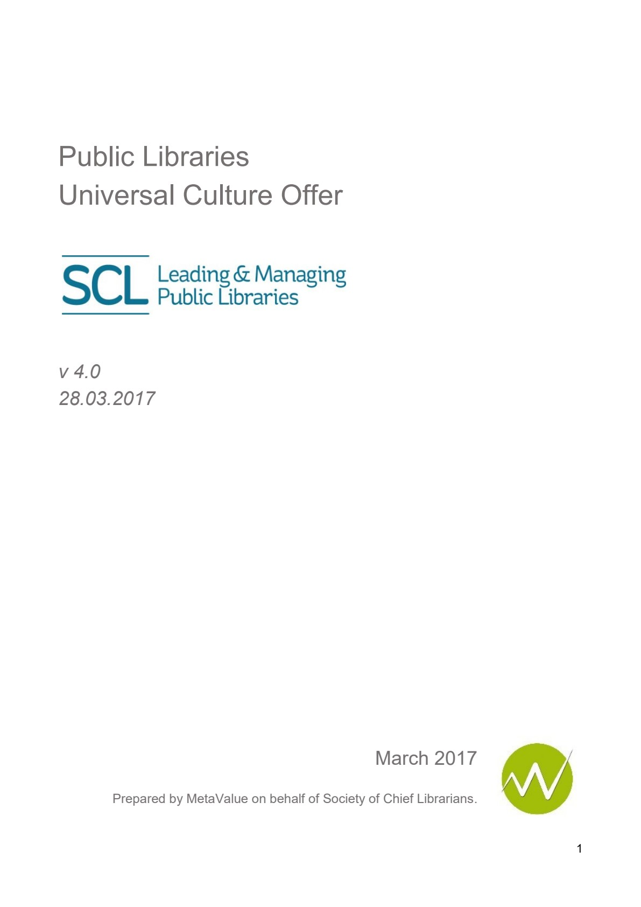

# Public Libraries Universal Culture Offer

**Version 4.0**  
**28 March 2017**

Prepared by **MetaValue** on behalf of the **Society of Chief Librarians (SCL)**.

---

<!-- PAGE: 2 -->

## Acknowledgements

 The Society of Chief Librarians (SCL) would like to thank all those who worked with us to create the Public Libraries Universal Culture including the following people and organisations:

* Alison Millar, Reader and Culture Development Manager, Leeds Library Information Service

* Andrew Bignell, Head of Libraries and Heritage Services, Hertfordshire County Council and

SCL Executive, East of England Regional Lead

* Andy Brisley, Libraries, Information and Customer Service Manager, North Somerset

Council

* Andy Ryan, Chief Executive, Cityread

* Arts Council England Bridge Organisations including ArtsWork and ArtsConnect

* Attendees and speakers: Libraries, Bridges and Cultural Education Partnerships Seminar,

Monday 27 February 2017

* Attendees and speakers: North East Regional Culture Offer Workshop on 7 February 2017,

Newcastle City Library

* Attendees and speakers: South East Regional Culture Offer Workshop, Monday 13 February

2017, Portsmouth City Library.

* Attendees and speakers: South West Regional Culture Offer Workshop, Thursday 9

February 2017, Exeter Central Library.

* Attendees and speakers: West Midlands Regional Culture Offer Workshop on 3 February

2017, The Core, Solihull

* Brian Ashley, Director, Libraries, Arts Council England

* Caroline Bray, Arts Award Associate (Museum, Heritage and Libraries)

* Ciara Eastell OBE, Chief Executive, Libraries Unlimited and SCL Executive Past President

* Cllr Annette Mackenzie, Solihull Metropolitan Borough Council

* Cllr Tony Ludlow, Solihull Metropolitan Borough Council

* Diana Edmonds, Head of Libraries, GLL

* Dorcas Taylor, Festival Director, East Riding of Yorkshire Council

* Elizabeth Elford, SCL Executive Communications Lead

* Fiona Atkinson, Community Services Manager, Bracknell Forest Council

* Fiona Talbott, Head of Museums Libraries Archives, Heritage Lottery Fund

* Helen Drakard, SCL Executive Officer

* Jo Heaton, Library Service Group Manager, Telford and Wrekin Council

* Julie Bell, Head of Libraries Museums, Culture and Registrars, Lancashire County Council

* Julie Spencer MBE, Head of Library and Museum Service, Bolton Central Library and SCL

Executive, Health Lead.

* Kathy Kirk, Strategic Libraries, Learning and Arts Manager, Worcestershire County Council

* Katie Peckacar, Independent Mind

* Krystal Vittles, Libraries Innovation and Development Manager, Suffolk Libraries

* Lesley Sim, County Librarian, West Sussex County Council and SCL Executive South East

Regional Lead

* Liz White, Head of Strategy Development, British Library.

* Mandy Macdonald, Service Manager (Libraries), Customer Service, Plymouth City Council

---

<!-- PAGE: 3 -->

* Marie Brett, Head of Library Services, Sunderland City Council and SCL Executive North

East Regional Lead

* Mark Freeman, Libraries and Heritage Services Manager, Stockton Borough Council

* Mark Taylor, Head of Culture, Libraries and Registration, Royal Borough of Windsor and

Maidenhead

* Medi Bernard, Services and Strategy Manager, Bournemouth, Bournemouth Borough

Council and SCL Executive South West Regional Lead and Information Lead

* Mike Clarke, Director of Libraries and Archives, London Borough of Hammersmith and Royal

Borough of Kensington and Chelsea, Director of Libraries and Culture and Proper Officer for Registration Services, Westminster City Council.

* Neil MacInnes, President, SCL and Strategic Lead - Libraries, Galleries and Culture,

Manchester City Council.

* Sarah Mears, SCL Executive and Team Manager: Library Strategy and Performance, Essex

County Council.

* SCL Executive

* SCL Regional Executive East of England

* Stella Duffy, Co-Director Fun Palaces

* Sue Ball, Stock, Services & Activities Manager at Staffordshire County Council, ASCEL,

Children's Promise Lead

* Sue Wilkinson CBE, Chief Executive, Reading Agency

* Sue Wills, SCL Executive and Library Services Manager, Borough of Poole.

* Survey respondents (105 library services responded to the survey).

* Susan Williamson, Head of Libraries, Metro. Borough of St Helen

* Tracey Cox, Head of Libraries, Solihull Borough Council, and SCL Executive West Midlands

Regional Lead

* Victoria Barton, Arts Council England

* Zoe Williams, Culture Lead, Libraries, Galleries and Culture, Manchester City Council.

---

<!-- PAGE: 4 -->

## Table of Contents

 Acknowledgements ........................................................................................................................... 2 Summary Report ............................................................................................................................... 4 1 Introduction ................................................................................................................................ 5 2 Literature review ...................................................................................................................... 22 3 Main Findings .......................................................................................................................... 36 3.1 Survey with library services .............................................................................................. 36 3.2 Qualitative research findings ............................................................................................. 40 4 Public Libraries Universal Culture Offer ................................................................................... 49 5 Conclusions and recommendations ......................................................................................... 49

---

<!-- PAGE: 5 -->

## Summary Report

### Background

 > “Public libraries are already very

**1.** In June 2016 SCL announced its intention to

create a sixth universal offer focused on culture involved in arts and culture, and to “bring the contribution that libraries make to this offer will give libraries the the cultural landscape to the fore and provide a resources to expand their platform for future development of the cultural partnerships with local culture offer of the public library sector."1 organisations and provide more ways for customers to get involved.

**2.** A research project was carried out between

We want to attract new library November 2016 and March 2017 to scope customers through arts and current activity taking place in libraries and to culture, and help people who don’t articulate how libraries can uniquely support a engage with art to develop a love vibrant cultural life in local communities through a and appreciation of it.” new Universal Culture Offer. Libraries and culture Neil MacInnes, President, SCL and Strategic Lead, Libraries, Galleries

**3.** People can enjoy a quality and diverse cultural

and Culture, Manchester City experience in every library service in the UK. All Council. library services provide the space for culture and enable creative enrichment. Library staff are catalysts for activity, empowerment and exploration.

**4.** The Culture Offer recognises public libraries as welcoming places where children and adults

can immerse themselves in every form of art: learn from local artists; create their own art; watch theatre, music and dance performances; and learn about art and culture through books and reading. Libraries are often the first place that children and young people experience art and culture, through books, free taster sessions, opportunities to work with artists, and library events.

**5.** Whether it is a rhyme time session with a group of

94 % of library services who children and their parents, an arts or crafts session with an emerging artist, a performance or responded to SCL’s culture storytelling workshop with an established survey said that they provide the practitioner or author, a national or regional space for people to experience exhibition touring to local libraries, a hackathon or cultural activities in their creative coding session with young people, a live libraries. music concert in a city centre library, or a

---

<!-- PAGE: 6 -->

community-led Fun Palace – libraries Leeds Library WordPlay Arts Programming understand what it takes to facilitate and Project create a quality and diverse cultural > “As a result of Leeds Library Arts Council funded experience, and the lasting impact that arts programme over 6,000 people have: has on people’s lives and the Drawn on the walls and the floor, painted, sung, communities they live in. created sounds from everyday objects, written stories and poems, delved into imaginative worlds,

**6.** No other public body has the same reach listened to music, sung songs, talked about art,

into and across the UK’s diverse local philosophy, heritage and books. Watched plays communities, or the networks, economies and works in progress, rolled on the floor, chilled of scale and flexibility to respond to local on cushions, played in the dark, crocheted snowflakes, gone on story walks, been in photos needs. There are over 3000 public and watched films, rummaged in our archives, libraries in England and people make admired pottery, hand stitching, sculptures and more than 225 million visits per year2. illustrations, explored Feminism, Race, giving birth The cultural activities and experiences and owning pugs, built sheds and tents, a labyrinth that libraries offer reach people who do and an Imaginarium. Shared ideas, challenged not normally participate in arts and culture each other, collaborated and marvelled at how all and help them to develop a love for and of this has taken place in Leeds Libraries.” appreciate them. Libraries are perfectly placed to help more people access great art and high quality participatory activities, helping to spark a lifelong interest in or pursuit of arts, culture and creativity.

**7.** Public libraries are a gateway to a community or

There are over 3000 public region’s wider cultural offer, including museums, galleries, libraries in England and more theatres, heritage projects, and the creative industries. than 225 million visits per year to Regional Bridge Organisations and local Arts Development libraries and 98 million visits to Officers and Agencies help libraries make the links to arts library websites2. and culture organisations, while libraries provide a means for arts and culture organisations to reach local Many libraries are co-located communities and people less likely to access the arts. 81 with or work in partnership with per cent of library services who responded to SCL’s culture survey said that they partnership arrangements in place museums, art galleries and other with the arts, museums and galleries sector. To find your cultural destinations. local Bridge organisation visit: http://www.artscouncil.org.uk/children-and-young- £6.6 million has been invested in people/bridge-organisations 141 projects through Grants for the Arts Libraries Fund since

**8.** Libraries have a strong track record in supporting the

2013[^2] development of emerging artists and providing ongoing opportunities for more established artists and authors. Public libraries are becoming more confident at securing external funding and commissioning creative projects, while arts and culture organisations and artists feel that libraries are becoming more receptive cultural partners.

**9.** National arts and culture organisations see the benefits of strategic partnering and investing

outside of London – the success of the British Library’s Living Knowledge programme is an

---

<!-- PAGE: 7 -->

example – and they could work with public libraries to extend their reach and impact into local communities. Literature review

**10.** Public libraries are part of the fabric of British life and deliver a wide range of cultural34,

social5, economic6 and even environmental7 benefits for people and local communities across England.

* Participation in culture contributes to Libraries enable people to

community cohesion, reduces social celebrate and showcase exclusion and isolation, and makes their own arts and culture – communities feel safer and stronger. and learn about the

* Those who attend a cultural place or event

diversity within their are more likely to report good health communities. compared to those who do not.

* Businesses in the UK arts and culture industry generated an aggregate turnover of

£12.4 billion in 2011.

* Libraries are often the first place that children and young people experience art and

culture, through RhymeTime sessions, books, free taster sessions and library events.

* Taking part in drama and library

activities improves attainment in Art of Libraries, Gloucestershire literacy.

* Taking part in structured music The overall aim of Art of Libraries is to

activities improves attainment in maths, develop the creative skills of children and early language, acquisition and early young people and develop new working relationships between libraries, arts venues, literacy, galleries and museums to sustain the offer

* Libraries offer people and communities

when the pilot funding comes to an end. opportunities for ‘betterment’ or ‘social Creative skills have been shown to improve mobility’. children’s educational achievement, health and wellbeing and in later life their

**11.** Library services who responded to SCL’s employability. It is a prototype project to test a

culture survey8 prioritised the following benefits new recipe for cultural education in six > “early and outcomes of their library service’s cultural adopter” libraries. Storytelling and reading will offer: health and wellbeing (including reducing be at the core of this new cultural offer, which will be firmly rooted in each community. isolation); education and lifelong learning; community engagement and cohesion; connecting people and communities (social interaction, wellbeing and human connection); a shared sense of place; and enjoyment.

---

<!-- PAGE: 8 -->

**12.** Libraries are cultural hubs within communities,

> “Libraries have a sense of as well as gateways to wider cultural activities ‘possibility’ and ‘discovery’ about locally. In and through libraries, people identify them. They are places of with, experience, participate in, create as well as transformation, both individually and lead culture at a range of different levels; from communally. […] Libraries are excellent and inspirational, international, national and regional arts and culture, to brilliant local democratic spaces where knowledge and community arts and projects inspired by is there to be explored. You can people’s place, culture and heritage. Libraries either choose where to go to find encourage people to explore their own culture, something specific, or you can let self-expression and creative enrichment. All this serendipity lead the way. Libraries happens through a diverse range means and allow for social mobility; they are activities. places of possibility, opening doors in later life for many people for whom

a. Cultural space for creativity such as

school didn’t work. The librarian is computer labs and study areas, exhibition there to make sense of the space, and providing or hiring out space information overload, to be a front of for groups and artists wisdom, advice and guidance.”

b. Cultural resources including free books,

multimedia collections, newspapers and ~ Darren Henley (2016) ‘The Arts supplements, history and ancestry, Dividend: Why Investment in Culture access to computers and free Wi Fi, Pays’ information and signposting to culture and cultural activities, and in many libraries, music lending services (scores and playlist), music downloads and business support for local creative businesses.

c. Cultural activities including parent and toddler sessions, group reading, music, arts,

crafts, creative writing, and in some libraries performance film-making and photography.

d. Cultural programmes consisting of book talks and workshops, artistic exhibitions,

film-screenings, dance, plays and drama, and, in some libraries, regular theatre and concert seasons.

e. Cultural events for high days, holidays and calendar spikes including World Book

Day, Summer Reading Challenge, and, in many libraries, Get Online Week, celebrating Shakespeare, and literature festivals, as well as wider national programmes such as World Mental Health day and World Autism Awareness Day, Black History Month, Fun Palaces, and Family Arts Festivals.

f. Cultural leadership and volunteering for example through Fun Palaces, which

empower people and communities to have fun and create and lead cultural activities events and experiences.

---

<!-- PAGE: 9 -->

g. Cultural partnerships such as cultural education partnerships or joint work with the

arts and culture sector and local history and heritage organisations. Some libraries are part of music hubs working together with local authorities, schools, other hubs, arts organisations, community or voluntary organisations to respond to local need, provide access to culture for young people, and fulfil the objectives of national plan for Music Education. Arts Award The Arts Award's unique qualifications support anyone aged up to 25 to grow as artists and arts leaders, inspiring them to connect with and take part in the wider arts world. Arts Award is growing fast in libraries: between April 2014 and March 2015 almost 2,000 young people achieved Arts Awards through library based projects. More than 100 libraries are Arts Award centres and169 are Arts Award Supporters. Libraries Live Manchester Libraries has a cultural programme consisting of popular and classical music concerts, dance classes, opera, film screenings, exhibitions and prolific author events. Over 4,000 audience and participants have engaged with Manchester Library Live at Central Library since 2014. Sandwell Libraries is in its 4th year of hosting jazz and blues concerts as part of the 32nd Birmingham and Solihull Jazz and Blues festival. In 2016 eight concerts took place over the two- week festival attracting 659 people to libraries. The library service has increased the number of concerts, improved the venues layouts/Jazz club feel ambience and strengthened support from a friends group who are financing more of the events.

**13.** Libraries act as enablers and catalysts for wider cultural and creative enrichment. Some of

the innovative ways libraries are working with partners to facilitate and create cultural activities and events include:

a. Opening up the library space for culture and creative activities to happen with library

staff acting as a supportive, hands-on facilitator-host to artists and organisations.

b. Creative Commissioning. Working with arts and cultural professionals to cultivate a

culture of experimentation, proto-typing, piloting, taking risks and ‘trying things out’. Empowering staff to commission culture.

c. Libraries as cultural hubs and creative making spaces.

d. Broadcasting. Providing a high profile cultural experience in a central library that is

streamed or toured to a network of smaller local libraries.

e. Touring. A wider regional cultural experience made available for local libraries.

f. Creative leadership and volunteering. Empowering artists, Friends’ groups and other

organisations to lead and co-ordinate cultural events and activities.

**14.** Creative commissioning and a culture of experimentation leads to a quality cultural

experience which is sustainable, especially where people and communities are empowered to create and lead cultural events and activities (e.g. Fun Palaces, literature festivals). This type of cultural enrichment should be pursued for its own sake, but it also contributes to a

---

<!-- PAGE: 10 -->

wider range of benefits for people and communities including health and wellbeing and social mobility.

**15.** Measuring the success of the Public Libraries Universal Culture offer should involve a

combination of traditional performance indicators (library visits and issues) with metrics for audience participation (in particular repeat participation as an indicator of success), partnership and collaboration (number of artists supported and groups using the space creatively) and Arts Council England core quality principles and metric statements9 (including excellence: > “it is one of the best examples of its type that I have seen”) – that are proportionate to the library service’s cultural offer and capacities to deliver. Celebrating Shakespeare 2016 The festival marked the bardʼs 400th anniversary with library events and activities over several months. It built on the previous yearʼs successful Shakespeare Week pilot project and was funded by Arts Council England. More than 11,000 children, young people and adults attended 572 sessions run by 388 libraries - a three-fold increase in engagement on the previous year. Shakespeare Selfie Saturday in April generated more than 6,000 tweets to #shakespeare16 and was shortlisted in two categories of the Public Sector Communications Awards 2016. A total of 47 different artists or groups received 95 commissions to work on arts events in 716 libraries over the Summer and Autumn - attracting 12,024 people. A context for partnerships

**16.** Libraries are trusted by the public and have extremely The largest decrease in

high levels of satisfaction and confidence. However, the the proportion of adults number of people using public libraries has decreased who use the library has over the last decade and there are on-going concerns been among 16 to 24 about the impact of reductions in expenditure on library year olds services. The largest decrease in the proportion of adults who use the library has been among 16 to 24 year olds: 51 per cent of adults aged 16 to 24 used a public library in 2005/06, but only 25.2 per cent did so in the year October 2014 to September 201510.

**17.** There is a risk of a two-tier offer as libraries respond in different ways to reductions in

expenditure on library services. However, reductions in funding also provide a greater incentive to engage in new partnerships to find ways to deliver the culture offer. Regional Bridge Organisations and local Arts Development Officers and Agencies can help libraries make the links and connections to arts and culture partners, while libraries provide a connection for arts and culture organisations into the UK’s diverse local communities.

**18.** Arts Council England’s investment approach for 2018-22 offers opportunities for libraries to

apply directly to the development agency’s three main funding streams: the National Portfolio, Grants for Arts and Culture, and strategic funds. Although Grants for the Arts and

---

<!-- PAGE: 11 -->

Culture will no longer be ring-fenced for public libraries, the open access funding stream will see an increase in budget of £10 million per annum to £87.5 million during this investment round. The Heritage Lottery Fund continues to offer a range of open and targeted grant programmes that are relevant for libraries, and is actively encouraging libraries to apply, even if they have been unsuccessful on their first attempt. National Portfolio Organisations (NPOs) are well placed to support public libraries and build capacity in the sector. British Library – Living Knowledge Network. The British Library has launched the Living Knowledge Network, a nationwide partnership between the Library and 21 major libraries in cities and towns across the UK. The Network will combine local expertise and national organising power to share knowledge, resources and activities. The Living Knowledge Network aims to strengthen libraries’ collective ability to deliver world-class library services to diverse communities, develop joint offerings for library users, and work together on funding applications to share programmes of activity with a combined audience of 13 million. At the heart of the Living Knowledge Network is a simple aspiration – to create value by sharing ideas, and sparking connections between libraries, collections and people across the UK. Audiences

**19.** There is an opportunity for public libraries to collaborate with the arts sector to attract new

library customers through arts and culture, and for the arts sector to realise benefits by bringing their audiences to libraries. Analysis reveals four broad audience profiles for public libraries11:

a. People who participate in libraries only. Slightly more likely to be 75+, non-white and

in the lower socio-economic group.

b. People who participate in both libraries and the arts sector. Slightly more likely to be

female, and in the upper socio economic group.

c. People who participate in the arts only. Slightly more likely to be in the 16-24 age

bracket, in the upper socio-economic group, white, working and not to have a long- standing illness or disability. A key audience that libraries could work with the arts sector to attract, through a stretch cultural offer.

d. People who do not participate in the arts or libraries. Slightly more likely to be in the

75+ age group and not working, in the lower socio-economic group and more likely to have a long-standing illness or disability. An audience that libraries should seek to support through partnership working and targeted projects and programmes.

**20.** In addition, libraries outside of London could seek to collaborate with the arts and cultural

sector to reach what the Audience Agency categorises12 as ‘Dormitory Dependables’ and ‘Commuterland Culturebuffs’, for whom being entertained is important. Libraries in London should ensure their culture offer appeals to a younger audience identified, as ‘Metroculturals’, for whom visual art is important.

---

<!-- PAGE: 12 -->

**21.** In terms of participation in cultural activities, reading for pleasure or buying a novel/book or

stories/poetry/plays remains the UK’s top activity across the age ranges, followed by original and textile crafts, painting and drawing, playing a musical instrument, photography and dance. In terms of attendance, going to the cinema and attending live music are the top events, followed by attending a play/drama, musical or public exhibition13. The Warwick Commission found that there is a "passion for music" in the UK14. Brighton and Hove Libraries: Evolving in Conversation 124 artists involved | 1,059 participants | 303,397 audience members Evolving in Conversation particularly targeted 13 - 34 year olds and adult learners, due to a drop-off in library card holders within this age group. The theme ‘How Can Individuals Make Society Change’ was explored through free photography, writing and dance workshops and artist commissions, which led to a showcase event at the end of each phase. There was also a professional day for staff, artists and facilitators at each stage to contribute to the development and evaluation of the project. Evolving in Conversation has brought lots of different people and audiences together to share new experiences and find out more about the libraries. The opportunities for participants to share their skills with others has helped develop confidence and leadership ability. An unemployed gentleman took on a leadership role within one of the groups and has now found employment. Some young people have received Arts Award accreditation through involvement in the project. Young people and adults continue to be engaged with libraries and have created their own groups or attend groups that meet in the library. Survey findings 81 % of library services who

**22.** A survey was carried out with SCL’s library service

responded to SCL’s culture membership in December 2016 to identify and survey said that they had a validate the core and stretch cultural services. The partnership in place with the headline findings are as follows: arts, museums and galleries

e. Space: 94 per cent of library services sector

provide or hire out space for people to experience cultural activities in their libraries

f. Activities: Over 80 per cent of library services provide the following cultural activities

at least monthly or quarterly: group reading activities, music activities, digital, arts and crafts, board games, and creative writing.

g. Events: Over 80 per organised events connected with books such as talks and

workshops with authors and writers, at least monthly or quarterly, while over 60 per cent organised the following events yearly or more than once a year: film screenings, events involving digital, video or electronic art, dance performances, theatre performances and concerts.

h. Programmes: Over 80 per cent of library services offered the following specific

programmes: Summer Reading Challenge, World Book Day and Night, Get Online

---

<!-- PAGE: 13 -->

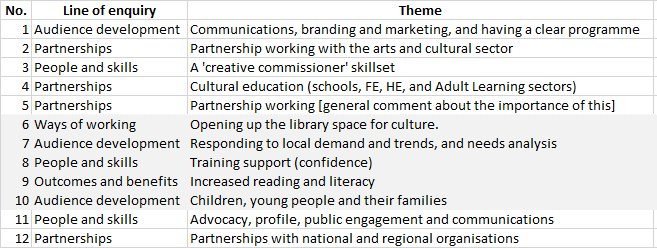

Week, and Celebrating Shakespeare. An emerging number of libraries, around 40 per cent, said they were offering Fun Palaces.

i. Partnerships: 81 per cent of library services had some form of cultural partnership in

place with the arts, museums and galleries sector, and 82 per cent did so with the heritage sector. An emerging 40 per cent of library services have cultural education partnerships and digital partnerships in place, while 34 per cent have partnerships in place relating to sport and physical activity and 26 per cent reported economic partnerships with creative businesses. Telephone interviews and regional workshops

**23.** Telephone interviews were carried out in January 2017 with a geographic sample of survey

respondents to gain a more in-depth insight. In February, regional workshops to develop the culture offer were facilitated with local library services and partners in four regions – West Midlands, North East, South East and South West. The table below shows the key themes from this phase of the research.

**24.** Comments focussed on the opportunities for collaboration with arts and cultural

organisations, working with the Bridge organisations to connect with children and young people, and the importance of an arts ‘co-ordinator’/development role to help libraries make the links to galleries, museums and theatres.

**25.** Communications and marketing were key themes in relation to audience development.

Comments centred around the need for a clear and consistent quality core programme that is accessible and grounded in libraries unique selling point: books, reading and lifelong learning. Linked to this, stakeholders emphasised the importance of ‘getting the basics right’; being tuned in to what people want, their needs and aspirations, as well as ‘what’s on’ locally, and then delivering a programme around that. Making the offer familiar but interesting with something unique and interesting and surprising was also seen as important. After communications and branding, and responding to local demand and trends, the next most common comments in relation to audience development were the importance of supporting children and young people and their families, outreach work, and leveraging partnerships.

---

<!-- PAGE: 14 -->

**26.** The importance of creative commissioning was

another key theme, often made in relation to > “Library service as the workforce development and the need to support staff “commissioner-curator”. to be able to experiment, pilot ideas and projects, Being able to take risks is key and take risks, as well as providing the broader role to delivering quality, getting of the library as an enabler and facilitator of culture the project up and running and and creativity. Bridge organisation Arts Connection then evolving it, and creating it have arrived at a helpful definition of Creative in a way you can’t always Producers: > “Librarians as enlightened predict.” commissioners, capable and confident of offering inspiring briefs for artists in the future”. Lit Up, East Riding Libraries Ove r the last 16 years, East Riding Libraries, through its Wordquake project, has developed a repu tation for bringing the best in literature to the East Riding of Yorkshire through their flagship fest ivals, Beverley Literature Festival and Bridlington Poetry Festival, thanks to the continuing support and commitment of East Riding of Yorkshire Council. The Festival on the Run has seen the library service take pop-up poetry and pop-up theatre out on the road to libraries across the county. The project has put poetry on buses, on prescription and even mashed poetry up with parkour.

**27.** In addition to specific cultural activities and events, stakeholders emphasised the importance

of capturing the practices and ways of working that enable libraries to deliver cultural and creative enrichment. Key among these was opening up the library space for culture as part of the core offer and creative leadership and volunteering as part of the stretch offer; empowering artists, Friends’ groups and other organisations to lead on cultural events and activities.

**28.** Library services are generally maximising their core budgets by sharing services with other

council partners or moving to fully integrated teams and services, e.g. with arts services, museums, galleries, archives and heritage. Alongside that libraries are becoming more confident at applying for external funding. Some library services have developed some aspects of their services as self-financing. The physical space of a library is an important part of its cultural offer. Stakeholders identified the importance of a flexible, attractive and welcoming space, and the benefits of performance and gallery space. The Hive, Worcestershire The Hive is the first integrated public/university

**29.** Challenges and barriers reflected the library, archaeology service and County archive in

survey findings: capacity, funding, Europe. With nearly a million visitors and book staffing and resources; developing an issues a year it is maintaining its popularity and has audience; physical environment of a thriving arts/culture offer. The most recent season’s highlights include more author talks, the libraries / continuing to provide suitable return of The Royal Photographic Society and a full space; staff skillset and confidence; programme of business workshops and courses. and marketing and publicity capacity.

---

<!-- PAGE: 15 -->

Culture offer

**30.** The accompanying Public Libraries Universal Culture Offer has been developed alongside

and in response to the findings from this research project.

**31.** The Culture Offer complements SCL’s existing universal offers for public libraries, in

particular the Reading Offer which includes tools to help libraries promote creative reading among its objectives. Recommendations The following recommendations have been developed in conversation with the Culture Offer Project Steering Group and the SCL Executive on 22 March 2017, and act as a menu of options. Positioning the Culture Offer

**1.** SCL to complete the design, branding, and communication of the Culture Offer publication

appropriate to target audiences (the public, partners and funding bodies).

**2.** Develop a culture outcomes and evaluation framework. SCL and Arts Council England to co-

create a shared definition of culture that is formally recognised by ACE classifiers. Define what quality looks like and how we gather data for evidence of impact.

**3.** Branding and communications. SCL to work with national organisations on a national

marketing campaign for public libraries. Linked to Single Digital Presence Strategy. Workforce

**4.** Cultural champions. Library services should ensure that all staff see themselves as

advocates for culture in libraries, while also ensuring there is a staff champion role with responsibility for culture in libraries.

**5.** Support workforce development by providing a toolkit owned and developed by SCL and

library service champions to provide support materials and promote good practice. Develop a matrix of national arts and culture organisations and their regional offers, links and partners.

**6.** Modula online training package on the creative commissioner skillset (including bid writing

skills and support in securing external funding) to promote diversity, quality, ambition and success. Arts development professionals have a strong track record at supporting public libraries in this area and are well placed to develop this support package further. Possible collaboration between SCL and Arts Development UK on this recommendation. Partnerships and building capacity

---

<!-- PAGE: 16 -->

## 1. Introduction

**7.** SCL to develop the relationship with Arts Council England to build capacity in the library

sector and ensure that libraries are positioned and supported to participate in funding opportunities and make successful grant applications. Identify the role and position of NPOs in the sector as key partners for libraries. Develop the interface between the Bridge Organisations, Cultural Education Partnerships, and public library services.

**8.** A possible briefings service for each local authority library service on the needs and

opportunities in their local area drawing on work by the Audience Agency and Arts Council England.

**9.** Raise awareness to SCL network of the opportunities for libraries to reach children and

families via partnering with school libraries services and libraries in schools.

**10.** Creative industries. National advocacy between libraries and the creative industries.

Regional activity

**11.** SCL regions to work with a national arts and culture organisations and each deliver a pilot

project. Accreditation

**12.** Accreditation. Raise awareness of the Arts Award and benefits of the supporter package.

---

<!-- PAGE: 17 -->

1 Introduction 1.1 Background and Objectives The Society of Chief Librarians (SCL) is a local government association made up of the head of each library authority in England, Wales and Northern Ireland. SCL takes a leading role in the development of public libraries, through sharing best practices, advocating for continuous improvement on behalf of local people, and leading the debate on the future of the public library service. SCL and its partners including The Arts Council and > “Public libraries are already very The Reading Agency are committed to keeping involved in arts and culture, and this library services relevant and accessible. Together offer will give libraries the resources they have created the Public Libraries Universal to expand their partnerships with local Offer Framework to articulate what libraries do culture organisations and provide ambitiously and positively. The framework covers more ways for customers to get the key areas of service which library customers and involved. We want to attract new stakeholders see as essential to a 21st century library customers through arts and library service: Health, Reading, Information, culture, and help people who don’t Learning and Digital. engage with art to develop a love and appreciation of it.” In June 2016 SCL announced that it will create a sixth Universal Offer focused on culture to “bring the Neil MacInnes, President, SCL and contribution that libraries make to the cultural Strategic Lead, Libraries, Galleries and landscape to the fore and provide a platform for Culture, Manchester City Council. future development of the cultural offer of the public library sector." The Culture Offer recognises public libraries as welcoming places where children and adults can immerse themselves in every form of art: learn from local artists; create their own art; watch theatre, music and dance performances; and learn about art and culture through books and reading. Public sector consultants MetaValue were appointed and commissioned in November 2016 to work with and on behalf of SCL to undertake a research project with the library sector to develop the Culture Offer. The project was overseen by a project steering group led by Neil MacInnes, President, SCL and Strategic Lead, Libraries, Galleries and Culture, Manchester City Council, and Sarah Mears, SCL Executive and Team Manager: Library Strategy and Performance, Essex County Council. The objectives of the research brief were:

* To scope current activity taking place in libraries

* To articulate how libraries can uniquely support a vibrant cultural life in local communities

through a new Universal Culture Offer. In addition, the project steering group identified the importance of developing an offer which reflects and builds on what libraries already do, with a focus on audience development opportunities and

---

<!-- PAGE: 18 -->

partnership working. These lines of enquiry were further refined with the project steering group in January 2017 to respond to the findings of the first phase of research and inform the second phase (see below). The end product is this report and the accompanying Offer (to be officially launched later in 2017) which together acts as a proposition that SCL can take to potential partners, funders and decision makers, and which sets out the unique role libraries play in the cultural landscape. As with SCL’s existing universal offers - Information, Health, Reading, Digital and Learning – the Universal Cultural Offer has two elements:

* The Core Offer: which describes succinctly what is currently taking place in all library

services across England

* The Stretch Offer: an optional set of activities and aspirations that library services can

selectively adopt 1.2 Approach The research was carried out in three phases: a baseline literature review between November 2016 and January 2017, qualitative research and stakeholder workshops between January 2017 and February 2017, and an appraisal and write-up in March 2017. 1.2.1 Phase 1 (November 2016 to January 2017) A baseline literature review was carried out through secondary and desk-based research, supported by consultation with a small handful of stakeholders with overarching knowledge of the cultural landscape. An initial understanding was reached of the many and varied cultural activities and services that libraries deliver up and down the country. The main findings are in Section 2 of this report. A survey was carried out with SCL’s library service membership in December 2016 to identify and validate the core and stretch cultural services that libraries deliver, as well as to identify the outcomes and benefits of these services, and the challenges/barriers to delivering culture offers locally. 102 library services responded to the survey out of 177 (58 per cent response rate), of which 90 completed the majority of the questions in the survey. The main findings are in Section 3.1 of this report. 1.2.2 Phase 2 (January 2017 to early February 2017) Telephone interviews were held with a geographic sample of library services who responded to the survey, supplemented by stakeholders identified by the project steering group to gain a more in depth qualitative insight. Three stakeholders also volunteered themselves to speak to the researcher about a specific library project and were included in this phase of the research. 18 telephone interviews were conducted in total, including three test interviews with members of the project steering group. The sample and the key points from the interviews have been recorded in

---

<!-- PAGE: 19 -->

Appendix 2. The main findings have been analysed alongside the feedback from four regional workshops, and are reported in section 3.2. of the report. Table 1. Telephone Interview Sample Region Name Library Service SCL Executive and Team Manager: Library Strategy and East Sarah Mears Performance, Essex County Council. East Krystal Vittles Libraries Innovation and Development Manager, Suffolk Libraries London and Head of Libraries, GLL. Representing Greenwich and Lincolnshire Diana Edmonds East Midlands Library Services. Director of Libraries and Archives, London Borough of Hammersmith and Royal Borough of Kensington and Chelsea, Director of Libraries London Mike Clarke and Culture and Proper Officer for Registration Services, Westminster City Council North East Mark Freeman Libraries and Heritage Services Manager, Stockton Borough Council North West Sue Williamson Head of Libraries, Metro. Borough of St Helens Head of Libraries Museums, Culture and Registrars, Lancashire North West Julie Bell County Council Head of Library and Museum Service, Bolton Central Library and North West Julie Spencer SCL Executive, Health Lead. Culture Lead, Libraries, Galleries and Culture, Manchester City North West Zoe Williams Council. Head of Culture, Libraries and Registration, Royal Borough of South East Mark Taylor Windsor and Maidenhead South East Fiona Atkinson Community Services Manager, Bracknell Forest Council South West Sue Wills SCL Executive and Library Services Manager, Borough of Poole Mandy Service Manager (Libraries), Customer Service, Plymouth City South West MacDonald Council Libraries, Information and Customer Service Manager, North South West Andy Brisley Somerset Council West Midlands Jo Heaton Library Service Group Manager, Telford and Wrekin Council Strategic Libraries, Learning and Arts Manager, Worcestershire West Midlands Kathy Kirk County Council Reader and Culture Development Manager, Leeds Library Yorkshire Alison Millar Information Service Yorkshire Dorcas Taylor Festival Director, East Riding of Yorkshire Council Fact-finding and information telephone conversations were also held with the following stakeholders to understand partners’ perspectives about the culture offer:

* Andy Ryan, Chief Executive, Cityread

* Brian Ashley, Director, Libraries (Nottingham office) Arts Council England

---

<!-- PAGE: 20 -->

* Caroline Bray, Arts Award Associate (Museum, Heritage and Libraries)

* Ciara Eastell OBE, Chief Executive, Libraries Unlimited and SCL Executive Past President

* Fiona Talbott, Head of Museums Libraries Archives, Heritage Lottery Fund

* Katie Peckacar, Independent Mind

* Liz White, Head of Strategy Development, British Library

* Stella Duffy, Co-Director Fun Palaces

* Sue Ball, Stock, Services & Activities Manager at Staffordshire County Council, ASCEL,

Children's Promise Lead

* Sue Wilkinson CBE, Chief Executive, Reading Agency

In early February, regional workshops to develop the Culture Offer were facilitated with local library services and partners in four regions – West Midlands, North East, South East and South West – kindly co-ordinated by the respective SCL Executive Regional Chairs. A session on the culture offer was also held as part of the East of England’s SCL Executive Quarterly Meeting. And at the Association of Senior Children's and Education Librarians (ASCEL) Libraries, Bridges and Cultural Education Partnerships Seminar on 27 February, delegates focussed on the theme of the culture offer.

* East of England SCL Executive Quarterly Meeting, 24 January 2017

* West Midlands Regional Workshop, 3 February 2017, The Core, Solihull

* North East Regional Workshop, 7 February 2017, Newcastle City Library

* South East Regional Workshop, 13 February 2017, Portsmouth City Library.

* South West Regional Workshop, Thursday 9 February 2017, Exeter Central Library.

* Libraries, Bridges and Cultural Education Partnerships Seminar, Monday 27 February 2017

The following lines of enquiry were agreed with the project steering group for phase 2 of the research. Lines of enquiry 1 to 3 and 7 were prioritised for the group discussions in the regional workshops. Table 2. Research lines of enquiry Theme Line of Enquiry The core and stretch 1 What should be in/out of the core and stretch offers? offer proposition How can libraries a) attract new audiences to libraries through art and 2 Audience development culture, and b) help people who don’t engage in art and culture develop a love and appreciation of it? Which partnerships are most important for the culture offer? Which 3 Partnership working could be developed? What skills and competencies are needed to deliver the culture offer? 4 People and skills What are the gaps and workforce development needs? How are libraries maximising their core budgets? How can libraries Resilience/Sustainability 5 using their cultural footing and high footfall to attract/diversify funding and Funding streams?

---

<!-- PAGE: 21 -->

Physical space of How can libraries physical space be maximised to promote the libraries participation and experience of cultural outcomes? What support do libraries and staff need to implement the core and 7 Support stretch offer 1.2.3 Phase 3 In March 2017 MetaValue worked with the Project Steering Group to appraise the findings, and produce the final report and recommendations, and accompanying offer. 1.3 How to read this report Section 2 of this report sets out the context for the Public Libraries Universal Culture offer drawing on the findings from the literature review. Section 3 sets out the main findings of the research. Section 4 provides a link to the accompanying offer Section 5 sets out the conclusions and recommendations from the research project

---

<!-- PAGE: 22 -->

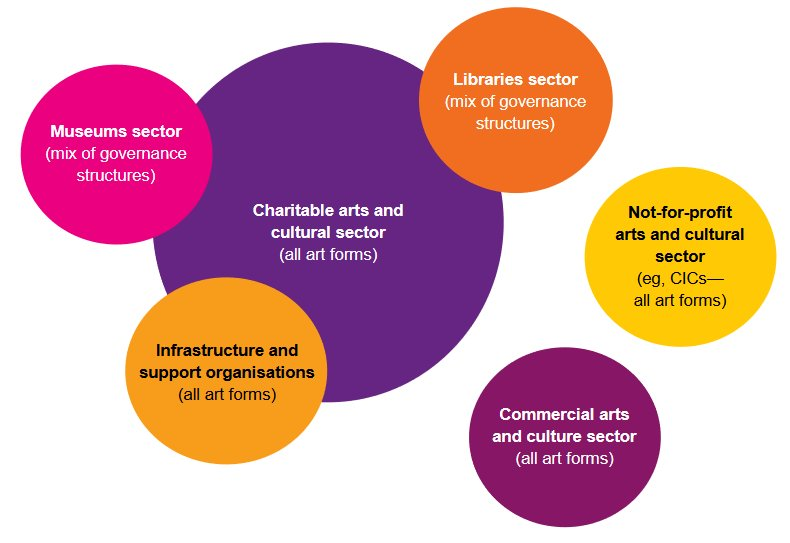

## 2. Literature Review

 Public libraries are part of the fabric of British life and deliver a wide range of cultural3 4, social5, economic6 and environmental7 benefits for people and local communities across the UK. They are trusted by the public and have extremely high levels of satisfaction and confidence. No other public body has the same reach into and across the UK’s diverse local communities, or the networks and economies of scale and flexibility to respond to local needs. The libraries sector is a major element of the arts and cultural sector; the majority are local authority led but the sector is also compromised of community and privately led libraries. 80 per cent of library services who responded to SCL’s culture survey in 2016 said they had some form of cultural partnership in place with the arts, museums and galleries sector, and 82 per cent did so with the heritage sector. Figure 1 below shows the elements of the arts and cultural sector (not to scale). There are over 3000 public libraries in England and more than 225 million visits per year to libraries and 98 million visits to library websites2. Many libraries are co- located with or work in partnership with museums, art galleries and other cultural destinations. £6.6 million has been invested in 141 projects through Grants for the Arts Figure 1 The Cultural Sector. Source: NCVO (2014) Cultural Commissioning Programme: Opportunities for Alignment. Libraries Fund since 2013[^2] However, the number of people using public libraries has decreased over the last decade and there are on-going concerns about the impact of reductions in expenditure on library services. Net local authority expenditure on library services has reduced from £1.2 billion in 2005 to £736 million in 2015[^15]. Library services who responded to SCL’s culture survey identified funding and capacity challenges as the top barrier to delivering their culture offer. 2.1 Libraries culture offer 94 per cent of library services who responded to Libraries are cultural hubs within communities, as well as SCL’s culture survey said gateways to wider cultural activities locally. In and through that their library service libraries, people identify with, experience, participate in, create as provides or hires out space well as lead culture at a range of different levels; from excellent for people to experience and inspirational, international, national and regional arts and cultural activities in their culture, to brilliant local and community arts and projects inspired libraries.

---

<!-- PAGE: 23 -->

by people’s place, culture and heritage. Libraries encourage people to explore their own culture, self-expression and creative enrichment. All this happens through a diverse range means and activities

* Cultural space for creativity such as computer

> “Public libraries are free to enter, labs and study areas, exhibition space, and open to all as spaces where people providing or hiring out space for groups and can explore and share reading, artists information, knowledge and culture.

* Cultural resources including free books,

Those spaces of quiet study and multimedia collections, newspapers and reflection can also be places of supplements, history and ancestry, access to wonder, excitement and creativity. computers and free Wi Fi, information and They are traditionally storehouses of signposting to culture and cultural activities, and the world’s knowledge, and they are in many libraries business support for local increasingly making spaces too.” creative businesses.

* Cultural activities including parent and toddler ~ Brian Ashley, Arts Council England

sessions, group reading, music, arts, crafts, creative writing, and in some libraries performance film-making and photography.

* Cultural programmes consisting of book talks and workshops, artistic exhibitions, film-

screenings, dance, plays and drama, and, in some libraries, regular theatre and concert seasons.

* Cultural events for high days, holidays and calendar spikes including World Book Day,

Summer Reading Challenge, and, in many libraries, Get Online Week, celebrating Shakespeare, and literature festivals, as well as wider national programmes such as World Mental Health day and World Autism > “Libraries have a sense of ‘possibility’ Awareness Day, Black History Month, Fun and ‘discovery’ about them. They are Palaces, and Family Arts Festivals. places of transformation, both

* Cultural leadership and volunteering for

individually and communally. […] example through Fun Palaces, which empower Libraries are democratic spaces where people and communities to have fun and create knowledge is there to be explored. You and lead cultural activities events and can either choose where to go to find experiences something specific, or you can let

* Cultural partnerships such as cultural

serendipity lead the way. Libraries education partnerships or joint work with the allow for social mobility; they are arts and culture sector and local history and places of possibility, opening doors in heritage organisations. Some libraries are part later life for many people for whom of music hubs working together with local school didn’t work. The librarian is authorities, schools, other hubs, arts there to make sense of the information organisations, community or voluntary overload, to be a front of wisdom, organisations to respond to local need and fulfil advice and guidance.” the objectives of national plan for Music Education. ~ Darren Henley (2016) ‘The Arts Dividend: Why Investment in Culture Pays’

---

<!-- PAGE: 24 -->

This is a reflection of the contribution that libraries make to cultural and creative enrichment in local communities, and the wider benefits that come with that including social mobility and health and wellbeing, as Darren Henley16 and William Sieghart17 have contributed in their thought leadership. Libraries’ culture offer recognises public libraries as welcoming places where children and adults can immerse themselves in every form of art: learn from local artists; create their own art; watch theatre, music and dance performances; and learn about art and culture through books and reading. Libraries are often the first place that children and young people experience art and culture, through books, free taster sessions and library events. Library staff are catalysts for activity and exploration, often making suggestions that customers wouldn’t have thought of on their own. 2.2 Outcomes and benefits and the value of culture In 2014, drawing on the Department for Culture Media and Sport’s ‘Culture and Sport Evidence Programme’ (CASE)18, Arts Council England identified the value of culture to people and society19. Businesses in the UK arts and culture industry generated an aggregate turnover of £12.4 billion in

**2011.** Those who had attended a cultural place or event in the previous 12 months were almost 60

per cent more likely to report good health compared to those who had not. And taking part in drama and library activities improves attainment in literacy. The review found strong evidence that participation in the arts can contribute to community cohesion, reduce social exclusion and isolation, and/or make communities feel safer and stronger. In addition, the review highlighted the benefits of cultural education, an agenda which has since been taken forward as part of Arts Council England’s Cultural Education Challenge20, and the formation of Cultural Education Partnerships, as well as SCL’s joint work with the reading agency on the Universal Reading Offer21 and reader development22.

* Taking part in drama and library activities improves attainment in literacy

* Taking part in structured music activities improves attainment in maths, early language,

acquisition and early literacy,

* Participation in structured art activities increases cognitive abilities

The Government in its national strategy for libraries2 acknowledges that libraries deliver the following outcomes:

* providing spaces and opportunities for Working with a range of partners, libraries

people to do, dream and create offer writing workshops, drama and

* enrichment to the lives of individuals and musical events. Taking part in cultural

communities activities provides cross-cutting benefits

* art and culture as part of local and contributes to a number of priorities;

‘placemaking’ health and wellbeing, developing

* contributions to the social and economic well/living well and vibrant economy.

role of arts and culture

* vibrant local creative economies ~ Libraries Shaping the Future (2016)

---

<!-- PAGE: 25 -->

The health and wellbeing benefits of cultural activities have been well evidenced in academic studies5 and there is a trend towards the social prescription of arts and culture. Libraries have adopted the Reading Well Books on Prescription23 for dementia initiative and the Public Library Dementia Offer. Libraries are well placed to tackle disadvantage and promote social mobility. Save the Children's research report The Lost Boys24 observes how a quarter of five-year-old boys are falling behind in their early years, an agenda that libraries are well placed to help tackle and are doing so already through their programmes and reading offers for children and young people, and their families. The reading agency has highlighted the important role of prison libraries in rehabilitating offenders (48 per cent of prisoners are estimated to have low reading skills), and the agency's Six Book Challenge and World Book Night programmes demonstrate that the capacity to read and enjoy books contributes to reducing re-offending and giving prisoners another chance in life25. Libraries also lend themselves to the principles of youth work and engagement with young people 13-19 to promote personal and social development. For example, Reading Hack is a programme led by young people aged 13 to 24 who do reading activities and volunteering, called hacks, to gain skills and experience26. Library services who responed to SCL’s culture survey prioritised the following benefits and outcomes of thesir library service’s culture offer: health and wellbeing (including reducing isolation); education and lifelong learning; community engagement and cohesion; connecting people and communities (social interaction, wellbeing and human connection); a shared sense of place; and enjoyment. 2.3 Measuring impact Measuring the success of the Public Libraries Universal Culture offer should involve a combination of traditional performance indicators with metrics for audience participation, partnership development and core quality metrics – that are appropriate and relevant to the library service’s culture offer. Libraries should aim to ensure that they are measuring the impact of their cultural projects and activities against the following areas:

**1.** General performance indicators. Number of library visits. Number of book issues.

**2.** Audience participation. Participation and repeat participation in a specific cultural experience

that the library service offers. Repeat participation acting as an important indicator of success and quality.

**3.** Partnership development. Number of emerging and established artists supported by the

library. Number of groups and organisations using the library space creatively.

**4.** Arts Council England quality principles. Excellence and innovation, authenticity, being

exciting, inspiring and engaging, ensuring a positive and inclusive experience, activity involving children and young people, enabling personal progression, developing belonging and ownership.

**5.** Arts Council England quality metrics.

a. Self, peer and public

i. Concept: it was an interesting idea

---

<!-- PAGE: 26 -->

ii. Presentation: it was well produced and presented iii. Distinctiveness: it was different from things I’ve experienced before iv. Challenge: it was thought-provoking

v. Captivation: it was absorbing and held my attention

vi. Enthusiasm: I would come to something like this again vii. Local impact: it is important that it's happening here viii. Relevance: it has something to say about the world in which we live ix. Rigour: it was well thought through and put together

b. Self and peer only quality metrics

i. Originality: it was ground-breaking

ii. Risk: the artists/curators really challenged themselves iii. Excellence: it is one of the best examples of its type that I have seen 2.4 Case Studies Appendix 1 highlights examples of public libraries which have developed an enhanced culture offer. These examples have been gathered and analysed through a combination of library services directly submitting case studies as part of the project, secondary research, sign-posting and through word of mouth during the second phase of the research. They include:

* 32nd Birmingham and Solihull Jazz *  Lit Up, East Riding Libraries

and Blues festival 2016 *  Live at the Library, Oldham

* Art of Libraries, Gloucestershire *  Manchester Libraries Live Programme

* Brighton and Hove Libraries Services: *  Norfolk dance and early years project

Evolving in Conversation *  Oxfordshire’s ‘find your voice’ initiative

* Central Bedfordshire Council Cultural *  Shropshire Libraries Creative Arts

Projects Summer Programme video

* Creative Libraries, Wiltshire *  Solihull Metropolitan Borough Council

* Cultural Hubs in St Helens Council Library Service, various case studies

* Derbyshire Rhythm and Rhyme *  South Gloucestershire Discover

* Dudley Libraries and Dudley Little Festival

Theatre *  The Deptford Lounge

* Exeter Fab Lab, a creative making *  The Green Library of Birmingham

space *  The Hive, Worcestershire, the Hive

* Fantastical Feats, a regional dance *  Warwickshire’s creative reading

and digital project involving the 15 festivals library authorities in South West *  Westminster Made in Libraries Project England *  Wigmore Lectures, Medway Libraries

* Leeds Library and Information Service and Medway Arts Team

* Leeds Library Arts Programming

Project Key success factors underpinning these examples include:

* Partnership working (e.g. with arts, history, education and science)

---

<!-- PAGE: 27 -->

* Creative commissioning

* Clearly defined offer and programme of events with signposting to groups and providers.

Offer is consistent and familiar but also offers a hook and a ‘surprise’. Includes targeted projects with specific groups.

* Library as a place for live events: Live at the Library

* Engaging with local providers, groups and artists, giving them a reason and purpose to bring

their talents to the library.

* Maximising the location and space in libraries for people to > “do, dream and create”

* Developing connections into the local community

* Delivering the health and wellbeing agenda

* Clearly defined targeted offer

* The use of dance and music linked to reading development and storytelling.

* Use of audience analysis and market insight, using local data in the context of the national

picture.

* Capital investment in a modern, attractive, flexible and integrated physical space that

promotes exploration and discovery. International research commissioned by the European Parliament's Committee on Culture and Education (CULT)27 in 2016 found in its review of practice that "although public libraries in some countries have experienced a decrease in the number of loans over the past few years, they have intensified their role as central cultural and public spaces. In many countries libraries – and mainly public libraries – are the most frequented cultural institutions, sometimes having more visits than the national football leagues." 2.5 Challenges The number of people using public libraries has decreased over Library services who the last decade and there are concerns about the impact of responded to SCL’s reductions in expenditure on library services. Net local authority Culture Survey identified expenditure on library services has reduced from £1.2 billion in funding and capacity 2005 to £736 million in 2015[^15]. Library services who responded to challenges as the top SCL’s culture survey identified funding and capacity challenges barrier to delivering their as the top barrier to delivering their culture offer. culture offer. DCMS estimated that 110 static public libraries closed in England between January 2010 and January 2016 while at least 77 new public libraries had opened. CILIP points to figures from the Chartered Institute of Public Finance and Accountancy (CIPFA) of a net reduction of 178 libraries in England between 2009-10 and 2014-15. CIPFA define a library as one which is open for at least 10 hours per week15. All local authorities are facing the same challenge of keeping these valuable services open while responding to substantial financial pressures, and demand pressures in adults and childrens social care. The Local Government Association has estimated that local government faces an overall funding gap of £5.8 billion by 2020.

---

<!-- PAGE: 28 -->

There is a local appetite for developing a more integrated approach to services with partnerships being established between libraries, heritage (museum and arts) adult and community learning, apprenticeships, community development, links with Higher Education and Further Education provision. Survey respondents identified the following barriers to delivering their culture offer:

* Capacity, funding, staffing and resources

* Developing an audience

* Physical environment of libraries / continuing to provide suitable space

* Staff skillset and confidence

* Marketing and Publicity Capacity

2.6 Participation trends and challenges The largest decrease in the DCMS taking part data released in April 2016 reveals that in proportion of adults who the year ending September 2015, 33.9 per cent of all adults use the library has been had used a public library service in the 12 months. This is a among 16 to 24 year olds significant decrease since data collection began in 2005/0610. The survey also finds that:

* Over the same time period, 94.2 per cent of adults who had used a library were very

satisfied or fairly satisfied with their library experience. This is a significant increase from 2010/11 when the question was first asked

* The largest decrease in the proportion of adults who use the library has been among 16 to

24 year olds: 51.0 per cent of adults aged 16 to 24 used a public library in 2005/06, but only 25.2 per cent in the year October 2014 to September 2015.

* Significantly more women used the library than men

* Significantly more non-working adults used a library than adults who are working

* A significantly higher proportion of adults from the black and minority ethnic (BME) groups

used a library in the year ending September 2015 than adults from the white ethnic group

* Significantly more adults from the upper socio-economic group used a library than adults

from the lower socio-economic group In terms of participation in cultural activities, reading for pleasure or buying a novel/book or stories/poetry/plays remains the UK’s top activity across the age ranges (62 per cent said they had done so in the last 12 months) followed by original and textile crafts, painting and drawing, playing a musical instrument, photography and dance. In terms of attendance, going to the cinema and attending live music are the top events (56 per cent and 31 per cent respectively said they had done so in the last 12 months), followed by attending a play/drama, musical or public exhibition. The Warwick Commission found that there is a "passion for music" in the UK. The Warwick Commission found that there is a "passion for music" in the UK. In a MORI survey, 70 per cent of adults and 84 per cent of under 25s said that music was important to them14.

---

<!-- PAGE: 29 -->

2.7 Policy objectives In its vision for a 21st public library network, the Government acknowledges the role that libraries play in: enriching the lives of individuals and communities, placing art and culture at the heart of ‘placemaking’, promoting the social and economic role of arts and culture, and creating vibrant local creative economies. The Government has set out its ambition for 2021 in which it expects public libraries to play a key role in delivering the following thee outcomes:

* more people (children and adults) having access to cultural experiences and events through

libraries (especially from disadvantaged backgrounds

* people see libraries as local creative hubs where exploration, experimentation, pursuing of

cultural interests, and making are encouraged

* libraries are seen as active partners with professional and amateur cultural and arts

organisations to provide cultural experiences and activities within libraries Libraries also have an important role to play in supporting the aims of the Government’s Culture White Paper28 and Art Council’s England’s strategic goals in its ten-year strategy ‘Great Art and Culture For Everyone’29. Table 3: Strategic Goals Culture White Paper (2016) Strategic Art Council England (2013) Strategic Goals Goals Helping to increase participation in culture Everyone has the opportunity to experience and and providing opportunities for everyone to be inspired by the arts, museums and libraries to access culture regardless of background. Every child and young person has the opportunity to experience the richness of the arts, museums and libraries Enabling culture to be integral to Excellence is thriving and celebrated in the arts, communities and contribute to the museums and libraries transformation of places. Promoting the contribution of cultural The leadership and workforce in the arts, sectors to improved health and wellbeing museums and libraries are diverse and appropriately skilled Supporting the development of new The arts, museums and libraries are resilient and cultural partnerships at national and local environmentally sustainable levels. The Government's new investment approach for 2018-22 offers opportunities for libraries to apply directly for all of the Government's funding proposals including the open access Grants for the Arts (GftA) fund, and applying for longer-term investment as National Portfolio Organisations (NPOs). The Libraries sector is showing increasing confidence and ability to secure external funding. The success rate of applications for Grants for Arts was 76 per cent in 2015/16 up from 70 per cent in 2013/14.

---

<!-- PAGE: 30 -->

In 2013 Arts Council England carried out in depth research through its Envisaging Libraries project and identified the following priorities:

* Developing the Library as a community hub

* Better use of digital technology and creative media

* Resilient and sustainable libraries

* Delivering the right skills for library workers

---

<!-- PAGE: 31 -->

2.8 Partnership perspectives and opportunities for collaboration Arts Council England continues to invest money from > “We’ll increase investment Government and the National Lottery in great art and outside London without culture for everyone. In October 2016 the development damaging the capital; fund agency set a budget of £622m per year across lottery and more new, small and diverse grant in aid for our three main funding streams: the organisations. And museums, National Portfolio, Grants for Arts and Culture, and libraries and arts organisations strategic funds. will apply to us on a more level playing field.” Although Grants for the Arts and Culture will no longer be ring-fenced for public libraries, the open access funding Darren Henley, Chief Executive, stream will see an increase in budget of £10 million per Arts Council England. annum to £87.5 million during this investment round. It is intended that the increase will help support the integration of museums and libraries, who will now be able to apply to this funding stream for museums’ activity for the first time. Unlike other funding programmes Fund, the Grants for the Arts and Culture will continue to be uniquely open to individual artists, as well as community and cultural organisations. Support for applicants is available on the Arts Council England website. Among other factors and criteria, libraries applying for the fund will be expected to demonstrate artistic quality, public engagement, a clear business case and evidence, and partnering. The Heritage Lottery Fund continues to offer a range of open and targeted grant programmes that are relevant for libraries30. In particular, the development agency has been encouraging libraries to explore the ‘Our Heritage’ fund. HLF funding is confirmed to 2019. At the end of 2017, HLF will begin to consult on its future funding programmes and will be working with Society of Chief Librarians. HLF are seeking to broaden who gets involved in heritage as part of a wider commitment to diversity and inclusion. Libraries are well placed to help new audiences participate in local history and heritage, and work with local volunteer networks. A key message from HLF to libraries, based on their analysis of applications, is that if libraries have been unsuccessful in their first attempt at applying for funding, they should apply again. National arts and culture organisations such as the British Library and the Tate are increasingly moving towards strategic partnering and investing resources outside of London through strategic touring and providing offers that libraries can sign up to (e.g. The British Library’s Living Knowledge). This helps with perception and branding and also gives people who do not usually visit London a sense that they are participating in a wider cultural offer or institution such as the British Library, in their own locality. The CILIP Library Fund is implementing a UK-wide crowdfunding campaign for individuals and companies to build up the Fund with the aim of creating a new Grants Programme from 201831. The intention is to support a range of projects and activities that improve access to information and knowledge, literacy, health, digital inclusion and life chances. The CILIP Library Fund will be open to applications from all parts of the information, knowledge and library sector. Applications will open in early 2018.

---

<!-- PAGE: 32 -->

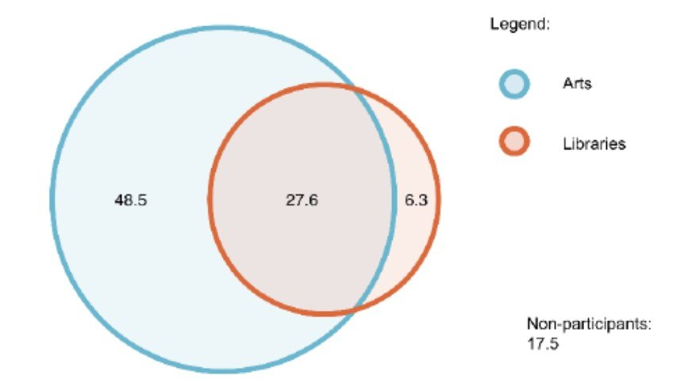

2.9 Audience development and opportunities for collaboration There is an opportunity for the public libraries sector to collaborate with the arts sector to attract new library customers through arts and culture, and for the arts sector to realise benefits by bringing their audiences to libraries and making use of library space. Libraries’ culture offer has a core audience of 27 per cent of people who both attend libraries and participate in the arts sector. In the year ending September 2015, 48.5 per cent of people engaged in the arts sector, but did not engage in public libraries, while 17.5 per cent of people did not engage in the arts or public libraries. This contrasts with greater synergies between the arts sector and museums and heritage, where there is closer alignment of audiences. By collaborating with the arts sector, public libraries can in turn reach audiences who visit museums and heritage sites and activities. Source: DCMS (April 2016) 'Taking Part focus on: cross-sector participation‘. Figure 2. The graph shows the overlap in participation between the arts and public libraries sector in the year to September 2015 (October 2014 to September 2015). 2.9.1 Audience opportunities This analysis identifies four key audiences for public libraries. These audiences are made up of a range of different groups of people, but there are some observations that can be drawn out from DCMS cross-participation data.

* People who participate in libraries only. Slightly more likely to be 75+, non-white and in

the lower socio-economic group. A core audience that libraries should look after with a familiar and consistent offer.

* People who participate in both libraries and the arts sector. Slightly more likely to be

female, and in the upper socio economic group. A second core audience that libraries should look after with a familiar and consistent offer.

* People who participate in the arts only. Slightly more likely to be in the 16-24 age bracket,

in the upper socio-economic group, white, working and not to have a long-standing illness or disability. A new audience that libraries could work with the arts sector to attract, through a stretch cultural offer.

* People who do not participate in the arts or libraries. Slightly more likely to be in the 75+

age group and not working, in the lower socio-economic group and more likely to have a

---

<!-- PAGE: 33 -->

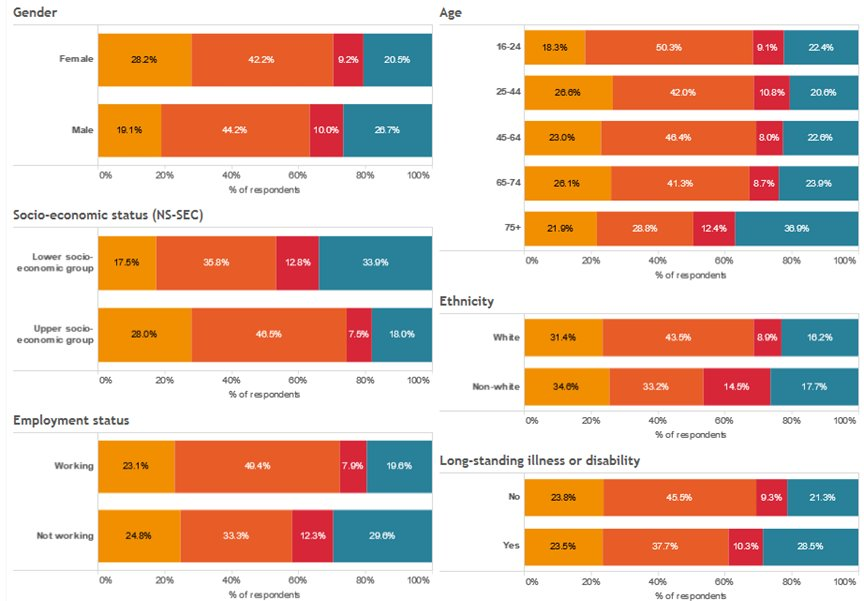

long-standing illness or disability. An audience that libraries should seek to support through partnership working and targeted projects and programmes. Figure three below shows the DCMS data on which these observations have been drawn. In addition, drawing on the Audience Agency’s analysis of Box Office Data for 2015-16, libraries outside of London should seek to collaborate with the arts and cultural sector to attract what the agency segments as ‘Dormitory Dependables’ and ‘Commuterland Culturebuffs’ as part of a stretch offer. See section 2.8.2. below for a description of these market segments. While libraries in London should ensure their culture offer appeals to a younger audience segment identified as ‘Metroculturals’. Figure 3: Participation between the arts and public libraries sector in the year to September 2015 (October 2014 to September 2015). Key: Attends art events/activities AND libraries Attends art only Attends libraries only Does not attend art or libraries

---

<!-- PAGE: 34 -->

2.9.2 Participation in culture and community expectations Audience Finder Box Office Data for 2015-16 reveals a significant divide in the way people consume and experience art and culture in London compared to the rest of the UK 12. The dominant audience type in London is what the Audience Spectrum segments as ‘Metroculturals’ (49 per cent of box office sales), typically a young audience aged 25 to 34, followed by ‘Kaleidoscope Creatives’ (16 per cent): Metroculturals: > “Prosperous, liberal urbanite group. Often choose a city lifestyle for the broad cultural opportunity it affords. Interested in a very wide spectrum of activity, but many tend towards their own preferred artform or style. Apt to be active museum attenders, but tend to be more engaged with the arts and many on a weekly basis. Represent good prospects for new, innovative work. Likely to be working in demanding but rewarding professions, including arts professionals, they are highly educated and have a wide variety of other interests.” Kaleidoscope Creatives: > “A group characterised by low levels of cultural engagement. Often living in and around city areas where plenty of opportunities are within easy reach. Mix of ages, living circumstances, resources and cultural backgrounds. For many low incomes and unemployment can present barriers to accessing some cultural provision. Two thirds annually engage with more popular and accessible culture, some of this in the local community and outside the mainstream. Free, local events like outdoor arts, festivals and carnivals may appeal, and so might popular offerings like musicals and music events.” This contrasts with regions outside of London where the dominant audience type was identified as ‘Dormitory Dependables’, followed by the ‘Commuterland Culturebuffs’ and ‘Trips and Treats’, and typically an older age profile and families. Dormitory Dependable: > “A significant proportion of arts audiences are made up of this dependably regular if not frequently engaging group. Most live in suburban or small towns and show a preference for heritage activities alongside popular and more traditional mainstream arts. Many are thriving, well off mature couples or busy older families. Lifestage coupled with more limited access to an extensive cultural offer mean that culture is more an occasional treat or family or social outing than an integral part of their lifestyle.” Commuterland Culturebuffs: > “Affluent and settled group with many working in higher managerial and professional occupation. Keen consumers of culture, with broad tastes but a leaning towards heritage and more classical or traditional offerings. Often mature families or retirees, living largely in leafy provincial suburban or greenbelt comfort. A group willing to travel and pay for premium experiences, their habits perhaps influenced by commuting. Motivations are multiple, ranging from social and self-improvement, to the pursuit of learning opportunities for older children. Tend to be frequent attenders and potential donors.” Trips and Treats: “While this group may not view arts and culture as a passion, they are reasonably culturally active, despite being particularly busy with a wide range of leisure

---

<!-- PAGE: 35 -->

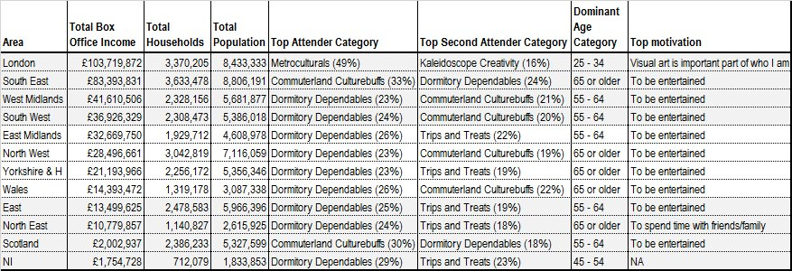

interests. Tend to be comfortably off and living in the heart of suburbia. Children range in ages, and include young people still living at home. With a strong preference for mainstream arts and popular culture like musicals and familiar drama, mixed in with days out to museums and heritage sites. This group are led by their children’s interests and strongly influenced by friends and family.” The dominant age category of London attenders was 25-34 compared to a much older age profile of 45 and over in the UK regions. ‘To be entertained’ was the top motivation for attending arts and culture in the majority of the regions, with the exceptions of London, where ‘visual art as an important part of who I am’ was a greater motivator, and North East where ‘spending time with friends/family’ was more important. Table 4: Audience Finder Box Office Data for 2015-16 extracted from Audience Finder Regions and local authority libraries are encouraged to explore their own area profiles using national tools such as the Audience Agency’s Audience Finder and Spectrum as well as a local understanding of need. As an example in practice, Manchester Libraries have used Audience Finder and Spectrum to analyse their local data in the context of national box office data as part of their cultural programme Libraries Live, to evaluate impact and identify opportunities for cultural engagement. Audience data sharing is also a requirement for organisations applying for NPO status.

---

<!-- PAGE: 36 -->

## 3. Main Findings

### 3.1 Survey with library services

 A survey was carried out with SCL’s library service membership in December 2016 to identify and validate the core and stretch cultural services. 102 library services responded to the survey out of 177 (58 per cent response rate), of which 90 completed the majority of the questions in the survey. Responses have a 7 per cent +/- margin of error at an industry standard 95 per cent confidence interval. 3.1.1 Outcomes and benefits Library services prioritised the following as the top outcomes and benefits delivered by their culture offers:

* Health and Wellbeing (including *  Access to local events, particularly for

reducing isolation) disadvantaged groups.

* Education and Lifelong Learning *  Family connections (connects families,

* Community Engagement and bonds parents and children)

Cohesion *  New audiences

* Connecting people and communities *  Understand local history

(social interaction, wellbeing, human *  Free access, affordable connection). A cultural community hub. *  Broadening people's experiences

* Shared sense of place *  Exposure to local art and culture (local

* Enjoyment, experience and widening artists, local history)

participation *  Stimulates creativity

* Making culture accessible *  Range, Diversity and vibrancy

3.1.2 Challenges and barriers Library services identified funding and capacity challenges as the top barrier to delivering their culture offer:

* Capacity, funding, staffing and resources

* Developing an audience

* Physical environment of libraries / continuing to provide suitable space. Size and space

limitations. Buildings not always appropriate.

* Staff skillset and confidence

* Marketing and Publicity Capacity

* Costs and budgeting for culture, and practicalities of being able to pay artists

* Perceptions and attitudes towards public libraries

---

<!-- PAGE: 37 -->

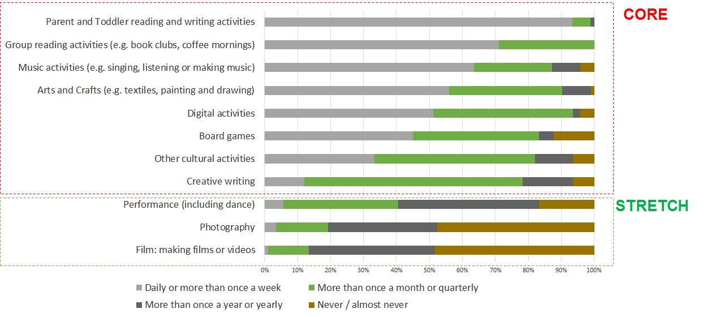

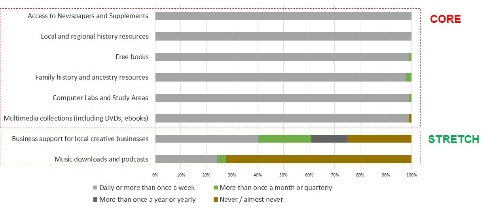

3.1.3 Cultural resources and products Over 80 per cent of library services provides the following cultural activities at least monthly or quarterly: group reading activities, music activities, digital, arts and crafts, board games, and creative writing. Business support for local creative businesses and music downloads and podcasts were provided less frequently identifying them as proposed ‘stretch’ resources. How frequently does your library service as a whole provide the following products / resources? 3.1.4 Cultural activities Over 80 per cent of library services provide the following cultural activities at least monthly or quarterly: group reading activities, music activities, digital, arts and crafts, board games, and creative writing. Performances, photography and film-making were provided less frequently and identified as stretch activities. How frequently does your library service as a whole provide the following activities?

---

<!-- PAGE: 38 -->

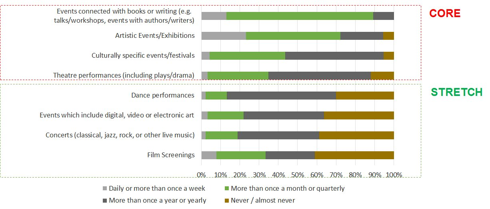

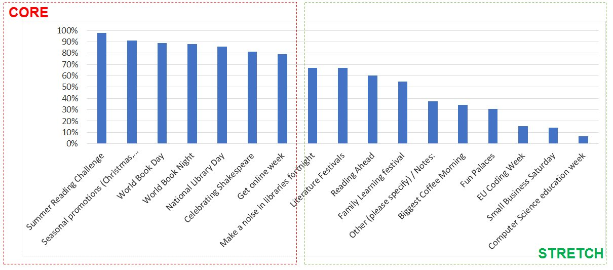

3.1.5 Cultural Events Over 80 per cent of library services said they organised events connected with books such as talks and workshops with authors and writers, at least monthly or quarterly, while over 60 per cent organised the following events yearly or more than once a year: film screenings, events involving digital, video or electronic art, dance performances, theatre performances and concerts. How frequently does your library service as a whole provide the following events? 3.1.6 Cultural Programmes and Calendar Spikes Over 80 per cent of library services offered the following specific programmes: summer reading challenge, world book day and night, get online week, celebrating Shakespeare. While an emerging number of libraries, around 30 per cent, said they were offering innovative programmes such as Fun Palaces. Does your library service offer the following specific programmes?

---

<!-- PAGE: 39 -->

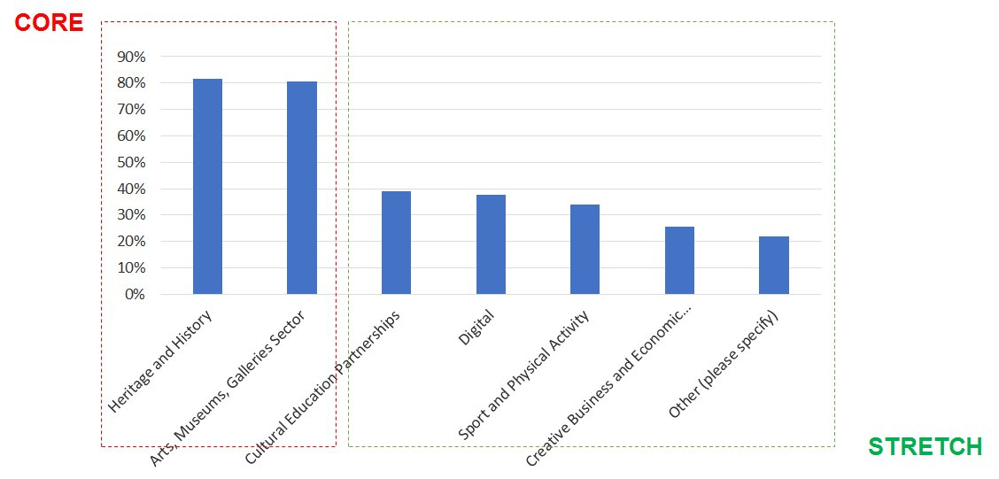

3.1.7 Cultural Space 94 per cent of library services provide or hire out space for people to experience cultural activities in their libraries. 3.1.8 Cultural Partnerships 81 per cent of library services had some form of cultural partnership in place with the arts, museums and galleries sector, and 82 per cent did so with the heritage sector. An emerging 40 per cent of library services have cultural education partnerships and digital partnerships in place, while 34 per cent have partnerships in place relating to sport and physical activity and 26 per cent reported economic partnerships with creative businesses. Does your library service have cultural partnership arrangements in place? 3.1.9 Regional Observations Library services in the Midlands and East of England appear to offer music downloads less frequently than nationally, although this is generally not frequently provided by libraries. Library services in London appear to provide concerts, film-screenings and events which involve digital, video or electronic art more frequently than other regions. Film-making and photography is provided more frequently in London than other regions, and less frequently than nationally in the South of England. Fun Palaces appear to be more frequently provided in the North of England, than in London and the South. Cultural Education Partnerships appear to be more established in the Midlands and East of England, and less developed in London, while digital partnerships appear to be more developed in the South.

---

<!-- PAGE: 40 -->

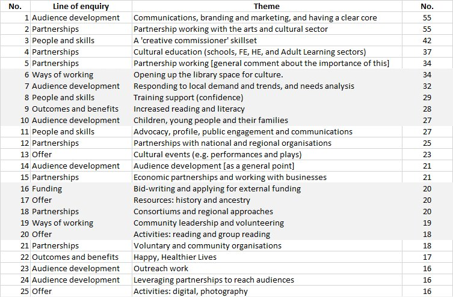

### 3.2 Qualitative research findings

 This section of the report summarises the key themes from the telephone interviews conducted with library services and the four regional stakeholder workshops. A coding approach was taken to ensure that the data (notes from the interviews in Appendix 2 and flip-chart notes from the workshops in Appendix 3) were analysed consistently against the key lines of enquiry, and to avoid researcher assumptions and generalisations. The information and key themes emerging from the telephone interviews were similar to those raised in the regional workshops and therefore the analysis has been amalgamated in this section of the report, with a section on some of the variation and regional observations. 3.2.1 Key Themes The table below shows the top 50 key themes from qualitative points and comments made in both the telephone interviews and regional workshops.

---

<!-- PAGE: 41 -->

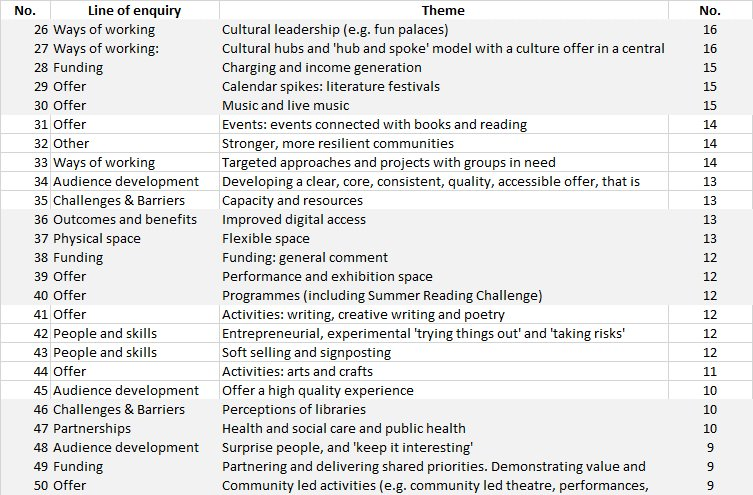

It is not unsurprising to see partnership working with the arts and cultural sector as the joint top theme, alongside communications, marketing and having a clear core programme, as this was a particular focus of the research project and a theme that featured in the introductory presentations in the regional workshops. Comments focussed on the opportunities for collaboration with arts and cultural organisations, working with the Bridge organisations to reach children and young people and their families, and the importance of an arts ‘co-ordinator’ role to help libraries make the links to galleries, museums and theatres. The following comments are reflective of the wider set of comments made on this theme.

* Libraries move to Arts Council England represents a huge opportunity to engage with arts

sector leaders. Libraries sector can develop its understanding of arts and culture, and ACE can develop its understanding about libraries reading and literature offer.

* Working with bridge organisations and wider cultural partners – e.g. Performing arts, music

service, NPOs, education

* Proud of our service – lots of creative people – breaks down barriers – that libraries are good

venues for this- cultural organisations not always aware of us. We’ve created good working relationships so they want to work with us

* We have a good relationship with our local arts manager who is key to creating links and

pulling people together.

* Co-creating programmes with Arts Council – (cf. Roald Dahl project)

---

<!-- PAGE: 42 -->

* Challenge: Working with Arts Council England has seen some very positive benefits

although it does sometimes feel as though the emphasis is on the other arts services, rather than the benefit that public libraries services bring to that sector. Communications and marketing was a key theme in relation to audience development. Comments cantered around the need for a clear and consistent quality core programme that is accessible and grounded in libraries unique selling point: books, reading and lifelong learning. Linked to this, stakeholders emphasised the importance of ‘getting the basics right’; being tuned in to what people want, their needs and aspirations, as well as ‘what’s on’ locally, and then delivering a programme around that. Making the offer familiar but interesting with something unique and interesting and surprising was also seen as important.

* Important to understand the local demographics and the needs of local communities and

tailoring services and activities.

* Providing the services that people actually want.

* Key is being relevant to what people what. Reading groups aren’t for everyone, but they are

a chance for people to come and see and have a chat about something.

* Need to hitch onto the latest trends, e.g. Minecraft, adult colouring. Need to horizon scan

and produce what people want / need. E.g. Pokémon craze. Local advertising.

* Identify what people want to access – use social media, staff engagement – ask customers

what they want. Conversations. Feed back mechanisms for existing audience

* Using accurate analysis/data/demographic. Marketing – social media

* Importance of outreach work, going out to families and children and young people not

waiting for them to come to us.

* Identify what local demand is – make culture relevant and accessible

The importance of creative commissioning was another key theme, often made in relation to workforce development and the need to support staff to be able to experiment, try things out, pilot ideas and projects, take risks as well as the broader role of the library as an enabler and facilitator of culture and creativity.

* Going beyond glue sticking offer and generating funding and income. Bringing together

teams and groups of people to be able to apply for funding and strengthen the application.

* Commissioning, and knowing how to commission and co-ordinate a local project. Having the

confidence to do that.

* Building teams around funded projects. Very flexible staffing structure. When we have a

project we say > “who is interested” and then free people up and build a team around the project.

* Libraries have always played an enabler / facilitator role. We can promote and develop

activities and events.

* Being able to bring in artists and event specialists, and going out of the way and beyond just

hosting them to actually supporting that person.

* Commissioned John Godbar to deliver a theatre touring project across the region. Staff

directly involved in planning and delivery. Partnerships were crucial to success. We gave the artist carte blanche to create the programme working in partnership with University of Hull.

---

<!-- PAGE: 43 -->

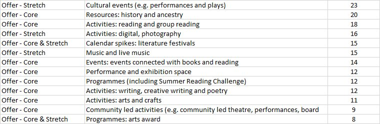

Library service as the > “commissioner-curator”. Being able to take risks is key to delivering quality, getting the project up and running and then evolving it, and creating it in a way you can’t always predict. The tour was phenomenally successful. People would travel to attend the performances. We rolled this out to North Yorkshire. Important to work across boundaries not just your area.

* > “Everything we do is a pilot”. Importance of staff being able to experiment, pilot and develop

the programme and projects. Partnership working was a key theme often made as a general point as the means to attract new audiences, but also specifically in relation to cultural education and the importance of the relationships with schools, further and higher education and universities.

* Cultural Education Partnerships – everyone brings something different to the table. Smaller

partnerships are important for opening it up. Arts Council England are starting to see the impact in terms of footfall.

* We have an important partnership and relationship with our schools. It is important to be

linked up with schools to bring children into libraries. We have run digital roadshows with schools. The importance of ‘opening up’ the library space for culture and creativity to happen was also a key theme and reflects the survey findings.

* A space for audiences. A space for things to happen.

* Building creatively a space: Welcoming, accessible, need to proactively promote offer.

* Importance of exhibition space. Creative spaces.

* Important to do things in public ‘space’ rather than a ‘closed’ room

3.2.2 The core and stretch offer proposition (including stretch practices and ways of working) History and ancestry resources and reading and group reading were among the top core activities while cultural events and music and live music were the top stretch activities. For example:

---

<!-- PAGE: 44 -->

* Kensington and Chelsea’s Black Archives and Refugee project and memory wall, Notting Hill

Carnival.

* Stockton War Memorial project. WW1 Centenary Project in partnership with youth service,

engaging young people through digital experiences.

* Poole’s library events programme has reached 6,000 new library users. Includes a core offer

of film nights, author visits, but also linked with a wider set of services, including health information, advice and guidance. Recording studio as a stretch element of this programme.

* Core: Music gigs and spoken word gigs. Headline act with a warm-up act, promoted locally.

Adults don’t mind paying a small amount. Last gig in Ipswich reached 250 people.

* Get it Loud in Libraries live programme as an example of a national stretch offer that has

been taken up and had a real impact locally in Lancashire. Links to children and young people and enabling them to explore new skills. Team and leadership skills developed. In addition to specific cultural activities and events, stakeholders involved in the project emphasised the importance of capturing the practices and ways of working that enable libraries to deliver cultural and creative enrichment. Key among these was opening up the library space for culture as part of the core offer and creative leadership and volunteering as part of the stretch; empowering artists, friends’ groups and other organisations to lead on cultural events and activities.

* Use Friends groups to promote & deliver offer – can enthuse local community

* Service has engaged young people 16-24 by developing a volunteer base of over 250 young

people through the Summer Reading Challenge. Working closely with schools, children’s service to reach looked after children. Poet Laureate scheme has been successful. No fines for under 18 year olds.

* Volunteering and user led activities to attract people to libraries

* Cultural leadership through fun-palaces and connecting with multiple groups and

organisations. Original project used a bit of funding from our arts pot which give us flexibility, but moving to being self-sustainable. Cultural programming, producing a clear consistent and accessible programme of events and activities, and targeted approaches with groups in need were examples of ways of working that straddled both the core and stretch offers. 3.2.3 Audience development

---

<!-- PAGE: 45 -->

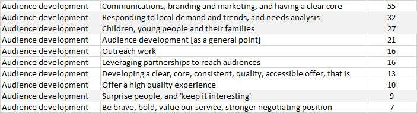

After communications and branding, and responding to local demand and trends, (highlighted above), the importance of supporting children and young people and their families, outreach work, and leveraging partnerships were the next most common comments in relation to audience development.

* Family experience is key

* Reach adults through parents/dads who are coming in with their children (parent only

sessions to visit library)

* Start early – nursery and school visit to cultural venues

* Importance of outreach work, going out to families and children and young people not

waiting for them to come to us. The importance of cultural programming and having a clear ‘what’s on’ programme of events and activities was also considered important to attracting and retaining audiences. 3.2.4 Partnership working After partnership working with the arts and cultural sector, and cultural education partnerships (highlighted above), partnership with national and regional organisations, consortiums and economic partnerships were the next most common themes in relation to partnership working.

* Importance of a regional focus of cultural offer – working together as a region with local

providers to deliver cultural offer, working with schools, drama groups, artists and theatre groups.

* Regional partnership is important. E.g. Success of Time to Read in the North West, driven

by a cultural co-ordinator applying for funding and delivering projects such as Shakespeare project.

---

<!-- PAGE: 46 -->

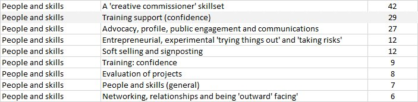

* Importance of regional offer (e.g. The Word in South Shields, National Centre for the Written

Word). Brings people together through an exhibition template that can be developed and adopted in local libraries.

* [Idea/option] SCL to apply for national funding on our behalf to cascade down regionally i.e.

Shakespeare project Economic partnerships were most often cited in related to partnership working with the creative tourism industry as part of local regeneration strategies.

* Working with council as part of its 2030 Vision to improve the town, attracting tourism and

economic regeneration. Library as a contribution to the cultural economy. Recognition of role of libraries in contributing to a sense of pride and place.

* We have an important partnership with the local creative tourism industry and have brought

them in with partners. Stretch offer: taking risks when creating projects and activities.

* Working with Lambeth Cultural Exchange bringing universities and employers together to

engage more people in creative art. 3.2.5 People and skills In addition to creative commissioning highlighted above, the importance of support to build staff confidence, and advocacy, profile and public engagement were the next most common themes, as well as the importance of specific skills such as soft-selling and sign-posting, evaluation, and an outward facing relations skillset.

* Regional training to build confidence (Reading, Libraries, and the Arts)

* Workforce development – staff need to understand what culture is as well as what the offer

is; build staff confidence to promote libraries cultural offer.

* Staff training, guidance, toolkits including training on how to apply for funding

* Take the message out and enthuse and facilitate plus a need to draw in money.

* Local ambassadors – attract others

* One-off visit doesn’t develop love/app – needs to be on-going dialogue

* Developing some of the basic skills around public engagement – being pro-active, cultivating

opportunities.

* Staff skills that are important: building relationships and connecting people and making the

links. Networking at a more strategic level, and digital up-skilling.

---

<!-- PAGE: 47 -->

* Brokerage role between library staff and artist. (e.g. English is Everywhere and Digital Light

Project took over the whole library and staff to be able to support that) 3.2.6 Resilience/Sustainability and Funding Libraries are generally maximising their core budgets by sharing services with other council partners or moving to fully integrated teams and services, e.g. with arts services, museums, galleries, archives and heritage. Alongside that libraries are becoming more confident at applying for external funding. Some libraries have developed some aspects of their services as self-financing by charging.

* Things we could do more of: drawing in additional funding

* Applying for funding opportunities, slightly outside staff comfort zones. Need to become

better at this.

* We do go for grants but don’t just chase the money. Needs to be right for the project and

what we want to deliver.

* When grant funding comes to an end we are positioning ourselves to self-direct the

programme and continue to deliver great quality art.

* Maximising core budgets in Essex through co-locating services in libraries and sharing

services

* An integrated workforce across Library and Museum services with shared delivery team.

* Sharing services and good practice through neighbourhood hubs model, with libraries part of

a wider prevention agenda: early health, tackling isolation. intervention, mental 3.2.7 Physical space of libraries A common theme against this line of enquiry was the important of flexible, attractive and welcoming space. Some library services also shared about the benefits of new technologies such as digital tables and ‘pods’.

* Needs to be accessible and give people the opportunity to try things out. Stage and

performance space is important.

* Using module spaces

* One public estate – integrating culture within library. Buildings

* Importance of performance space and flexible space.

---

<!-- PAGE: 48 -->

* Newer libraries have performance and gallery space.

* Libraries can learn from supermarket and retail sectors when thinking about how to plan and

organise their space.

* Digital tables to show the community library history

* Accessible opening hours. Central library open 7 days with a late night opening on one day

to 7.30pm. As part of the regional workshops, the research team visited Exeter Central Library, Newcastle City Library, the Core in Solihull and Portsmouth City Library. Key success factors in these libraries was the importance an open, attractive and welcoming space, including a cafeteria that enabled people to explore and discover, and in the case of Solihull an integrated box office and theatre.

---

<!-- PAGE: 49 -->

## 4. Public Libraries Universal Culture Offer

## 5. Conclusions and Recommendations

4 Culture Offer The Public Libraries Universal Culture Offer is set out as an accompanying publication to this report and has been developed in response to the findings in this report alongside on-going development with stakeholders and the project steering group. 5 Conclusions and recommendations This research has identified the many and varied cultural activities and services that libraries deliver up and down the country, as well as the innovative practices and ways that libraries work to co- create culture and creative enrichment, and the sectors views on the strengths and opportunities of a universal culture offer. Whether it is a rhyme time session with a group of children and their parents, an arts or crafts session with an emerging artist, a performance or storytelling workshop with an established practitioner or author, a national or regional exhibition touring to local libraries, a hackathon or creative coding session with young people, a live music concert in a city centre library, or a community-led Fun Palace – libraries understand what it takes to facilitate and create a quality cultural experience, and the lasting impact that has on people’s lives and the communities they live in. Key themes include the importance of two-way collaboration with the arts and culture sector, with a recognition that Bridge organisations can help libraries make the links and connections to arts and culture partners, while libraries provide a connection for arts and culture organisations into the UK’s diverse local communities. The research has identified the importance of creative commissioning or ‘creative producing’ and other practices such as opening up the space for culture to happen, libraries as culture hubs, broadcasting and touring, regional and consortium approaches and creative leadership and volunteering. The research has also identified some gaps around communications and marketing. The following recommendations have been developed in conversation with the Culture Offer Project Steering Group and the SCL Executive on 22 March 2017. Positioning the Culture Offer

**1.** SCL to complete the design, branding, and communication of the Culture Offer publication

appropriate to target audiences (the public, partners and funding bodies).

**2.** Develop a culture outcomes and evaluation framework. SCL and Arts Council England to co-

create a shared definition of culture that is formally recognised by ACE classifiers. Define what quality looks like and how we gather data for evidence of impact.

**3.** Branding and communications. SCL to work with national organisations on a national

marketing campaign for public libraries. Linked to Single Digital Presence Strategy.

---

<!-- PAGE: 50 -->

Workforce

**4.** Cultural champions. Library services should ensure that all staff see themselves as

advocates for culture in libraries, while also ensuring there is a staff champion role with responsibility for culture in libraries.

**5.** Support workforce development by providing a toolkit owned and developed by SCL and

library service champions to provide support materials and promote good practice. Develop a matrix of national arts and culture organisations and their regional offers, links and partners.

**6.** Modula online training package on the creative commissioner skillset (including bid writing

skills and support in securing external funding) to promote diversity, quality, ambition and success. Arts development professionals have a strong track record at supporting public libraries in this area and are well placed to develop this support package further. Possible collaboration between SCL and Arts Development UK on this recommendation. Partnerships and building capacity

**7.** SCL to develop the relationship with Arts Council England to build capacity in the library

sector and ensure that libraries are positioned and supported to participate in funding opportunities and make successful grant applications. Identify the role and position of NPOs in the sector as key partners for libraries. Develop the interface between the Bridge Organisations, Cultural Education Partnerships, and public library services.

**8.** A possible briefings service for each local authority library service on the needs and

opportunities in their local area drawing on work by the Audience Agency and Arts Council England.

**9.** Raise awareness to SCL network of the opportunities for libraries to reach children and

families via partnering with school libraries services and libraries in schools.

**10.** Creative industries. National advocacy between libraries and the creative industries.

Possible partnership between SCL and the Creative Industries Federation. Regional activity

**11.** SCL regions to work with a national arts and culture organisations and each deliver a pilot

project. Accreditation

**12.** Accreditation. Raise awareness of the Arts Award and benefits of the supporter package.

---

<!-- PAGE: 51 -->

## References

1. SCL (July 2016) [Libraries to invest time and resources in art and culture](http://goscl.com/libraries-to-invest-time-and-resources-in-art-and-culture/)
2. Department for Culture, Media and Sport (DCMS) (December 2016) *Libraries Deliver: Ambition for Public Libraries in England 2016 to 2021*
3. Libraries Taskforce (2016) *Cultural and creative enrichment: how libraries deliver*, [Libraries Taskforce Blog](https://librariestaskforce.blog.gov.uk/category/case-study/outcome-culture/)
4. NCVO (2014) *Cultural Commissioning Programme: Opportunities for Alignment*
5. Arts Council England (2015) *The health and wellbeing benefits of public libraries*
6. Arts Council England (2014) *Evidence review of the economic contribution of libraries*
7. Library of Birmingham (2016) *The 'Green' Library of Birmingham*
8. SCL (2016) *Libraries and culture: online survey*
9. Arts Council England (2014 to present) *Quality Principles*, [Arts Council England](http://www.artscouncil.org.uk/quality-metrics/quality-principles)
10. DCMS (2016) *Taking Part April 2016: Focus on Libraries*
11. DCMS (April 2016) *Taking Part focus on: cross-sector participation* and *Taking Part April 2016: Focus on Libraries*
12. The Audience Agency, [Audience Spectrum](https://www.theaudienceagency.org/audience-spectrum)
13. DCMS (2016) *Taking Part Survey 2015-2016: Participation and Attendance in the Arts*
14. Warwick Commission on the Future of Cultural Value (2015) *Enriching Britain: Culture, Creativity and Growth*
15. House of Commons Library (April 2016) *Briefing Paper: Public Libraries*
16. Henley, D. (2016) *The Arts Dividend: Why Investment in Culture Pays*
17. Sieghart, W. (2014) *Independent Library Report for England*, Department for Culture Media and Sport, and Department for Communities and Local Government
18. DCMS (2013 to present) *CASE Programme*, [gov.uk](https://www.gov.uk/guidance/case-programme)
19. Arts Council England (2014) *The Value of Arts and Culture to People and Society: An Evidence Review*
20. Arts Council England, *Cultural Education Challenge*, [Arts Council England](http://www.artscouncil.org.uk/children-and-young-people/cultural-education-challenge)
21. SCL, *Universal Reading Offer*, [Society of Chief Librarians](http://goscl.com/universal-offers/reading-offer/)
22. SCL (2017) *Review of Reader Development Activities in Libraries and Training Needs*
23. Reading Agency, *Reading Well*, [Reading Agency](https://readingagency.org.uk/adults/quick-guides/reading-well/)
24. Save the Children (July 2016) *The Lost Boys*
25. Reading Agency, *The impact of books and reading in prisons*, [Reading Agency](https://readingagency.org.uk/news/blog/the-impact-of-books-and-reading-in-prisons.html)
26. Reading Agency, *Reading Hack Project*, [Reading Agency](https://readingagency.org.uk/young-people/004-get-involved/readinghack-project/)
27. Committee on Culture and Education (CULT), European Parliament (2016) *Research for CULT Committee: Public Libraries - Their New Role*
28. DCMS (March 2016) *The Culture White Paper*
29. Arts Council England (2013) *Great Art and Culture for Everyone: 10-Year Strategic Framework 2010 - 2020*
30. Heritage Lottery Fund, [Grant Programmes](https://www.hlf.org.uk/looking-funding/our-grant-programmes)
31. CILIP, [Support Your Library - CILIP Library Fund](https://www.cilip.org.uk/advocacy-campaigns-awards/advocacy-campaigns/support-your-library/cilip-library-fund)

---

## Footnotes

[^1]: SCL (July 2016) Announcement of intention to create a sixth universal offer focused on culture.
[^2]: Department for Culture, Media and Sport (December 2016) *Libraries Deliver: Ambition for Public Libraries in England 2016 to 2021*.
[^3]: SCL Project Steering Group appraisal, March 2017.
[^15]: House of Commons Library (April 2016) Briefing Paper: Public Libraries.
