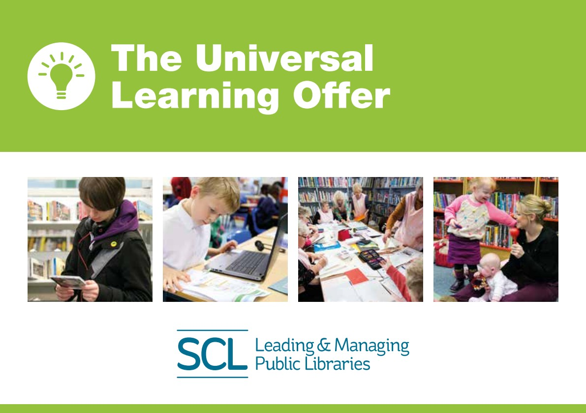
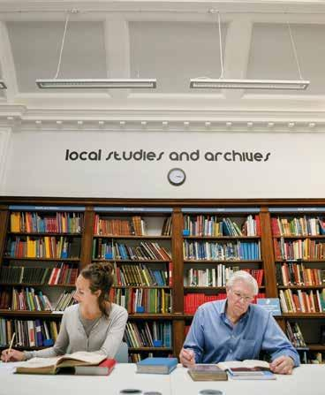
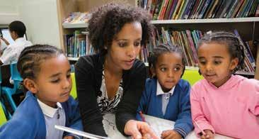
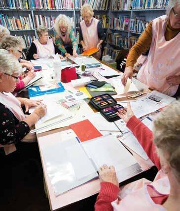
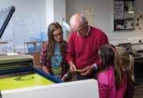
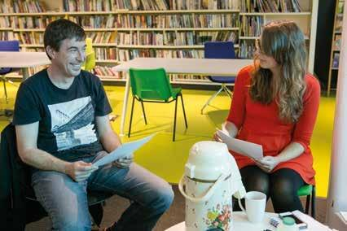

# The Universal Learning Offer

<!-- PAGE: 1 -->

# The Universal Learning Offer

<!-- PAGE: 2 -->

## Foreword from Ciara Eastell, President of the Society of Chief Librarians

The Society of Chief Librarians is delighted to launch its fifth Universal Offer: The Universal Learning Offer.

Learning has always been at the heart of what libraries deliver. With the growth in demand for self-directed and online learning, combined with the growing skills agenda at a national policy level, it is a logical step for libraries to be more central in this agenda.

The Universal Learning Offer, like all our Universal Offers, has been informed by customer research, tested with stakeholders and customers and developed with the support of a range of partners. Research conducted by RedQuadrant for the Society of Chief Librarians demonstrated both the appetite for learning in libraries and the huge opportunities for libraries to support learning in the 21st Century.

The voices and needs of learners are central to the Universal Learning Offer: we have produced a video called “Lightbulb Moments” which shows the powerful impact that learning in libraries can have on people’s lives. It showcases new ways in which libraries are supporting learners, including offering self-organised and new digital learning opportunities. It also demonstrates the strong potential for libraries to support the Science, Technology, Engineering and Maths (STEM) agenda, combat social exclusion and loneliness and build empowered, learning communities.

As part of this launch we are building on libraries’ existing strengths in lifelong learning and welcoming new ways of learning in libraries. We have published “Code Green: A Digital Making Kit” to help bring digital making into libraries and will be widely publicising a set of pilot projects exploring ways that libraries can support Massive Open Online Course (MOOC) learners. We are excited about the potential to work with the BBC on its Make It Digital initiative and to develop our relationships with other partners.

SCL is committed to moving forward this exciting area of work for the benefit of individuals and local communities across England. We welcome the opportunity to work with other agencies, funders and learners themselves to grow this important area of work over the next year.

## The Universal Learning Offer

Libraries are there for you throughout your learning journey because they are in your local area and they are open and accessible to all.

The Society of Chief Librarians is pleased to launch the newest addition to its suite of universal offers: the Learning Offer. The Universal Learning Offer is supported by over 90% of library services across England which have all signed up for the first time ever to provide:

- Free resources for study and learning, such as online resources and courses, text books and reference books
- Study/learning spaces for children, young people and adults in the library service
- Information about a range of free and low cost learning opportunities local to you, such as courses and study groups
- Opportunities for you to explore and be creative, including workshops, regular groups and/or special events for children, young people and families
- Places where communities and individuals can develop and share ideas and learn together

<!-- PAGE: 3 -->

## Children and Family Learning

The Universal Learning Offer in public libraries has been developed so that children, young people and families will be able to build confidence and develop increased creativity, coding and digital skills.

This offer will give families more opportunities to learn together, on a variety of subjects, and help to move through from literacy to fluency.

Currently many library services already offer:

- Baby rhyme times and play sessions
- Homework and revision clubs
- Classes, workshops and activities aimed at children and families
- Coding clubs for young people and families
- Opportunities for young people to organise their own learning activities in libraries
- Intergenerational learning opportunities, particularly in digital technology

### Voices of Young Learners

> “I learnt how a 3D printer worked in the library and then when I went back to school I could understand what it was doing and how it worked.”  
> *(Secondary school student)*

> “When you think of a library you just think of books and people telling you to be quiet, but this isn’t that kind of library, it’s very different.”  
> *(Primary school student)*

> “It’s a good place for my baby to come because he learns how to mix with other babies and it is good for me because I get to meet other mums too.”  
> *(Mother of baby attending rhyme time sessions)*

<!-- PAGE: 4 -->

## Self-Organised Learning

Library services offer a unique opportunity in local communities across the country, for people to come together to design and deliver their own learning experience.

Libraries already support self-organised learning groups across a huge variety of learning areas, including: job clubs, business development, handicrafts, digital making, language learning, distance learning for Higher Education courses, local history and family learning.

Libraries offer the physical space, learning resources and in some cases staff and volunteer support to facilitate these groups. We have developed learning resources with partners, including the Workers’ Educational Association, to provide public libraries with the skills and confidence to support and facilitate self-organised learning in their communities.

### Voices from Self-Organised Learning Groups

> “I have always believed that learning isn't just about passing tests, but about a lifetime experience, learning from and with each other. This is the only place in our community where that can happen.”  
> *(Member of a local history group)*

> “It gave me back my identity, it gave me back my belief in myself. I had not realised how lonely and lost I was.”  
> *(Student attending English for Speakers of Other Languages group)*

> “Our meetings in the library really helped develop my initial ideas and test them out on people who gave me honest and constructive feedback. Having access to market research data, company information and industry journals, as well as free WiFi, has made all the difference to my business.”  
> *(User of library-based business club)*

<!-- PAGE: 5 -->

## Code Green: Digital Making Kit

In response to huge demand from library services across the country, we have collaborated with the Association of Senior Children’s and Education Librarians (ASCEL) to develop and launch the **Code Green: Digital Making Kit**, a ‘how to’ guide for libraries who wish to develop digital making services for children and young people.

It includes chapters to help public libraries start:

- Coding clubs
- Building computers, circuit building and programming
- Robotics
- Digital music making
- 3D digital imaging and making

As well as critical success factors for sustaining these activities in libraries, including:

- Targeting your offer
- Being inclusive
- Effective marketing
- Engaging volunteers
- Building community
- Evolving your offer

> “This is a brilliant resource for librarians and beyond, and Nesta will certainly be sharing it widely. The field of digital making activities can appear hard to navigate, and our research has shown a lack of awareness of the opportunities out there. This guide manages to simply, effectively and comprehensively walk through the diverse ways to get creative with digital technologies.”  
> *(Sylvia Lowe, Programme Director – Innovation Lab, Nesta)*

Code Green is available as an interactive online guide at: `www.goscl.com/codegreen`

## Our Partners

The development and roll out of this offer has been funded by Arts Council England. Many of the activities that make up the Universal Learning Offer will be delivered alongside new and existing partners:

- We have been working with the Publishers Licensing Society on the Access to Research project. Over 90% of library services have signed up to provide the public with free access to millions of academic research articles.
- We have signed a partnership agreement with the BBC to support their Make It Digital initiative.
- We have signed a partnership agreement with FutureLearn to explore the development of Massive Open Online Courses in libraries.

We would like to thank the following organisations for their help in developing the Universal Learning Offer:

- Arts Council England
- Association of Senior Children's and Education Librarians (ASCEL)
- BBC
- British Library
- CILIP
- FutureLearn
- Tinder Foundation
- Workers' Educational Association (WEA)

<!-- PAGE: 6 -->

## FutureLearn MOOC Pilot Projects

Massive Open Online Courses (MOOCs) offer people who are not in higher education courses the opportunity to study bite-sized, high quality university-level courses within their own communities.

They also offer libraries the opportunity to support individual and community learning through the learning resources already available through the Universal Learning Offer. The Society of Chief Librarians has partnered with FutureLearn to pilot MOOC study services in six public libraries across England over the course of autumn 2015:

### Dudley – MOOCs for Business Development

Dudley is focussing on MOOCs for business support. All MOOC groups are able to use a community cafe facility where customers will be able to discuss ideas and learning, helping to establish libraries across Dudley as social learning spaces.

### Norfolk – MOOCs to Enhance Existing Self-Organised Study Groups

Norfolk is using MOOCs to add value to existing self-organised learning projects taking place in the library setting already. The pilot project focuses on MOOCs about World War 1, which is already a focus of interest among Norfolk library users.

### Poole – MOOCs to Expand Existing Business and Employment Offer

Poole is developing its MOOC offer around existing job clubs and the business support offered by the enterprise library in Poole Central library. Volunteer tutors are available every other week to answer questions and provide support. When the tutor is not available a room is available for MOOC course followers to meet at a set time every week.

### Somerset – MOOCs as Part of a New Digital Making Service

Somerset is developing a targeted MOOC offer for people who may be interested in its emergent digital making offer, which will include code clubs and a new maker space in Taunton called the “Glass Box”.

### Southwark – MOOCs to Provide Access to Learning to Housebound Library Users

Southwark’s project aims to deliver learning via MOOCs to Southwark’s housebound population by taking laptops into their homes and supporting them to access MOOCs via the Home Library Service.

### Telford and Wrekin – Using Libraries to Support Existing MOOC Users

Telford and Wrekin are exploring ways of attracting existing MOOC users to the library, for face-to-face discussions of their studies and community building.

<!-- PAGE: 7 -->

## Contact and Further Information

If you would like to find out more about the Universal Learning Offer or partner with SCL to deliver this offer in public libraries, please contact:

**Elizabeth Elford**  
Email: `elizelford@gmail.com`  
Telephone: +44 7891 056 114  

- `www.goscl.com/codegreen`
- `www.goscl.com`
- `www.ascel.org.uk`

### Partner Organisations

- **Society of Chief Librarians (SCL)**
- **Association of Senior Children's and Education Librarians (ASCEL)**
- **Supported using public funding by Arts Council England**
