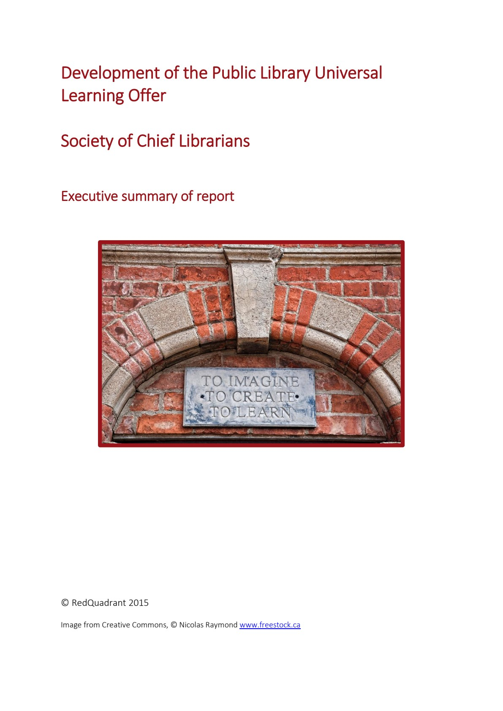

# Development of the Public Library Universal Learning Offer

<!-- PAGE: 1 -->

# Development of the Public Library Universal Learning Offer

## Society of Chief Librarians

### Executive summary of report

© RedQuadrant 2015.

<!-- PAGE: 2 -->

## Executive summary

The Society of Chief Librarians (SCL) engaged us to support the development of a fifth Universal Offer to be focused on learning. The aim was to reflect the wide range and diversity of people using public libraries. The offer was to be built on the current baseline offer that, it was assumed, public libraries are already providing for learning:

- Enabling access to free resources that support learning in a range of formats which are appropriate for each learner;
- Offering study and learning spaces for children, young people and adults;
- Signposting to a range of free and low-cost learning opportunities available within and across communities; and
- Providing opportunities for exploration and creation, especially for children and young people.

As with the other Universal Offers, it was important that this should not only promote what most library authorities currently do well, but also to develop new offers that will challenge authorities, enabling continuous improvement. This new learning offer needed also therefore to build on existing provision by enabling public libraries to engage creatively and ambitiously with new emerging technologies.

This report assesses the degree to which library authorities are already meeting the baseline and the willingness among service leaders to sign up to commit to these levels of provision, and sets out recommendations for ‘stretch’ offers to be piloted (or potentially directly implemented) to enhance the learning offer, build capacity in the sector and enable it to respond to the changing landscape of learning needs and provision. It is based on a programme of consultation with the sector, partners and potential partners, and a small number of users of learning services in libraries, complemented by extensive desk research covering current government policies, the wider landscape for learning, examples of good practice and possible approaches to quality assurance and evaluation.

As context to the work we examined current trends for informal and community learning provision, looking in particular at the recommendations of the Department of Business, Innovation & Skills (BIS) report, ‘New Challenges, New Chances; the Further Education and Skills System Reform Plan: Building a World Class Skills System’ which emphasised, among other things, the importance of provision for ‘for people who are disadvantaged and who are furthest from learning and therefore least likely to participate’.[^1] We also looked at new trends in learning, especially the increasing recognition that skills in science, technology including computing, engineering and maths (STEM subjects) need a renewed focus, and examined how public libraries could best respond to this need by bringing together the development of this Universal Learning Offer with work underway on the Digital Offer. We recognise too the potential opportunities that the work of the new Leadership for Libraries task force may bring, while acknowledging that it is not yet clear what funding or powers the task force will have.

<!-- PAGE: 3 -->

With so much going on, and so many opportunities, it is potentially easier than ever for libraries to lose focus (or appear to lose it) and fall into trap of trying to be all things to all people. This is a laudable aim, but it is not helpful for communicating a new offer. Our work was underpinned therefore by a recommendation that SCL adopt a marketing approach to the development of the Public Library Universal Offers in order to provide focus and clarity, especially as the number of these offers grows. We propose that SCL considers each Universal Offer as a ‘product range’, a group of related services. Each offer has its basic services, the ‘core product range’, and its ‘flagship product’, e.g. Books on Prescription for the Health Offer.

Our findings were based on our consultation activities, desk research and on this need to create focus. It was important first of all to ensure that the SCL members were comfortable with the baseline offer and that library authorities were, for the most part, already delivering to this baseline and would be willing to commit to it formally. Over 90% of authorities responding to our survey indicated that they would be willing to do so. In general we believe that the proposed baseline does indeed represent what libraries currently provide and are likely to continue to be able to provide, though for some authorities, particularly those where services have been reduced significantly, even these basic commitments will be challenging.

Following discussion with SCL, an additional baseline commitment was added: ‘Places where communities and individuals can develop and share their own learning activities’. This was broadly supported by members, though with less confidence in their ability to deliver it across all libraries.

With a viable baseline established, the focus of our work was on ‘stretch offers’. In line with the recommended marketing approach we sought to identify a small number of potential flagship products that could be developed and piloted and which would enable public libraries to align themselves with relevant <!-- PAGE: 4 --> national agendas and to position themselves at the heart of current thinking about learning, as well as to access the funding streams that might result from such positioning.

The various ideas that were proposed for these ‘stretch offers’, whether by the project group, other members of SCL or other organisations (as well as our own reflections on the potential of public libraries) were evaluated against agreed criteria:

- Alignment with other Universal Offers
- Feasibility of national roll-out
- Added value for learners
- Potential for partnership and co-funding
- Contribution to reducing inequalities and supporting social inclusion

This process identified three preferred options for further development and piloting:

1. **Coding clubs:** Building on the existing Code Club network and emerging digital making initiatives to support children and young people in learning computational thinking and programming.
2. **Online learner support groups:** Supporting learners enrolled in Massive Open Online Courses (MOOCs) through library-hosted study groups, face-to-face facilitation, and social learning spaces.
3. **Extending early years work:** Partnering with early years organisations, brokered by the National Literacy Trust, to extend libraries’ existing early years offer and enable them to open up access to parents and carers currently disengaged with their own and their children’s learning.

Given that self-learning and community-learning is a strong thread running through the proposed Universal Learning Offer, learner views and feedback will form an important part of the quality assurance framework. Ultimately libraries have to strike a balance between a formal quality assurance framework which will by its nature be administratively demanding but be resisted by staff and volunteers, and the legitimate needs of learners who rightly expect a level of reassurance as to the level of quality. As a proposed minimum, a quality assurance framework should cover what the library offers, what is expected of learners; and what learners can expect of the library.

A method of measuring learning is also necessary to enable individuals and the library service to understand what has been achieved, its quality and its value. This helps measure current value but also provides evidence for further work, whether an individual’s learning or future funding. We propose that SCL consider either using (but possibly in simplified form) the Generic Learning Outcomes (GLOs) developed by the Museums, Libraries and Archives Council, or adapting the self-assessment framework used by Estyn, the body that inspects <!-- PAGE: 5 --> quality and standards in education and training providers in Wales. We also suggest the minimum space requirements for the provision of learning in libraries, including a designated area as a learning space (which could be flexibly used for other activities at other times), with good lighting, adequate power capacity, PCs and tables and chairs capable of being arranged flexibly. Ideally there should also be a mobile hearing loop and privacy, where possible. Spaces additionally need to be fully accessible, and to both be and to feel safe. Ideally they will also offer projection facilities, a whiteboard or smart board and wifi.

As important as suitable spaces (arguably more so) are staff with the necessary skills to support learners in engaging with the library offer. SCL might want to consider commissioning a tailored and less demanding course to be offered to selected staff in all authorities in a similar way to the training programmes that have supported other Universal Offers.

## Recommendations

We recommend that:

1. You adopt a clear and focused approach to marketing this new offer. This would promote the core offer (the ‘product range’) and augment it with a small number (initially at least) of exciting new flagship products – the ‘stretch offers’. Marketing messages should be built around the libraries’ USP identified in our work: ‘Libraries are there for you throughout your learning journey because, uniquely, they are open and accessible to all’. This is a message that all in the sector can recognise and promote, and one on which advocacy and promotion can be founded.
2. You develop a baseline for the Universal Learning Offer that builds on this and articulates five strands:
   - access to free resources that support learning in a range of formats which are appropriate for each learner;
   - study/learning spaces for children, young people and adults;
   - signposting to a range of free and low-cost learning opportunities available within communities;
   - opportunities for exploration and creation, especially for children and young people; and
   - places where communities and individuals can develop and share their own learning activities.
3. You explore further, and identify ways to pilot, two or potentially three ‘stretch offers’:
   - Online learner support groups;
   - Coding clubs; and
   - Extending early years work (if a suitable partner can be identified).

<!-- PAGE: 6 -->

4. You initiate further conversations with Nesta and ACE about funding pilot programmes, especially for the online support groups, and with FutureLearn and CoderDojo about the detailed planning for these.
5. You develop a marketing plan and toolkit to promote the new offer at national, regional and local levels.
6. You develop a simple quality framework to be adopted by all authorities which sign up to the offer.
7. You consider whether it is appropriate to undertake an assessment of library staff skills and/or a further development programme; and
8. You review the Estyn framework to assess whether it would provide a more flexible and simple tool for the evaluation of learning in libraries, and/or revisit and potentially recommit to the Generic Learning Outcomes.

## Footnotes

[^1]: New Challenges, New Chances; Further Education and Skills System Reform Plan: Building a World Class Skills System, 2011: https://www.gov.uk/government/uploads/system/uploads/attachment_data/file/145452/11-1380-further-education-skills-system-reform-plan.pdf
