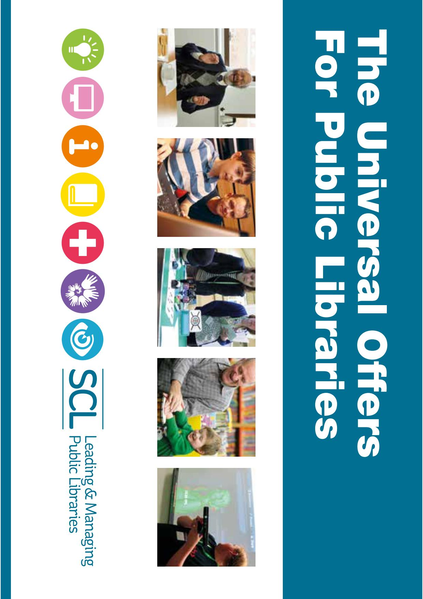
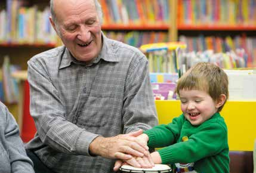
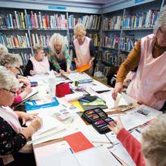
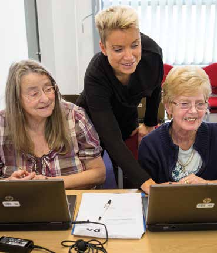
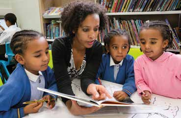

<!-- PAGE: 1 -->

# The Universal Offers For Public Libraries

<!-- PAGE: 2 -->

## Introduction

The Society of Chief Librarians manages the public library service.

SCL works to maintain a strong library network and keep libraries at the forefront of information and learning. It works with Government departments and national agencies on behalf of its members to ensure that public libraries can lead and support key national agendas.

In 2013 SCL launched the Universal Offers for Public Libraries. Today these offers stand as the foundation for a successful and comprehensive library service.

The Universal Offers cover the five key areas which our customers and our partners see as essential to a 21st century library service:

* **Health**
* **Reading**
* **Digital**
* **Information**
* **Learning**

In addition we have two complementary offers:
* **Children’s Promise**
* **Six Steps**

The Offers are a positive and proactive response by SCL to the challenges that local authorities and public libraries are currently facing.

### Partnership Delivery

Offers delivered in partnership with:
* Arts Council England
* The Reading Agency
* ASCEL (Association of Senior Children's and Education Librarians)
* Share the Vision
* Scottish Library and Information Council (SLIC)

<!-- PAGE: 3 -->

## Universal Reading Offer

The Universal Reading Offer, developed and delivered in partnership with The Reading Agency, is a gateway to partnerships, resources, programmes and activity which:

* Encourages and enables reading for pleasure and empowerment and the individual and societal benefits that brings
* Enables all libraries to access tools and resources which can be delivered locally
* Is a celebration of a Library’s core function
* Enables Librarians to learn from, deliver and share best practice
* Supports libraries to offer creative learning and reading opportunities for every age group.

### Libraries are Crucial: Key Facts

* **16.4%** of adults in the UK "score at the lowest level of proficiency in literacy costing the UK £81 billion a year in lost earnings and increased welfare spending"
* Each year more than **800,000 children** take part in the Summer Reading Challenge
* **300 million visits** and **64 million members**: LISU’s UK Statistics
* **98 million visits** to library websites: DCMS Taking Part Survey
* **60%** of the UK population have a library card
* Libraries are free, open and welcoming spaces.

### Feedback from Participants

> "My child is much more likely to read independently and at bedtime after completing the challenge. It allowed us to experiment a bit with which type of book he enjoyed most"  
> — *Parent of 6-year-old boy*

> "I think the reading challenge was the best one in my life"  
> — *8-year-old boy*

<!-- PAGE: 4 -->

## Universal Health Offer

The Health Offer enables libraries to be community hubs offering trusted non-clinical space where health and well-being partners can engage with local people for outreach, supporting the vulnerable, providing assisted online access to key health information sites, and valuable information and signposting.

Reading Well Books on Prescription, developed and delivered in partnership with The Reading Agency, is a key element of the Health Offer. It helps people to understand and manage their health and wellbeing using quality assured lists of helpful reading, recommended by leading health organisations and endorsed by experts.

Reading Well Books on Prescription includes:
* A **common mental health conditions** list for adults (stress, anxiety, depression)
* A **dementia** list providing support for people worried about their memory, with a diagnosis of dementia or caring for someone with the condition
* The **Reading Well for young people** list, providing recommended reading to support the mental health and resilience of 13–18 year olds.

Libraries provide a range of health and well being activity promoting resilience, learning and engagement.

> "The books have helped me so much in understanding things like what can bring on a panic attack… Now if I’m having a bad day, I drop in the library and borrow a book."  
> — *Gill Taft*

> "I found it really useful to take the book home and work on it in my own time… The library staff were wonderful whilst I was there, I mentioned that I was in the dark ages with my computer skills. The librarian signed me up to lessons."  
> — *Carol Speakman*

---

## The Learning Offer

The Learning Offer in public libraries has been developed so that children, young people and families will be able to build their confidence and skill with their creativity, coding and digital skills.

This offer will give families more opportunities to learn together, on a variety of subjects, and help to move through from literacy to fluency.

Currently many library services already offer:
* Baby rhyme times and play sessions
* Homework and revision clubs
* Classes, workshops and activities aimed at children and families
* Coding clubs for young people and families
* Opportunities for young people to organise their own learning activities in libraries
* Intergenerational learning opportunities, particularly in digital technology.

> "I learnt how a 3D printer worked in the library and then when I went back to school I could understand what it was doing and how it worked."  
> — *Secondary school student*

> "When you think of a library you just think of books and people telling you to be quiet, but this isn't that kind of library, it's very different."  
> — *Primary school student*

<!-- PAGE: 5 -->

## Universal Digital Offer

The Digital Offer recognises that the development of digital services, skills and access underpins so much of a 21st century library service. It supports and enables the delivery of all of the Universal Offers:

* **Free access to the Internet** for every customer (for a minimum period of time).
* **Clear and accessible online library services** including access to ebooks.
* **Staff trained to help customers** access digital information, especially those who do not have access or the skills to use IT.
* **24/7 access to services** through a virtual library presence.

### Digital Leadership Programme Feedback

> "It has inspired me to deliver a new agenda within my service. It has given a whole new breadth of knowledge and networks. It has inspired and energised me."  
> — *Library staff member and participant in Digital Leader Programme*

> "It has renewed my enthusiasm to lead rather than manage as well as giving me insights into new technologies and ideas."  
> — *Digital Leadership programme participant*

---

## Universal Information Offer

The Information Offer supports people to access information and services online in life-critical areas such as careers and job seeking, health, personal finance, and benefits. Central to this offer is helping people to use vital government online information and services. This supports the Government's Assisted Digital agenda to help people access national and local government services.

* **Brings together government and non-governmental sources** of carefully vetted information, giving a level of quality assurance to the user.
* **Ensures that public library staff and volunteers** are continually developing their skills to provide help to people accessing information and services.
* **Access to Research** gives free, walk-in access to millions of academic articles and research in public libraries across the UK.
* The Information Offer team delivered a hugely successful online digital skills training for more than 14,000 library staff (via `http://goscl.com/learning-pool/`).

### Information Offer Feedback

> "I have been pursuing a new job for sometime and after building a CV with the help of the staff at Whickham library I achieved my goal."  
> — *Whickham Library customer*

> "The case studies were really useful. They made me think about the different people who might need our help. The case studies made the training more real and more relevant for me."  
> — *Library staff member*

<!-- PAGE: 6 -->

## Complementary Offers

### Children’s Promise

The Children and Young People's promise sets out the experience young people should have through a 21st Century public library service. It underpins all the other offers in relation to children and includes:

* A focus on reading for pleasure and cultural opportunities.
* Ensuring library services are inclusive.
* Libraries' role in developing digital and creative skills.
* Support for children and young people's health and wellbeing.
* The opportunity to be actively involved in shaping the library service through volunteering programmes and activities.

The Promise sets out the **Library Journey**: the way libraries should engage with children and young people as they grow and their needs change.

#### Rhyme Time and Reading Feedback

> "Songs are fantastic and enjoyable. Great enthusiasm from staff - a very happy place to be - we never miss a session!"  
> — *Parent at Rhyme Time*

> "Very good. English not first language, so enjoy these very much, and it is great for my little girl to hear traditional English rhymes and songs."  
> — *Parent at Rhyme Time*

> "After a long struggle the Librarian recommended some books for my son. He enjoyed them so much he couldn't stop reading them. Fantastic for a mum to see. Thank you"  
> — *Parent*

> "I would like to have 10 books in the challenge - and I enjoyed it because we came to the library more, and I read six books in two weeks because I enjoyed them so much - thanks"  
> — *8-year-old reader*

---

### Six Steps

There are almost two million blind and partially sighted people in the UK who, like everyone else, need library and information services to support their daily life. Public libraries are a vital link for people and we need to make them as accessible as we can.

To help us to maintain a clear minimum standard for our services, **Share the Vision**, the **Society of Chief Librarians** and the **Scottish Library and Information Council** call on all public library services to take the following Six Steps:

> "It helps when I am very sad or angry or frustrated. It also keeps things in perspective."  
> — *Female reader, 65–79, Scotland*

> "I can go out into a book even if I am physically or financially incapable to leave home. It occupies me even if my body feels capable of nothing. I would be insane without reading."  
> — *Female reader, 50–64, England*

> "It is a lifeline. It’s so important because otherwise you’re completely cut off, aren’t you? … It’s a very lonely thing if you’re not in touch with other people… It’s just feeling normal, part of things."  
> — *Female reader, 80+, England*

<!-- PAGE: 7 -->

## Contact and Further Information

If you would like to find out more about the Universal Offers or partner with public library services to deliver this offer, please contact:

* **Society of Chief Librarians (SCL):** [www.goscl.com](http://www.goscl.com)
* **Association of Senior Children's and Education Librarians (ASCEL):** [www.ascel.org.uk](http://www.ascel.org.uk)
* **The Reading Agency:** [www.readingagency.org.uk](http://www.readingagency.org.uk)
