<!-- PAGE: 1 -->
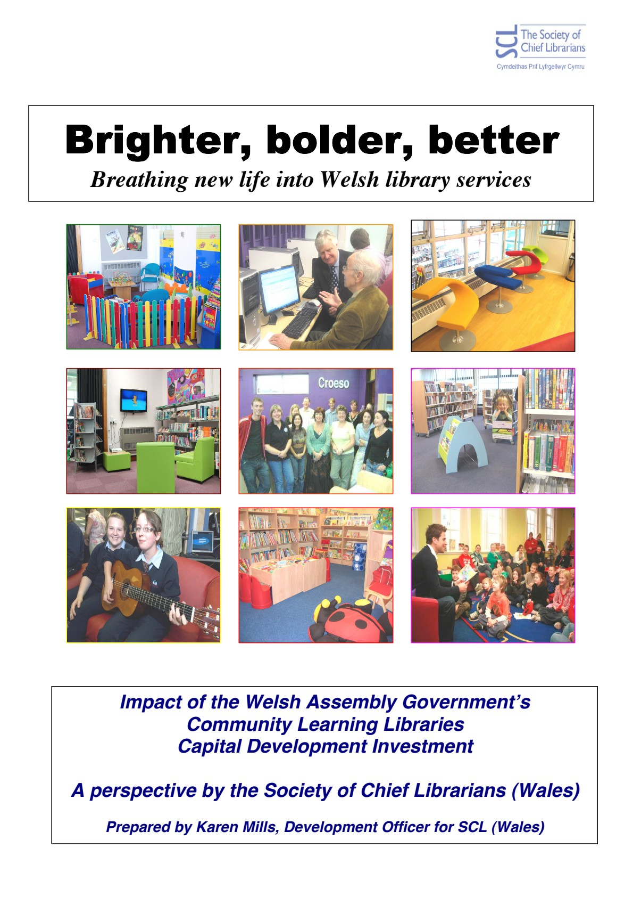

# Brighter, Bolder, Better

## Breathing new life into Welsh library services

### Impact of the Welsh Assembly Government's Community Learning Libraries Capital Development Investment

**A perspective by the Society of Chief Librarians (Wales)**  
Prepared by **Karen Mills**, Development Officer for SCL (Wales)

---

<!-- PAGE: 2 -->

## Contents

| Section | Page |
| :--- | :--- |
| **Foreword** by Steve Hardman, Chair of SCL (Wales/Cymru) | 3 |
| **Section 1: Executive Summary** | 4 – 8 |
| * Purpose of the Report | 4 |
| * Summary of the Findings | 4 – 7 |
| * Background Information | 7 – 8 |
| **Section 2: The Case Studies** | 9 – 40 |
| * Blaenau Gwent: Tredegar Library | 10 – 16 |
| * Caerphilly: Nelson Library and Learning Centre | 17 – 18 |
| * Caerphilly: Abertridwr Library | 19 – 23 |
| * Conwy: Colwyn Bay and Abergele Libraries | 24 – 29 |
| * Flintshire: Mold Library Modernising Information Provision (@nswers) | 30 – 31 |
| * Rhondda Cynon Taf: Treorchy Library (The Library Project) | 32 – 34 |
| * Swansea: Gorseinon Library | 35 – 40 |
| **Section 3: Conclusion** | 41 – 42 |

---

<!-- PAGE: 3 -->

## Foreword

### By Steve Hardman, Chair of SCL (Wales/Cymru)

The Society of Chief Librarians (Wales) holds that modern, vibrant and well-developed public library services are essential to the citizens of Wales in the 21st century.

I am very pleased therefore to place on record our appreciation for the significant investment by the Welsh Assembly Government in the refurbishment of public library buildings through the Community Learning Libraries programme.

Our purpose in this report is to demonstrate the impact that the programme is having on the public library network and the overall value that this brings to communities and individuals across Wales.

The Society of Chief Librarians, representing as it does the chief librarian of each library authority in Wales, aims to influence the statutory, financial and other decisions which relate to the effectiveness of public library services, and takes a leading role in the national development of public library services.

As such, we would wish to state that it is imperative that the Community Learning Libraries grants continue so that with local authority support the progress made during the first 3 years of this programme can continue.

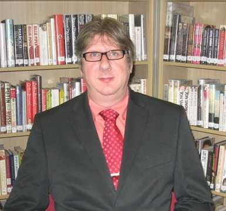

**Steve Hardman**  
Chair of SCL (Wales/Cymru)

---

<!-- PAGE: 4 -->

## Section 1: Executive Summary

### Purpose of the Report

The Society of Chief Librarians (Wales) consists of the chief librarian of each library authority in Wales. The Society aims to influence the statutory, financial and other decisions which relates to the effectiveness of public library services, and takes a leading role in the national development of public library services

The Society of Chief Librarians (Wales) has prepared this report to demonstrate to the Welsh Assembly Government and other key partners, the significant impact that the community learning libraries programme is having on the public library network and the overall value that this has brought to communities and individuals across Wales.

EXECUTIVE SUMMARY

The report includes 7 case studies from across Wales. These are:

Blaenau Gwent

-

Caerphilly

-

Caerphilly

-

Conwy

-

Flintshire

-

Rhondda Cynon Taf

-

Swansea

-

Tredegar Library Nelson Library and Learning Centre Abertridwr Library Colwyn Bay and Abergele Libraries Mold Library Treorchy Library Gorseinon Library

The case studies describe the impact that receiving the community learning libraries capital funding has had on their service, their customers, their staff and their communities.

Each case study has been written by the relevant head of library service. Therefore each is quite different. Given that each community and region has its own unique points and that there are varying community and customer needs, differences are inevitable. All the case studies, however, demonstrate the significant impact that the capital investment is having on public library services and the communities they serve. Although local needs and requirements must be considered, public libraries across Wales are moving forward together.

It is apparent that public libraries now, more than ever, play a key role in the delivery of adult community learning, informal learning, community engagement and social inclusion.

There are many positive examples of the excellent progress that has taken place during the last couple of years due to the capital investment provided by the Welsh Assembly Government. We have selected just a few case studies

---

<!-- PAGE: 5 -->

to highlight this renaissance in public library design and building and to press the case for continuation of this investment programme. As a result of the refurbishments that have taken place in the libraries included in this report and others, public libraries across Wales are better placed to help the Welsh Assembly Government and local authorities deliver the learning agenda. Here are just a few reasons why public libraries can help the Welsh Assembly Government and local authorities to deliver the learning agenda There are libraries in most communities in Wales. Public libraries help maintain the cultural identity and lives of local communities. Public libraries support adult community learning and informal learning for people of all ages. At a library everyone can study the subject of their choice, in their own time, at their own pace. Through our network of public libraries people can read, learn, research, surf (the web), meet and share  various activities which help people engage with their local communities and beyond. We mustn't lose sight of the importance of `informal learning' gained through social connections and community life. Informal learning or independent learning such as that undertaken through libraries often serves as an important first step into Adult Community Learning. Many libraries provide cultural events, arts competitions, business advice, and local history information. Libraries are also information services. They provide advice, information, research opportunities and mediated help on a wide range of topics. People of all ages use libraries when they have a query that needs answering or for more long term research. Libraries can help young people to engage with their communities by offering a wide range of resources (for young people) including books, CDs, DVDs, music, magazines, free filtered internet access. Many libraries have exciting dedicated meeting spaces for young people (see Treorchy and Abertridwr's case study enclosed). Children can also use the facilities for homework and learning. The inclusive nature of libraries also encourages intergenerational activity - family visits, neutral space for grandparents to visit with children something for everyone in the same place.

---

<!-- PAGE: 6 -->

The work of many academics has shown that engagement in learning in later life contributes to mental health and well being, reduces social exclusion and improves self confidence. It should also be noted that currently participation in learning amongst those over 65 years of age, is very low, at around 20%. There will therefore need to be a significant growth in learning provision, particularly the informal non-accredited opportunities favoured by older people; the kind of learning provided through public libraries. Committed staff are trained to assist, whether it be to help find a book, information or provide advice. Libraries have a track record in reaching hard to reach groups. Public libraries provide localised support for learners who may otherwise be working in isolation thus providing essential referral points for remote learners. Libraries are linked to the Public Sector Broadband Aggregated Network (PBSA) and there has been significant investment in ICT infrastructure in libraries allowing them to deliver community learning. Many libraries are already used by other learning providers (for example, further education colleges) as a base to deliver learning programmes. Public libraries provide dynamic experiences which stimulate and support learning and enrich lifelong learning for all ages and backgrounds. Public libraries impact on the knowledge, attainment, self-development and enjoyment of children, young people and adults. Public libraries impact on the literacy and information literacy of Britain, including the goals set out in skills for life and workforce development strategies. Public libraries enable increased signposting and access to collections via knowledge management systems. A major influence for the latter part of 2008 and into 2009 is the global situation. Significant redundancies have resulted in more people returning to learning and wanting to update their skills in a cost effective way. Public libraries can help people acquire learning and life skills. This can help considerably with confidence building so that they are ready to participate in the next stage of learning and employment.

---

<!-- PAGE: 7 -->

### Background Information > “Our museums, archives and libraries are more than places where cultural artefacts are kept. They are educational centres where families, schools, and all members of the public can access information and collections” [Source: Welsh Assembly Government]. The Welsh Assembly Government aims to develop libraries and their potential as an educational resource and make them fit for the 21st century. The Welsh Assembly Government is committed to providing: > “modern library services in the community, which support lifelong learning and are accessible to everyone”

The Society of Chief Librarians in Wales (SCL Wales) wholeheartedly agrees with this statement from the Welsh Assembly Government. SCL Wales asserts that high quality public library and information provision is a fundamental requirement for an informed, democratic, inclusive and bilingual society in Wales. SCL Wales has been working with CyMAL (a policy division of the Welsh Assembly Government) to deliver the Libraries for Life Programme. This development programme responds to the need to further improve library services. SCL Wales was pleased to welcome the inclusion of the Community Learning Libraries Capital Development Programme as part of the Libraries for Life Programme. This is a programme of capital investment and refurbishment in the public library network. In keeping with the vision set out in `One Wales: A progressive agenda for the government of Wales' the programme aims to deliver modern library facilities, fit for the 21st century, in order to attract more people to benefit from an improved range of education and learning opportunities provided by public libraries. Wales has an extensive network of over 300 public library buildings. However, the network of static libraries had deteriorated, both before and after 1996, as a result of significant under-investment in capital improvements. Many library buildings date from the heyday of new building programmes in the 1960s and 1970s. Until recently, comparatively few new public libraries had been built and certainly there had been no refurbishment of larger flagship libraries. Reports had identified this alarming deterioration (Roberts, D. Hywel E.  Capital Investment in Welsh Public Library Buildings, 2006) and the need for significant new capital investment. Since 2007, the Community Learning Libraries programme, alongside other capital investment, has begun to address the issues mentioned above. The library investment projects completed in the first two years and scheduled for 2009/10 will benefit around 50 communities. We hope that this report will

---

<!-- PAGE: 8 -->

emphasize the significant impact that the capital investment provided by the Welsh Assembly Government has had on those communities. It is also significant that the Community Learning Libraries fund has resulted in further investment from local authorities. Each grant requires an element of match-funding amounting to 10% of the grant but many local authorities have also allocated additional capital and maintenance budgets to ensure further refurbishment of these libraries. In many cases, local employment has been stimulated as building work has often been carried out by local companies. It is noticeable that the library refurbishments already completed have resulted in more people using those libraries. The level of expectation is therefore high - amongst communities, individuals and, indeed, library workers. Better library buildings mean better library services. And raising the profile of libraries in this way also demonstrates the value of the Libraries for Life programme and the impact of the investment by the Welsh Assembly Government. We believe that we are on the right road  but that there is still some way to go to realize the vision for public libraries contained in One Wales. There are still a considerable number of decaying library buildings where investment is required. Continuing to invest in the public library estate, promotes better services in local authorities and is essential to attaining the `One Wales' vision. As one happy library customer commented: > “Libraries are brighter, bolder and better than ever before! Long may this continue!”

---

<!-- PAGE: 9 -->

## Section 2: The Case Studies The following pages contain a selection of case studies describing the impact from the community learning investment. Here you will read about the significant difference it has made to library services, to our customers, to our staff and to our communities in Wales. We hope you enjoy reading the following case studies.

---

<!-- PAGE: 10 -->

### Blaenau Gwent: Tredegar Library

**Capital Development Grant Funding**
*Written by Sue White, Principal Librarian, Blaenau Gwent* 

Background The town of Tredegar is an area with a proud history as the birthplace of the NHS and it has made a significant contribution to the political landscape of Britain. The restoration of community pride had already begun with the launch of the Local Studies Resource Centre at the Library in 2005. With one of the highest levels of adults with no formal qualifications (47.1%, Census 2001) and one of the highest levels of economic inactivity in Wales (46%, Census 2001) the demand for provision for customers with low levels of literacy, basic skills problems and IT literacy is substantial and the library is in a prime position to `make a difference'.

There was already considerable evidence of partnership working, for example the Community Education Service used the available space for groups to meet and the Open Learning Centre IT suite is situated in the building. The recent Gateways to Learning project demonstrated a need for provision to customers with low levels of literacy, basic skills problems and IT literacy. When the project came to a close, one of the Library Supervisors spent some time at the library every week offering basic IT and Information literacy support through a course of 4 taster sessions designed to meet the needs of individuals. There was considerable interest in this informal provision and capacity problems quickly became a real issue for the service.

Further hampering this development was an overall impression of a library of the 1970's which had not changed much in terms of dcor or signage since it's opening in 1975.

Proposal The objectives were to: Give the library a higher profile through improved external and internal signage and make the interior more visible from the street Modernise the interior library environment  Improve access to staff and services through improved guiding, flexibility of space, lighting and furnishings  Improve access to study and learning facilities enhancing RISE services

---

<!-- PAGE: 11 -->

Increase use of the facility such as the number of visits and items borrowed by 10% Increase attendance at events for both adults and children  Increase in referrals to Open Learning through improved access to basic IT and literacy provision and partnership working.  Improve access for young people and younger children and babies by making the space more flexible, attractive and more relevant to their needs. Structural work at Tredegar Library was minimal as the library already met some of the DDA requirements such as lift access between floors and disabled toilet facilities. The work was intended to modernise the main library giving it a 21st century feel becoming more attractive and welcoming. The library is visible from the street to the side and rear of the building and needed to give out a positive message to passers-by. Our experience at Brynmawr Library where we had provided a smaller counter and the introduction of RFID technology demonstrated that a more flexible space allows for more effective service delivery following the principles of the recent library innovation/marketing initiatives in Wales. Self issue through RFID technology was regarded as an important service enhancement which would offer other service benefits by releasing staff time to devote to customer service. RFID also represented a clear intention to provide a 21st Century library driving innovation and new ways of working. The provision of two community rooms on the first floor was intended to free up the heavily used space in the Local Studies Resource Centre for local enquiries and individual study. An existing small side room was extended and adapted to provide more natural light and become a meeting/class room. The second classroom would be able to cater for larger groups and meetings. The work was supported by the Community Education Service who themselves were struggling to provide space for classes in the area.

Current position The improvements have created a more attractive and flexible environment and we think we have created that WOW factor as people come through the doors. The dcor is modern but the links to Tredegar's proud history have been maintained by a series of graphics and bay ends depicting landmarks of the local area. The layout of the library has changed and additional computer points and Wi-Fi access have enhanced People's Network provision. To create a more welcoming and relaxed atmosphere customers are able to help themselves to tea and coffee as they wish. The introduction of RFID self service technology means that there is much greater opportunity for staff to engage with customers, in fact the RFID itself has been a hot topic of conversation with very little user resistance once they

---

<!-- PAGE: 12 -->

realise that staff have more time to attend to their needs. All customer feedback to date has been very positive. This in turn has freed up staff to be able to assist the public with their learning and information needs and several library staff now offer one-to-one taster sessions and all staff provide support for People's Network customers. One staff member has since undertaken an ET01 Preparing to Teach qualification in order to run weekly basic IT and internet sessions. During the recent Adult Learners' Week, the library offered internet sessions for job seekers. As a result of the success of the taster sessions a handbook to support staff and customers has been developed by the Community Library Manager and this is being used in Tredegar Library for a trial period. The improvements have facilitated an increased opportunity to work with partners and there is increased cross departmental work using Tredegar Library as the base. The library is used by the Blaenau Gwent C2BG Outreach Services for benefits verification surgeries and Housing officer appointments. Library staff are able to deal with a number of routine corporate matters ranging from answering questions about services such as recycling, street lighting and arranging waste collections to the provision of application forms for a variety of council services. Local ownership has been key to the success of any project and prior to the refurbishment a successful arts project produced the mural that is sited on the front of the building and is a good example of the community contributing to their own facilities. The community rooms are used by community groups and Community Education classes (see attached list). A Community Services Directorate Group brings together a number of different service areas to work on mainstreaming equalities which has resulted with a group of people with moderate to severe mental disabilities visiting Tredegar Library to access library services in a safe and welcoming environment. There have been a number of referrals from Social Services who recognise the value the informal one-to-one approach can have for some individuals and a number of taster sessions have taken place with individuals going on to continue to use the library after the more formal sessions have been completed. We are about to embark upon sessions through referral from the Occupational Health Service at the local hospital. Promotion of Local Heritage helps to restore community pride and learning and it is a platform from which many of our services can be delivered. The addition of meeting/class rooms and an additional 4 computers in the Local Studies Resource Centre allows us to extend this service, offering Family History services and the use of on line resources such as Ancestry.com and Find My Past (from August 2009) for the increasing number of customers demanding this help. A Family History Open Day was one of the Adult Learners' Week activities offered in 2009 with other branches of the Gwent Family History and Merthyr Tydfil Family History Group attending. The town museum is situated on the ground floor of the library building and this allows for better links to be made between the two services.

---

<!-- PAGE: 13 -->

Take up of all types of provision for under-5's has been low in the Tredegar area and the flexibility of the main library space now allows us to offer a story and rhyme time for under-5's as a regular weekly feature. Children have proved to be far more eager to use self issue and have been helping their parents and grandparents to use the system. The tutoring of pupils unable to access mainstream school for a variety of reasons can now be taught in a more suitable room whilst still retaining the much needed social contact with library staff and other users. Partnership working with the Inclusion Support Officer will open up opportunities to extend tutoring at Tredegar Library. Provision for young people has been focussed on the area on the first floor landing. It has been cleared and during holiday periods is given over to Splash sessions organised jointly for young people by the library service, youth and sports diversion officers. To date activities have included Wii tournaments, smoothie making, tattoo sessions, DJ decks and nail art. It is intended to undertake more consultation with young people to add magazines and other appropriate provision in this area and the area will be further enhanced in line with suggestions and ideas put forward by the young people themselves. Staff The staff have been key to the success of the project; they have demonstrated the flexibility to deal with change and have embraced new and innovative ways of working. They have taken the initiative in introducing new services as well as repackaging traditional services. Their enthusiasm for the service and a willingness to take everything in their stride is evident to all and has been of benefit in encouraging many individuals and community groups to regard the library as their own. Through changing the way the library operates the staff have all developed positive attitudes towards providing services accessible to all client groups and they have taken every training and developmental opportunity to equip themselves with the skills and abilities to continue to develop services at Tredegar. Notably staff have been able to visit house-bound customers for whom they have been selecting books via the Home Delivery service in order to improve the quality of service offered, develop relationships and to provide a human face for the service. Tredegar Library and it's staff were key to the success of a promotion to increase use of on-line resources. The project involved Library staff organising visits to the local comprehensive school to promote the range of on-line resources, and Britannica in particular, to year 7 pupils. These sessions were well received and use of the resources increased significantly during that period. The pupils were then invited on class tours of the library which combined use of People's Network, quizzes and general library use. RFID was a big hit with this age group! This project went on to win the Gold Award in the "Happy Days" staff marketing awards

---

<!-- PAGE: 14 -->

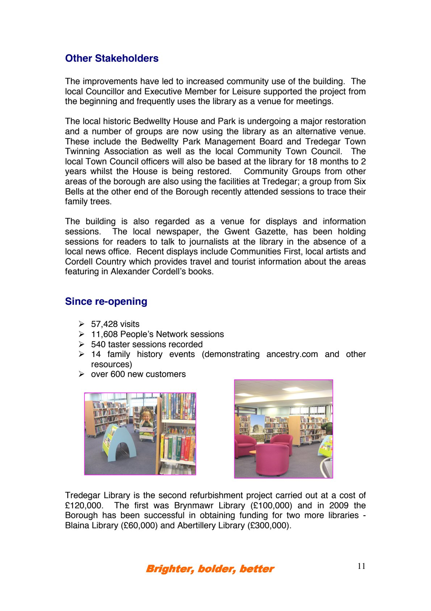

Other Stakeholders The improvements have led to increased community use of the building. The local Councillor and Executive Member for Leisure supported the project from the beginning and frequently uses the library as a venue for meetings. The local historic Bedwellty House and Park is undergoing a major restoration and a number of groups are now using the library as an alternative venue. These include the Bedwellty Park Management Board and Tredegar Town Twinning Association as well as the local Community Town Council. The local Town Council officers will also be based at the library for 18 months to 2 years whilst the House is being restored. Community Groups from other areas of the borough are also using the facilities at Tredegar; a group from Six Bells at the other end of the Borough recently attended sessions to trace their family trees. The building is also regarded as a venue for displays and information sessions. The local newspaper, the Gwent Gazette, has been holding sessions for readers to talk to journalists at the library in the absence of a local news office. Recent displays include Communities First, local artists and Cordell Country which provides travel and tourist information about the areas featuring in Alexander Cordell's books. Since re-opening 57,428 visits  11,608 People's Network sessions  540 taster sessions recorded  14 family history events (demonstrating ancestry.com and other resources)  over 600 new customers

Tredegar Library is the second refurbishment project carried out at a cost of 120,000. The first was Brynmawr Library (100,000) and in 2009 the Borough has been successful in obtaining funding for two more libraries Blaina Library (60,000) and Abertillery Library (300,000).

---

<!-- PAGE: 15 -->

Upon the successful completion of the projects for 2009 four of the six libraries in the Borough will have been refurbished and equipped with a 21st century look. With no local capital funding programme for libraries this work would not have been undertaken without the investment from the Community Learning Libraries programme. Of the remaining two libraries, the building at Ebbw Vale remains our biggest challenge. The library is situated in a prime town centre location in a converted chapel building and we hope to be able to undertake work at that library through the continuation of the Community Learning Libraries Capital Development programme together with other potential funding opportunities. Tredegar Library  Community Use (June 2009) Adult Basic Skills Group  Decoupage groups  afternoon and evening classes  IT classes  daytime and evening groups across all days  Mixed Craft Group  Cookery  Tredegar Digital Archive Group  Pupil tutoring  5 days per week  Blaenau Gwent Housing Department  housing interviews  C2BG (Connect to Blaenau Gwent)  outreach service team for benefits verification etc.  U3A  Tredegar Book Club  Saturday language group  Under 5's story and rhyme  weekly sessions  IT taster sessions weekly with informal support during opening hours  Family History taster sessions and further support by arrangement  Splash groups -school holidays and some evenings  Vision House group  occasional visits  Class visits from a number of schools in Tredegar  Tredegar Comprehensive School  Tredegar Town Council meetings and base for officers  Gwent Gazette  occasional sessions for readers  Blaenau Gwent Heritage Forum meetings - monthly  Tredegar Town Twinning meetings  Blaenau Gwent Writers Squads  once a term  Local Studies events

---

<!-- PAGE: 16 -->

Here are just some comments from our customers and staff > “Much more space, appears brighter and a more pleasant environment, probably due to the colour scheme and the arrangement of fixtures/furniture” > “I'm thrilled that the library has managed to get all the books I needed for my course, and so quickly” > “I'm 51 and I never though I'd be able to use a computer, three people have tried to show me how to use a computer and I've learnt more today than I ever have before” > “We have been using the library again in Tredegar after years. The library staff went to my son's school, Tredegar Comprehensive and he encouraged us all to go. My whole family go now, every Saturday morning. My son uses the Internet, my six year old daughter is now an avid reader - she has come on in leaps and bounds in her reading. The library has a real friendly, family feel to it. It is a pleasure to go there” > “I come to the library every day after school. I meet my friends, we do our homework together and then go on the Internet. We all love the new library, it's a great idea to have DVDs and X-box games!” > “I love using the new self service machines, Ryan showed us how to use them, when we came up with the school, - but they are so easy! - easier to use than my ipod” > “It's a pleasure to come to work in our newly refurbished library. The customers have been very enthusiastic and complimentary. We've been surprised at how easily the customers have adapted to the new self service system and they love the coffee machine” [Staff member]

---

<!-- PAGE: 17 -->

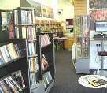

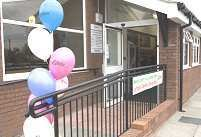

### Caerphilly: Nelson Library and Learning Centre

**Capital Development Grant Funding**
*Written by Gareth Evans, Business Development Manager, Caerphilly Library Services* 

Background and Context Nelson Library recently underwent a major refurbishment costing some £191,000, including £110,374 from CyMAL under the 2008-09 Community Learning Libraries Programme The Library originally opened to the public in 1981 and the 2008-09 refurbishment and extension was the first major reconfiguration of provision at the site since it was built. The building was dated and in need of structural improvement. Nelson is a community of some 4,500 residents that is relatively isolated from other parts of Caerphilly County Borough. Nelson as a community does face a number of challenges including pockets of relative deprivation and high instances of limiting long-term illness. There are a limited number of alternative venues within Nelson for community based learning to take place. Nelson Library, prior to its refurbishment, was one of the Council's more effective service points with over 6 visits per resident per annum regularly achieved. Both the Community Council and local Village Partnership supported the Nelson Library improvement project from its outset and were instrumental in enabling the Council to attract CyMAL grant funding at the application phase. The support of both these bodies has continued post the Library re-opening with the Village Partnership holding regular meetings in the refurbished building. What was achieved? Construction of new front facing extension  housing the children's library  Enhanced and increased entrance with new DDA accessible ramped entry  Public DDA accessible toilet facility

---

<!-- PAGE: 18 -->

New internal lighting scheme  New carpet and interior decoration to all public areas  Totally refurbished interior  Creation of bespoke Learning Centre area for IT and other forms of community based learning provision, including basic skills  with ceiling mounted project facilities  Improved Children's and Young People's sections within the reconfigured Library  RFID self-service kiosk and security system Impact and Strategic Importance The improvements achieved at Nelson need to be viewed within the context of the Council's merger of Libraries and Community Education that took place in September 2007. Nelson Library and Learning Centre is the first jointly commissioned facility bringing book, information, Public ICT, and learning services together under one roof. The intention is to offer language, basic skills, and local history courses alongside ICT tasters  with the Learning Centre element blending seamlessly with the more traditional library role. Courses will be available during and outside normal library opening hours with the RFID self-service kiosk enabling book loans and returns to take place whenever the building is in use. Based on the tiering model for Library Provision adopted by the Council in 2003, Nelson is designated as a Joint-Use Community site. CyMAL and Council funding has enabled this joint provision role to be realised at a time when, without the stimulus of grant aid, no substantive improvements would have been possible. Performance to date Early indicators at Nelson Library and Learning Centre are extremely positive with an increase of 105% in recorded visits and 23% with regard to book and audio-visual loans in its first full month of operation. The trend since May 2009 shows a like for like increase of 31% in visitors compared to the equivalent time

---

<!-- PAGE: 19 -->

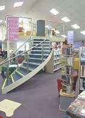

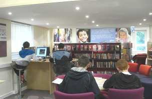

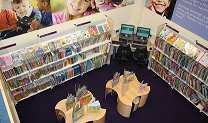

### Caerphilly: Abertridwr Library

**Capital Development Grant Funding**
*Written by Gareth Evans, Business Development Manager, Caerphilly Library Services* 

Background and Context Abertridwr Library underwent a major refurbishment in 2007-08 as part of the initial phase of the CyMAL supported Community Learning Libraries Capital Development Scheme. The total project cost 263,500 included a CyMAL grant for 100,645. Abetridwr Library originally opened to the public in 1978 and serves a population of some 6,789. The communities of Abertridwr, Senghenydd, and Penyheol fall within the library's catchment area. All three communities face a mixture of social and demographic challenges including: A relatively young population  only 12.3% of residents are 65 or older  High numbers of households in receipt of family credit, or with children entitled to free school meals  well in excess of the County Borough average  Teenage pregnancy rates at twice the Welsh average  A higher percentage of lone parents in the Aber Valley area compared to the County Borough average  Low levels of educational achievement: below average results at key stages 1 & 2 with in excess of 42% of the resident work age population holding no formal qualifications The condition of Abertridwr Library priory to CyMAL grant support was at best poor with the original shelving, counter, carpeting, and loose furniture very much in evidence. The internal design of the old library lacked imagination, did not maximise the use of space, and offered limited opportunities to engage with children and young people. The Aber Valley Communities First Partnership played a prominent role in the commissioning and development of the refurbished Library.

---

<!-- PAGE: 20 -->

What was achieved? Total refurbishment of the internal public space, including shelving and furniture Introduction of a bespoke mezzanine `quiet study and relaxation' space in the main body of the library  18m2 in size Enlarged entrance reclaiming under utilised space to better effect  Creation of new children's area, teenagers' zone, and informal learning space  New suspended ceiling and lighting scheme  Disabled access ramp to the entrance  Full redecoration and carpeting to the public areas with limited paint work also commissioned to staff only areas  Exterior works undertaken included a new linked rear path to the buildings fire exit, roller shutters fitted to front and back of the site and more sympathetic window grills added Overall the Library has changed dramatically as a direct result of CyMAL and Council funding and the improvements that this has facilitated. The following observations are of particular note: Entrance and DDA improvements - the new entrance and external access ramp have opened up the library. Some 5m2 of additional usable space has been claimed in this part of the building and a light airy feel welcomes customers to investigate further within the facility. New open circulation space with a retail feel - the introduction of new shelving and soft furniture has created a feeling of space within the main library area this has been complemented by a new suspended ceiling, lighting scheme, and full internal redecoration and carpeting. The impact generated is that of a new library within an existing facility and the response of existing and new customers has been of high satisfaction. Children's Library - the creation of a new, vibrant and welcoming children's area located near the Teenage zone, has been extremely well received by younger customers, and logically offers a progression route to wider Library use. Teenage Zone, the creation of a bespoke teenage area with caf style ICT provision has proved attractive to many young adults  this is particularly important in a community with an above average representation of this demographic group. Study space and relaxation areas (including the feature Mezzanine space) - the improved study space provided, with quiet zone for reflective learning, have been well received by adult learners who are undertaking Community Education courses at the library. ICT facilities - informal and more formal course provision has benefited from a more welcoming and open environment.

---

<!-- PAGE: 21 -->

External faade - the new ramped entrance, removal of a large tree which hid the front of the library, and general tidying of the external building fabric has given the building a new more youthful look and higher visibility amongst local residents Impact and Strategic Importance Abertridwr Library has traditionally been seen as a facility that could and should reach a wider audience. The library, serving three distinctive communities is recognised within the County Borough Council's tiering model as a Joint Use Community facility. Abertridwr Library is the second largest service point within the Caerphilly Basin area of the County Borough and the improvements achieved have ensured that the building fits this brief appropriately. In commissioning the Abertridwr Library improvement work, the County Borough Library Service was endeavouring to create a public space that: Supported wider recreational reading  Become a venue that was central to community life and activity  hosting arts events, providing meeting space, and acting as an informal learning centre to residents of all ages and abilities The improvements achieved in Abertridwr have transformed the building and ensured that the Library is well placed to meet the aspirations noted above. Equally important has been the involvement and commitment of local staff during the design and improvement phase, and since the library has reopened. Local managers and frontline staff were involved in the tender selection process, the choice of furniture, and colour schemes. In addition local staff were encouraged to work alongside colleagues in the Council's Marketing Section to develop a marketing plan for the refurbished facility. The level of engagement achieved by all staff has ensured that a positive approach has been taken to community development activities and has also helped to generate a strong sense of ownership and pride. Performance to date The refurbishment and enhancements achieved at Abertridwr Library have led to marked improvements in core performance. The performance achieved needs to also be viewed against the context of significant deprivation and social needs which continues to effect the Aber Valley.

---

<!-- PAGE: 22 -->

Noteworthy performance includes: Visitor increases of 39% when comparing 2008-09 with 2007-08, and an underlying 11% improvement on the last full comparable year of library occupation, 2006-07. It is important to note that for a period of approximately 4 months during 2007-08 the Library was situated in temporary accommodation while the refurbishment and renewal work took place. Increases in new customer registrations of 71% when comparing 2008-09 with 2007-08, and the increase is more marked when the 2006-07 performance is considered, a 112% rise. Loan of books and audio-visual materials overall has increased by 67%, when compared to 2007-08, and 110% when matched to the performance of the equivalent period in 2006-07. Children's loans have increased by 107% (2007-08) and 99% (2006-07) respectively  a significant achievement. There has been a 100% increase in the number of individuals attending events and activities in the Library since it reopened in March 2008. The use of ICT facilities, though indicating a healthy increase over the last 12 months, when compared to 2007-08, is actually some 13% lower than the equivalent period in 2006-07. It is important to also note that ICT usage across Caerphilly's Libraries has seen a drop in activity since 200607.

---

<!-- PAGE: 23 -->

Here are some customer comments > “I like the new library the best :o)” > “The new library is gr8 I like it upstairs.” > “World's best little library” > “Began working here today (tutor), warm friendly library. Excellent environment to work in. Helpful colleagues and friendly customers. A pleasure to work here.” > “What a lovely building a pleasure to look for books, a very spacious library, upstairs is a nice quiet place” > “Wonderful library, helpful staff, good range of books for all ages. Will definitely call in here again.” > “Excellent facilities and very supportive staff  A great help to me in my role as a community education tutor. Many Thanks!” > “Perfect facilities for the older age group, very supportive staff, the best library in the Caerphilly Council Area.” > “Our family love using this library, the facilities are great and the staff helpful and friendly. As a home schooling family of five children we would be lost without the never ending supply of wonderful books we borrow on a regular basis. Many thanks, the Jones family.”

---

<!-- PAGE: 24 -->

### Conwy: Colwyn Bay and Abergele Libraries

**Capital Development Grant Funding**
*Written by Rhian Williams, Section Head: Culture and Information, Conwy County Borough Council*  Introduction Colwyn Bay library received a Community Learning Libraries grant in 2007-08 and Abergele library in 2008-09, both with varying amounts of corporate and service contributions. In Colwyn Bay library, where capital had already been spent on the structure, the emphasis was on the look and layout of the library, and the new services and new ways of delivering services to customers. Structurally there was the creation of a double community room from former large reference library space. In Abergele there was much more structural work and so some new services were not possible at that stage. However, a `new library' was the product of both projects. Although this paper could spend time describing what was done, and how, which would be interesting in itself, its main focus is how the community learning library grants have acted as a catalyst for change, not only at these two libraries but throughout the service as a whole. Change in politicians' and strategic managers' perceptions A town councillor from Llandudno said `I thought we had a modern excellent library in Llandudno [completely refurbished in 1994] until I saw Colwyn Bay's new library. Then I went to Abergele. I now see what a modern library is like, open and spacious and full of new services and colour. When do we get the same at Llandudno?' Until politicians and strategic managers see a 21st century library with their own eyes they tend not to perceive the possibilities and the tie-ns with corporate and community development strategies, despite it having been described to them by library managers. Their perception of a Library Service is based on images from their childhood and/or parenthood. In order to understand the changes which have taken place they need to experience it first hand. The changes don't simply relate to physical objects and structures. It was seeing the difference between a large number of our libraries on a one day tour that enabled the Conwy Members of a Libraries Task and Finish Group to perceive the possibilities of the future and what could be aimed for as a whole service serving Conwy's communities.

---

<!-- PAGE: 25 -->

Changes in customer perception What the customer sees in both libraries is now different, no longer walking in to be confronted by a barrier of a high library counter and a psychological obstacle to anonymous use and browsing. Attention has been given to the aesthetics of the buildings. The practical but dull 1980s brown has been replaced by colours designed to complement and enhance the historical features of the buildings e.g. red, turquoise and gold accents to bring out the Edwardian mosaic in the foyer (Colwyn Bay) or teamed with black shelving to raise a 1960's building from the ordinary (Abergele) to entice people in. Passers-by are now presented with an ever changing array of face-on books as opposed to computer cables or the backs of shelving. Both libraries are now full of natural light, with appropriate and sustainable levels of artificial lighting for today's usage. A result is an increasing number of new users and people who have returned after many years, finding something for today and not yesterday as they remembered it. No longer is the library square, with shelves round the edges and strict tramline shelving, unable to be moved because the carpet and paint had been laid around the shelves. Propeller shaped book shelves reflect the browsing pattern of customers, with quick choice, face-on, stand-up displays of modern literature for the time poor. Shelving heights not only improve service to the disabled but also, by being less than head height, create a feeling of spaciousness and ensure services are prominent and visible to all not to be hidden and so open to all. The libraries are no longer a jigsaw of developments over time, with a few computers stuffed in here and there as money became available or a new section on family history or council information created in a corner. They are now an integrated whole with colour used to create zones and identify age or theme related services. Changes in services We now have new services in at least one of the two libraries - self-service loan and return of books, with appreciated add-ons such as a list of all the books you have out at the moment. You can sit and read a book or newspaper in greater comfort on appropriate easy chairs, sipping coffee you've just bought. You can use your own laptop configured as a People's Network PC, through Wi-Fi to carry on your business on your journey, to keep in touch with colleagues and friends, to do on-line courses at times and locations convenient to you, as well as meet up with an advisor or information giver, e.g. Pensions Service, now able to access their own banks of information on the spot.

---

<!-- PAGE: 26 -->

Changes in staff perception and service In taking away monolith library counters, in providing self-service for loans, staff are removed from behind the barrier to become more free to help customers - to talk about and recommend books, to help with computer use, to be information mediators, to tell stories to children. Their role is changed from following processes and conducting behind the scenes work to meeting customer need as their starting point. Knocking a hole in a schoolroom type partition on the first floor to create a two-sided low counter for staff to be able to help information seekers, local and family history users as well as support People's Network customers equally has increased the customer benefit of limited staff capacity and has changed customer perception of their right to have help. Children and young people wanting homework help and after-school use now make a bee-line for that area because it meets their needs as equally as those of adults. A comparatively small change has had a massive impact on the perception and reality of staff being there to help. In stocking face-on library furniture with books, in influencing the themes and deciding where to shelve information books in bookshop type sections rather than `un-userfriendly' Dewey classification order, and in using returns trolleys to proactively promote books for loan, staff are re-learning about their books, valuing the knowledge they have and more able and willing to talk about books to each other and customers, their core work. Reflecting changes in demand Over a period of years, the first floor of Colwyn Bay library with its huge intimidating Reference Library, had declined in use because so much information is now on-line rather than in hard copy, and because young people did not find it friendly. By cutting off a greatly underused part and creating a new double additional community room, the information and history section retained is much better used and is now always busy - there is always a buzz there making it a place of choice for young adults and older people yet with enough peace to do an on-line course on your laptop. More and more groups and services wanted to use libraries for learning, for support and for information services. Having two additional community rooms at Colwyn Bay (which can be opened up to create one big space for a higher profile event), together with having an accessible public toilet at Abergele to enable the room to be used for longer stretches of time, has escalated what was a trend even before the grants. Flying Start, the Pensions Service, Language and Play, author events, displays of Local Development Plan consultation material and smoking cessation sessions can now be held, with the appropriate refreshments and facilities for their need. Confidential services such as Want2Work for job-seekers, especially appreciate the two entrances and exits at Colwyn Bay to increase anonymity of advice

---

<!-- PAGE: 27 -->

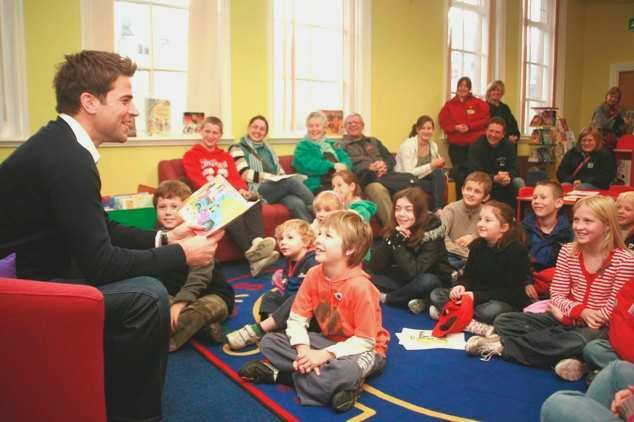

We as a service can now hold high profile events such as the North Wales Happy Days launch with Gethin Jones of Blue Peter and Strictly Come Dancing fame, author events like Phil Rickman talking about his books to over 40 people, or work with Save the Children and the Children and Young People's Partnership to do storytelling activities with small children while their young parents participate in present and future library services. We can use the whole library to hold our events because of the new open layout.

Changing to meet all needs equally Restrictions on the accessibility of services, to meet everyone's physical and learning needs, have been greatly overcome. Having all shelving of a height within easy reach, not having to struggle through a heavy door with a wheelchair or double buggy because the door opens automatically, and having wheelchair friendly toilets - all this psychologically makes it easy to bring yourself to come in to a strange building. We have broken down barriers and helped many more than the original customer group. Being able to serve yourself with loans has proved popular with older people who want to be independent and may not want others to see and comment on their choice of reading or information needs, as it has with the use of Books on Prescription by people with mental health needs and their families. New simple bilingual and colourful shelf headers can be helpful to people of all levels of ability and the bookshop style layout and categorisation has made it simple to find interesting books serendipitously. Change rolling out of the buildings There have been noticeable changes in other libraries - not only in the two libraries where the funding was used. How staff regard books, know about them, think about what customers would be interested in and how that can be

---

<!-- PAGE: 28 -->

promoted to them, link books together in new ways, has all permeated out of Colwyn Bay and Abergele libraries to influence staff throughout the service. There has been a step change in what we do with new books, how we maximise the use of all our stock, how we get books loaned and how we make the most of space and layout. Piloting book display facilities to find out what works and what doesn't in which kinds of environments has enabled some purchase of the necessary accessories for other libraries. Having an opportunity to work in a modern `today' library has opened eyes to possibilities elsewhere, some of which can be done for free or at low cost until that library itself can be refurbished completely. A can-do attitude has been inspired. New staff can be inducted in the best we have. Change in staff participation Involving staff at all levels in the brainstorming of bids, in the decisions along the way of implementing, in the planning of layout, in the training necessary to cope with and build on change, in the organising of open days and partnership events, has increased team working. It has also made the most of expertise, has built on ownership and personal investment in success and eventually, since all change is painful, has widened the base of responsibility and freedom to action. Learning from managing large projects like these, from trying to maximise every penny spent, and encouraging input from staff at every level and specialism, has enabled other smaller projects to be planned. Learning from experience and using existing skills has encouraged us to work more successfully and effectively. We've found ourselves sharing in a continuously learning environment. Seeing the results and objectively analysing what worked and what worked less well and learning from it, has built a solid base for future development. One of the project teams was short-listed for a corporate Celebrating Excellence award under the heading `Informed and Inclusive', for the way they took staff and customers alike with them through the process of change. Change in press perception One newspaper queried a press release that almost 700 people had visited the Abergele library Open Day with all its myriad of activities - `how do you expect us to believe that so many people would want to visit the library', they asked. When we explained the whole range of what was on offer that day, they changed their minds about what a library is. This all reinforces national marketing of libraries through Libraries for Life and brings the reality to local level. Change in partner perception All the things described above have also influenced how former and new partners see libraries. Long-standing partners such as Coleg Llandrillo have been able to expand their activities in a more appropriate atmosphere and

---

<!-- PAGE: 29 -->

seeing the possibilities has triggered new ideas, especially in response to the recession and basic skills need in the economically inactive community. Newer partners such as Abergele Town Council and the Participation Team of the Children and Young People's Partnership have been inspired to venture into new projects both practical such as a cycle rack and a town plan in Abergele and softer projects such as work with young parents and youth clubs in Colwyn Bay. Bay Life, the regeneration partnership in Colwyn Bay now part of the SRA area, has been able to develop projects, hold events and be inspired to further work, through having the facility. One example is the intergenerational work done on local history and a town trail where the library's atmosphere is now conducive to all ages and challenges all the old stereotypes. In a small way we have also altered other Authorities' perceptions ( other local authorities also being our partners). We have had visits from library staff from other library services to see how not only the physical improvements work but also how changes in workflow, people flow and focus can present both planned and unexpected benefits. Continuing change We live in a world of change of all kinds, but we have learnt through these grants that we can influence change, that we can maximise benefits and the impact from it Through not being afraid to venture we can do much with little and take people with us. Here are just a few customer comments > “Library looking very smart - also the staff who have been greatly missed and are a great asset to Abergele” > “It's easier to find your way around” > “Less institutional  lovely!” > “Who'd think that Abergele would have such a lovely library after all these years?” > “Great selection of books. Only got  way around th e library and had too many to carry. Welcome back!” > “It's wonderful - thought it was wonderful before - but it wasn't”

---

<!-- PAGE: 30 -->

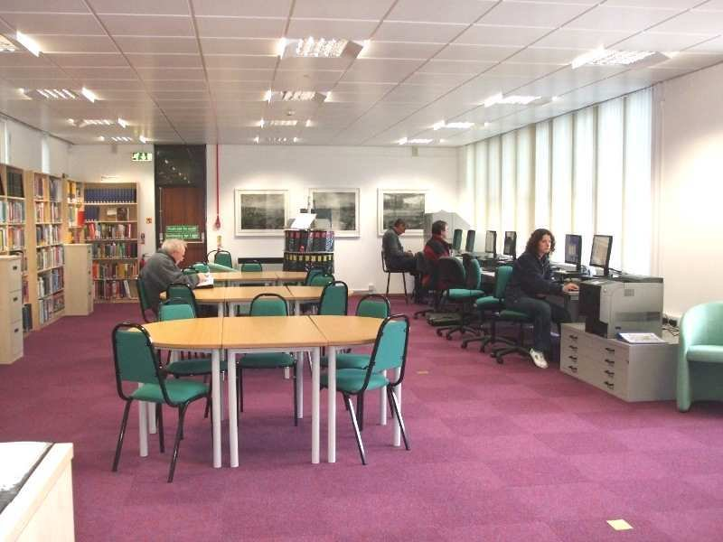

### Flintshire: Mold Library Modernising Information Provision (@nswers)

**Capital Development Grant Funding**
*Written by Sheila Kirby, Principal Librarian (Community Libraries and Arts), Flintshire*  Background Flintshire is a county of 150,500 population, spread over five medium sized towns and numerous smaller communities. Library services are delivered through a network of libraries open for up to 51.5 hours each week, plus mobile provision, managed from a Library Headquarters on the County Hall campus outside the town of Mold. In 2007, prompted by the huge changes to the ways in which people access information, the County Council supported a proposal to relocate and refocus the main reference and information centre for the county, which up until then had been based in Library HQ. Mold Library and Museum was selected as the most suitable venue, it being in the town centre near to good transport links, the busiest library in the county, with the longest opening hours, and the greatest number of visits each year. With the assistance of a Community Learning Libraries Programme grant, the first floor gallery area was converted into @nswers, which is now the main information centre for Flintshire. The emphasis is on electronic resources, local studies and family history, with an additional six desktop and five laptop public access PCs complementing the previously oversubscribed provision. The open structure of the gallery was retained, with the furniture and fittings designed to allow flexible use of the space. The area was intended to be, and has become, a quieter area of the library ideally suited to independent study and learning. The ground floor of the library was further improved with enhanced signage, automatic entrance doors, mobile shelving for the children's library, and selected replacement windows to improve visibility into the library from a busy pedestrian thoroughfare.

---

<!-- PAGE: 31 -->

What difference has it made? Since @nswers opened in March 2008, visitor numbers compared against the former location have increased by over 100%, and, more importantly, have been retained into 2009. The flexibility of the space has enabled the library to deliver ICT tasters in partnership with the local FE college, and host informal drop-in sessions by the community archaeologist and Civic Society and also the annual children's Summer Reading Challenge presentation during the day, whilst outside opening hours @nswers has hosted events as diverse as a local studies symposium, poetry competition prize evening and an evening event for Welsh Learners. An additional benefit not immediately envisaged has been an increase in the number of enquiries related to the adjacent museum collection, which has led to the libraries and museums services planning a more integrated approach to promoting the local studies and museums resources. The @nswers centre represents more than the refurbishment of a library space. It has enabled us to adopt a whole change of approach to providing information and learning facilities in the most heavily used library in the county, and innovative ways of service delivery are still being identified and exploited. In addition to the direct benefits to library users, the integration of the specialist reference and information staff with the team delivering lending and community services has enabled the workforce to broaden and develop their expertise and interests, and offer an improved all round experience to users. The @nswers centre project has succeeded due to a combination of retaining the previous core users of the Reference and Information Centre and attracting new customers who find the new location convenient and more accessible. Here are some comments from our customers "An excellent service" > “Staff are very helpful. I'll definitely come again!” "Very helpful" > “As I don't have a PC at home I enjoy coming to this relaxing environment to do my research” > “Many thanks for the online demonstration. You've given me a lot to think about” > “Very pleasant working atmosphere” > “What a wonderful thing to see the new resources and study area so well set out. It's a pleasure to be in and also so comfortable. Long overdue and very welcome”

---

<!-- PAGE: 32 -->

### Rhondda Cynon Taf: Treorchy Library (The Library Project)

**Capital Development Grant Funding**
*Written by Gill Evans, Head of Libraries, Museums, Heritage and Welsh Language Services, Rhondda Cynon Taf*  Background Treorchy Library is one of the three main area libraries in Rhondda Cynon Taf serving the Rhondda Valleys area. It used to operate as a stand-alone library but as part of the local authority's customer care programme, one of the council's new one-stop shops was installed inside the library in order to provide shared service facilities at one location. Prior to that development, the former public library space on the mezzanine floor upstairs had to be closed due to non-compliance with DDA legislation as there was no lift. As part of the one-stop shop development, it was planned to install a lift and fire exit to re-open the mezzanine floor upstairs, and create extra library public floor space. However, building work revealed an asbestos problem and addressing this problem swallowed up the funding for the lift and fire exit. Fortunately a capital funding grant from the Welsh Assembly Government meant that this significant project could continue. What difference did receiving the capital funding make? Receipt of the capital funding allowed Treorchy Library to:  Install a lift and separate access/fire exit  Re-open the separate mezzanine area upstairs  Increase the amount of library public space  Install new glass panels across the balcony to make it a separate sound proof room  Redecorate and revamp the layout of the mezzanine floor to make it an attractive, modern space  Install new IT facilities aimed at young people Following wide scale consultation with young people in the locality, this section has been transformed into a dedicated teenage library. Young people told library managers the sort of facilities they wanted and how they wished to be involved in this project, so this is what they got: to be allowed to take ownership of the area themselves  to design the layout of the area and its decoration and furnishing  to have their own entrance area.  to have their own IT facilities  to have special facilities such as a screen and projector to show films/presentations, Wii games (which promote active lifestyles and health) etc.

---

<!-- PAGE: 33 -->

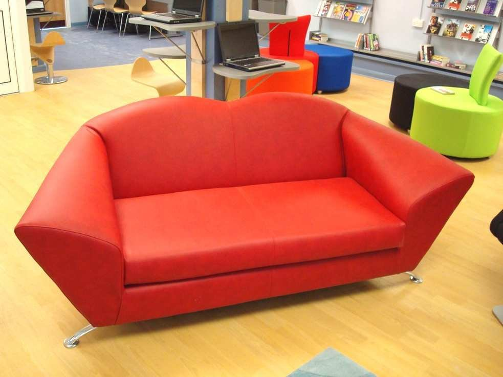

to develop a programme of activities  to be responsible for policing the teenage library themselves (although CCTV was also installed for health and safety reasons)

CyMAL: Inspiring Learning Grant funding also allowed for a temporary post to undertake background research including talking to young people in schools and the local community to find out what they want. The feedback received from setting up this dedicated teenage library has helped library staff generally to consider how they engage with teenagers in all their libraries. As well as working closely with the local school, the Youth Service and the Detached Youth Workers Team (part of Continuing Education), partnerships have also been developed with the following groups/officers to develop the new teenage library: The RCT E3+ (Extend, Enrich, Excite) initiative which offers young people after school hours activities in community venues CWMNI, the Communities First strategy group  South Wales Valleys Literature Development Officer  Community Arts team  Coleg Morgannwg  Want to Work team A programme of activities has been developed including  A Collective Nouns poetry and arts project  Photoshop and short film making training  Want to Work surgeries for under 25s  Detached youth work surgeries and outreach work  Language and play sessions targeting young mothers We have also been asked to provide a film club and "Open Mike> “ evening. We are currently working with partners to provide this activity. The South Wales Valleys Literature coordinator is interested in helping out with an ”Open Mike event" and we have installed a projector and suitable software for creating images for making short films. Our Digitisation officer and local Youth

---

<!-- PAGE: 34 -->

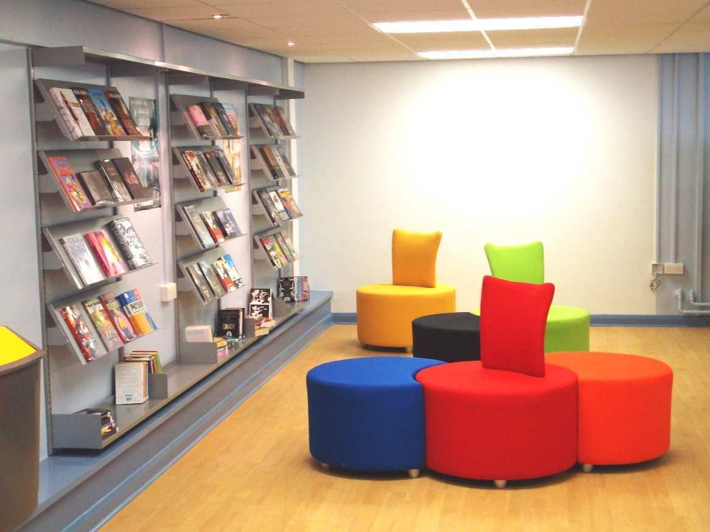

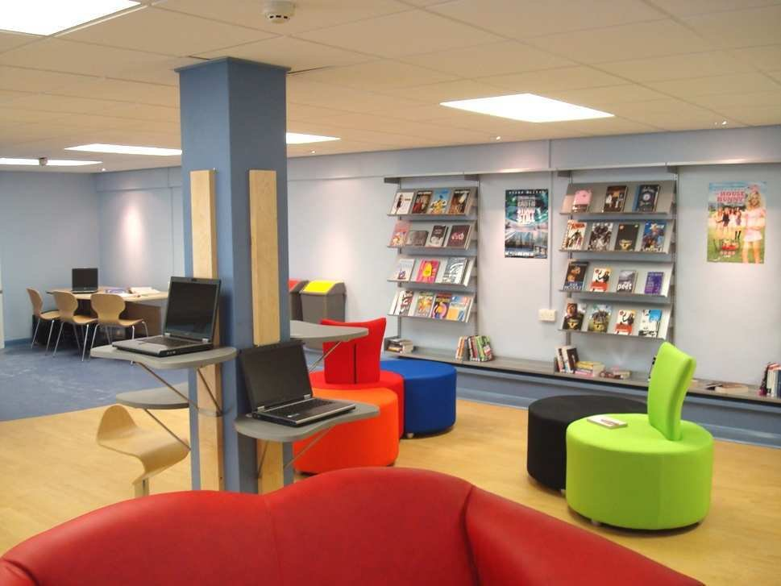

Worker are hoping to provide suitable activities to accomplish this. This is a new project which is still being developed. However initial feedback has been extremely positive and encouraging. Partnership working, both with longstanding partners as well as new ones, is an integral part of its success.

Some comments from youngsters involved with the project. > “Cool - I'd definitely use this place” "That looks mint> “ [speaking about an artist's impression of the finished room. `That looks mint' was one of the most used responses] ”Lush> “ [local youngsters on being shown the new room and entrance] ”We would like to take this home with us" [speaking about a sound chair allowing them to listen to music] Without the capital funding received from the Welsh Assembly Government, none of this would have been possible.

Some photos taken on the day of the launch (July 2009)

---

<!-- PAGE: 35 -->

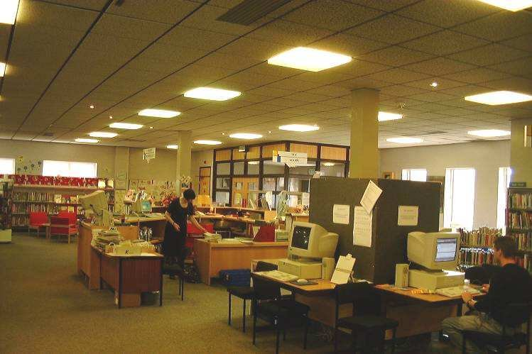

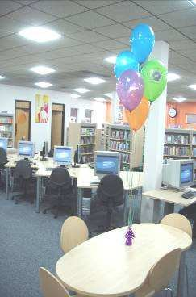

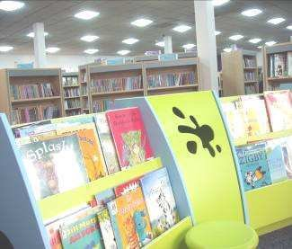

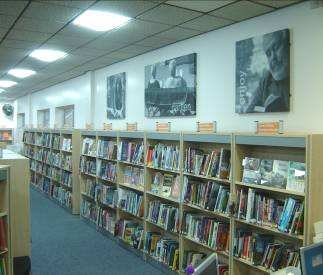

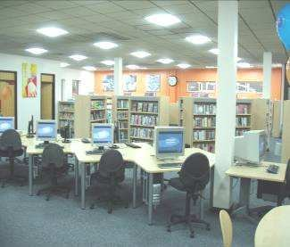

### Swansea: Gorseinon Library

**Capital Development Grant Funding**  
*Written by Steve Hardman, Library Services Manager, City and County of Swansea*

#### Introduction

Although Swansea library services has made improvements to the library offer over the last few years there was always going to be a difficulty in continuing to develop the audience and participation rates at a number of libraries due to their physical condition and interior design. The introduction of the CyMAL Capital Development Grants allowed the service to strategically plan and target a number of libraries where, with a reasonable amount of capital investment, a return on the participation figures could be expected. In the case of Swansea it allowed the service to continue its development journey on the road to delivering a first class library service.

#### Gorseinon Library Refurbishment

Gorseinon Library was chosen for the first bid for the Capital Grant. Although the library was in reasonable condition structurally the interior was extremely dated with poor levels of lighting, a large counter which compromised the layout and took up a lot of space and old style shelving which made adjustments to layout difficult. The bid was ambitious as Gorseinon is Swansea’s second largest library and performance was reasonable given the catchment area. It was decided that the whole of the public area was to be redesigned using retail techniques to exploit the stock, inspirational artwork to create an aspirational feel for users, a bold mix of colours to help differentiate areas of the library and above all to create a feeling of a vibrant 21st century space. There was a feeling from everyone involved in the project that the new design must appeal to existing customers and new users and that the ‘brown, drab space’ had to be replaced by a light and flexible library with a ‘Wow’ factor that would be audible when people entered! A decision was made to try and achieve this within a relatively short six week period.

---

<!-- PAGE: 36 -->

New services As the library was to be completely redesigned it gave the opportunity to implement RFID self issue services. The idea being that this would free up some staff time to allow staff to help promote the new facilities in the community and to plan and deliver a wider variety of events and promotions. The new space also allowed for a refocusing of the local studies facilities and the partnership between the Library service and Archives service saw a change in the way the services were delivered. A stronger emphasis on local community groups using the facilities independently was created. Support from the Archives service could be called upon by the library staff if further research was needed or community groups wished for Archive consultation. A small but useful change to layout also allowed the service to make use of some previously dead space which was converted into a small buggy parking and cloak room area for young children. Benefits The main benefit to users has been the layout of the library. It is far more flexible and has allowed the service to create a much larger children's area with clearly defined age ranged stock. It has also allowed staff to experiment with the layout and adjust spaces accordingly. Much of this is down to being able to move shelving as required (many shelves are castor mounted so allowing layout changes relatively quickly). Early on staff noticed that teenagers were not that comfortable within close proximity of the children's area and staff room access. Stock was moved and the layout adjusted so that a slightly more secluded feel could be accommodated. Stock display has benefited greatly with the new more flexible shelving and a higher proportion of stock can now be displayed face out which gives instant appeal whilst browsing. The new much smaller counter which is now located at the rear of the building allows customers to enter without being intimidated by a `command and control' layout which the previous counter engendered! On entering the building customers can see the quick choice stock immediately and are given space to get their bearings. Customers can see that there are areas where they can relax to read a newspaper or magazine, the layout is much more open and the overall feel of the library is welcoming and friendly. As part of the `Wow' factor we wanted customers to realise that the service still essentially provides a great range of stock and so the decision was made very early on to provide a large injection of new stock as part of the project. This I believe is essential to any major refurbishment project. The funding has also attracted additional funding from our Corporate Building

---

<!-- PAGE: 37 -->

Services who agreed to update the air conditioning within the building  something which we have failed to achieve after numerous requests over the last five years. One of the biggest benefits that I have seen as Head of Service has been the transformation of staff at Gorseinon. Although the overall project was managed by the Assistant Head of Libraries there was huge input from the staff at Gorseinon. The project timeline was tight as we did not want to set up temporary service provision as this dilutes the reopening and also stops staff from fully integrating with the project as most of their energies are focused on providing a sub-standard service in temporary accommodation. The staff launched into the project with great enthusiasm and supported the project at all levels. This continued after the project was finished and there is a real sense of ownership at the library. The staff are so proud of what they have achieved and this is reflected in everything they have done following on from the reopening of the library. Their drive to improve services has continued and the confidence within the team is a joy to behold. New skills have been learned along the way and the staff understand that although the service did attract a reasonable amount of users it could do better. The programme of events that the staff helped to put together for the first six months is now a fully fledged rolling programme of events which although supported centrally is mainly down to the ideas and preparation of the staff at Gorseinon. I also think that success breeds success. Staff have engaged much more effectively with partner organisations over the past twelve months and have seen a number of partnerships emerging either in newly formed projects or in a reinvigoration of existing partnerships. Staff have even managed to use commercial partners such as the local Sainsbury's to promote the library. Overall although the results below show that the investment has been successful the greatest success I believe is the confidence and self belief staff have shown for the service. The library is reinvigorated, staff are now fully onboard with the services aims and objectives. They can see the service vision and want to improve but more importantly they want to sell it. They feel they have a product that they can be proud of and really want to shout about it - something that traditionally librarians are not very good at especially in Wales! Conclusion The performance of the library continues to move forward with an increase of visitors for 08-09 of 21%, issues of 19% and encouragingly an active customer improvement of 14%. The number of activities and events continues to climb as staff become more confident with organising and running them. The library still looks great and continued publicity and marketing keep the

---

<!-- PAGE: 38 -->

library's profile high. Anecdotal evidence from staff suggest that the customers are staying longer within the library especially families. Staff have a more `can do' attitude, are more autonomous in their decision making and certainly make the library a welcoming and friendly place to be. Overall the money has in my opinion been very well spent and has extended the life of the library within the community for many years to come. The next couple of pages have been written by Carole Bonham, the Library Manager at Gorseinon who was asked to submit something about her thoughts on what has been achieved over the last eighteen months. Steve Hardman Library Services Manager The next couple of pages will give you a feel for the kind of positive comments we received from our customers and our staff.

---

<!-- PAGE: 39 -->

CUSTOMERS and STAFF Here are some things our customers and staff have said about the Gorseinon library refurbishment and the positive impact it has had on the town. Customers are proud of the library, and happy to have such an asset in their town. The service we provide is a valuable and valued one. Gorseinon is not a particularly wealthy area, and because of this we play a very important part in the lives of our customers. A lot of the children who use our facilities have no other access to computers, other than in school hours. Our homework club is, as a consequence, very well supported, and of great help to our local children in providing them with information for their school projects. Positive comments from the public > “Extremely pleasant and inviting. The range of books is wide. Well done! ”Wow!" "Lovely, welcome back!" > “Great looking new library, good selection of new books” "Fantastic!" > “Really bright and pleasant, plenty of choice, and well set out. Really, really nice, well done!” > “Amazing transformation  very bright and open  so many books!!” > “Fantastic  lovely ambience and everything easy to find  never seen it so well stocked” > “Big, clean and I can now find books easier”. "Staff friendly and happy" "It's got the WOW factor!" > “Very well set out and a pleasure to browse in” Having such a lovely environment has impacted positively also on staff morale. We now have more confidence when it comes to planning and delivering events. Our events programme has been stepped up since the refurbishment, and we have kept going very successfully the initially momentum caused by the excitement of the new library.

---

<!-- PAGE: 40 -->

Our children's area is now a versatile space, enabling us to offer events on a larger scale than we could have done previously. Stacks can be rolled back to provide more space, and as we frequently have over 50 children with accompanying parents to our events, this is a plus. We have been able to hold a film night and a puppet show since the refurbishment, and become an even more important part of the community life in this area. We try to hold events that will attract new users to the library. An example of this has been our "Girls nights in", the first of which had a beauty theme, and the second a craft theme. Staff have great pride in the library, and everyone is involved and responsible in maintaining the high standard with which we started off, post refurbishment. The presentation of the library is always high on our agenda. The staff pulled together as a team to prepare for the refurbishment. New skills were developed and new opportunities given to staff. This resulted in higher morale and ownership with regard to the new library. Senior staff showed faith in the Gorseinon team's ability to be ready for the re-opening, which gave us all confidence. Everybody was involved in the preparation, and this heightened team spirit was carried over, and still continues.

Positive comments from the staff > “We felt a very real sense of achievement. We were consulted all through the process and this made us feel involved in what was happening” > “The library is now more user-friendly. The new layout helps customers find what they want. The wide spaces provide ease of access to both customers and staff” > “It is much easier to maintain a high standard when you start with everything shiny and new!” > “Once people see how nice the library is, and what a pleasant place to visit and spend time in, they come back time and time again. The refurbishment was a very real investment in the town of Gorseinon, and an asset than continues to give pleasure to the people who live in the area”

Carole Bonham, Library Manager of Gorseinion Library

---

<!-- PAGE: 41 -->

## Section 3: Conclusion Our purpose in this report was to demonstrate the impact that the community learning libraries programme has had on the public library network and the overall value that this has brought to communities and individuals across Wales. We hope this report gives you a feel for the considerable difference that receiving the capital investment has made. We are sure you will agree that each case study is different. However, despite the diversity they demonstrate that as library services, we are all moving forward with local authority and Welsh Assembly Government funding and support. Impact Receiving the capital investment has resulted in the following: Improvement in customer satisfaction and customer experience (as evidenced in the customer comments) Improvements to the buildings, to library layouts and ambience Improvements to the service and the introduction of new services An increase in the number of visitors to those libraries Improvements in the facilities to support lifelong learning Impact on local communities, community groups and individuals Impact on staff who describe a sense of empowerment, ownership and a positive culture change Anecdotal evidence also shows that a broader spectrum of people are applying for library jobs. It is possible that a more modern, vibrant image is resulting in a positive change in perception about libraries in people's mindsets Raised the profile of public libraries in Wales and provided greater opportunities for marketing them Raised customer and stakeholder expectations Impact on wider issues such as wellbeing, sustainability, social inclusion and community engagement. We have learnt that through not being afraid to venture we can do much with little and take people with us.

---

<!-- PAGE: 42 -->

Public libraries are often regarded as hubs of the local community. The funding therefore not only renews library buildings and services it also helps to renew and regenerate town centres and village life within Wales. It is true to say that the impact created by this investment can be felt in diverse communities across the whole of Wales. We recognise that the Welsh Assembly Government aims to develop libraries and make them fit for the 21st century. We wish to work with you towards this aim. However, our ability to do this will be considerably diminished without the capital investment from the Welsh Assembly Government. Continuing to invest in the public library estate is essential to attaining the `One Wales' vision and provide better services to local communities. Thank you for taking the time to read this report. We hope you found it useful. > “Libraries are brighter, bolder and better than ever before! Long may this continue!”

---
