<!-- PAGE: 1 -->
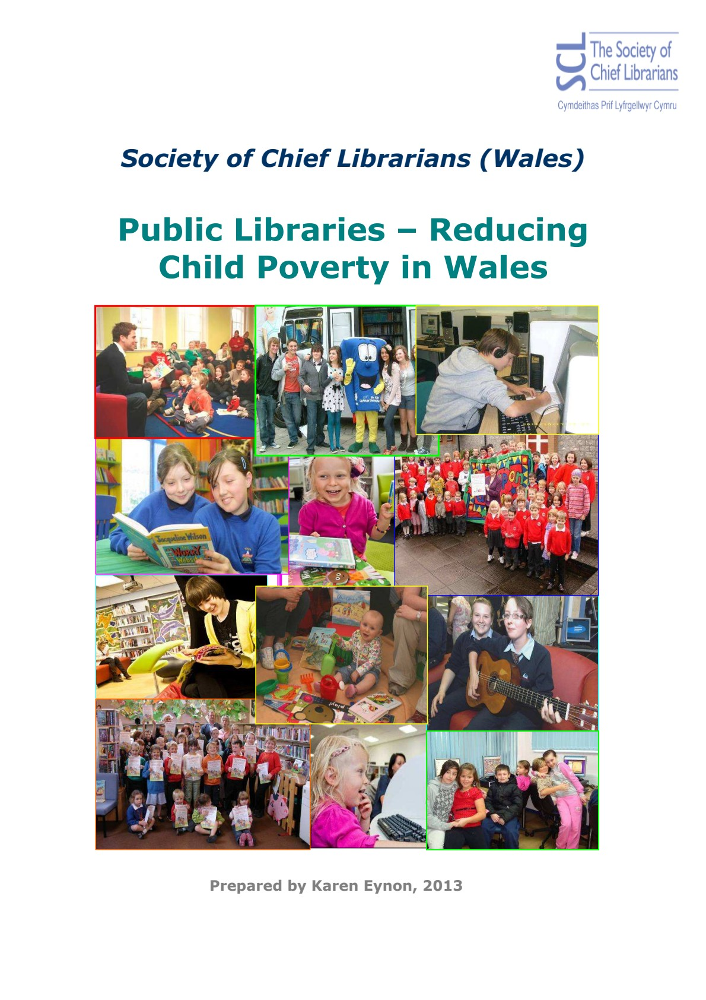

# Public Libraries & Reducing Child Poverty in Wales

## A report by the Society of Chief Librarians (Wales)

Prepared by **Karen Eynon**, Development Officer for SCL (Wales)  
Foreword by **Ann Jones**, Chair of SCL (Wales)

**May 2013**

---

<!-- PAGE: 2 -->

## Contents

| Section / Chapter | Page |
| :--- | :--- |
| **Foreword** by Ann Jones, Chair of SCL Wales | 3 |
| **Executive Summary** | 4 – 7 |
| **Part One: Background** | 8 – 36 |
| * Introduction | 8 – 9 |
| * Objective 1: Reduce the number of families living in workless households | 10 – 12 |
| * Objective 2: Improve the skills of parents and young people living in low income households so they can secure well-paid employment | 13 – 26 |
| * Objective 3: Reduce inequalities that exist in health, education and economic outcomes of children and families by improving the outcomes of the poorest | 27 – 31 |
| * Conclusion | 32 – 36 |
| **Part Two: Case Studies** | 37 – 95 |
| * All Wales: Kids Take Over the Library – Summer Reading Challenge | 37 – 41 |
| * All Wales: Bookstart | 42 – 43 |
| * Anglesey: Job Club & Healthy Cookery Skills | 44 – 45 |
| * Blaenau Gwent: Reaching Out NEETs Project, Amber House & Diary of a Wimpy Kid | 46 – 49 |
| * Bridgend: Reading for Fun & Families First | 50 – 51 |
| * Caerphilly: Risca Palace Library & Wicked | 52 – 53 |
| * Cardiff: New Life Project & Barnardo's Asylum Seekers | 54 – 56 |
| * Carmarthenshire: Geocache Challenge | 57 |
| * Ceredigion: Family Learning | 58 |
| * Conwy: Talking Without Words, Bookshine, Booktouch and Letterbox | 59 – 61 |
| * Denbighshire: Picture This | 62 |
| * Flintshire: Job Clubs in the Library | 63 – 65 |
| * Gwynedd: Helping Hand Books & e-Family Scheme | 66 – 68 |
| * Merthyr Tydfil: Yolo (Digital Magazine Project) & Follow the Shadows | 69 – 71 |
| * Monmouthshire: Poetry Emotion, Digital Stories to Combat Bullying & Macmillan Youth Project | 72 – 77 |
| * Neath Port Talbot: Toy Library | 78 |
| * Newport: Book Break, Young Parents Programme & Improving Boys' Literacy | 79 – 82 |
| * Pembrokeshire: Summer Learning & Themed Baby Rhyme Times | 83 – 84 |
| * Powys: Bookrunner Service | 85 – 86 |
| * Rhondda Cynon Taf: E-Teens Library | 87 – 88 |
| * Swansea: Young Readers & Bookstart Corner | 89 – 90 |
| * Torfaen: Sharing Books with Under Fives, Healthy You Happy Baby & Engaging with Travelling Community | 91 – 93 |
| * Vale of Glamorgan: Sign and Rhyme & Outreach Stories and Crafts | 94 |
| * Wrexham: Splash and Rhyme Time | 95 |
| **Bibliography** | 96 |
| **Appendix: What Users Tell Us** | 97 – 102 |

---

<!-- PAGE: 3 -->

*(Contents continuation — full case study breakdown by local authority as listed in Table of Contents)*

Thank you to the marketing strand (Libraries Inspire) for use of some of the photographs [© Welsh Government]

---

<!-- PAGE: 4 -->

## Foreword

### By Ann Jones, Chair of SCL Wales

 The Society of Chief Librarians (Wales) is an association made up of the head librarian (or equivalent) of each public library authority in Wales. Our key aim is to influence decisions at national level and provide leadership and future direction in relation to the d evelopment of public libraries in Wales. O ur purpose in this report is to demonstrate to you the role that p ublic libraries have and can have in relation to reducing child poverty in Wales. We believe public libraries are uniquely placed in the heart of the community to provide a range of social, economic, education and health benefits and opportunities. Libraries bring people together. They are also vital in reaching out to more hard to reach and vulnerable people, for example to those who live in low income h ouseholds, to those living in rural areas and to those who are less a ble to afford to pay for services. S ome of the activities that public libraries do to support the child poverty agenda are summarised in this report. This is only a snapshot of the position so far and the Society is aware that new services are coming on stream as changes within the public sector occur. Libraries are rapidly evolving to meet the needs of children and the wider community and this report is just one of many that outline the benefits provided by a strong public library sector. P eople tell us all the time how they value our library services. We h ave included a selection of our user comments which demonstrate t hat libraries do indeed change lives. Ann Jones, Chair of SCL Wales

**Ann Jones**  
Chair of SCL Wales

---

<!-- PAGE: 5 -->

## Executive Summary

 The Society of Chief Librarians (Wales[^1]) has prepared this report in order to demonstrate the role public libraries have in relation to reducing child poverty in Wales. The full report emphasises the contribution made by public libraries in relation to improving the lives of those who are in poverty or at risk of being in poverty. Public libraries do so much already in relation to this important agenda. SCL (Wales) believes this requires greater recognition and exploitation within national strategies and priorities. In the full report case studies are provided from each local authority in Wales which demonstrate this impact. Libraries help reduce child poverty by: Child Poverty What public libraries do Strategy Objectives Reduce the number Provide free access to the internet and of families living in information resources. Specifically this workless includes providing the means to find work households via online access to JobMatch and Universal Credit entitlements. Public libraries in Wales have a partnership arrangement with Communities 2.0 and Job Centre Plus to ensure that the power of the library network to act as a gateway for people out of poverty is fully utilised. Improve the skills Empower children and young people, of parents and parents and families to access and use young people living books, information and computers. Ꙅʚ ʚ & ꙅ ꙅ ꙅ ʚ ʚ ʚ ꙅ ꙅ ʚ •ꙅ ʚ ꙅ ʌ ꙅ ʚ ꭎ ʌ ʚ •• ʚ ꭎ ʚ ꙅ ꙅ․

---

<!-- PAGE: 6 -->

in low income Nurture and develop a love of reading for households so they pleasure, which strong evidence indicates is can secure well- a key factor in children's educational paid employment. attainment and future social mobility ( libraries as well as providing a range of books also provide a range of activities such as storytelling, Bookstart, Summer Reading Challenges, book quizzes, homework clubs etc.) Provide community, informal and some formal learning opportunities to children, young people and adults. Work closely in partnership with schools, further and higher education organisations in relation to learning and training opportunities. Impact on the knowledge, attainment, self-development and enjoyment of children, young people and adults. Encourage intergenerational activity including family learning. Reduce inequalities Provide a free, inclusive service for that exist in health, children, parents and families. education and Provide a network of easily accessible, non economic

* threatening, inclusive environments

outcomes of (including static libraries, housebound and children and mobile libraries) families by Provide literacy, information literacy, digital improving the literacy and health literacy opportunities. outcomes of the

---

<!-- PAGE: 7 -->

poorest Provide the well respected Book on Prescription Wales Scheme (partnership with Public Health Wales). Provide learning opportunities. Provide free or easily affordable resources, activities and services. Provide vital social and community links to children, young people and families who may otherwise find it difficult to socialise and engage within their local communities. Reach out to those who are usually hard to reach. This includes physically via housebound, Homelink and mobile services as well supporting and encouraging the more vulnerable groups in society such as looked after children, people with disabilities, older people etc.. Help young people to engage with their communities by offering a wide range of resources including books, CDs, DVDs, music, magazines, free filtered internet access. Reduce stress levels (there is much evidence for example to show that reading reduces stress levels) Help children and young people escape from their problems through reading, reading groups, community activities etc.

---

<!-- PAGE: 8 -->

Significantly, public libraries are FREE to all users. This is particularly important during these difficult economic times. Thus public libraries have economic, health, education, and social benefits. In addition, public libraries are free and available to all. Public libraries therefore provide many positive outcomes to those most in need. Often the role public libraries have in relation to this important agenda can be overlooked but comments and stories provided by our users within the full report show that our public libraries in Wales have a powerful and positive impact on many people's lives. Libraries are a gateway out of poverty!

---

<!-- PAGE: 9 -->

## Part One: Background

### Introduction

 Libraries will inspire the people of Wales to enjoy reading, enhance their knowledge and skills, to enrich their quality of life and empower them to realise their full potential The CyMAL (Museums, Archives and Libraries Wales) Libraries Inspire Framework 2012 – 2016 The Society of Chief Librarians (Wales) is an association made up of the head librarian (or equivalent) of each public library authority in Wales. Our key aim is to influence decisions at national level and provide leadership and future direction in relation to the development of public libraries in Wales. Our purpose in this report is to demonstrate to you the role that public libraries have and can have in relation to reducing child poverty in Wales. DID YOU KNOW? Compared to other cultural facilities, libraries are used by a higher percentage of people from deprived areas (39.8%) Public libraries have economic, health, education, and social benefits and provide a free and accessible service which is available to all. Public libraries therefore provide many positive outcomes to those most in need. This is particularly significant given that the Welsh Government has identified offering support at the right time and in the right way, including at community level, as being vital to improving outcomes for the poorest.

---

<!-- PAGE: 10 -->

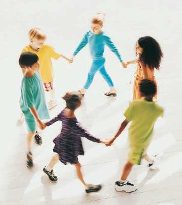

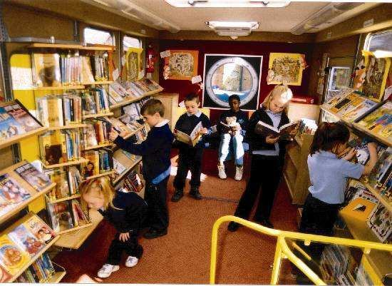

We want to see a Wales where we break the link between being born poor and spending a lifetime in poverty. This means we need to offer support at the right time and in the right way – at home, at school and at the community level. By doing what we can in the early years of a child's life and through working with parents and families, we can have a transformational impact on their journey into adulthood and later life Building Resilient Communities: Taking forward the Tackling Poverty Action Plan, Welsh Government, 2013. Often the role public libraries have in relation to this important agenda can be overlooked but comments and stories provided by our users show that our public libraries in Wales have a powerful and positive impact on many people's lives. In the Welsh Government's Child Poverty Strategy for Wales (2011 – 2014) there are three strategic objectives for tackling child poverty: 1. reduce the number of families living in workless households; 2. improve the skills of parents and young people living in low income households so they can secure well- paid employment; 3. reduce inequalities that exist in health, education and economic outcomes of children and families by improving the outcomes of the poorest. Public libraries can help the Welsh Government achieve these objectives.

---

<!-- PAGE: 11 -->

### Objective 1: Reduce the number of families living in workless households

 Public Libraries help the Welsh Government to achieve the first objective. People who do not have access to the internet are now at a considerable disadvantage in life. Those who have access will be more likely to: succeed in life get a job find the best deals on purchases which makes their money go further gain access to information on their rights communicate with people across the globe …and so many other things. Libraries can be, and are, a solution to this digital divide; empowering the have nots and giving them access to a world of information for free. They are a gateway out of poverty. They are also a gateway to accessing online employment related services. The introduction of Universal JobMatch and Universal Credit means more and more people need online services to access employment opportunities and benefits. All this causes difficulties for those who don't have access to online facilities. Did you know? According to the Welsh Government Digital Inclusion Unit's National Survey for Wales 2012 – 13 Those in the most deprived areas are least likely to have access to the internet at home or at work Those who have never worked or are long term unemployed are most likely to use a public place (not home, work or education) such as a library to access the internet.

---

<!-- PAGE: 12 -->

Universal Jobmatch which recently replaced the job search function of JobCentre Plus means more and more people are looking for work on-line. Universal JobMatch requires each person to register with the service to obtain an email account and this produces a Government Gateway account number which is used for subsequent logins. The account allows people to keep a record of all their job search activity in one place, allows job searches to be saved, jobs to be applied for, email alerts to be received and CVs to be created and uploaded. In addition Universal Credit, which replaced the 6 existing benefit payments in October 2013, also requires claims to be made through the internet. Government expects that most subsequent contact between recipients and the delivery agency will also be conducted online. More and more people are turning to public libraries to access Universal JobMatch and Universal Credit. The majority of these are people who are out of work and don't have access to the internet at home. Public libraries are also noticing a considerable increase in the number of referrals from Job Centres. We are currently working together with Communities 2.0 and Job Centre Plus to discuss extending our partnership working to ensure that the power of the library network to act as a gateway for people out of poverty, is fully utilised.

* I am unemployed at present, so I joined the

library to be able to go on the internet and look for jobs. It also has a job search machine and the staff are great and very helpful. Most jobs require you go online. If you haven't got the internet at home or can't afford to have it, the library is the place to be. Really look forward to coming in– [Customer – Caerphilly Library Service] Many businesses and organisations also place their job opportunities online as it is a cheaper way to advertise. Usefully many public libraries in Wales have separate business services to assist with business enquiries, business start ups and business networking too.

---

<!-- PAGE: 13 -->

Many people use public libraries to access the internet for other reasons too such as paying bills and accessing their bank accounts. In addition people use public libraries to help keep them to date with things and to keep in touch with others, thus reducing isolation and encouraging community engagement.

* I haven't got internet access at home and I need it these

days to keep an eye on my bank account, pay my gas, electricity, water, council tax and TV licence and to look for jobs and fill in applications online as well as to check my e-mail. The library has access to the internet. The library saves me a lot of time and money.– [Customer Cardiff Library Service] Many libraries offer special sessions for job-surfers to help people with IT assistance, filling in application forms, help with CVs etc. Public Libraries help with the skills required and this is explained in the next section.

---

<!-- PAGE: 14 -->

### Objective 2: Improve the skills of parents and young people living in low income households so they can secure well-paid employment

 Public libraries help the Welsh Government with the second objective. Linked to the first objective many people are turning to public libraries to help improve their skills which in turn helps them to find employment.

* I don't know what I would do without the library!

I've recently had to sign up for the Universal Job- Seeker process. I was really worried about doing this, as my computer skills are poor. The help and support I have had in the library has been excellent. I now attend the Work-Club and I have signed up for a LearnDirect course in basic skills–. Parent, Blaenau Gwent As well as providing a wealth of reading material in various formats, many public libraries also offer learning opportunities including Learndirect courses, adult learning events, reading discussion groups, ICT skills training, job seekers help etc. These are just a few examples. Many people in fact prefer the type of community learning offered through public library services. Some libraries also provide more formal training working with other local training providers. Public libraries provide localised support for learners who may otherwise be working in isolation and provide essential referral points for remote learners. As previously stated public libraries also hold training sessions at libraries to help people gain skills to return to work.

---

<!-- PAGE: 15 -->

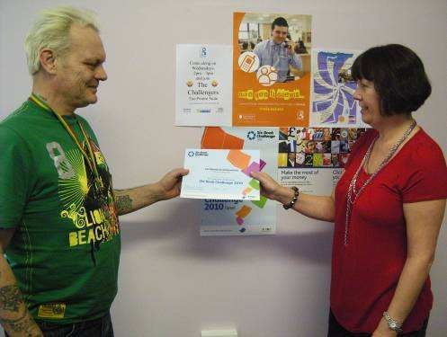

* I attended the Work Club in the library to gain

confidence. I have spent most of my adult life caring for my parents. I have had help with basic skills and gone on to do the Six Book Challenge. This is the first certificate I have ever received. Following all the support I received from the Work Club, I am now volunteering at the local residential home. My life has been turned around!– BLAENAU GWENT Norman receiving his certificate for completing the Six Book Challenge at the Ton Pentre Suite, Bridgend. Norman has successfully completed eleven Learndirect courses in Literacy and is working towards his Adult Literacy qualification through Bridgend Public Library Service. He now regularly attends the Ton Pentre Suite with his wife and daughter who are all enrolled on Learndirect courses to achieve qualifications. They are working towards a Certificate in Adult Literacy Level 1. Norman also attends the reading group and the literacy classes at the Ton Pentre Suite to improve his learning.

---

<!-- PAGE: 16 -->

Family Learning Libraries also provide many learning opportunities for all the family. Parents and families who participate with their children in the schemes and activities provided by public libraries benefit greatly. I have been attending the Digital Friday sessions at Ebbw Vale Library. I plucked up the courage to ask for help, as I wanted to help my children with their homework. It has been great, I am now able to find accurate websites and I have learnt about safe surfing Library staff receive many positive comments from people for example, about the Bookstart scheme which impacts on the whole family.

* After recently receiving free Bookstart packs for children

and distributing them to families supported by our organisation, we have recommended families attend the Bookstart sessions at Rhyl Library. We find this service invaluable as it enables those who may be isolated to make new friends, learn new skills and use the free services the library has to offer. I feel parents and their children gain a great deal from the experience.– From a Young Person's Development Worker, North Denbighshire Domestic Abuse Service Libraries are also important in creating the bond between the home and school environment and much of our success over the years has been in engaging at an early age with parents and children through Bookstart, rhyme time and story time sessions.

---

<!-- PAGE: 17 -->

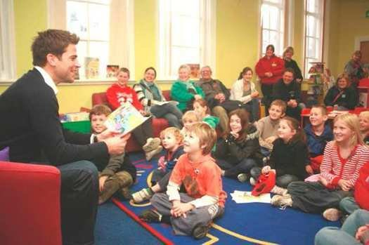

TV Presenter, Gethin Jones, reading stories at Colywn Bay Library Bookstart is the very first step in lifelong learning and introduces babies and their families to the world of books that gives them a head start in life. Research has shown that children who are introduced to books from an early age make better progress when they get to school and that education achievement is strongly influenced by children's attitudes towards learning.

* Bookstart has made my

daughter learn that books are fun!– Regular storytimes in libraries also increases parents confidence in sharing books and rhymes with their children, and make a positive impact on children's early language and social development.

* Probably the biggest effect the library sessions have had, has

been with the parents of our children. Most of these parents have declined from taking their children into the public eye due to some bad experience or other. However, by attending (in the background) the Bookstart session and having seen their child in action joining in within the session, it has given them a huge confidence boost, thus enabling them to access other public places with their child, and start to really communicate with them.– From a Specialist Special Needs Teacher for children with autism, Denbighshire

---

<!-- PAGE: 18 -->

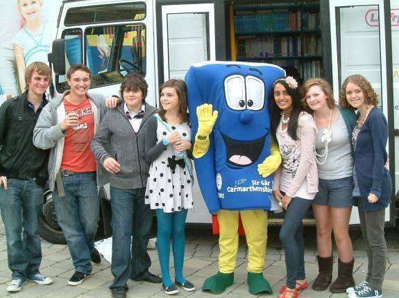

SuperBook Carmarthenshire Library Mascot Public libraries offer a whole host of family learning opportunities. Improving the family's learning has a direct effect on a child's life. By empowering the parents through education, the parent's self- esteem and confidence raises the expectations of children in their own education. Learning opportunities offered through library services not only raises their self-esteem and confidence in general life, but of course their confidence in work related issues and employment prospects, therefore having a direct effect on poverty. The recent Estyn report The Impact of Family Learning [2012] cites a wide variety of publications, surveys and reports which document the importance of family programmes and the positive impact that these can have on improving the standards children achieve in schools. An enquiry by NIACE, Work, Society and Lifelong Literacy (2011) also confirms this. The enquiry finds that schools on their own cannot address the multiple disadvantages faced by many families. In the Ofsted report, Family Learning: An Evaluation of the Benefits of Family Learning for Participants, their Families and the Wider Community (2009) inspectors found that family programmes have a significant impact on the behaviour of children. Children have better communication skills, settle better in class and have an improved relationship with teachers and other children. The Estyn report, Tackling Poverty and Disadvantage in Schools (2011) describes how pupils achieve higher results and are more likely to succeed when parents are involved in their education and provide them with learning support.

---

<!-- PAGE: 19 -->

Significantly, using the library is FREE for all the family! Reading and Literacy We have previously highlighted the importance of reading and the impact this has on individuals in our report The Importance of Reading).(http://www.goscl.com/wpcontent/uploads/2012/03/SCL_ W_ImportanceofReadingDec20111.pdf) Public libraries have a key role to play here. People who enjoy reading will have improved literacy skills which in turn increases opportunities within education and learning, work and employment, social and life skills and personal health and wellbeing.

* If I didn't go to the library I wouldn't have as many

friends as I do now and wouldn't have read as many books and wouldn't have done so well at lessons in school.– Library customer, Blaenau Gwent Children thrive when reading outside the classroom environment as shown by figures provided via the National Literacy Trust. Children who enjoy reading are five times more likely to be above average readers. National Literacy Trust

---

<!-- PAGE: 20 -->

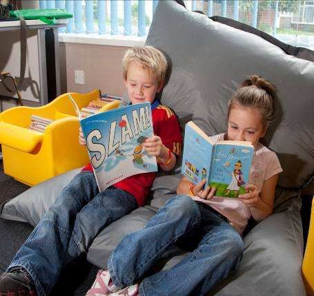

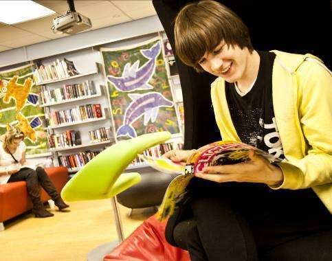

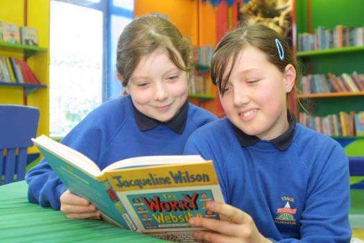

A recent article in the Telegraph states: Reading for pleasure at the age of 15 is a strong factor in determining future social mobility. Indeed, it has been revealed as the most important indicator of the future success of the child Research from the Organisation for Economic Co-operation and Development (Telegraph 04 May 2013) Libraries also work closely with schools, school librarians and LEA staff to ensure children have access to resources, learning support and community involvement. We strongly encourage our pupils to participate in the Summer Reading Challenge. It fosters an enjoyment of reading, elevating the status of reading and books. It becomes very desirable to complete the challenge and to gain recognition from library staff, parents, teachers and the other children. The scheme develops links between our school and the local community, and gets the parent on board too. Our hope is that more and more parents play an active role by hearing their children read ( or by sharing books with the younger age groups) during the Summer Holidays Flintshire Head Teacher

---

<!-- PAGE: 21 -->

Supporting the curriculum In addition to providing a key role in relation to reading and literacy with the individual child or with families, public libraries enhance and complement the education children receive in school by supporting most aspects of the curriculum and encouraging children and young people to participate in enrichment opportunities. For example:

* ICT : Free access to computers and the internet to support study

and homework

* History: A wide range of local history resources

* Creativity and Arts: Libraries provide creative spaces and

experiences for children and families. Visits by children's authors and writing squads improve reading and creative writing skills.

* Personal and social education: Joining and using the library

promotes a sense of belonging and responsibility. Children are encouraged to visit and use library services as individual young citizens, developing their sense of community involvement and individual responsibility. Using the library is an important first step in local citizenship and community responsibility.

* Cross –curricular and themed projects and research: Libraries

support children with homework and research, providing online resources, books, primary sources, maps and DVDs, as well as support and help to develop independent learning skills.

* Class visits.

Children across Wales visit their local library on class visits Just 14% of variation in individuals performance is accounted for by school quality. Most variation is explained by other factors, underlining the need to look at the range of children's experiences, inside and outside school, when seeking to raise achievement Joseph Rowntree Foundation , 2007

---

<!-- PAGE: 22 -->

Children are regularly consulted for their opinion on their local library and the service offered. Here is a sample of a recent survey which demonstrates the impact the public library service has. Using the library has helped me to: Authority CIPFA (PLUS) survey figures Read better Do better at school Isle of Anglesey 73% 46% Flintshire 66% 45% Bridgend 66% 53% Caerphilly 56% 45% Conwy 60% 48% Denbighshire 60% 46% Gwynedd 71% 51% Monmouthshire 60% 36% Newport 61% 46% Powys 66% 41% Pembrokeshire 66% 44% RCT 57% 44% Swansea 64% 53% Torfaen 59% 35% Xale of 60% 40% Glamorgan

---

<!-- PAGE: 23 -->

Public libraries offer a whole host of free resources, activities and events for children, young people, parents and families. Libraries hold reading groups, storytimes, Bookstart schemes, homework clubs, arts groups, health and wellbeing projects. Libraries work with local schools in relation to information, research and homework and out of school activities such as the Summer Reading Challenge. Libraries can also help young people to engage with their communities by offering locally based services and a wide range of resources (for young people) including books, CDs, DVDs, music, magazines and free filtered internet access. Adult Literacy DID YOU KNOW? 7 million people in the UK lack basic literacy skills. That means 20% of the adult population in the UK cannot read or understand simple instructions. 25% of the working-age population in Wales lack basic literacy skills, a higher proportion than in any of the English regions. Improvements in reading and literacy can have a profound effect on individuals and their contribution to society when they reach adult life. Literacy impacts on skills, employment and life opportunities thus improving the quality of life for people of all ages. Reading opportunities through public libraries impact on literacy levels and this in turn increases the chances of employment. Figures by the National Literacy Trust shows the impact of low literacy levels: 22% of men and 30% of women with low literacy levels live in non-working households. Individuals with low levels of literacy are more likely to lead solitary lives.

---

<!-- PAGE: 24 -->

Individuals with low literacy levels are more likely to have reduced access to technology. Increased literacy rates improve the chances of using a PC at work from 48% to 65%. A modest rise in literacy levels sees the likelihood of a person owning their own house rise from 40% to 78%. Men and women with the poorest literacy or numeracy skills were the least likely to have voted in the general elections. Digital Literacy and Inclusion There is evidence also to show that people with low literacy skills are reluctant to use technology as they may not have the confidence to read what appears on the screen. Low levels of literacy will therefore also impact on digital literacy and a person's ability to access information electronically. Those who suffer social exclusion – a combination of social disadvantages such as poor skills, poor health and low income - are also likely to be excluded from the information society. This is evidenced in the report: Digital inclusion: an analysis of social disadvantage and the information society (2008) by the Oxford Internet Institute. This report states that ICT deprivation can be considered alongside, and strongly linked to, more traditional twenty-first century social deprivations, such as low income, unemployment, poor education, ill health and social isolation. Digital exclusion affects social exclusion. Social exclusion affects digital exclusion. The correlation between digital and social exclusion means that those already at a disadvantage and arguably with the most to gain from ICT and the internet are the least likely to be making use of it. Public libraries have a particular role to play in relation to digital inclusion. Our network of public libraries throughout Wales are open to all individuals and communities and enable them to access free internet and ICT provision. The fact that there are libraries in most communities in Wales also means that everybody can access ICT and the internet easily, conveniently and cheaply.

---

<!-- PAGE: 25 -->

The library has made a difference because I don't have the internet and the library is within walking distance from my house– [Customer & Flintshire Library Service] People who don't have the internet at home are able to call into their local library and use the facility for free! In relation to the digital agenda public libraries offer: FREE Internet access FREE On-line membership registration and access to library services and information ICT sessions. This would include for example - Introduction to PCs, job searching, how to print documents and images, navigating the operating system, saving documents, text editing, use of clipart, introduction to the internet and successful web searching, using the email and use of social networking. Learndirect bite-sized learning is available in some libraries. Some are more niche in nature focusing on topics such as buying on e-bay . Many have sessions focusing on information literacy themes. OCN training provision is provided in some libraries. Some host accredited ICT courses offered by local FE colleges I have signed up to the Get Blaenau-Gwent On-line project at Tredegar Library . I can't afford a computer, so the library is ideal for me. Since starting the sessions I have saved money by switching my gas and electric suppliers and have been able to search for cheaper car insurance. Иext I want to learn how to sell items on E-bay. I'm going to have a good clear out at home, - and save the money for the presents for my children at Christmas Parent, Blaenau Gwent

---

<!-- PAGE: 26 -->

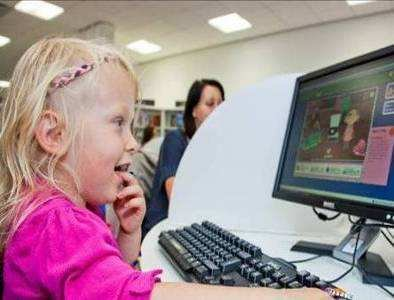

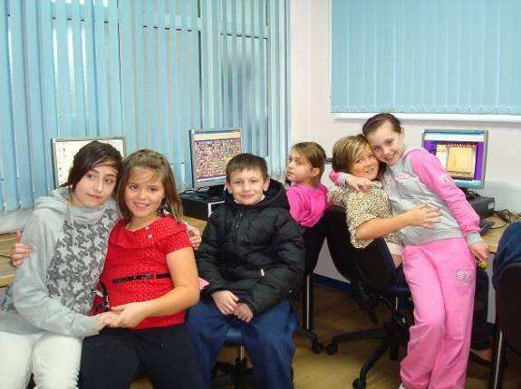

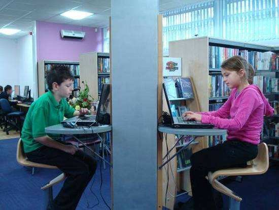

Some Local Studies Librarians offer family history taster sessions. We all come to the library every Saturday; it is one of the few places that doesn't cost anything. My husband is tracing his Family Tree and I catch up emailing my relatives in Australia, my son goes on the Xbox in the games room and my daughter just loves drawing and browsing Many provide smaller specialised courses working with further education providers, for example, on family and local history research Many public libraries hold community learning classes Most offer ongoing ICT help from frontline staff and/or Libraries ICT support officers Many libraries have developed interesting projects with key target groups. For example, in Wrexham the ICT and Learning for Children and Young People Project targets mainly school children in the transition from primary to secondary school. Also, Caerphilly Library Service has developed the information literacy scheme to include young people (14+) who are completing the Welsh Baccalaureate. Gwynedd Libraries have developed the Her y We web-site to encourage and assist children and young people to use libraries. The site contains information, games and resources and has ideas for school librarians to promote their libraries in support of the curriculum. The site is available at www.herywe.org.uk/

---

<!-- PAGE: 27 -->

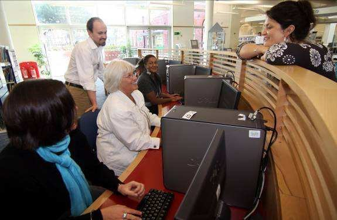

### Objective 3: Reduce inequalities that exist in health, education and economic outcomes of children and families by improving the outcomes of the poorest

A group of people brushing up on their computer skills at Barry Library, Vale of Glamorgan. Actress and writer Ruth Jones finds out more! The global financial situation has had its impact. Significant redundancies have resulted in more people returning to learning and wanting to update their skills in a cost effective way. Public libraries can help people of all ages acquire learning and life skills. This can help considerably with confidence building so that they are ready to participate in the next stage of learning and employment. Informal learning opportunities are often the first access individuals have to digital technologies. By using computers in libraries learners can become more confident and socially mobile. It is then more likely that learners will begin using ICT for their own benefit. In addition there are many young people who are not in education or training who may prefer more informal based learning opportunities. The type of learning opportunities offered at our public libraries could appeal to children and young people who are not in education and training (NEET) and also to parents and families on lower incomes. Public libraries support community learning and informal learning for people of all ages. At a library everyone can study the subject of their choice, in their own time, at their own pace. Through our network of public libraries people can read, learn, research, surf (the web), meet and share – various activities which help people engage with their local communities and beyond. In addition we mustn't lose sight of the importance of the informal learning gained through social connections and community life.

---

<!-- PAGE: 28 -->

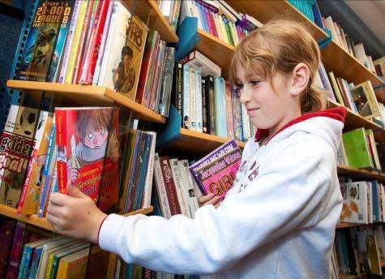

Objective 3 Reduce inequalities that exist in health, education and economic outcomes of children and families by improving the outcomes of the poorest Economic Benefits In addition to the educational and social benefits previously described, there are also economic benefits to using public libraries. This is an important factor as there are many families in Wales who find it difficult to purchase books and other resources particularly during these difficult economic times. In addition there is a greater reliance on accessing on-line services (see the previous section explaining the impact of Universal Job Match and Universal Credit Offer) and many people still are unable to afford computers and on- line services at home. It is a simple fact that libraries are even more vital in difficult economic times. Libraries are free. Libraries offer value for money. DID YOU KNOW? Public libraries cost just 5p per person/ per day to run, on average The cost is 35 p per week/ per person: less than a bag of crisps or a pint of milk! The public library service core offer is FREE for children and young people, parents and families. This includes borrowing books, use of the computers and internet access as well as many of the activities on offer. This is a significant and important point when one of the key objectives for the Welsh Government is to tackle child poverty in Wales, reduce inequalities and improve social inclusion.

---

<!-- PAGE: 29 -->

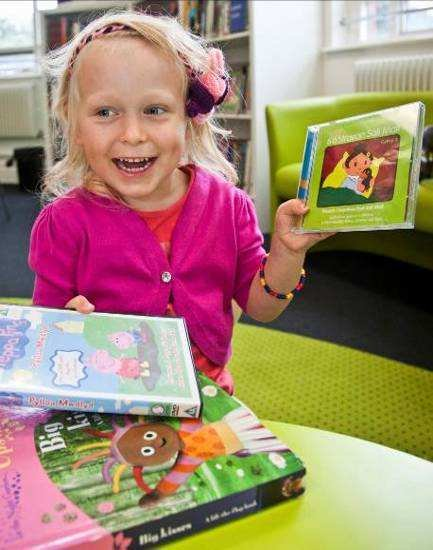

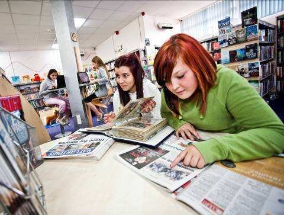

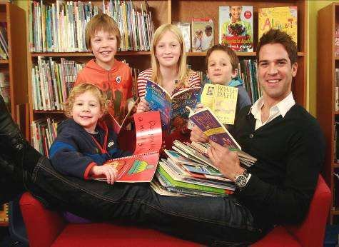

Public libraries provide a service which is equal and fair to all. Public libraries have a proven track record in helping hard to reach people and those who are at risk of being socially excluded. Public libraries provide a network of community-based services, and mobile libraries to more rural locations and services for people who are housebound. There are many examples to demonstrate what public libraries are doing to help people who maybe socially and digitally excluded due to living in rural or remote areas. The network of public libraries, including mobile libraries, reach many rural areas throughout Wales. In addition there are positive examples of specific projects that have been developed to ensure people living in rural areas are able to access ICT and digital services. Librarians and information professionals work closely with excluded individuals and communities in local communities, in other communities of interest such as prison libraries and through partnerships with other library sectors, for example within schools, further and higher education and health. Libraries bring people together. They are also vital in reaching out to more hard to reach and vulnerable people. Libraries provide

---

<!-- PAGE: 30 -->

support, company, enjoyment and interaction to many people. This important aspect of the library service is often overlooked but the public value it. Public libraries are also one of the most widely used community resources, shared community spaces that celebrate local diversity. As community hubs, libraries are at the centre of local communities providing a meeting place for local groups, provision of community information and a wide range of activities for all ages. The public have a high level of trust in libraries, and continue to place a high value on them which indicates that they do help contribute to creating stronger and more cohesive communities. Alongside this, more emphasis needs to be placed on the value of public libraries and their contribution to the wider agenda. Public libraries contribute to health, education and learning, literacy, community wellbeing, skills, economic regeneration, digital inclusion and participation and cultural identity. Health and Wellbeing

* Poverty can have both direct and indirect impacts

on health and well-being. Good health is a critical factor in accessing employment– Building Resilient Communities: Taking forward the Tackling Poverty Action Plan, Welsh Government, July 2013. Libraries contribute to health and wellbeing by providing: Bibliotherapy; including self help books and more general reading for pleasure books that can enhance wellbeing Book Prescription Wales scheme General health information and referral access to health libraries Free inclusive access for all A network of neutral, trusted and accessible community spaces. Libraries can provide a venue for a wide range of health and well-being activities. Community outreach services including library mobiles and provision for the housebound, care homes, sheltered housing and children's centres

---

<!-- PAGE: 31 -->

A wide range of reader development, literacy and reading group activities which actively feed into the health and wellbeing agenda Creative bibliotherapy: Bookstart, social reading activity, shared reading, reading groups, reading challenges, events and workshops for mainstream and vulnerable groups Health literacy and e-health literacy [health literacy is an individual's ability to read, understand and use healthcare information; e-health literacy is the use of the internet for information-seeking and health information distribution purposes] Free assisted on-line access. Libraries provide access to IT resources and expertise Staff skilled in information management, reader development and engaging with the local community Facilities, resources and equipment suitable for people with disabilities, such as for visually impaired people Strong links with leisure and fitness centres. A strong partnership arrangement with the Health Promotion Library within Public Health Wales. http://librarywales.org/fileadmin/documents/toolkit/Marketing/G et_Libraries/libraries_flyer_en.pdf Thus libraries contribute to community cohesion and the health and well-being of people of all ages, thereby reducing the burden on health and social care services. SCL Wales has previously produced a report detailing the impact public libraries have on health, wellbeing and socially. http://librarywales.org/fileadmin/documents/Documents1/SCLWPub licLibrariesinWalesHealth_Wellbeingand_Social_Benefits2012_1_.pdf In addition the First Incomplete Guide to Wellbeing in Libraries was launched in January 2013. This includes various case studies demonstrating the link between public libraries and health and wellbeing. http://librarywales.org/fileadmin/documents/toolkit/Marketing/GetLi braries/Wellbeing_in_Libraries_ENGLISH_FINAL.pdf Here you will find more information about the contribution of public libraries in relation to health and wellbeing.

---

<!-- PAGE: 32 -->

### Conclusion

Access to government and public services Libraries can also help the public engage more with governance, democratic processes and other council services. Socially and economically disadvantaged people who could benefit most by accessing council services will be the least likely to be able to use electronic means to access government initiatives or democratic information. Public libraries can provide mediated access to online services. There is a need to promote and enhance the role of libraries here. Public libraries are in many cases the public face of local councils. Because libraries provide support as well as access to digital technologies, there is huge potential for libraries to drive the take- up of e-public services and e-government services. This is particularly important as outlying government and local authority offices are closed and services are increasingly made available online. This could have a significant impact in areas such as employment, housing and health now and in the near future. Public libraries have a base of experience in delivering public services including online library services and have the potential to signpost and guide users to other online public services. Libraries provide a service for all people, of all ages, of all walks of life – in fact everybody! In addition public libraries are free! By using public libraries you can save yourselves money.

---

<!-- PAGE: 33 -->

Conclusion The intention of this report is to demonstrate the significant role public libraries have in relation to the child poverty agenda. Public libraries can help the Welsh Government achieve the three new objectives in the Child Poverty Strategy for Wales. Public libraries can: Help to reduce the number of families living in workless households; Improve the skills of parents and young people living in low income households so they can secure well-paid employment; Reduce inequalities that exist in health, education and economic outcomes of children and families by improving the outcomes of the poorest. The many comments and stories received from people who use library services really show how libraries impact on people's lives. Libraries can change lives. The comments included in this report are just a small selection of those received from people who tell us every day how much they value our service and the difference their library makes to them. An important driver is the current economic climate. Public libraries are more vital in difficult economic times as the core public library offer is free to all people. Potential partners should and do recognize the economic benefits as well as the social benefits to be had from collaborating with public libraries in Wales.

---

<!-- PAGE: 34 -->

Child Poverty What public libraries do Strategy Objectives Reduce the number Provide free access to the internet and of families living in information resources. Specifically this workless includes providing the means to find work households via online access to JobMatch and Universal Credit entitlements. Public libraries in Wales have a partnership arrangement with Communities 2.0 and Job Centre Plus to ensure that the power of the library network to act as a gateway for people out of poverty is fully utilised. Improve the skills Empower children and young people, of parents and parents and families to access and use young people living books, information and computers. in low income Nurture and develop a love of reading for households so they pleasure, which strong evidence indicates is can secure well- a key factor in children's educational paid employment. attainment and future social mobility (libraries as well as providing a range of books also provide a range of activities such as storytelling, Bookstart, Summer Reading Challenges, book quizzes, homework clubs etc.) Provide community, informal and some formal learning opportunities to children, young people and adults. Work closely in partnership with schools,

---

<!-- PAGE: 35 -->

further and higher education organisations in relation to learning and training opportunities. Impact on the knowledge, attainment, self-development and enjoyment of children, young people and adults. Encourage intergenerational activity including family learning. Reduce inequalities Provide a free, inclusive service for that exist in health, children, parents and families. education and Provide a network of easily accessible, non economic

* threatening, inclusive environments

outcomes of (including static libraries and mobile and children and housebound library services) families by Provide literacy, information literacy, digital improving the literacy and health literacy opportunities. outcomes of the Provide the well respected Book on poorest Prescription Wales Scheme (partnership with Public Health Wales). Provide learning opportunities. Provide free or easily affordable resources, activities and services. Provide vital social and community links to children, young people and families who may otherwise find it difficult to socialise and engage within their local communities. Reach out to those who are usually hard to reach. This includes physically via housebound, homelink and mobile

---

<!-- PAGE: 36 -->

services as well supporting and encouraging the more vulnerable groups in society such as looked after children, people with disabilities, older people etc.. Help young people to engage with their communities by offering a wide range of resources including books, CDs, DVDs, music, magazines, free filtered internet access. Reduce stress levels (there is much evidence for example to show that reading reduces stress levels) Help children and young people escape from their problems through reading, reading groups, community activities etc. Significantly, public libraries are FREE to all users. This is particularly important during these difficult economic times.

---

<!-- PAGE: 37 -->

## Part Two: Case Studies

For us to continue making this difference, decision makers and partners (as well as users) need to recognize that public libraries require support. With the correct level of recognition, support and investment public libraries in Wales could do so much more to help the Welsh Government achieve the objectives within the Child Poverty Strategy for Wales and make improvements for those most affected. Libraries are a gateway out of poverty! The final word goes to a child who went up to the librarian and said: Miss, are you sure that I can take these home, as I've never had a book to keep before?

---

<!-- PAGE: 38 -->

Part Two Case Studies

---

<!-- PAGE: 39 -->

All Wales - Kids take over the library – Summer Reading Challenge Creepy House/Plas Braw This summer has seen thousands of children across Wales signing up for the Summer Reading Challenge. The creepy theme meant lots of spiders, cobwebs and dressing up in libraries. It was launched on 22nd July 2013 with the Minister for Sport and Culture joining in the fun. 'A library full of kids' in Bethesda and at least one library in each authority had kids taking over the library for fun-filled activities and in some cases running the library for the day. The Summer Reading Challenge takes place every year with a different theme. It is a great way to keep children's' reading levels up over the summer break encouraging them to visit the library and read at least six books with lots of rewards along the way. > “I think this a fantastic scheme, especially for my son “We all got involved in the reading who is dyslexic and has challenge, my daughter was keen to helped him to maintain his read each night and beat the challenge reading over the summer” deadline. My kids loved the promotion and the prizes encouraged them to use the library over summer. Thank you”. IMPACT : On work On skills On equal opportunities in health, economy and education

---

<!-- PAGE: 40 -->

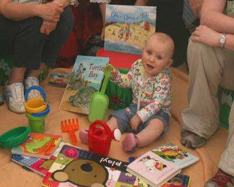

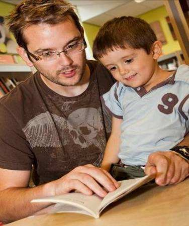

All Wales – Early Learning Bookstart Bookstart is the very first step in lifelong learning and introduces babies and their families to the world of books and libraries to give them a head start in life. Research has proven that children who are introduced to books from an early age make better progress when they get to school and that educational achievement is strongly influenced by children's attitudes towards learning. Every child in Wales receives the gift of a Bookstart bag containing free books, advice for parents and an invitation to join the library at 8 months old and 2 years old as part of the universal Bookstart offer in Wales Hannah has always enjoyed a story, but since receiving her Bookstart Packs, her love of reading has grown and grown. We can only keep up with her demand for books with regular visits to the library. Knowing D\*\*\* so well means Hannah always looks for her and is willing to sit and listen to as many stories as possible. Hannah's reading age is now that of a reception child, and I totally believe this is due to how much she loves her stories and books– IMPACT : On work On skills On equal opportunities in health, economy and education

---

<!-- PAGE: 41 -->

Anglesey - Job Club The Job Club at Holyhead library was set up as part of a wider outcomes project by the Porthyfelin partnership. The Club allows individuals access to a suite of laptops in the gallery area of the library where they can discuss their applications, gain support and advice in developing their CVs and develop effective job searching techniques. The neutral space provided by the library has been seen as crucial to the success of this job club. The Club offers support to those most in need in terms of guiding them towards suitable positions available locally; developing skills; signposting to courses and offering practice interviews. The library service, seeing the benefits of these clubs is establishing job clubs in 2 more of its libraries. IMPACT : On work On skills On equal opportunities in health, economy and education

---

<!-- PAGE: 42 -->

Anglesey - Healthy Cookery Skills By working in partnership with Flying Start and the Age Friendly Communities project our Lifelong Learning Co-ordinator has set up a Healthy Cookery Skills course for parents of children below the age of 3. The aim of the partnership project is to equip the parents with the skills they need to feed their families with healthy and nutritious food on a budget. We began with a pilot group in Newborough with the group of 7 working towards Agored Credits. After 20 weeks and a lot of support one of the group members has piloted a business idea in the village. Barriers to learning and access to the library service have been broken down and 2 participants who have some literacy problems have joined the library in order to develop their own skills and to loan books for their children. The project will began again in September with a group in Holyhead and again in Newborough. We have learnt from the pilot and we are offering the Jamie Oliver Home Cooking Skills (Edecxel) qualification this time. We hope to develop the strong links which we have built with the Timpson Foundation and the Oyster Catcher (a local restaurant, chef's academy and social enterprise) to give the groups a unique opportunity to see behind the scenes at a training restaurant which is open to the public. This project not only gives the families a better diet and health it also gives the individuals who form the groups a sense of achievement, self-worth and aspiration. IMPACT : On work On skills On equal opportunities in health, economy and education

---

<!-- PAGE: 43 -->

Blaenau Gwent – Reaching Out NEETS Project The Reaching Out project was delivered through-out Blaenau Gwent Libraries as a pilot scheme in 2012. The project specifically targeted NEETS (young people aged 14 plus, not in education, employment or training) The main aims of the project were: To increase library membership of NEETS and those who are at risk of becoming NEET To increase library usage of NEETs To raise the profile of reading to NEETs To raise awareness of library services to NEETs My daughter won an iPod in the Reaching Out project. She was thrilled, this is the first time she has won anything. It has really boosted her confidence; her enthusiasm for using the library has rubbed off on

* Since joining the project, I have

all the family too. We now make it started coming to the library every a weekly family visit– day after school. I haven't got a computer at home, so I do my homework and then spend the rest of the time chilling, playing games or music–

* I've b een using the library with my loyalty card

since j oining the library, mainly to get help with de ciding what I am going to do when I leave s chool. I've been using the CareersWales web site and found out information about training co urses. I am meeting an advisor here in the l ibrary next week to see what courses are available for me–

---

<!-- PAGE: 44 -->

The project was successful in breaking down barriers, enabling the young people to access library services by promoting social inclusion. The project has helped the young people gain confidence, social skills and awareness of how libraries can support learning. Hopefully by having access to accurate information, they will be well equipped to make well informed choices regarding their futures. Mandy Scanlon, Head Tutor Sorted project Bringing the pupils to the library has really helped their social skill as they're inter-acting with the community and working with the staff. It has demonstrated how libraries can help them through-out their lives and it has definitely changed their views on libraries IMPACT : On work On skills On equal opportunities in health, economy and education

---

<!-- PAGE: 45 -->

Blaenau Gwent - Amber House I originally visited Amber House in 2012. The hostel is a safe home for vulnerable women of all ages who have become homeless for whatever reason. Over the period of a year, I have met over thirty women, many of these women have small children varying from small babies to ten years of age. However, quite a lot of the women are in their fifties and sixties and are illiterate. I visit the hostel every fortnight, taking a collection of adult fiction and a variety of junior fiction, board books etc, chatting to the women, building up a rapport and also taking specific books over to meet their needs. One lady in particular could not read. I took a collection of audio books as well as playaways over to her. Sue, aged 54 had never had a book read to her! Sue listened to Amanda Brookfield – Life Begins on a clipper playaway and was overjoyed that she had experienced this story and could relate to a lot of the text. I helped Sue to start to read by using phonic cards as well as taking some Gatehouse books over to her. I signposted Sue to a basic skills class in the Local Action Centre, where she has since attended a few classes. Many of these women lack confidence to go back into society and spend a lot of time indoors. I feel that this outreach project contributes to these women's well being. Many of the women have said ……..

* reading helps us forget our troubles! –

IMPACT : On work On skills On equal opportunities in health, economy and education

---

<!-- PAGE: 46 -->

Blaenau Gwent - Diary of a Wimpy Kid The project arose from an initial proposal to promote the cinema at Brynmawr by involving the library service in a project to get children to read the book of the film prior to a showing of the film. It was agreed that this project would benefit boys in particular, and the LEA Advisor for Learning and Teaching – Literacy identified schools who would welcome some support to improve boy's literacy. They were contacted to identify 5 or 6 boys who would benefit from the project. There were 3 main elements to the project: A library visit 3 weeks prior to the project to meet the Library Children's Officer who gave out information about the project. The boys (and one teacher!) were enrolled as library members and each borrowed a copy of the book to read A visit to the cinema at Brynmawr for a behind the scenes tour and a showing of the film A follow up day working with a scriptwriter to produce a short piece of work based on the film 26 boys from 6 schools were involved in the project, accompanied by teachers. During the day with writer, Dan Anthony, they talked about books and reading, read aloud to the group and produced a short script based on the film they had seen. All went away wanting more! What the participants said

* I would love to come again, it made me more confident–

* I thought the event was fun and now I have considered doing

something like this again.–

* I liked the bit when we said about our stories. I enjoyed every bit

it made me want to write more. D\* was really funny–

* I was really excited to find out that I had been invited to a library

and D\*\*\* giving me a library card and to watch a film and take a tour of an old cinema…–

---

<!-- PAGE: 47 -->

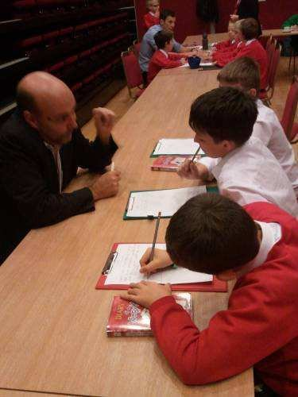

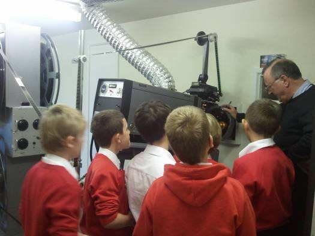

What the teachers said

* I was amazed to see children who would not normally volunteer

during speaking and listening sessions happily and willingly discuss the story and the film. The literacy session helped improve the children's self esteem and encourage their motivation to want to read!–

* The event has encouraged me to join the library and take my

children along. I was impressed by the range of resources available. Well thought out event that has encouraged children to join the library, read and enjoy books engaged them in a discussion about the book. It was wonderful today to see a room full of boys eager to read from the book to an audience and enjoy it! Event also gave children the opportunity to meet children from other schools.–

* The event greatly encouraged the boys to read more; I've never

seen them so keen to finish a book! With their shiny new library cards I'm sure they'll be up to their eyeballs in fiction very soon.–

* Overall it is clear that this short course has been very beneficial

for the boys some of which had never read a book of their own accord. Иow however I am pestered to go to the library and recommend good books for them to read...– IMPACT : On work On skills On equal opportunities in health, economy and education

---

<!-- PAGE: 48 -->

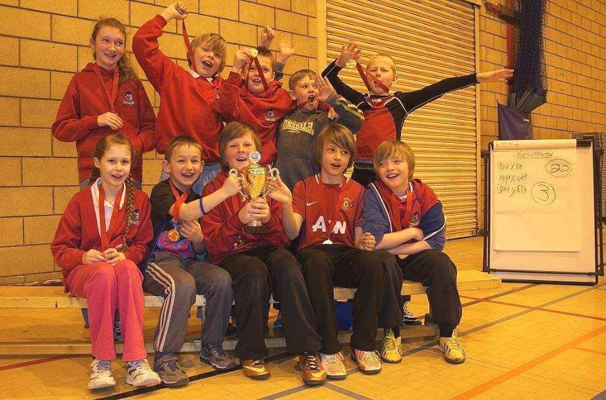

Bridgend : Reading for fun Reading for Fun is a programme organised by Bridgend Libraries for children within the county borough. Schools are invited to select ten children for the programme. Children should not be SEN but should admit to not enjoying reading. The programme has been successfully running for three years and has received grant funding. Four schools are selected to participate and children are invited to participate in a series of workshops over a six week period. Session One: Discuss reasons why children are not interested in reading, what they enjoy to do recreationally. Children are offered books to take away and read with the incentive of writing questions to be asked to other participating groups of children at the Penalty Shoot Out quiz final. Session Two: Book Aerobics quiz. Children are asked questions based on books they have read and other popular titles which also have film tie-ins. They have to do a series of exercises and actions before answering the question. Children are given the opportunity to swap books. Session Three: Rap workshop. A local rapper is invited to help children create spoken word rhymes or raps. They are given the opportunity to perform at the Penalty Shoot Out final. Session Four: Penalty shoot out quiz. Children have a practice of the penalty shoot out quiz in preparation for the Inter school quiz. Children are asked questions based on the books that they have read and general knowledge. For every question they get correct they have a penalty opportunity. Goals are set up and the children are able to try and score goals. Session Five: Comic book creation and illustration. Children are encouraged to develop characters and create a comic book with and invited artist.

---

<!-- PAGE: 49 -->

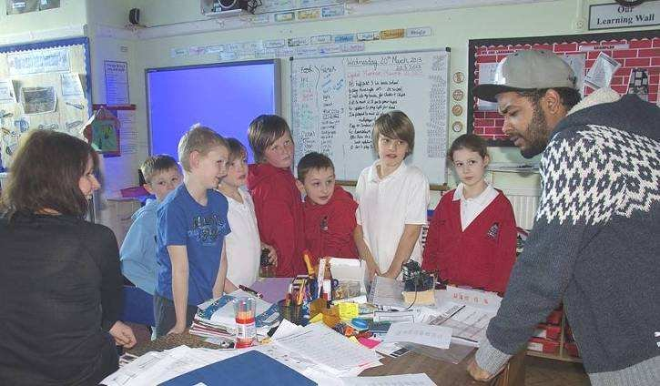

Session Six: Discuss and evaluate what children have discovered during the programme. Penalty Shoot Out Final: All groups are invited to take part in the final at a mutually agreed venue. Children help to write the questions based on the books that they have read. Author Tom Palmer has attended the two previous events, speaking and acting as goalie. A trophy is awarded to the winning team, with all pupils receiving a medal and signed copy of one of Tom's books. IMPACT : On work On skills On equal opportunities in health, economy and education

---

<!-- PAGE: 50 -->

Bridgend : Families First The family liaison worker works through the Families First learning services of the libraries to engage learners in any of their learning needs. Working with adults who parent or care for children and young people between the ages of 0 to 24years old, the family liaison worker will discuss in detail the families specific needs and then discuss and arrange an exclusive plan tailored to that family. Within that plan will be the adult's learning needs, whether this may be for confidence building, improving self-esteem, personal or career advancement or to help with attaining employment. Clare՚s story Clare came along to the Library services for help and met up with the Families First family liaison worker. Clare has two boys who are in comprehensive school, one in special needs and the other who has difficulty reading. Clare was very ashamed that she could not read and therefore hid it well. The jobcentre did not therefore believe she couldn't read and told her she must use the computer to use the Universal job match site to prove she was looking for work. Clare was given the time to talk at the library with the family liaison worker, and through tears of frustration explained how she memorised what buttons to press on the computer to access her job match account, then had the words cleaner and the name of her town written down to copy. She then put these into the computer and printed off everything that came up. Clare then had to go in search of someone she could trust to ask to read these jobs and to tell her whether they were suitable for her. Of course, she then had the challenge to find someone to help her complete the applications, and then the impossible task of finding the correct address to go to for an interview. Clare now attends her local library on a regular basis to work on her reading and writing. She will soon begin an essential skills course through the library and through the same library service has been given the confidence to work as a volunteer, attend events with her boys and has developed the confidence and self-esteem to work alongside her sons, learning to read together. Clare says her life has already changed and is looking forward to working further towards that goal of being able to confidently apply for that job on her own and attend the interview with confidence.

---

<!-- PAGE: 51 -->

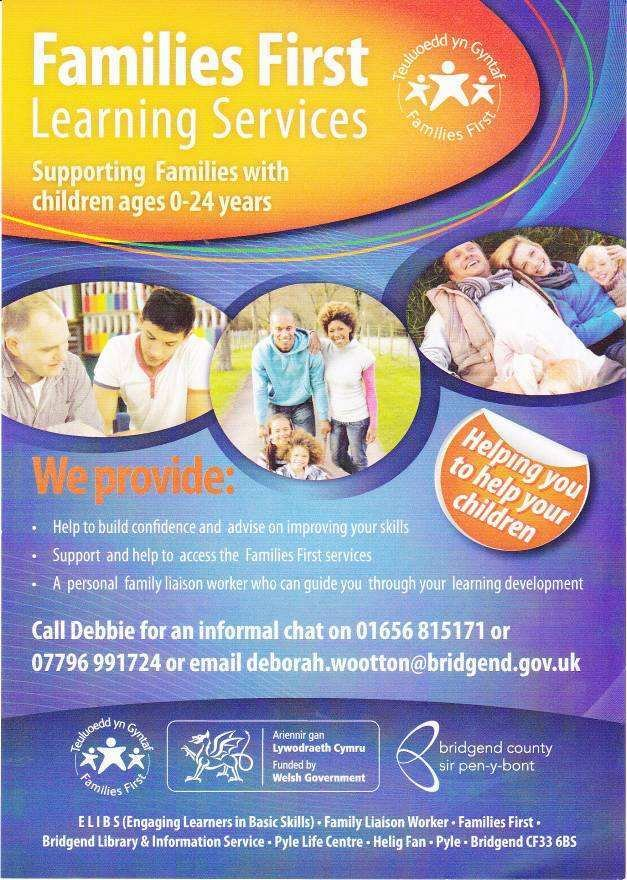

Improving the family's learning has a direct effect on a child's life. By empowering the parents through education, the parent's self- esteem and confidence raises the expectations of children in their own education. The learning plans that the library services offer to these families will not only raise their self-esteem and confidence in general life, but of course their confidence in work related issues and employment prospects, therefore having a direct effect on children's and families poverty. IMPACT : On work On skills On equal opportunities in health, economy and education AC

---

<!-- PAGE: 52 -->

CaerphillyWicked - A report from the CIBER research team at University College London claims that today's young people are the cut and paste generation who spend very little time actually reading the information they have found on the web. However, the students at Blackwood Comprehensive school are showing that there is more to the Google Generation : interpretation, application and presentation is evident from their research. Twenty-one pupils have achieved a qualification by demonstrating their improved skills in using their local library and finding information. Aware of the difficulties that people often experience in identifying trustworthy information on the internet,Caerphilly Libraries were keen to take on the challenge of helping the Google Generation to become more information literate. In partnership with the School Librarian, they wanted to demonstrate to young people what libraries can offer and how they can support them with their studies. A group of pupils were selected to take part and the introductory visit to the school by library staff was followed by a number of sessions at Blackwood Library. The students were registered as library members and shown how to use the library catalogue and the internet to find useful and relevant resources. They then used their new skills to work towards the Agored Cymru Level One qualification Using sources of information , by carrying out independent research on their choice of topic. All of the participating pupils were successful in achieving the Level One qualification and were presented with their certificates by the school, with the library staff in attendance. The School Librarian described the project as a great success which she is extremely enthusiastic about repeating. Feedback from pupils demonstrated how their confidence and motivation had increased as a result of visiting the library, with several of them describing the experience as wicked . Caerphilly Libraries are now planning to offer IMPACT : the project to other schools in the authority, in On work order to further strengthen their links with the On skills young people in their community. On equal opportunities in IM health, economy and education

---

<!-- PAGE: 53 -->

Caerphilly - Risca Palace Library The Library Service in Caerphilly identified the need to engage more effectively with young people and, after a number of consultation exercises with this age group, applied to Welsh Government for funding to establish a free film club in the recently opened Risca Palace Library. This facility incorporates a cinema area with a drop- down screen, projector and speaker system and also includes a dedicated learning suite which would provide a suitable base for the project. Since receiving confirmation of funding and after working closely with the Arts Development Team, staff are currently in the process of appointing a Co-ordinator to oversee the project and are also in discussion with Zoom Cymru regarding the development of film nights and film-workshops in the library. Local Youth Clubs and schools have been invited to participate in the project and to assist in promoting the initiative to the young people they engage with. Members of the Caerphilly Youth Forum recently visited the library and were consulted about the range of films to be shown. A short- list was produced and the first showing took place on 24th July with A Life of Pi . A further five film-nights are planned, culminating in an event to celebrate the centenary of the Risca Palace Cinema on 13th December 2013. The first workshop took place on 14th August. Free transport was provided, with the intention of developing a core group of youngsters who will meet on a regular basis to develop their film- making skills. It is hoped that some of their work may be included in the Centenary celebration. ACT IMPACT : On work On skills On equal opportunities in health, economy and education

---

<!-- PAGE: 54 -->

Cardiff – New Life Project The New Life Project is an innovative project to promote Bookstart to young mothers aged 16-25yrs in a deprived area of Cardiff, Butetown. Regular Bookstart rhyme/story times helped overcome barriers in learning songs, rhymes and sharing stories so helping the mothers to improve their own self-confidence and life skills. Introduction The New Life Project is a Lottery Funded project which began in Jan 2008 and ran until Dec 2012 operating in the Butetown area of Cardiff. The project aims to break the cycle of poverty and deprivation for young pregnant girls (16-19 years old) and young mothers (16-25 years old) by Giving the young women the chance to access new social networks, information and guidance to decrease feelings of isolation. Helping the women improve their self confidence through acquiring new life skills Encouraging the women to have greater involvement in their local community. I was approached by the Project Leader responsible for the group of mums 16-25 yrs at the initial programme planning stage in June 2008 and felt it would be an extremely worthwhile project in which to promote Bookstart. The leader was new to the area but had received my details through Language and Play with whom Bookstart works very closely in Cardiff. I felt it would be a great opportunity to introduce the women to the love of sharing books, rhymes and songs with their children and encourage them to become life-long users of the library. Methodology The initial meeting in June with the Project Leader, allowed me to introduce myself and my role as Bookstart Co-ordinator: how I could contribute to the programme by promoting Bookstart to the mums, sharing songs and rhymes so helping to break down barriers with the group. We agreed I would make regular afternoon visits to the mums aged 16-25yrs in Strand 2 of the project. In the morning the women attended workshops 3 days per week learning such skills as IT, DIY, Parent Nurturing, Fitness, Cookery and in the afternoon attended more informal sessions with their children-in

---

<!-- PAGE: 55 -->

which Bookstart would play a vital role along with other agencies such as Language and Play and Rubicon Dance. I met with the playworker to talk through the nature of my visit and ensure the rhyme time would be appropriate to the needs of the women, some of whom had high social and emotional needs. Findings I visited some of the group initially in July and gave a taster session to introduce myself and get to know them. I subsequently visited every 3 weeks and after some hesitations, gradually helped the mums to join in with songs, rhymes and stories. With the encouragement and support of the playworker, the mums began to look forward to sharing rhymes and songs and especially using musical instruments accompanied by my guitar. Over the weeks, the toddlers concentration improved and I was able to introduce some book-sharing, highlighting good picture books to use with their children. The mothers were thrilled to receive the Bookstart packs and I helped build up their knowledge of rhymes through sharing themed rhymes each visit and also leaving book bags with library picture book collections. Evaluation Verbal feedback from each visit was gained from the Playworker who regularly asked the mums which parts of the programme they enjoyed. In my Bookstart report, the playworker commented.. The sessions have been a huge success! The parents were a little sceptical initially but through the regular visits have learnt to overcome their embarrassment to enable them to enjoy participating in the singing sessions, sharing rhymes with their children and books.–

---

<!-- PAGE: 56 -->

Comments gained from the mums at the sessions were very positive. One mum commented…

* Ever since M\*\*\* gave me a

book pack, I have shared a story at bedtime with my son.– Conclusions The core group of mums did benefit from the visits by learning new rhymes and songs and learning how to enjoy sharing books with their children. All joined their local library and two mums came along to a special summer Bookstart Bear Roadshow at the Central Library. Good communication with the playworker allowed me to deliver appropriate Bookstart sessions for the group. Funding ceased for the project in Dec 2012 but Bookstart in Cardiff is currently liaising with other partners including Barnardo's Young Parents Group under the Families First funding to continue to share Bookstart's message to vulnerable young people and encourage them to share books with their children at as early an age as possible. IMPACT : On work On skills On equal opportunities in health, economy and education

---

<!-- PAGE: 57 -->

Cardiff- Barnardo's and Asylum seekers Bookstart in Cardiff has been delivering Bookstart rhyme/storytimes since 2008 to young parents under the age of 17 at Barnardo's. The aim of the project is to provide a range of services to help young people gain the necessary skills, knowledge and awareness to be able to live more independently as citizens in their communities. The Bookstart Co-ordinator was introduced initially to the project through partnership working with Language and Play, initially visiting groups in their own setting at Marlborough Road and helping break down barriers to books/reading that some young people might have had growing up. Regular visits in the form of a rhyme time session later took place in Penylan Library to encourage the young people to be aware of their local library and to possibly attend a regular rhyme and story time session near them. Engaging the young people in the rhyme times has often been challenging but through gradual exposure to songs and rhymes, some inhibitions have been broken. When the young parents see the obvious enjoyment of their baby/toddler when tapping a Tap Tap box or shaking musical instruments, they become more engaged. Book bags were devised by the Bookstart Co-ordinator and Language and Play worker so that regular book sharing could continue at the Marlborough Road setting and more importantly at home. More recently, the groups take part in compiling a Nursery Rhyme Scrapbook after the library rhyme time, to give feedback about rhymes enjoyed during the sessions and at home.

---

<!-- PAGE: 58 -->

Hayley Smith who manages the project commented Positive interaction and language is crucial to the emotional and social development of the child. The rhyme time sessions are such a valuable resource that help us achieve this level of positive interaction.– Working with Asylum Seekers in Cardiff Since 2008, the Bookstart Co-ordinator has been reaching out to asylum seeker families directly by organising regular rhyme times at various drop in facilities and liaising with Health Visitors who have responsibility for asylum seeker families. Regular contact has helped break down barriers of isolation many such families may feel, helping them become members of a local library etc. Close links have now been established with the Play worker from the Welsh Refugee Council and Oasis, a charity in the City Centre working with asylum seeker families and regular rhyme time sessions are being planned after the summer. Louise, Children's and Young People's Worker from DPIA (Displaced People in Action) has said

* Sessions were very well received

and mums were happy that their children took part in the singing…The interaction and educational aspects of the sessions are very important.– IMPACT : On work On skills On equal opportunities in health, economy and education

---

<!-- PAGE: 59 -->

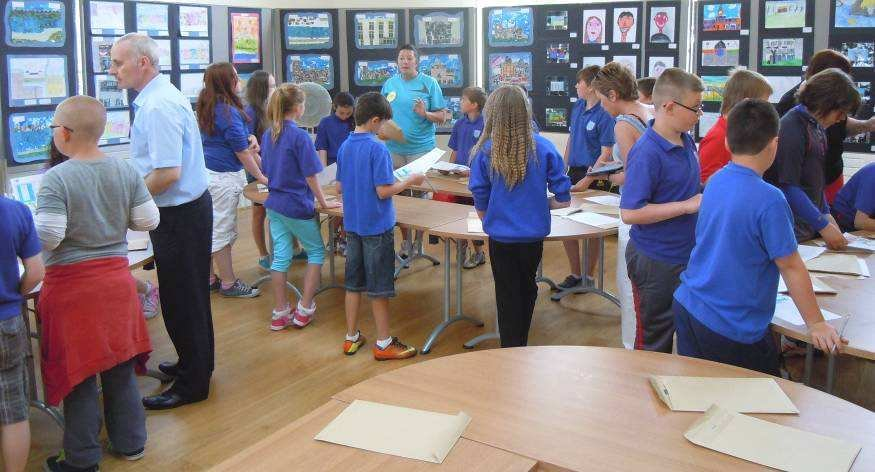

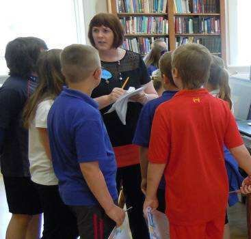

Carmarthenshire – Geocache Challenge Carmarthenshire Council is using Geocaching as a way of bringing people in to the town and, in particular, to involve those from low- income areas who might not otherwise access its portfolio of cultural facilities and services. The scheme has been introduced to help promote the newly-regenerated Llanelli town centre, which involves the restoration of the main library and the adjacent Llanelly House heritage centre, the new East Gate cultural centre and Ffwrnes theatre, along with external town centre improvements. Geocaching is a real-world, outdoor treasure hunting game using GPS-enabled devices. Participants navigate to a specific set of GPS co-ordinates and then attempt to find the Geocache (container) hidden at that location. Five Geocaches have been hidden around Llanelli, each containing several questions. Participants must locate them and answer the questions inside. Anyone without access to a smartphone can enter the challenge via Google Maps, which of course can be accessed on the library's public PCs. To promote this challenge, local schools were invited to take part in a day of activities including a treasure hunt at the library, a tour of the town centre and a theatre event. Town centre schools were targeted as their pupils tend to be from lower-income families, and may not be library users. The library treasure hunt acted as a mini-Geocache activity designed as a taster for the main challenge during the summer.

---

<!-- PAGE: 60 -->

With 170 children taking part, the event was an excellent way both of show-casing the library and of involving disadvantaged children in the cultural life of Llanelli. It is also extremely pleasing that the refurbished library is evidently seen as such a major feature in the regeneration of the town. This follows on from October 2012 when a marketing drive to inform and enthuse the public about the town's redevelopment was implemented. The library played a key role in hosting visits and tours for approximately 350 schoolchildren. > “AWESOME – best time “Me and my mates had a being here, it’s so cool! lot of fun – Thank you!” Glad I came”. > “I had a really good time and I was so inspired...” IMPACT : On work On skills On equal opportunities in health, economy and education

---

<!-- PAGE: 61 -->

Ceredigion – Family Learning Ceredigion Library Service Works closely with Ysgol Llwyn-yr-Eos and Penparcau Family Centre. Both locations are part of the Penparcau Communities First and Reading Communities schemes (Penparcau being a deprived area on the outskirts of Aberystwyth), which have the aim of improving literacy and self confidence. While working together with the Family Centre, we have arranged for parents and their children to visit Aberystwyth town library, and we have been holding occasional story sessions in the Family Centre itself. The Library Service has for many years now also been helping Ysgol Llwyn-yr-Eos with arranging their World Book Day events, with activities ranging from author visits (for example, Jenny Sullivan, The Two Steves) to stalls promoting the library Service in book fairs. The Schools Library Service also provides regular resources to both the school and the Family Centre. Naturally, these activities and visits have had a very positive reaction from all sectors of the community, be they parents, children or teachers. IMPACT : On work On skills & education On equal opportunities in health, economy and education

---

<!-- PAGE: 62 -->

Conwy - Talking without words I ...for me and him, in our little world, pictures are fantastic Boardmaker user, Conwy In May 2012, Conwy was the first public library authority in Wales to provide access to Boardmaker software which can be used by parents, carers, teachers and support workers to communicate with anyone who has language difficulties. Boardmaker is computer software containing thousands of picture symbols that can be used with anyone who may need additional support with communication. The symbols available can be used to assist communication with: Children and adults with Autistic Spectrum Disorders, learning difficulties and/or physical disabilities Anyone with Specific Language Impairment (SLI) People with English as an additional language Anyone with a disability or impairment that affects communication or memory Older people with some forms of dementia or anyone who has lost some language skills after a stroke. Boardmaker is available, free of charge, at five Conwy libraries. Customers can book a session with a member of staff to learn how to use the software. Customers are also able to laminate their printouts. At Colwyn Bay Library there are monthly Autism/Asperger's advice sessions where people can meet other parents/carers, share ideas and resources and learn how to use Boardmaker. There are also collections of Makaton resources and Something Special DVDs available in selected libraries.

* I honestly don't

kn ow what I would

* ... I don't feel so

ha've done without isolated or this service…– overwhelmed now– IMPACT : On work

* The sy mbols give

On skills & him som e control and education they giv e him a voice On equal opportunities in health, economy and education

---

<!-- PAGE: 63 -->

Conwy - Bookshine, Booktouch and Letterbox As well as offering the Bookstart for all children packs via Health Visitors, Conwy Libraries also gift Bookshine (for children who are deaf) and Booktouch packs (for children who are blind or partially sighted) and Dual language Bookstart books. Conwy Libraries also work with the Letterbox club to ensure Looked after Children are made aware of what Conwy Libraries can offer them throughout the year. Letterbox Club is available on a subscription basis. Each child enrolled by participating local authorities is sent a parcel of books, maths activities, stationery and other materials once every month for six months. In addition Conwy Libraries hold a whole host of learning, reading, storytimes and craft sessions for children.

* My daughter visits the library on a regular basis

for books and loves to go, and has used the library to research projects. She has a good rapport with the staff who often order books for her. I could not afford to buy all the books she reads and as she gets older will be able to go on her own–

* My daughter is nearly 4 and has been visiting

th e library for as long as I can remember with me, her grandmother or with her school and she loves it. With the growing cost of books and petrol it would not be possible for us to read so many books to her. She loves books and stories and has encountered some favourites through visiting the library, books she reads over and over, that she would never have come across otherwise–. IMPACT : On work On skills & education On equal opportunities in health, economy and education

---

<!-- PAGE: 64 -->

Denbighshire - Picture This People gain benefits from being in a supportive environment as well as from active engagement in creative pursuits. The benefits relate mainly to emotional health and wellbeing. Recognising this, Rhyl Library took part in a significant Arts and Wellbeing project, working with the textile artist Alison Mercer during the summer of 2011. Alison Mercer's work challenges and explores the diversity of parental relationships, enabling explorations of self-identity and relationships. She maintains that while parenting is a wonderful experience it is sometimes tinged with self-doubt, loss of self- identity and depression and her work aims to uncover the hidden truths of modern parenting. Alison worked with a variety of groups from Rhyl, including Bookstart Parent and Baby Group, Bookstart Parent and Toddler Group, Botanical Gardens Parent and Toddler Group, Clwb CIC (Welsh language female group from South West Rhyl), cared-for children from Rhyl and Rhyl Adventure Playground Association. The groups produced keepsake quilts, altered baby grows and fabric books, memory books, batik and collage canvases. The workshops provided a relaxed and interactive forum for creativity to take place and to enhance the personal wellbeing of participants. The individuals participating in the baby and toddler groups and clinics were helped to achieve long-term wellbeing through creative play and learning new skills. All of the artwork produced during the workshops was exhibited at Rhyl Library Gallery from August to October 2011 alongside Alison's own pre-selected artwork. This proved a fantastic opportunity to demonstrate that textile arts and skills can create unique benefits for all participants whatever their age and ability. A comprehensive project evaluation report has been produced that identifies the benefits of participating in the arts project as:

---

<!-- PAGE: 65 -->

helping with stress confidence building making new friends learning new skills drinking less in the evenings as a result of working on their textile pieces. Two sewing groups have developed from the project with one group of mums meeting at each other's houses to make Halloween costumes for their children as well as birthday gifts. The other group have found a teacher and a venue and have 10 members in their club. Mums are talking about their experiences via social networking sites, blogging and sharing tips via YouTube.

* I'm not just a mummy!–

I have remembered I can do other things!– IMPACT : On work On skills On equal opportunities in health, economy and education

---

<!-- PAGE: 66 -->

Flintshire - Job Clubs in the Library Flintshire Library Service formed an informal partnership with Communities First in order to address the additional needs of the local community which arose from the introduction of Universal Job Match, and in anticipation of the roll out of Universal Credit. Job Clubs were set up in two libraries and will be started in further libraries as staffing allows. The libraries provide signposting and free venues and Communities First staff run weekly sessions. Library staff are able to support Job Club members who visit the library during the rest of the week. The aim of the job club is to support people to become job ready and give them the opportunity to do job searches and assist with applications. Communities First staff also have links with local businesses who have vacancies. Kate Thew, Lead Officer for East Cluster, Flintshire Communities First reported: Working in partnership with Connah's Quay library has certainly been productive, it enables people from the Connah's Quay area to more easily access support on their doorstep. It is an excellent facility, the computer suite is invaluable to the Job Club especially with the Universal Job Match site being online. We have also referred members of our Job Clubs and those on our database to the other courses taking place at the Library. The staff are helpful and friendly and are happy to promote Communities First activities and events to all users of the Library– 4 people who have attended the Job Club at Connah's Quay Library have obtained employment. Two case studies: A lady who was NEET came to the Job Club who had been a carer for a family member and was looking to change occupation. She had very low confidence in applying for jobs online and gets very nervous at the thought of the interview process. She had no basic IT skills.

---

<!-- PAGE: 67 -->

In order to get her job ready we have helped her to: Compile a CV and cover letter Register on the Universal JobsMatch site She has attended a 6 hour basic IT course She has attended and Interview skills course She has signed up for a 4 week Employability skills course She had now registered with Deeside College to start in September to gain an IT qualification She attends the Job Club weekly to search for jobs A man who was NEET came to the Job Club in Connah's Quay Library and John Summers Campus, Deeside. He had been unemployed for over a year and was looking to change occupation. His confidence had been lowered due to the length of time being unemployed and not have much feedback with regards sending his CV to employers. In order to get him job ready we have helped him to: Improve his CV and write cover letters and emails that were tailored to jobs he was applying for. Use the Universal Jobsmatch site He attends the Job Club weekly to search for jobs He has attended and Interview skills course He had signed up for a 4 week Employability skills course Sent his CV to a Local Company we had been leasing with. He was invited to an interview and successfully obtained a job. IMPACT : On work On skills On equal opportunities in health, economy and education

---

<!-- PAGE: 68 -->

Gwynedd - Helping Hand Books A difficult problem or subject can often be introduced to young children through the medium of picture books. Gwynedd Library and Information Service maintains a special collection of books on all types of situations to be used by or with children. Among the specific themes of the books are disabilities, mental health, keeping healthy, personal safety, first experiences, family life, caring for oneself and others, growing up and bereavement. Recommended books available from the library on these themes are listed in two booklets, one for up to 8 years and the other for 8-13 years. The contents of the booklets are divided into simple everyday topics such as: New baby in the family Moving house Going to the dentist Keeping safe Step families Losing someone special The majority of the books in the under8 collection are suitable for very young children. The complete collection contains books for a wide range of reading ages, up to early teens. The lists can accessed on line at www.gwynedd.gov.uk or are available as printed booklets. I IMPACT : On work On skills On equal opportunities in health, economy and education

---

<!-- PAGE: 69 -->

Gwynedd – e – Family Scheme The aim of the e-Family scheme is to > “promote family prosperity in order to improve outcomes for children, young people and families through the loan of computer equipment with internet connectivity and also promote finding information to supportive family life and support the school work of a child / young person”. The main purpose of e-Family in Gwynedd is to provide an opportunity at home for a child and their family to develop 'information literacy' skills that will reduce digital and community exclusion in a society that is making increasing use of the internet and digital communications. Families are referred to the scheme by a specialist Family Support team which assesses the needs of vulnerable families in the authority. The scheme is sponsored as part of a package of support and information provided by a local consortium. This package is commissioned by Families First in Gwynedd as part of a 'Family Support and Parenting' strategy in the authority. Other partners in the consortium are the Citizens Advice Bureau (CAB) and local Barnardo scentre. Through Gwynedd libraries over 90 laptop computers are available for loan to vulnerable families with 3G connectivity to the internet where that is possible. The equipment is loaned to the parents of children and includes a basic introduction to the information skills with particular emphasis on supporting the child.

* it made access easier to

look thing up and my daughter can do her homework she took the Excellent - thank you laptop all round the house! • for the opportunity A parent A parent

---

<!-- PAGE: 70 -->

During a study of the initial phase of the scheme the provision was praised by children, parents and teachers who noted the high quality of the equipment and that its use promoted not only educational work and confidence when looking for information but also the quality of leisure time and social networking.

* I got to do my homework at

home without the hassle of From a young people - • I staying on after school the was able to work on my •Bac– laptop ran very smoothly and , communicate with friends fast • and help my little sister with her homework– From a young person From a young person [* [e-Family project is based in part on the experience of an OWLS (One Wales Laptop Scheme) operated by the Welsh Government for a period before May 2010. In Gwynedd the scheme was active in a limited number of schools but equipment was not loaned for use at home nor for use by parents / carers at that time] IMPACT : On work On skills On equal opportunities in health, economy and education

---

<!-- PAGE: 71 -->

Merthyr Tydfil - Yolo (Digital Magazine Project) Merthyr Tydfil Public Libraries recent digital magazine project with a local comprehensive school was a great success, in one of the most deprived areas of Wales. The prohibitive costs of new technologies are particularly relevant when working with the catchment area of Penydre High School, the school chosen to participate. The Welsh Index of Multiple Deprivation has scored this area as amongst the bottom 10% in the whole of Wales, for all indicators including income deprivation, health and education. The Digital Magazines Project we ran at Penydre High School gave ten students the opportunity to work with Merthyr Tydfil Public Library Service on a project which would introduce them to new technologies and services from their local libraries. The project, which ran January-March 2013, focused on showcasing our newly acquired Online Magazines service (Zinio) to a potential new audience. The students accessed Zinio using the tablets, exploring our range of magazines, and then used that as inspiration for creating their own content, that resulted in a magazine which they called Yolo. Feedback from the students in response to the project was overwhelmingly positive with one student saying learning to use the tablets has made me read more and another student saying I liked this project as I'm interested in digital media and would like to use it more. The ability to engage with students through schools has lead to them coming into libraries more often and using the facilities and services available to them there. By ensuring their access to services and facilities, it is hoped that the inequalities that exist in health, education and the economic outcomes IMPACT : surrounding them everyday will be reduced. On work On skills On equal opportunities in health, economy and education

---

<!-- PAGE: 72 -->

Merthyr Tydfil – Follow the shadows (Greenaway & Carnegie Shadowing Project) Merthyr Tydfil Library Service shadowed the CILIP Carnegie & Greenaway Children's Book Awards across a Borough in one of the worst hit areas in Wales in terms of health, child poverty and education. Both shadowing projects were aimed at promoting literacy by encouraging children to read for pleasure as well as promoting and empowering free access to information and resources through their local library service. In addition to the above, the shadowing session for the Greenaway Awards used Lunchtime by Rebecca Cobb and a food themed activity, to deliver a message about healthy eating to the children. The Carnegie sessions were delivered over three visits to two different secondary schools in Merthyr; one located in the Gurnos Estate, an area with a high proportion of low income families. The first session introduced the shortlist, handing out copies of the books as well as discussing reading habits and library usage, promoting the library service and acted as an informal consolation exercise. The follow up session encouraged the children to swap the books they had already read with each other and facilitated debate based upon the shortlist. The final session encouraged children to express their opinions and foster debate around the winning title. The success of this project has resulted in plans being developed to work in partnership with more primary and secondary schools in Merthyr to help combat low literacy levels by using next year's prize as well as other shadowing projects for awards such as the Roald Dahl Funny Prize. IMPACT : On work On skills On equal opportunities in health, economy and education

---

<!-- PAGE: 73 -->

Monmouthshire – Poetry Emotion As an extra activity to support World Book Week in March 2013 Monmouthshire Libraries offered a series of workshops with the poet Stewart Henderson to schools in the catchment area of the King Henry VIII Comprehensive School in Abergavenny. This part of Abergavenny is a Flying Start area and the primary school in the centre already hosts a PEEP project, which aims to use reading groups to help boost the confidence of children who struggle with reading and ensure that they are better prepared for the transition to secondary education. To further ensure that those most in need are targeted Monmouthshire libraries offered the additional poetry workshops. Funding by the Welsh Books Council ensured that we were able to acquire enough copies of Stewart's book, Poetry Emotion for every child who attended a workshop to receive their own book. Poetry Emotion deals with all kinds of feelings. Stewart's style is upbeat, fun but very sensitive and class teachers were amazed at the results of his visits. At the end of one session an eight year old boy who had never before voluntarily said anything in class willingly read out his poem and his teaching assistant was visibly moved. The head of one of the smaller schools said that the impact had been remarkable. The workshops had provoked discussions during the succeeding weeks, largely due to the fact that the children had their own copies of the book and had obviously been reading them. The Community Librarian has been stopped by children in the street who wanted to tell her how much they still enjoy the book. We have further projects in mind, funding permitting with schools now very keen to be involved as they see the social as well as the educational benefits of this kind of initiative. IMPACT : On work On skills On equal opportunities in health, economy and education

---

<!-- PAGE: 74 -->

Monmouthshire - Digital Stories to combat bullying One of Monmouthshire's smallest libraries is in a village where there are a number of families in challenging circumstances. Despite input from social services and other agencies, situations of a bullying nature occur both in and out of school and are frequently aired in the library because many of the perpetrators belonging to families with no home computer so rely on the library computers. After a series of incidents we decided to try a digital story project. We employed an experienced digital artist, Katrina Kirkwood to discuss a story, create images and record the narrative with the children. This proved to be a demanding project as some of the participants exhibited very challenging behaviour and the concept of sharing and taking turns had to be explained. However, the exercise produced some good discussion about how children feel when they are badly treated by other children and how they feel disputes should be settled. The resulting story Nasty Santa Learns his Lesson has been well received by a number of groups, and has produced a noticeable sense of achievement in the children who took part. We have received good feedback from the County Councillor for the area who is very concerned about provision for young people. In addition local youth leaders have found it very useful. We are currently seeking funding to provide some more regular book/ story based intervention. IMPACT : On work On skills On equal opportunities in health, economy and education

---

<!-- PAGE: 75 -->

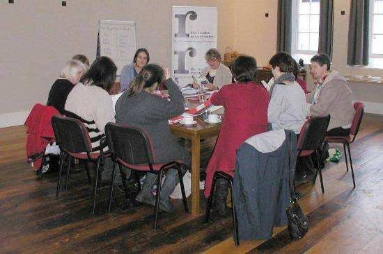

Monmouthshire - Macmillan Youth Project Monmouthshire Libraries have a joint project with Macmillan Cancer Support and have a dedicated Cancer Support and Information Coordinator who is keen to make cancer information available to young people in an age appropriate way. The Coordinator began by consulting young people on their needs (in partnership with Monmouthshire Youth Service). She has since had meetings with the Monmouth Youth group who have helped to design an area with comfortable seating where teenagers can browse health information at their leisure. Shared Reading volunteers have also been trained to read one to one with young people affected by cancer in the children's hospice and elsewhere and also to offer a Shared Reading Group which Young People affected by cancer and young cares could attend. Twelve people attended a Reader Organisation training day and have begun to build their skills. This is a sensitive area but the project is gradually beginning to take root. A South East Wales ՙRead to Lead՚ training group in Shire Hall, Monmouth. The members of library staff here are undergoing a training by The Reader Organisation to equip them to read aloud to groups in the community, for example to older people in homes, or looked after children. IMPACT : On work On skills On equal opportunities in health, economy and education

---

<!-- PAGE: 76 -->

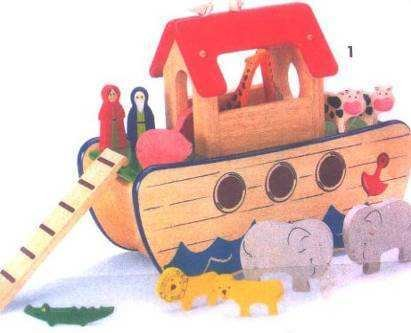

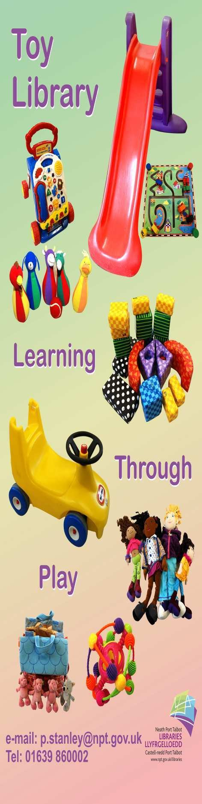

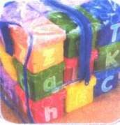

Neath Port Talbot : Toy Library Neath Port Talbot Toy Library operates under the umbrella of NPTCBC's Library Service and is based in Library Headquarters in Port Talbot. The service has one permanent member of staff working 12 hours per week supported by a volunteer who assists with the cleaning and checking of toys. All children have an innate and instinctive need to play and indeed it is their right under the UN Convention on the Right of the Child (Article 31). Our Toy Library is helping disadvantaged children in socially deprived areas to play by providing good quality toys and play equipment that they might not otherwise be able to access. We lend to registered Childcare Providers including Playgroups, After School Clubs and Childminders. We also lend to Partner Agencies, Foster Carers and to teachers of the Foundation Phase in schools, supporting them in their work.

---

<!-- PAGE: 77 -->

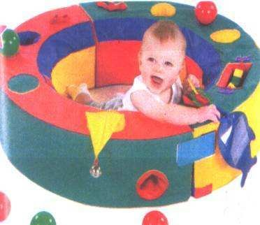

We have a large collection of good quality toys and play equipment including ethnic items, toys for children with Special Needs. Our Storysacks help to encourage learning through play and the sensory toys help the Visual Impairment Team in their play sessions. The Service is valued by borrowers as reflected in the quotes below: The Toy Library service is extremely useful and efficient and I have found the staff to be friendly and helpful at all times, The choice available is varied and the quality and cleanliness excellent–. Local Playgroup Leader

* Excellent Service! The children get so

much from toys that perhaps we couldn't afford to get After School Club

* I am a huge fan of the Toy Library the

toys enhance my care-setting and enable the children I care for to enjoy a huge variety of different types of toys that would incur considerable cost to me . - Childminder IMPACTIMPACT : On work On skills On equal opportunities in health, economy and education

---

<!-- PAGE: 78 -->

Newport - Young parents programme The aim of this project was to work with NEETs who are parents of young children. The programme was delivered in partnership with the Newport City Council Youth Service. The programme was designed for the whole family to attend. The aims of the programme were

* To introduce the family's participants to the range of library

services

* To encourage and support families to use our service

* To introduce books and reading in a fun way

* To encourage families to become regular library users

The first week's theme was choosing the right book for you and your child to share together . There was a brief discussion on child development and the importance of sharing stories, books and rhymes. The Bookstart Superbox book was shared and the families then created a collage of the story, which was then displayed in the library. At this first session library membership was encouraged and we helped the parents and young children choose books to share. Chosen stories were then discussed at subsequent sessions. In the second session we shared a story and the families created their own simple ABC book. In the last session our Visual Services Team helped the families register for our online services and play on stories from the web. Parents felt that the programme gave them more confidence to share more books with their child, and that the library was a place they could visit. IMPACT : On work On skills On equal opportunities in health, economy and education

---

<!-- PAGE: 79 -->

Newport - Book Break In common with other carers, foster carers are often time- pressured and can find it difficult to get the opportunity to meet and socialise with others. Realising this, Newport holds Book Break sessions for foster carers at the Central Library, as one of a number of groups being run throughout the city using the Reader Organisation's Get into Reading programme. The group is open to all foster carers in Newport and the library service has worked in partnership with Newport City Council's fostering team to promote the scheme to carers. During the session attendees are invited to read aloud a short story or extract from a novel and to discuss the text in relation to their own experiences. The Book Break allows foster carers to meet people with similar experiences, to relax and to take a bit of time out for themselves. Through promoting a shared reading experience, Get into Reading groups help those attending to become more confident, feel less isolated and explore their experiences through literature. Feedback from the group on the impact of the sessions is overwhelmingly positive:

* I just love the fact that I The group is such a

am, for once, doing something great idea, I'm so glad for myself which is different I plucked up the and gets me out of the house. courage to go! I drop my carer's role, just for an hour. It is so refreshing! I come out after an hour and I feel happier, I have a IMPACT : little smile on my face! It may sound On work silly, but I think of it as a bit of me On skills time, shared with friendly people. On equal And it really makes a difference opportunities in to how I feel. health, economy IMPACT and education

---

<!-- PAGE: 80 -->

Newport - Improving Boys Literacy The aim of this project was to change Year 5 and 6 boy's attitude towards reading, through the art of storytelling. Eight schools nominated up to 15 boys who were reluctant readers. In total 105 boys took part in the project. Storyteller Guto Dafis delivered weekly interactive sessions, with memory games and learning to tell well known stories with enthusiasm. In the last week Natasha James from Community Arts programme, Breaking Barriers, recorded the boys telling their story. The boys also created pictures to help tell the story. Natasha used these recordings and artwork to create a digital story for each school. To complete the project an event was held at the local arts centre where the boy's achievements were recognised and celebrated. At the event the boys digital stories were screened to their family, friends, teachers and invited guests from the Council. At the beginning and at the end of the project the boys completed questionnaires to determine the impact of the project. Library membership increased from 48% (46 boys out of 95) to 54% or (43 boys out of the 79). Attitudes towards reading improved from 87% (83 boys out of 95) to 99% (78 boys out of 79 boys). 77% or (59 out of the 77 boys) said they wanted to tell stories to family and friends. The schools encouraged the boys to share their new talent with the rest of the school in assemblies or to individual classes. One school said the boys had become keen storytellers . IMPACT : On work On skills On equal opportunities in health, economy and education

---

<!-- PAGE: 81 -->

Pembrokeshire – Summer Learning The Library Service is taking a cross domain approach to tackling child poverty by working with museums, archives and the arts to put together a comprehensive programme of summer learning opportunities for 2014. Working with the school improvement service, Pembrokeshire Cultural Services is planning to target schools in Communities First areas to provide learning opportunities for children from deprived areas to access quality cultural opportunities, including library services during the important, summer period. Evidence indicates that children from less deprived areas continue to learn and develop out of school during the summer holidays, as they have access to a range of opportunities that more disadvantaged children can't access. This has the effect of further widening the educational attainment gap. The aim of the project is to provide exciting and inspirational learning opportunities through culture for disadvantaged children in order to prevent this gap from widening. For example, work might include steps to foster a love of reading, and of regularly using library services. Strong evidence exists to show that children who read for pleasure do better in school exams and go on to be more socially mobile in later life. For many children living in poverty, education is their ticket to a better life, and only around 25% of children's learning comes from the school environment. Cultural Services, and libraries in particular, are an important part of the remaining 75%. IMPACT : On work On skills On equal opportunities in health, economy and education

---

<!-- PAGE: 82 -->

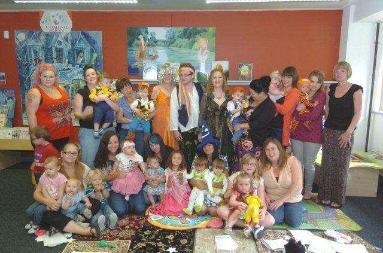

Pembrokeshire : Themed Baby Rhyme Times The project arose from a discussion focussing on ways to encourage new mums, dads and carers that are not library users, to come to our Baby Rhyme Times and join in the sessions with their young children at Pembroke Dock Library. Pembroke Dock library serves a large council estate in an area of socio- economic deprivation. It has one of the highest rates of unemployment and of people aged 16 or over with no formal qualifications in Wales. It is a Flying Start and a Communities First area. Our regular BRT sessions are very well attended by regular library users and we wanted to try and increase the take up from local non-users. A themed Baby Rhyme time is held once a term during the school holidays, the session focuses on a fun, themed event that will appeal to people who may not have used or visited a library before. So far the themes have been: Teddy Bears Picnic, Favourite Nursery Rhyme Characters and Disney Characters.

---

<!-- PAGE: 83 -->

The event is advertised in the local community and to local playgroups. The children are encouraged to dress up as their favourite characters. Over 20 children and 12 adults attended the recent Disney Rhyme Time. We started the session singing Disney songs and nursery rhymes and gave out sheets for the parents to use so they could join in. Some of the comments from parents and carers: It's a great place for What a lovely time my grandson the children to learn and I had singing and dancing to and have fun. the nursery rhymes. What a great way to introduce little ones to reading and looking at books we loved it. My child had a wonderful time dressing up and singing the songs IMPACT : On work On skills On equal opportunities in health, economy and education

---

<!-- PAGE: 84 -->

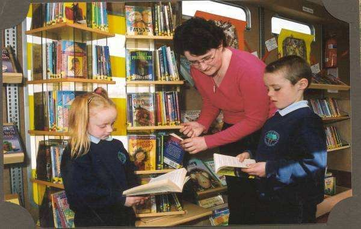

Powys - Bookrunner Service Powys Library service reaches out to every child in primary and special schools across the whole county, through the Bookrunner children's mobile libraries. The Bookrunner service was set up to address the issues of children growing up in rural Powys, with limited access to branch libraries or bookshops. Many of Powys libraries are part time, and some distance away from local families. The LEA was approached to see if the public library could be taken out to include all of the children through the Powys schools set-up – going out to where the children are. This was agreed, and so in 1995, the Bookrunners were launched, designed to promote a love of books and reading to our children through the provision of a quality public library experience. There are 2 bookrunner mobile libraries, which visit every primary and special school in Powys each term, enabling all the children to come onto the vehicle, be read stories and poems, and to choose library books for themselves. We make sure that Welsh speaking staff are with the Bookrunner when it visits a Welsh medium school or a school with a Welsh stream. At the special schools, lift access ensures that everyone is able to come onto the vehicle and enjoy the books and stories. IMPACT : On work On skills On equal opportunities in health, economy and education

---

<!-- PAGE: 85 -->

Rhondda Cynon Taf - E-Teens Library Young people in Rhondda Cynon Taf (RCT) have three cool spaces where they can chill out by playing on a Wii, watching DVDs, listening to music, and even taking part in a DJ workshop. The local youth club? No, their local library! RCT library service (with the support of CyMAL grant funding) has created dedicated areas for teenagers at Treorchy, Aberdare and Tylorstown libraries. All three have been designed with the help of the local School Councils and feature bright colours, up to- date technology and the name E-Teens Library . Treorchy E-Teens opened in 2009 and since then the number of teenagers visiting the libraries each month has more than doubled. Activities organised across all three venues with partners such as E3+, Youth Service and Detached Youth team have included a Halloween party attended by 150 young people, theatrical makeup sessions, Graffiti Art, poetry sessions and employability skills for Year 11. Young people attending the launch of the teenage library in Tylorstown could not believe their eyes when they entered the room for the first time. One exclaimed: •This is awesome!–, whilst another younger companion wistfully declared that he would have to wait three whole years before it was his turn. A local Councillor said:

* This is a good example of rebranding libraries to

make them relevant to the changing needs of society and encourage people to use them. These days it is even more important to have local facilities and make full use of them. The teenage library has been an important element of the regeneration of this area.–

---

<!-- PAGE: 86 -->

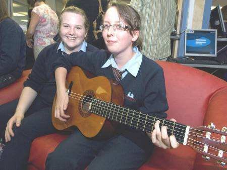

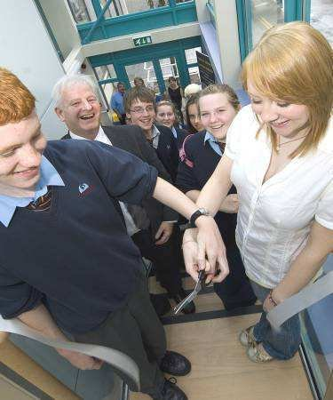

Some comments from youngsters involved with the project:

* That looks mint–

> “Cool - I'd definitely use this place”

* We would like to take this

home with us–

* Lush

IMPACT : On work On skills On equal opportunities in health, economy and education

---

<!-- PAGE: 87 -->

Swansea - Young Readers It's the best thing that's ever happened to me , said a child when he opened his book bag and saw what was in it. He ran up to the librarian, giving her a huge hug and actually cried. As part of the National Young Readers programme, an initiative between Swansea Libraries and the National Literacy Trust, children from a number of primary schools were given their favourite book from a list selected by their classmates. One lad had always wanted to own a copy of The Hobbit but his mother wouldn't buy one for him due to the expense, and although it was not in the choice of books provided for the children to pick from, the librarian had bought a copy for him. The Young Readers Programme aims to help transform the lives of disadvantaged children by engaging them and motivating them to read for pleasure. Research has shown that children who continue to read widely throughout their school years and beyond are more likely to be academically successful and more economically well off, both of which will have an impact on their future wellbeing. In fact, the research shows that reading for enjoyment is more important for children's educational success than their family's socioeconomic status. So far the project has engaged with over 1000 pupils and is proving rewarding not only for the children, but also for the teachers and library staff who are involved. Teachers have said how wonderful the programme is, and that they have seen a difference in the way the children pick books from the school's library. The final word goes to another child who went up to the librarian and said: IMPACT : On work Miss, are you sure that I can On skills take these home, as I've never On equal had a book to keep before? opportunities in IMPACT health, economy and education

---

<!-- PAGE: 88 -->

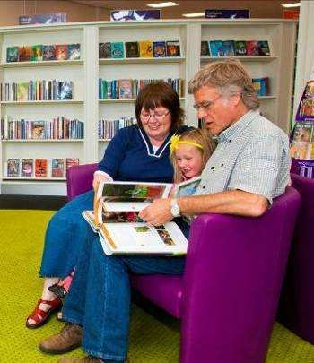

Swansea's Bookstart Corner - I Sharing the story experience One of Swansea Library's core aims is to Inspire the enjoyment of books and reading . This is just one of the initiatives that Swansea has to ensure that books and stories can be enjoyed by, all whatever their age or social background. The basic idea of Bookstart Corner is to provide a follow up message to those parents who have recently received the Bookstart packs as part of the universal Bookstart entitlements (See all Wales Bookstart section). A number of supported sessions run by library staff take place over a five week period. The aim of the sessions is to learn more about the importance of sharing books and rhymes with children. At the end of the sessions parents would have the knowledge, confidence and some basic resources to interact with their child through story telling in a fun way that also supports child development and helps to strengthen the child / parent bond. At the end of the five sessions the participants attended a library celebration and are presented with a certificate, a goody bag and the Story Sack resource that they create throughout the sessions A brief outline of the sessions is given below: Session 1 The group are made to feel safe, secure and comfortable within the chosen setting, i.e. library, community centre, family first centre etc. Everyone is encouraged to meet and greet each other and then a short DVD is shown outlining the benefits of sharing books from a young age. Following on from this the group are shown the concept around Story Sacks (at it's most basic form a Story Sack contains a single book and some props that can help the story come to life).

---

<!-- PAGE: 89 -->

The group then discuss a range of stories using the books supplied by the library service as a starting point. Individuals are then asked to think about which story they would like to base their Story Sack on. Session 2 The next session introduces parents to using rhymes with their children. Nursery rhymes are great to use with children as they help their language and they are FUN. The group looks at various traditional and modern rhymes which they may want to incorporate within their Story Sack or use with their child as an added activity. The group is also introduced to using props such as puppets, rhyme sticks etc with ideas of how to make them. Session 3 The third session introduces the group to the work of libraries more specifically and outlines the FREE services the library provides. Although the emphasis is on children's services the parents are also told of services that are relevant to them independent of their child. The session also introduces libraries as places of FREE information, FREE resources and FREE events and activities. This is especially useful for parents with a restricted budget over long summer holiday periods as most libraries run a range of FREE or very low cost activities for children throughout the holiday periods. There are lots of libraries in Swansea and they are FREE. Staff join up parents and children who are not already members. Session 4 Throughout each of the previous sessions the group have been making their Story Sacks and collecting resources to use with them. This session helps them to complete the Sacks and readies them to use it with their children. The group is encouraged to share ideas and to try out each others Story Sacks with other parents. / children.

---

<!-- PAGE: 90 -->

Session 5 If none of the sessions have taken place at a library the group are invited to the local library to enjoy a mini celebration for completing the course. A trip to the library draws the sessions to an end with the hope that the parents will continue to use the knowledge they have gained to continue with their own Story Sack collections and to make independent use of their local library. Parents are encouraged to take books out to supplement their story ideas. An activity will be put on for the children and their siblings. Children will receive a goody bag (orange Bookstart bags) and certificates (first library visit). Parents are invited to socialise meet the library staff and enjoy some light refreshments - tea and cakes. IMPACT : On work On skills On equal opportunities in health, economy and education

---

<!-- PAGE: 91 -->

Torfaen – Sharing Books with Under Fives If a parent or carer can spare 10 minutes a day to read with their child, it can make a huge difference to their development. Realising that not everyone is confident enough to read with their children, Torfaen Libraries held two Sharing Books with the Under 5s sessions as part of a programme of events for Adult Learners Week. The aim was to help under 5s develop a love of books and reading before school, and to encourage the parents and carers to share books with their children. These sessions were both fun and practical, offering advice and guidance on choosing and reading books with babies and toddlers. They emphasised that sharing books with under 5s is enjoyable for both child and carer alike! In addition, the benefits of shared reading were highlighted, such as developing a child's language and listening skills, the positive impact on progress at school, and the comfort, stability and reassurance provided by reading a favourite story. The attendees said that they all felt more confident and enthusiastic about sharing books with their children after the sessions. As one parent said: The session showed me the importance of introducing children to the joy of books, no matte r how young. IMPACT : On work On skills IMPACT On equal opportunities in health, economy and education

---

<!-- PAGE: 92 -->

Torfaen - Healthy You, Happy Baby In October 2012, Torfaen Libraries hosted a themed health and well-being day aimed at under-fives and their parents and carers. The event was open to all but specifically marketed at parents and carers from Communities First areas, young single Mums and vulnerable families – those people who may not be traditional library users and who might have very little idea of the range of services on offer through the public library and how these services might benefit them. Entitled Healthy You, Happy Baby , the event brought together local organisations and partners involved with the provision of health and well-being support and advice to people in Torfaen, with the emphasis being on the range of services available to under-fives and their carers. Participants included Mini-Mend (nutrition advice for babies and children,) Torfaen Leisure, local health visitors, Want2Work (employment skills and're-training support,) Language and Play and Torfaen Family Information Service. Excellent links were formed with local partners on the day, and all organisations expressed an interest in working together with the library on future events. Activities on the day also included mini manicures and massage for adults and baby rhyme times, craft sessions and crẻche facilities for the children. 43 children and 34 adults participated on the day, with 15% of the attendees being new to the library and signing up for library membership as a direct result of the event at Cwmbran. One very positive outcome has been continued visits by some young mums from the Women's Refuge in Cwmbran, who attended the event and have since become regular users of the library and its facilities.

* A brilliant morning very useful for somebody

like myself who has recently moved to the area with two young children. Lots of things to do and information available. My one year old son really enjoyed himself!– IMPACT :

* A v ery informative event that increased On work

my a wareness of activities and services On skills On equal available for my child. Those presenting opportunities in were helpful and friendl– health, economy and education

---

<!-- PAGE: 93 -->

Torfaen– Engaging with the Travelling Community Torfaen Libraries Bookstart Co-ordinator works with families at the Flying Start Stay n Play weekly sessions held at the Shepherd's Hill Gypsy and Traveller Site. The sessions are aimed at 0- 4 year olds and their parents / carers. Activities on offer include art and craft, free-play, stories and rhymes. Older children are welcome to turn-up and join in too. One 8 year old boy, who has a history of school absenteeism, enjoys choosing a book from the library's outreach deposit collection, and, with help, reading it to the Bookstart Coordinator. 9 families are currently registered with Flying Start at the site and over the last 2 years we have developed a positive, trusting relationship. On average 7 children attend each week, either on their own or with parents / carers, including teenage mums. This provides an opportunity to promote library services and Story/Rhyme sessions and ensure that their babies have received their Bookstart packs. Children are encouraged to borrow books from the library collection and join the Bookstart Bookcrawl. Torfaen's Bookcrawl initiative offers free books (funded via Flying Start) in addition to certificates, and library service involvement in the sessions ensures that Traveller children participate in reading, sharing, and owning books.

* In one particular family, a young girl, took a book

home with her. The following week she brought it back and read it to everyone! Her mum or older siblings had obviously shared the story with her time and again. K\* was so proud of her library book and her Book Crawl certificate, which her mum proudly displayed in their trailer. Her mum asked if K\* could borrow another book next week, too.– IMPACT : On work Flying Start Team Leader On skills On equal opportunities in health, economy and education

---

<!-- PAGE: 94 -->

Vale of Glamorgan - Sign and Rhyme Sign and Rhyme is an innovative activity in the County Library in Barry. Around 20 adults attend the regular sessions with even more babies and toddlers, and the Children's Library is alive with chatter, crawling babies, laughter and the occasional tantrum! Mums, dads and grandparents bring along the babies – it's aimed at those between 6 months and 2 years – and there are a number of teenage mums among them. The sessions involve fun rhymes and songs, accompanied by a range of simple signs, such as those for more , hurt , milk , stop . Repetition is the key to success and parents are encouraged to use the signs at home and get other family members involved. Parents are delighted when their baby uses a sign for the first time to communicate what it is they want. The activity primarily enables babies and parents to communicate before they can talk and gives the babies a head start in language development. Frustration is reduced and the bond between parent and child is strengthened. Parents enjoy the relaxed atmosphere and social interaction. Young mums are learning from those who are more experienced, and gaining confidence in bringing up their child. It is an opportunity to socialise with others in the same position. Parents are also reporting benefits in terms of the new skills learned, but also improved behaviour among their children, especially at normal flash points such as meal times. A number have reported that their babies are better able to concentrate and that they are more confident in interacting with other children. IMPACT IMPACT : On work On skills On equal opportunities in health, economy and education

---

<!-- PAGE: 95 -->

Vale of Glamorgan - Outreach Stories & Crafts Ty Iolo Hostel is a recently're-furbished hostel which caters for homeless people from all kinds of backgrounds, including care- leavers, ex-servicemen and women and families. The libraries Outreach Officer has had links with Ty Iolo for several years and runs a Shared Reading group for adults at the hostel. Regular group meetings led to the awareness of the number of children at the hostel, and so the Children and Young People's Librarian was invited along to run storytimes and craft activities with children and their families. The hostel is a temporary home to children of all ages and this variety makes arranging story sessions both challenging and rewarding. It requires alternative approaches and ideas that can be adapted on the day depending on who joins in. The purpose of the sessions is to introduce children to the joy of reading and stories but the emphasis is always on fun – with a capital F! Stories have to be chosen carefully for children so they can be enjoyed on different levels and engage all ages, likewise the craft activities have to be ones that will engage the youngest child as well as have the potential to appeal to an older age group. Owl collages and monster mask making have proved especially popular. Reactions are really positive from parents and hostel workers. Parents are happy to see their children engaging in activities and developing their literacy through stories. The hostel workers are delighted to see the children so quiet and involved! And most importantly the children enjoy the sessions and keep coming back for more. It is early days but the intention is to continue the partnership with Ty Iolo and continue to run regular storytime IMPACT : sessions in the hostel. This gives children and On work families a moment of stillness in their day when On skills they can experience and explore the delights of On equal books and reading. opportunities in health, economy and education

---

<!-- PAGE: 96 -->

Wrexham - Splash and Rhyme Time Splash & Rhyme Time is a weekly term time only session that involves action rhymes and songs in the water at Plas Madoc Leisure Centre for children aged 4 and under and their parents. Early Years Librarians from Wrexham Library run the sessions. Nerys described a typical Splash session:

* We all form a circle in the water and

sing action rhymes and songs which the babies and toddlers love. They then have a play in the gentle waves and have turns on the slide– The main aims of Splash & Rhyme Time are to develop early literacy skills through action rhymes and songs in a fresh and fun way, and to boost water confidence and a healthy and active lifestyle through the use of the leisure facility. It also promotes Bookstart and local libraries. A parent engaging in this physical activity with their child will benefit from feeling happier and more relaxed. This in turn will reduce the parent's stress levels, improve their self esteem, and increase their confidence, thus fostering a positive relationship with their child. It is a very popular session with families describing it as brilliant , very entertaining and a fantastic service . One commented that she and her partner now shared rhymes regularly with their son at bath time. IMPACT very entertaining brilliant , IMPACT : On work fan tastic On skills On equal opportunities in health, economy and education

---

<!-- PAGE: 97 -->

## Bibliography

1. Addressing the Digital Divide, SCL Wales, 2010
2. Brighter, Bolder, Better, SCL Wales, 2009
3. Building Resilient Communities: Taking forward the Tackling Poverty Action Plan, Welsh Government, 2013
4. Child Poverty Strategy for Wales, Welsh Government, 2011
5. Family Learning: An Evaluation of the Benefits of Family Learning for Participants, their Families and the Wider Community, Ofsted, 2009
6. The Impact of Family Learning, Estyn, 2012
7. Importance of Reading, SCL Wales, 2011
8. Learning for Participants, their Families and the Wider Community, Ofsted, 2009
9. Libraries Inspire: The strategic development framework for Welsh libraries 2012 – 16, CyMAL, 2012
10. Literacy Changes Lives, National Literacy Trust, 2008
11. Maintaining a Valued Service 2011 – 14, (Welsh Public Library Standards Framework 4), CyMAL, 2012
12. Programme for Government, Welsh Government, 2011
13. Public Libraries in Wales: Health, Wellbeing and Social Benefits, SCL Wales 2012
14. Tackling Poverty and Disadvantage in Schools, Estyn, 2011
15. Through libraries to learning: The role of public library services across North Wales in children and young people's attainment, participation and engagement, Bethan M Hughes, October 2011
16. Work, Society and Lifelong Literacy, NIACE, 2011

---

<!-- PAGE: 98 -->

## Appendix: What Users Tell Us

Appendix User Comments: ANGLESEY We just wanted to express how fantastic all the staff are at the library, particularly with reference to my daughter and their encouragement of her enthusiasm for reading. She has been using the library almost weekly ever since she was 6 years old and has now just won scholarship as she has moved to secondary school. She has always been an avid reader, but their support and kindness have helped her to remain interested. BLAENAU GWENT I have signed up to the Get Blaenau-Gwent On-line project at Tredegar Library I can't afford a computer, so the library is ideal for me. Since starting the sessions I have saved money by switching my gas and electric suppliers and have been able to search for cheaper car insurance. Next I want to learn how to sell items on Ebay, I'm going to have a good clear out at home, - and save the money for the presents for my children at Christmas BLAENAU GWENT I don't know what I would do without the library! I've recently had to sign up for the Universal Job-Seeker process. I was really worried about doing this, as my computer skills are poor. The help and support I have had in the library has been excellent. I now attend the Work-Club and I have signed up for a LearnDirect course in basic skills BLAENAU GWENT I have been attending the Digital Friday sessions at Ebbw Vale Library. I plucked up the courage to ask for help, as I wanted to help my children with their homework. It has been great, I am now able to find accurate websites and I have learnt about safe surfing BLAENAU GWENT We all come to the library every Saturday; it is one of the few places that doesn't cost anything. My husband is tracing his Family Tree, I catch up emailing my relatives in Australia, my son goes on the Xbox in the games room and my daughter just loves drawing and browsing BLAENAU GWENT We have been using the library again in Tredegar after years. The library staff went to my son's school, Tredegar Comprehensive and he encouraged us all to go. My whole family go now, every Saturday morning. My son uses the Internet, my six year old daughter is now an avid reader - she has come on in leaps and bounds in her reading. The library has a real friendly, family feel to it. It is a pleasure to go there

---

<!-- PAGE: 99 -->

BLAENAU GWENT I come to the library every day after school. I meet my friends, we do our homework together and then go on the Internet. We all love the new library, it's a great idea to have DVDs and X-box games BLAENAU GWENT If I didn't go to the library I wouldn't have as many friends as I do now and wouldn't have read as many books and wouldn't have done so well at lessons in school. BLAENAU GWENT My daughter has recently been diagnosed with Autism. At first it was really scary, I didn't know very much about the condition, so I went to my local library to borrow some books on the subject. The library has given me all the information I need, including the details of a local support group. The library staff also encouraged my daughter to use the Internet in the library, we now go every Saturday, it has really helped her with her social skills. BLAENAU GWENT I attended the Work Club in the library to gain confidence. I have spent most of my adult life caring for my parents. I have had help with basic skills and gone on to do the Six Book Challenge. This is the first certificate I have ever received. Following all the support I received from the Work Club, I am now volunteering at local residential home. My life has been turned around! BRIDGEND Since the time I was a small child, the library has been a magical place for me. So many books, each with a secret to share - a new fantasy, a new journey. As I grew, my knowledge and vocabulary increased, less through formal learning than the simple internalisation of language through absorbing the written world. Now I teach others how to write and this would not have been possible if the library had not taught me first. BRIDGEND The library has given my children the ability to choose and read MANY books. It has helped with homework too. I have been able to use books to pass my childcare qualification and husband his degree. It is a fab, bright and cheerful place to be. Also the extra activities, such as storytime, summer reading challenge etc are an excellent idea. BRIDGEND The library has made me and my friends happy knowing that it is a safe place to chat and read. It has also helped us to study and also use the internet. We love our local library and come weekly. We all have a library card also we all have an internet card. CAERPHILLY

---

<!-- PAGE: 100 -->

As a mother to 3 young children, aged 8, 6 and 3 and a childminder, I find it very hard to occupy them and not spend much money! In the library, they are always thrilled to find the latest Captain Underpants or Fireman Sam ! It costs nothing and they are given incentives such as Team Read or the Big Wild Read which help so much during wet summer holidays. Story and craft activities are always available, as are colouring or puzzles on request. It makes being a mother a lot less lonely too, as there are so many of my friends who I first met there and I enjoy going as much as my kids. Libraries offer so much to me personally and I am much less stressed knowing a suggestion of a visit will go down a treat with my children. CARDIFF Before I started using the library again I was spending so much money (that I don't really have due to being on benefits) on books. I love reading, as it takes me out of my own little life that I find boring as I don't work at the moment. I love the escape of entering into another world fictional or real. To read makes me so much happier and relaxed. I feel a need to read all the time, and the library makes that possible. CARDIFF My children love visiting the library. My 6 year old son finds a book he likes the look of, and takes it to the comfy sofa to read. My 1 year old loves to draw and make pictures with the felt, crayons and sticky things. My 8 year old likes the competitions and Harry Potter books and tapes. I like to see all my children happy at the same time in one place. CARDIFF Before I started using the library again I was spending so much money (that I don't really have due to being on benefits) on books. I love reading, as it takes me out of my own little life that I find boring as I don't work at the moment. I love the escape of entering into another world fictional or real. To read makes me so much happier and relaxed. I feel a need to read all the time, and the library makes that possible CARMARTHENSHIRE AWESOME – best time being here, it's so cool! Glad I came . Me and my mates had a lot of fun – Thank you! I had a really good time and I was so inspired... CONWY ... I don't feel so isolated or overwhelmed now I honestly don't know what I would have done without this service… CONWY The present Library provides for all age groups – the under fives for story telling where they are encouraged to learn the value of books from an early age; school age children for computer homework and books; adults for books, local information, computer use and research.

---

<!-- PAGE: 101 -->

CONWY I value the library at Llandudno - when my children were younger I attended the library for story time and met some people who have turned out to be very good friends and we have gone on to set up a book club. My children are now passionate readers and this is because story time influenced them and built up and're-enforced our family's love of books and how reading is so beneficial in so many ways . CONWY My daughter is nearly 4 and has been visiting the library for as long as I can remember with me, her grandmother or with her school and she loves it. With the growing cost of books and petrol it would not be possible for us to read so many books to her. She loves books and stories and has encountered some favourites through visiting the library, books DENBIGHSHIRE After recently receiving free Bookstart packs for children and distributing them to families supported by our organisation, we have recommended families attend the Bookstart sessions at Rhyl Library. We find this service invaluable as it enables those who may be isolated to make new friends, learn new skills and use the free services the library has to offer. I feel parents and their children gain a great deal from the experience. (from a Young Person's Development Worker, North Denbighshire Domestic Abuse Service) DENBIGHSHIRE Probably the biggest effect the library sessions have had, have been with the parents of our children. Most of these parents have declined from taking their children into the public eye due to some bad experience or other. However, by attending (in the background) the Bookstart session and having seen their child in action joining in within the session, it has given them a huge confidence boost, thus enabling them to access other public places with their child, and start to really communicate with them, using the visual systems we use, that they were once so afraid of, for fear of being singled out or discriminated against. These wonderful outcomes are due to the positive manner and professional demeanour of the Bookstart team. (from a Specialist Special Needs Teacher for children with autism) DENBIGHSHIRE It is such a fab service it should be shouted from the rooftops and be advertised on every billboard to let others know. (about Bookstart rhymetimes) DENBIGHSHIRE Brings a smile to their faces and has helped them develop speech and songs and reading. FLINTSHIRE My children and I love books, the library means that I have been able to get books for me to read to the children, so the children have books for

---

<!-- PAGE: 102 -->

their reading levels. The library has also been there for me to help me with my college course. Also medical knowledge. The world would not be the same without libraries. They are for children and adults now and the future. GWYNEDD it made access easier to look thing up and my daughter can do her homework – she took the laptop all round the house! GWYNEDD I was able to work on my Bac , communicate with friends and help my little sister with her homework GWYNEDD I got to do my homework at home without the hassle of staying on after school – the laptop ran very smoothly and fast MERTHYR TYDFIL I couldn't afford to buy my own books when I was younger and the selection at my high school was very drab. The library provided my sisters and I with an activity we could look forward to on weekends – riding our bikes to Merthyr then filling our bags with books that we could get stuck into on a Saturday night. We were always spoilt for choice and found some great reads. MONMOUTHSIRE Both my children have thoroughly enjoyed the rhymes and stories. We love the library and I am sure that coming to the library has helped my daughter's language development. It is also a great way to meet other mums MONMOUTHSIRE Probably the biggest effect the library sessions have had, have been with the parents of our children. Most of these parents have declined from taking their children into the public eye due to some bad experience or other. However, by attending (in the background) the Bookstart session and having seen their child in action joining in within the session, it has given them a huge confidence boost, thus enabling them to access other public places with their child, and start to really communicate with them, using the visual systems we use, that they were once so afraid of, for fear of being singled out or discriminated against NEWPORT I just love the fact that I am, for once, doing something for myself which is different and gets me out of the house. I drop my carer's role, just for an hour. It is so refreshing! I come out after an hour and I feel happier, I have a little smile on my face! It may sound silly, but I think of it as a bit of me time, shared with friendly people. And it really makes a difference to how I feel. The group is such a great idea, I'm so glad I plucked up the courage to go!

---

<!-- PAGE: 103 -->

PEMBROKESHIRE It's a great place for the children to learn and have fun. POWYS This library has been fantastic to us. We (as a family) have borrowed hundreds if not thousands of Welsh books over the last seven years, particularly books for children. The service has been excellent and very useful to us because we cannot pay for a whole load of books. Thanks! RHONDDA CYNON TAF I have two young children and have always encouraged the use of books. Having full use of the library enables us to have a new story every night at bed time which also saves a lot of money. My children love the library due to the welcoming and friendly staff so it makes my job of encouraging early reading much easier! SWANSEA When I was a child I went along with my nanny but stopped going when I was about 11 because I couldn't read very well and was statemented in school as being dyslexic. Now I have a two year old son I am back going to the library as they hold lots of events for children and it's somewhere free to take him indoors. This I feel will also make me look good and clever in his eyes as he gets older and we keep going to the library because he loves books! and this will also save me money borrowing books instead of buying them for him! SWANSEA I have been able to sample a range of authors without the need of buying a book. The greatest benefit has been to my youngest son's attitude to reading. At around 8 years old he was diagnosed with dyslexic tendencies and hated books with a vengeance but I continued to borrow stories on CD and tape. He now has a wonderful imagination and is progressing well in English in secondary school. Thank you. TORFAEN I feel I can be myself while I'm here. Teenage Book group member TORFAEN I just love the fact that I am, for once, doing something for myself which is different and gets me out of the house. I drop my carer's role, just for an hour. It is so refreshing! I come out after an hour and I feel happier, I have a little smile on my face! It may sound silly, but I think of it as a bit of me time, shared with friendly people. And it really makes a difference to how I feel.

---

<!-- PAGE: 104 -->

---

## Footnotes

[^1]: SCL (Wales) consists of the chief librarian, or equivalent officer, of each public library authority in Wales.
