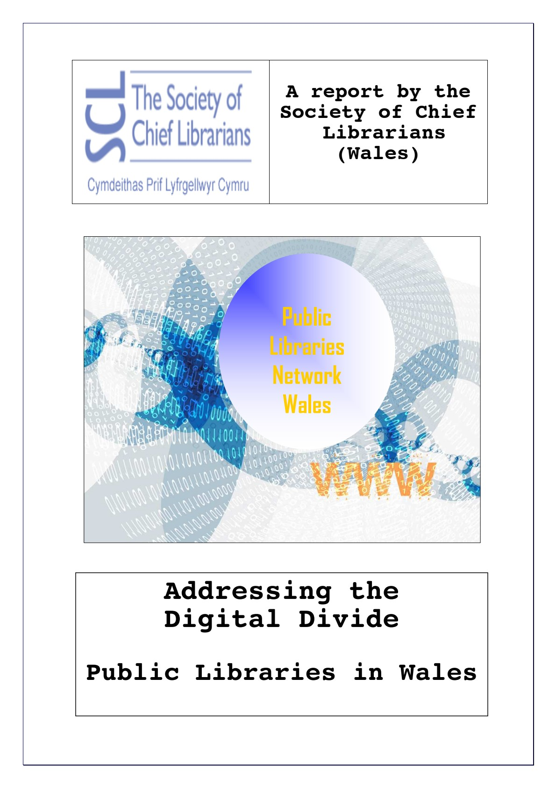
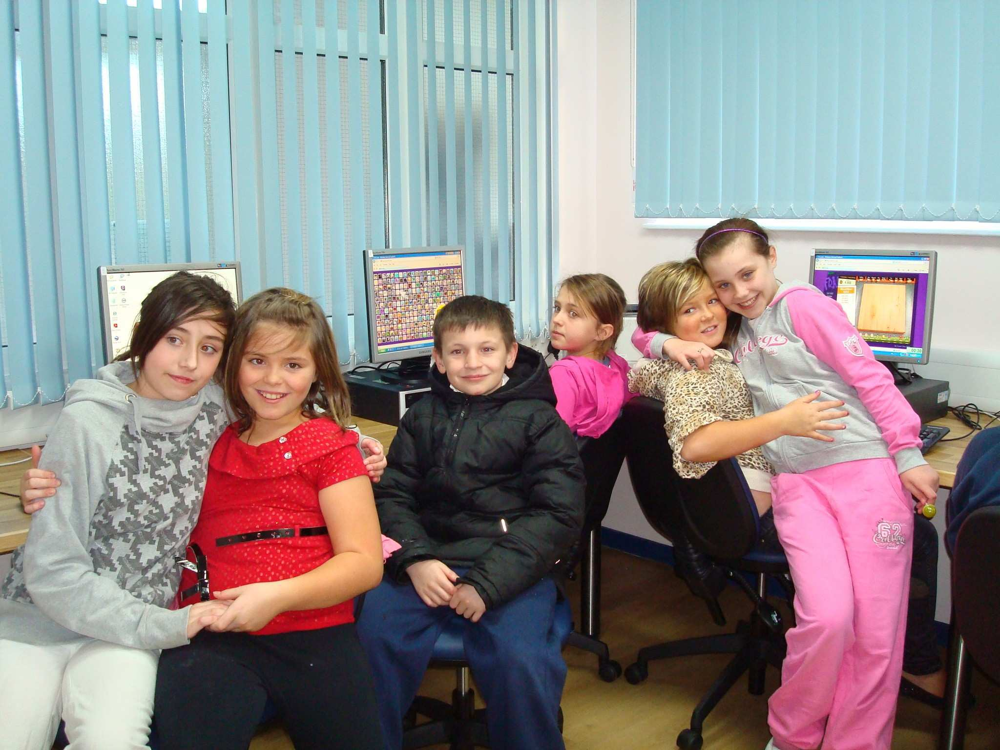

<!-- PAGE: 1 -->

# Addressing the Digital Divide

## Public Libraries in Wales

A report by the Society of Chief Librarians (Wales) / Cymdeithas Prif Lyfrgellwyr (Cymru)

---

<!-- PAGE: 2 -->

## Contents

| Section | Page |
| :--- | :--- |
| **Foreword by Gareth Evans**, Chair of SCL (Wales/Cymru) | 2 |
| **Executive Summary** | 3 – 4 |
| **What Public Libraries do to help bridge the digital divide** | 5 – 19 |
| **Key areas that require investment and development** | 20 – 22 |
| **Conclusion** | 23 – 25 |

---

<!-- PAGE: 3 -->

## Foreword by Gareth Evans, Chair of SCL Wales

The Society of Chief Librarians (Wales), representing as it does the chief librarian, or equivalent officer, of each library authority in Wales, asserts that modern, vibrant and well-developed public library services are essential to the citizens of Wales in the 21st century.

Our purpose in this report is to demonstrate to you the role that public libraries have and can have in relation to reducing the digital divide in Wales. We believe that public libraries are uniquely placed in the heart of the community and provide free digital access and support to all individuals and communities.

Public libraries have already made a significant contribution to digital inclusion in Wales:

* Over 3,000 public access computers are available in Welsh public libraries, free of charge;
* Over 15 million visits were made to public libraries in Wales last year;
* Over 3 million computer sessions were booked by members of the public in libraries;
* Free Wi-Fi is being rolled out across public library services in Wales;
* Every public library authority provides informal learning, ICT taster sessions, and structured digital literacy support.

We look forward to working in partnership with the Welsh Assembly Government, local authorities, and national agencies to ensure that no citizen in Wales is left behind in the digital age.

**Gareth Evans**  
*Chair of SCL (Wales)*  
*Chief Librarian, Merthyr Tydfil County Borough Council*

---

<!-- PAGE: 4 -->

## Executive Summary

The Society of Chief Librarians (Wales) consists of the chief librarian of each library authority in Wales. The Society aims to influence the statutory, financial and other decisions which relate to the effectiveness of public library services, and takes a leading role in the national development of public library services.

The Society of Chief Librarians (Wales) has prepared this report to demonstrate to the Welsh Assembly Government, The National Assembly for Wales and other key partners the significant role that public libraries have in relation to digital inclusion.

Digital inclusion is about ensuring that everyone has the access, skills, and confidence to use digital technology and the internet to improve their lives. It is recognized that those who are digitally excluded are frequently those who are already socially and economically disadvantaged.

Public libraries provide an established, trusted, and universally accessible network of community hubs that are already actively bridging the digital divide across Wales every day.

Key findings of this report include:

* **Universal Free Access**: Public libraries provide free access to the internet, hardware, assistive technology, and online resources in every local authority in Wales.
* **Overcoming Financial Barriers**: Free access ensures that individuals and families who cannot afford home broadband, hardware, or subscription software are not excluded from essential online services.
* **Trusted Intermediary Support**: Library staff provide expert, patient, and informal mediation, assisting non-users and beginners to develop digital skills and confidence.
* **Supporting Employment and Economic Wellbeing**: Public libraries are front-line venues for job seekers, CV preparation, online job applications, Universal Jobmatch, and benefit claims.
* **Promoting Digital Learning and Skills**: Libraries host informal ICT taster sessions, formal qualifications, silver surfer clubs, and youth digital projects.
* **Tackling Rural and Urban Disadvantage**: Library branches and mobile libraries ensure digital access reaches rural valleys, coastal towns, and isolated communities across Wales.

---

<!-- PAGE: 5 -->

There is much evidence to show that people are using public library ICT provision to address issues in their lives, such as job seeking, learning and finding information.

Public libraries are uniquely placed to deliver digital inclusion because:

1. **They are local and accessible**: With hundreds of service points across Wales, libraries are located within easy reach of the communities they serve.
2. **They are free and open to all**: There are no financial barriers to entry or usage.
3. **They provide trusted, safe, and non-stigmatising spaces**: Users from all backgrounds feel welcome and comfortable seeking assistance in a library.
4. **They have dedicated, knowledgeable staff**: Library staff are skilled at information navigation and supporting learners at all levels of ability.
5. **They work in strong local partnerships**: Libraries collaborate with adult learning providers, Jobcentre Plus, voluntary organisations, housing associations, and schools.

More detailed information provided by all 22 local authorities is included in the Supplement to this report: *"Addressing the Digital Divide: Public Libraries in Wales (Information from 22 local authorities)"*.

---

<!-- PAGE: 6 -->

## What Public Libraries Do to Help Bridge the Digital Divide

### Further Information

### The Importance of Digital Equality

Digital equality is increasingly recognised as an essential requirement for modern citizenship, economic participation, and social cohesion. Access to digital services affects educational attainment, employability, financial wellbeing, health management, and civic engagement.

The Welsh Assembly Government *‘Delivering Digital Inclusion consultation’* [2008] states that there are 17 million adults not using the <!-- PAGE: 7 --> internet in the UK. This can be compared with figures around literacy and numeracy. Now ICT skills are seen as the ‘third basic skill’.

There is evidence also to show that there are categories of people who are particularly vulnerable to digital exclusion:

* Older people (aged 65 and over);
* People on low incomes or unemployed;
* People with disabilities or long-term health conditions;
* People living in social housing;
* People living in rural communities with poor broadband infrastructure;
* Children and young people from disadvantaged families who lack home access to learn and do their homework.

---

<!-- PAGE: 8 -->

### What Role Can Public Libraries Play?

More detailed information provided by all 22 local authorities is included in the Supplement to this report *"Addressing the Digital Divide: Public Libraries in Wales"*.

Public libraries are uniquely positioned to bridge this divide because they combine physical infrastructure—computers, high-speed broadband, printers, scanners, and adaptive software—with the human element of staff support, encouragement, and guidance.

Libraries provide a non-threatening environment where individuals can take their first steps online without pressure or fear of failure. Furthermore, the public library network ensures equality of access and high standards of service to users across Wales.

---

<!-- PAGE: 9 -->

Public libraries have a particular role to play in relation to digital inclusion. Librarians and Information professionals work closely with excluded individuals and communities through public libraries in local communities, in other communities of interest such as prison libraries and through partnerships with other library sectors, for example within schools, further and higher education and health.

Our network of public libraries throughout Wales are open to all individuals and communities and enable them to access free internet and ICT provision. The fact that there are libraries in most communities in Wales also means that everybody can access ICT and the internet easily, conveniently and cheaply.

People who don’t have the internet at home are able to call into their local library and use the facility for free!

> “The library has made a difference because I don’t have the internet and the library is within walking distance from my house.”  
> — *(Customer, Flintshire Library Service)*

> “I don’t have access to the internet at home. Thanks to the library I get fast access to the internet. This allows me to stay in contact with one of my friends who lives abroad and allows me to stay in touch with friends in the UK.”  
> — *(Customer, Swansea Library Service)*

In addition, some people who do have the internet at home prefer to use their local library until they become proficient. They may initially need to be supported through an intermediary such as a library and require some level of support from library staff when they first use the internet and other forms of ICT. A library and the library staff help people to gain skills and confidence to engage with technology.

### Informal Learning

In relation to learning, many people prefer to learn informally. Public libraries offer a supportive, friendly atmosphere where people can learn at their own pace without the intimidation of formal tests and beyond.

---

<!-- PAGE: 10 -->

Public libraries offer:

* **FREE** Internet access;
* **FREE** On-line membership registration and access to library services and catalogues;
* **FREE** Access to subscription online reference resources, databases, and encyclopaedias;
* **FREE** Wi-Fi access in an increasing number of library authorities;
* Access to colour and black-and-white printing, scanning, and photocopying;
* Specialist hardware and software for visually impaired and disabled users;
* One-to-one assistance from trained library staff and digital volunteers;
* Taster sessions, workshops, and structured courses in partnership with adult education providers.

> “I can now use the computer to look up bus timetables, check my bank account, and email my family. The staff were so patient and kind.”  
> — *(Customer, Carmarthenshire Libraries)*

---

<!-- PAGE: 11 -->

Public libraries can help people acquire learning and life skills, including learning to use ICT. This can help considerably with confidence building so that they are ready to participate in the next stage of learning and employment.

Public libraries have pioneered various innovative methods of supporting learners who may otherwise be both digitally and socially excluded.

Libraries across Wales run regular "bite-sized" taster sessions covering:

* Basic computer handling (mouse, keyboard, desktop navigation);
* Setting up and using email accounts;
* Searching the web safely and evaluating online information;
* Online shopping, banking, and public services;
* Digital photography and social media;
* Family history and genealogy research using library subscriptions.

---

<!-- PAGE: 12 -->

> “The Library helps me to do serious scholarly research in a rural environment, by giving me access to world class libraries through the inter-library loans system. The service is unique and irreplaceable.”  
> — *(Customer, Powys Library Service)*

> “As an elderly person living alone, coming to the library computer club has given me a new lease of life. I feel part of the modern world again.”  
> — *(Customer, Conwy Library Service)*

Libraries ensure that digital inclusion is not merely about physical access to a terminal, but about meaningful participation, intellectual growth, and social connection.

---

<!-- PAGE: 13 -->

People are also using libraries to find out about job opportunities and as a way to get them back on the career ladder. Many job opportunities are now placed online as it is a cheaper way to advertise. Those who are not online are severely disadvantaged when seeking work.

Public libraries support job seekers by providing:

* Free access to online recruitment portals and Jobcentre Plus services;
* Word processing software and templates for CV writing;
* Printing facilities for paper applications and supporting documentation;
* Email facilities to correspond with potential employers;
* Assistance from library staff with navigating application forms and uploading CVs.

During school holidays, libraries provide vital ICT access for schoolchildren and students who lack computers or broadband at home, preventing the digital divide from widening during holiday periods.

---

<!-- PAGE: 14 -->

Many libraries offer targeted training to young people. For example, Caerphilly Library Service has developed the information literacy scheme further to include young people (14+) who are completing the Welsh Baccalaureate Qualification.

Libraries provide young people with safe, supervised spaces equipped with modern technology, educational software, and homework support clubs. Staff guide pupils in developing critical digital literacy skills, such as distinguishing credible sources from misinformation and understanding online safety and copyright.

---

<!-- PAGE: 15 -->

Many public library authorities are actively engaged in older people’s initiatives. For example, the Head of Libraries at Monmouthshire serves on the Older People’s Strategy Group. Caerphilly Library Service is currently running a series of silver surfer clubs in partnership with Age Concern and local community groups.

Older people represent one of the groups most affected by digital exclusion. Many have never used a computer during their working lives and feel intimidated by modern technology. Libraries break down these barriers by offering gentle, one-to-one mentoring in a calm and friendly setting.

Participants learn how to keep in touch with distant relatives via Skype and email, research health conditions, manage utility bills online, and pursue hobbies and local history.

---

<!-- PAGE: 16 -->

Libraries also encourage intergenerational activities.

*A Monmouth Library customer reading up on extra information from a new book and exploring digital sources.*

There are many examples across Wales where young volunteers, including sixth-form students and college learners, act as "digital buddies" to older library users. These schemes foster mutual understanding, break down age barriers, and build community cohesion in a modern world where people have become more mobile and transient.

---

<!-- PAGE: 17 -->

Tourism is big business in many areas of Wales. Public libraries encourage tourists to use their local library. Often tourists and visitors like to have access to the e-mail and internet in order to keep in touch with people back home, check weather and travel forecasts, and find information about local attractions and accommodation.

Public libraries also provide access to a wide range of local studies and historical databases that attract cultural tourists and family historians from across the globe.

By providing public internet access in seaside resorts, rural market towns, and national park areas, libraries support the Welsh tourism economy while serving the local population.

Furthermore, public libraries combine digital services with traditional literature and reader development, ensuring that technology does not replace literacy, but enhances it. Public libraries not only promote digital inclusion but also promote reading and literacy.

---

<!-- PAGE: 18 -->

## Information and Knowledge

Information Literacy is also vital in helping to address the digital divide. Public libraries are information services with staff on hand to help with any enquiry.

It is not enough simply to provide access to the internet; citizens must also possess the skills to navigate, evaluate, and utilise digital information effectively. Library staff are trained information professionals who teach users how to:

* Formulate effective search queries;
* Distinguish authoritative information from misleading content;
* Verify the security and trustworthiness of transactional websites;
* Protect personal data and privacy online.

A customer seeking health information, consumer advice, or legal guidance can rely on library staff to guide them to authoritative, vetted sources rather than unverified search engine results.

---

<!-- PAGE: 19 -->

## Access

As stated, there are public libraries in most communities throughout Wales. In 2009, in order to improve access to our public libraries in Wales even further, library authorities across Wales have invested in automated management systems, online renewals, and expanded opening hours where possible.

Mobile libraries bring digital access to isolated hamlets, sheltered housing schemes, and residential care homes, ensuring that geographical isolation is not an insurmountable barrier to digital inclusion.

Furthermore, as public services transition to "digital by default," citizens are increasingly required to interact with government online—whether claiming benefits, paying council tax, applying for driving licences, or accessing democratic information. Public libraries can provide <!-- PAGE: 20 --> mediated access to online services. There is a need to promote and enhance the role of libraries here.

An example of this would be the recent promotion to encourage the public to engage with government consultations and electronic petitions via the National Assembly for Wales website.

However, to maintain and enhance this vital public service, libraries require sustained investment and recognition as core components of national digital infrastructure.

---

<!-- PAGE: 21 -->

## Key Areas That Require Investment and Development

Public libraries in Wales are ideally positioned to help the Welsh Assembly Government to bridge the digital divide. However, additional investment and strategic support are urgently needed in key areas:

1. **Broadband Infrastructure and Bandwidth**: Upgrading library connections to high-speed broadband to handle data-heavy services, video streaming, and concurrent users.
2. **Hardware and Software Refresh**: Ensuring that public computers, monitors, operating systems, and assistive technologies are modern, reliable, and secure.
3. **Staff Training and Development**: Equipping library staff with continuous professional development in emerging digital tools, e-government platforms, and customer coaching skills.
4. **Physical Environment and Refurbishment**: Modernising library buildings to create flexible, welcoming spaces that accommodate learning zones, quiet study, and group workshops.
5. **Wi-Fi Provision**: Expanding free public Wi-Fi across all branch libraries to allow users to bring their own devices.

The urgent need for broadband infrastructure investment was highlighted in the Welsh Affairs Committee Report *‘Digital Inclusion in Wales’* (2009):

---

<!-- PAGE: 22 -->

> “The eradication of broadband ‘notspots’ in Wales must continue to receive priority attention. We welcome the Government’s proposals to introduce a universal service commitment for broadband and to ensure that public access points, such as libraries, receive adequate bandwidth.”  
> — *(Welsh Affairs Committee, 2009)*

Public libraries are the first and often only point of digital contact for thousands of Welsh citizens living in broadband "notspots." If libraries themselves suffer from slow or unreliable connectivity, the digital divide is compounded rather than resolved.

Investment must also address the barrier of limited opening hours, ensuring that working people and students have ample opportunity to access facilities during evenings and weekends.

---

<!-- PAGE: 23 -->

## What Needs to Happen?

To maximise the contribution of public libraries to digital inclusion across Wales, SCL Wales recommends:

* **Sustained Capital Funding**: The refurbishment programme under the Community Learning Libraries Capital Development Grants must continue in order to enable more library buildings to be brought up to modern digital standards;
* **National Broadband Strategy Integration**: Public libraries must be explicitly integrated into national broadband rollout plans, ensuring guaranteed high-speed connectivity to every branch;
* **Partnership and Co-location**: Closer collaboration between public libraries, the Welsh Assembly Government, health boards, and local service boards to deliver mediated public services;
* **Workforce Development**: A funded national training programme to ensure all library staff possess advanced digital mediation and customer support skills;
* **Promotional Campaign**: A coordinated national marketing and awareness campaign to inform the public of the extensive free ICT facilities and support available in local libraries through media, press coverage etc.

---

<!-- PAGE: 24 -->

## Conclusion

Our purpose in this report is to demonstrate the role that our public library network in Wales has in relation to digital inclusion and to highlight the overall contribution of public libraries to the Welsh Assembly Government’s strategic priorities.

Public libraries in Wales assert:

* That free access to ICT and the internet is a fundamental public service in the modern information society;
* That public libraries are uniquely qualified and positioned to provide this access without commercial bias or financial barrier;
* That people who do not have the internet at home or who live in rural areas are able to access ICT and digital media; <!-- PAGE: 25 -->
* That public libraries support adult community learning and informal learning (including use of ICT, use of the internet and e-learning) for people of all ages;
* That public libraries provide an essential safety net for vulnerable, isolated, and economically disadvantaged citizens;
* That with targeted investment and strategic partnership, public libraries can serve as the primary delivery mechanism for the Welsh Assembly Government’s digital inclusion agenda in relation to Digital, Media and ICT.

---

<!-- PAGE: 26 -->

At the debate on public libraries which took place at the Senedd on October 13th 2009 the following was proposed:

> “The National Assembly for Wales supports the Welsh Assembly Government’s commitment to modern public library services as vital community assets that promote literacy, learning, digital inclusion, and cultural heritage across Wales.”

We urge the Welsh Assembly Government and local government partners to act upon this commitment and invest in the future of Welsh public libraries.

As one library user recently observed:

> “The library provides free computers, friendly staff to help me when I’m stuck, warmth, and books to read. What else could be better for me! Thank you.”
