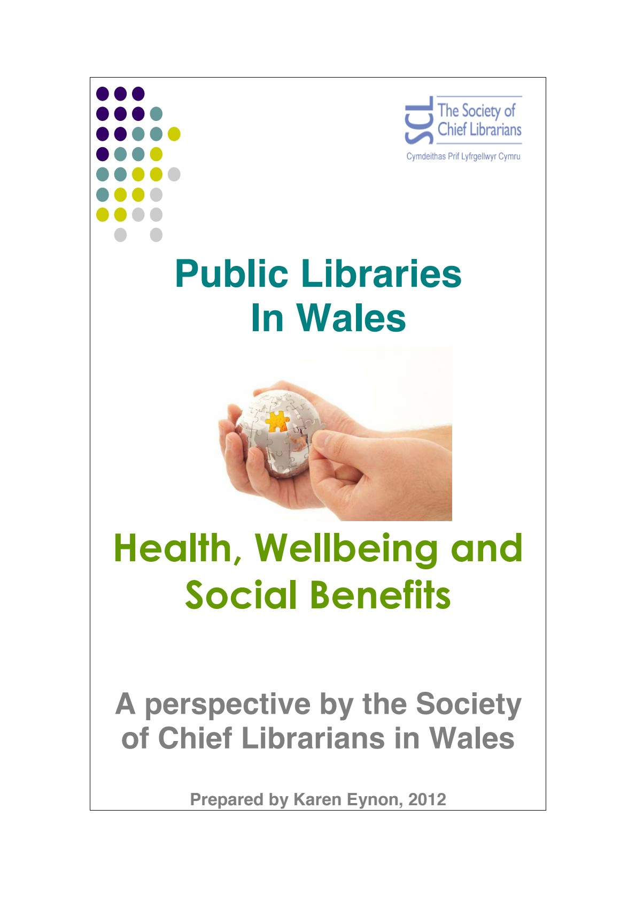
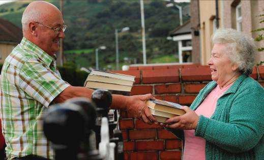
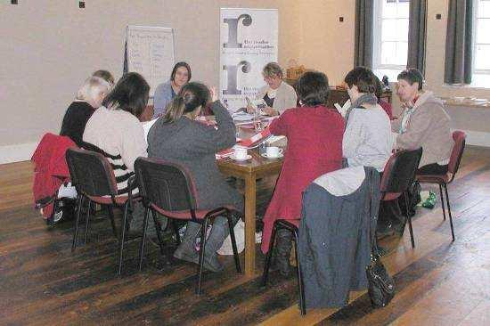
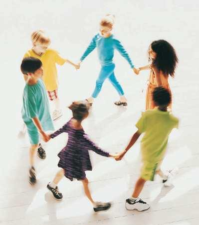
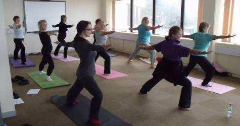
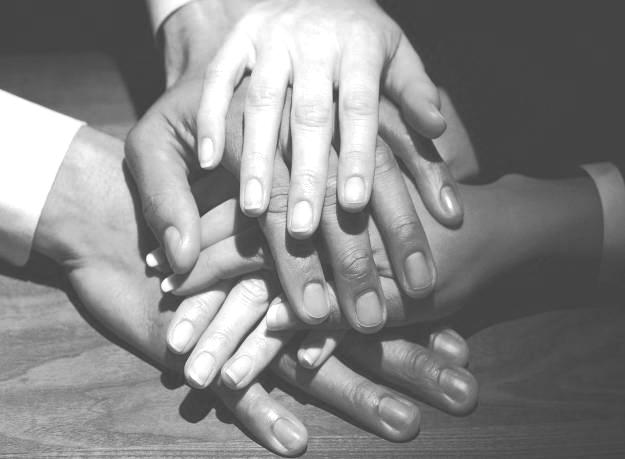

# Public Libraries in Wales: Health, Wellbeing and Social Benefits

<!-- PAGE: 1 -->

# Public Libraries in Wales: Health, Wellbeing and Social Benefits

### A perspective by the Society of Chief Librarians in Wales

**Prepared by Karen Eynon, 2012**

<!-- PAGE: 2 -->

1 Contents Foreword by Chair and Vice-Chair of SCL Wales  2 Executive Summary  3 - 4 1. Introduction   5 – 7 2. Background  8 – 10 3. Public Library Activity in the areas of Health,        Wellbeing and Social Benefits:   • Reading for pleasure and wellbeing  • Reaching out to others ( hard to reach groups) • Children and Young People ( and Child Poverty) • Reading, Mental Health, anxiety and depression  • Book Prescription Wales ( BPW)  • Literacy and health • E-Health Literacy • Health Information  • List of library activities relating to health, wellbeing and social benefits   11 – 29    11 – 12  13 – 17  18 – 21  22 – 24  22 – 24 25 – 26  27 -  28 28  29 - 30 4. Collaboration 31 – 34 5. Conclusion 35 Bibliography 36 Appendix 1: What customers tell us 37- 47 Appendix 2: The Society of Chief Librarians in Wales Members (heads of local authority library services)  48   Thank you to the marketing strand (Libraries Inspire) for use of some of the photographs © Welsh Government <!-- PAGE: 3 --> 2 Foreword                                                               Ann Jones,               Chair of SCL Wales             Elspeth Morris, Vice-Chair of SCL Wales The Society of Chief Librarians (Wales) is an association made up of the head librarian (or equivalent) of each public library authority in Wales.   Our key aim is to influence decisions at national level and provide leadership and future direction in relation to the development of public libraries in Wales.        Our purpose in this report is to demonstrate to you the role that public libraries have and can have in relation to health, wellbeing and social benefits.    We are pleased to see that the role of public libraries in relation to health and wellbeing is beginning to be recognised.  This can be seen through the very successful Book Prescription Wales Scheme and our partnership work with groups such as MacMillan Cancer Support.   However, we believe the health and social benefits provided by public library services are still often overlooked by decision makers.  We believe public libraries are uniquely placed in the heart of the community to provide a range of health, wellbeing and social benefits and opportunities.  Libraries bring people together.  They are also vital in reaching out to more hard to reach and vulnerable people, for example to those who are housebound, to those living in rural areas, to those who are less able to afford to pay for services.    Activities that public libraries do to support health, wellbeing and social benefits are summarised in this report.   You may be aware of some of them but we’re sure you’ll be surprised by others.    Also for your information we have included a selection of our customer comments which demonstrate that libraries do indeed change lives.    We hope you enjoy reading this report.

<!-- PAGE: 4 -->

<!-- PAGE: 5 -->

4 The benefits are substantial: - Libraries help reduce the burden on social care and health services by:   Reducing isolation amongst the elderly   Supporting older people to live independent lives   Encouraging healthy lifestyles   Helping children and young people to develop and enjoy life   Helping to reduce levels of child poverty in Wales by providing a free, inclusive service for children, parents and families.   Supporting care and recovery   Providing carers with an escape mechanism     Providing a network of easily accessible, non - threatening, inclusive environments – across Wales there is access to over 250 service points which are open for more than 10 hours a week and additional mobile and housebound library services.   Providing non-clinical environments so there is no stigma attached  Empowering people to access and use health and wellbeing information   Providing free access to the internet and information resources  Supporting literacy, information literacy, digital literacy and health literacy   Helping with the prevention and early diagnosis of illness  Providing social and community links to people who may otherwise find it difficult to socialise  Reaching out to those who are usually hard to reach   Reducing stress levels  (there is much evidence to show that reading reduces stress levels)  Helping people escape from their problems through reading, reading groups, community activities etc.  Thus libraries contribute to community cohesion and the individual health and well-being of people of all ages, thereby reducing the burden on health and social care services.  The full report describes a range of services and activities in more detail.       Often the role public libraries have in relation to this important agenda can be overlooked but comments and stories provided by our customers within the full report show that our public libraries in Wales have had a powerful and positive impact on many people’s lives.

<!-- PAGE: 6 -->

5 1. Introduction  The Society of Chief Librarians (Wales), representing as it does the chief librarian, or equivalent officer, of each library authority in Wales, asserts that modern, vibrant and well-developed public library services are essential to the citizens of Wales in the 21st century. The Society of Chief Librarians (Wales) recognises that substantial savings are taking place across the public sector.   A recent investigation by the Wales Audit Office [2012] estimates a loss of £1.9 billion worth of funding by 2014/15. According to this investigation the NHS faces the toughest settlement in the UK and Welsh Councils will also be badly hit.    There is a clear message that we need to collaborate and work efficiently together.   Public Libraries in Wales have a track record of collaboration and partnership working.   We wish to build on this further.    Alongside this we feel that more emphasis needs to be placed on the value of public libraries and their contribution to the wider agenda.  Public libraries contribute to health, learning, literacy, community wellbeing, skills, economic regeneration, digital inclusion and participation and cultural identity.  It is a simple fact that libraries are even more vital in difficult economic times. Libraries are free.  Libraries offer value for money.   DID YOU KNOW?   Libraries cost just 5p per person/per day to run, on average.   The cost is 35p per week/per person: less than a bag of crisps or a pint of milk.  Our purpose in this report is to demonstrate the role public libraries have and can have in relation to health, wellbeing and social benefits. We believe public libraries are uniquely placed in the heart of the community to provide a range of health, wellbeing and social benefits and opportunities.   Libraries contribute to health and well-being by providing:-  Bibliotherapy; including self help books and more general reading for pleasure books that can enhance wellbeing.    Book Prescription Wales scheme.     General health information and referral access to health libraries  Free inclusive access for all   A network of neutral, trusted and accessible community spaces. Libraries can provide a venue for a wide range of health and well-being activities.

<!-- PAGE: 7 -->

6  Community outreach services including library mobiles and provision for the housebound, care homes, sheltered housing and children’s centres.  A wide range of reader development, literacy and reading group activities which actively feed into the health and wellbeing agenda  Creative bibliotherapy: Bookstart, social reading activity, shared reading, reading groups, reading challenges, events and workshops for mainstream and vulnerable groups   Health literacy and e-health literacy [health literacy is an individual's ability to read, understand and use healthcare information; e-health literacy is the use of the internet for information-seeking and health information distribution purposes]  Free assisted on-line access.  Libraries provide access to IT resources and expertise   Staff skilled in information management, reader development and engaging with the local community   Facilities, resources and equipment suitable for people with disabilities, such as for visually impaired people.    Strong links with leisure and fitness centres.  The benefits are substantial:- Libraries help reduce the burden on social care and health services by:   Reducing isolation amongst the elderly   Supporting older people to live independent lives   Encouraging healthy lifestyles   Helping children and young people to develop and enjoy life   Helping to reduce levels of child poverty in Wales by providing a free, inclusive service for children, parents and families.   Supporting care and recovery   Providing carers with an escape mechanism     Providing a network of easily accessible, non - threatening, inclusive environments – across Wales there is access to over 250 service points which are open for more than 10 hours a week and additional mobile and housebound library services.   Providing non-clinical environments so there is no stigma attached  Empowering people to access and use health and wellbeing information   Providing free access to the internet and information resources  Supporting literacy, information literacy, digital literacy and health literacy   Helping with the prevention and early diagnosis of illness <!-- PAGE: 8 --> 7  Providing social and community links to people who may otherwise find it difficult to socialise  Reaching out to those who are usually hard to reach   Reducing stress levels  (there is much evidence to show that reading reduces stress levels)  Helping people escape from their problems through reading, reading groups, community activities etc.    Thus libraries contribute to community cohesion and the individual health and well-being of people of all ages, thereby reducing the burden on health and social care services.  We believe this potential requires greater recognition and exploitation within health and social care strategies and priorities.

<!-- PAGE: 9 -->

8 2. Background  According to the NHS’s 5 year vision Together for Health (NHS, 2011) there are major pressures on the health service.  Wales faces an obesity epidemic and rates of smoking, drinking and substance misuse are still high.   Within 2 decades it is estimated that almost one in three people in Wales will be aged 60 or over with older people requiring more health care than any other age group.   There are also concerns about the health of the younger generation in Wales.    The changing nature of society with an increasing older population, the greater demand on and expense to be met by the NHS and the current economic climate means that the NHS faces a tough financial future.  It is more important than ever that the NHS collaborates with others and for other public service providers to contribute to health and wellbeing.  The requirement to collaborate is implicit in the new Welsh Government’s legislative programme 2011-15.  This is an agenda which has also brought a new focus on the health of the nation, a commitment to support health promotion, protection and prevention.  In addition to the emphasis on health promotion, health awareness and “upstream” health prevention activity to reduce the need for costly intervention further down the line,   there is a also a growing emphasis on self help.  Also, it is now recognized that health is as much about emotional and psychological wellbeing as it is about physical health matters.   Future health demands are therefore likely to be different from past decades.    A new emphasis on self-help and prevention will result in increased access to health information, self-help books, self-learning and ways to improve emotional and psychological wellbeing.    There is a clear role for libraries here. Libraries are information providers and library staff are information facilitators, helping and guiding people to access and understand the information they require.  Take away this understanding and ability to use health information (health literacy) and the individual’s ability to make informed decisions will be seriously impaired.  Libraries also provide reliable and trustworthy health information, self-help books, self-learning and through the resources and services on offer also improve emotional and psychological wellbeing. Examples to demonstrate this are included in the Appendix.   There is also a strong correlation between reading, literacy and health.  Reading offered through public libraries impacts on literacy levels and there is overwhelming evidence that literacy has a significant relation to a person’s <!-- PAGE: 10 --> 9 health and success in life.   In addition, reading for pleasure reduces stress and increases mental and emotional wellbeing.    The Society of Chief Librarians (Wales) Importance of Reading report  http://www.goscl.com/wp-content/uploads/2012/03/SCL_W_ImportanceofReadingDec20111.pdf describes in more detail the benefits of reading. Reading and literacy is attracting increasing attention from primary care practitioners as a means of reducing demand on the National Health Service. This interest is further reinforced by the National Institute for Health and Clinical Excellence (NICE) guidelines indicating that primary care professionals should offer bibliotherapy based therapy for mild to moderate mental disorders.  It therefore makes perfect sense for public libraries and health and social care bodies to collaborate.  The Society of Chief Librarians (Wales) has identified ‘Health and Wellbeing’ as a key priority and this has been included in our SCL (Wales) Business Plan commencing in 2012.   In addition, as part of the Welsh Public Library Standards Framework (CyMAL- a division of the  Welsh Government dealing with museums, archives and libraries), libraries have standards of service and performance indicators directly linked to the delivery of the following key current national policy agendas:   • Health and Well-being  • Social Care and Older People  • Equality and Diversity  • Digital Inclusion  • Reading and Literacy  • Children and Young People’s Plan  • Employment  • Lifelong Learning and Re-skilling.  The Libraries Inspire Framework, 2012-16 produced by CyMAL also includes the following key objectives that relate to health and wellbeing and collaboration : -   Exploring opportunities for greater joint working between local authority library services and other library and information services within a region   Supporting the sustainable development of regional partnerships to improve services to the users <!-- PAGE: 11 --> 10  Promoting the health and wellbeing of the people of Wales by enabling people to access information to promote , manage and improve their health status throughout their lifetime   Developing regional/ national reading strategies to promote reading for enjoyment and well-being.   It is encouraging to see the role of libraries in relation to health and wellbeing included in strategic national plans.  However, the health and social benefits provided by public library services are still often overlooked by decision makers.  The public value this aspect of the service and libraries are seen as  community hubs and safe meeting places.  Libraries bring people together. They are also vital in reaching out to more hard to reach and vulnerable people.     Activities that public libraries do to support the health and wellbeing agenda are summarised in this report.  Public library services are committed to building on this and working in partnership with health and social care partners to enhance contributions further.

<!-- PAGE: 12 -->

11 3. Public Library activity in the areas of health, wellbeing and social benefits   Reading for pleasure and wellbeing   The importance of reading for pleasure and enjoyment cannot be underestimated. Reading improves literacy levels, social skills, personal wellbeing and provides meaningful activity and a sense of purpose. The simple act of doing something for pleasure has so many benefits. Reading helps you escape, utilises your mind, gets your creative juices flowing, helps you learn and discover new things and takes you on wonderful journeys – very powerful!  [SCL Wales The Importance of Reading , 2011]                 The added benefit is that reading improves wellbeing and the feeling of pleasure.   Reading also reduces stress levels.  As stress is a major contributor to physical, mental and emotional health this is an important point.   Research by consultancy Mindlab International at the University of Sussex says that reading is the best way to relax and even six minutes a day can be enough to reduce stress levels by more than two thirds  (68%)                   “The library has always been a part of my life.   As a young girl, a place of wonder surrounded by so many books.  As a teenager, a place to learn and read about romance.  As a mother, a place to introduce my son to the pleasure of reading.  As a grandmother, a place to relive the pleasures of motherhood.  And now, in retirement, a place to join a readers’ group where I can enjoy discussion, chatting with friends and the chance to meet authors”.  LIBRARY CUSTOMER – NEATH PORT TALBOT <!-- PAGE: 13 --> 12  Reading appeals to people of all ages.  In public libraries there are books for all age groups from babies to adults. There are stories, factual books, reference books, longer novels, shorter quick reads, picture books. There are also books in different formats, for example e-books, audio books and large print books.  There is simply something for everyone.                 Bibliotherapy offered through libraries can make a considerable difference to an individual’s health and wellbeing.   Bibliotherapy can include reading for pleasure and enjoyment as well as using self help and information resources.   People who enjoy reading benefit from bibliotherapy.  People who are looking for answers to health questions can benefit from bibliotherapy.    In addition, the National Institute for Health and Clinical Excellence (NICE) guidelines indicate that primary care professionals should offer bibliotherapy based therapy for mild to moderate mental health issues.  According to Professor Neil Frude (consultant clinical psychologist, Cardiff and Vale University Health Board) who first developed the Books on Prescription Scheme (see page 22), bibliotherapy has the following advantages over medication:   • Higher patient acceptability • More immediate effects than some medication • No rebound effect at the end of treatment • Tendency for continued improvement over time • Lower relapse rates • No appreciable adverse side effects as with medication • No danger of overdose      “Since becoming partially sighted, finding large print books to read in the library has improved my disposition – having been depressed about it  before-hand. I was always an avid reader and thought I had lost that pleasure”.  LIBRARY CUSTOMER - SWANSEA <!-- PAGE: 14 --> 13  Reaching out to others ( hard to reach groups)       A key action in the Programme for Government, Chapter 4: 21st century healthcare is to  ‘continue to improve access to care in rural areas through innovation such as telemedicine, mobile outreach services and building a community ownership and initiatives in line with the rural health plan’   Public libraries are an ideal vehicle for the health and social care sectors to reach out to local communities, particularly to those which might be hard to reach. Indeed, health agencies can find it difficult to reach out to all areas and some groups may be at risk as a result    In addition public libraries provide an inclusive service and proactively support people who have disabilities to use the service. Books, resources and equipment are available such as large print, audio, special computer software etc.                DID YOU KNOW?    40% of the population in the UK use their local library.    Libraries have 11.9 million active borrowers (and bring books to         a further 111,000 housebound readers). (CIPF(CIPF(CIPF(CIPFA, October 2010)A, October 2010)A, October 2010)A, October 2010)   There are more than 4500 library service points in the UK.    Compared to other cultural facilities, libraries are used by a high        percentage of people from deprived areas (39.8%) “As a visually impaired customer, the library is a life-line for using the internet to research my interests, watching rugby and football, increasing the size of fonts so that I can see text more clearly and connecting me with the relevant council departments that can help with my daily requirements”  Rhondda Cynon Taf  “As I am disabled, the library is life enhancing.  Staff are very helpful and know my likes.  My widowed sister also comes with us.  We select approx 10 books, on each visit and it keeps us motivated and happy.”  Swansea <!-- PAGE: 15 --> 14 Public libraries have a proven track record in helping hard to reach people and those who are at risk of being socially excluded.   Public libraries provide a network of community-based services, and mobile libraries to more rural locations and services for people who are housebound.                       Housebound and Home-Link Library services take books to people who are unable to leave their own homes and therefore at risk of social exclusion. The combination of personal contact and some good reading material can be a life line to people in this situation.                 Libraries bring people together.  They are also vital in reaching out to more hard to reach and vulnerable people.  Libraries provide support, company, enjoyment and interaction to many people.  This important aspect of the library service is often overlooked but the public value it.      “I first joined the library when I was 7 years old. I am now 97 and due to arthritis am totally housebound. But thanks to the home library service I can still enjoy my reading and would be lost without it.”   97 year old Conwy library customer  “I have been visiting this library for 25 years. It serves not only me but my housebound husband.  The support to myself and the community is paramount.   Without the library I feel there would be a loss of social support especially for the more vulnerable in society, the young, the elderly, and the unemployed.”  Library User [CIPFA Public Library User Survey] “I’ve been very ill with cancer over the last two years. The library van calling each month kept me going. The driver/librarian is extremely kind and helpful. I have relied on library books to stop me concentrating on my illness over the last two years.”  Ceredigion  “We have always found the travelling library and the librarians of the greatest benefit. Now that I am alone in this isolated position, unable to drive or walk very far, the travelling library and the librarian are even more of a help in keeping me in touch with books, so essential to my mental health.” Ceredigion

<!-- PAGE: 16 -->

15 DID YOU KNOW?    More older people are visiting libraries in the UK. 43% of adults aged 65-74 visited the library in 2010/11 compared to 39% in 2009/10.    37% of people over 75 visited the library compared to 33% in 09/10.   The number of people aged 60 or over in the UK is predicted to rise by more than 50 percent in the next 25 years. Libraries are a safe, free and friendly place for all people including older people.    There are at least 10,000 library linked reading groups arranged through our UK public libraries.  Shared reading and reading aloud together is proven to have a positive impact on wellbeing, confidence and social interaction.  The actual act of reading out aloud and hearing the sound of your own voice can be very empowering. Reading aloud together within a group can help somebody express him/herself. Often people connect with the stories or poems and then wish to share their story too.  Also, reading sessions bring people together, making it easier to communicate and feel part of something.   Reading aloud together can be an enjoyable experience for the majority of people but is particularly beneficial for older people who have little contact with others.  It also benefits those who have lost their confidence or ability to communicate and children who are struggling to express themselves following trauma or difficulties, for example looked after children.                  A  South East Wales ‘Read to Lead’ meeting in  Shire Hall, Monmouth where the Reader Organisation (TRO) is training for library staff to read aloud to groups in the community, for example to older people in homes.

<!-- PAGE: 17 -->

16      And another from Torfaen                 Bridgend libraries run read aloud sessions for adults with learning difficulties who read stories and poems out aloud and then discuss the story.                   Here are just some comments from Adult Day Care Users  “We have fun and enjoy a chat” “It’s fun”  “Enjoy helping others” “I lost my confidence to go out since my husband died but since I got to know the other ladies in this group I’ve been going out with them.  Now, as well as the reading group I am out several days a week.”  From a regular at a group run in a sheltered housing complex, Monmouthshire “We have noticed a difference in several residents since the group has been going.  In particular, one lady who can never relax or settle, has astonished us by sitting still and concentrating on the reading for a full hour.” From the manager of an Elderly Person’s home. Monmouthshire “I think it’s good for Colin to get out of the care home and have some time away, to himself.”   Carer of a blind man with learning difficulties, talking about a VIP Shared Reading session at Pontypool library, Torfaen <!-- PAGE: 18 --> 17  “Enjoy the stories”  “We have a laugh” “We like the teacher who takes part in the session”  “Enjoy being in a smaller group with our friends”  Bridgend also run a book club activity within the Pyle Life Centre for people with a range of disabilities.                Cardiff libraries work in partnership with two care homes to run a ‘Sharing Stories as Therapy’ programme.   The Neighbourhood Development Librarian visits the care homes on a weekly basis to read stories and poems to the residents and the residents are encouraged to share memories and thoughts.  These sessions have been particularly successful with patients suffering from dementia. Family members are also welcome at the sessions encouraging and promoting intergenerational communication whilst providing therapy for those suffering with disabilities. Cardiff libraries also run a Breakfast Club working in partnership with Huggard which is a registered charity comprising of a Day Centre, Emergency Bed Unit and supported houses offering support and resettlement in the Community. Here people take it in turns to read aloud if they want to and talk about their own experiences in relation to the topic.  It is hoped to build a similar partnership with the Salvation Army Hostel.   Monmouthshire libraries also have an Intergenerational Shared Reading project running and have been able to take feedback from the adults involved, all of whom have been surprised at how relaxed they feel after a session.    Here is a spontaneous quote from a child:      “This was the best morning ever.  I feel fizzy inside.” This gives the users of varying disabilities a chance to interact within a group session in an environment where they feel valued.  This gives them the chance to improve their skill base which will enhance their independence.  Neil Hoskins, Day Service Officer 1, Bridgend <!-- PAGE: 19 --> 18 Children and young people  Public libraries offer a whole host of resources, activities and events for children and young people. Libraries hold reading groups, storytimes, Bookstart schemes, homework clubs, arts groups, health and wellbeing projects. Libraries work with local schools in relation to information, research and homework and out of school activities such as the Summer Reading Challenge.                             Children and young people having fun in our public libraries in Wales <!-- PAGE: 20 --> 19 Libraries can help young people to engage with their communities by offering locally based services and a wide range of resources (for young people) including books, CDs, DVDs, music, magazines and free filtered internet access.  Many libraries also have exciting meeting spaces for young people.   As well as the many enjoyable activities for children, libraries also provide many learning opportunities for all the family. Parents and families who participate with their children in the schemes and activities provided by public libraries also benefit greatly.   Library staff receive many positive comments from people for example, about the Bookstart scheme.            The recent Estyn report ‘The Impact of Family Learning’ [2012] cites a wide variety of publications, surveys and reports which document the importance of family programmes and the positive impact that these can have on improving the standards children achieve in schools.    A recent enquiry by NIACE, ‘Work, Society and Lifelong Literacy’ (2011) also confirms this.  The enquiry finds that schools on their own cannot address the multiple disadvantages faced by many families.   In the Ofsted report, ‘Family Learning: An Evaluation of the Benefits of Family Learning for Participants, their Families and the Wider Community’ (2009) inspectors found that family programmes have a significant impact on the behaviour of children. Children have better communication skills, settle better in class and have an improved relationship with teachers and other children.    The Estyn report, ‘Tackling Poverty and Disadvantage in Schools’ (2011) describes how pupils achieve higher results and are more likely to succeed when parents are involved in their education and provide them with learning support.      “After recently receiving free Bookstart packs for children and distributing them to families supported by our organisation, we have recommended families attend the Bookstart sessions at Rhyl Library. We find this service invaluable as it enables those who may be isolated to make new friends, learn new skills and use the free services the library has to offer.  I feel parents and their children gain a great deal from the experience.“  From a Young Person's Development Worker, North Denbighshire Domestic Abuse Service <!-- PAGE: 21 --> 20 Children at Play  Taken from the cover of the  Child Poverty  Strategy for Wales, 2011   In the Welsh Government’s Child Poverty Strategy for Wales (2011 – 2014) there are three new strategic objectives for tackling child poverty: 1. reduce the number of families living in workless households;  2. improve the skills of parents and young people living in low income households so they can secure well-paid employment;  3. reduce inequalities that exist in health, education and economic outcomes of children and families by improving the outcomes of the poorest.          Public libraries can help the Welsh Government achieve these objectives.  Objective 1. Reduce the number of families living in workless households:  As well as  providing a range of free books, internet access and activities for adults and children, many public libraries in Wales also provide information to help with careers,  job seeking, preparing CVs etc. Public libraries could therefore help the Welsh Government achieve the first new objective in the Child Poverty Strategy for Wales.     Objective 2. Improve the skills of parents and young people living in low income households so they can secure well-paid employment:  Public libraries can help the Welsh Government achieve the second new objective.  They offer community and informal learning opportunities such as ICT skills training.   Some provide more formal training working with other local training providers.   Public libraries provide localised support for learners who may otherwise be working in isolation thus providing essential referral points for remote learners.  For example Neath Port Talbot libraries have been used to run support groups and classes for single parents, providing  learning, health education and confidence building support.

<!-- PAGE: 22 -->

21 The global financial situation has also impacted on children and young people in Wales.  Significant redundancies have resulted in more people returning to learning and wanting to update their skills in a cost effective way. In addition there are many young people who are not in education or training who may prefer more informal based learning opportunities. Public libraries can help people of all ages acquire learning and life skills. This can help considerably with confidence building so that they are ready to participate in the next stage of learning and employment.   The type of learning opportunities offered at our public libraries could appeal to children and young people who are not in education and training and also to parents and families on lower incomes.     Some libraries also offer special services within their locality, for example, Neath Port Talbot libraries support the Education Psychology service to facilitate after schools counselling sessions for children throughout the Authority.  Objective 3: Reduce inequalities that exist in health, education and economic outcomes of children and families by improving the outcomes of the poorest:   Public libraries certainly play a major role in relation to the third new objective and promote social inclusion and equality.  The public library service core offer is FREE for children and young people, parents and families.  This includes borrowing books, use of the computers and internet access as well as many of the activities on offer.   This is a significant and important point when one of the key objectives for the Welsh Government is to tackle child poverty in Wales, reduce inequalities and improve social inclusion. Public libraries in Wales provide a network of community based services meaning that most people can access the range of services on offer.  Public libraries provide a service which is equal and fair to all.             “Probably the biggest effects the library sessions have had, have been with the parents of our children. Most of these parents have declined from taking their children into the public eye due to some bad experience or other. However, by attending (in the background) the Bookstart session and having seen their child ‘in action’ joining in within the session, it has given them a huge confidence boost, thus enabling them to access other public places with their child, and start to really communicate with them.”  From a Specialist Special Needs Teacher for children with autism, Denbighshire <!-- PAGE: 23 --> 22 “Having suffered from anxiety and depression for years I found it hard to go out socialising and enjoying my life as one should, then I had my two sons 4 and 2 years who brought great joy, but still I was gripped by fear or panic and depression, but as the children grew older they obviously needed to go out and mix i.e. school and so forth.  When one day my eldest son said he would like to go to the library, which is only down the road from my home, I thought right let’s do it and “I did”!  I haven’t looked back since.  It gets me out twice a week, it’s not too stressful for me, the kids love it – and I get to read books that help me deal with my condition, and the librarian is really good to talk to.  I would definitely recommend people to use their library as it caters for most needs. To me and my family Library Days are Happy Days”  LIBRARY CUSTOMER - GWYNEDD Reading, mental health, anxiety and depression  The importance of bibliotherapy and the positive impact reading can have on health and wellbeing has been mentioned previously.   There is additional evidence to show the therapeutic benefits of reading and the impact specifically on mental health, anxiety and depression. The study ‘ An investigation into the therapeutic benefits of reading in relation to depression and wellbeing’ (a partnership between The University of Liverpool, Liverpool Primary Care Trust and TRO, 2010)  2 revealed significant improvements in the mental health of depressed patients during the 12-month period in which they had attended reading groups. The study found that shared reading helps people who suffer from depression in terms of their social well-being, their personal confidence, their mental well-being and their emotional and psychological well-being.              Book Prescription Wales (BPW)   The 2005 government funded ‘Book Prescription Wales Scheme’ (BPW) is a partnership between the National Health Service and public libraries in Wales. The BPW Scheme helps patients with mild to moderate psychological problems and research shows that effective 'do-it-yourself' books can help them to overcome a range of emotional problems including anxiety, panic, stress and depression. The books are selected and/or written by clinical psychologists and psychiatrists.  General Practitioners or professional workers ‘prescribe’ the books to their patient.  This prescription can then be taken to any library in Wales.    Each library has copies of the pre-selected self-help books that are prescribed.                                               ”“Thi“,iokit“Vtgowrnoarlw“rn“o“woarlwo))y“tiblgwrnik“biwati“elt“ahi“xtlLlarlw“le“tiokrwg“owk“xlnrar.i“Liwao)“hio)ahW““““ <!-- PAGE: 24 --> 23 Professor Neil Frude, who devised the first scheme, explains that his contact with librarians and library services through the scheme has given him a greater appreciation of the benefits of libraries for mental health and well-being:                           Since the introduction of the scheme, it has spread significantly. There is a national scheme in Ireland and books are now available on prescription across much of England and Scotland. There is also now a scheme in New Zealand.  Wales led the way here as all of these acknowledge the fact that their schemes are based on the idea generated in Wales.    In 2010 the Book Prescription Wales Scheme received support from the National Leadership and Innovation Agency for Health Care (NLIAH) and the Wellbeing through Work Project and included books about Dementia.            “When I first had cancer I couldn’t face the facts and couldn’t bear to read about it, I just took out books to keep me positive. Since my operation I’ve read about the cancer I had and I’ve been using the library to find books on how to stay healthy.”  VALE OF GLAMORGAN   "I've come to realize that it's not just the book prescription scheme that enables libraries to contribute to the mental health and well-being of those who use libraries. Both in their 'core business' of lending books and other media, and through the various general and health focused activities that take place on a regular basis, libraries provide an invaluable resource.   I don't think that it is widely enough understood that libraries provide a major community hub. Strategically based, and with a mobile service for those who cannot come to the library building, they provide a unique infrastructure for the delivery of all manner of resources for personal well-being. They are the 'village halls' of the urban community, a meeting place and a place for personal growth.   We should be recognizing the enormous benefits and potential benefits. It is very sad that in this age when their benefits are so intensely needed some of these services are under threat”.   PROFESSOR NEIL FRUDE,  CONSULTANT CLINICAL PSYCHOLOGIST,  CARDIFF AND VALE UNIVERSITY HEALTH BOARD <!-- PAGE: 25 --> 24        Just a few examples of the kind of books that form part of the  Book Prescription Wales Scheme.           The Book Prescription Wales Scheme and Bibliotherapy (self help or general reading for pleasure) can make a considerable difference to people and their health and wellbeing.   “When I visit the library the staff are always helpful and friendly. I have found very informative books on Bipolar Disorder, with which I have recently been diagnosed, which have helped me to come to terms with my illness. …..It also gave me confidence about going into places. It is spacious, modern, light and airy, always room for privacy in a corner, and always a pleasure to visit.”  CAERPHILLY <!-- PAGE: 26 --> 25  Literacy and health  DID YOU KNOW?      7 million people in the UK lack basic literacy skills.  That means 20% of the adult population in the UK cannot read or understand simple instructions such as those found on medicine labels.    25% of the working-age population in Wales lack basic literacy skills, a higher proportion than in any of the English regions.    There is much research to show that poor literacy has a negative effect on health, life expectancy, accidents, diseases, nutrition and mental health.  In addition people with lower literacy skills are more likely to be under stress. All this means that those in most need of information and interventions are those least likely to be able to find and interpret such information without help and support.            Reading opportunities through public libraries impact on literacy levels.  Improvements in reading and literacy can have a profound effect on individuals and their contribution to society.  Literacy impacts on skills, employment and life opportunities as well as health thus improving the quality of life for people of all ages.    “I suffer with reading and writing and this gives me a chance to learn how to read and how to spell in my own time.    I find it very relaxing and when I get into a book I feel like I am one of the characters and it’s like living a different life every time I pick up the books”  SWANSEA <!-- PAGE: 27 --> 26    Figures by the National Literacy Trust shows the impact of low literacy levels:     22% of men and 30% of women with low literacy levels live in non-working households.   Individuals with low levels of literacy are more likely to lead solitary lives.   Individuals with low literacy levels are more likely to have reduced access to technology.    Increased literacy rates improve the chances of using a PC at work from 48% to 65%.   A modest rise in literacy levels sees the likelihood of a person owning their own house rise from 40% to 78%.   Men and women with the poorest literacy or numeracy skills were the least likely to have voted in the general elections.     Reading, literacy and health goals therefore have a better chance for success when pursued together. Reading activities and literacy programmes offer health and social care services an important channel to reach people who are often most at risk.

<!-- PAGE: 28 -->

27  E-Health Literacy     A key action in the Programme for Government, Chapter 4: 21st century healthcare is to ‘make better use of ICT to improve access to health services’   The provision of assisted online services provided through libraries could provide considerable cost savings to partners such as health and social care services.            DID YOU KNOW?   Public Libraries helped over 2 million customers who had never used the internet (or never used it confidently) to go online in the past year- more than any other group or organization in the UK.     In Wales alone libraries helped over 100,000 customers in the past year – and still counting!  Public libraries are information services holding print and electronic information materials and providing assistance with enquiries and research.  Using print or electronic resources, libraries can help a person to search for health information, retrieve health information, make sense of the information and utilise this information.    There is evidence also to show that people with low literacy skills are reluctant to use technology as they may not have the confidence to read what appears on the screen.  Low levels of literacy will therefore also impact on digital literacy and a person’s ability to access health information electronically (e-health literacy).

<!-- PAGE: 29 -->

28 Libraries have a key role to play here also as they not only provide opportunities for digital inclusion by providing free access to the internet in all libraries in Wales but libraries also promote reading and literacy.  Libraries can also provide the vehicle to connect the wider public to health services.   There are libraries in most communities in Wales and they all provide free internet access.            Health Information       A key action in the Programme for Government relating to Supporting People is to ‘improve information services’   Libraries are information services.   Libraries provide reference books, research materials, learning resources and other information sources in a number of different formats including books, CDs, DVDs and the internet.  This includes health information which in some libraries is integrated into the general information and reference sections whilst others have dedicated health information sections.   In addition, libraries provide a range of self-help books (see Book Prescription Wales).      Libraries have staff to help make sense of this information. They are trained to retrieve and disseminate information and help to identify and recommend the most relevant and trustworthy sources for the user.            “This library has helped me to deal with my personal (family) problems by providing me access to books and information. I have found this a great help in my recovery.”  Anglesey library customer <!-- PAGE: 30 --> 29 Library activities relating to Health, wellbeing and social benefits:    Bibliotherapy including self help books and more general reading for pleasure books that enhance wellbeing.     Book Prescription Wales scheme.      General health information and referral access to health libraries   Free inclusive access for all    A network of neutral, trusted and accessible community spaces. Libraries can provide a venue for a wide range of health and well-being activities.    Community outreach services including library mobiles and provision for the housebound, care homes, sheltered housing and children’s centres.   A wide range of reader development, literacy and reading group activities which actively feed in to the health and wellbeing agenda   Creative bibliotherapy: Bookstart, social reading activity, shared reading, reading groups, reading challenges, events and workshops for mainstream and vulnerable groups    Health literacy and e-health literacy [health literacy is an individual's ability to read, understand and use healthcare information; e-health literacy is the use of the internet for information-seeking and health information distribution purposes]   Free assisted on-line access.  Libraries provide access to IT resources and expertise    Staff skilled in information management, reader development and engaging with the local community    Facilities, resources and equipment suitable for people with disabilities, such as for visually impaired people.     Strong links with leisure and fitness centres.

<!-- PAGE: 31 -->

30 Many libraries deliver specialized project based activities such as:    Specialist health information.  For example, a number of libraries in Wales have set up MacMillan Cancer Information points in their libraries.   This is a very effective partnership arrangement which is set to expand.     Public health promotion: health checks, health promotions, health awareness activity.   Mental health promotion: mental health awareness days   Carers’ Collections - Books and resources for people who care for others  Services for looked-after-children   Some libraries are used as venues to run support groups. For example Neath Port Talbot libraries have been used to run support groups and classes for single parents providing learning, health education and confidence building support.  Some libraries work with physical activity and sports services and hold activities such as advice sessions on exercise and nutrition.  Some libraries even hold exercise classes for example there are zumba dance classes in Neath Port Talbot and yoga classes in Swansea.           Some libraries work with art groups on health and wellbeing themes, for example at Denbighshire libraries    Many libraries work with schools to develop projects. For example Neath Port Talbot libraries support the Education Psychology service to facilitate after schools counselling sessions for children throughout the Authority and Cardiff Libraries run the Families and Schools Together Programme.    Conwy libraries are the first in North Wales to provide access to Boardmaker software in their libraries. This is a computer programme giving access to thousands of downloadable pictures and images to use when helping anyone with speech and language difficulties (www.conwy.gov.uk/library/boardmaker)    All North Wales libraries loan Handbooks in support of the Local Health Board’s Expert Patient Programme  If you are interested in reading more about health and wellbeing projects and activities held in our libraries in Wales please look out for  'The Incomplete Field Guide to Wellbeing and Welsh Libraries’ [January 2013]. Yoga in Swansea Libraries

<!-- PAGE: 32 -->

31 4. Collaboration and Sustainability   Together for Health: a 5 year vision for the NHS in Wales (2011) begins “sustainability lies at the heart of our agenda and good health is vital to the creation of a prosperous, successful, sustainable Wales.  It will require action on many fronts not just in the traditional health sector” [Lesley Griffiths, AM, Minister for Health and Social Services]             Collaboration is high on the agenda in Wales.   It is more important now than ever for organisations to consider new ways of working together. Public libraries in Wales already work with a number of health and social care partners for example the Health Services, Social Care departments, Mental Health Groups, support groups, carers groups, Age Well Centres, NHS Alternative Therapies, General Practitioners’ surgeries, health visitors, children’s centres, adult social care and third sector organisations including MacMillan, MIND, Rethink, Salvation Army, Alzheimer’s Society and Age UK.            “I was recently contacted by Social Services about a lady whose eyesight had deteriorated.  When I visited her at home she was obviously very depressed.  She had been a great reader but having given them a try she decided that she didn’t really want talking books.  It was obvious that she liked politics and current affairs so I arranged for her to receive newspapers on CD which are sent to her home weekly and she is delighted with them.”  Home Delivery Library Assistant, BLAENAU GWENT

<!-- PAGE: 33 -->

32  Public libraries also have partnerships with organizations such as the BBC  and have worked jointly on a number of initiatives such as BBC Headroom to deliver ‘mood-boosting’ reading provision.   Collaborative arrangements with other local authority services (such as leisure services, adult social care and education psychology services) are encouraged, as are partnerships external to the authority such as the Book Prescription Wales Scheme already described.    Some libraries in Wales have developed special Carers collections and projects with Carers.  For example, Wrexham and Gwynedd libraries have set up a Carers collection in collaboration with Adult Social Care and the Voluntary Carers Service.  Blaenau Gwent run Carers Projects.    There are many examples and comments from Carers who we’ve helped and worked with.                 Close working with the voluntary sector and with registered charities also occurs.   Many of the reading groups mentioned in the previous section are arranged in partnership with groups such as MIND, the Salvation Army, community charity groups.      The opportunity to develop community-based services is valued by the MacMillan Foundation who has established community bases in a number of libraries in Wales by funding specialist information officers.  From here they raise cancer awareness, and provide information and support for patients at the post-treatment stage.   A recent report about the MacMillan Project by Katherine Hughes Associates Ltd (MacMillan Library Projects: Opportunities and Challenges for Libraries In Wales, 2011) describes libraries as “credible providers of good quality mediated information, effective sign-posters of advice and neutral non-judgmental sources of support”.    It goes on to say:      “I have been coming to the library for taster sessions on how to use the Internet.  I was so nervous, I was a complete beginner, didn’t know where to start.  As I am a carer, it has been great to be able to come for the session when it suits me. I would never be able to commit to a class.  Within a couple of weeks, I have been able to research advice and support groups for my daughter’s disability.  I have been able to contact other parents with similar problems. This has helped me cope with things.   It is an enjoyable hour and a nice break for me to come to the library”  Carers Project, Ebbw Vale Library, Blaenau Gwent <!-- PAGE: 34 --> 33            Through the MacMillan project health providers, local authorities, and the voluntary sector achieve positive ‘wellbeing’ outcomes at a local level.   Here are some comments following a MacMillan Library Project at Torfaen:  •  ‘Lots on offer, I only came to get my books but got my blood pressure checked’ • ‘I feel so relaxed after my Indian Head Massage’.  • ‘All of this for free....its great!’  There are other specific collaborative projects underway or planned.  For example, from September 2012 the BCUHB Mental Health Team in Flintshire are arranging consultation events with a dementia advisor to be held in libraries.  Cardiff libraries hold a ‘families and schools together programme’ which encourages children and parents to take part in activities to improve children’s learning, social inclusion and wellbeing, such as eating a healthy family meal together.  Denbighshire libraries work in partnership with an artist on an Arts in Health and Wellbeing project. This project challenges and explores the diversity of parental relationships, enabling explorations of self-identity and relationships.   These are just a few examples.  There are many other examples demonstrating collaborative working already included in the body of this report and there are far too many others to include them all here.   People value working with public libraries and have noticed benefits and positive changes. We receive encouraging comments from partners as well as those from customers.       There are many new opportunities to collaborate with public libraries in relation to the health and social care agenda.  The public library sector in Wales welcomes the opportunity to build on existing partnership arrangements and explore new collaborative ideas.       “Having a library presence is extremely important.  Information designed to help people with cancer is often provided in the clinical setting, which gives the impression that its focus is about treatment for the illness rather than supporting people’s recovery and survival.    A library presence gives the project a neutral, supportive, non-clinical place for people to find out things that concern them about cancer and to become more aware about the value of well-being”  MacMillan Library Projects: Opportunities and Challenges for Libraries in Wales, 2011 <!-- PAGE: 35 --> 34 Question:   Why would I want to collaborate with the public library sector in Wales?    Here are just a few answers:  Libraries help reduce the burden on social care and health services by:  “ Reducing isolation amongst the elderly  “ Supporting older people to live independent lives  “ Encouraging healthy lifestyles  “ Helping children and young people to develop and enjoy life  “ Helping to reduce child poverty levels in Wales by providing a free, inclusive service for children, parents and families.  “ Supporting care and recovery  “ Providing carers with an escape mechanism    “ Providing a network of easily accessible, non - threatening, inclusive environments – across Wales there is access to over 250 service points which are open for more than 10 hours a week and additional mobile and housebound library services.  “ Providing non-clinical environments so there is no stigma attached “ Empowering people to access and use health and wellbeing information  “ Providing free access to the internet and information resources “ Supporting literacy, information literacy, digital literacy and health literacy  “ Helping with the prevention and early diagnosis of illness “ Providing social and community links to people who may otherwise find it difficult to socialise “ Reaching out to those who are usually hard to reach  “ Reducing stress levels (there is much evidence to show that reading reduces stress levels) “ Helping people escape from their problems through reading, reading groups, community activities etc.

<!-- PAGE: 36 -->

35 5.Conclusion   The intention of this report is to demonstrate the significant role public libraries have in relation to the health, wellbeing and social care agenda.    The many comments and stories staff receive from people who use library services really show how libraries impact on people’s lives. Libraries can change lives.    The comments included in this report are just a small selection of those received from people who tell us every day how much they value our service and the difference their library makes to them.     Public libraries recognise the importance of collaborating with others even more and the need to continue to build on existing partnerships.     Substantial savings are taking place across the public sector including within local authorities and the NHS so the need to collaborate and work efficiently together is more important than ever before.   An important driver is the current economic climate.  Public libraries are more vital in difficult economic times as the core public library offer is free to all people.   Potential partners should and do recognize the economic benefits as well as the social benefits to be had from collaborating with public libraries in Wales.   For us to continue making this difference, decision makers and stakeholders (as well as users) need to recognize that public libraries require support.   With the correct level of recognition, support and investment public libraries in Wales could do so much more.       Please feel free to contact the Society of Chief Librarians (Wales) if you wish to discuss further.     A selection of customer comments can be seen on page 37 onwards.

<!-- PAGE: 37 -->

36 Bibliography    1. Child Poverty Strategy for Wales, Welsh Government, 2011   2. Family Learning: An Evaluation of the Benefits of Family Learning for Participants, their Families and the Wider Community,  Ofsted, 2009  3. The Impact of Family Learning,  Estyn, 2012  4. Importance of Reading, SCL Wales, 2011  5. An investigation into the therapeutic benefits of reading in relation to depression and wellbeing, The Reader Organisation et al, 2010    6. Libraries Inspire: The strategic development framework for Welsh libraries 2012 – 16,  CyMAL, 2012  7. Literacy Changes Lives, National Literacy Trust, 2008   8. MacMillan Library Projects: Opportunities and Challenges for Libraries In Wales, Katherine Hughes Associates Ltd, 2011   9. Programme for Government, Welsh Government, 2011  10. Tackling Poverty and Disadvantage in Schools, Estyn, 2011  11. Together for Health: a 5 year vision for the NHS in Wales, Welsh Government, 2011   12.  Maintaining a Valued Service 2011 – 14, ( Welsh Public Library Standards     Framework 4), CyMAL, 2012   13.  Work, Society and Lifelong Literacy, NIACE, 2011 <!-- PAGE: 38 --> 37 APPENDIX 1 What our customers tell us:   “This library has helped me to deal with my personal (family) problems by providing me access to books and information. I have found this a great help in my recovery.” Anglesey   “The library is a lifeline to us. I am a day support worker with a group of adults with learning difficulties. We come every week to the library. The clients use the computers, borrow books and take part in activities. Visiting the library has enabled us to integrate with the local community, in a relaxed, comfortable setting. Learning new skills in a very informal environment - the clients really enjoy it.” Blaenau Gwent   “I came to the health checks and health library promotion. I discovered my blood pressure was up. I followed this up with a visit to my doctor and am having treatment - the library probably saved my life!” Blaenau Gwent  “I lost my wife 3 months ago and since I have been coming to my local library it has made a big difference to my life and the staff are excellent.” Blaenau Gwent   “My doctor sent me to the library, recommending a book to help with my stress and anxiety.  The books have been a great help, since then I have started reading for pleasure again, - this is helping me relax in the evenings”  Blaenau Gwent   “I visited my local Library for books on the menopause.  I took out the couple they had on the shelf, the library staff then suggested the Health Promotion Library, as I wanted to read as much as <!-- PAGE: 39 --> 38 possible to help with my symptoms.  This was a brilliant service, - I had five books delivered for me and lots of information leaflets.  After reading as much as I possibly could, I was able to discuss the problem with my GP with more confidence” Blaenau Gwent  “My daughter has recently been diagnosed with Autism.  At first it was really scary, I didn’t know very much about the condition, so I went to my local library to borrow some books on the subject.  The library has given me all the information I need, including the details of a local support group.   The library staff also encouraged my daughter to use the Internet in the library, we now go every Saturday, it has really helped her with her social skills.” Blaenau Gwent  “I have started using the library again after many, many years.  I suffer from depression and find it difficult to leave the house some days.  I have been doing the Six Book Challenge, the library came up to our community centre and I thought I would give it a go.  I’ve started using Tredegar Library every week now.  Reading has helped me relax, it also takes my mind of my worries.  I have just had my certificate, that give me a boost!” Blaenau Gwent  “I attended the Work Club in the library to gain confidence.  I have spent most of my adult life caring for my parents.  I have had help with basic skills and gone on to do the Six Book Challenge.  This is the first certificate I have ever received.  Following all the support I received from the Work Club, I am now volunteering at local residential home.  My life has been turned around!” Blaenau Gwent  “The library has made me and my friends happy knowing that it is a safe place to chat and read. It has also helped us to study and also use the internet. We love our local library and come weekly. We all have a library card also we all have an internet card.” Bridgend <!-- PAGE: 40 --> 39 “The library has been a source of support for me during a period where ill health has meant I have been house-bound. A good book takes my mind off the pain for a while.” Bridgend  “When I visit the library the staff are always helpful and friendly. I have found very informative books on Bipolar Disorder, with which I have recently been diagnosed, which have helped me to come to terms with my illness. I have also had books out on art and painting, which have helped me develop my talents. Today when I came in there were children, happily drawing, and I stopped to admire their work and chat to them, which also gave me confidence about going into places. It is spacious, modern, light and airy, always room for privacy in a corner, and always a pleasure to visit.” Caerphilly  “It is a place that is local, easy for me to reach, access the internet, look at books and mix with people. This is important to me as I am recovering from a long chronic illness and it helps me to participate in life again and feel connected to the world.”  Cardiff  “Although I am 76 my attitude to life is there is always something new to learn and reading a variety of subject matter helps to keep the mind active.” Cardiff  “I am a senior citizen, living alone. I have always been an avid reader preferring it to watching T.V. I could not possibly afford to buy regularly but by using the library I have a source of a great variety at no cost.  I can also try to widen my choice of authors aware that if I find a book unreadable - very seldom - I can return it and select another. Going to the library is an incentive to get out.” Carmarthenshire  “As a retired lecturer, a senior citizen and living on my own, visiting a library gives me the opportunity of meeting people even if it’s a <!-- PAGE: 41 --> 40 ’good day’ and a smile from a librarian, otherwise I may not converse with anyone from week to week”   Carmarthenshire  “I’ve been very ill with cancer over the last two years. The library van calling each month kept me going. The driver/librarian is extremely kind and helpful. I have relied on library books to stop me concentrating on my illness over the last two years.” Ceredigion   “We have always found the travelling library and the librarians of the greatest benefit. Now that I am alone in this isolated position, unable to drive or walk very far, the travelling library and the librarian are even more of a help in keeping me in touch with books, so essential to my mental health.” Ceredigion   “The ]mobile] service is invaluable to our household as my husband is disabled and would not be able to get to the library in town, with the van calling here he is able to choose his own entertainment and looks forward to chatting with the library man, I think  that makes his day. I enjoy the convenience of the service, it enables me to enjoy a lot of books as I don’t have to carry them far. Thank you!!” Ceredigion   “The library makes such a positive difference to my elderly parents’ lives.” Ceredigion   “Libraries were always very quiet places to me - too quiet since I was deaf but if I hadn’t gone one day for information on hearing loss and implants, I would never have thought of asking my doctor about a cochlea implant.  Now I sometimes just sit and listen to the rustle of newspapers, pages of books being flicked through, computer beeps and the chatter of people asking all sorts!  Now again, I can use the listening (audio) books, CDs and DVDs.  My library gave me the knowledge to change my life!” Conwy <!-- PAGE: 42 --> 41  “The library is very good for ordering new books and is not far away so that does not involve travelling and books when ordered come quickly and staff are friendly and always very helpful and even personal delivery as my work place is next door.  I am a warden of sheltered accommodation and my tenants enjoy using the library also.” Conwy  “I first joined the library when I was 7 years old. I am now 97 and due to arthritis am totally housebound. But thanks to the home library service I can still enjoy my reading and would be lost without it.” Conwy   “After recently receiving free Bookstart packs for children and distributing them to families supported by our organisation, we have recommended families attend the Bookstart sessions at Rhyl Library. We find this service invaluable as it enables those who may be isolated to make new friends, learn new skills and use the free services the library has to offer.  I feel parents and their children gain a great deal from the experience.“  Denbighshire )from a Young Person's Development Worker, North Denbighshire Domestic Abuse Service)  “Probably the biggest effect the library sessions have had, have been with the parents of our children. Most of these parents have declined from taking their children into the public eye due to some bad experience or other. However, by attending (in the background) the Bookstart session and having seen their child ’in action’ joining in within the session, it has given them a huge confidence boost, thus enabling them to access other public places with their child, and start to really communicate with them, using the visual systems we use, that they were once so afraid of, for fear of being singled out or discriminated against. These wonderful outcomes are due to the positive manner and professional demeanour of the Bookstart team.”  Denbighshire )from a Specialist Special Needs Teacher for children with autism)

<!-- PAGE: 43 -->

42 “I use the library regularly - it’s a sort of ’home from home’; being visually handicapped it’s wonderful to still be able to read with the help of large print and audio books.  Reading has always been an important part of my life and it’s so good to be able to continue and to find such a variety of choices.”   Flintshire  “Going to the library is like visiting a long standing friend, where all the family drop in. Young children, always eager to see what is happening, adults popping in and out or on the computers, older folk with more time to chat. When I was studying for a degree it was not always possible to travel to the university library ’NO PROBLEM’ if I needed a book the ladies at my local libraries without fail would track down the books I needed.  Always with a smile and encouragement.  P.S. I graduated last year with a BA in Social Studies.  Not bad at 76 years old.” Flintshire  ’Having suffered from anxiety and depression for years I found it hard to go out socialising and enjoying my life as one should, then I had my two sons 4 and 2 years who bought great joy, but still I was gripped by fear or panic and depression, but as the children grew older they obviously need to go out and mix i.e. school and so forth.  When one day my eldest son said he would like to go to the library, which is only down the road from my home, I thought right let’s do it and “I did”!  I haven’t looked back since.  It gets me out twice a week, it’s not too stressful for me, the kids love it - and I get to read books that help me deal with my condition, and the librarian is really good to talk to.  I would definitely recommend people to use their library it caters for most needs. To me and my family Library Days are Happy Days.” Gwynedd   “After retiring 2 years ago I felt a little lonely so I joined the computer class and I love coming here to meet my friends and also learn new things.  I am not afraid of the computer anymore and will try new things on the computer.  I also spend a happy time looking through the books and it has started me back reading.” Merthyr Tydfil <!-- PAGE: 44 --> 43  “Ill health has suspended my working life.  The library saves times for busy people, but fills time for people like me who have active minds but a body that is letting them down.” Merthyr Tydfil   “My arthritis is a problem but when I come to these sessions I go away feeling wonderful” said a regular at the Abergavenny Library session who, as well as the arthritis, is still recovering from a recent stroke. Monmouthshire  “I lost my confidence to go out since my husband died but since I got to know the other ladies in this group I’ve been going out with them.  Now, as well as the reading group I am out several days a week.” Monmouthshire )from a regular at a group run in a sheltered housing complex)  “We have noticed a difference in several residents since the group has been going.  In particular, one lady who can never relax or settle, has astonished us by sitting still and concentrating on the reading for a full hour.”  Monmouthshire )from the manager at an Elderly Person’s home).  “I am a wheelchair user and due to my illness I find it hard to hold a book for long, so I use the talking books which I enjoy and it helps me to relax.  The staff are all very friendly and extremely helpful.  It makes my trip to the library very enjoyable.” Neath Port Talbot   “Since retiring from full time work the library has filled a gap in my life.  I have made new and lasting friendships, new skills and started building my family tree.  Thank you for making this possible.”  Neath Port Talbot   ’During my recovery from a breakdown, I was able to visit the library and read books on recovery and spirituality, diet, etc.  I find this very useful. Also using the internet has been useful.  Now I <!-- PAGE: 45 --> 44 attend Uni once a week.  So I use the library for study and research, I particularly like the spiritual books and healthy living books.  Thank you.” Newport  ’I am fortunate in having a travelling library so I get a regular visitor and wide choice of books.  I also enjoy a chat about local and world affairs which brings me insights into how younger people view what is happening.  As I live alone and am disabled I would be very unhappy to lose this service.” Pembrokeshire  “Very helpful and sociable staff and it is a nice place to come and find out information on what is going on in the community.  I always leave feeling fulfilled.  Thank you all. “ Powys  “This ( Llanidloes) Library is excellent and provides a valuable service to the community. “  Powys  “I like to check on the computer my e-mails and see purchases I make, read some local papers and take the odd book back to read.  Like to have a talking book for the weekend to relax with and the friendly staff.  Instead of being alone at home it’s nice to have access to all these things and have company too.” Rhondda Cynon Taf  We have a young woman who suffers from depression. She’s a very quiet reserved woman but enjoys using the internet. She loves the library and has always attended with her mother, but lately as she has got used to us, she comes on her own. Library Staff, Rhondda Cynon Taf    A lady suffers from ME has started using our library taking about 10 books every 3 weeks. After coming here and chatting to us, she told us it has given her confidence to start going out on her own. Library Staff, Rhondda Cynon Taf <!-- PAGE: 46 --> 45 A gentleman suffering with cancer and going through chemotherapy, has told us that visiting the library and taking books out has helped him cope with the treatment. Also when he can’t attend his wife comes for him and we choose his books. Library Staff, Rhondda Cynon Taf    “As a visually impaired customer, the library is a life-line for using the internet to research my interests- watching rugby and football-increasing the size of fonts so that I can see text more clearly-connecting me with the relevant council departments that can help with my daily requirements” Rhondda Cynon Taf  “Since becoming partially sighted, finding large print books to read in the library has improved my disposition - having been depressed about it before-hand. I was always an avid reader and thought I had lost that pleasure.” Swansea  “The Library provides a venue to interact with people.  It’s safe and caring and supports my recovery from serious depression.  It motivates me on a day to day basis.” Swansea   “As I am disabled, the library is life enhancing.  The staff are very helpful, know my likes etc.  My widowed sister also comes with us.  We select approx 10 books on each visit and it keeps us motivated and happy.” Swansea   “I suffer with reading and writing and this gives me a chance to learn how to read how to spell in my own time.  I find it very relaxing and when I get into a book I feel like I am one of the characters and it’s like living a different life every time I pick up the books.  I have suffered a hard life and when I read books I can see that I am not the only one that has had a hard life and it stops me thinking of me and makes me think of other people.  It also helps with my depression and anxiety.” Swansea <!-- PAGE: 47 --> 46  “I had to take early retirement due to ill health in 2000.  I was very depressed as my work had been both challenging and mentally stimulating.  I was unable to do anything else except read.  I rediscovered my local library.  Helpful staff, new books and time put me back on track.  My health is still poor but library visits help cheer me enormously.  I can’t imagine life without the library.” Swansea  “The library is important to me as it’s my escapism, whilst caring for both my parents with Alzheimer’s. It takes me out of what could possibly become a depressive situation for me. The librarians are so helpful with the books I like, it’s a great community benefit.” Swansea  “I’m 91 and partially sighted. I can’t watch TV much except for quiz programmes, and then I can’t see the contestant’s faces. So the talking books are wonderful for me.” Torfaen  “I’m unable to walk so the Library at Home Service is a great benefit to me.” Torfaen  “The Library at Home Service is great. Because of ill health I spend lots of time reading.” Torfaen  “I couldn’t afford to buy all the books I read” Torfaen   “These sessions have given me a thirst for knowledge. If it hadn’t been for this group I wouldn’t read anything at all” Member of Torfaen Libraries Shared reading group at Torfaen Mind  “It has made me aware of another world besides TV and music and I am going to the library more” Member of Torfaen Libraries Shared reading group at Torfaen Mind <!-- PAGE: 48 --> 47  “I feel I can be myself while I’m here.” Teenage Book group member,Torfaen  “It is a great opportunity to meet with people of various ages and backgrounds and to share our different perspectives on the books we are reading.” Book group member,Torfaen  “I think it’s good for Colin to get out of the care home and have some time away, to himself.“ Carer of a blind man with learning difficulties, talking about a VIP Shared Reading session at Pontypool library,Torfaen  “I come to the library nearly every day.  I’ve lost my husband and get quite lonely at times.  It’s so good to have somewhere to come to sit and read the paper, go to a class or just to have a chat with people.” Vale of Glamorgan   “When I first had cancer I couldn’t face the facts and couldn’t bear to read about it, I just took out books to keep me positive. Since my operation I’ve read about the cancer I had and I’ve been using the library to find books on how to stay healthy.”   Vale of Glamorgan   ”I wish this book had been available in 2004 when my husband was diagnosed with dementia. I would have been better prepared”. Member of the Ty Avow Carers Forum, Wrexham  ”Offers some very good advice to relatives” Home manager of a Care Home, Wrexham  “I didn’t know the library had all of these things, we need to tell more people!”  From the facilitator of a local Deaf Blind group, Wrexham <!-- PAGE: 49 --> 48 APPENDIX 2: LIST OF SOCIETY OF CHIEF LIBRARIANS (WALES) MEMBERS [as September 2012]   Note: These are the heads of library services for each local authority in Wales. Blaenau Gwent  Sue White  Sue.white@blaenau-gwent.gov.uk Merthyr Tydfil Jane Sellwood Jane.Sellwood@merthyr.gov.uk Bridgend Margaret Griffiths Margaret.griffiths@bridgend.gov.uk Monmouthshire Ann Jones annjones@monmouthshire.gov.uk Caerphilly  Gareth Evans Evansg1@caerphilly.gov.uk Neath Port Talbot Wayne John w.john@npt Carmarthenshire Wil Phillips WTPhillips@carmarthenshire.gov.uk Newport Gill John Gill.john@newport Cardiff Elspeth Morris emorris@cardiff.gov.uk  Pembrokeshire Anita Thomas Anita.thomas@pembrokeshire.gov.uk  Ceredigion Gareth Griffiths Gareth.Griffiths@ceredigion.gov.uk  Powys Mark Jones Mark.jones1@powys.gov.uk Conwy  Sharon Morgan  Sharon.morgan@conwy.gov.uk  Rhondda Cynon Taf Ros Williams Ros.williams@rhondda-cynon-taff.gov.uk  Denbighshire  Arwyn Jones arwyn.jones@denbighshire.gov.uk   Swansea Steve Hardman Steve.hardman@swansea.gov.uk  Flintshire Pennie Corbett Pennie_corbett@flintshire.gov.uk   Lawrence Rawsthorne Lawrence.rawsthorne@flintshire.gov.uk  Torfaen Christine George Christine.george@torfaen.gov.uk   Vale of Glamorgan Sian Jones SJones@valeofglamorgan.gov.uk Wrexham Dylan Hughes Dylan.hughes@wrexham.gov.uk  Gwynedd Hywel James HywelJames@gwynedd.gov.uk Ynys Mon/ Anglesey John Rees Thomas  jrtlh@ynysmon.gov.uk Development Officer for SCL Wales and author of this report :  Karen Eynon  (name change from Aug 2012 , formally Karen Mills) Karen.eynon@wrexham.gov.uk

## Footnotes

[^1]: The Society of Chief Librarians (Wales) is an organisation consisting of the heads of library services (or equivalent) of all 22 local authorities in Wales.
