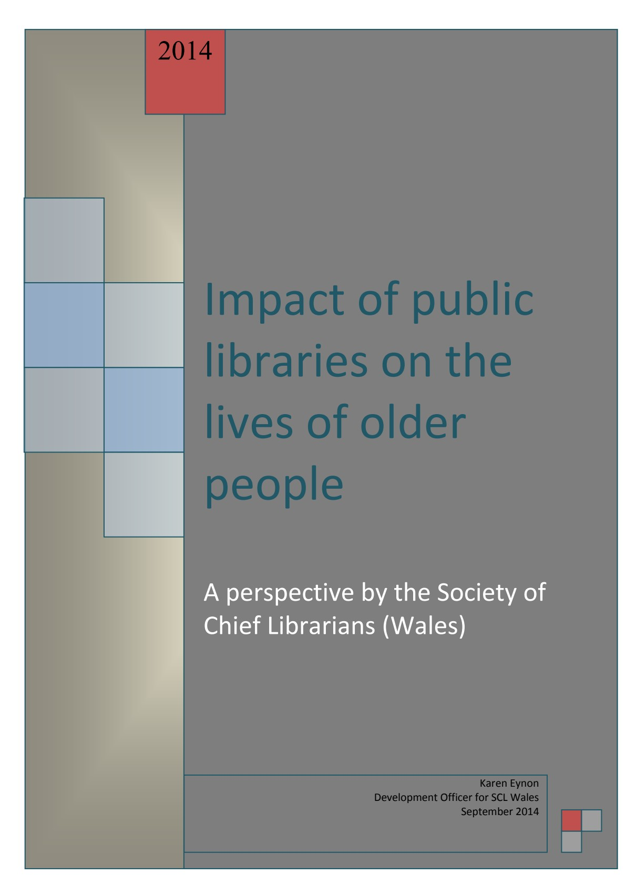
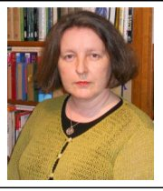
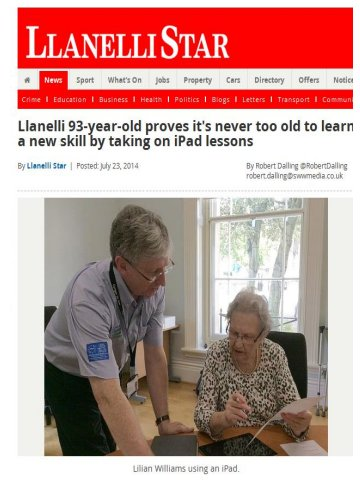
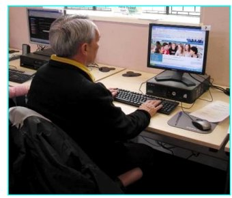
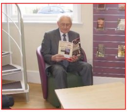

<!-- PAGE: 1 -->

# Impact of Public Libraries on the Lives of Older People

### A perspective by the Society of Chief Librarians (Wales)

**Karen Eynon**  
Development Officer for SCL Wales  

**September 2014**

<!-- PAGE: 2 -->

## Contents

- **Foreword by Ann Jones, Chair of SCL Wales and Jane Sellwood Vice-Chair of SCL Wales** (page 2)
- **Introduction** (pages 3–5)
- **Public library services for older people – summary** (pages 5–7)
- **Lifelong Learning Benefits** (pages 7–8)
- **Digital inclusion Benefits** (pages 9–12)
- **Social Inclusion Benefits** (pages 13–17)
- **Financial Benefits** (pages 18–19)
- **Health and Wellbeing Benefits** (pages 19–23)
- **Conclusions** (page 24)
- **Comments from our users** (pages 25–30)

<!-- PAGE: 3 -->

## Foreword by the Chair and Vice-Chair

The Society of Chief Librarians (Wales) is an association made up of the head librarian (or equivalent) of each public library authority in Wales. Our key aim is to promote and support public libraries in Wales.

Public libraries have always provided services for older people. However, in recent years this area of work has become even more important due to the changing demographic profile of Wales and the growing recognition of the role public libraries play in supporting older people.

The growing number of older people across Wales is bringing new challenges and opportunities for public services. Public libraries are ideally placed to meet many of these challenges, providing accessible, community-based services that contribute to independent living, social connection, and mental and physical wellbeing.

The evidence in this report demonstrates the wide range of services public libraries deliver for older people in Wales and the real difference these services make to people's lives. We hope it will be of interest and value to policy makers, service planners, and anyone interested in the wellbeing of older people in Wales.

  
**Ann Jones**  
Chair of SCL Wales  

  
**Jane Sellwood**  
Vice-Chair of SCL Wales.

<!-- PAGE: 4 -->

## Introduction

The Society of Chief Librarians (Wales)[^1] has prepared this report in order to highlight the role public libraries have in relation to older people.

Older people are one of our higher user groups if divided by age. More older people are visiting libraries than in previous years and with the number of people aged 60 or over predicted to rise the number wanting to use public library services will inevitably increase.

We are pleased to see the importance of public libraries recognised in the recent report by the Older People's Commissioner in Wales *The Importance and Impact of Community Services in Wales* (2014):[^2]

> "Libraries play a significant role in the lives of older people across Wales, providing physical spaces in which to interact ... The local library provides a social and civic role within communities, contributing towards people's sense of social wellbeing. 'Bibliotherapy', for example, can make a considerable difference to an individual's health and wellbeing.
>
> "Libraries play a central role in our communities and contribute to our social, educational, cultural and economic wellbeing. Libraries help bring people together."

Public libraries provide a service many older people value. This is demonstrated throughout this report and particularly through the user comments.

The *Strategy for Older People in Wales 2013–2023* underlines the importance of older people being full participants in society at a time when many older people are able to participate in the community, learn new skills or take up new activities. However, many older people come up against barriers that prevent their participation, and what should be an enjoyable stage of life can become a time of loneliness and isolation. Public libraries have a key role to play here as they provide an invaluable learning and social resource for many older people.

Public libraries also have a key role to play in relation to national policy agendas which are important to older people in the areas of:

- Social Care and Older People

<!-- PAGE: 5 -->

- Health and Well-being
- Equality and Diversity
- Digital Inclusion
- Reading and Literacy
- Lifelong Learning and Re-skilling.

As part of the Welsh Public Library Standards Framework (CyMAL — a division of the Welsh Government dealing with museums, archives and libraries), libraries have standards of service and performance indicators directly linked to the delivery of the above key current national policy agendas.

> ### Did You Know?
>
> - More older people are visiting libraries in the UK. 43% of adults aged 65–74 visited the library in 2010/11 compared to 39% in 2009/10.
> - 37% of people over 75 visited the library in 2010/11 compared to 33% in 2009/10.
> - The number of people aged 60 or over in the UK is predicted to rise by more than 50 percent in the next 25 years.

While libraries contribute to all of the agendas mentioned, they have a particular strength in building community cohesion, social inclusion and contributing to the individual health and well-being of older people in Wales.

Libraries play a huge and positive role in the lives of older people and other age groups across Wales. Libraries give older people physical spaces (particularly important in rural areas with few alternatives) in which to socialise and interact and a role within communities thus contributing towards people's sense of social wellbeing.

SCL Wales believe the potential of library and information services in relation to older people requires greater recognition and exploitation within national and regional strategies and priorities.

The benefits are substantial:

Libraries help:
- Reduce isolation amongst the elderly
- Support older people to live independent lives

<!-- PAGE: 6 -->

- Provide Lifelong Learning opportunities
- Provide Digital Inclusion opportunities
- Encourage healthy lifestyles
- Support carers
- Support people with dementia and their families
- Provide neutral, warm, welcoming public spaces
- Provide free access to information, reading, and ICT.

## Public Library Services for Older People – Summary

A reduction in library services would seriously impact on older people's ability to live active, independent lives.

Key services libraries provide:

- **Books of all formats, genres, levels, fact and fiction:** Specifically, libraries provide large print books and audiobooks (on CD, MP3, and downloadable e-audiobooks) which are vital for people with failing sight.
- **Local Studies and Family History materials:** A higher proportion of over 50s use these services than other age range.

<!-- PAGE: 7 -->

- **Talks:** A varied range of talks are provided by library services, for example in relation to local cultural history and events. Many of the talks are requested by groups such as local history societies or U3A.
- **IT support and equipment:** Libraries provide access to computers, the internet, and Wi-Fi. Free introductory IT taster sessions and one-to-one digital support are delivered by library staff and digital volunteers.
- **Reading groups:** Discussion groups which meet regularly in libraries to discuss books, poetry, or plays.
- **Home library / housebound services:** Delivery of books and audiobooks directly to people's homes, sheltered housing complexes, and care homes for those unable to visit a branch library.
- **Mobile libraries:** Essential mobile library stops reaching rural and isolated communities across Wales.
- **Information services:** Access to reliable public information, local authority services, welfare benefits, health advice, and consumer guidance.
- **Reminiscence collections and activities:** Multi-sensory packs, memory boxes, and photograph archives used to stimulate memory and communication for people with dementia.
- **Learning activities:** Courses delivered by library staff (Local Studies and ICT are good examples) or through partner organisations such as U3A, the University of the Third Age. Many of these

<!-- PAGE: 8 -->

courses are free. One of the library services' greatest treasures is the range of stock it holds or can access from other library partners.

- **Group social activities:** Social groups, knitting and craft clubs, coffee mornings, genealogy circles, yoga classes, and shared reading groups.
- **Volunteering opportunities:** Opportunities for older people to volunteer in libraries, sharing their skills, mentoring others, and remaining socially active.

## Lifelong Learning Benefits

Lifelong learning has been shown to have a significant positive effect on older people's physical health, mental wellbeing, and sense of community belonging.

Libraries are primary providers of non-formal, self-directed lifelong learning. They offer adults an accessible, pressure-free environment to pursue personal interests, upgrade skills, or simply explore new subjects.

Many older adults experience barriers to participating in formal education (such as cost, qualifications, transport, or lack of confidence). Libraries provide a free, welcoming alternative where people can learn at their own pace.

Learning keeps the mind active and also increases confidence, personal development and self-esteem.

<!-- PAGE: 9 -->

> "Going to the library is like visiting a long standing friend, where all the family drop in. Young children, always eager to see what is happening, adults popping in and out or on the computers, older people finding it a safe haven."
> — Library user

Research by NIACE (the National Institute of Adult Continuing Education) shows that participation in learning in later life is associated with:

- Greater life satisfaction and psychological wellbeing[^3]
- Better physical health and maintenance of cognitive function
- Protection against dementia and cognitive decline[^4]
- Stronger social networks and reduced loneliness.

Libraries support lifelong learning for older people through:

- Free access to extensive collections of non-fiction, biographies, history, science, and the arts
- Access to online reference resources (such as Ancestry Library Edition, Oxford Dictionaries, Encyclopaedia Britannica)
- Structured adult learning classes delivered in partnership with adult education services and colleges
- Informal learning groups (reading groups, language practice, family history clubs).

<!-- PAGE: 10 -->

## Digital Inclusion Benefits

Digital inclusion is becoming increasingly central to everyday life. Government, local authorities, utilities, banking, and retail are all moving towards "digital by default" delivery models.

However, older people are disproportionately excluded from the digital world:

- Older adults make up the largest group of non-users of the internet.
- Many older people lack digital skills, affordable home internet access, or confidence to use online services safely.
- In Wales, older people are significantly more likely to be digitally excluded, particularly in rural communities.

Public libraries are the primary public network delivering digital inclusion for older people in Wales:

- Free public access to computers and broadband internet in every branch
- Free Wi-Fi enabling users to bring and use their own tablets, laptops, and smartphones
- Patient, friendly, one-to-one assistance from frontline library staff
- Digital champion and volunteer mentoring programmes.

> "I have learnt to use Skype to keep in touch with my daughter in Australia. It has completely changed my life."
> — Library user

<!-- PAGE: 11 -->

*Above: Lifelong learning and digital access in Welsh public libraries*

> "I have been coming to the library for taster sessions on the computer. I was terrified of technology, but the staff were so kind and patient. Now I can do my own grocery shopping online and send emails to my grandchildren."
> — Library user

Libraries provide:

- Introductory sessions on basic mouse and keyboard skills, setting up email, and browsing the web safely
- Assistance with accessing public services online (NHS Direct Wales, local council portals, bus passes, and pension information)
- Drop-in "gadget surgeries" where older people can bring their own tablets, e-readers, and smartphones to get help.

<!-- PAGE: 12 -->

> ### Did You Know?
>
> - Public Libraries in Wales have over 2,000 public access computer terminals with free internet access.
> - Over 40% of people aged 65 and over in Wales do not use the internet at home.[^5]
> - For older people who do not have a computer at home, the library is the single most common location to access the internet.[^6]

Without the free computers and staff support provided by public libraries, thousands of older people in Wales would be completely cut off from essential digital public services, communication with family, and online information.

<!-- PAGE: 13 -->

*Above: Digital support sessions helping older adults get online*

> "My library is a great meeting place. The staff are always friendly and helpful, and there is always someone to talk to. Coming here gets me out of the house."
> — Library user

As Martha Lane Fox (UK Digital Champion) noted:

> "The internet is not a luxury, it is an essential utility. Public libraries are the front door to the digital world for millions of citizens who would otherwise be left behind."

<!-- PAGE: 14 -->

## Social Inclusion Benefits

Public spaces such as libraries play a crucial role in preventing social isolation and loneliness among older people.

Loneliness has been shown to have severe impacts on health, equivalent to smoking 15 cigarettes a day and twice as harmful as obesity.

Libraries are uniquely positioned to counteract isolation because they are:

- **Free and open to all:** There is no charge for entry, no requirement to buy coffee or goods, and no time limit on how long people can stay.
- **Neutral and non-stigmatising:** People visit libraries for many positive reasons (books, learning, community, information), meaning that using a library carries no stigma of dependency or vulnerability.
- **Intergenerational spaces:** Libraries bring together people of all ages — from babies at Rhymetime to students studying and pensioners reading the daily papers.
- **Embedded in local communities:** Branch libraries and mobile library stops are rooted in town centres, suburban estates, and rural villages.

Activities hosted by libraries to foster social connection include:

- Knit and natter groups
- Coffee mornings and tea afternoons
- Shared reading circles
- Board games and scrabble clubs
- Local history and reminiscence groups.

<!-- PAGE: 15 -->

> "The library has always been a part of my life. Since my husband passed away, it has become even more important. It is somewhere I can go where I feel welcomed and safe, and where I can have a chat. Some days, the library staff are the only people I speak to."
> — Library user

For many older adults living alone, a visit to the local library provides routine, a reason to get dressed and leave the house, and essential human contact.

Frontline library staff play an informal welfare and monitoring role: when a regular older user fails to visit for several days, staff notice and often enquire after their wellbeing.

<!-- PAGE: 16 -->

The Welsh Government's *Programme for Government* emphasizes the creation of cohesive, resilient communities and the promotion of independent living for older people.

Public libraries support these national strategic goals directly:

- Promoting community cohesion by bringing diverse age groups together
- Enabling older people to remain active contributors to community life
- Supporting carers with information, flexible lending rules, and respite activities
- Facilitating volunteering opportunities that keep older people engaged and active.

<!-- PAGE: 17 -->

Public libraries provide a network of community-based services that support older people living in rural and dispersed communities across Wales.

Mobile libraries and home delivery services ensure that frail, isolated, or housebound individuals can continue to access books, audiobooks, and social contact.

> "The mobile library is a lifeline. In our village there is no shop, no pub, and the bus runs only twice a week. When the mobile library arrives, it's not just about the books — the whole lane comes out and we catch up with each other."
> — Mobile library user, Powys

<!-- PAGE: 18 -->

*Above: Community engagement and reading activities for older adults*

The Booklink library service in Bridgend and home library services across Welsh authorities deliver books directly to housebound residents, care homes, and sheltered housing.

As highlighted in the CyMAL report *Public Libraries: Health, Wellbeing and Social Inclusion*:

> "Public libraries are an essential pillar of community infrastructure. They deliver preventative social value that reduces pressure on primary care and social services."

<!-- PAGE: 19 -->

## Financial Benefits

Public libraries offer enormous financial value to older people, particularly those living on fixed state pensions:

- **Free borrowing:** Free access to books, large print novels, audiobooks, and e-books, saving older readers hundreds of pounds each year.
- **Free internet and PC access:** Free computer access, Wi-Fi, scanning, and digital support, saving older people substantial broadband subscription and hardware costs.
- **Free warm spaces:** During winter months, libraries provide warm, comfortable spaces where older people can spend time without heating their own homes throughout the day.
- **Free cultural and educational events:** Free author events, lectures, craft sessions, and clubs that would otherwise cost admission fees.
- **Financial and benefits information:** Staff guidance on accessing pension credits, Winter Fuel Payments, council tax reductions, and consumer rights advice.

<!-- PAGE: 20 -->

Local authorities in Wales have a statutory duty under the Public Libraries and Museums Act 1964 to provide a "comprehensive and efficient" library service.[^7]

Investing in public libraries represents exceptional value for money for local authorities and the Welsh Government. Library services operate on modest budgets while delivering cross-cutting preventative benefits across health, social care, digital inclusion, and education.

## Health and Wellbeing Benefits

The health and wellbeing benefits of public libraries are well established:

- **Mental stimulation and cognitive health:** Reading and learning stimulate brain plasticity and help maintain cognitive function in later life.
- **Reduction of depression and anxiety:** Bibliotherapy and recreational reading have proven therapeutic value in reducing symptoms of mild-to-moderate depression and stress.
- **Books on Prescription (Llyfrau ar Bresgripsiwn):** A national Welsh scheme providing high-quality, evidence-based self-help books recommended by health professionals for mental health conditions.
- **Dementia support:** Specialist dementia collections, memory boxes, and reminiscence sessions designed to support individuals living with dementia and their carers.

<!-- PAGE: 21 -->

> "I've been very ill with cancer over the last two years. The library was my sanctuary. Reading took my mind off the pain and the worry, and the audiobooks were wonderful when I was too tired to hold a book. I honestly don't know how I would have coped without it."
> — Library user

Shared reading groups (run in partnership with The Reader Organisation[^8] and local health boards) bring people together to read poems and stories aloud, stimulating lively conversation and personal reflection.

<!-- PAGE: 22 -->

Professor Neil Frude, Consultant Clinical Psychologist and founder of the Books on Prescription scheme in Wales, states:

> "Evidence for the effectiveness of bibliotherapy is now overwhelming. Books can change minds, relieve depression, and offer therapeutic strategies that people can practice in their own homes. Public libraries are the delivery vehicle that makes this accessible to everyone, free of charge."

<!-- PAGE: 23 -->

Specialist dementia resources available through Welsh public libraries include:

- **Pictures to Share books:** Beautifully designed books combining striking images and short texts, specially formatted for people living with mid-to-late stage dementia.
- **Memory boxes:** Themed collections of artifacts, photographs, music, and smells (e.g. 1950s household items, wartime memories, childhood toys) used for group reminiscence.
- **Information for carers:** Dedicated collections on caring for someone with dementia, legal affairs, lasting power of attorney, and local support services.

<!-- PAGE: 24 -->

Many other health and wellbeing activities take place in Welsh public libraries:

- Gentle exercise classes (chair-based yoga, Tai Chi)
- Health awareness talks by NHS practitioners and charities (Age Cymru, Alzheimer's Society, Macmillan Cancer Support)
- Blood pressure checks and hearing aid clinics in partnership with local health boards.

<!-- PAGE: 25 -->

## Conclusions

Our intention in this report has been to demonstrate the vital, multi-faceted impact public libraries have on the lives of older people across Wales.

As the population of Wales ages, public libraries are more essential than ever. They provide:

- A safe, welcoming, and free community hub in every locality
- Critical digital access and one-to-one coaching that bridges the digital divide
- Lifelong learning opportunities that promote cognitive health and self-esteem
- Practical preventative interventions that combat loneliness and social isolation
- Therapeutic reading and dementia resources that support health and wellbeing.

SCL Wales urges national and local policy makers, health boards, and community partners to:

1. **Recognise public libraries as core social and preventative health infrastructure.**
2. **Include public libraries in health, social care, and older people's strategic planning.**
3. **Protect and invest in public library funding, staffing, and physical branch networks.**
4. **Foster partnerships between health boards, social services, and library services to expand preventative wellbeing initiatives.**

Public libraries are not a cost to be cut; they are an investment in the health, dignity, and independence of older people in Wales.

<!-- PAGE: 26 -->

## Comments from Our Older Public Library Users in Wales

Direct feedback from older library users across Welsh local authorities illustrates the personal impact of public library services:

> "The mobile service is invaluable to our household as my husband is disabled and unable to travel. The driver and librarian are always so kind and helpful."  
> — *Carmarthenshire*

> "I look forward to my weekly library visit. It's the highlight of my week, meeting friends and choosing my books."  
> — *Ceredigion*

> "The large print books have allowed me to keep reading even though my eyesight has deteriorated. Reading is my main pleasure."  
> — *Conwy*

<!-- PAGE: 27 -->

> "The convenience of the service enables me to enjoy a lot of reading. Without it, I would be lost."  
> — *Denbighshire*

> "I attended the computer classes at the library and now I can manage my own online banking and keep in touch with my grandchildren abroad. It gave me my independence back."  
> — *Flintshire*

> "The library staff are wonderful. They always have time for a cheerful word, which means so much when you live on your own."  
> — *Gwynedd*

<!-- PAGE: 28 -->

> "I have been using the library for many years and always enjoy my visits. I enjoy chatting with the staff and browsing the shelves. Long may it continue."  
> — *Isle of Anglesey*

> "Glad you have a good selection of large print novels. It keeps me going through the long winter evenings."  
> — *Merthyr Tydfil*

> "The knit and natter group has given me a new circle of friends. We laugh, we share patterns, and we look out for each other."  
> — *Newport*

<!-- PAGE: 29 -->

> "I never felt comfortable or confident enough to use computers, but the staff here made it so simple and reassuring. Now I look up local history and check the news every day."  
> — *Pembrokeshire*

> "The library makes such a positive difference to my elderly parents' lives. The home library service brings them books every fortnight and brightens their day."  
> — *Powys*

> "The library is a warm, friendly place where you never feel out of place, whatever your age."  
> — *Rhondda Cynon Taf*

<!-- PAGE: 30 -->

> "I like to check my emails on the computer and browse the local history section. When you're on your own, having somewhere welcoming to go makes all the difference."  
> — *Swansea*

> "Books on Prescription helped me through a very dark patch after I retired. Having the right book recommended by a professional made a huge difference."  
> — *Torfaen*

> "A wonderful service with dedicated staff who genuinely care about the community."  
> — *Vale of Glamorgan*

<!-- PAGE: 31 -->

> "I wish this service had been available years ago. It has brought so much joy and interest back into my life."  
> — *Wrexham*

## Acknowledgements

**Society of Chief Librarians (Wales)**

Karen Eynon, Development Officer for SCL Wales  
Ann Jones, Chair of SCL Wales  
Jane Sellwood, Vice-Chair of SCL Wales.

Thanks to all 22 Welsh public library authorities, CyMAL (Welsh Government), and the older library users of Wales who contributed their thoughts and experiences.

Website: [www.goscl.com](http://www.goscl.com)

## Footnotes

[^1]: The Society of Chief Librarians (Wales) is an organization consisting of the heads of library services (or equivalent) of all 22 local authorities in Wales.
[^2]: *The Importance and Impact of Community Services in Wales*, Older People's Commissioner for Wales (2014).
[^3]: Schuller, T. and Watson, D. (2009), *Learning Through Life: Inquiry into the Future for Lifelong Learning*, NIACE. Available at: [http://shop.niace.org.uk/ifll-learningthroughlife.html](http://shop.niace.org.uk/ifll-learningthroughlife.html).
[^4]: *Learning and Wellbeing in Later Life*, NIACE (2011). Available at: [http://shop.niace.org.uk/media/catalog/product/f/i/file_1_50.pdf](http://shop.niace.org.uk/media/catalog/product/f/i/file_1_50.pdf).
[^5]: *Older People and Digital Inclusion*, Calouste Gulbenkian Foundation and Independent Age. Available at: [http://www.independentage.org/media/9425/gulbenkiannewreport.pdf](http://www.independentage.org/media/9425/gulbenkiannewreport.pdf).
[^6]: *Older People and the Internet*, Age Cymru (2011).
[^7]: Public Libraries and Museums Act 1964; see National Assembly for Wales Legislative Competence Order documentation: [http://www.assemblywales.org/lco-ld7557-em-e.pdf](http://www.assemblywales.org/lco-ld7557-em-e.pdf).
[^8]: The Reader Organisation is a nationally recognised centre for the promotion of shared reading and positive mental health.
