<!-- PAGE: 1 -->
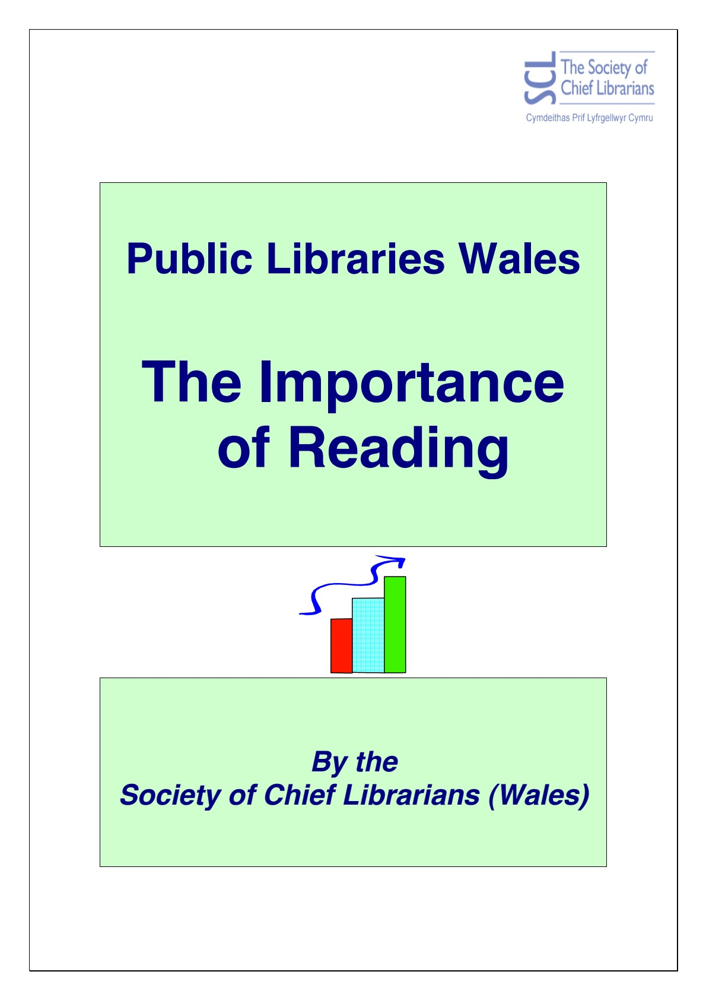

# The Importance of Reading

## Public Libraries Wales

By the **Society of Chief Librarians (Wales)**

**December 2011**

---

<!-- PAGE: 2 -->

## Contents

| Section | Page |
| :--- | :--- |
| **Foreword** by Gareth Evans and Ann Jones | 2 |
| **1. Introduction** | 3 |
| **2. Our Core Reading Offer** | 4 – 5 |
| **3. The Difference We Make** | 6 – 19 |
| * 3(i) Reading for Pleasure | 6 – 7 |
| * 3(ii) Children and Young People | 8 – 12 |
| * 3(iii) Adults | 13 – 14 |
| * 3(iv) Information Literacy | 15 |
| * 3(v) Reading and Digital Literacy | 16 |
| * 3(vi) Reading, Health and Social Benefits | 17 – 19 |
| **4. Sustaining, Supporting and Strengthening** | 20 |
| **5. Conclusion** | 21 – 22 |
| **Appendix: Customer Comments** | 23 – 28 |

Thank you to the marketing strand, Libraries Inspire for use of many of the photographs [© Welsh Government]

---

<!-- PAGE: 3 -->

## Foreword

### By the Chair and Vice-Chair of The Society of Chief Librarians Wales

The Society of Chief Librarians (Wales), representing as it does the chief librarian, or equivalent officer, of each library authority in Wales, asserts that modern, vibrant and well-developed public library services are essential to the citizens of Wales in the 21st century.

Our purpose in this report is to demonstrate to you the role that public libraries have and can have in relation to reading and literacy in Wales. We believe that public libraries are uniquely placed in the heart of the community to provide a range of reading, literacy and learning opportunities.

We also believe this potential requires greater recognition and exploitation within both local and national reading and literacy strategies and initiatives. For example, The National Literacy Programme.

Reading impacts on literacy levels, information and knowledge, digital literacy, social skills, health and wellbeing as well as providing fun and meaningful activity. With the correct level of investment the role of public libraries can be enhanced further thus allowing greater impact in these areas.

SCL (W) asserts that our public libraries in Wales will:

* Be the first stop for reading, inspiring and fostering the enjoyment of reading for everyone.
* Provide a wide range of relevant reading opportunities for all ages and abilities.
* Improve wellbeing and life chances for all.

On behalf of SCL (Wales) we hope you enjoy ‘The Importance of Reading’ and recognise the role public libraries have in relation to reading.

**Gareth Evans**  
Chair of SCL (Wales)

**Ann Jones**  
Vice-Chair of SCL (Wales)

---

<!-- PAGE: 4 -->

## 1. Introduction The Society of Chief Librarians (Wales) asserts that modern, vibrant and welldeveloped public library services are essential to the citizens of Wales in the 21st century. The CyMAL (Museums, Archives and Libraries Wales) Libraries Inspire Framework 2012  2016 states: > “Libraries will inspire the people of Wales to enjoy reading, enhance their knowledge and skills, to enrich their quality of life and empower them to realise their full potential” For two consecutive years, 2008-09 and 2009-10, there has been an increase in the number of visitors to Welsh public libraries demonstrating that the role of libraries is even more important in a period of economic downturn. Public libraries have a key role to play in relation to economic wellbeing, digital literacy, information literacy, education and learning and culture. However, our purpose in this report is to demonstrate to you the role that public libraries have specifically in relation to reading and literacy. Recent research clearly indicates that the public see the primary purpose of libraries' as being about reading. In a survey of 670 library users in Wales, 94% said that the main reason for visiting a library is to borrow, renew or return books [Scotinform (2010) Evaluation of Libraries for Life final report] The report `What the public want from Public Libraries' by the Museums, Libraries and Archives Council, states: > “ Books are still the main reason why most people use public libraries  and are seen as the core offer of the library service by users and non-users alike” Libraries provide activities to stimulate learning, literacy and reading. This includes the provision of a wide range of high quality books, audio and ebooks, for listening and reading for pleasure. Libraries are supportive reading environments, where children and adults can enjoy reading in their own space and in their own time, with help on hand when they need it from supportive staff. > “Libraries remain absolutely central to the life of a nation. Libraries house our knowledge and our culture; they are beacons of light in a difficult world.” Alexander McCall-Smith, author of the No. 1 Ladies' Detective Agency series

---

<!-- PAGE: 5 -->

## 2. Our Core Reading Offer Public libraries are literally `cradle to grave' services with books and other resources available to everyone regardless of age, gender, religion, educational background Public libraries are committed to supporting children's learning and development, as illustrated by initiatives which include Bookstart, the Summer Reading Challenge, rhyme times, storytimes, class visits and provide learning facilities to support study and homework. Libraries provide important links with school library services and local schools. Public libraries provide fiction books in hardback and paperback from classics to the latest best sellers, `easy reads' to challenging contemporary authors. Public libraries provide information and reference materials in print and electronic formats including specialised services in some places, for example local studies and business collections. Public libraries provide books and other reading materials in various formats including large print books, audio books, e-books and digital audio books. Public libraries provide book related activities for adults and children including reading groups and social reading activities for all ages. Public libraries support and help adult learners with literacy needs including Quick Reads, the Six Book Challenge, Adult Learners' Week and work with adults in prisons. Public libraries support people with a variety of health needs including Books on Prescription Wales, Bibliotherapy, reading for relaxation and pleasure. Public libraries in Wales provide books, other resources and activities in the Welsh language and reflecting the Welsh culture Tools to deliver Our Universal Library Membership (which allows members to join one library and use any other in Wales and England) is free and available to all Library staff are helpful and friendly and committed to delivering a high quality, user-focused service in a supportive and safe environment Increasingly library services are becoming available 24/7 through corporate websites and a range of online resources and databases Book reservations and access to stock in other libraries across the UK

---

<!-- PAGE: 6 -->

Library catalogues and stock circulation system for all titles to enable a wide range of titles to be accessed by customers in all libraries. CatCymru on librarywales.org provides access to all Welsh library catalogues. Many library services offer a Mobile Library service and/or a service to customers who may be housebound or for some reason be unable to visit a static library A sense of community. Public libraries help preserve the history and cultural heritage of local communities and help create a sense of pride and belonging

---

<!-- PAGE: 7 -->

## 3. The Difference We Make ### 3(i) Reading for Pleasure Reading appeals to people of all ages. There are books for children and for adults. There are books of varying levels and for all different age groups from books for babies to adults. There are stories, factual books, reference books, longer novels, shorter quick reads, picture books. There are also books in different formats, for example audio books and large print books for people who may struggle to see smaller text. There is simply something for everyone!

> “Since becoming partially sighted, finding large print books to read in the library has improved my disposition  having been depressed about it before-hand. I was always an avid reader and thought I had lost that pleasure.” LIBRARY CUSTOMER - SWANSEA

> “It has opened my eyes to all the fantastic books that are available. It has given me knowledge and fostered a great love of reading. It has enabled me to fulfil many ambitions and encouraged my creativity. It has been a very important part of my life for twenty two years.” LIBRARY CUSTOMER  WREXHAM

The importance of reading for pleasure and enjoyment can not be underestimated. Reading improves literacy levels, social skills, personal wellbeing and provides meaningful activity and a sense of purpose. The simple act of doing something for pleasure has so many benefits. Reading helps you escape, utilises your mind, gets your creative juices flowing, helps you learn and discover new things and takes you on wonderful journeys  very powerful! > “The library has always been a part of my life. As a young girl, a place of wonder surrounded by so many books. As a teenager, a place to learn and read about romance. As a mother, a place to introduce my son to the pleasure of reading. As a grandmother, a place to relive the pleasures of motherhood. And now, in retirement, a place to join a readers group where I can enjoy discussion, chatting with friends and the chance to meet authors”. LIBRARY CUSTOMER  NEATH PORT TALBOT

---

<!-- PAGE: 8 -->

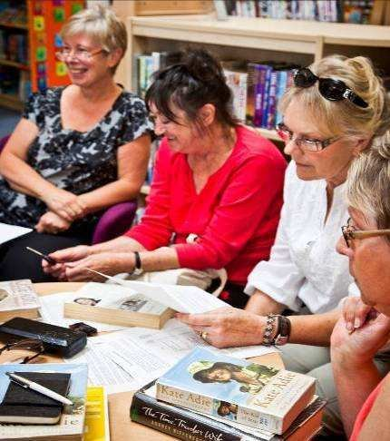

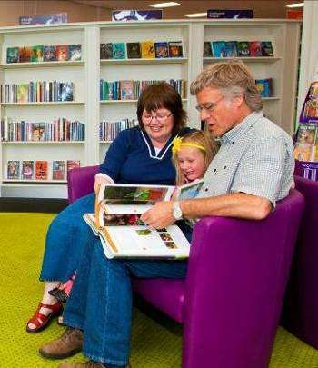

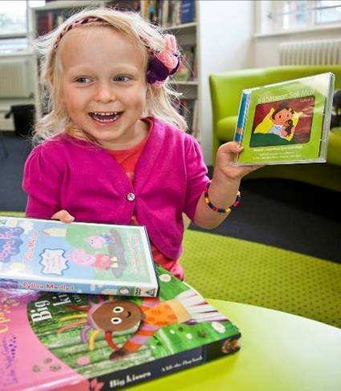

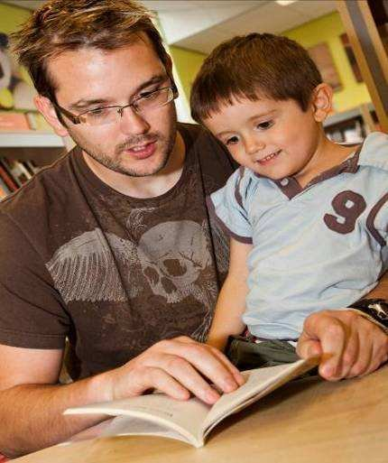

A book group at Gwersyllt Library near Wrexham Family Reading at Llandudno and Gowerton Libraries

A delighted young customer at Llandudno Library

In addition, people who enjoy reading will have improved literacy skills which in turn increases opportunities within education and learning, work and employment, social and life skills and personal health and wellbeing.

---

<!-- PAGE: 9 -->

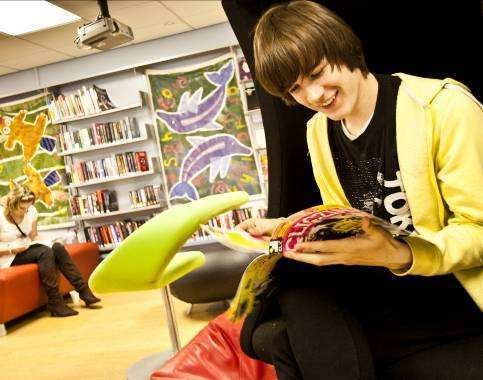

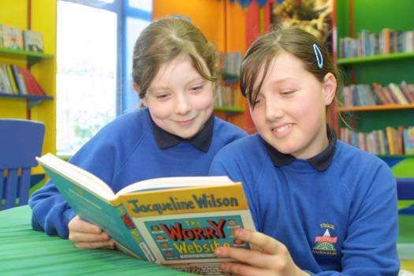

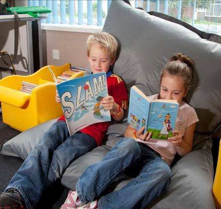

### 3(ii) Children and Young People Reading for enjoyment also improves literacy skills and other educational subject areas. Children who enjoy reading are five times more likely to be above average readers. Children thrive when reading outside the classroom environment as shown by figures provided via the National Literacy Trust. Children who only read in class:  45% are below average readers  45% are average readers  9% are above average readers Children who enjoy reading are five times more likely to be above average readers.

Rhos Library, Wrexham Fairwater Library, Cardiff Teenage section of Treorchy Library, Rhondda Cynon Taf.

---

<!-- PAGE: 10 -->

Libraries are key to enthusing the child to read and it is important that children are provided with access to inspirational authors and settings outside of the school whenever possible. Young people who use their public library are nearly twice as likely to be reading out of class every day. Public Libraries and Literacy. National Literacy Trust, February 2011. Libraries work closely with schools, school librarians and LEA staff to ensure children have access to resources, learning support and community involvement. Public libraries enhance and complement the education children receive in school and also help improve quality of life for children and young people > “We strongly encourage our pupils to participate in the Summer Reading Challenge. It fosters an enjoyment of reading, elevating the status of reading and books. It becomes very desirable to complete the challenge and to gain recognition from library staff, parents, teachers and the other children. The scheme develops links between our school and the local community, and gets the parent on board too. Our hope is that more and more parents play an active role by hearing their children read (or by sharing books with the younger age groups) during the Summer Holidays” Flintshire Head Teacher In addition to providing a key role in relation to reading and literacy with the individual child or with families, public libraries enhance and complement the education children receive in school by supporting most aspects of the curriculum and encouraging children and young people to participate in enrichment opportunities. For example libraries also provide the following: ICT : Free access to computers and the Internet to support study and homework History: A wide range of local history resources

---

<!-- PAGE: 11 -->

Creativity and Arts: Libraries provide creative spaces and experiences for children and families. Visits by children's authors and the Writing Squads improve reading and creative writing skills. Personal and social education: Joining and using the library promotes a sense of belonging and responsibility. Children are encouraged to visit and use library services as individual young citizens, developing their sense of community involvement and individual responsibility. Using the library is an important first step in local citizenship and community responsibility. Cross curricular and themed projects and research: Libraries support children with homework and research, providing online resources, books, primary sources, maps and DVDs, as well as support and help to develop independent learning skills. > “Just 14% of variation in individuals' performance is accounted for by school quality. Most variation is explained by other factors, underlining the need to look at the range of children's experiences, inside and outside school, when seeking to raise achievement” Joseph Rowntree Foundation , 2007 Libraries are also important in creating the bond between the home and school environment and much of our success over the years has been in engaging at an early age with parents and children through Bookstart, rhyme time and story time sessions.

> “Bookstart has made my daughter learn that books are fun!” Parent at Denbighshire libraries

Bookstart is the very first step in lifelong learning and introduces babies and their families to the world of books and libraries that gives them a head start in life. Research has shown that children who are introduced to books from an early age make better progress when they get to school and that education achievement is strongly influenced by children's attitudes towards learning. An article in Nursery World (November 2011) describes how more children under five are visiting libraries to take part in children's events than four years

---

<!-- PAGE: 12 -->

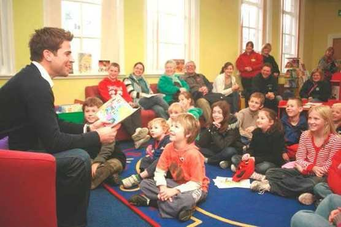

ago. This article quotes from the Children's Public Library Users Survey, which is based on data from 1,203 libraries across 63 local authorities in the UK. More than one third of children visited a library for an under-fives' event between April 2010 and March 2011, an increase from 28 per cent in 2007/08. The Welsh Government's National Literacy Programme also describes the importance of targeting children of foundation and primary ages. TV Presenter Gethin Jones reading stories at Colwyn Bay Library

Regular storytimes in libraries also increases parents' confidence in sharing books and rhymes with their children, and make a positive impact on children's early language and social development. An Organisation for Economic Co-operation and Development (OECD, 2011) analysis examines the long-term impact of parental support on literacy. Discounting social differences, the study found children with early support remained ahead in reading What children say

> “If I didn't go to the library I wouldn't have as many friends as I do now and wouldn't have read as many books and wouldn't have done so well at lessons in school.” Library customer, Blaenau Gwent Children are regularly consulted for their opinion on their local library and the service offered. Under the Welsh Public Library Standards framework, authorities are required to conduct a CIPFA Children's Public Library User survey every three years.

---

<!-- PAGE: 13 -->

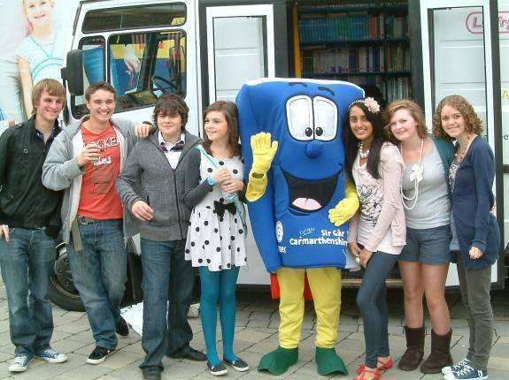

Here is a sample of the most recent survey which demonstrates the impact the public library service has. Using the library has helped me to:

Authority Flintshire Bridgend Caerphilly Isle of Anglesey Monmouthshire Powys Pembrokeshire UK

Read better 66 % 66 % 56 % 73 % 60 % 67 % 66 % 60%

Do better at school 45 % 53 % 45 % 46 % 36 % 42 % 44 % 39%

Significantly, using the library is FREE for children and young people! In addition to educational and social benefits there are also economic benefits to using public libraries. This is an important factor as there are many families in Wales who find it difficult to purchase books and other resources particularly during these difficult economic times

SuperBook : Carmarthenshire Library Mascot

---

<!-- PAGE: 14 -->

### 3(iii) Adults Reading impacts on literacy levels and there is overwhelming evidence that literacy has a significant relation to a person's success in life. Improvements in reading and literacy can have a profound effect on individuals and their contribution to society. Literacy impacts on skills, employment and life opportunities, thus improving the quality of life for people of all ages. Figures from the Basic Skills Agency suggest that 25% of the population of Wales have literacy skills at entry level or below (the level expected of an eleven year old). This compares to 16% in England for the same literacy levels. In Wales, 4% of the adult population have the lowest level of literacy, where they can understand short texts with repeated signs and symbols. This is equivalent to around 72,000 adults in Wales. Figures by the National Literacy Trust shows the impact on an individual during the course of their life: 22% of men and 30% of women with low levels literacy live in non-working households. Individuals with low levels of literacy are more likely to lead solitary lives. Individuals with low literacy levels are more likely to have reduced access to technology. Increased literacy rates improve the chances of using a PC at work from 48% to 65%. A modest rise in literacy levels sees the likelihood of a person owning their own house rise from 40% to 78%. Men and women with the poorest literacy or numeracy skills were the least likely to have voted in the 1987 and 1997 general elections.

Evidence shows that literate individuals contribute to and are successful in a range of areas, and help create literate families who live within literate communities, which contributes towards a literate nation. Thus reading and literacy has a key role to play in relation to many aspects of life including education, learning, work, social skills, health, democracy, digital literacy, health and wellbeing, fun and enjoyment.

---

<!-- PAGE: 15 -->

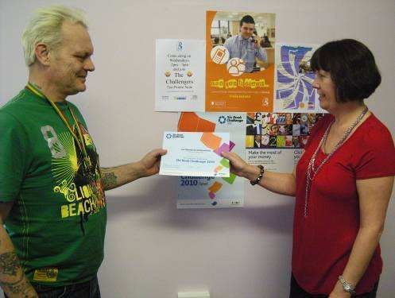

As well as providing a wealth of reading material in various formats, many public libraries also offer further literacy and learning opportunities including learndirect courses, adult learning events, reading discussion groups, informal and formal learning. Older people particularly enjoy the type of community learning offered through public library services. Norman receiving his certificate for completing the Six Book Challenge at the Ton Pentre Suite, Bridgend. Norman has successfully completed eleven Learndirect courses in Literacy and is working towards his Adult Literacy qualification through Bridgend Public Library Service. He now regularly attends the Ton Pentre Suite with his wife and daughter who are all enrolled on Learndirect courses to achieve qualifications. They are working towards a Certificate in Adult Literacy Level 1. Norman also attends the reading group and the literacy classes at the Ton Pentre Suite to improve his learning. Significantly, using the library is FREE for people of all ages!

---

<!-- PAGE: 16 -->

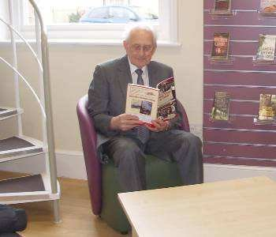

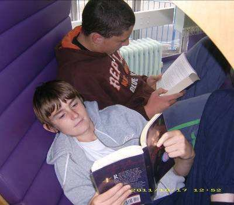

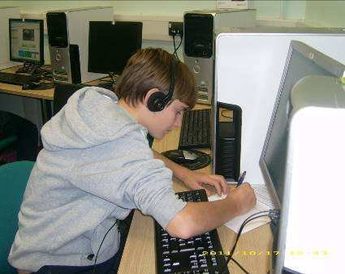

### 3(iv) Information Literacy Public libraries have a central role in information literacy delivery and development.

> “Being able to use different ways of finding information and being able to judge whether the information is trustworthy or accurate is vital: it opens up choices, empowers us and can give us more confidence”. Welsh Information Literacy Project, 2010 Public libraries are information services holding print and electronic reference materials and providing assistance with enquiries and research. Libraries can help a person to find information, retrieve information, make sense of information and utilise information. For example, a library can help a young person develop dictionary skills or assist an older person to correctly handle reference sources. Many learners (formal and informal) use public libraries to help them with their research, homework and projects. People use public libraries to help trace their family trees, others to help with local quizzes. These are just a few examples: -

This Monmouth Library customer is reading

up on extra information from a new book

about evacuees for his talk to local children about his experiences during World War 2.

Blaenau Gwent`s Sorted project As part of the `Sorted' project, young people at risk of being unemployed, have been visiting Abertillery library twice a week for sessions with library staff. During the sessions the students have been discussing reading choices, using on-line resources to access information and researching a topic of interest.

---

<!-- PAGE: 17 -->

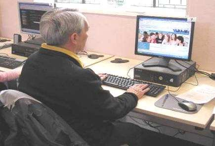

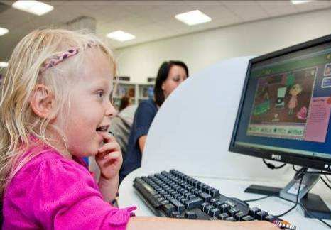

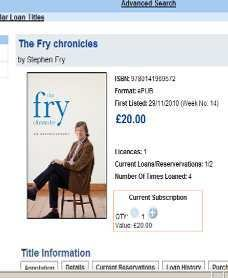

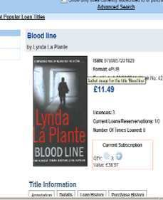

### 3(v) Reading and Digital Literacy There is evidence to show that people with low literacy skills are also reluctant to use ICT as they may not have the confidence to read what appears on the screen. Low levels of literacy will therefore impact on digital literacy and digital inclusion. Addressing the educational requirements of people with low literacy levels is essential for achieving greater levels of digital participation. Libraries have a key role to play here as libraries not only promote reading and literacy but also provide opportunities for digital inclusion. Using our public libraries to learn about computers E-books Public libraries in Wales also embrace new developments and opportunities. 14 of our library authorities in Wales have launched an Electronic Books Scheme (E-books). This is currently a pilot scheme in Wales but one we wish to develop and build upon with the right level of funding. Screen shots of the website www.libraryebooks.co.uk / www.cymru.libraryebooks.co.uk

---

<!-- PAGE: 18 -->

### 3(vi) Reading, Health and Social Benefits Libraries' increasing involvement in health support and information programmes, as well as their intrinsic role as enjoyable leisure and cultural activities, means that they can make a contribution towards well being and health outcomes. New research by consultancy Mindlab International at the University of Sussex says that reading is the best way to relax and even six minutes can be enough to reduce stress levels by more than two thirds or 68%. > “Having suffered from anxiety and depression for years I found it hard to go out socialising and enjoying my life as one should, then I had my two sons 4 and 2 years who bought great joy, but still I was gripped by fear or panic and depression, but as the children grew older they obviously needed to go out and mix i.e. school and so forth. When one day my eldest son said he would like to go to the library, which is only down the road from my home, I thought right let's do it and ”I did> “! I haven't looked back since. It gets me out twice a week, it's not too stressful for me, the kids love it  and I get to read books that help me deal with my condition, and the librarian is really good to talk to. I would definitely recommend people to use their library as it caters for most needs. To me and my family Library Days are Happy Days” LIBRARY CUSTOMER - GWYNEDD We wish specifically to highlight to you the government funded `Book Prescription Wales Scheme' (BPW) which is a partnership between the National Health Service and public libraries in Wales. The BPW Scheme helps patients with mild to moderate psychological problems. General Practitioners or professional workers `prescribe' books to their patient. This prescription can then be taken to any library in Wales. Each library has copies of the preselected self help books that are prescribed. The Book Prescription Wales Scheme has recently gained the support of the National Leadership and Innovation Agency for Health Care (NLIAH ) and the Wellbeing through Work Project > “This library has helped me to deal with my personal (family) problems by providing me access to books and information. I have found this a great help in my recovery.” Anglesey library customer

---

<!-- PAGE: 19 -->

Reading is attracting increasing attention by primary care practitioners as a means of reducing demand on the National Health Service. This interest is further reinforced by the National Institute for Health and Clinical Excellence (NICE) guidelines indicating that primary care professionals should offer bibliotherapy based therapy for mild to moderate mental disorders. > “When I visit the library the staff are always helpful and friendly. I have found very informative books on Bipolar Disorder, with which I have recently been diagnosed, which have helped me to come to terms with my illness. .....It also gave me confidence about going into places. It is spacious, modern, light and airy, always room for privacy in a corner, and always a pleasure to visit.” LIBRARY CUSTOMER  CAERPHILLY

Public libraries are well placed to be health information providers and to make a valuable contribution to improving public health. In addition to our network of libraries, we also offer community outreach services including library mobiles and provision for the housebound, visually impaired people, care homes, sheltered housing and children's centres.

> “I first joined the library when I was 7 years old. I am now 97 and due to arthritis am totally housebound. But thanks to the home library service I can still enjoy my reading and would be lost without it.” 97 year old Conwy library customer

> “This service is a godsend. Now that I can't get to the library the library, thank god is coming to me” Mrs Rosa Lunt, Conwy, the recipient of the Library Readers award 1996

Library services also make every effort to ensure that there are no barriers to looked-after-children having full access to library services. The children are encouraged to be members of their local libraries and some libraries such as Denbighshire and Wrexham have organized author visits for Looked After Children and their foster families.

---

<!-- PAGE: 20 -->

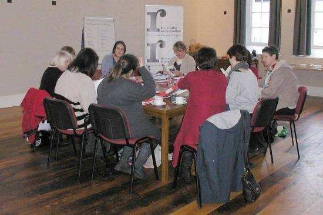

A South East Wales `Read to Lead' training group in Shire Hall, Monmouth. The members of library staff here are undergoing a training by The Reader Organisation to equip them to read aloud to groups in the community, for example to older people in homes, or looked after children. Public libraries in Wales also work with a number of health and social care partners for example the Health Boards, Mental Health Groups, support groups, carers groups, Age Well Centres, NHS Alternative Therapies, General Practioners' surgeries, health visitors, children's centres, adult social care and third sector organisations including MacMillan, MIND, Rethink, Alzheimer's Society and Age UK. > “I was recently contacted by Social Services about a lady whose eyesight had deteriorated. When I visited her at home she was obviously very depressed. She had been a great reader but having given them a try she decided that she didn't really want talking books. It was obvious that she liked politics and current affairs so I arranged for her to receive newspapers on CD which are sent to her home weekly and she is delighted with them.” Home Delivery Library Assistant, BLAENAU GWENT The health and social benefits provided by public library services are often overlooked by decision makers. However, we know the public value this aspect of the service. Public libraries are community hubs and meeting places. Libraries bring people together. They are also vital in reaching out to more hard to reach and vulnerable people. > “I have been visiting this library for 25 years. It serves not only me but my housebound husband. The support to myself and the community is paramount. Without the library I feel there would be a loss of social support especially for the more vulnerable in society, the young, the elderly, and the unemployed.” Library User [CIPFA PLUS SURVEY]

---

<!-- PAGE: 21 -->

## 4. Sustaining, Supporting and Strengthening With the correct level of support and investment we strongly believe we could enhance our role further and make improvements for the people of Wales. At the very least we would wish to maintain the following : The choice and range of stock on offer. A wide range of activities to encourage, enhance and support people's reading. The use of targeted marketing campaigns aimed at engaging with different groups in the community. Reading strategies to increase people's awareness of the opportunities we offer and target those most in need Capacity and quality of our workforce Easily accessible services Continue working with each other, key partners, schools and communities. With the correct level of support and investment we also aspire to: Work in partnership to develop a core reading offer for the people of Wales Improve the choice and range of stock on offer Provide opportunities for our staff to develop and grow Enhance the physical environment: making our libraries cleaner, brighter, more colourful and more welcoming. Improve access to the stock (for example, developing an All Wales Library Management System via a phased approach over 3  5 years thus increasing the ease with which people access our services). Embrace new developments (such as e-books) to ensure we are up to date with popular ways to read and learn. Improve our ICT infrastructure to ensure electronic access to reading and learning opportunities and increase digital literacy skills. Provide our customers with even more reading opportunities.

---

<!-- PAGE: 22 -->

## 5. Conclusion Public libraries have a key role to play in relation to reading and literacy. Our network of public libraries in Wales provide free access to a wide range of books and other reading resources in different formats which are available to all. The importance of reading for pleasure and enjoyment can not be underestimated. As well as providing enjoyment, reading improves literacy levels, social skills, wellbeing and provides meaningful activity and a sense of purpose. The act of doing something for pleasure has so many benefits. Reading helps you escape, utilises your mind, gets your creative juices flowing, helps you learn and discover new things and takes you on wonderful journeys  very powerful! The positive impact reading can have on health and wellbeing is well documented. Reading for pleasure and self help (Bibliotherapy) both impact on a person's mental wellbeing. In addition libraries' activities contribute significantly towards the development and improvement of literacy. There is much evidence to show that people who enjoy reading will have improved literacy skills which in turn increases opportunities within education and learning, work and employment, social and life skills and personal health and wellbeing Many studies demonstrate statistical correlations between literacy levels and higher earnings, better physical and mental health. There are therefore a range of longer term socio-economic outcomes such as increased life expectancy, higher earnings, reduced cost of health and social care, and so on. > “Libraries are democratic treasures of human thought, imagination and aspiration. They are sources of knowledge and information, helping people access and use information so that they can become active and engaged citizens. They are spaces that can meet the needs of the most diverse groups; the mother introducing her child to books, the adult who is returning to study, the young person discovering the treasure of literature, those who would never think of engaging with culture but who feel they will be welcome in a library or for whom the library is the only place they can access the internet”. Review of the Arts Council's strategic framework 2011

Maximising the capacity of libraries will save money further down the line.

---

<!-- PAGE: 23 -->

In addition public libraries are free! By using public libraries you can save yourselves money. Why buy books when you can borrow them for free?

Public libraries are also one of the most widely used community resources, shared community spaces that celebrate local diversity. As community hubs, libraries are at the centre of local communities providing a meeting place for local groups, provision of community information and a wide range of activities for all ages. The public have a high level of trust in libraries, and continue to place a high value on them which indicates that they do help contribute to creating stronger and more cohesive communities.

We are also aware of the growing emphasis on a more collaborative approach to working and providing services. As well as public libraries working more closely together on key issues, we also already have successful partnerships with other reading and literacy bodies for example:

* Bookstart
* The Reading Agency
* The Reader Organisation
* Essential Skills
* Local and regional partnerships and services (for example, Children and Young People's Services, Older People's Partnerships, Adult Community Learning Partnerships)
* Association of Voluntary Organisations

To conclude, public libraries and reading contribute to:

* Leisure, fun and enjoyment
* Literacy skills
* Information literacy skills
* Digital literacy skills
* Social skills
* The Economy
* Education and Learning
* Health and Wellbeing
* Cohesive communities
* Democracy
* The Collaboration agenda

> “The library, and especially the public library, is one of the greatest of mankind's creations, and surely a cornerstone of democratic society.....The record of our civilization rests in books, and free access to books is a vital part of the civilizing process.”  
> **John Banville**, Booker prize-winning novelist and journalist

---

<!-- PAGE: 24 -->

## Appendix: Customer Comments

*Our library customers have told us the following......*

### Anglesey

  > “The library is an excellent source of every book I ask for  –  I couldn’t afford to buy the books I read, so the library saves me money and gives me enjoyment, relaxation and education all at once.”

  

### Anglesey

  > “We just wanted to express how fantastic all the staff are at the library, particularly with reference to my daughter and their encouragement of her enthusiasm for reading. She has been using the library almost weekly ever since she was 6 years old and has now just won scholarship as she has moved to secondary school. She has always been an avid reader, but their support and kindness have helped her to remain interested.”

 

### Blaenau Gwent

 > “If I didn’t go to the library I wouldn’t have as many friends as I do now and wouldn’t have read as many books and wouldn’t have done so well at lessons in school.”

  

### Bridgend

 > “Since the time I was a small child, the library has been a magical place for me. So many books, each with a secret to share - a new fantasy, a new journey. As I grew, my knowledge and vocabulary increased, less through formal learning than the simple internalisation of language through absorbing the written world. Now I teach others how to write and this would not have been possible if the library had not taught me first.”

  

### Bridgend

 > “The library has given my children the ability to choose and read MANY books.  It has helped with homework too. I have been able to use books to pass my childcare qualification and husband his degree. It is a fab, bright and cheerful place to be. Also the extra activities, such as storytime, summer reading challenge etc are an excellent idea.”

   

### Caerphilly

 “As a mother to 3 young children, aged 8, 6 and 3 and a childminder, I find it very hard to occupy them and not spend much money! In the library, they are always thrilled to find the latest ‘£aptain Underpants’ or ‘Fireman Sam’! It costs nothing and they are given incentives such as Team Read or the Big Wild Read which help so much during wet summer holidays. Story and craft activities are always available, as are colouring or puzzles on request. It makes being a mother a lot less lonely too, as there are so many of my friends who I first met

---

<!-- PAGE: 25 -->

there and I enjoy going as much as my kids. Libraries offer so much to me personally and I am much less stressed knowing a suggestion of a visit will go down a treat with my children.”  

### Caerphilly

 > “When I visit the library the staff are always helpful and friendly. I have found very informative books on Bipola Disorder, with which I have recently been diagnosed, which have helped me to come to terms with my illness. I have also had books out on art and painting, which have helped me develop my talents. Today when I came in there were children happily drawing, and I stopped to admire their work and chat to them, which also gave me confidence about going into places. It is spacious, modern, light and airy, always room for privacy in a corner, and always a pleasure to visit.”

  

### Cardiff

 > “My children love visiting the library. My 6 year old son finds a book he likes the look of, and takes it to the comfy sofa to read. My 1 year old loves to draw and make pictures with the felt, crayons and sticky things. My 8 year old likes the competitions and Harry Potter books and tapes. I like to see all my children happy at the same time in one place.”

  

### Cardiff

 > “Before I started using the library again I was spending so much money (that I don’t really have due to being on benefits) on books. I love reading, as it takes me out of my own little life that I find boring as I don’t work at the moment. I love the escape of entering into another world fictional or real. To read makes me so much happier and relaxed. I feel a need to read all the time, and the library makes that possible.”

  

### Carmarthenshire

 > “I am a senior citizen, living alone. I have always been an avid reader preferring it to watching T.V. I could not possibly afford to buy regularly but by using the library I have a source of a great variety at no cost.  I can also try to widen my choice of authors aware that if I find a book unreadable  –  very seldom  –  I can return it and select another. Going to the library is an incentive to get out.”

  

### Ceredigion

 "A few years ago my son and his friend came to the library to borrow some books.  As boys will be boys  they got a bit excited and threw a Mr Sticky up in the air and he has remained stuck to the ceiling ever since!!!  We now visit the library much more often to see him and borrow books, DVDs and £Ds at the same time.  My sons have told their friends, and so have we, so more people visit the library to check on Mr

---

<!-- PAGE: 26 -->

Sticky and use the library at the same time.  Long live Mr Sticky and our excellent local library!"   

### Conwy

 > “Reading is my favourite pastime.  Having a library in the village where I can call in any time, and browse for books that appeal to me (or request one in particular) is a wonderful facility.  Encouraging my children to read and to love books is very, very important to me.  The library helps me with this enormously, and the non-fiction section has been a life saver with homework many times over the years.  The staff could not be more friendly and helpful  –  the library has a wonderful atmosphere and community spirit.”

  

### Denbighshire

 > “It is such a fab service it should be shouted from the rooftops and be advertised on every billboard to let others know.”

 (about Bookstart rhymetimes)”  

### Denbighshire

 > “Brings a smile to their faces and has helped them develop speech and songs and reading.”

  

### Flintshire

 > “I use the library regularly  –  it’s a sort of ‘home from home’; being visually handicapped it’s wonderful to still be able to read with the help of large print and audio books.  Reading has always been an important part of my life and it’s so good to be able to continue and to find such a variety of choices. “   

### Flintshire

 “My children and I love books, the library means that I have been able to get books for me to read to the children, so the children have books for their reading levels.  The library has also been there for me to help me with my college course.  Also medical knowledge.  The world would not be the same without libraries.  They are for children and adults now and the future.”

  

### Gwynedd

 > “Having suffered from anxiety and depression for years I found it hard to go out socialising and enjoying my life as one should, then I had my two sons 4 and 2 years who bought great joy, but still I was gripped by fear or panic and depression.  But as the children grew older they obviously needed to go out and mix i.e. school and so forth.  When one day my eldest son said he would like to go to the library, which is only down the road from my home, I thought right let’s do it and “I did”

!  I haven’t looked back since.  It gets me out twice a week, it’s not too stressful for me, the kids love it  –  and I get to read books that help me

---

<!-- PAGE: 27 -->

deal with my condition, and the librarian is really good to talk to.  I would definitely recommend people to use their library. It caters for most needs. To me and my family Library Days are Happy Days.”  

### Merthyr Tydfil

 > “I couldn’t afford to buy my own books when I was younger and the selection at my high school was very drab.  The library provided my sisters and I with an activity we could look forward to on weekends  –  riding our bikes to Merthyr then filling our bags with books that we could get stuck into on a Saturday night.  We were always spoilt for choice and found some great reads.”

  

### Monmouthshire

 > “£hepstow library is a wonderful place and an excellent source of knowledge, information and pleasure.  I visit several times a week. I value the provision of newspapers and magazines.   I value the fact that I can request books having read the reviews”

   

### Neath Port Talbot

 > “The library has always been a part of my life.  As a young girl, a place of wonder surrounded by so many books.  As a teenager, a place to learn and read about romance.  As a mother, a place to introduce my son to the pleasure of reading.  As a grandmother, a place to relive the pleasures of motherhood.  And now, in retirement, a place to join a readers group where I can enjoy discussion, chatting with friends and the chance to meet authors.”

  

### Newport

 > “Having travelled abroad I found that one of the things I missed the most was having a warm corner in which to read a book and while away the hours.”

  

### Pembrokeshire

 “Books are the gateway to other places and times, other lives and even other worlds.  Life without books  –  their characters, stories and information  –  would be less enjoyable for me.  I would certainly have less to talk about with my husband as we have many discussions about the different books we read.  Living on the edge of the highest village in Pembrokeshire means very few amenities but peace and quiet and spectacular views (often with weather to match).  Quality time without stress is important to me, and having the Mobile Library visit the village every month is time to be savoured and valued.  I can discuss what I read whilst choosing my next set of ‘imaginary characters’.   As an active pensioner in today’s economic climate of expensive fuel costs, the mobile library delivers my reading directly to me at no extra charge.  At

---

<!-- PAGE: 28 -->

the same time it delivers interest, excitement, thought and discussion free of charge  –  a rare thing these days.”  

### Powys

 > “The library gives me great joy in the reading of books.  It helps people of my age to ‘get away from ourselves’ for a few hours.“   

### Powys

 “This library has been fantastic to us.  We (as a family) have borrowed hundreds if not thousands of Welsh books over the last seven years, particularly books for children.  The service has been excellent and very useful to us because we cannot pay for a whole load of books.  Thanks!”

    

### Rhondda Cynon Taf

 > “I have two young children and have always encouraged the use of books.  Having full use of the library enables us to have a new story every night at bed time which also saves a lot of money. My children love the library due to the welcoming and friendly staff so it makes my job of encouraging early reading much easier!”

  

### Swansea

 > “When I was a child I went along with my nanny but stopped going when I was about 11 because I couldn’t read very well and was ‘statemented’ in school as being dyslexic. Now I have a two year old son I am back going to the library as they hold lots of events for children and it’s somewhere free to take him indoors. This I feel will also make me look good and clever in his eyes as he gets older and we keep going to the library because he loves books! and this will also save me money borrowing books instead of buying them for him!”

  

### Swansea

 > “I have been able to ‘sample’ a range of authors without the need of buying a book. The greatest benefit has been to my youngest son’s attitude to reading.  At around 8 years old he was diagnosed with dyslexic tendencies and hated books with a vengeance but I continued to borrow stories on £D and tape.  He now has a wonderful imagination and is progressing well in English in secondary school. Thank you.”

  

### Torfaen

 > “£an get hold of the latest books by my favourite authors. It gives me a good book to help me relax. It has also helped me to help my neighbours.  I now regularly get books for the older ladies on our street who cannot get to the library themselves.  Sometimes this is the only thing that keeps them busy in their days.”

---

<!-- PAGE: 29 -->

### Wrexham

 > “It has opened my eyes to all the fantastic books that are available.  It has given me knowledge and fostered a great love of reading.  It has enabled me to fulfil many ambitions and encouraged my creativity.  It has been a very important part of my life for twenty two years.”

  

### Vale Of Glamorgan

 > “I think the library is a fantastic place to read and have some peace. I have a great time here in the library reading a book it’s almost like you’re there on the spot.”

  

### Vale Of Glamorgan

 > “Just a quick message to say how thrilled I am to have picked up the small card from my local Llantwit Major Library with information about this website. My daughter loves to read everywhere and anywhere. She uses my phone to read e-books on dark car journeys, until now she has had the fairly limited free children’s e-books you can find online (not usually contemporary authors). I have bought a few titles of e-books but not as many as requested. You've made her day, week and year. The best part of the site is that you can download direct to android. Just in time for dark evenings on ride home from school. Thanks again”

---
