<!-- PAGE: 1 -->
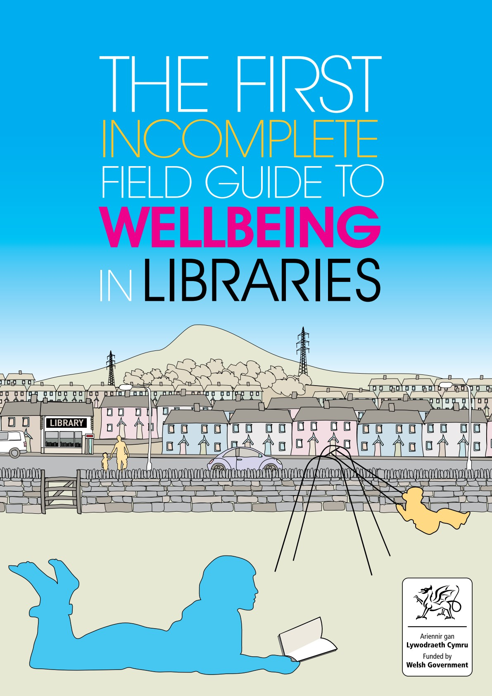

# The Incomplete Guide to Wellbeing in Libraries

## A showcase of public library health and wellbeing services across Wales

Society of Chief Librarians (Wales) / Welsh Government (Libraries Inspire)

**October 2012**

---

<!-- PAGE: 2 -->
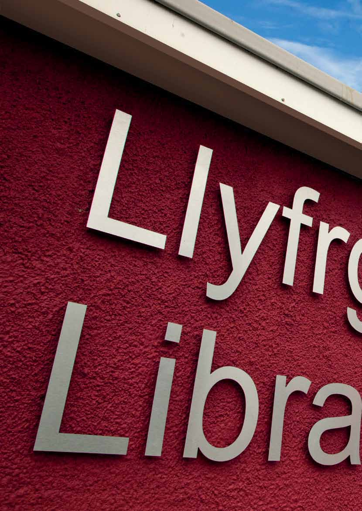

Photographs © Welsh Government (Libraries Inspire)  
Design: www.greenergraphics.co.uk

---

<!-- PAGE: 3 -->
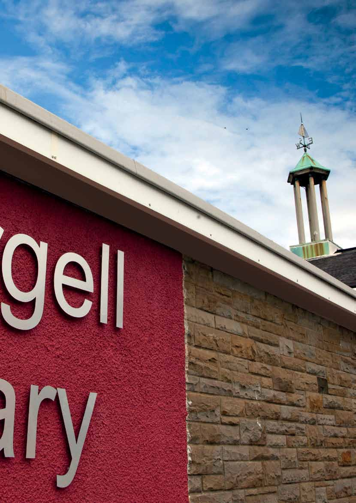

## Contents

| Section / Authority | Page |
| :--- | :--- |
| **Foreword** by Professor Sir Mansel Aylward CB | 4 |
| **Sustainable Wellbeing** | 6 |
| **Libraries and Wellbeing** | 7 |
| **Book Prescription Wales** | 8 |
| **Story Time** | 9 |
| **Macmillan Cancer Support** | 10 |
| **New Tricks** | 11 |
| **Opening Doors** | 12 |
| **A Community Resource** | 13 |
| **Job Clubs** | 14 |
| **Get Reading, Get Better** | 15 |
| **Health Promotion Library** | 17 |
| **Blaenau Gwent** | 18 – 19 |
| **Bridgend** | 20 – 21 |
| **Caerphilly** | 22 – 23 |
| **Cardiff** | 24 – 25 |
| **Carmarthenshire** | 26 – 27 |
| **Conwy** | 28 – 29 |
| **Denbighshire** | 31 |
| **Gwynedd** | 32 – 33 |
| **Merthyr Tydfil** | 34 – 35 |
| **Monmouthshire** | 36 – 37 |
| **Neath Port Talbot** | 38 – 39 |
| **Newport** | 40 – 41 |
| **Pembrokeshire** | 42 |
| **Powys** | 43 |
| **Rhondda Cynon Taf** | 44 – 45 |
| **Swansea** | 46 – 47 |
| **Torfaen** | 48 – 49 |
| **Vale of Glamorgan** | 50 – 51 |
| **Wrexham** | 52 – 53 |
| **Society of Chief Librarians (Wales) Directory & Bibliography** | 54 |

---

<!-- PAGE: 4 -->

## Foreword

The case studies in this guide show the invaluable work public library staff are doing to support the health and wellbeing of the people of Wales. The true value of libraries cannot be measured by statistics alone, we need also to take into consideration the social impact of library services on people’s lives.

Libraries are at the heart of communities across Wales, and as these studies show, they offer friendly, welcoming and safe spaces to all people including the most vulnerable in our society. Whether by participating in story time, read aloud groups, accessing health information from the Book Prescription Wales scheme or the Macmillan cancer information services, libraries empower people to access, understand and use health and wellbeing information effectively. Free access for all to the internet, along with training provided by library staff, supports everyone including older people and those looking for a job, to become more confident in using online systems and resources.

Evidence shows that better informed people have a better prognosis and greater wellbeing. The activities and services described in this guide show how libraries contribute to the public health agenda by tackling health inequalities, supporting health literacy, improving mental health and helping with the prevention and early diagnosis of illness.

As patron of ‘Wellbeing Wales’ and a lifelong advocate and user of public libraries, I wholeheartedly support the work being done in Wales, and commend this guide as a unique publication to stakeholders in health, social and community services, local government and to the library community throughout the world.

**Professor Sir Mansel Aylward CB**  
Chair, Public Health Wales  
Foreword to the Incomplete Guide to Wellbeing in Libraries

---

<!-- PAGE: 5 -->

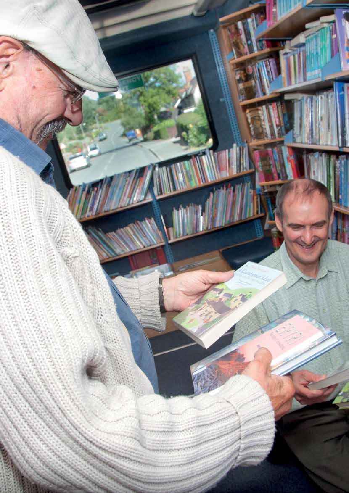

Free access For aLL

---

<!-- PAGE: 6 -->

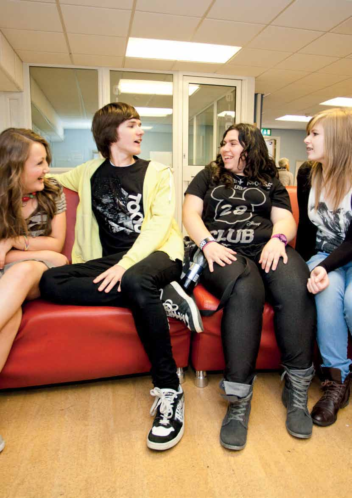

sustainable wellbeing The goal of greater wellbeing is to make a healthier, fairer and happier future for everyone. In improving our own wellbeing, we shouldn’t harm our children’s chances of living in a happy, healthy and fair society too. Sustainable wellbeing is divided into the four key elements shown below. Only when all four are in balance will we achieve a degree of sustainable wellbeing. CyMAL, Museums Archives and Libraries Wales have funded this document which demonstrates how Welsh libraries are increasingly involved in activities that support all four elements that make up sustainable wellbeing. For more information on sustainable wellbeing visit www.wellbeingwales.org

---

<!-- PAGE: 7 -->

Libraries and wellbeing The changing nature of society, with an increasingly older population, as well as the current economic climate, means that the NHS faces a tough financial future. It is more important than ever before for the NHS to work in collaboration and for other public service providers to contribute to health and wellbeing. Public libraries in Wales have an excellent track record of partnership working, and wish to build on this further to collaborate with health and social care organisations. The Society of Chief Librarians Wales (SCL Wales) has identified ‘Health and Wellbeing’ as one of its key priorities for 2012 and beyond. More emphasis needs to be placed on the value of public libraries and their contribution to the wider agenda: health, learning, literacy, community wellbeing, skills, participation and cultural identity. Libraries already contribute to health and wellbeing by:-

* Providing a range of reading

materials to enhance wellbeing

* Providing reading and literacy

opportunities to improve the health literacy of the nation

* Providing free internet access to

assist with e-health literacy

* Encouraging healthy lifestyles

* Supporting older people to live

independent lives

* Helping children and young

people to develop and enjoy life

* Supporting care and recovery.

The benefits of libraries are substantial as they: -

* Help reduce the burden on social

services and NHS care

* Reduce isolation amongst the

elderly

* Provide carers with an escape

mechanism

* Provide a network of easily

accessible, non-threatening, inclusive environments

* Are non-medical environments, so

there is no stigma attached

* Empower people to access and use

health and wellbeing information

* Provide free access to the internet

and information resources

* Have experience of supporting

literacy, information literacy, digital literacy and health literacy

* Can help with the prevention and

early diagnosis of illness

* Provide social and community links

to people who may otherwise find it difficult to socialise

* Reach out to those who are usually

hard to reach. Public Libraries in Wales: Health, Wellbeing and Social Benefits, SCL Wales, August 2012 1

---

<!-- PAGE: 8 -->

Book Prescription Wales Book Prescription Wales (BPW) is a partnership between the NHS and public libraries in Wales. The scheme helps patients with mild to moderate psychological problems. General Practitioners or professional workers ‘prescribe’ books to their patients. This prescription can then be taken to any library in Wales as each library has copies of the pre-selected self-help books. The Book Prescription Wales Scheme has recently gained the support of the National Leadership and Innovation Agency for Healthcare (NLIAH) and the Wellbeing through Work Project. According to Dr Neil Frude, the psychologist who first developed Books on Prescription, the scheme has the following advantages over medication:

* Higher patient acceptability

* More immediate effects than

some medication

* No rebound effect at the end of

treatment

* Tendency to continued

improvement over time

* Lower relapse rates

* No appreciable adverse side

effects / reaction with medication

* No danger of overdose

Book Prescription Wales can make a considerable difference to people and their health and wellbeing. The library staff are always helpful and friendly. I have found very informative books on Bipolar Disorder, with which I have recently been diagnosed, which have helped me to come to terms with my illness. ... The library also gave me confidence about going into places. It is spacious, modern, light and airy, always room for privacy in a corner, and always a pleasure to visit. Customer, Caerphilly Libraries Just a few examples of the kind of books you’ll find at the public libraries in Wales

**Impact:** Physical and Psychological ✓ | Economic and Material ✓ | Community and Social ✓ | Environmental ✓

---

<!-- PAGE: 9 -->

story Time Giggles, dribbles and burps – It must be story time! Libraries across Wales work with health visitors to ensure that babies receive a free Bookstart bag at the nine month health check, and every toddler receives an Early Years satchel at the two year health check. Every pack includes two free books and advice about sharing books with your child. Public libraries offer a whole host of resources, activities and events for children and young people. They hold reading groups, story times, homework clubs, arts groups as well as health and wellbeing projects. Libraries also work with local schools in relation to information, research and homework and out of school activities such as the Summer Reading Challenge. Sarah Daly, who attends Under Fives Story Time at Chepstow Library, commented: ”Both my children have thoroughly enjoyed the rhymes and stories. We love the library and I am sure that coming to the library has helped my daughter’s language development. It is also a great way to meet other mums.” In the new Child Poverty Strategy for Wales (2011–2014)2 the three new strategic objectives for tackling child poverty are to: 1. Reduce the number of families living in workless households 2. Improve the skills of parents and young people living in low income households so they can secure well-paid employment 3. Reduce inequalities that exist in health, education and economic outcomes of children and families by improving the outcomes of the poorest. Public libraries can help the Welsh Government achieve these objectives. Probably the biggest effects the library sessions have had, have been with the parents of our children. Most of these parents have declined from taking their children into the public eye due to some bad experience or other. However, by attending (in the background) the Bookstart session and having seen their child ‘in action’ joining in within the session, it has given them a huge confidence boost, thus enabling them to access other public places with their child, and start to really communicate with them, using the visual systems we use, that they were once so afraid of, for fear of being singled out or discriminated against. Specialist special needs teacher for children with autism, Denbighshire

**Impact:** Physical and Psychological ✓ | Economic and Material ✓ | Community and Social ✓

---

<!-- PAGE: 10 -->

Macmillan cancer support People affected by cancer tell us that having information and support makes all the difference to their journey through cancer. It helps them feel empowered and to make the right choices – for them. Currently there are very few information and support services for people affected by cancer across Wales. The ground-breaking services in South East libraries provide information and support to people near where they live and work, and in a comfortable, easily accessible and supportive environment. Ginny Brink, Macmillan Cancer Support Since 2009 libraries in South East Wales have been working with Macmillan Cancer Support to provide information for people affected by cancer and there are now four 3-year projects based in Rhondda Cynon Taf (RCT), Torfaen, Monmouthshire and Blaenau Gwent, all of which include a Cancer Support Information Officer. The ultimate purpose of providing information and support to people affected by cancer is to improve their health and sense of wellbeing and empowerment. Libraries delivering the Macmillan Cancer Support projects are delivering the public health agenda – tackling health inequalities, supporting health literacy, providing materials to improve mental health, supporting people who are not undergoing current treatment and engaging the ‘not- well, not-worried’ people that the health services struggle to reach. Macmillan’s Policy Statement for Wales (February 2011)3 emphasises the need for more personalised information and support as a way of giving people more control of their condition. It is based on evidence which suggests that better informed people have a better prognosis and greater wellbeing. The projects address the information needs of people affected by cancer (whether patients or carers) using the co-ordinators with information giving and research skills. The projects began with an approach to RCT Library Service from Diane Raybould, chair of the Rhondda Breast Friends, whose personal experience of information provision at hospital appointments was poor. The service has now grown to be accessible to approximately 400,000 people through the 41 libraries.

**Impact:** Physical and Psychological ✓ | Economic and Material ✓ | Community and Social ✓

---

<!-- PAGE: 11 -->

New Tricks 2010 was the year that, for the first time ever, there were more people over the age of 65 than under 16. Older people are the least likely to use the internet – about two thirds of people aged 65-79 did not use the internet in 2008, more than twice the proportion of all other age groups. Access to the internet is becoming as important as access to water, electricity and gas supplies. Those without internet access are at an ever increasing disadvantage particularly with the approach of e-Government.10 Libraries have a key role supporting older people in overcoming the barriers to technology - internet access, lack of skills/ confidence and motivation - by providing activities and support which persuade them to engage with the internet. The activities available in libraries, designed to encourage individuals to make the most of technology, are many and varied and often tailored to meet local needs. A number of the sessions are run in partnership and are often aimed at giving people a reason to use the internet. Examples of the type of sessions held across Wales include:-

* BBC First Click

* Digitisation of documents

* Family & local history

* Digital storytelling

* Shopping online

* Contacting family and friends

* Finding health information

* Open University taster sessions

Libraries provide more than simply free access to the Web. For those unable to travel far, the proximity of the local library is important. The friendly, helpful staff are vital in providing support and encouraging their older customers to try something new. I like to check on the computer my e-mails and see purchases I make. …..Instead of being alone at home it’s nice to have access to all these things and have company too. Customer, Rhondda Cynon Taf After retiring 2 years ago I felt a little lonely so I joined the computer class and I love coming here to meet my friends and also learn new things. Customer, Merthyr Tydfil

**Impact:** Physical and Psychological ✓ | Economic and Material ✓ | Community and Social ✓

---

<!-- PAGE: 12 -->

opening Doors

Undertaking part-time education increases the level of wellbeing by the same amount as an increase in annual household income of between £2,500 and £5,100. NIACE Lifelong Learning and Wellbeing 2009 One of the main barriers for adult returning to learning is often negative perceptions associated with formal learning environments. To overcome this and to regain confidence in their skills, people often need non-judgemental support in an environment where they feel comfortable. A survey in 2008 regarding public libraries and community learning found that 89% thought “the library would be a good place to learn” and 79% “were attracted by flexible (on-line) learning”. At a library, everyone can study the subject of their choice, in their own time, and at their own pace. On many occasions informal learning starts with wanting information to support a specific interest or hobby. By providing access to a wide variety of resources and activities, libraries play a key role in attracting adults back into the world of learning. They work in partnership with local initiatives and agencies to provide a range of informal as well as formal learning opportunities. An example of this is the strategic partnership with the Open University in Wales. The Open University (OU) in Wales has forged links with one of Bridgend County Borough Council’s largest libraries, Pyle Life Centre, to offer the local community access to higher education through introductory courses and taster sessions. In January 2012, people from all over the county attended an OU taster based on the Openings course Understanding Health. Mark Parsons from Kenfig Hill who attended the taster session, started learning with Pyle Life Centre in 2009 by enrolling on a number of courses through learndirect. This led to him gaining his European Computer Driving Licence and he was now looking to further his education with the OU with the support of Pyle Life Centre. Mark said: I have come along today to find out what Open University courses are available. I am looking for a different career path, hopefully in IT, and am really pleased that there are courses and funding that I can apply for. I am really looking forward to starting as I believe the courses will further develop my skills and improve my career prospects. Additionally from September onwards, the OU has started monthly information sessions at the libraries in Abertillery, Bargeod and Cwmbran. During 2013 it plans to extend the sessions to other authorities in South East Wales.

---

<!-- PAGE: 13 -->

a community resource

Libraries more than ever need to be places of inspiration and aspiration where people can come to access high quality resources in a safe relaxing environment. Libraries Inspire, Welsh Government 2011 In 2009 a fabulous Early Years Resource Centre was created in Rhymney Library. A bright new space with colourful equipment and resources was carved out of a first floor computer room for use as the Early Years Resource Centre. The aims were to provide quality and motivating play experiences, to support parenting skills, and to enhance young children’s active involvement in their learning. Rhymney Library used CyMAL funding to create a new extension to accommodate a fully equipped dedicated informal learning space, making space available to create the Early Years Centre. The objective was to re-establish the library at the heart of the for informal learning, increase community activities, particularly for young children, and provide a modern, attractive, inviting and flexible environment where everyone feels welcome. Resources provided by Flying Start and the Library helped to refurbish the upstairs room with resources including:

* Books to foster a love of books and

help develop pre-reading skills

* Story-sacks and themed resource

boxes to stimulate curiosity and promote parent interaction

* Creative tools to help develop fine

motor and pre-writing skills

* Musical instruments to develop

auditory and listening skills

* Games and toys to stimulate

cognitive development. The Early Years Centre is a stimulating area for parents and children to grow together. The flexible space upstairs is a valuable for grandparents to read books to their grandchildren and for children to play and enjoy themselves. The flexible use of the space makes it possible to accommodate meetings by external agencies, author visits, music concerts and visits by local schools. The library has been transformed from its tired 1970s image into a light, bright, inviting and colourful place and as a result there is more community engagement which is crucial where there are high levels of unemployment, Up to 2010/11 the Welsh Government had invested £9m with an additional £3.65m in match funding from local authorities to transform libraries across Wales.

---

<!-- PAGE: 14 -->

Job clubs Looking for a job can be a stressful experience for anyone, particularly if it is years since you last applied for one. As most job vacancies and application forms are now online, if you lack internet access and the necessary IT skills, the whole process can be a nightmare. Many libraries across Wales are providing tangible support for people facing the stigma and isolation of unemployment. This support is often in partnership with agencies such as Job Centres and Careers Wales. The Work Club scheme run by the libraries in the Vale of Glamorgan is a good example of the type of support provided and it was honoured in 2010 with a Social Inclusion for Adults award by Careers Wales Cardiff and the Vale. The scheme started in April 2009 and sessions for up to 20 people are always full to capacity. The three hour sessions help people identify a career path, write their CV, or search online for job opportunities. The sessions are free at the point of delivery, with the library providing the facilities and Careers Wales and Jobshop Extra providing the manpower. The Job Centre encourages its clients to visit the library for support. A brief initial interview is carried out to assess the client’s needs, with advice and guidance offered relating to career goals, career matching, identifying transferable skills etc. Additional help is available covering interview techniques, internet job searching and CV presentation. ‘Digitally excluded’ clients (those who have difficulty accessing the internet) also have access to free IT taster classes within the library.

Although the project was achieved at minimal cost, clients have gained in many ways from attending the workshops and they also value the impartiality of the library. Because libraries are neutral places, people do not feel stigmatised by their age, ability or where they live. Comments from clients: I have been able to produce a CV that I’m confident with.

Without the workshop I wouldn’t have a clue how to sort out my CV.

**Impact:** Physical and Psychological ✓ | Economic and Material ✓ | Community and Social ✓

---

<!-- PAGE: 15 -->

Get reading – Get Better Welsh libraries have been encouraging everyone to take a fresh look at their library as part of a national campaign to promote the benefits library usage can have on people’s health and wellbeing. From mood-boosting books and group activities to large print and audio books, libraries will be showing how they can have a positive impact on your life during the ‘Get Reading, Get Better, Get Libraries’ campaign. International rugby referee Nigel Owens launched the campaign at Pyle Life Centre in Bridgend on World Mental Health Awareness Day and he commented: Taking time out to relax is very important. Reading is a great way to find out more or to escape from reality and joining in group activities can help you share experiences and have some fun. A full programme of free events for all the family in libraries and local communities across the whole of Wales was organised

* ranging from regular library events such

as author visits, baby bounce and rhyme sessions and reading groups through to yoga, laughter therapy, zumba classes and drop-in health checks. Huw Lewis, Housing, Regeneration and Heritage Minister said, Libraries are crucial to our health and wellbeing providing us with a vast choice of things to read, watch or listen to, as well as activities and special events. Being ‘prescribed’ a book by your GP or health worker may not be what you were expecting, but research has shown that the Book Prescription Wales scheme is a great success for helping those suffering from mild to moderate mental health issues. Specially chosen books can help people take charge of their health. During the month long ‘Get Libraries’ festival I urge everyone to take a fresh look at their local library and discover ways that libraries can help with their health and wellbeing. My doctor sent me to the library, recommending a book to help with my stress and anxiety. The books have been a great help, since then I have started reading for pleasure again – this is helping me relax in the evenings. Customer, Blaenau Gwent

**Impact:** Physical and Psychological ✓ | Community and Social ✓

---

<!-- PAGE: 16 -->

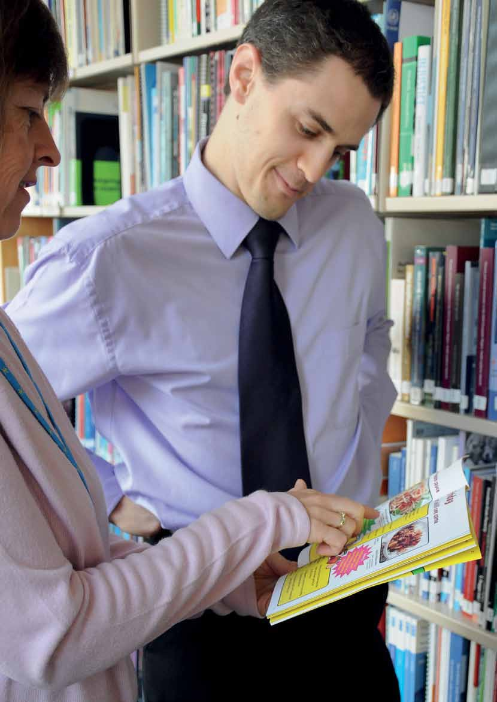

WeLLBeING INForMaTIoN

---

<!-- PAGE: 17 -->

Health Promotion Library Gateway to wellbeing information The Health Promotion Library working in partnership with local libraries, the NHS and the voluntary sector makes health and well- being information accessible to all. Blaenau Gwent library staff referred one of their customers to the Health Promotion Library as she was looking for detailed information on the menopause. The customer said: I visited my local library for books on the menopause. I took out the couple they had on the shelf. The library staff suggested the Health Promotion Library, as I wanted to read as much as possible to help with my symptoms. This was a brilliant service. I had five books delivered to me and lots of information leaflets. After reading as much as I possibly could, I was able to discuss the problem with my GP with more confidence. The Health Promotion Library provides information on all aspects of health and well- being. People can contact the enquiry line on 0845 606 4050 or email hplibrary@wales. nhs.uk and staff will track down specific information, supply health leaflets free of charge and lend books to local libraries or send the books by post to library members. Customers using the enquiry line to order leaflets said Very helpful and friendly service which is very important in dealing with health matters, and the leaflets were delivered promptly. I use these leaflets to support education and health promotion in the community and parents find these leaflets useful and informative.

**Impact:** Physical and Psychological ✓ | Community and Social ✓

---

<!-- PAGE: 18 -->

Blaenau Gwent Gwent Police, in partnership with local people, have established over 20 ‘Talk About It’ centres for people with learning disabilities to report hate crimes. Blaina Library has been selected as one of those centres and the library staff have been trained to support and guide users through the process of reporting incidents to the Disability Hate Team. Many of the library’s customers experience difficulties with communication and find reporting issues a challenge. However, they feel comfortable and safe within the library environment, have usually built up a good rapport with the staff and have enough confidence to speak to them about their problems.

Allyson Roberts, Senior Library Assistant, says: I feel this service is of great benefit to the local community and having been part of the process I wouldn’t hesitate to encourage and support anyone who is suffering or having difficulties in this way to come forward, to speak out and to report issues to the team. The help people get when they report a hate incident or crime is quick and people feel that their concerns will be taken seriously and acted upon. They are telling their friends and family about the scheme and the number of enquiries is increasing. A customer who recently needed to use the services said: I have been having lots of problems with people calling me horrible names in the street. I really didn’t feel like I should bother the police, but when I told Allyson she encouraged me to report it. She helped me with some forms and I couldn’t believe how since then things have been sorted out for me. Now I can go out and feel less frightened, and it is good to know I can always go to the library for help, I feel much better. Talk abouT iT

**Impact:** Physical and Psychological ✓ | Community and Social ✓ | Environmental ✓

---

<!-- PAGE: 19 -->

Blaenau Gwent Inclusion through outreach The Six Book Challenge is an incentive- based reading project for reluctant adult readers. The scheme builds confidence and motivation, along with an enthusiasm for reading. In Blaenau Gwent the majority of participants were enrolled through outreach provision, recruited from mental health day centres, domestic abuse support groups, needs. From regular visits to centres and groups, a good relationship is established between library staff and individuals. The majority of the participants are at entry level, many suffering from low self-esteem and lack of confidence. It has been a huge achievement for these individuals to receive recognition for reading six books, and for many this is their first ever certificate. I suffer with severe depression, from doing the Six Book Challenge I have discovered reading can take my mind off my worries. It helps me relax too. I have also started using my library again, I am enjoying trying new books. Participant, Mental Health Day Centre

I haven’t read any books since I left school, it has got me interested in reading again. I have started taking my children to the library too, we have all started reading together. It has also spurred me on to brush up on my reading and writing, I want to be able to keep up with my children! Sarah, a single mother of three young children, joined the Six Book Challenge via outreach visits to a local domestic abuse support group. She progressed onto other courses and hopes to start college soon. She won Young Learner of the Year at the Blaenau Gwent Adult Learner awards, citing the Six Book Challenge as a confidence booster on her learning journey. Some of our senior students are unable to read, due to their disabilities. It has been great for them to discover the MP3 playaways and talking books and still complete the challenge, it has been a real achievement for them. Learning Support Assistant, Pen-y-Cwm Special Needs School

Many students are now using their local libraries with their families on Saturdays, this has been encouraging to see, I have seen their confidence grow and grow. Shelley, Outreach Officer

**Impact:** Physical and Psychological ✓ | Economic and Material ✓ | Community and Social ✓

---

<!-- PAGE: 20 -->

Bridgend Improving your skills Confidence. Independence. Inviting. Valued. Encouraging. Success. Informal. Social. Friendly. Positive. Safe. Welcome. These are just some of the words that have been used to describe the shared reading group run by Bridgend Library & Information Service at the Ton Pentre Suite (TPS). The TPS helps people who lack the confidence or necessary skills to engage in learning. The focus is on basic skills - literacy, numeracy, IT and money management. It is a friendly, informal and safe environment. The shared reading group is open to anyone who uses the TPS and takes its members a step further than functional literacy - they are introduced to novels, poetry and biographies. They learn how to discuss what they’ve read, how to compare stories, authors and styles and how to make the most of their reading skills. Shared reading helps to improve personal wellbeing through human interaction, self- reflection and encouragement of expression in talking about the text. The weekly sessions provide valuable structure and a meaningful activity. People also build greater self-confidence by providing a positive focus for each individual within a safe, comfortable environment, encouraging people to read aloud and helping people to connect with and understand a rich variety of reading material. TPS reading diary extract for ‘The 10 Keys to Success’ by John Bird: I thought this book was a fantastic read. It has taught me not to be afraid of failure, but to learn from it.

**Impact:** Physical and Psychological ✓ | Economic and Material ✓ | Community and Social ✓

---

<!-- PAGE: 21 -->

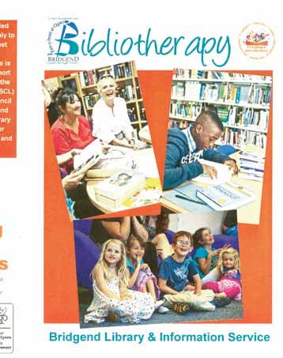

Bridgend Bibliotherapy partnerships Bridgend Library and Information Service has been working with partners in the health sector to highlight the role libraries and reading can play in wellbeing, from national programmes such as Book Prescription Wales, to local initiatives such as reading groups, baby bounce and rhyme sessions and Books on Wheels. Links have been made with local opticians, opthamologists and eye clinics to promote large print titles, audiobooks and audio downloads. The Sensory Impairment Unit within Social Services and the RNIB have helped to reach partially sighted and blind housebound people through the Booklink service, which is also running a pilot scheme to supply visually impaired housebound customers with USB speakers and monthly deliveries of downloaded audiobooks on USB. The library service has also made links with Education Programme for Patients (EPP), Mental Health Matters and the local health board’s psychology services. It is working with the public health team to disseminate information to local health practitioners and encourage them to support the bibliotherapy scheme. A bibliotherapy leaflet has been created with case studies and feedback from users about the impact these services have had on their lives. This leaflet is the link between all partner organisations and has been sent to all GPs, health care providers and carers’ groups within Bridgend. There is also a sister leaflet for members of the public. Book PrESCrIPTION

**Impact:** Physical and Psychological ✓ | Economic and Material ✓ | Community and Social ✓ | Environmental ✓

---

<!-- PAGE: 22 -->

caerphilly Wicked A report from the CIBER research team at University College London claims that today’s young people are the ‘cut and paste’ generation who spend very little time actually reading the information they have found on the web. However, the students at Blackwood Comprehensive school are showing that there is more to the ‘Google Generation’: interpretation, application and presentation is evident from their research. Twenty-one pupils have achieved a qualification by demonstrating their improved skills in using their local library and finding information. Aware of the difficulties that people often experience in identifying trustworthy information on the internet,4 Caerphilly Libraries were keen to take on the challenge of helping the ‘Google Generation’ to become more information literate. In partnership with the School Librarian, they wanted to demonstrate to young people what libraries can offer and how they can support them with their studies. A group of pupils were selected to take part and the introductory visit to the school by library staff was followed by a number of sessions at Blackwood Library. The students were registered as library members and shown how to use the library catalogue and the internet to find useful and relevant resources. They then used their new skills to work towards the Agored Cymru Level One qualification ‘Using sources of information’, by carrying out independent research on their choice of topic. All of the participating pupils were successful in achieving the Level One qualification and were presented with their certificates by the school, with the library staff in attendance. The School Librarian described the project as a “great success” which she is extremely enthusiastic about repeating. Feedback from pupils demonstrated how their confidence and motivation had increased as a result of visiting the library, with several of them describing the experience as “wicked”. Caerphilly Libraries are now planning to offer the project to other schools in the authority, in order to further strengthen their links with the young people in their community.

**Impact:** Physical and Psychological ✓ | Economic and Material ✓ | Community and Social ✓

---

<!-- PAGE: 23 -->

caerphilly Make Hay while the sun shines An excited group of readers left Caerphilly for the wilds of Hay-on-Wye. For months they had been preparing for their adventure by reading the works of several authors who would be appearing at the prestigious literary festival. This very popular annual event aims to bring together readers from all over the borough and gives them the opportunity to engage and interact with well-known authors and celebrities. At the same time, library staff were on hand to help and advise the group when needed. The library service organises the transport and co-ordinates the day, allowing the group to enjoy, for some of them, a completely new experience. The group consisted of members from several library book clubs, and their families, making this a truly intergenerational day out for all concerned. Drawn together by a love of reading, they were inspired by their day at Hay to broaden their reading choices when they returned home. All agreed that the 2012 event was the best yet and clamoured for something similar later in the year. What a wonderful idea. I wish we could do this all the time. Coming to the reading group has really brought me out of my shell. I’ve made some good friends and can’t wait until the next time. Mary Before I came along to the library I felt isolated at home but the reading group has given me a new lease of life and a circle of new friends who all enjoy the same things as me. Joan It makes a change from watching TV and it was good to see the authors who write the books we read in our reading club. Mike

**Impact:** Physical and Psychological ✓ | Economic and Material ✓ | Community and Social ✓ | Environmental ✓

---

<!-- PAGE: 24 -->

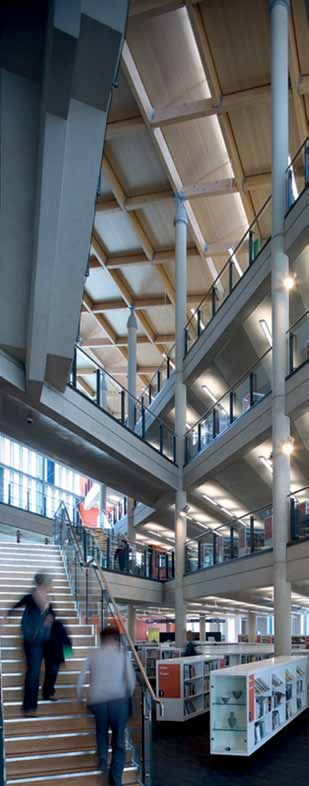

cardiff Breakfast Club Libraries gave us power / Then work came and made us free / What price now for a shallow piece of dignity? 5 Manic Street Preachers Many hostel residents may be reluctant to come into a library, not realising that it is free to join and provide access to the internet amongst many other services. Cardiff Libraries have been trying to change the perceptions of homeless and other vulnerable people with their new Breakfast Club initiative. Cardiff Central Library’s Breakfast Club includes an early morning ‘Read Aloud’ session, where participants are invited to read from a short story, poem or newspaper article. The group members are encouraged to take turns reading aloud but there is absolutely no pressure for them to do this. They then share thoughts and ideas on what they’ve read in a relaxed, informal environment - tea and toast are provided, with bread courtesy of the local Greggs bakery. Cardiff Libraries have found that the Breakfast Club has resulted in increased engagement and social interaction along with improved knowledge and literacy. They have seen the participants grow in confidence as their reading skills have developed. The library has been contacted by the Salvation Army hostel in the city centre and invited to start holding a Breakfast Club there. The probation service has also shown an interest in working with the library to set up similar groups. Although this is still a fairly new initiative, Cardiff Libraries are hoping that in future they will be able to foster active citizenship and improve mental health and wellbeing. The library staff involved have developed a better understanding of those individuals in the community that they would normally only engage with on a superficial basis.

**Impact:** Physical and Psychological ✓ | Economic and Material ✓ | Community and Social ✓

---

<!-- PAGE: 25 -->

cardiff Memories are made of this Recollections of childhood games, visits to the seaside and family relationships are just a few of the many personal memories shared during weekly reading sessions with patients suffering from dementia. The Neighbourhood Development Librarian linked to Cardiff Council’s Hub Project in the east of the city, has developed a close working partnership with local care homes, to provide library books for residents and monthly trips to the library for those who are still mobile, as well as the librarian-led reading and story sessions. Each session takes place in a different ward of the home and concentrates on a particular theme. Many of the stories are already familiar to residents and the regular breaks in the reading encourage conversation and the sharing of memories from their pasts. Is he coming next week? These stories are good. I always look forward to these sessions. Resident Reading aloud can improve the quality of life for patients with dementia. In a recent evaluation, The Reader Organisation found that during reading aloud sessions, people

became less agitated and their mood, concentration and social interaction all improved.6 Family members are always welcome at the sessions and can often provide additional details from their relative’s life. In many cases visitors have been so impressed with the enthusiasm and lucidity of their loved ones during the sessions that setting aside a few moments to read together has become a regular feature of their visits. My mother always loves the sessions and I have found out some interesting stories about my grandparents as a result. Family member From my view as an activities co- ordinator for 8 years I know that residents like different stimulus and the storytelling sessions are a very welcome addition to our existing programme. The library service provides us with a storyteller every week as well an invaluable book service. The residents react well to the story sessions and they always provide good talking points and a chance to interact with each other. Care home co-ordinator

**Impact:** Physical and Psychological ✓ | Economic and Material ✓ | Community and Social ✓

---

<!-- PAGE: 26 -->

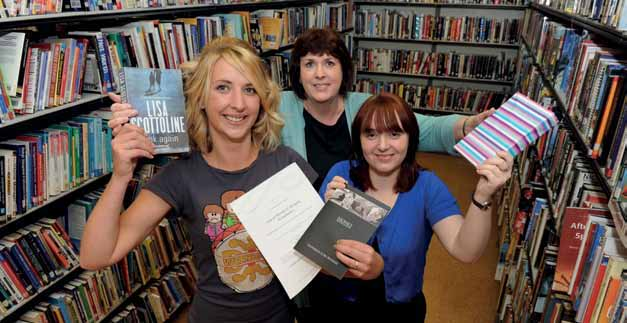

An active mind is as important as an active body but one in four adults say that they haven’t read a book in at least a year. In order to broaden customers’ reading habits, stretch their minds and take them out of their comfort zones, people visiting Carmarthenshire Libraries were given a “Summer Surprise” - a gift-wrapped book with the challenge to read and review something completely different, with a prize for the best written review. The lucky winner, Mrs Eve Jones, said: I think whoever thought of this promotion is a genius! I came to the library for my boys to get a book but would never have thought of getting one for myself until I saw the beautifully wrapped gifts. As an adult I have hardly read, but this promotion has given me the gift of reading. …….. I can’t wait for my next Summer Surprise now! Thank you. The idea was extended to a seasonally- themed “Christmas Cracker” in December, with a children’s scheme being run alongside it. The younger readers particularly liked the idea of a surprise. Tempting readers of all ages to borrow a mystery book has been a big success. Parents and children have really taken to the idea of being exposed to new experiences, opening doors to new styles of writing and widening their horizons. The parents were asked to share the child’s reading material, especially when the children weren’t sure about the book they had unwrapped. Research shows that literacy has a significant relationship with a person’s happiness and success.7 Eve’s happiness will definitely increase as she enjoys her prize of a gift voucher for use at the Machynys Health Spa! carmarthenshire Summer Surprise!

**Impact:** Physical and Psychological ✓ | Economic and Material ✓ | Community and Social ✓

---

<!-- PAGE: 27 -->

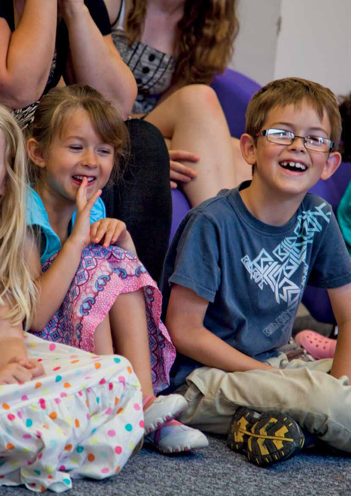

exPoseD To NeW exPerIeNces

---

<!-- PAGE: 28 -->

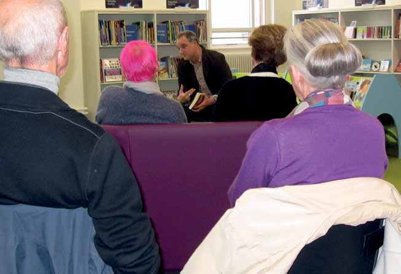

conwy ‘reading is a life force’ Libraries are in a unique position to enable and empower individuals to explore opportunities for developing their reading experiences, not only by providing as wide a range as possible of books free of charge but also by bringing readers together whether in reading groups, author events or shared reading sessions. Such an event held with earlier in the year in Llandudno Library when Stephen May novelist, playwright and TV writer came along to talk about his books. His first novel TAG (Cinnamon Press, 2008) was one of ten books long-listed for Welsh Book of the Year and it went on to win the Media Wales Readers’ Prize – an award voted for by the general public, as the best book on the list. The emotive language used within the feedback received from this type of event clearly shows the importance reading plays in the lives of the individuals and its contribution to their health and wellbeing. Comments include: My main form of relaxation; my drug of choice Reading takes you to another place; I could not live without it Reading it keeps me structured when my mental health starts to decrease Reading is as necessary as breathing Reading takes me out of myself Reading helps me see the world through other’s eyes Reading makes me feel better when I’m down Reading allows me to escape…

The role libraries play in supporting, encouraging and acknowledging this is significant.

**Impact:** Physical and Psychological ✓ | Economic and Material ✓ | Community and Social ✓

---

<!-- PAGE: 29 -->

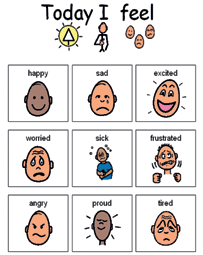

conwy Talking without words ...for me and him, in our little world, pictures are fantastic Boardmaker user, Conwy In May 2012, Conwy was the first public library authority in Wales to provide access to Boardmaker software which can be used by parents, carers, teachers and support workers to communicate with anyone who has language difficulties. Boardmaker is computer software containing thousands of picture symbols that can be used with anyone who may need additional support with communication. The symbols available can be used to assist communication with:

* Children and adults with Autistic

Spectrum Disorders, learning difficulties and/or physical disabilities

* Anyone with Specific Language

Impairment (SLI)

* People with English as an

additional language

* Anyone with a disability

or impairment that affects communication or memory

* Older people with some forms of

dementia or anyone who has lost some language skills after a stroke. Boardmaker is available, free of charge, at five Conwy libraries. Customers can book a session with a member of staff to learn how to use the software. Customers are also able to laminate their printouts. At Colwyn Bay Library there are monthly Autism/Asperger’s advice sessions where people can meet other parents/carers, share ideas and resources and learn how to use Boardmaker. There are also collections of Makaton resources and Something Special DVDs available in selected libraries. Customer comments: Without the symbols, he just doesn’t even make the effort to speak ... I don’t feel so isolated or overwhelmed now I honestly don’t know what I would have done without this service… The symbols give him some control and they give him a voice

Boardmaker Conwy is a partnership project between Conwy Library Service, Afasic Cymru, and Betsi Cadwaladr University Health Board, and funded by the Welsh Government.

**Impact:** Physical and Psychological ✓ | Economic and Material ✓ | Community and Social ✓

---

<!-- PAGE: 30 -->

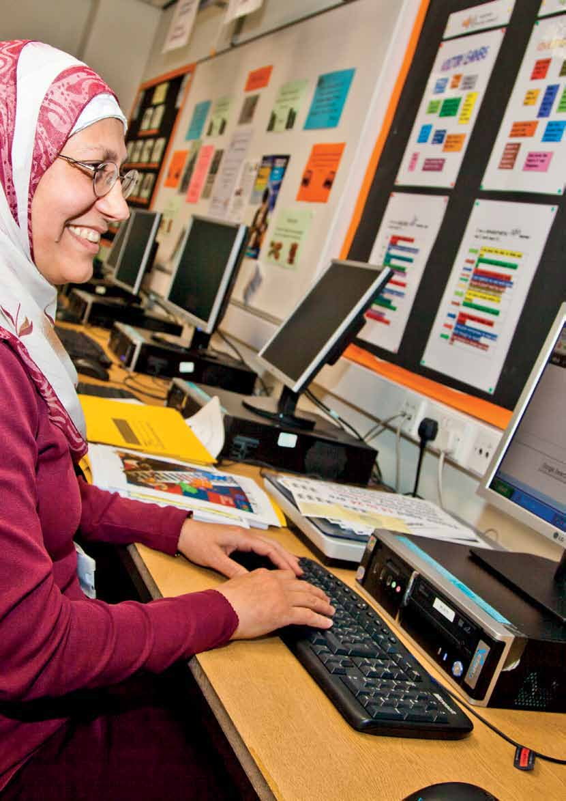

BLoGGING aND sHarING

---

<!-- PAGE: 31 -->

Denbighshire Picture This People gain benefits from being in a supportive environment as well as from active engagement in creative pursuits. The benefits relate mainly to emotional health and wellbeing.14 Recognising this, Rhyl Library took part in a significant Arts and Wellbeing project, working with the textile artist Alison Mercer during the summer of 2011. Alison Mercer’s work challenges and explores the diversity of parental relationships, enabling explorations of self-identity and relationships. She maintains that while parenting is a wonderful experience it is sometimes tinged with self-doubt, loss of self-identity and depression and her work aims to uncover the hidden truths of modern parenting. Alison worked with a variety of groups from Rhyl, including Bookstart Parent and Baby Group, Bookstart Parent and Toddler Group, Botanical Gardens Parent and Toddler Group, Clwb CIC (Welsh language female group from South West Rhyl), cared-for children from Rhyl and Rhyl Adventure Playground Association. The groups produced keepsake quilts, altered baby grows and fabric books, memory books, batik and collage canvases. The workshops provided a relaxed and interactive forum for creativity to take place and to enhance the personal wellbeing of participants. The individuals participating in the baby and toddler groups and clinics were helped to achieve long-term wellbeing through creative play and learning new skills. All of the artwork produced during the workshops was exhibited at Rhyl Library Gallery from August to October 2011 alongside Alison’s own pre-selected artwork. This proved a fantastic opportunity to demonstrate that textile arts and skills can create unique benefits for all participants whatever their age and ability. A comprehensive project evaluation report has been produced that identifies the benefits of participating in the arts project as:

* helping with stress

* confidence building

* making new friends

* learning new skills

* drinking less in the evenings as

a result of working on their textile pieces. Two sewing groups have developed from the project with one group of mums meeting at each other’s houses to make Halloween costumes for their children as well as birthday gifts. The other group have found a teacher and a venue and have 10 members in their club. Mums are talking about their experiences via social networking sites, blogging and sharing tips via YouTube. Customer comments include: I have remembered I can do other things! I’m not just a mummy!

Enjoying sewing and stitching

**Impact:** Physical and Psychological ✓ | Economic and Material ✓ | Community and Social ✓

---

<!-- PAGE: 32 -->

Gwynedd reading Together In co-operation with Ty Newydd Writers’ Centre, Gwynedd Library and Information Service is develop[ping and supporting groups who meet and read books which focus on a range of life experiences. The groups do not just read for enjoyment

* although it is hoped that this is also a

significant outcome of the sessions. The groups aim to improve access to self- help materials, provide an opportunity for people to talk about their own experiences, and bring people together. The Library Service has worked with representatives from the Local Health Board, Literature Wales and Social Services (Carers Support and Mental Health) to establish groups with a wide variety of vulnerable clients, from disadvantaged areas to the elderly in care homes. Libraries can help transform people’s lives and reading can help reduce the stresses of everyday life. The more you read the sharper your mind becomes and the more focused you become. Reading fiction can open up whole new worlds for you and reading factual books can better your knowledge. Your local library is here to help you find those worlds and experiences. Gwawr Eilian Williams, Gwynedd Community Librarian Ty Newydd Writers’ Centre

**Impact:** Physical and Psychological ✓ | Economic and Material ✓ | Community and Social ✓ | Environmental ✓

---

<!-- PAGE: 33 -->

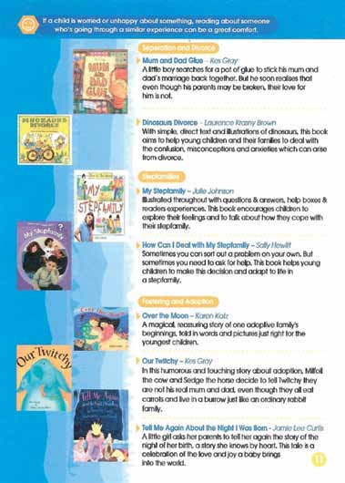

Gwynedd Helping Hand Books A difficult problem or subject can often be introduced to young children through the medium of picture books. Gwynedd Library and Information Service maintains a special collection of books on all types of situations to be used by or with children. Among the specific themes of the books are disabilities, mental health, keeping healthy, personal safety, first experiences, family life, caring for oneself and others, growing up and bereavement. Recommended books available from the library on these themes are listed in two booklets, one for up to 8 years and the other for 8-13 years. The contents of the booklets are divided into simple everyday topics such as:

* New baby in the family

* Moving house

* Going to the dentist

* Keeping safe

* Step families

* Losing someone special

The majority of the books in the under 8 collection are suitable for very young children. The complete collection contains books for a wide range of reading ages, up to early teens. The lists can accessed on line at www. gwynedd.gov.uk or are available as printed booklets.

**Impact:** Physical and Psychological ✓ | Community and Social ✓ | Environmental ✓

---

<!-- PAGE: 34 -->

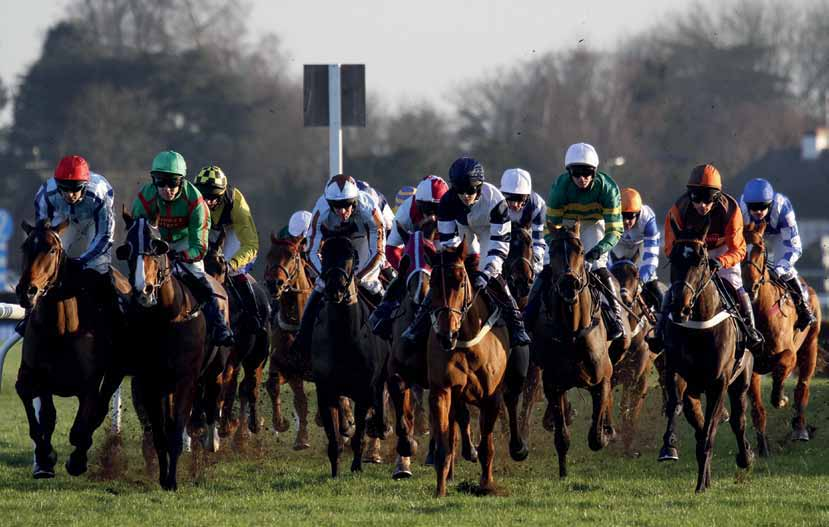

Merthyr Tydfil A day at the races Merthyr Libraries’ book groups are a sociable bunch. While they meet as three separate groups (Chapters, Chapter 2 and A Novel Idea), four times a year we organise an event, activity or outing for the 35 members. All three groups read a wide variety of books, and after the book group leader heard Felix Francis speaking animatedly about his own and his father Dick’s work at an event, an idea was formed for the next book group outing! Dick Francis, born in Wales, is widely acclaimed as one of the greatest thriller writers of all time. His books centre around the world of horse racing and with the Chepstow racetrack just on the doorstep, where better to bring the books to life? The group read ‘Even Money’ before attending a race meeting, and in discussions after the outing the group members all agreed that being at the races did make the book come to life for them. One member said: I’ve never been into racing and so have never been to the races. Reading the book and the descriptions was one thing but actually being in the environment Dick Francis was writing about was something else. When I went back to the book again, I had the sounds, smells and sights all adding something extra to my reading. The social impact of the activities undertaken by the book groups cannot be underestimated. One quote from a book group member highlights this: When I moved to the area I didn’t really know anyone, when I joined the library I saw a poster about Chapters and decided to come along. I had a great welcome from the whole group and have made new friends I may otherwise never have met. When we all get together for an evening out or to a quiz we have a great time and it’s widened my social circle immeasurably.

**Impact:** Physical and Psychological ✓ | Economic and Material ✓ | Community and Social ✓

---

<!-- PAGE: 35 -->

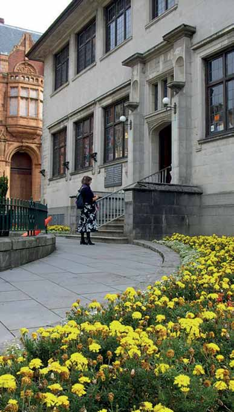

Merthyr Tydfil A day to remember Merthyr Tydfil is an area of high deprivation and sickness and disability levels are high. The Home Links service provided by the library service for housebound users is a lifeline. For some, it may be a precious link to the outside world and one of the few occasions they receive a visitor. Knowing how much the customers who visit the library enjoy a quick chat when they come in, the staff decided to extend this to their housebound customers by bringing them into the library building. They spoke to all the Home Links users to see if this was something they would like to do. Having received an overwhelmingly positive response, they hired a local community minibus and held 3 sessions throughout the day, picking up the users, bringing them to the library and dropping them home afterwards. A member of staff commented: We had tea, coffee, cakes and biscuits and long chats. A volunteer joined us and led discussions about ‘the old days.’ The tales were fascinating, stretching through many decades of local history. It was lovely to hear the human stories, the memories that touched individuals and left a lasting impression. We used photographs to stimulate discussion and memories and no one who joined us on the day wanted to leave! One very happy customer said: This day has been the highlight of my year, it was like coming alive again. I have so few visitors and I can’t get out, this day has been wonderful.

**Impact:** Physical and Psychological ✓ | Economic and Material ✓ | Community and Social ✓

---

<!-- PAGE: 36 -->

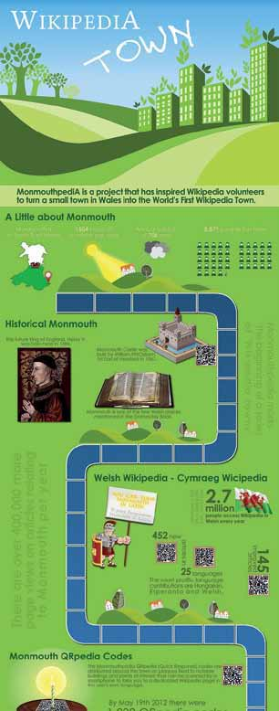

Monmouthshire MonmouthpediA Sustainable wellbeing covers not only the includes the economic, material, community and social side as well. MonmouthpediA is the first Wikipedia project to embrace a whole town. The idea was conceived by a Monmouth resident and the project aims to cover every single notable place, person, artefact, plant, animal and object in Monmouth in as many languages as possible. The project is jointly co-created and funded by Monmouthshire County Council (MCC) and Wikimedia UK. MCC has installed free town-wide Wi-Fi for the project, another first in Wales! MonmouthpediA uses QRpedia codes, a type of bar code that a smartphone can read through its camera. The code links to a Wikipedia article which is then displayed on the phone in your language. Articles have coordinates to allow a virtual tour of the town using Wikipedia Mobile apps. To access the articles people simply scan the QRpedia codes on the ceramic plaques attached to the outside of buildings or labels for items within the buildings – including books in Monmouth Library and places of interest within the Shire Hall The amount, detail and quality of the information that the community can create is staggering. Knowledge gives us context, it and allows us to appreciate our surroundings more. Monmouth may well be the first place in the world to offer its tourist information in over 250 languages. http://en.wikipedia.org/wiki/ Wikipedia:GLAM/MonmouthpediA

**Impact:** Physical and Psychological ✓ | Economic and Material ✓ | Community and Social ✓ | Environmental ✓

---

<!-- PAGE: 37 -->

Monmouthshire New start in Chepstow These days, finding any job, let alone a job that involves working in an area of personal interest, can be almost impossible. But the impossible has happened for Stephen Assender, 26, from Blackwood. Stephen is part of the Conserving Local Communities Heritage (CLOCH) project, which is funded through the Heritage Lottery Fund’s ‘Skills for the Future’ programme. Targeting local young unemployed men, the CLOCH project offers 12-month traineeships in heritage skills focusing on digitisation, research and local history, collections and conservation management and community engagement. CLOCH is a partnership project, led by Glamorgan Archives, bringing together libraries, archives and museums across South Wales to offer placements and work experience in the heritage sector. The project will recruit 16 trainees over three years to gain skills and accredited learning in the heritage sector. Trainees spend three months developing core skills at Glamorgan Archives before embarking on additional placements at partner sites. At the end of their 12-month traineeship, trainees will be supported to match their new skills with entry-level posts in the sector and/or explore further training and qualifications. Stephen is part of the second cohort of trainees who started in September and he will be based at the newly refurbished Chepstow library following his induction at Glamorgan Archives. Chepstow library includes a dedicated local history area with significantly improved access to the Chepstow Collection of local history volumes. Stephen’s placement will focus on developing the Chepstow Collection through:

* Updating the library catalogue

and adding new donations to stock

* Digitising archive material and

making it more accessible online

* Collaborating with Chepstow

Museum to improve information about collections

* Promoting the Chepstow

Collection in partnership with The Chepstow Society

* Developing links between

MonmouthpediA and Chepstow. I am very interested in history but was unsure how to get into the Heritage sector. Having been unemployed for ages I see this as a major opportunity to follow up my interests. Stephen Assender, Chepstow Library The CLOCH project is using Positive Action Training to target local men under 30 as evidence from placement partners show that young men continue to be under- represented in the sector. It is working with Working Links, Bridges into Work, local councils and local voluntary and training organisations to reach its target group.

**Impact:** Physical and Psychological ✓ | Economic and Material ✓ | Community and Social ✓ | Environmental ✓

---

<!-- PAGE: 38 -->

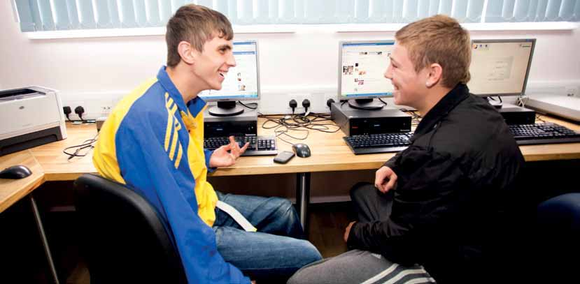

Neath Port Talbot Cuppa with a copper ‘Cuppa with a Copper’ is an initiative which enables the people of Baglan to meet their and non-threatening environment – which happens to be their local library. They can have a cup of tea and a friendly chat with the officer about any issues, including things that may be worrying them. It is also a chance for the officer to help alleviate concerns about the policing of the area and inform people of the many ways they can contact the police. There is an opportunity to find out about Partners and Communities Together PACT meetings, including where and when they are held and what happens during these sessions. Younger members of the community are encouraged to get involved in Cuppa with a Copper, fostering a positive relationship with the police and giving them a voice within their community. This hopefully will give young people the confidence to speak to the police, should they have any worries or concerns such as bullying or peer pressure. Most estimates of the cost of crime quite rightly focus on the victims, yet there is an even larger cost in terms of its indirect non-victims. Increases in crime rates have a negative impact on the mental wellbeing of local residents.8 Being able to discuss worries in a neutral environment benefits both the individual and the local community.

**Impact:** Physical and Psychological ✓ | Economic and Material ✓ | Community and Social ✓ | Environmental ✓

---

<!-- PAGE: 39 -->

Neath Port Talbot Baby massage and babbling Baby Massage and Baby Babbling are two projects sponsored by the Flying Start Initiative aimed at new mums (and dads). Baby Massage is suitable for babies under one (or until they get too mobile to enjoy the sessions) and Baby Babbling is generally aimed at under twos. The sessions are held weekly in Sandfield Library’s community room and run by trained Flying Start staff and health professionals. The library is ideally placed for such a project, being centrally located in a large housing estate with ample parking and good bus routes. The scheme enables new mums to socialise together and provides a support network for them. The practices promote bonding and closeness between parent and child, helping improve communication and calming and soothing the baby. Evidence shows that touching and nurturing contact plays an important role in baby’s development. It is especially aimed at young mums who may be unaware of the social and developmental opportunities available to them and their babies, or who lack the confidence to find out and join in.

The small groups (about 10 to 15) are encouraged to socialise outside the session and to participate in other activities such as parent and toddler groups. Other family members (such as dads and grandparents) are also welcome, helping to establish family bonding. The sessions are very popular and are now run on a ‘rolling programme’ to meet demand. The library has also benefited from it, as most parents have now become library members, also signing up their babies and other children. Many now participate in events held here such as craft and story times.

**Impact:** Physical and Psychological ✓ | Economic and Material ✓ | Community and Social ✓

---

<!-- PAGE: 40 -->

Newport Jobs Fair Bettws, built largely as a council estate in the 1960s, has an adult population of 5,000, of whom 27% are claiming one of the key out-of-work benefits. A Job Club has been operating in the library for the past two years. Building upon the work of the club, a Jobs Fair was held in March 2012, which was delivered in partnership with the local Communities First office and supported by organisations including Job Centre Plus. The day was open to all members of the Bettws Advisors were on hand to help residents search for jobs, complete application forms and give information about the benefits that may be available to them during their search for employment. The aim of the Jobs Fair was to engage with people in the community who the partner organisations have often found it difficult to reach. The library was chosen as the venue because it is located centrally and was able to offer the resources that were required, especially free access to PCs and the internet. As the library is a neutral space the fair was able to attract residents who may have been intimidated by the prospect of attending a similar event at an unfamiliar location. Caren White, the Communities Development Worker for Bettws Communities First, commented: The Jobs Fair has been so successful that we will be using this venue again. It is so welcoming and the customers are not intimidated here. They are all very comfortable about attending. Thank you for the welcome.

**Impact:** Physical and Psychological ✓ | Economic and Material ✓ | Community and Social ✓

---

<!-- PAGE: 41 -->

Open your heart Open your home Foster Newport Book Break

In common with other carers, foster carers are often time-pressured and can find it difficult to get the opportunity to meet and socialise with others. Realising this, Newport holds Book Break sessions for foster carers at the Central Library, as one of a number of groups being run throughout the city using the Reader Organisation’s ‘Get into Reading’ programme. The group is open to all foster carers in Newport and the library service has worked in partnership with Newport City Council’s fostering team to promote the scheme to carers. During the session attendees are invited to read aloud a short story or extract from a novel and to discuss the text in relation to their own experiences. The Book Break allows foster carers to meet people with similar experiences, to relax and to take a bit of time out for themselves. Through promoting a shared reading experience, ‘Get into Reading’ groups help those attending to become more confident, feel less isolated and explore their experiences through literature. Feedback from the group on the impact of the sessions is overwhelmingly positive: I just love the fact that I am, for once, doing something for myself which is different and gets me out of the house. I drop my carer’s role, just for an hour. It is so refreshing! I come out after an hour and I feel happier, I have a little smile on my face! It may sound silly, but I think of it as a bit of me time, shared with friendly people. And it really makes a difference to how I feel. The group is such a great idea, I’m so glad I plucked up the courage to go!

**Impact:** Physical and Psychological ✓ | Economic and Material ✓ | Community and Social ✓

---

<!-- PAGE: 42 -->

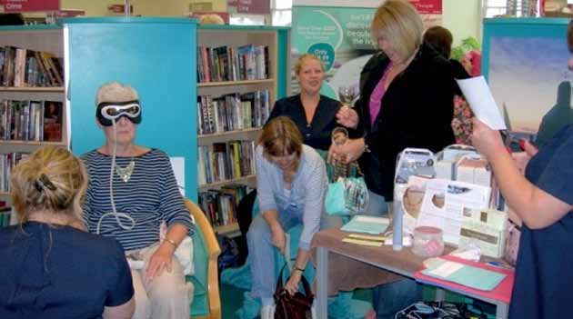

Pembrokeshire A girls’ night in It all started with somebody suggesting how nice it would be to have a beauty fair in the library - to get all the local businesses under one roof and say ‘Come on girls! Look at all the wonderful ways you can be pampered in Fishguard!’ And so ‘A girls’ night in’ was born. The fair took place on a July evening in Fishguard Library. Every available space between the book shelves was filled by stalls, ranging from colour therapy and nail treatments to fitness monitoring by the Leisure Centre; even the small art gallery became a haven of peace and tranquillity where Chinese massage could be enjoyed by the more adventurous visitor. The event aimed to bring together businesses and the community to enhance wellbeing, support the local economy and bring people together for an enjoyable, free evening whilst encouraging the locals to use their library. Over 70 people attended the event and although most were already members of the library, there were 4 new borrowers and 1 lapsed user reinstated her membership. I am very ill and usually I am in bed by now, but I made myself stay up so I could come to this and I am very glad I did.

I just wanted to say what a fantastic night last night was, it was a great idea. The colour consultant was great, as was the aromatherapy massage. Oh and Megan enjoyed it too, her nails are looking great.

It presents the library in an entirely different light. Much more inviting and I feel more a part of it.

**Impact:** Physical and Psychological ✓ | Economic and Material ✓ | Community and Social ✓

---

<!-- PAGE: 43 -->

Powys No-one could accuse library users in Powys of being couch potatoes! To encourage residents to exercise their bodies as well as their minds, everyone joining the library during Libraries Fortnight was given a voucher to use for a free racquet sport session at their local leisure centre. In Powys almost 50% of the population is overweight or obese, levels of potentially harmful alcohol consumption are increasing and while significant progress has been made in reducing the impact of tobacco on health, over 25% of the adult population smoke.9 Supporting the objectives set out in the Health, Social Care and Wellbeing Strategy, the aim of the activities during the Library Fortnight was to encourage people to learn something new and achieve a work-life balance. Powys Healthy minds, healthy bodies Older people need to keep learning to get the most out of life, whether it’s managing money, learning new technology or learning how to keep healthy. Rapid social and technological changes mean it’s all the more important that older people learn new skills. Learning is also great for keeping older minds active and for socialising.10 With this in mind, Powys Library Service started its ‘Healthy minds, healthy bodies’ campaign, which built on the good relationship with the local leisure centres and enabled the libraries to forge excellent links with the Exercise Referral team. As part of the campaign, groups visited their local library, where they were shown how to access the family history software (Ancestry.com) free of charge, and given a demonstration of e-readers and the new Welsh e-books service.

**Impact:** Physical and Psychological ✓ | Economic and Material ✓ | Community and Social ✓

---

<!-- PAGE: 44 -->

rhondda cynon Taf E-Teens Library Young people in Rhondda Cynon Taf (RCT) have three ‘cool spaces’ where they can chill out by playing on a Wii, watching DVDs, listening to music, and even taking part in a DJ workshop. The local youth club? No, their local library! RCT library service (with the support of CyMAL grant funding) has created dedicated areas for teenagers at Treorchy, Aberdare and Tylorstown libraries. All three have been designed with the help of the local School Councils and feature bright colours, up- to-date technology and the name ‘E-Teens Library ’. Treorchy E-Teens opened in 2009 and since then the number of teenagers visiting the libraries each month has more than doubled. Activities organised across all three venues with partners such as E3+, Youth Service and Detached Youth team have included a Halloween party attended by 150 young people, theatrical make- up sessions, Graffiti Art, poetry sessions and employability skills for Year 11. Young people attending the launch of the teenage library in Tylorstown could not believe their eyes when they entered the room for the first time. One exclaimed: “This is awesome!”, whilst another younger companion wistfully declared that he would have to wait “three whole years” before it was his turn.

Councillor Robert Bevan, RCT Cabinet Member for Education, said: This is a good example of rebranding libraries to make them relevant to the changing needs of society and encourage people to use them. These days it is even more important to have local facilities and make full use of them. The teenage library has been an important element of the regeneration of this area.

**Impact:** Physical and Psychological ✓ | Economic and Material ✓ | Community and Social ✓

---

<!-- PAGE: 45 -->

rhondda cynon Taf The Talking reading Group For a group of blind and partially sighted people the second Thursday of each month is special, because that’s when they meet at Rhydyfelin Library to listen to audio books. Each session starts with a cuppa and a friendly chat, followed by a discussion of the previous month’s book with everyone voicing their opinions – resulting in some very lively discussions! Each month they embark on a new book. The first chapter of the book is played so that everyone can get an idea of the story and gauge whether they like the reader’s style. If anyone doesn’t like the book or feels they can’t listen to it, they are free to choose another which they will listen to before the next meeting. The meetings end much as they started with animated discussion about anything else anyone has read that month and ideas are given for future book group ‘reads’. The Talking Reading group is important because it encourages its members to venture out of their houses into a friendly environment where they can meet new friends, socialise and learn about other groups and events that are taking place within the local area. The comments from the group speak for themselves: It’s great to get out to the library. I love a good read and being able to talk about what I have read and to get some new ideas really make me want to keep coming to the group. I like the relaxed atmosphere and the chance to have a coffee and a bit of a laugh! Large print and audio books are not the only resources available at the libraries for the visually impaired as another customers comments show: As a visually impaired customer, the library is a lifeline for using the internet to research my interests, watching rugby and football, increasing the size of fonts so that I can see text more clearly and connecting me with the relevant council departments that can help with my daily requirements

**Impact:** Physical and Psychological ✓ | Economic and Material ✓ | Community and Social ✓

---

<!-- PAGE: 46 -->

swansea Young readers “It’s the best thing that’s ever happened to me”, said a child when he opened his book bag and saw what was in it. He ran up to the librarian, giving her a huge hug and actually cried. As part of the National Young Readers programme, an initiative between Swansea Libraries and the National Literacy Trust, children from a number of primary schools were given their favourite book from a list selected by their classmates. One lad had always wanted to own a copy of ‘The Hobbit’ but his mother wouldn’t buy one for him due to the expense, and although it was not in the choice of books provided for the children to pick from, the librarian had bought a copy for him. The Young Readers Programme aims to help transform the lives of disadvantaged children by engaging them and motivating them to read for pleasure. Research has shown that children who continue to read widely throughout their school years and beyond are more likely to be academically successful and more an impact on their future wellbeing. In fact, the research shows that reading for enjoyment is more important for children’s educational success than their family’s socio- So far the project has engaged with over 1000 pupils and is proving rewarding not only for the children, but also for the teachers and library staff who are involved. Teachers have said how wonderful the programme is, and that they have seen a difference in the way the children pick books from the school’s library. The final word goes to another child who went up to the librarian and said: Miss, are you sure that I can take these home, as I’ve never had a book to keep before?

**Impact:** Physical and Psychological ✓ | Economic and Material ✓ | Community and Social ✓ | Environmental ✓

---

<!-- PAGE: 47 -->

swansea A tea dance A tea dance in the library – well why not? Golden Years, a group of over-fifties who meet regularly at Swansea Central Library, held a tea dance to encourage exercise and new friendships to blossom. The group, which started around two years ago, meets up in a corner of the library where they enjoy the relaxed atmosphere and the refreshments, whilst reminiscing and talking about some of the similar problems they may have. As well as being a place to go and chat, the library has run a number of special sessions to support wellbeing amongst the over- fifties, which the group have attended. These have included delivering exercise and nutrition sessions focusing on heart disease, stroke and osteoporosis and how keeping active can prevent falls and increase muscle stability in later life. Representatives from environmental health have delivered sessions on fire safety at home and also told the group about the authority’s electric blanket trade-in scheme. The recycling team popped in during “Wise up to Waste Week” although not everyone understood which week is pink and which is green! The most popular event to date has been a local history talk on the Blitz in Swansea as part of library’s ‘Golden Years’ promotion. This attracted well over 40 people and was delivered by local historian Roy Kneath. Roy’s talk focused on the community spirit during the very dark times of the air raids, when the ‘ugly lovely’ town of Dylan Thomas was gone forever. To misquote David Bowie you won’t hear this group of ‘Golden Years’ saying that life‘s taking them nowhere.

**Impact:** Physical and Psychological ✓ | Economic and Material ✓ | Community and Social ✓

---

<!-- PAGE: 48 -->

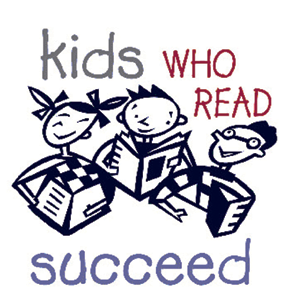

Torfaen Sharing Books with Under Fives If a parent or carer can spare 10 minutes a day to read with their child, it can make a huge difference to their development. 7 Realising that not everyone is confident enough to read with their children, Torfaen Libraries held two ‘Sharing Books with the Under 5s’ sessions as part of a programme of events for Adult Learners Week. The aim was to help under 5s develop a love of books and reading before school, and to encourage the parents and carers to share books with their children. These sessions were both fun and practical, offering advice and guidance on choosing and reading books with babies and toddlers. They emphasised that sharing books with under 5s is enjoyable for both child and carer alike! In addition, the benefits of shared reading were highlighted, such as developing a child’s language and listening skills, the positive impact on progress at school, and the comfort, stability and reassurance provided by reading a favourite story. The attendees said that they all felt more confident and enthusiastic about sharing books with their children after the sessions. As one parent said: The session showed me the importance of introducing children to the joy of books, no matter how young.

**Impact:** Physical and Psychological ✓ | Economic and Material ✓ | Community and Social ✓

---

<!-- PAGE: 49 -->

Torfaen Healthy, Wealthy & Wise Torfaen Libraries are well aware of the important part that libraries can play in empowering people to access and use health and wellbeing information. Each year the events staged by the four libraries in Torfaen to support Adult Learners Week attract large audiences, and so it was decided that this initiative would be an excellent opportunity to raise awareness of the library-based Macmillan Cancer Support Service and the Book Prescription Scheme that had recently been re-launched. As well as promoting these services, the Information Officer also wanted to establish links with local agencies that offer support to people with chronic illnesses and conditions other than cancer. As a result, the ‘Healthy, Wealthy & Wise’ event was born, with the ultimate aim of helping local residents to improve all aspects of their lives. From healthy living and exercise to financial advice and support for carers, the day ensured that more than 600 people from the borough were given information and guidance. The Welsh Ambulance Service and the Stroke Association offered stress and blood pressure tests, encouraging anyone with an abnormal reading to visit their GP. The event was positively received by residents and agencies alike. One satisfied customer who visited the Macmillan Cancer Support Service was referred to both Gwent Cancer Support and Pontypool Carers, making her visit far more valuable than she had anticipated!

**Impact:** Physical and Psychological ✓ | Economic and Material ✓ | Community and Social ✓

---

<!-- PAGE: 50 -->

Vale of Glamorgan Sign and rhyme Sign and Rhyme is an innovative activity started by Danielle, who works in the County Library in Barry. Around 20 adults attend the regular sessions with even more babies and toddlers, and the Children’s Library is alive with chatter, crawling babies, laughter and the occasional tantrum! Mums, dads and grandparents bring along the babies – it’s aimed at those between 6 months and 2 years – and there are a number of teenage mums among them. The sessions involve fun rhymes and songs, accompanied by a range of simple signs, such as those for ‘more’, ‘hurt’, ‘milk’, ‘stop’. Danielle has devised these songs and rhymes herself. Repetition is the key to success and parents are encouraged to use the signs at home and get other family members involved. Parents are delighted when their baby uses a sign for the first time to communicate what it is they want. The activity primarily enables babies and parents to communicate before they can talk and gives the babies a head start in language development. Frustration is reduced and the bond between parent and child is strengthened. Parents enjoy the relaxed atmosphere and social interaction. Young mums are learning from those who are more experienced, and gaining confidence in bringing up their child. It is an opportunity to socialise with others in the same position. Parents are also reporting benefits in terms of the new skills learned, but also improved behaviour among their children, especially at normal flash points such as meal times. A number have reported that their babies are better able to concentrate and that they are more confident in interacting with other children.

**Impact:** Physical and Psychological ✓ | Economic and Material ✓ | Community and Social ✓

---

<!-- PAGE: 51 -->

Vale of Glamorgan The Community Bus This voluntary scheme has been running for 40 years in Dinas Powys in the Vale of Glamorgan. A minibus is operated by Dinas Powys Voluntary Concern to help local residents to get out and about. The service is especially valued by elderly people who are unable to use the local bus or train service. Residents are collected from their homes every fortnight and taken to the library. Books are exchanged, new books are ordered, photocopying is done, and staff can assist with finding any information needed. Some users have also been interested in learning to use some of the online services. However, Susan Sawyer, Community Librarian, says: It is the social interaction with each other, the library staff and other people using the library which is often most appreciated. The service supports individual wellbeing by providing an opportunity to get out, meet others, and socialise. Users of the bus generally enjoy a chat with library staff as much as they want to borrow books. It helps people who may otherwise be isolated to still feel part of the community. The books they borrow ensure they can continue to enjoy reading and the service provides them with access to choose the books for themselves and have a chat with others about their choice of reading material. One regular user commented: We have help with carrying our books, we meet other people on the bus and in the library. David Hurman, the volunteer bus driver, said: We have had as many as 13 people visiting the library on a 3 weekly roster - people who use the service have told me that it has given them a new lease of life. Another user commented: Very caring service and unique in the Vale.

**Impact:** Physical and Psychological ✓ | Economic and Material ✓ | Community and Social ✓ | Environmental ✓

---

<!-- PAGE: 52 -->

Wrexham The Carers’ Collection Balancing work and family responsibilities with caring for someone can be very challenging and can generate demands which at times can be difficult without the right information and support. It is estimated that one in eight adults are carers, indicating that there are over 17,000 in the Wrexham area (and almost 400,000 across Wales). Wrexham Library and Information Service, in partnership with Wrexham County Borough Council’s Adult Social Care Department and the Wrexham Carers Service, have addressed this need by establishing the Carers’ Collection. Available at all 12 of Wrexham’s libraries and on the mobile library and the Homelink service, it includes titles covering topics such as autism and dementia through to guides providing advice on rights, benefits and the emotional aspects of being a full time carer. A reference collection of all titles is also maintained at Wrexham Library. A select booklist, covering subjects of interest to people who care for others, has been compiled and is also available online. The range of subjects is extensive and includes Asperger Syndrome, arthritis, cancer, diabetes, eating disorders, hearing loss, heart problems, memory loss, visual impairment and many others. Carers are encouraged to suggest titles for inclusion in the collection and to review books that they’ve read in order to help other carers. The collection is promoted throughout the year but in particular during National Carers’ Week in June and Carers’ Rights Day each December.

**Impact:** Physical and Psychological ✓ | Economic and Material ✓ | Community and Social ✓

---

<!-- PAGE: 53 -->

Wrexham Splash and rhyme Time Splash & Rhyme Time is a weekly term time only session that involves action rhymes and songs in the water at Plas Madoc Leisure Centre for children aged 4 and under and their parents. Early Years Librarians from Wrexham Library run the sessions. Nerys described a typical Splash session: We all form a circle in the water and sing action rhymes and songs which the babies and toddlers love. They then have a play in the gentle waves and have turns on the slide. The main aims of Splash & Rhyme Time are to develop early literacy skills through action rhymes and songs in a fresh and fun way, and to boost water confidence and a healthy and active lifestyle through the use of the leisure facility. It also promotes Bookstart and local libraries. A parent engaging in this physical activity with their child will benefit from feeling happier and more relaxed. This in turn will reduce the parent’s stress levels, improve their self- esteem, and increase their confidence, thus fostering a positive relationship with their child. It is a very popular session with families describing it as ‘brilliant’, ‘very entertaining’ and a ‘fantastic service’. One commented that she and her partner now shared rhymes regularly with their son at bath time.

**Impact:** Physical and Psychological ✓ | Economic and Material ✓ | Community and Social ✓

---

<!-- PAGE: 54 -->

## Society of Chief Librarians (Wales) Directory

| Local Authority | Contact | Email |
| :--- | :--- | :--- |
| Blaenau Gwent | Sue White | sue.white@blaenau-gwent.gov.uk |
| Bridgend | Margaret Griffiths | margaret.griffiths@bridgend.gov.uk |
| Caerphilly | Gareth Evans | evansg1@caerphilly.gov.uk |
| Cardiff | Elspeth Morris | emorris@cardiff.gov.uk |
| Carmarthenshire | Wil Phillips | WTPhillips@carmarthenshire.gov.uk |
| Ceredigion | Gareth Griffiths | Gareth.Griffiths@ceredigion.gov.uk |
| Conwy | Ann Lloyd Williams / Sharon Morgan | Ann.Lloyd.Williams@conwy.gov.uk / sharon.morgan@conwy.gov.uk |
| Denbighshire | Arwyn Jones | arwyn.jones@denbighshire.gov.uk |
| Flintshire | Pennie Corbett | Pennie_Corbett@flintshire.gov.uk |
| Gwynedd | Hywel James | HywelJames@gwynedd.gov.uk |
| Merthyr Tydfil | Jane Sellwood | jane.sellwood@merthyr.gov.uk |
| Monmouthshire | Ann Jones | annjones@monmouthshire.gov.uk |
| Neath Port Talbot | Wayne John | w.john@npt.gov.uk |
| Newport | Gill John | gill.john@newport.gov.uk |
| Pembrokeshire | Anita Thomas | anita.thomas@pembrokeshire.gov.uk |
| Powys | Mark Jones | mark.jones1@powys.gov.uk |
| Rhondda Cynon Taff | Ros Williams | ros.williams@rhondda-cynon-taff.gov.uk |
| Swansea | Steve Hardman | steve.hardman@swansea.gov.uk |
| Torfaen | Christine George | christine.george@torfaen.gov.uk |
| Vale of Glamorgan | Sian Jones | SJones@valeofglamorgan.gov.uk |
| Wrexham | Dylan Hughes | dylan.hughes@wrexham.gov.uk |
| Ynys Môn | John Rees Thomas | jrtlh@ynysmon.gov.uk |
| Development Officer | Karen Eynon | karen.eynon@wrexham.gov.uk |

## Bibliography

1. Public Libraries in Wales: Health, Wellbeing and Social Benefits, SCL Wales, August 2012
2. Child Poverty Strategy for Wales (2011-2014), Welsh Government, 2011
3. Changing Cancer Care in Wales, Macmillan Cancer Support, 2011
4. Can Google be Trusted? Fairsearch Europe, 2012
5. 'A Design for Life', Manic Street Preachers
6. An investigation into the therapeutic benefits of reading in relation to depression and wellbeing, The Reader Organisation et al, 2010
7. Literacy Changes Lives, National Literacy Trust, 2008
8. Crime and Mental Wellbeing, F. Cornaglia & A.K. Leigh, April 2011
9. Powys Health, Social Care and Wellbeing Strategy (2008-2011)
10. Wales: A Good Place to Grow Old? Bevan Foundation, 2012
11. Reading for Change, OECD, 2012
12. Lifelong Learning and Wellbeing: Analysis of the Relationship between Adult Learning and Subjective Wellbeing, Matrix Knowledge Group for NIACE, 2009
13. Libraries Inspire: The strategic development framework for Welsh libraries (2012-2016), 2011
14. Arts in Health and Wellbeing, An Action Plan for Wales, March 2009, Arts Council of Wales
