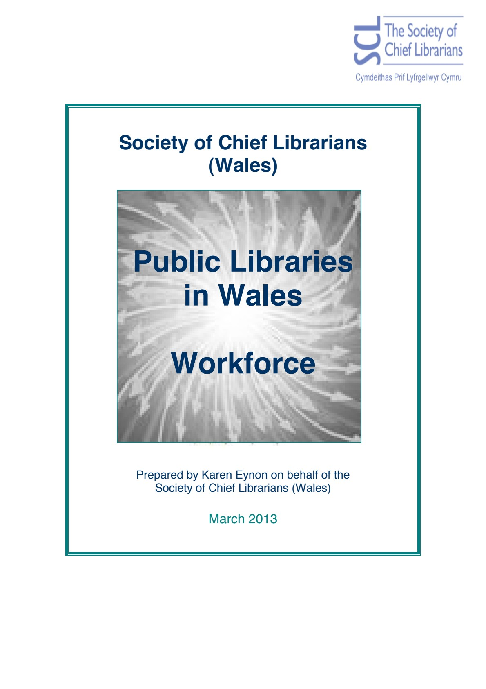
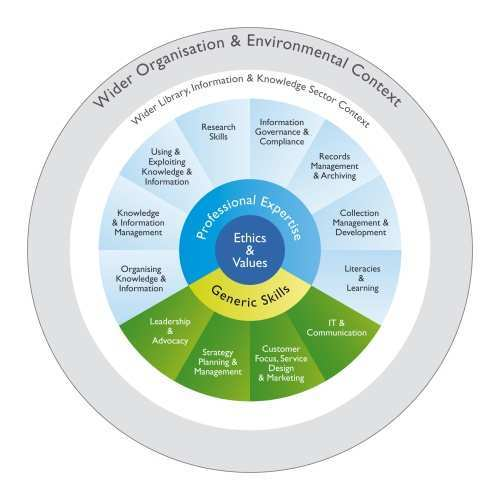
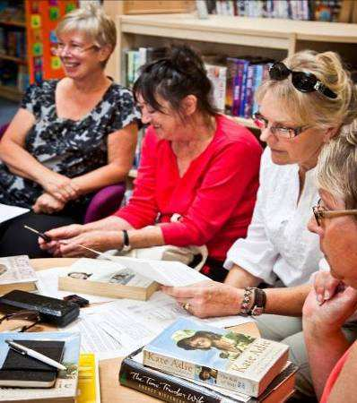
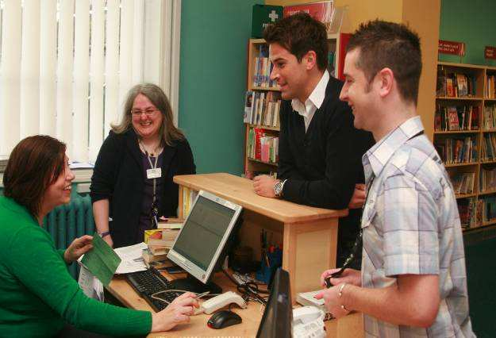
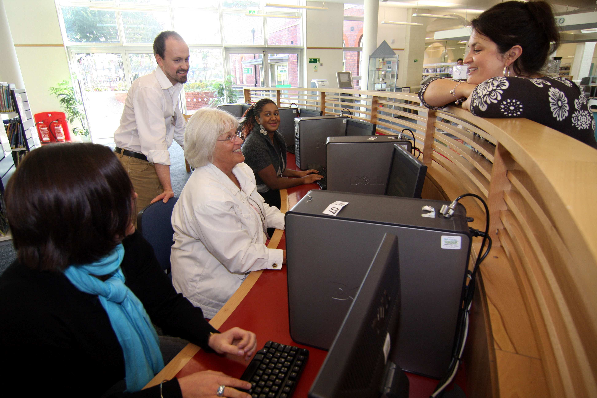
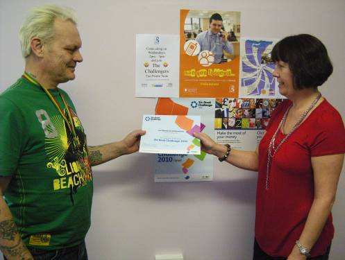
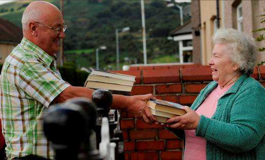
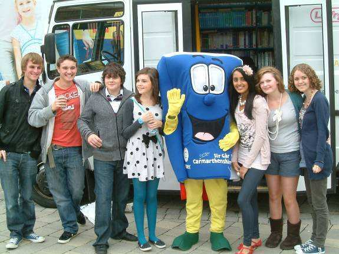

<!-- PAGE: 1 -->


# Society of Chief Librarians (Wales)

## Public Libraries in Wales: Workforce

Prepared by Karen Eynon on behalf of the Society of Chief Librarians (Wales)

**March 2013**

---

<!-- PAGE: 2 -->

## Contents

| Section | Pages |
| :--- | :--- |
| **Foreword** by Ann Jones, Chair of SCL Wales | 2 |
| **Executive Summary** | 3 – 6 |
| **FULL REPORT** | |
| 1. Introduction | 7 |
| 2. A Vision for the Workforce | 7 |
| 3. Barriers and Issues Facing Library Services | 8 – 9 |
| 4. Context | 10 – 14 |
| 5. Core Skills | 14 – 17 |
| 6. Why These Skills Are Important | 18 – 29 |
| 7. Training and Development | 30 |
| 8. Conclusions and Recommendations | 31 – 32 |
| **SCL Wales Action Plan** | 33 |
| **Appendix 1: Training and Development Framework** | 34 – 36 |
| **Appendix 2: Public Library User Comments** | 37 – 44 |

*Front cover and internal photographs © Welsh Government / Local Authorities.*

---

<!-- PAGE: 3 -->

## Foreword

As the Chair of the Society of Chief Librarians (Wales) I strongly believe that a skilled and experienced workforce is essential to the delivery and sustainability of public library services in Wales. This view is echoed by colleagues in SCL Wales.

It is also a view held by public library users in Wales. We regularly receive customer comments about library staff. Just a few examples of these are included in this report. They show the impact members of staff have had on individuals. For example, an older person who is housebound; a child who needs help with homework; a new learner needing support with ICT skills.

Staff time spent with people helping them achieve what they set out to do is an important aspect of our service. The social connection is frequently as important as the ‘task’ itself. This is often overlooked by stakeholders and decision makers.

It is an undeniable fact that our workforce is more important now than ever before as we face greater demands and expectations. People are turning to public libraries to help with reading, literacy, digital literacy, information literacy, community engagement and social interaction. We need appropriate levels of staff with the right aptitudes and skills, matched with capacity to satisfy these growing demands.

It is our intention, therefore, to demonstrate to partners, groups and organizations the importance of our workforce and highlight the key issues facing us during this difficult economic time in Wales.

Recognising the leadership role to play in relation to sustaining and improving workforce issues and staff development, SCL (Wales) has an action plan prepared to take this forward. Partnership working with, for example, Welsh Government/CyMAL, Welsh Local Government Association, CILIP Cymru and colleagues in other library sectors will be fundamental to ensuring that the service is fit for the future.

**Ann Jones**  
*Chair of SCL Wales*

---

<!-- PAGE: 4 -->

## Executive Summary

### Introduction

The Society of Chief Librarians (Wales) is an organisation consisting of the chief librarian or equivalent of each local authority in Wales.

The aim of the Society is:

> “to influence the statutory, financial and other decisions which relate to the effectiveness of public library services, and take a leading role in the national development of public library services”  
> — *[SCL constitution]*

SCL Wales believes that a skilled and customer-focused staff is the library service’s most important resource.

### Purpose

The purpose of this report is:

* To demonstrate the importance of our library workforce;
* To highlight key workforce issues currently facing the public library sector in Wales;
* To emphasise the need for ongoing training and development for future service delivery and succession planning;
* To make key recommendations regarding our workforce in the future;
* To feed into the next Welsh Public Library Standards framework and future funding discussions.

### Summary

The following are the main points within the body of the report:

#### 1. We Can’t Operate Without a Good, Skilled Workforce
The public library service aims to meet new wider social goals and public library staff need to be equipped with the correct skills to meet these needs. Changing demands and expectations placed on public libraries is huge, and responding to such changes and complexity requires high-quality leadership and management. Library services also require a strong, flexible and motivated workforce. Staff at all levels need to maintain and develop their existing skills and some will need to acquire new skills to deliver what is expected of them.

#### 2. We Can’t Operate Without Sufficient Levels of Staff
Capacity is at its lowest as public libraries find themselves overstretched:

* Only **0.85%** (Welsh average based on 18/22 local authorities) of local authority staffing budgets is spent on library staff; <!-- PAGE: 5 -->
* Over half the library authorities in Wales have below the minimum staffing requirements as defined by the Welsh Government’s Public Library Standards;
* There are lower library staff expenditure levels in Wales than the rest of the UK;
* **12 heads of library services** or chief officers with responsibility for libraries in Wales have left prematurely (some have now been replaced) since 2010 impacting on strategic leadership and succession planning.

Despite all this, public libraries in Wales are striving to meet increased demands and expectations.

#### 3. Users Value the Staff
The relationship between library user and staff cannot be compromised due to new pressures. The public value the library staff. Public library staff regularly receive comments and thanks from library users. The comments included in this report are just a small selection of those received from people who tell us every day how much they value the public library staff and the difference their library makes to them.

Despite this, stakeholders and decision makers often overlook this fact. The relationship between user and staff is very important and cannot be compromised due to new pressures.

#### 4. Backdrop of Budgetary Pressures
Public libraries in Wales are currently working against a backdrop of other pressures and changes including:

* Staff cuts;
* Not being able to replace staff once they’ve left;
* Reduction in opening hours and/or branch closures;
* Other financial cuts;
* Increase in demand and expectation despite having less money and fewer staff.

#### 5. Efficiency Savings and New Models
Public libraries in Wales have already made efficiency savings. Public libraries are also exploring different ways of working in order to provide best value. For example:

* Partnership working with other library sectors in all regions and locally;
* Working closely together to roll out national and regional strategies, for example a Library Management System for Wales, an e-books scheme for Wales, Book Prescription Wales, etc.;
* Public libraries have always had a good track record of working with others nationally (CyMAL, CILIP, BBC, WLGA), regionally through partnership groups, and locally with other departments and agencies;
* Shared regional training groups and opportunities for staff job swaps, networking, and peer support.

---

<!-- PAGE: 6 -->

### Key Principles

We strongly believe the following needs to be recognised:

1. **The importance of retaining a good, skilled library workforce**;
2. **The positive impact library staff have on users**;
3. **Recognition of dedication**: Many library staff are often appointed on comparatively low salary scales and do more than their salaries reflect due to their goodwill and commitment to the job;
4. **Local training success**: The good training and development work that already takes place at local authority level;
5. **Regional collaboration**: The good work already underway in relation to training and development at regional and national level particularly through the regional training groups;
6. **The Welsh dimension**: The importance of the Welsh dimension including the Welsh language in workforce-related issues and training and development;
7. **Appropriate capacity**: The importance of delivering a good, efficient service with the correct staffing levels to meet ever changing needs and expectations.

### Recommendations

We recommend the following:

1. **Regional training funding**: Funding for the continuation of the regional training courses continues;
2. **Pan-Wales knowledge sharing**: We share the information from each training group across all of Wales and use it to identify good practice areas;
3. **National training framework**: A training and development framework be developed which is accessible and flexible and includes attention to the Welsh dimension and Welsh language;
4. **National Occupational Standards**: We look at how we can integrate the National Occupational Standards (NOS) for libraries into everyday working arrangements;
5. **Digital skills investment**: Funding is provided for additional input and support in relation to updating and developing ICT/digital inclusion skills specifically (linked to something along the lines of a new People’s Network);
6. **CILIP framework alignment**: We continue to keep a watching brief over CILIP’s universal framework and build in an annual review of this framework to ensure linkages and consistency;
7. **Standards enforcement**: The minimum requirements in relation to workforce as stipulated in the WPLS continues and we work with CyMAL to help identify new useful WPLS performance indicators relating to training, development and succession planning; <!-- PAGE: 7 -->
8. **Professional leadership requirement**: Future Standards frameworks should include the current stipulation that Library Authorities shall ensure that the designated operational manager of library services shall be the holder of recognised professional qualifications in librarianship or information science or information management;
9. **Sustainable funding streams**: We work with CyMAL to establish funding streams and sustainability levers in relation to workforce skills and training and development;
10. **Accessible bursaries**: CyMAL continue providing funding and bursaries but that they are made more accessible and flexible. We recommend that this is included in CyMAL’s workforce development plan;
11. **Cross-sector workforce group**: That consideration be given to establishing a cross-sector workforce group, consulting beforehand with other sectors to establish that this would be feasible and useful.

---

<!-- PAGE: 8 -->

# Full Report

## 1. Introduction

The Society of Chief Librarians (Wales) is an organisation consisting of the chief librarian or equivalent of each local authority in Wales.

The aim of the Society is:

> “to influence the statutory, financial and other decisions which relate to the effectiveness of public library services, and take a leading role in the national development of public library services”  
> — *[SCL constitution]*

SCL Wales believes that a skilled and customer-focused staff is the library service’s most important resource.

The purpose of this report is:

* To demonstrate the importance of our library workforce;
* To highlight key workforce issues currently facing the public library sector in Wales;
* To emphasise the need for ongoing training and development for future service delivery and succession planning;
* To make key recommendations regarding our workforce in the future;
* To feed into the next Welsh Public Library Standards framework and future funding discussions.

## 2. A Vision for the Workforce

By 2015 we will:

* **Have a library workforce** who have recognized levels of skills and knowledge to enable them to offer an enhanced customer experience to inspire a community of readers and learners;
* **Have a national development framework**, affording opportunities for career development at all levels, and prioritising areas identified (for example, addressing the digital divide);
* **Ensure succession planning**, role development and embrace different models of library provision.

---

<!-- PAGE: 9 -->

## 3. Barriers and Issues Facing Library Services

Public libraries in Wales are currently working within a difficult financial climate, impacting on staffing levels and the workforce.

There are staff losses, downgrading of posts, vacant posts and a reduction in human resources expenditure in many library authorities.


Based on a recent survey we have calculated that only **0.85%** of staffing budgets at local authority level is currently being spent on library staff (based on the Wales national average). In addition, Wales has lower staffing and expenditure levels than the rest of the UK.

There are also greater demands placed on library staff with a requirement to do more than core library skills, for example supporting adult learners and helping customers navigate online public services and job applications. This is despite the fact that front-line library posts are still among the lowest paid posts within the local government sector.

All this reduces the capacity of library services to innovate and change, to shape services to the needs of local communities, deal with complex enquiries and work in partnership with other organisations.

However, library practitioners continue to work within this difficult backdrop, striving to maintain the quality of the service and helping to transform lives through their work.

**Put simply, libraries are trying to do more with less.**

---

<!-- PAGE: 10 -->

### Summary of Barriers and Issues Facing Library Services

```
┌────────────────────────────────────────────────────────────────────────┐
│               BARRIERS AND ISSUES FACING LIBRARY SERVICES              │
├────────────────────────────────────────────────────────────────────────┤
│ • Increase in service expectation                                      │
│ • Increase in skills levels and training needs to meet expectations    │
│ • Reduction in financial and human resources                           │
│ • Overall decline in Wales for each staffing indicator in WPLS        │
│ • Lower staffing and expenditure levels in Wales than rest of the UK   │
│ • Frozen and vacant posts on the increase                              │
│ • Downgrading or loss of many senior posts                             │
│ • Current structures make succession planning and progression hard    │
│ • Only 0.85% of local authority staffing budget spent on library staff │
│ • Uncertainty about the future of National Occupational Standards (NOS)│
│ • Frontline staff required to deliver digital advice & learning support│
│ • Frontline posts remain among the lowest paid in local government     │
└────────────────────────────────────────────────────────────────────────┘
```

---

<!-- PAGE: 11 -->

## 4. Context

Based on the Welsh Public Library Standards 2011/12 (as defined by CyMAL, the cultural branch of the Welsh Government), at the very minimum library authorities in Wales shall ensure that:

* Total establishment staffing levels for the library service per 1,000 resident population shall not fall below **0.37 FTE**;
* At least **23%** of the total staff (full-time equivalent) of the library service will be formally qualified library and information professionals;
* Staff receive appropriate training and continuous professional development.

However, the latest assessment shows a worrying decline in compliance:

* In 2011/12, **12 out of 22 authorities** failed to meet the minimum staffing standard of 0.37 FTE per 1,000 population;
* Staff expenditure per capita in Wales remains significantly lower than the English and Scottish averages;
* Staff reductions have directly caused restricted opening hours, mobile library service reductions, and reduced capacity for outreach.

---

<!-- PAGE: 12 -->

The economic downturn and local government austerity measures have led to:

* Reductions in training budgets across almost all local authorities;
* Hiring freezes leaving key frontline and specialist posts vacant for extended periods;
* Loss of specialist children's, reference, and local studies librarians;
* Increased reliance on single-staffed branch libraries, raising health, safety, and lone-working concerns.

Despite these constraints, public libraries have consistently achieved high customer satisfaction ratings, demonstrating the resilience and commitment of the workforce.

---

<!-- PAGE: 13 -->

### Did You Know?

> * **Only 0.85%** (Welsh average based on 18/22 local authorities) of local authority staffing budgets is spent on library staff.
> * **Over half** of the library authorities in Wales fail to meet the minimum staffing requirements stipulated by the Welsh Public Library Standards.
> * **Wales has lower library staff expenditure** per capita than the rest of the UK.
> * **12 heads of library services** or chief officers with responsibility for libraries in Wales have left prematurely since 2010, impacting strategic leadership and succession planning.
> * **Frontline public library posts** are still among the lowest paid posts within the local government sector.

---

<!-- PAGE: 14 -->

### Collaboration and Efficiency

In response to financial constraints, Welsh public libraries have embraced unprecedented levels of partnership working and resource sharing:

* **All-Wales Library Management System (LMS)**: Developing a shared system to rationalise procurement and improve user access across authorities;
* **Welsh Public Library Consortia**: Collaborative procurement of books and digital media (audiobooks and e-books), securing substantial volume discounts;
* **All-Wales E-Books Service**: 21 authorities collaborating to offer a national downloadable collection;
* **Information Literacy Framework for Wales**: Collaborative development with higher and further education libraries;
* **Regional Training Cooperatives**: Shared training delivery through regional groups (South East, South West, and North Wales).

---

<!-- PAGE: 15 -->

### Position on Volunteers

Public libraries in Wales engage with volunteers where they can add value and enhance the service. It is important, however, to note that whilst SCL Wales is open to exploring the innovative use of volunteers to enhance services beyond what paid staff can achieve alone, **we do not believe volunteers should be used to substitute trained, skilled staff.**

SCL Wales updated its formal position statement on volunteers in February 2013, affirming that:

1. Volunteers must complement, not replace, paid staff;
2. Volunteers require dedicated staff time for recruitment, training, supervision, and safeguarding;
3. Core statutory services must remain the responsibility of qualified, paid personnel.

---

<!-- PAGE: 16 -->

## 5. Core Skills

### Frontline Staff Core Skills

Frontline library staff are the direct interface between the service and the citizen. The core skills required include:

* **Customer Engagement**: Welcoming diverse users, active listening, and conflict resolution;
* **Reader Development**: Guiding readers, recommending literature, and facilitating reading groups;
* **Stock Knowledge and Enquiry Skills**: Navigating print and electronic catalogues, databases, and reference tools;
* **Information Literacy** [^1]: Assisting users to identify, locate, evaluate, and use authoritative information;
* **Digital Literacy**: Supporting beginners with ICT, broadband access, online forms, and adaptive technology;
* **Working with Children and Young People**: Storytimes, Baby Rhymetime, Summer Reading Challenge, and homework clubs;
* **Empathy with Varying Needs**: Supporting older people, housebound readers, and people with disabilities;
* **Marketing and Promotion**: Creating engaging displays, social media promotion, and community outreach;
* **Bilingual Capability**: Communicating and delivering services effectively through the medium of Welsh.

---

<!-- PAGE: 17 -->

### Professional and Management Staff Core Skills

Senior and specialist library personnel require advanced leadership and technical competencies:

* **Strategic Thinking and Innovation**: Horizon scanning, service redesign, and policy alignment;
* **Leadership and People Management**: Motivating teams, performance coaching, and change management;
* **Advocacy and Political Acuity**: Articulating the library's value to councillors, funding bodies, and community partners;
* **Partnership and Collaboration**: Building cross-sector alliances with education, health, and voluntary sectors;
* **Project Management**: Delivering complex initiatives on time and within budget;
* **Finance and Budgetary Control**: Commissioning, procurement, and commercial awareness;
* **Facilities Management**: Overseeing modern, safe, accessible physical and digital environments;
* **Volunteer Coordination**: Managing and supporting volunteer programmes safely and effectively.

---

<!-- PAGE: 18 -->

### Mapping Against CILIP's Professional Knowledge and Skills Base



CILIP’s Professional Knowledge and Skills Base (PKSB) covers the generic skills required by library and information professionals across all sectors in the UK. The core competencies identified by SCL Wales align directly with the PKSB dimensions:

1. Professional expertise (information governance, collection management, literate environments);
2. Customer service, literacy support, and digital mediation;
3. Strategy, leadership, and operational management.

---

<!-- PAGE: 19 -->

## 6. Why These Skills Are Important

The following sections illustrate the vital impact of library workforce skills on individuals, families, and communities across Wales, supported by evidence and case studies from all 22 Welsh library authorities.

---

<!-- PAGE: 20 -->

### Customer Engagement and Reader Development

Library staff play an essential role in fostering a love of reading across all age groups:



> “The staff at my local branch always take time to suggest books they know I will enjoy. They introduced me to new authors I never would have picked up on my own.”  
> — *(Library User, Wrexham)*

Staff use their reader development training to spark conversations, organise reading groups, and support reluctant readers, contributing directly to national literacy goals.

---

<!-- PAGE: 21 -->

### Stock Knowledge and Enquiry Skills

Expertise in managing and exploiting collections ensures citizens get the exact information they need:



> “Ms P\*\* has unobtrusively picked up on my off-the-cuff remarks about authors and books that I have enjoyed, to the extent that when I next visit she has titles to my liking to hand. She has the magic touch!”  
> — *(Customer, Merthyr Tydfil Libraries)*

Staff enquiry skills save citizens hours of frustration by guiding them to authoritative reference sources, legal databases, and community directories.

---

<!-- PAGE: 22 -->

### Information Literacy and Digital Inclusion

In an increasingly digital world, library staff provide the patient, one-to-one coaching that turns non-users into confident digital citizens:

* Assisting job seekers to create CVs, search employment portals, and apply online;
* Helping older citizens register for online bus passes, council services, and NHS services;
* Guiding students to evaluate online sources critically and avoid plagiarism.

> “Without the help of the library staff, I would never have been able to apply for Universal Credit. They were so patient with me when I didn't even know how to use the mouse.”  
> — *(Customer, Caerphilly)*

---

<!-- PAGE: 23 -->

### Working with Children and Young People

Library staff introduce children to literacy from the earliest months through Baby Rhymetime, Bookstart, and story sessions:



*Actress and writer Ruth Jones supporting library reading initiatives in South Wales.*

The annual Summer Reading Challenge engages tens of thousands of Welsh schoolchildren, preventing the summer reading "dip" and encouraging lifelong library habits.

---

<!-- PAGE: 24 -->

### Supporting Older People and Vulnerable Groups

Public libraries provide a vital social lifeline for isolated and housebound citizens:



Mobile library drivers and home delivery staff do far more than deliver books—they provide crucial welfare checks, human connection, and combat loneliness:

> “I enjoy seeing the photographs of my family and talking to the mobile library driver. As I am unable to leave my house, this visit is the highlight of my fortnight.”  
> — *(Housebound Customer, Blaenau Gwent)*

---

<!-- PAGE: 25 -->

### Health and Wellbeing

Through Book Prescription Wales, dementia support collections, and shared reading circles (such as "Get Into Reading"), staff actively support community mental health and wellbeing:

* Delivering bibliotherapy sessions in partnership with local health boards;
* Creating welcoming "dementia-friendly" library spaces and reminiscence boxes;
* Offering free, warm, safe community spaces that reduce social isolation.

> “In short, libraries change lives.”  
> — *(Library Service Feedback, Torfaen)*

---

<!-- PAGE: 26 -->

### Marketing, Promotion and Advocacy

Modern library professionals must be skilled communicators and advocates:

* Promoting diverse services via social media, websites, and local press;
* Designing eye-catching displays and themed reading promotions;
* Advocating the socio-economic value of libraries to community leaders and corporate managers.

Case studies from Monmouthshire demonstrate that active marketing directly boosts circulation, footfall, and event attendance.

---

<!-- PAGE: 27 -->

### Community Engagement and Partnerships

Libraries act as neutral community anchors, co-locating with partner organisations to deliver multi-agency support:



* Collaborative partnerships with Citizens Advice, credit unions, and housing associations;
* Hosting adult education courses, language clubs, and local history societies;
* Serving as polling stations, community consultation hubs, and local resource centres.

---

<!-- PAGE: 28 -->

### Anti-Poverty and Social Inclusion

As local authorities implement the Welsh Government’s Child Poverty Strategy, libraries serve on the frontline of poverty alleviation:



* Providing completely free computer, broadband, and Wi-Fi access for families without home connectivity;
* Offering free children's holiday activities and homework clubs;
* Supporting financial literacy, fuel poverty advice sessions, and benefit mediation.

---

<!-- PAGE: 29 -->

### Educational Support and Schools

School library services and public library children's teams collaborate closely with primary and secondary schools:

* Providing block loans, curated topic boxes, and curriculum support collections;
* Hosting class visits to teach library navigation and research skills;
* Running reading hack events and author visits that inspire reluctant readers.

> “The support we receive from our local library service is invaluable. Our pupils have developed a genuine passion for books thanks to the librarians' visits.”  
> — *(Headteacher, Flintshire)*

---

<!-- PAGE: 30 -->

### Strategic Leadership and Workforce Resilience

To meet rising expectations with declining budgets, library leaders require advanced strategic, commercial, and change management skills:

* Redesigning service models to maximise shared services and community co-location;
* Managing workforce restructuring with empathy and professional integrity;
* Securing external grant funding (CyMAL, Arts Council, Heritage Lottery) to enhance capital facilities.

---

<!-- PAGE: 31 -->

## 7. Training and Development

It is essential for staff to be equipped with the correct skills as highlighted in the previous section. Library staff therefore require appropriate, structured training and development opportunities.

Back in 2009, SCL Wales identified key requirements for workforce training:

1. Learning pathways must be streamlined and clearly articulated across all career stages;
2. A consistently applied training framework is needed across all 22 authorities in Wales;
3. Priority national themes (digital literacy, reader development, customer care) must be addressed urgently;
4. Flexible development opportunities (job swaps, peer mentoring, cross-sector working) should be expanded;
5. Competency frameworks (CILIP and NOS) should be integrated into local performance reviews;
6. CyMAL bursaries and training grants must be made more accessible and predictable.

SCL Wales reinforces these priorities and has developed a comprehensive Action Plan to take them forward.

---

<!-- PAGE: 32 -->

## 8. Conclusions and Recommendations

We strongly believe the following must be recognised:

* **The indispensable value** of retaining a skilled, experienced, and motivated public library workforce;
* **The profound personal and community impact** that library staff achieve every day;
* **The dedication of frontline staff**, who frequently perform duties far beyond their remuneration level;
* **The success of regional training cooperatives**, which deliver cost-effective, collaborative professional development;
* **The imperative of bilingual capacity**, ensuring services are delivered seamlessly in Welsh and English;
* **The critical necessity of adequate staffing levels**, without which statutory standards and community needs cannot be met.

### Detailed Recommendations

1. **Sustained Training Funding**: Welsh Government and CyMAL should maintain and expand funding for regional training partnerships;
2. **All-Wales Framework**: Adopt the SCL Wales Training and Development Framework across all local authorities;
3. **National Occupational Standards**: Integrate NOS competencies into job descriptions, appraisals, and recruitment;
4. **Digital Skills Investment**: Establish a dedicated national programme to upskill all library staff in advanced digital coaching and assistive technology;
5. **Standards Compliance**: CyMAL must enforce the staffing and professional qualification standards in the Welsh Public Library Standards framework; <!-- PAGE: 33 -->
6. **Mandatory Qualified Management**: Ensure that every library authority retains an operational head who holds recognized professional qualifications in library and information management;
7. **Cross-Sector Collaboration**: Explore establishing a Welsh Cross-Sector Library Workforce Group spanning public, HE, FE, and health libraries.

---

<!-- PAGE: 34 -->

## SCL Wales Action Plan

| No. | SCL Wales Action | Lead | Timeframe | Progress |
| :--- | :--- | :--- | :--- | :--- |
| **1** | Establish a training and development framework for public library staff | KE / SCLW Executive | Summer 2013 | Completed (Appendix 1) |
| **2** | Recommend to regional partnerships that they agree and adopt the framework | KE / SCLW Executive | Summer 2013 | Underway |
| **3** | Share training data across Wales to identify and spread best practice | KE / SCLW Executive | Immediate / Ongoing | In progress |
| **4** | Work with CyMAL to establish sustainable funding streams and levers | KE / SCLW Executive | Autumn 2013 / Ongoing | Active dialogue |
| **5** | Work with CyMAL to identify new WPLS performance indicators on workforce | KE / SCLW Executive | Autumn 2013 / Ongoing | Feeding into Framework 5 |
| **6** | Maintain a watching brief over CILIP’s universal framework (PKSB) | KE / SCLW Executive | Ongoing | Annual review |
| **7** | Integrate National Occupational Standards (NOS) into everyday practice | GJ / SCLW Executive | December 2013 | Scoping |
| **8** | Consult across library sectors on feasibility of a cross-sector workforce group | KE / SCLW Executive | May 2013 | Initial consultation |

---

<!-- PAGE: 35 -->

## Appendix 1: Workforce Training and Development Framework

*Note: This is an open framework subject to ongoing review and enhancement.*

### Level 1: Initial Training (Induction and Frontline Baseline)

| Competency Area | Content | Existing Training Opportunities |
| :--- | :--- | :--- |
| **Core Customer Care** | Customer engagement, frontline communication, handling difficult situations | • Modern Apprenticeships<br>• LAIS framework level 2<br>• Local authority Customer Care courses |
| **Reader Development** | Basic reader development, recommending stock, promotional displays | • Frontline<br>• Reading Agency Chatterbooks<br>• Estyn Allan: *Give me a break*, *Dewis Sydyn* |
| **Stock & Enquiries** | Basic enquiry work, catalogue navigation, local studies basics | • Internal induction<br>• CILIP workshops |
| **Information Literacy** | Identifying information needs, finding reliable local & community sources | • Agored Information Literacy level 2 |
| **Digital Literacy** | Computer basics, internet searching, public printing, assisting users | • European Computer Driving Licence (ECDL)<br>• Social media workshops (CyMAL) |
| **Children & Youth** | Delivering Rhymetime, Bookstart, Summer Reading Challenge | • Bookstart training<br>• Rhymetime training<br>• WiseKids internet safety |
| **Equality & Diversity** | Empathy with older people, people with disabilities, and disadvantaged groups | • Corporate Equality & Diversity<br>• Disability Awareness training |
| **Governance & Safety** | Data protection, confidentiality, health and safety in the workplace | • Corporate Data Protection<br>• Corporate Health & Safety |

---

<!-- PAGE: 36 -->

### Level 2: Acquiring Further Qualifications / Continuing Professional Development

| Competency Area | Content | Existing Training Opportunities |
| :--- | :--- | :--- |
| **Advanced Reader Development** | Running reading groups, author events, bibliotherapy basics | • Frontline Advanced<br>• *Get Into Reading* / Shared Reading (The Reader Organisation) |
| **Learning & Digital Support** | Advanced ICT coaching, jobseeker support, e-government platforms | • PDA ICTL levels 4 & 5<br>• Agored Information Literacy Unit level 3 |
| **Supervisory Skills** | First-line supervision, team briefing, rotas, conflict management | • LAIS level 3<br>• First-line management courses |
| **Events & Promotion** | Marketing library services, designing displays, community events | • CyMAL-funded marketing courses<br>• *Reader Friendly Libraries* / *Cracking Displays* (OTB) |
| **Welsh Language** | Delivering services bilingually, Welsh language conversational skills | • Local & national Welsh language courses (Cwrs Mynediad, Sylfaen) |
| **Volunteer Support** | Supporting and working alongside community volunteers | • Accredited volunteer mentoring modules (WPLS requirement) |

### Level 3: Continuing Professional Development (Specialist & Middle Management)

| Competency Area | Content | Existing Training Opportunities |
| :--- | :--- | :--- |
| **Professional Qualifications** | Advanced library and information science theory and practice | • Foundation Degree (FdA) in Library and Information Management<br>• ACLIP / MCLIP chartership |
| **Project & Team Management** | Managing teams, project delivery, time management, budget oversight | • Institute of Leadership & Management (ILM) levels 3 – 5 |
| **Information Governance** | Advanced enquiry work, research support, freedom of information | • Agored Information Literacy Unit level 4 |
| **Public Sector Leadership** | Cross-departmental working, public sector modernisation | • Public Sector Management Wales courses / summer schools |

---

<!-- PAGE: 37 -->

### Level 4: Senior Leadership and Strategic Management

| Competency Area | Content | Existing Training Opportunities |
| :--- | :--- | :--- |
| **Strategic Leadership** | Vision setting, corporate leadership, political advocacy, service redesign | • Degree / Postgraduate / Masters in Information and Library Studies (inc. distance learning)<br>• MCLIP / FCLIP Fellowship |
| **Executive Management** | Financial modelling, commissioning, change management, HR management | • ILM levels 5 – 7<br>• CyMAL Leadership Bursaries |
| **Complex Project Delivery** | Capital refurbishment, major procurement (LMS, consortia) | • Prince2 Project Management training |
| **Mentoring & Sector Development**| Mentoring emerging leaders, peer review, national policy contribution | • CILIP / CyMAL Mentoring courses<br>• Public Sector Management Wales Executive Programmes |

---

<!-- PAGE: 38 -->

## Appendix 2: Public Library User Comments and Staff Testimonials

The following comments were collected from library users and staff across Welsh local authorities, illustrating the everyday impact of library staff:

### Reading Groups and Reader Support

> “The warmth of the sessions and good hearted humour and debate ensures that we all look forward to the next book. The staff recommend books and new reading materials and also supply us with background notes. It has enriched my life enormously.”  
> — *(Reading Group Member, Bridgend)*

> “As an author of local history books, the library provides me with most of the material I need for research purposes. The staff are most helpful and I could not function without their help.”  
> — *(Local Historian, Cardiff)*

---

<!-- PAGE: 39 -->

### Social Connection and Lifelong Learning

> “I do enjoy coming here every month, taking part in the organised quiz that A\*\* runs, just getting together with like minded people who read for pleasure which before this group I had totally forgotten how to do.”  
> — *(Customer, Merthyr Tydfil)*

> “Next year I will be 80 and the computer club run by the library has kept my mind active. The patience shown by the young librarian who teaches us is beyond words.”  
> — *(Silver Surfer, Monmouthshire)*

---

<!-- PAGE: 40 -->

### Literacy and Adult Basic Education

> “I am one of the students who go to the learning suite; I am learning English and spelling. Doing this has given me a great deal of confidence. Tuesday I filled in a form for the first time in my life. L\*\* has helped me so much.”  
> — *(Adult Learner, Rhondda Cynon Taf)*

> “The library staff helped me write my CV and apply for a warehouse job online. I got the job! I cannot thank them enough for their encouragement.”  
> — *(Jobseeker, Newport)*

---

<!-- PAGE: 41 -->

### Community Inclusion and Partnerships

> “Just wanted to say a massive thank you to you and all the staff and volunteers at Gwersyllt Community Resource Centre. We have had the most wonderful 8 weeks using your facilities for our Welsh National Opera Blooming Voices Project.”  
> — *(Community Partner, Wrexham)*

> “Coming into the library is the only conversation I have all day. The staff always greet me with a smile and ask how I am. It keeps me going.”  
> — *(Elderly Resident, Pembrokeshire)*

---

<!-- PAGE: 42 -->

### Shared Reading and Mental Health

> “I hate to miss this hour with C\*\*. It makes me think about things, and I have started reading stuff I wouldn’t have otherwise. It calms my anxiety and makes me feel connected.”  
> — *(Shared Reading Group Member at Torfaen Mind, Torfaen)*

> “I’ve been very impressed by how the staff handle customers who are distressed or confused. Their empathy and calmness make this library a truly safe haven.”  
> — *(Library Visitor, Conwy)*

---

<!-- PAGE: 43 -->

### Mobile and Housebound Services

> “Thank you for the splendid service you provide; in particular the friendliness and supportive dealings of your driver who brings the Mobile Library to our village. As I am confined to my bed or electric wheelchair, I would be completely cut off without this service.”  
> — *(Housebound Reader, Powys)*

> “The mobile library is the beating heart of our rural community. It brings books, information, and a friendly face to people who cannot travel into town.”  
> — *(Parish Councillor, Ceredigion)*

---

<!-- PAGE: 44 -->

### Children and Early Years

> “Thank you for a wonderful service you have provided this last year. When I needed help you helped me and when I asked for more Baby Rhymetime you arranged it. There are not a lot of places like Chepstow Library! The best library ever!”  
> — *(Mother of toddler, Monmouthshire)*

> “The summer reading challenge gets my children excited about books every single year. The staff treat them like champions when they collect their stickers and medals.”  
> — *(Parent, Vale of Glamorgan)*

---

<!-- PAGE: 45 -->

### Schools and Teachers

> “The library staff came to our school and captivated the children with their storytelling and book talks. The children were buzzing with enthusiasm all week. Please pass on our heartfelt thanks to all concerned.”  
> — *(Primary School Teacher, Carmarthenshire)*

> “Library staff are our unsung heroes. In every community across Wales, they provide knowledge, empathy, and hope. We must invest in their future so they can continue to transform lives.”  
> — *(SCL Wales Conclusion)*

---

## Footnotes

[^1]: "Information literacy is knowing when and why you need information, where to find it and how to evaluate use and communicate it in an ethical manner" — Chartered Institute of Library & Information Professionals (CILIP).
