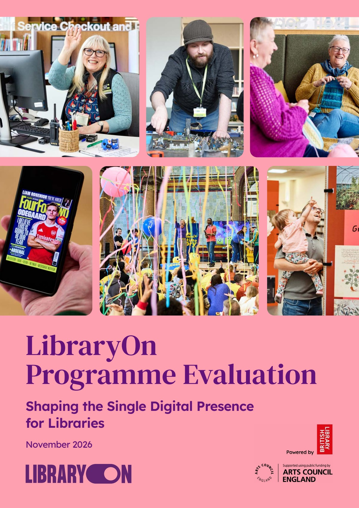

<!-- PAGE: 1 -->

# LibraryOn

## Programme Evaluation: Shaping the Single Digital Presence for Libraries

**The British Library and Arts Council England**

*November 2026*

<!-- PAGE: 2 -->

Contents
1. Introduction  2
2. Executive summary 4
3. Background 7
4. Impact of the programme 10
5. Capital assets created 12
6. Technical achievements 14
7. Team and ways of working 16
8. Brand 19
9. LibraryOn.org website 21
10. Sector collaboration on features 32
11. Data  35
12.  Ideas we tested 37
13. User research 40
14. Sector digital grants 45
15.  Sector support, learning and collaborations 51
16. Marketing and socials 54
17. Financial overview 59
18. Recommendations and reflections 60
19. Thank you 63
20.  Appendices 65
LibraryOn would like to thank everyone who has supported the programme 
and made our work possible. A full list of thanks can be found at the end of 
this evaluation.  
Front cover images:  
Top row: Nottingham Central Library; bottom left and centre: Leeds City Library; bottom right: Jersey Library.

<!-- PAGE: 3 -->

## 1. Introduction
This evaluation report reviews the Single Digital Presence programme developed 
by the British Library (known as LibraryOn) and Arts Council England, in 
collaboration with stakeholders and the wider library sector. This report outlines 
the history and background that led to the independent recommendation of 
the Single Digital Presence (SDP) concept in 2014, and the journey to creating 
LibraryOn as a public-facing brand in 2022.  
The programme received capital funding from Arts Council England during 2022–
2026, building on earlier phases of research and prototyping. This enabled the 
British Library to establish a new multidisciplinary digital team, create a national 
platform and launch a local digital grants programme, with the aim of improving 
the online presence of public libraries. LibraryOn also tested different ways to 
create synergy and interoperability between national and local library digital 
presence. A key aspect was the emphasis on evidence-based and user-centred 
approach to understand drivers of library usage, what people are looking for 
from libraries’ digital presence and what works best in library digital marketing 
campaigns. A core element of the programme was a focus around supporting 
library sector development around data and the creation of a comprehensive 
libraries dataset, which powered a public-facing Library Finder map. 
The programme has come to an end as the capital delivery period has now 
successfully concluded, with the grant deliverables met and exceeded.
This report is aimed at library sector professionals to provide an overview of the 
background, record the approaches, share learnings and celebrate the successes 
of the programme. 
It should be noted that where the report refers to libraries, this refers specifically 
to public libraries unless otherwise stated.

<!-- PAGE: 4 -->

Programme highlights
Created the first ever public facing website 
dedicated to showcasing libraries, what they 
offer and where they are.
Comprehensive libraries dataset and library 
finder map with 3,000+ libraries.
280,000 sessions to the LibraryOn website.
Just under £1.8m awarded in digital grants to 63 
projects, benefiting 90 library services or 59% of 
all English public library authorities.
LibraryOn featured or collaborated with  
102 library authorities in marketing activities 
(nine wider UK libraries and 93 English services). 
Equating to 61% of public libraries in England. 
More than 4,240 followers on LibraryOn Facebook 
and Instagram. 
Supported digital skills development for the 
sector through grants, communities of practice 
and a conference.

<!-- PAGE: 5 -->

## 2. Executive Summary
Origins of the LibraryOn programme 
The bold and ambitious vision of a ‘single digital presence’ for libraries was 
conceived in the Sieghart Review back in 2014.  It was followed by research to 
build consensus on what a new national digital service and improved local digital 
presences might look and feel like. 
Key drivers from a 2019 report identified existing challenges around fragmented 
and poor-quality digital services, a complex landscape, and a ‘brand’ identity that 
didn’t reflect the vibrancy of modern libraries. It highlighted opportunities around 
sector digital innovation, national co-ordination, greater collaboration and the 
creation of a national digital platform designed to amplify public awareness and 
drive meaningful engagement with the library offer. And so at the heart of the 
LibraryOn programme, which fully began in 2022, was a commitment to reaching 
new and lapsed users, effectively opening doors to a wealth of library resources 
and services for communities nationwide.
Capital funding and capacity building 
A dedicated digital team was appointed with capital funding from Arts Council 
England, and revenue match from the British Library, to enable the delivery period 
to run for four years until 2026. The team was the first of its kind at the British 
Library, introducing agile and iterative working to test and iterate ideas quickly 
and deliver at pace, in line with modern digital best practice.
The capital funding was for a research and development approach with a wide 
scope to “establish the software/hardware protocols and schema necessary 
for the widest range of existing local web presences and library management 
systems to plug in to the national portal for mutual, interoperable benefit.”  
The team took a collaborative approach to working in the open, seeking 
consultation and consensus in working with the wider library community and 
stakeholders to define what the new national digital presence for UK public 
libraries might look like. It also continued to iterate based on feedback from 
libraries and users, as well as staying abreast of digital and technological 
advancements and evolving user consumption patterns, emphasising smooth 
user journeys, tailored content and opportunities for automation.

<!-- PAGE: 6 -->

Delivering a digital front door for libraries 
The programme delivered a range of assets and outcomes with considerable 
impact during the 2022-26 period.  One of the first successes of the programme 
was the creation of a new, vibrant LibraryOn brand. This helped to position 
libraries as modern and relevant, laying a robust foundation for future marketing 
activity to widen and increase the user base.
The new brand also created a strong foundation for the LibraryOn.org website as 
a digital front door to libraries. It featured informative and engaging content, the 
first-ever national library event listings feature, and a library finder map enabling 
users to explore everything libraries have to offer. The offer was promoted through 
extensive national marketing campaigns, collaborations and partnerships, which 
delivered an increasing number of site visitors and growth trajectory. At the 
time of publication, the site hosted 280,000 sessions from January 2022 to the 
end of July 2026, with 22% of traffic going on to explore library websites.  The 
marketing campaigns tested different creative assets, national collaborations, 
and segmentation of audiences. LibraryOn collaborated with 61% of English public 
library services to showcase the best of what libraries offer, and social media 
followers exceeded 4,240. 
Research, innovation and product 
development
User research-led platform development yielded insights into what motivates 
members of the public to use libraries, barriers to library use and touchpoints where 
digital interventions add most value. 
The team continued to investigate a range of product features informed 
by research and feedback from libraries regarding what would be useful to 
implement. This was assessed against the appetite for national collaboration and 
evaluated the demand, feasibility, and desirability of delivering these features. 
Discovery work was undertaken on ideas that tested the waters for future 
possibilities and built relationships with library management system suppliers.
Supporting libraries through investment 
and collaboration
The LibraryOn programme aimed to combine local and national approaches  
to deliver maximum benefit and awarded c£1.8m in digital grants to library 
services across the country. 63 projects were supported, benefitting 90 English 
library services.  
Behind the scenes, powering the public-facing library map, was a cohesive 
national dataset and a new self-service feature, and collaborative work with <!-- PAGE: 7 --> Arts Council England around data standardisation.
The LibraryOn programme valued learning and sharing work with the library 
sector, providing multiple opportunities for sector colleagues to connect such as 
webinars, community of practice sessions and a conference. Over 77% of English 
library services attended a community of practice session at least once. 
Impact, learning and legacy 
Delivery highlighted how ongoing national investment in the sustainability of 
large-scale national programmes is essential. It takes considerable time to grow 
and build momentum, as well as securing government and stakeholder support 
and buy-in. It was also evident that supporting the digital infrastructure and 
joined-up presence of libraries nationally and regionally requires centralised 
capacity-building and a convening role to maximise impact and create efficiencies.
The LibraryOn programme delivered a huge amount of impact for the sector and 
users in the comparatively short amount of time available and delivered a modern 
platform nodding to the varied ambitions and hopes from over a decade ago.

<!-- PAGE: 8 -->

## 3. Background
An outline of decisions made prior to capital funding being awarded in 2021  
is detailed in the appendices of this report.
Capital funding awarded in 2021
In 2021 Arts Council England awarded the British Library £3,400,000 to deliver a 
“Single Digital Presence (SDP)” for public libraries in England. The funding covered 
capital expenditure and included an allocation for a local grants programme to 
support library services’ own digital infrastructure. 
It was awarded as a research and development grant. The key deliverables included 
building the technical architecture and software development for a national content 
platform (beta), testing with library authorities for local and national interoperability, 
and a grant programme for local authorities to upgrade their website and local 
digital presence.
The formal grant agreement delivery criteria included:
(i)  building technical architecture for a Single Digital Presence for public libraries, 
comprising: software development for a national content platform (beta), live 
testing with a range of library authorities (representing about 20% of services 
nationally and reflecting a variety of geography and business models), and 
establishing the software/hardware protocols and schema necessary for the 
widest range of existing local web presences and library management systems 
to plug in to the national portal for mutual, interoperable benefit; and 
(ii)  commissioning a grant programme to allocate capital funding to up to 50 local 
authorities to upgrade their website and local digital presence, to enhance 
library service buy in and public benefit and contribute to the national impact 
and sustainability of the proposal.
The British Library developed a strategic plan, budget and began involving  
sector partners. At the time, no Government library or data strategy had been 
published. Feedback from earlier phases showed that systems used by local 
authorities sometimes felt out of date to customers. Fragmented platforms meant 
library staff found it challenging to share resources, reach audiences, and publicise 
what was on offer. Library websites’ varying user experience levels meant they didn’t 
always act as the easy-to-use gateways customers have come to expect  
from modern digital experiences.

<!-- PAGE: 9 -->

The discovery work suggested that a national digital presence was only one 
aspect of the problem to solve, requiring intervention at both national and local 
level, to transform from isolated council-by-council digital setups to a coordinated 
national presence for public libraries. This involved using standardised APIs* to 
develop a unified technical platform that would allow different library systems to 
connect.
The British Library appointed agency Public Digital to support with the planning 
and scoping of the delivery process. It followed Government Digital Service 
guidelines around digital product delivery, moving from discovery, to alpha, 
private beta, and public beta to a live product offer. The British Library also ran a 
tender to appoint FCB Inferno to develop the brand strategy and proposition.
Phase illustration adapted from How to Navigate the Alpha Prototyping Phase: 
The Secret to Product Success 
Before you 
commit to 
building 
a product 
of service 
you need to 
understand the 
problems that 
need to  
be solved
Design 
solutions, build 
prototypes and 
test different 
ideas. Challenge 
the way things 
are done at the 
moment.
Take your best 
ideas from 
alpha and start 
building it for 
real. Invite a 
limited number 
of people to 
use the service. 
Continue to 
design, test and 
iterate.
Ensure the 
product or 
service can be 
operated at the 
appropriate 
scale. Invite the 
wider audience 
and start 
replacing the 
legacy service.
Support the 
product or 
service in a 
sustainable way 
and continue 
to iterate 
and make 
improvements.
Discovery Alpha Private  Beta Public  Beta Live
*API 
(application programme interface)  
is a technical term referring to a 
mechanism that allows two systems 
to communicate and connect.
Further Reading
- Guide on Assurance for Agile Delivery of Digital Services_V1.2.  
- Phases of agile delivery from the Government Digital Service.

<!-- PAGE: 10 -->

Delivery phase 2022–2026 
The recruitment of a new digital delivery team at the British Library began in June 2022. The team, in consultation with the library sector, developed LibraryOn as a 
national, unifying brand to represent libraries. As a digital front door, it set out to 
provide an online space, promoting the content and communities at the heart of 
libraries and helping people access information, services and events.
Key achievements: 
• Developed scalable technical national infrastructure, data and  
appropriate governance
• Enabled libraries and other organisations to engage at scale with a 
heterogeneous system and through the provision of an API
• Introduced integrations with Library Management Systems for shared 
national events and catalogues
• Encouraged and enabled improvements to libraries’ own websites and 
digital services by sharing best practice and awarding over £1.8m in  
local investment. 
• Promoted libraries by running extensive digital marketing campaigns and 
curating an enhanced social media presence.
• Developed peer sharing through a national community of practice to 
understand and scale what works
• Introduced digital capacity building and skills development and used its 
convening power to share best practice
• Contributed to sector strategic infrastructure and advocated for 
standardised data and increased interoperability. 
This evaluation provides further details on what and how it was delivered  
and achieved.

<!-- PAGE: 11 -->

## 4. Impact of the Programme
The LibraryOn programme provided the first large-scale investment in unifying 
the library sector’s digital presence and building sector capability. The impact of 
the programme was evident at many different levels, such as improving public 
awareness and engagement with libraries, building sector digital capability, and 
creating a nationally unifying digital brand and presence for libraries. It also 
supported local libraries to improve their own websites and test new digital ideas. 
The national platform was capital funded as a Research and Development (R&D) 
programme, and over the years created a range of assets:
• LibraryOn developed a national presence for libraries, which complemented 
local online presences through the provision of £1.8m in grants to library 
services and sharing of best practice and collaborative work.
• An extensive database of 3,000+ libraries across the UK was developed, 
including statutory and community managed libraries. It included 
comprehensive data on location, opening times, services, facilities  
and accessibility.
• The national LibraryOn.org website hosted 280,000 sessions from launch 
and provided onward traffic to library websites at an average of 22.55%.
• The commitment to engage 20% of English services in testing of the site, 
as set out in the Arts Council England funding agreement was met. The 
team sought engagement and feedback from libraries over three years 
through one-to-one sessions, drop-ins, Living Knowledge Network meetings, 
attending Libraries Connected area meetings, surveys, sector gatherings 
and library visits. In total, LibraryOn engaged approximately 84% of English 
library services through these sessions.
• Extensive sector engagement, and an agile communications approach was 
taken by the team. A monthly newsletter with 658 recipients, and a LinkedIn 
newsletter of 30,974 subscribers, plus regular drop-ins and show and tells.
• Social media accounts were created to motivate and engage people to use 
libraries. There were successful social media collaborations with 61% of 
English library services, plus nine wider UK services and seven non-library 
organisations. From launch in January 2024 up until July 2026, followers 
totalled 956 on Facebook and 3,284 on Instagram.

<!-- PAGE: 12 -->

• A self-service platform was developed that enables libraries to update their 
own library and/or service details, and administrators to approve and send 
automated messages.
• A national event listing was built that featured over 2,000 library events at 
any one time, using APIs.
• The LibraryOn umbrella brand was developed with extensive sector 
consultation. Supporting creative campaigns messaging was used to raise 
the profile of libraries and drive visitors to the website and make onward 
journeys to public library websites, or physical locations.
• The LibraryOn data API was published for others to use and connect to  
the data, including the ReadOn app.
• Hosted 13 expert session webinars, including sessions on data, special 
collections, accessibility, AI and copyright. Over 117 individual services 
attended at least one session, meaning they reached at least 77% of all 
English public libraries plus services from the other UK nations.
• For public library marketing colleagues, LibraryOn held five community of 
practice sessions covering digital topics to support local marketing activity.
• LibraryOn hosted Press Play in March 2024; a digital conference with  
33 speakers and 159 participants with over 20 sessions on topics chosen  
by libraries.
• The team researched potential opportunities for sector scale cost 
efficiencies and for improving interoperability with unified digital 
approaches, such as shared e-lending, a national library card and  
joining online.
• Encouraged and developed digital skills, knowledge and capacity in the 
library sector and within the British Library through the creation of a new 
multidisciplinary agile team and the proactive sharing of knowledge and 
ways of working. 
• LibraryOn adopted an agile product approach, with iterative development 
that involved user testing, prototyping and the development of a roadmap, 
moving from alpha to beta stages. The programme conclusions identified 
the need for ongoing investment in supporting the digital infrastructure and 
presence of libraries nationally and regionally, and the need for centralised 
capacity building and leadership.

<!-- PAGE: 13 -->

## 5. Capital Assets Created
During the 2022-2026 delivery period, a range of assets were created: 
1.  The LibraryOn.org website, including content, 
videos, case-studies, Special Collections stories, 
digitised archive material, the library finder map 
and national events listings (and related APIs).
2.  Brand and marketing campaigns assets,  
stock videography/photography, case-studies, 
user research and segmentation. 
3.  Assets funded through three rounds of Digital 
Grants Programme up to £1.8m, which included 
collaborations with LibraryOn.
4.  Collaborations where sector organisations are 
using LibraryOn APIs and content, including 
ReadOn App using the Library Finder API to 
power their application, and the National Year of 
Reading using the national event listing.
5.  Back-end assets, such as the published 
Design System, the Strapi headless Content 
Management System (CMS) codebase, hosting 
and data insights dashboards.

<!-- PAGE: 14 -->

6.  A digital gallery and submissions portal to host 
exhibitions material from the British Library/
Living Knowledge Network, public libraries and 
user-generated content.  
7.  Shelf – a hub for sector content and learning. This 
includes data insights, a self-service portal for 
libraries to edit their data, the ability to extract 
the national library location dataset, and support 
material for the digital grants programme.
8.  Research reports for product features,  
such as joining a library online.
9.  Social media accounts and followers,  
and collaborative content made with more  
than 100 library services.
10.  Sector learning materials including community 
of practice webinars, marketing packs and 
recordings from Press Play conference.
*Screenshot from virtual tour created by Libraries Unlimited with their LibraryOn grant.*

<!-- PAGE: 15 -->

## 6. Technical Achievements
• Built a unified, national events platform for libraries, aggregating  
events from multiple providers (e.g. Solus, Eventbrite) into a single, 
searchable and filterable experience for end users.   
By connecting with the platforms libraries already use, such as Solus and 
Eventbrite, LibraryOn brought resources together into a single, consistent 
experience, removing the need for users to navigate multiple websites or rely on 
individual library social media accounts. A family looking for a holiday reading 
activity, an adult seeking a digital skills workshop, or an older person wanting 
a social event could find what is on near them in one place. This fulfilled a key 
component of the Arts Council England grant deliverables by connecting local 
library services to a national presence to create mutual benefit and increased the 
visibility of library offers to users.  
• Developed a scalable data ingestion and enrichment pipeline,  
enhancing existing Arts Council England datasets with structured, 
standardised, and validated library and authority data. 
This provided cleaner, richer, and more reliable library data. Working from 
existing Arts Council England datasets, the team built a system to bring together 
information from multiple sources, standardised it, and checked for accuracy 
– which strengthened the evidence base available to the sector for advocacy, 
planning, and reporting.
• Developed a self-service data management portal for libraries  
and authorities, designed to enable them to update, validate, and  
maintain their own records—the intention was to also support  
Arts Council England’s annual data aggregation process and  
significantly reduce manual effort.
This was intended to give libraries control of their own information with the ability 
to manage and update their own records directly and be active stewards of their 
own information. The annual data aggregation process that Arts Council England 
oversees would also become significantly less resource and time intensive as <!-- PAGE: 16 --> a result. This would have created a more sustainable, scalable, locally owned 
approach to national library data.
• Designed a flexible, extensible platform architecture (using Strapi  
+ Next.js + integrations) capable of supporting national rollout  
and future global expansion, including multi-region data models  
and third-party integrations. This set-up made improvements and  
iterations easier to implement and provides the groundwork for  
future expansion and lifespan as built with modern technology. 
This ensured LibraryOn was built on modern, flexible technology designed to serve 
the sector not just today but over the decades to come. New features, data sources 
and partnerships could be added without rebuilding from the ground up, whether 
it be expanding to the devolved nations, integrating with more library systems or 
developing new tools for both users and libraries.
• Implemented intelligent automation and AI-assisted tagging, 
improving event categorisation, discoverability, and reducing the 
manual operational burden on the LibraryOn team. This tagging 
developed consistency for events titling and made it easier for 
customers to find events.

<!-- PAGE: 17 -->

## 7. Team and Ways of Working
LibraryOn was delivered by a multidisciplinary team, planning work in regular 
cycles to make swift iterative progress. The team quickly demonstrated best 
practice in agile working, providing new digital skills and capacity for the library 
sector. Technical expertise along with skills in design, marketing, data and user 
engagement ensured the programme delivered innovation that met the needs of 
libraries and library users. Priority was given to user needs and experience in the 
development of the offer.    
The team used project management software called ClickUp to manage 
workflows, plan sprints, organise the backlog of tasks, and to organise and 
prioritise suggestions for new ideas, developments, or requests. In addition to 
Microsoft Teams, the team also used Slack as a communication platform, which 
made it easy for the team to invite external parties to collaborate.
Other planning tools included Miro to collaboratively create product roadmaps 
and plan work. The whole team helped to shape ideas and product strategy and 
feedback on user research and experience. Tools such as Figma, Canva, and 
Balsamiq were used for design work.  
The British Library was keen to learn from this multidisciplinary agile approach, as 
it was the first time such a team had been set up within the organisation.

<!-- PAGE: 18 -->

The team consisted of the following roles : 
Head of Delivery - responsible for strategic direction and development 
of LibraryOn. Oversight of product strategy and roadmaps, product 
delivery, user research, grant programmes and marketing. Leading  
the team, managing stakeholder relationships, financial planning,  
and management. 
Technical Lead - overall technical responsibility and overseeing the 
technical direction of the programme.  
Product Manager - led on the product strategy and roadmap, 
managing delivery plans and user research.
Interaction Designer - digital design lead for the website incorporating 
user feedback to create smooth user journeys.   
Developer x 2 - developed software and code to support user 
functionality. 
Content Strategist - led on content strategy and design being 
responsible for the look and feel of the website.
Content Creator - developed, shot and edited video and  
photography content.
User Researcher - undertook regular research and understand  
user needs.
Senior Marketing Manager - managed all marketing activities for 
LibraryOn including paid activity, socials and digital marketing.
Programme Manager - led on project management covering 
partnerships, governance, stakeholder engagement, reporting  
and fundraising.
Digital Project and Engagement Officer - supported project co-
ordination including planning, delivery, promotion, quality assurance, 
product delivery and ongoing management of the programme.
Project Assistant - administrative and grants support, content creation, 
planning, social media, data and general co-ordination.

<!-- PAGE: 19 -->

Working in the open and sharing best practice with the sector was a feature  
of LibraryOn, as evident in ways of working, such as:
• Monthly drop ins to demo work in progress and plans
• Monthly digital newsletter with more than 600 subscribers
• Setting up community of practices for grantees and library marketeers 
• Programming of expert sessions on digital topics chosen by libraries
• Delivery of a sector digital conference tailored to libraries 
• Open sourcing the codebase
• Publishing the design patterns
• Making APIs available so anyone can access LibraryOn features
• Involving libraries in decision making to help shape the programme and 
ensure it delivered what libraries needed
• Co-curating the grants programme to identify priority areas for funding
• Gathering feedback on product developments at library forums  
and conferences.
 
Learnings
What worked?
  Maintaining a skilled 
multidisciplinary team to cover all 
aspects of delivery
  Being able to deliver and iterate 
swiftly using agile methodologies
  The use of different online tools 
to enable team collaboration and 
sharing of ideas 
  Working in the open to share what 
we were working on and gain 
immediate feedback.
What would we do differently?
  Set up a dedicated sector advisory 
board from the beginning of the 
programme to support product 
development earlier. Plans for 
this had been made but not 
implemented in time, although the 
team generally sought input from 
the sector at every opportunity.

<!-- PAGE: 20 -->

## 8. Brand
LibraryOn is the first national brand in England to cohesively and impactfully 
represent libraries, developed in consultation with the sector and building on the 
recommendation from the 2019 report. As LibraryOn’s main ambition has been 
to provide a digital space that connects libraries and people, we needed a brand 
to celebrate what libraries do and what people love about them. It was designed 
to help people understand what libraries offer in an inclusive, empowering, 
informative, and vibrant way.
The LibraryOn brand set out to:
• celebrate public libraries and what people love about them the most
• reflect public libraries as modern and relevant
• be accessible by default
• share what libraries have to offer
• be universal and inclusive.
This branding needed to sit seamlessly alongside local authority and library branding 
so that we could leverage the LibraryOn brand to undertake national campaigns to 
raise awareness of public libraries more broadly. At the same time library authorities 
simultaneously ran more localised activities under their own branding.  
The British Library appointed the creative agency FCB Inferno to lead on the 
development of the LibraryOn brand. They undertook extensive stakeholder 
evaluation as well as user research via YouGov to identify both the appeal and 
barriers to using libraries. 
Once several possible routes had been identified, names and visuals were tested 
with members of the public (both library users and non-users) to determine which 
resonated most and had the greatest potential to engage potential, lapsed and 
current users. Library staff were invited to input into the direction of the brand 
through workshops.  
All this insight was used to agree and refine the name and visual identity for the 
new brand, LibraryOn. Following sign-off, FCB Inferno created a set of mission-
led and value-led brand guidelines, which packaged LibraryOn as an accessible 
entry point to libraries.

<!-- PAGE: 21 -->

These guidelines helped to ensure that the branding was consistently and 
professionally applied to all areas of the project. From the website, through to 
merchandise and on other digital channels, such as social media and emails. 
Leveraging the LibraryOn brand has enabled us to raise the profile of public 
libraries, start to change perceptions about what libraries are, and more 
effectively showcase everything that they have to offer.
Brand
Guidelines
V.01 - NOVEMBER 2022
Visual Language
Visual Elements and Use
Lozenge shapeLozenge shape Circle
Adjusted lozenge shapeAdjusted lozenge shape Combined lozenge shape Partner logo containerImage container
Rounded boxesRounded boxes
We are not limited to these 5 shapes.  
So long as the shape used keeps the 
rounded visual language, we can use 
more variations (within reason).
UI element, call-out boxImage container
Image container Key word highlight
Examples of use: commsVisual Elements
Meet
Did you know?
You can access 
audiobooks for free!
21
The use of logo in print should not be apologetic - we need to 
ensure that the logo is prominent and sits proud. It’s size and 
placement will depend on the nature of the poster.
Application
Use of Logo: Print
A4 Portrait Awareness Poster
We use the stacked logo here because it 
occupies more space to create prominence.
A4 Portrait Awareness Poster
We use an impactful colour combination here to 
really draw the eye and make an impact.
A4 Landscape Event Poster
Here we use the single logo in the bottom right to align with the hierarchy (see 
layout section). Colours are sophisticated.
34
Our colour palette is designed to be warm, flexible and digital-first.
Reminiscent of book pages that have 
been lovingly used by numerous people 
in a Library. A warm nod back to where 
Libraries began - with books.
Primary colours are those used most frequently in LibraryOn communications.  
They are the cornerstone of our palette.
Our secondary colours may be used as an 
accent colour. These warm pastel tones 
bring a soft, approachable yet sophisticated 
tone to the brand.
Our tertiary colours are split into three groups - greys, deep tones and impactful 
pops. Grey 05 is our preferred body text colour - it has great colour contrast with light 
backgrounds but is soft and easier for your eye to read than 100% black.
Our impactful colours (Spring and Citron) can be used to bring energy to 
communications - they should be used sparingly. Our deep tones are primarily for text 
sub-headers on the website.
Grey tones
Deep tones Impactful pops
A warm navy-black, representative of 
physical ink - whether that be printed 
words in a book, or written notes in a 
pad. Another nod to the physical realm 
of libraries.
Colour Palette
Overview
Primary Secondary Tertiary
Aged Paper
Rose
Purple and deep purple should never be 
used as a full background fill colour.
Purple represents wisdom, creativity 
and ambition. The deeper tones denote 
trustworthiness. Warm shades of purple 
have an uplifting and engaging effect.
White Grey 01 Grey 02
Inkblot
Apricot
Rust Maroon Spring
Midnight Forest Citron
Deep Purple
Heather
Grey 03 Grey 04 Grey 05
Purple
9
Learnings
What worked?
   Vibrant and fun branding that 
looked fresh and eye-catching 
across all channels
   Accessibility was central to the use 
of colour, shapes and typography, 
and was clearly laid out from  
the start
   The brand put imagery and 
photography front and centre, 
placing users and library staff at  
the heart of the brand.
What would we do differently?
   Increase the colour palette and 
more swiftly replace colours which 
weren’t working in practice
   Incorporate tone of voice and house 
style into guidelines sooner so the 
team had a one-stop-shop for all 
guidelines relating to the brand 
   Put more guardrails in place for how 
to use certain brand features, such 
as shapes, to help refine the design 
process and maintain consistency 
across all channels
   Place greater emphasis on fleshing 
out guidelines for web, user 
interface (UI) and video usage.

<!-- PAGE: 22 -->

## 9. LibraryOn.org Website
LibraryOn’s website tested the feasibility of a national platform to represent 
libraries and to connect the fragmented systems and online presence of libraries 
across the country. The website has evolved throughout the programme to adapt 
to a changing landscape, sector priorities, user demand, and resources. 
LibraryOn’s website has been developed iteratively. It presents written, photo and 
video content to promote and tell stories about libraries. It includes a national events 
listing, catalogue integrations and a library finder map providing comprehensive, 
searchable information on library opening times, services and accessibility. 
The website was built with a focus on accessibility and user-friendly features. 
The initial aim was to provide visitors with inspiring information about libraries 
to motivate engagement. This was followed by practical information regarding 
services, local events, library membership, and guidance on how to find a nearby 
library or borrow items online. 
Below explains the iterative journey and the product development process, and 
different features.
Iteration of the site
Initially, the content focused on staff and customer stories, paired with a vibrant 
brand identity, to update perceptions of what libraries offer and their relevance 
in the 21st century. At this stage, content was broad and static, while product 
functionality was in its early development and lacked the data that would later be 
leveraged.
Content creation occurred alongside the development of the Library finder map, 
the first tool to catalogue all public libraries and provide a dedicated hub for 
information to support future scalability.
Over time, in response to user research and feedback from the sector, the map 
and library pages evolved to offer:
• opening times that reflect the nuances of part-day opening and different 
staffing models
• links to common map services which offer directions to libraries
• embedded virtual tours that allow users to preview what to expect at a library <!-- PAGE: 23 -->
• information on facilities, services and accessibility features 
• embedded, dynamically updated library events listings
• landing pages for library authorities.
National event listing
Our aim was to create a comprehensive list of searchable library events. The 
feature intended to showcase the range of events across the UK and enable users 
to explore what was happening locally and nationally. This was the first attempt 
to harmonise public library events discovery into a single interface, through 
integration with the various event listing APIs used by library authorities. 
It was built with embedded widgets that could be grouped around themes; for 
example, Halloween or the National Year of Reading. 
We used insights gained from user research and our relationship with digital 
marketing agency Crafted to rethink the content that LibraryOn published and 
how it directed visitors towards finding the information they needed. This led 
to a new content architecture, new page design and newly created content 
that focused on distinct offers at libraries, targeted at our audience segments, 
presented in a way that would also appeal to younger demographics. 
Pages were created using a checklist of measures intended to increase a site’s 
authority with search engines and generative search tools. In addition, they were 
designed with a mobile-first approach, responding to how most people access  
the site.
We contacted 80% of English public library services and successfully integrated event 
feeds from 34% of these authorities. At the time of publication, 2,000+ events were 
featured on the LibraryOn site. As a beta phase feature, we had planned a number 
of improvements to increase the usability of events’ functionality. We also worked to 
increase the geographic spread of integrations, which would have enabled targeted 
paid advertising campaigns to drive traffic to this feature. However, technical 
complexity and the resource requirements for maintaining such a feature limited the 
growth of event numbers. Additionally, slow response times or technical limitations 
from library management system (LMS) providers hindered progress.

<!-- PAGE: 24 -->

LibraryOn Events page
Visitor figures
Although the website has been an R&D project, tracking monthly and all-time 
sessions, and the drivers behind this traffic, remained a priority. From launch 
until July 2026, we’ve recorded 280,000 all-time sessions. We use sessions as our 
standard metric for reporting as it is a more accurate reflection of the number 
of individual visits. The number of individual users reflects the total audience 
reach, but sessions can provide a deeper engagement metric, demonstrating the 
underlying impact of our product. With that in mind, from 2022 until today, the site 
has attracted 193,000 users. Quarterly sessions rose from 5,800 to 21,000 once paid 
and organic marketing activity started in Q4 2023–2024. Onward traffic to libraries 
averaged 22.55%, driving traffic to library sites and event booking platforms that 
might not otherwise have connected with a public library online.

<!-- PAGE: 25 -->

Design process
As part of the initial scoping for what would become LibraryOn, four 
demographics were identified for it to engage:
Families Young professionals 
Retirees Future library users
24
These demographics were used to scope out new website features and to improve 
the experience for website visitors. 
Designing the national event listing required importing event information from 
third-party providers, categorising this data and presenting it across the site. 
As such, it was vital to better understand user needs and define a strategy to 
address the challenges they experienced when searching for suitable events.
We developed user personas to identify specific user needs and challenges. These 
were then used at touch points for analysing project outcomes, with outputs such as 
user journey maps (how someone navigates through the site and features) proving 
instrumental in the research, ideation, delivery, and measurement of outputs.
Ideal user journeys were balanced against team capacity and technical resources 
to prioritise development decisions.

<!-- PAGE: 26 -->

User flow diagrams were used as key visual aids. These diagrams broke down the 
start of user journeys, user motivations, and specific flow steps to ensure visibility. 
This process also facilitated cross-team input regarding requirements, ranging 
from copy to data collection for marketing purposes.
User journey from a new “Feature” page
Start
End
End
End
Scroll to 
featured 
events 
carousel
Do  
these events 
interest 
visitors?
Do  
these events 
interest 
visitors?
Do you  
want to  
filter your 
search?
Scroll to 
curated  
events  
section
Scroll to 
curated  
events  
section
User begins  
search  
through  
bar
Click on 
desired  
event
Click on 
desired  
event
Click on 
desired  
event
Press 
Search
User  
clicks on  
CTA
User  
clicks on  
CTA
User  
clicks on  
CTA
Filter by date, 
frequency, “authority” 
and genre
CTA means ‘call to action’: a clear instruction 
that tells a user what they can do next.

<!-- PAGE: 27 -->

User journey from existing map search page
Start
End
Do  
these events 
interest 
visitors? Do you  
want to  
filter your 
search?
Click on  
the event 
search bar
Press 
Search
Type in  
location
Press “Find 
Nearby”  
button
Filter by date, 
frequency, “authority” 
and genre
The initial solution was anchored in 
presenting event offerings in various 
contexts site-wide, such as within 
library listing pages, the interactive 
map, and events. When clicked, a 
pop-up dialog box displayed full event 
information, including details regarding 
the event, the hosting library, and a link 
to the booking page.
Low-fidelity wireframes were created 
early in the design process to facilitate 
discussion of high-level concepts, and 
to maintain fluid experimentation.
Right: Wireframe for Events map 
search.

<!-- PAGE: 28 -->

Old map search, integrating events search Redesigned map with events tab  
and accessibility controls
Final design of events map search Events homepage, with search browser
*Event browser pop-up. Mobile view of Events browser.*

<!-- PAGE: 29 -->

The library finder map 
The map was an early feature, enabling 
the consolidation of fragmented sector 
datasets into a meaningful, public-facing 
resource that collates comprehensive 
data on libraries and their services.
The user interface (UI) featured a search 
box, enabling users to locate libraries 
by name or postcode, alongside a list 
of libraries supported by search filters. 
These filters allowed users to tailor 
their library search results based on 
variety of options, such as libraries that 
were open at time of search, or later 
that day/week, services and facilities 
available and accessibility information, 
also the user’s distance to a location/
library.
The UI adjusted depending on the 
function needed to carry out a task, 
enabling and disabling features 
accordingly. It was designed to be 
responsive, ensuring ease of use on 
mobile devices. 
Libraries were represented by pins, 
ensuring they were easily identifiable 
while navigating the map. This system 
was later expanded to include a set of 
colour-coded pins, categorising libraries  
by their type of operation:
• Local authority-run
• Local authority-run (Self-service)
• Community-run
• Commissioned
• Independent.
And status:
• Temporarily closed
• Closed/Not open
• Permanently closed
• Mobile stop.
Library results in the listing contained 
the official name of the library, street 
address, services, facilities and who 
was operating the library. These linked 
to individual library pages, spanning all 
3,500+ entries.
A toggle at the top of the interface 
allowed users to switch between 
browsing libraries and events. This view 
displayed a comprehensive list of all 
events taking place at local libraries. 
Where integrations with library event 
platforms were established, API access 
provided live event information. This 
allowed users to explore events through 
LibraryOn before moving on to external 
sites to book tickets or reserve spaces.

<!-- PAGE: 30 -->

Accessibility 
LibraryOn’s website was built in 
accordance with the Web Content 
Accessibility Guidelines (WCAG) 2.2 
AA , published by the World Wide 
Web Consortium (W3C). The site met a 
range of Level A and AA requirements, 
including:
• alt text for images
• video subtitles with transcripts
• full keyboard navigation
• screen reader compatibility with 
dynamic content announcements
• correct semantic HTML structure
• colour contrast standards, 
including a dedicated high 
contrast map design. 
Plain English was used across the site to 
support clarity and comprehension.
The site was formally audited in late 
2025 by Goss Consultancy, with input 
from a pan-disability group with lived 
experience of disability, including 
neurodiversity, visual impairment, and 
long-term health conditions. Testing 
covered multiple browsers, devices, 
and assistive technologies. The audit 
demonstrated that the site’s design and 
navigation worked well, including more 
complex interactive features such as the 
library map and events integrations.
Accessibility was treated as an 
ongoing commitment throughout 
the programme, with iterative 
improvements made in response 
to testing and a public accessibility 
statement maintained on the site. Many 
of the choices made to support users 
with access needs also improved the 
overall experience for all visitors.
Use of Artificial  
Intelligence  
automation 
In addition to the event tagging 
mentioned in section 5, AI tools 
supported ticket curation and project 
management automation via ClickUp, 
enabling the team to triage and 
prioritise work more efficiently. More 
broadly, AI-assisted code and test 
generation were used throughout 
development to accelerate delivery and 
improve reliability across the codebase. 
However, all creative, consultative, and 
design processes remained human-led.

<!-- PAGE: 31 -->

Catalogue  
integration  
We piloted library catalogue integration 
on the LibraryOn website by working 
with Newcastle Libraries. The intention 
was to create another way for users  
to search and discover their library,  
and drive more traffic to their 
library’s website. 
Working with Open Fifth we successfully 
integrated seven further catalogues 
through Koha. This meant users were 
able to search for stock on the LibraryOn 
site before heading to the library to 
borrow an item. This tested a model 
of interoperability, creating the first 
step towards a national catalogue; the 
intention was to create another way into 
library catalogues, with plans to explore 
how we could integrate all catalogues 
across all LMS providers.
Use of APIs
We used APIs to connect LibraryOn with 
a number of different providers. Each 
provider used its own authentication 
method (such as API keys or OAuth 
tokens), with credentials securely stored 
and encrypted within the platform.
For the events listing, we integrated 
with Solus, Eventbrite, WeGotTickets, 
TicketSource, Civica Spydus, and Aspen 
Discovery to automatically import 
and display library events across the 
platform.
Through the relationships we built with 
Library Management Systems and 
platform providers, the integrations 
neatly pull through information in 
a consistent format with search 
functionality.
We also worked with individual libraries 
on custom event integrations. However, 
due to the programme ending we were 
unable to progress all of these. 
For catalogue search, we integrated 
with Koha (via Open Fifth), as outlined 
above. There were seven authorities that 
had their catalogue on the LibraryOn 
website: Halton, Kensington and 
Chelsea, Middlesbrough, Newcastle, 
Sefton, St Helens and Westminster.

<!-- PAGE: 32 -->

Learnings
What worked?
  Developing the site iteratively to 
ensure it continually evolved to meet 
user needs and expectations
  Building a relationship with libraries 
and the wider sector to create a site 
that accurately reflected modern 
library services 
  The creation of the first dedicated 
platform for library events
  Our commitment to accessibility 
meant the website met accessibility 
guidelines and delivered a good user 
experience 
  The use of AI to speed up some 
behind the scenes processes, which 
would have taken significant manual 
labour
  Creation of APIs available to any 
organisation who wanted to feature 
LibraryOn data on their platform
  Working with Open Fifth to promote 
catalogue integration.
What would we do differently?
  Harness the power of libraries to 
make the case to LMS providers 
that integrating could help increase 
awareness and attendance at events 
  Establish formal data-sharing 
agreements with key sector partners 
earlier in the project to reduce the 
time taken to navigate data access 
and governance
  Invest earlier in user research, as 
the YouGov polling and usability 
testing provided genuinely valuable 
insight. This would have helped 
inform product decisions from the 
outset
  Put rigorous automated testing 
frameworks in place from the 
beginning to ensure consistency in 
the quality of code being shipped.

<!-- PAGE: 33 -->

## 10. Sector Collaboration on Features
Special Collections 
Sector feedback identified a significant national opportunity for LibraryOn to 
help surface special collections held by libraries. Research indicated that access 
to special collections remained limited in terms of both public awareness and 
physical accessibility. We developed a pilot project with Nottingham City Library, 
curating a narrative on the history of lacemaking in the city using archival 
materials. We wanted to know if this process would work for other libraries and 
what the response would be from the public.  
Further research into collection 
holdings enabled us to examine library 
relationships with archives and explore 
effective methods for displaying these 
collections online. We worked in close 
collaboration with library authorities 
managing collections of both local 
and national significance. The aim 
of publishing these stories was to 
illustrate the depth of collections held 
in libraries, which people are often 
unaware of. We felt that they could 
help elevate libraries as cultural and 
historical institutions that people might 
consider exploring further. 
In total, five stories were created—
including the Nottingham Lace pilot—
drawing on artefacts held by libraries 
nationwide. For two of these stories, we 
collaborated with the British Library’s 
Senior Imaging Technician to digitise 
items from the respective library 
collections. The first was a collection of <!-- PAGE: 34 --> early circus posters held by Wakefield 
Libraries. This was followed by items 
from the collection of pioneering 
female gardener Frances Wolseley, held 
by Brighton & Hove Libraries.
The stories featured in LibraryOn social 
media posts—including a collaboration 
with Findmypast and the British 
Library regarding the Frances Wolseley 
collection—as well as British Library 
newsletters reaching over 200,000 
subscribers.
Feedback from libraries told us the 
stories helped to raise the profile of 
their collections and that for some 
libraries there has been increased 
interest from the public.     
This initiative facilitated the 
development of robust, collaborative 
relationships with partner libraries 
and various departments across 
the British Library. For example, by 
engaging the Imaging Services team 
to digitise these items, we not only 
utilised the assets within our narratives 
but also ensured their long-term 
digital preservation for future access. 
Furthermore, we worked closely with 
the Copyright team to conduct risk 
assessments, ensuring the secure and 
compliant inclusion of items within 
these stories.
Gallery and submissions portal 
As part of our efforts to deepen public engagement with library collections, 
we developed a standalone submissions portal and an online gallery microsite. 
The platform was designed to enable the public and library staff to upload 
and contribute content—including images, video, audio and documents—to 
themed story galleries, fostering a genuine two-way exchange between cultural 
institutions and the communities they serve. We intend for the first use case to be 
in service of the Agatha Christie exhibition; Living Knowledge Network’s partners 
will be using the gallery to display alternative book covers created by attendees 
of events at libraries across the country.

<!-- PAGE: 35 -->

Shelf 
Shelf was intended to be a sector-facing learning hub created to support libraries 
and provide resources. It was originally built as a sector data hub, to give a 
central access point to data insights and access to a Self-service portal for 
libraries to update their information on the LibraryOn map and to gather a full 
location dataset. It went on to contain wider sector support material including:
• Data insights 
• Information on LibraryOn 
APIs, event integrations and 
documentation
• Access to the LibraryOn  
design system 
• Grant information 
• Marketing materials including the 
LibraryOn marketing pack 
• Brand guidelines 
• Past LibraryOn newsletters.
Learnings
What worked?
  Creating engaging content about 
library collections and bringing 
items to life through online 
storytelling
  Collaborating with libraries to 
explore their collections and make 
the most of artefacts often hidden in 
their archives
  Developing an accessible online 
gallery that is easy to view and 
upload images to
  Providing an online home for 
everything LibraryOn has created 
which will be accessible to the sector.  
What would we do differently?
  Marketing should be embedded 
from the start of Special Collections 
work and a budget allocated to raise 
awareness externally
  Keyword research on special 
collections topics/content ahead of 
finalising topics to ensure content is 
relevant to the audience
  User research to understand the 
topics/collections we should focus 
on to ensure they are relevant for 
our intended audience.

<!-- PAGE: 36 -->

## 11. Data
Early research suggested that people wanted to know what was happening in 
their local library, and staff wanted something that they could easily update 
themselves. LibraryOn set out to create a national directory of public libraries 
that would allow users to search, browse and filter libraries by location, services 
and accessibility. To support this, a foundational dataset of library locations and 
operational information was required.
No single source provided a complete or sufficiently up-to-date dataset, so 
we combined and tested multiple sources. The Arts Council England Libraries 
Location Dataset offered broad national coverage and core location information, 
while the open dataset compiled by Libraries Hacked supplied more granular 
operational detail, particularly regarding structured opening hours.
Both datasets presented challenges. The Arts Council England dataset was only 
updated annually and did not provide opening times in a format suitable for 
direct public use. Libraries Hacked’s open-source dataset—pioneered by libraries’ 
advocate Dave Rowe—showed the sector what was possible, but Libraries Hacked 
had not received any funding for ongoing maintenance to ensure accuracy of 
data. Differences between the two datasets created inconsistencies in areas such 
as mapping coordinates and location data.
To create a more useful public-facing experience, we enriched the dataset with 
services and accessibility information sourced directly from library and library 
authority websites. Because this information was presented inconsistently across 
the sector, it was necessary to standardise terminology and structure the data 
into filterable categories.
The project demonstrated the value of a single definitive source of truth for 
public library data at a national level, and that long-term maintenance requires a 
distributed approach. These learnings informed the development of a self-service 
portal, allowing library staff to maintain their own records directly.

<!-- PAGE: 37 -->

Learnings
What worked?
  Combining multiple datasets 
provided a workable national 
baseline
  Using Arts Council England data 
as a benchmark gave the project a 
consistent organisational structure 
and broad coverage 
  Libraries Hacked data filled 
important operational gaps, 
particularly around structured 
opening times 
  Structuring services and 
accessibility information into 
standardised categories enabled 
filtering and comparison across 
libraries 
  A manual baseline update exercise 
substantially improved data quality 
and exposed recurring patterns in 
data inconsistencies 
What would we do differently?
  Avoid relying on static or 
periodically updated datasets 
without a sustainable update 
mechanism in place 
  Introduce distributed or self-service 
model sooner to keep the data up 
to date, reducing dependence on 
centralised manual maintenance 
  Define standardised categories 
and terminology for services and accessibility earlier to reduce later rework.

<!-- PAGE: 38 -->

## 12. Ideas We Tested
for potential 
functionality
We investigated a range of product features informed by research and feedback 
from libraries regarding what would be useful to implement. We assessed the 
appetite for national collaboration and evaluated the demand, feasibility, and 
desirability of delivering these features.
Mobile Library tracker: Building on the work undertaken by Libraries Hacked, 
we began work on a real-time mobile library tracker, going beyond the standard 
timetable. We sought a solution that would be efficient for mobile library staff 
to operate without disrupting their daily workflows. We explored implementation 
strategies and would likely have piloted a beta version had the programme 
continued.
Room bookings: We conducted research with libraries to assess the viability of 
a centralised room booking system. This included evaluating different systems 
and their uses. The range of systems used by the sector varies enormously. 
Given the disparity in workflows—ranging from sophisticated online platforms to 
manual processes handled in-branch or via telephone— we concluded that the 
effort required was unlikely to lead to a high volume of new bookings to justify 
the resource required. Nevertheless, six room booking systems projects were still 
supported through our grants programme, and are linked to individual library 
pages on our map.
Libraries iPlayer: We explored the concept of a curated digital space for library 
content, featuring cultural and community events, archived recordings, live 
streams and special programmes. We ran a design thinking workshop with sector 
stakeholders and British Library colleagues to test the waters. We discussed the 
idea with the Living Knowledge Network, specifically the potential for integrating 
the two platforms. Weighing everything up, we concluded that an iPlayer-style 
platform was too big a concept. It would require specialised content production 
skills the team didn’t have, and regular high-quality new content to keep it 
fresh. Furthermore, we identified uncertainty regarding user demand, given the 
fragmented landscape of current content consumption. Consequently, we decided 
to pursue other ideas.

<!-- PAGE: 39 -->

E-books/e-lending and working with independent publishers: Many libraries 
face increasing demand, high costs and challenges around licensing models 
and title availability. Libraries Connected led an e-licensing project in 2023 that 
explored different license models and mutual opportunities for publishers and 
libraries.   
The original 2019 Five Approaches to a Single Digital Presence report concluded 
that further development was not recommended but should be kept under 
review. Seven years on, amidst rapid technological change and rising demand 
for digital content, LibraryOn explored piloting a national independent e-book 
library hosted on the LibraryOn platform, in partnership with independent 
publishers and libraries. We identified the potential but did not pursue this as 
it was not in scope and would have been a departure from the British Library’s 
core remit. We convened a cohort of sector representatives and consulted with 
the National Library of Finland to explore their e-lending model. User research 
regarding motivations for library engagement indicated significant interest in 
digital lending, with participants highlighting the value of a national, curated 
platform. We felt there were opportunities to build a not-for-profit model capable 
of generating cost efficiencies and increased collective bargaining power, while 
providing the sector with greater independence, improved stock variety and 
enhanced awareness of library digital lending services. This work didn’t progress, 
as a comprehensive national offer would take significant investment, resource 
and buy-in from a range of stakeholders, and the British Library ultimately 
determined that e-lending efforts would be more effectively led by other parties 
and it was not in scope for LibraryOn. The team contributed to conversations 
convened by Arts Council England and attended by sector representatives, and 
Libraries Connected have since been funded by Arts Council England to continue 
the momentum.
Join a library online: For new users, joining a library online should be a 
straightforward and efficient process that minimises friction. We undertook 
some research into existing online registration offers across English library 
services which indicated that nearly all provide a digital route to membership. 
We wanted to simplify the process for users and bring a level of uniformity to 
joining requirements. Options included creating a central library membership 
access point, facilitating a more cost-effective identity verification process and 
increasing general awareness of how to access membership online. As part of this 
thinking, in our third-round grants programme we invited libraries to apply for 
activity that would bolster their online registration offer. 
Although each library page on the map currently includes a link to the relevant 
‘join’ page, future iterations of LibraryOn would have included a centralised 
access point for both new and lapsed users.

<!-- PAGE: 40 -->

Learnings
What worked?
  Research with libraries into different 
ideas to help us identify the digital 
projects we should and shouldn’t 
take forward
  Collaborating with different teams 
within the British Library and 
externally to identify opportunities 
for development work 
  Learning from international models 
to inform how we could take forward 
ideas in the UK. 
What would we do differently?
  We would introduce user surveys 
at an earlier stage to evaluate 
demand among our target audience, 
thereby enabling more data-driven 
prioritisation of project features.

<!-- PAGE: 41 -->

## 13. User Research
User research informed content 
In the early days of LibraryOn the team didn’t have access to the data and 
product functionality that would later become central to the programme. The 
first iteration of the site was therefore a largely content-driven proposition. We 
decided we needed to communicate what libraries were offering in the 21st 
century, and the impact they were making on people’s lives. We wanted to 
conduct user research to define the most effective content to shift perceptions 
and position libraries as relevant and modern. 
We forged relationships within the library sector and arranged opportunities to 
connect such as visiting Libraries Connected regional meetings, to: 
• conduct interviews and quickfire surveys with staff within authorities, which 
elicited insights we could use, and 
• build connections with library customers, who could talk to us through their 
experiences and provide attributable quotes.
This approach meant we published content anchored in user research and the 
experiences of people who lived and worked in libraries.

<!-- PAGE: 42 -->

In-house user  
research
The LibraryOn team recruited an in-
house User Researcher for two years to 
undertake research around behaviours 
and attitudes around libraries through 
qualitative and quantitative research. 
With a User Researcher in post and 
the product offering developing more 
functionality, we continued to speak to 
members of the public. This would be 
via dedicated trips to different regions 
of the UK, as well as video calls. 
We wanted to gain a wide range of 
insights from a range of geographical 
and demographically diverse spread of 
library users, as well as current, lapsed 
and non-library users. 
This was especially around their:
• Relationship with libraries, what do they want/need from libraries and what 
might be the barriers or challenges in how libraries fit into their life
• Online experience, and what they would like from their library websites, and 
views on what would make it easier to access services provided by libraries 
digitally and how the online presence encourages / discourages use
• Views around the LibraryOn website and suitability of features to meet their 
needs. 
Some examples of actionable insights that were yielded at this time include:
• A need to provide more concrete examples of services and facilities on 
offer, and more tangible actions to take. This helped us identify areas where 
product functionality should be interwoven more closely with content; e.g. 
embedded versions of the map and events listings
• A need to publish content that would appeal to students and young 
professionals. This helped us prioritise publishing content about services 
that would resonate with these audiences and gain photography that would 
represent them; e.g. business support for entrepreneurs and the e-lending 
offer
• A need to show what libraries looked and felt like behind the doors. This 
helped us decide to repurpose social media video content for use on the 
site; e.g. podcasting facilities and digital skills sessions.

<!-- PAGE: 43 -->

Taken alongside quantitative research such as surveys, our qualitative research 
was crucial for identifying detail that could be applied to content. Having 
someone speak their thoughts aloud as they encounter something for the first 
time is an invaluable way of getting true reactions.
In addition, the act of getting into communities to speak to the public had the 
benefit of helping members of the team, who accompanied the User Researcher, 
feel more closely connected to the mission of LibraryOn.
For each new website feature, we undertook research at discovery stage, and 
as the features were developed or improved. After each burst of user research, 
the team went through the findings to start grouping trends, different types of 
insights, etc. to identify how to utilise them in product, marketing, or content 
outputs. 
YouGov polls
LibraryOn commissioned three nationally representative YouGov polls 
between June and August 2025, reaching 1,131 respondents in total. This was 
complemented by a series of usability sessions testing the user experience of 
our core features – the library finder map, events, and Special Collections. The 
research was designed to understand public perceptions of libraries, identify 
improvements to the platform, and gather evidence to inform future development.
The findings paint a clear picture: the majority of the public are lapsed or non-
users of libraries. The most common barrier is not hostility; it is simply a perceived 
lack of need. Yet the same respondents expressed strong interest in digital 
services, online catalogues, and events, many of which libraries already provide. 
This gap between reality and perception is precisely the problem LibraryOn was 
built to address.
The research also identified meaningful variation across audience segments 
– from time-poor parents to digitally engaged young professionals, providing 
nuanced insights to guide product decisions, prioritise features, and ensure 
LibraryOn spoke effectively to the communities libraries most need to reach.
Marketing
We used user research insights to determine new content strands, different ways 
of introducing a library offer, or what sort of messages we should be prioritising. 
The LibraryOn team also reviewed insights from relevant external reports (as 
found in the Appendix).

<!-- PAGE: 44 -->

Enablers to  
engagement
LibraryOn Instagram collaborations. Top Right: Royal Borough of Windsor and Maidenhead Libraries  
Bottom Left: Leeds Libraries Bottom Right: Southwark Libraries
Up-to-date book collections (34%), 
important to older adults, graduates, 
and higher-income individuals. 
Dedicated work/study spaces 
(26%), with strong appeal among 
17-24 year olds and graduates .
Comfortable and inviting spaces 
(38% of non-users), appealing 
particularly to younger people  
and women.

<!-- PAGE: 45 -->

Learnings
What worked?
  Using research insights to 
understand what people need and 
want from libraries and identify 
entry routes to engage non/lapsed 
library users
  People across the team fed into 
LibraryOn run user research 
questions to ensure the insights 
would benefit multiple people within 
team and strands of the project
  Using YouGov’s Crunch (self-service) 
platform. This allowed for easy-to-
build, quick results from a large 
volume of people for a reasonable 
price
  Utilising existing published user 
research to not duplicate efforts.
What would we do differently?
  More user validation earlier in 
the planning process, all the 
way through to usability testing 
functionality – to ensure the needs 
of non-library users were considered, 
as well as website features working 
seamlessly
  Allow more time to do user testing, 
and explore different types of testing 
  Put together a long-term user 
testing plan to accompany the 
product roadmap, so it’s an 
integrated part of the process.

<!-- PAGE: 46 -->

## 14. Sector Digital Grants
LibraryOn delivered three grant rounds, awarding just under £1.8m in capital 
funding to English public libraries. The programme was designed to respond to 
the digital needs of libraries. We worked with services to shape a fund that was 
accessible to apply to and delivered to library priorities. We kept the application 
process simple to reflect the limited time and resources available to libraries and 
to ensure we only asked for essential information. We incorporated learning from 
each round into the next to ensure continued relevance to the sector. 
Decisions on funding were made by a panel of library and digital experts, 
including Arts Council England, library professionals working in the sector, 
LibraryOn staff and industry bodies. The process ensured robust decisions 
were made to maximise benefits for library users and would-be users. The fund 
benefitted 90 different library services across three rounds meaning 59% of the 
English library sector received funding. This included single applicants and those 
part of consortia. The awards had excellent geographic reach and benefitted all 
Arts Council England regions, with funding also going to over 50% of Arts Council 
England Priority Places where investment has traditionally been lower.  
Awards focused on enhancing the digital presence of libraries and included 
activities such as virtual tours to enhance accessibility, new and enhanced 
websites, booking systems, apps, and more. In 2025, an evaluation was 
published  exploring the impact of the first two rounds and how the sector and 
public had benefitted from the investment. 
In 2025, the third round was launched, supporting 15 new projects and further 
enhancing libraries’ digital offers with the intention of making it easier for the 
public to discover and engage with their library service. As with the first two 
rounds, there was a focus on connecting with LibraryOn to support greater join-
up across libraries to create a stronger national presence.   
In total across three rounds, the programme supported 63 projects, benefiting 90 
library services across England. Investment broke down as:

<!-- PAGE: 47 -->

£1,788,379
36%
10%23%
19%
12%
Financial breakdown of areas and  
percentage of total investment  
Including consortia
Midlands 
£173,420
London  
£418,324
North  
£634,005
South East  
£341,927
South West  
£220,703
AI
C
!
AI
C
!
AI
C
!
AI
C
!
AI
C
!
AI
C
!
AI
C
!AI
C
!
AI
Copyright
Building 
Partnerships
Tackling 
Online Abuse
Social Media
Contracting  
Digital Projects
Digital Inclusion
Accessible  
User Journeys
AI
C
!
AI
C
!
AI
C
!
Data
Digital  
Sustainability
Special 
Collections
£1,788,379
36%
10%23%
19%
12%
25 
awards
6 
awards
16 
projects
10 
awards
8 
awards
Breakdown of regional awards 
across 3 rounds
Our community of practice delivered 13 Expert 
sessions on topics chosen by grant recipients.  
These ranged from using data to tell stories to 
AI themes to contracting digital projects.
£1,788,379
Investment breakdown: 
  Round one: £1,080,845 
  Round two: £406,345
  Round three: £301,189 
  North – 25
  Midlands – 6
  London – 16
  South East – 10
  South West – 8.

<!-- PAGE: 48 -->

Learnings
What worked?
  Offering a library specific funding 
programme developed with input 
from the sector to help meet their 
digital needs  
  A light touch application process 
with minimal questions and 
straightforward reporting
  Delivering a community of practice 
to share learning and skill up 
libraries in digital topics identified 
by them
  All grantees said the award had 
enhanced their digital presence 
enabling them to engage with the 
public more effectively. That means 
59% of English library services have 
benefitted from a boost to their 
digital infrastructure and users have 
a better understanding of what their 
library offers digitally.  
  Several projects connected directly 
with our product features such as 
ReadOn and the LibraryOn map and 
virtual tours. We also collaborated 
with grantees on our social channels 
to showcase funded activities     
  We ran Press Play, a conference for 
public libraries designed to present 
best practice and share digital 
skills and knowledge. Libraries 
from around the country were 
represented and feedback told us 
this was a much needed and very 
enjoyable event 
  Team presented at CILIP’s Libraries 
Rewired to share insights and 
respond to feedback.
What would we do differently?
  Feedback from libraries told us more 
delivery time would be beneficial. 
This would enable longer for 
procurement, liaison with suppliers 
and generally more space to work 
around local authority processes 
and procedures 
  Gathered more quantitative  
feedback from grantees on numbers 
engaging with their projects
  We researched grant platforms, 
however, were we to run future 
rounds; we’d look for systems that 
were even more intuitive for staff  
to use.

<!-- PAGE: 49 -->

Grant Testimonials 
 
 
  Very positive experience thank you. Looking forward to seeing the long term 
benefits of the project. 
Sally Starkey, Cheshire West and Chester Libraries  
  We just want to say we are over the moon that we got this money and the 
project we have been able to complete with it. It will make a difference to  
our communities. 
Jo Steele, West Sussex Libraries
  We now have a range of marketing assets to draw customers into our libraries 
but also to our online services.
*Jake Smith, Brighton & Hove City Libraries*

<!-- PAGE: 50 -->

Case study – Camden Libraries 
Awarded £41,200
Making e-books more accessible to  
blind and partially sighted library users
This project partnered Camden Libraries  with the Royal National Institute of  
Blind People (RNIB) . The aim was to connect with blind and partially sighted 
users in Camden to make listening to digital books more accessible. RNIB 
identified through research that blind and partially sighted people are twice as 
likely to be digitally excluded than the general population.  
The project was awarded £41,200 with spending allocated to:
   Magnification software for library PCs
   Software development costs
   Staff costs related to creating the project and training. 
RNIB supplied the Envoy Connect devices  . These are simple to use audiobook 
players that can hold up to 50 books. It is designed for people who can’t use a 
smart product. Books are downloaded to the Envoy via a USB cable from the 
Borrowbox   and Libby App   on a PC. This uses iKiosk   software on the 
device which connects directly to RNIB online reading services without having to 
log-in.    
As a result of the project, all Camden libraries now have the right software and 
hardware to make computers accessible to blind and visually impaired users. 
The library teams have also been trained in how to use it. The training means they 
can help someone download e-audiobooks on the Envoy Connect device. People 
who work in Camden libraries now feel much more confident to support users 
Image courtesy of LibraryOn team <!-- PAGE: 51 --> with a visual impairment. They also have learnt how to make the service more 
accessible for the visually impaired.  
There have been some challenges with encouraging people into the library who 
had received the Envoy Connect. However, the team at Camden is working on ways 
to build confidence and make it easy for users to come in. There were also a few 
challenges with the software and ensuring the kit in libraries was up to scratch. 
Generally, the activity has been a huge success in digitally opening out the library 
to blind and partially sighted users. The partnership with the RNIB is continuing 
with Camden wanting to set up a shared reading group for the visually impaired. 
They have also planned to purchase video magnifying readers for all libraries. 
This will make text more accessible to visually impaired and will be another great 
addition to the library offer.  
 “ This project has potentially life changing opportunities for people with sight 
loss. It will give them the ability to be more in control of their books. This means 
getting them when they want, as opposed to waiting for books in the post or 
otherwise. It also provides confidence in way-finding, connecting with others in 
libraries and will open up new ways to become part of the local community.”  
*Lara Marshall, Libraries Engagement Manager, RNIB*

<!-- PAGE: 52 -->

## 15. Sector Support, Learning and Collaborations
learning and  
collaborations
Sector support and learning 
We have worked to establish relationships with library authorities across all areas 
of delivery, including through our grants programme and communities of practice, 
social media collaborations, through our map, events and catalogue integrations 
and in the ideas we tested. Our intention was to build trust and establish LibraryOn 
as an important part of the library infrastructure. Our approach has been informed 
by user research and the needs of libraries focusing on ways to emphasise and 
support digital activity. For example, we created Shelf as a sector facing learning 
hub and self-service portal to make it easy for services to update their details on 
our map as well as through a partnership with Arts Council England to collect the 
annual location data set. 
In total, it’s estimated we engaged or collaborated with 125 library authorities 
through our marketing and grants activity. In addition to this, we have been invited 
to present at Libraries Connected area meetings, Living Knowledge Network 
steering groups and sector conferences. We have also engaged a considerable 
number through our drop-in sessions, and our newsletter had over 650 subscribers 
from the library sector.
Breakdown of engagement
125  
Library Services 
engaged
South East  
(15)
Scotland  
(7)
South West  
(8)
Midlands  
(15)
London  
(33)
North  
(43)
Crown Dependencies (2)
Wales (2)

<!-- PAGE: 53 -->

Collaborations
Over the past three years, we’ve built up many successful partnerships with 
internal and external teams. We have built partnerships to inform and support 
our product (behind-the-scenes and on its front end) and to help deliver our 
community of practice sessions and marketing content. 
These partnerships have allowed us to reach new audiences, do more than we 
could alone, buy in valuable expertise and knowledge that our team does not hold 
and strengthen our relationships with the library sector.
Who we’ve worked with:
And British Library Teams:
• Marketing
• Living Knowledge Network  
• Business & IP Centre (BIPC) 
National Network 
• Public Lending Right (PLR) 
• Copyright
• Finance
• Legal 
• Enterprise Portfolio Management 
Office (EPMO) 
• Newspaper Collection
• Findmypast   and  
The British Newspaper Archive  
• BFI Replay 
• The Reading Agency 
• National Year of Reading 
• The Space 
• Digital Culture Network 
• DCMS 
• CBeebies 
• ReadOn.

<!-- PAGE: 54 -->

Learnings
What worked?
  Delivering our community of practice sessions digitally, which enabled them 
to be recorded and shared more widely 
  Identifying internal and external teams who share the same goals and values 
as we do, and have the audiences we are also looking to reach to amplify 
each other’s messages
  Getting out and about meeting libraries at sector meetings, conferences and 
through visits. This has directly shaped our work and helped us to continue to 
understand the digital needs of library services. 
  We have worked hard to address any perceived tension between local and 
national digital activity. LibraryOn always strived to boost local digital 
presence by working with libraries to accurately reflect their services and 
showcase all the amazing things they offer. The aim being to increase physical 
and digital visits and get more people into libraries.    
What would we do differently?
   Put together a more formal partnership plan, including links to the Marketing 
and Content Strategy to identify beneficial partners and collaborators. This 
work had begun, but it would have been beneficial to start it sooner.

<!-- PAGE: 55 -->

## 16. Marketing & Socials
Our objective was to drive discoverability of and engagement with the public 
libraries offer via LibraryOn to lapsed and non-library users, targeting core 
audiences that we identified as receptive or important for growing library usage, 
including students, young professionals, families and retirees. 
We wanted to:
• Maintain current audience (students, young professionals, families and 
retirees) by keeping LibraryOn front of mind, and opportunity to grow 
lapsed/non-public library users by leveraging the LibraryOn website to 
connect them with their local libraries
• Overcome negative perceptions of libraries
• Leverage the LibraryOn brand as the national brand for libraries to build 
awareness of what libraries offer and their benefits among students, young 
professionals, families and retirees, and to drive them to trial the experience 
for themselves.
We put SMART targets and communications objectives against each KPI to 
inform our tactical activities. 
We also added tracking to the map and events pages of the website to allow 
us to monitor how people were interacting with the website and make onward 
journeys to library websites. This allowed us to see trends in our marketing and 
conversion rates. 
Organic activities
LibraryOn ran an Instagram and Facebook account. Facebook primarily 
served our families and retiree audiences. Instagram targeted students, young 
professionals and families. Much of our content has consistently reached people 
who aren’t following us, which indicates we’re reaching new audiences, and likely 
those who might not be using libraries. 
Early on, we saw the value in opening our channels to content created by library 
authorities, so we implemented a quarterly Collaboration Week and Takeover Week.

<!-- PAGE: 56 -->

Our Collaboration Week saw us accept collaboration requests from any library 
service who would like their content to be amplified by us. This allowed us to 
populate our channel, without having to create the content ourselves, but the 
library also got a boost in reach and views by collaborating with an additional 
account. The Takeover Week saw one library authority log in directly to our 
account and post as if they were posting on their own account for the week. This 
allowed the authority’s authentic tone of voice to come through and showcase 
content the LibraryOn team would have not been able to create on our own.
Sefton Libraries Instagram takeover
Over 4240 followers across  
both accounts
102 library authorities featured or  
collaborated with (9 wider UK libraries 
and 93 English services) equating to  
61% of public libraries in England
Over 277,000  
organic video views
25 – 34 year olds  
our most reached audience  
on Instagram
*1,841 downloads of marketing pack assets.*

<!-- PAGE: 57 -->

Social media takeovers
“ Thank you again for all your support, it has been such a great week and has been 
wonderful having the staff join in! Thanks again, and I look forward to working 
with you again” 
  Frances Harrison,  Library & Information Officer  
- Marketing and Promotions, Newcastle Libraries 
Marketing pack
Early on, we heard from library staff that they wanted more support with 
marketing, especially around social media. This was not part of the capital grant 
deliverables from ACE funding but was provided by the British Library in response 
to sector feedback. 
Libraries shared with us that a barrier for some was the lack of video and/
or photography they could use. LibraryOn commissioned several video and 
photo shoots, illustrations, designed graphics and audio to create a bank of 
stock assets,   which were free to be used by both LibraryOn and public libraries 
enabling us to directly respond to sector feedback. We put this together in 
a marketing pack, along with other useful tips and guidance, such as email 
newsletters, links to our community of practice recordings, and how to integrate 
various systems with the LibraryOn website.
“ I’m just looking through the LibraryOn marketing pack – the assets are 
brilliant and will be of great help to us, thank you” 
Caroline Dunseath, Locality Librarian,  
Cheshire West and Chester Libraries
“ I particularly like the ones that show reference resources like microfiche 
and how public use computers are used – I always struggle to find suitable 
images to promote these things!” 
*Laura Norman, Plymouth Libraries*

<!-- PAGE: 58 -->

Paid activities 
Example of a LibraryOn Spotify ad
Between 2024 and 2026 we ran three multi-channel paid digital campaigns, 
targeting lapsed and non-library users and our four audience segments in 
England. These campaigns complemented local activities running by libraries 
themselves and allowed for a more generic library brand message, raising 
awareness of the modern services and facilities library spaces offer and the 
feelings they evoke. 
Each year we tested different channels and refined targeting alongside our media 
agencies. Channels included YouTube, Reddit, Spotify, DAX, Meta, Invibes and 
Ozone. The primary goal for our campaigns was awareness, with some channels 
monitoring onward conversions to library websites. LibraryOn also benefitted 
from utilising some of the British Library’s Google Grants allowance, which 
performed exceptionally well for the project.

<!-- PAGE: 59 -->

Learnings
What worked?
  Mixing LibraryOn created content, 
alongside content from public 
libraries – allowed all accounts to 
reach new audiences and maximise 
creatives
  Testing new paid advertising 
channels to refine and optimise 
activities and get the most out of 
our budgets
  Defining which audience segments 
would be prioritised for each 
channel (both organic and paid), 
which helped focus our creatives, 
efforts and budgets
What would we do differently?
  Marketing activity was not part of 
the core ACE capital grant, but if 
resource was available, we would 
look to do more always on, year-
round paid activities, to complement 
organic activity. 
  Bring in additional social media 
channels, such as TikTok, to reach 
the younger audiences we were 
wanting to convert to library users. 
Unfortunately, capacity in the 
team meant it would have been too 
much of a stretch to commit to new 
channels
  Launch a public-facing newsletter. 
This had been in the roadmap, 
but we hadn’t been able to launch 
before the project ended.

<!-- PAGE: 60 -->

## 17. Financial Overview

The British Library was awarded a £3,400,000 capital grant by Arts Council 
England to deliver a ‘Single Digital Presence’ for English public libraries. The funding 
was split between creating a national content platform and delivering a grants 
programme for libraries. The project delivery ran for three years during the financial 
years of 22/23, 23/24, 24/25, and due to a small underspend of the grant it was 
extended for an additional fourth year of 2025/26. 

The British Library contributed £1,438,667 over the four years (until end of March 
2026) covering non-capital salaries, marketing and other non-capital expenditure. 
The original British Library contribution was smaller, and additional funds were 
allocated to accommodate the final year.

<!-- PAGE: 61 -->

## 18. Reflections & Recommendations
The LibraryOn programme was a first in many ways; it tested innovative approaches 
and explored possibilities and hosted conversations. These spanned from exploring 
effective ways to promote libraries to the public, converting them to regular library 
users, developing ideas and testing the feasibility of new features and functionality 
for the LibraryOn website. In addition to this, it supported the library sector to 
develop its digital capacity and capability through local grants. These provided a 
wealth of skills development through webinars, a conference and community of 
practice sessions. 
Some of the highlights for the team were engaging the library sector in its work and 
ensuring libraries were involved in the development and implementation of the website. 
The team pioneered working in the open – showing, not just telling, and providing 
demos of work in progress rather than just the finished product. User research 
formed a central part of the team’s approach to development and helped to create 
impactful marketing campaigns delivered with libraries that grabbed attention and 
put libraries in the spotlight. Working with the sector, the team created a one stop 
shop website to celebrate libraries and challenge perceptions about what they do, 
in the process of bringing library data together all in one place. By working with Arts 
Council England, the future intention has been to support the sector by providing rich 
data insights and an easy way to access and manage a national dataset.
The LibraryOn team started integrating events and catalogues by working with 
Library Management System providers and other suppliers. It was acknowledged 
that creating a comprehensive listing requires a long-term approach to procurement 
and open data. 
As outlined in the Background section, a deep shared infrastructure was not part 
of the scope for LibraryOn, but it was apparent through the programme that the 
concept of a single digital presence through shared infrastructure would have opened 
up further potential for shared e-lending, a national catalogue search functionality 
through integration, and therefore a unified approach to joining libraries online and 
a national dataset. If this was actioned in the future, feedback from international 
comparators suggests that it has the potential to generate cost-efficiencies for 
libraries and a better provision for end users, much like the government digital 
service Gov.uk where access to information and services has a central point. 
Complex digital projects like Single Digital Presence require wide sector appetite 
and large-scale long-term investment to ensure its potential outcomes can be fully <!-- PAGE: 62 --> realised.  Also, a carefully considered funding model is vital to ensure work is 
sustainable and not reliant on one source of funding, or one host organisation to 
sustain it and/or having succession planning in place for the hosting of the team 
and the assets. Regular reviews of this and funding models would help to ensure the 
programme remains sustainable.
There were many benefits to siting LibraryOn in the British Library, as well as some 
challenges, including access to the expertise from a wide range of departments. 
LibraryOn benefitted from the resources, contacts and the profile afforded by a 
large national institution. 
The journey to current day LibraryOn from the original concept of a Single Digital 
Presence in 2014, has seen it evolve as the landscape has changed over the 
years, from ongoing technological advancements including AI, changing user 
expectations and ways of accessing and consuming reading material, services and 
information, political changes including devolution and funding of libraries.
Work streams that hold potential to be developed further include: 
• Enhanced interoperability between systems and deepening the work on 
catalogue and events integration. Event coverage was growing, offering 
users an even greater range of events to tempt them into a library. 
Catalogue searches across a wider range of libraries would increase the 
chances of them finding their chosen title. Given over a fifth of visitors to 
the website made onward journeys to library sites, future improvements 
could drive even more online traffic to libraries and significantly increase 
discovery. 
• Data work begun with Arts Council England providing an easy way to 
access and manage a national dataset and provide detailed insights for 
libraries.   
• Building the profile and expanding the work that was started around special 
collections and the LKN Gallery. The intention was to create a national 
online gallery of library collections and archives for users aligning with 
themes from the British Library exhibition programme and expanding to 
a national online exhibition in partnership with libraries and the Living 
Knowledge Network. As a user, the potential to explore local and national 
collections online is an exciting and intriguing idea. 
• Momentum was building around paid and organic marketing campaigns, 
attracting users to engage with libraries and challenge perceptions about 
what a modern library can offer. Results from paid activities yielded almost 
23.5m impressions and drove 179,659 clicks to the LibraryOn website, which 
suggests a national marketing approach working to direct people to their 
local library services, either physically or digitally, helps raise the profile of 
libraries in general. 
• Other features such as live tracking for mobile libraries and a national 
join online offer are tangible offers for users. These can enhance their 
experience and help create easier access to library services.

<!-- PAGE: 63 -->

LibraryOn has been an ambitious research and development programme that 
was a response to research, and government and national demand. Funding 
was iterative, with the capital programme undertaken in an exploratory spirit 
at a time where clarity about the project’s evolution and future resourcing was 
unclear. Having successfully delivered all the capital award expectations and more, 
LibraryOn balanced ongoing sector feedback and user testing with the original 
conditions of grant set by Arts Council England.
The impact on the sector was significant. A brand and website to unify the digital 
presence of libraries as well as seeking national integration with LMS systems 
hadn’t been attempted before and the innovation of the programme helped 
to build sector capacity and improve public awareness of libraries. It leaves a 
legacy by showing what is possible when libraries are showcased collectively on a 
national digital platform and the value they hold individually but also as a sector. 
As a research and development project LibraryOn showed what was possible and 
explored where a unified digital presence could go next.

<!-- PAGE: 64 -->

## 19. Thank You to All Teams and Individuals We’ve Worked With
Luke Burton, Sophie Lancaster Luke 
Burton, Sophie Lancaster and James 
Urquhart and the wider Libraries team 
at Arts Council England.
Sue Williamson – Former Director, 
Libraries at Arts Council England and 
CILIP trustee 
Dave Rowe – Libraries Hacked 
Fiona Tarn – Head of Libraries, London 
Borough of Camden 
Dave Lloyd – Service Development 
Manager, Coventry Libraries and 
Information Service 
Chris Neath – Network Manager, 
Community Managed Libraries 
National Peer Network
Fiona Borthwick – Head of Sales and 
Account Management and wider team 
at Open Fifth 
Sue Wills – Assistant Director, Arts, 
Culture, Heritage and Libraries, Surrey 
County Council 
Elizabeth Whale – Information, 
Skills and Area Manager, Libraries, 
Southampton City Council 
Carly Jupp – Libraries Manager: 
Development, Brighton & Hove City 
Council 
Claire Pickering – Library Manager, 
Wakefield Council 
Rachel Levy – Head of Barbican and 
Community Libraries 
David Harrington – Project Manager, 
Digital Lead – Middlesbrough Council 
Candide Kirk – Novellic 
Linda Cockburn and John White – 
The Space
Sheila Bennett and Jenny Harland 
- Department for Culture Media and 
Sport
Libraries Connected, CILIP,
WeGotTickets, TicketSource, 
Findmypast, Zealous 
Guest speakers for our community 
of practice expert sessions and 
marketing community of practice 
sessions.
Grant panelists
Chrys Mellor, Dave Lloyd,  
Diana Edmonds, Emma Stone, 
Georgina Carr, James Urquhart, 
Jenny Pearce, Jill Brown, Jo Cornish, 
Liz White, Luke Burton, Nicole Nelson, 
Sue Williamson, Tiina Hill. 
Grantees and all the library services 
that applied to the grants programme
Library services that have given their 
time and resources for our away days
Beeston Library, Bristol Library,  
Explore York, Holborn Library, Inspire, 
Lincoln Library, Nottingham City 
Library, Shepherds Bush Library and 
Swiss Cottage Library.

<!-- PAGE: 65 -->

At the British Library
The Living Knowledge Network, Public Lending Right, Business & IP Centre, Legal 
team, Finance team, Digital Imaging Services, Endangered Archives Programme, 
IIIF team, Liz White, the Marketing team, the LibraryOn Programme Board. 
The present LibraryOn team – Alex Bennett, Jill Brown, Vadim Gnezdyshkin,  
Tom Hellyer, Tiina Hill, Nicole Nelson, Jenny Pearce, Dan Spencer,  
Tite-Live Wasolua Kibeti, Stuart Waterman. And those who are no longer working 
on the project - Jasmine Ahmad, Rich Ball, Justyna Gosch, Mabel Msonthi and 
Jonno Witts. And freelance support from Anna Goss, Naomi Turner, Louise Stone, 
and Conor Delahunty.

<!-- PAGE: 66 -->

## 20. Appendices
Related reports published during  
the Programme:
Good Things Foundation Digital Inclusion In Libraries (2023) 
DCMS Barriers to Library Use 
DCMS Libraries Annual Report 2023/24 
DCMS Rediscovering libraries 
Below are some of the key reports and milestones of 
development and scoping during 2014-19, prior to the 
delivery period covered by this report.
The Independent Library Report for England 2014  
(the Sieghart Review) provided recommendations to be 
overseen by the Libraries Taskforce , a cohort of partners 
and individuals providing leadership to reinvigorate the 
public library service. The report suggested that:
History and background to Single Digital 
Presence (SDP) 2014-2021:
“ The provision of WiFi and improved computer facilities could also allow for 
the creation of a national digital network for libraries. This can be viewed as 
the next phase of The People’s Network which changed how libraries have 
been used since 2000.  
  This digital network could include a single library platform and a national 
library card and catalogue. There is also a need to develop and have access 
to high quality content to help inspire and encourage creativity, leisure, and 
engagement across the digital world.  
  This can build on the work from Library 21 which has begun to explore how, in a 
digital age, the public library space can be the most exciting place for readers 
and give the public access to an unprecedented range of digital content.”

<!-- PAGE: 67 -->

**1.** Essential Digital Infrastructure for Public Libraries in 
England: A Plan for moving forward 2016 scoping report 
was commissioned by the Society of Chief Librarians 
(SCL), with funding from Arts Council England, and 
published in January 2016
SCL worked with stakeholders to host a major engagement 
workshop for library partners and stakeholders to consider 
the early findings of BiblioCommons’ research. The 
Bibliocommons report argued for a single, standards-
based digital platform and co-production of services 
involving library authorities and staff, national and local 
partners, and end users. 
It recommended “£20 million over three years” for a digital platform, with 
shared standards and a co-creation model, supported by centrally provided 
library management system middleware to “inspire lapsed and non-users in a 
revitalised, contemporary service”. This recommendation was unfunded and 
although aligned to what campaigners have long called for, did not provide a 
solution for the need for local authority autonomy in service provision. 
The Libraries Taskforce noted in January 2016 that the report was “an important 
first step in understanding what was needed and what could be achieved 
through a unifying digital presence for public libraries”. It established the Single 
Library Digital Presence Group as a sub-group of the Taskforce, making support 
for a “national digital library network” a priority.
**2.** Sector roundtable report published by Carnegie UK 
Trust in 2017
This report presented conclusions from a roundtable chaired 
by Arts Council England and the Carnegie UK Trust. It aimed 
to advance recommendations while balancing the essential 
need for local government autonomy in service delivery. 
It discussed how a “single digital presence” must balance 
a unified national brand with local accountability. It also 
assessed the reality of a fragmented network of online 
services, and the risks and opportunities associated with 
centralisation.

<!-- PAGE: 68 -->

**3.** Funding awarded for research in 2018
The British Library’s formal role in 
developing a “single digital presence” 
began in February 2018, when it was 
commissioned by Arts Council England 
and awarded £236,000 to research and 
re-evaluate options for “a single digital 
presence” for public libraries in dialogue 
with the sector. This research accounted 
for technological advances, the evolving 
digital landscape and the growing 
number of local authority consortia 
entering new procurement contracts. 
The British Library was also awarded 
£30,000 by the Carnegie UK Trust to 
explore UK-wide options and learn from 
approaches in Scotland, Wales, and 
Northern Ireland. 
A small project team was formed to 
consider the potential of a national 
online platform. They explored how such 
a platform could help libraries function 
as a connected network, rather than just 
as individual services delivering local 
provision. 
Key considerations included: 
• the importance of local 
government autonomy
• a fragmented delivery landscape
• potential interoperability with 
other systems
• long-term procurement contracts
**4.** The British Library publishes a report in 2019
In June 2019, the British Library published a report drawing 
on international comparisons and national research. It 
advised that a blend of regionally led and nationally driven 
interventions was the most effective way to achieve the 
benefits of a “single digital presence”.
The report, Digital Transformation for UK Public  
Libraries  – five approaches to a single digital presence 
2019 report for Arts Council England and Carnegie Trust UK, 
explored how a unified brand and digital intervention could 
highlight the best of public libraries as a trusted, accessible 
service, while increasing both physical and digital visits.
The research identified the need to deliver public value and 
ensure that proposals were achievable across England’s 
152 library authorities. It noted that the benefits of a “single 
digital presence” could be reached through consensus 
rather than complex national procurement. This approach 
accounted for the importance of local autonomy, the 
influence of regional consortia and the potential for technical 
integration across systems.

<!-- PAGE: 69 -->

The five recommendations included: 
1. Deep shared infrastructure: to procure a single Library Management System 
(LMS) at a national level 
2. UK-wide content discovery: to create a unified discovery platform which 
offers access to digitised content from libraries, archives and public 
collections, such as Gallica in France or Trove in Australia. 
3. Unified digital lending: to provide national e-books offer for readers. This 
also acknowledged it would require considerable work to balance the needs 
of readers, authors, publishers, and booksellers. The British Library felt at 
the time that this did not form part of its role as the National Library.
4. Safe social space: to create a community that connects library users and 
professionals, encapsulating the trust, support and safety that users find in 
libraries in the real world
5. One library brand: to create a unifying brand that builds on the “unique 
proposition of public libraries and encapsulating the love and iconic status 
that the idea of the library holds in the 21st century”.
Good Reads,  
Faber Social,  
LitHub
Local Authority  
library websites
Library Planet
Ask a Librarian
Professional Blogs
Communities of practice
Service Type
Service Focus
Content
Crowdsourced Professional
Spaces People
One Library 
Brand
National Content  
Discovery
Overdrive, Amazon, 
Google, Bing, Europeana, 
DPLA, Finna
Safe Social Space
Types of digital service in the library and information services space. Source Digital Transformation for UK Public Libraries  – 
five approaches to a single digital presence 2019 report for Arts Council England and Carnegie Trust UK
For options one and three, the report did not recommend further development by 
the British Library at that time, but for them to be kept under review. 
The British Library’s approach was to draw on its track record of adding value both 
locally and nationally and its convening power as the national library. Working 
with sector partners at a strategic level would promote interoperability between 
commercial and non-commercial systems, in line with the recommendations from 
previous stages of consultation.

<!-- PAGE: 70 -->

The report, agreed with Arts Council England, concluded that the British Library’s 
further development towards a “single digital presence” should focus on brand, user 
engagement and collaborative, consensus-led partnerships, drawing on the impact 
of the Business & IP Centre and Living Knowledge Network. It recommended that 
eBook and library management system procurement should be kept under review 
by the sector, noting the growth in local authority-led regional consortia and the 
importance of locally led decision-making.
Discovery funding awarded for 2019–2021 
The British Library was awarded £196,000 from Arts Council England for 2019–2021 
in two tranches for web prototyping, user research and sector consultation. 
Key findings identified for next steps were: 
• Provide a space to showcase libraries and the variety of activities  
and services 
• Create a recognised identity for public libraries to serve as a focal point  
for national campaigns
• Connect users to their local library service seamlessly and intuitively
• Develop a national digital presence alongside efforts to ensure every  
public library has a web presence to reflect its unique character.
