<!-- PAGE: 1 -->

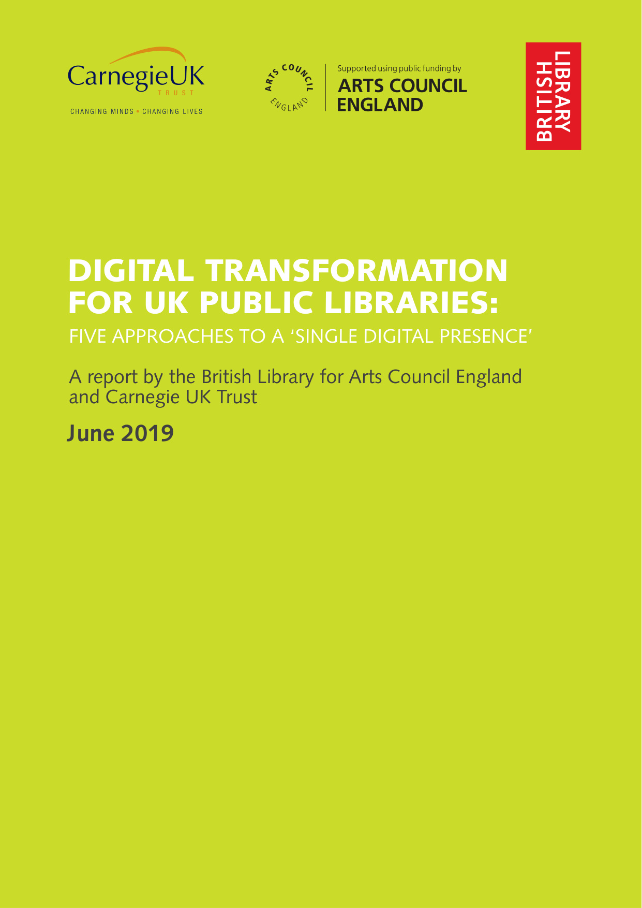

# Digital Transformation for UK Public Libraries: Five Approaches to a ‘Single Digital Presence’

**June 2019**

**A report by the British Library for Arts Council England and Carnegie UK Trust**

FIVE APPROACHES TO A ‘SINGLE DIGITAL PRESENCE’

<!-- PAGE: 2 -->

## Contents

- [Foreword](#foreword) (p. 3)
- [Introduction](#introduction) (p. 4)
- [Section 1: Rationale and Guiding Frameworks](#section-1-rationale-and-guiding-frameworks) (p. 6)
- [Section 2: Libraries in a Changing World](#section-2-libraries-in-a-changing-world) (p. 9)
- [Section 3: Industry Feedback and Perspectives](#section-3-industry-feedback-and-perspectives) (p. 12)
  - Library sector (p. 12)
  - Publishing and bookselling (p. 13)
- [Section 4: Options for a “Single Digital Presence”](#section-4-options-for-a-single-digital-presence) (p. 15)
  - A note on Business Models and Governance (p. 15)
  - Option A: Deep Shared Infrastructure (p. 16)
  - Option B: UK-wide Content Discovery (p. 17)
  - Option C: Unified Digital Lending (p. 19)
  - Option D: Safe Social Space (p. 20)
  - Option E: One Library Brand (p. 22)
- [Section 5: Conclusions and Next Steps](#section-5-conclusions-and-next-steps) (p. 23)
- [Selected Bibliography](#selected-bibliography) (p. 24)
- [Appendix: Supporting Data and Research](#appendix-supporting-data-and-research) (p. 25)

<!-- PAGE: 3 -->

## Foreword

In my role at the British Library, I am often asked about the relevance of libraries in our increasingly connected and globalised society. My answer is that the professional skills of library and information professionals, coupled with institutional values of trust, authenticity and inclusion are needed more than ever before.

As commercial technology products put content and services at our fingertips, issues of provenance and authority have become absolutely fundamental, especially as more and more of our professional and personal lives are now conducted online. Whether these are financial transactions, social updates, cultural experiences or millions of variations upon these, digital technologies and social media have enabled us to engage with a depth and breadth of content and experiences that were simply unimaginable a generation ago.

And yet we all still crave physical experiences and the opportunity to be in proximity with others. We know that desk space in libraries is at a premium as students, researchers, entrepreneurs and writers sit in public libraries alongside readers, teachers, professionals, parents and children and indeed anyone else who wants to be there. This is itself part of the wonder of public libraries: where else in society offers a place just to be and to think, with ideas and inspiration, quiet study, family activities or conversation? It seems to us that public libraries have always offered access to things that are in short supply: whereas this used to be about access to books and newspapers, nowadays libraries offer welcoming non-commercial spaces, reliable Wi-Fi, 3D printing, quiet study space, activities for all ages and interests; all things that are still out of reach for many.

Although the British Library does not have statutory responsibility for public library policy, in our national library role we care passionately about other actors within the knowledge ecosystem. We have a proud tradition of joint working with public libraries, including a growing network of Business and Intellectual Property Centres across the UK, as well as more recent innovations such as the Living Knowledge Network, a UK-wide partnership of national and public libraries. Since 2013 we have administered the Public Lending Right in the UK and Ireland, an important connection between the creators and readers of the books borrowed within public libraries. Without these partnerships, the British Library’s impact would be severely diminished and so we were pleased to accept the invitation from Arts Council England and Carnegie UK Trust to consider the sorts of digital transformation or “single digital presence” that might ensure that public libraries become (as envisioned by William Sieghart in his 2014 review) “society’s most exciting physical spaces, with unprecedented levels of digital content, engagement and opportunity.”

Technologies and indeed user expectations are evolving constantly, even during the creation of this report. Our contribution to the debate does not pretend to offer definitive answers to what is inevitably a highly complex set of interconnected issues. Rather, our aim has been to advance and re-frame the discussion by identifying five distinct varieties of possible intervention, each one of which, by itself or in combination, could provide a step towards the sought-after goal of a unified presence for libraries in the digital space. We have also offered some tentative and pragmatic judgements about those which we consider most likely, in current circumstances, to help the UK move towards the sustained future for public libraries that we all wish to see.

This report is an independent study by a small team within the British Library and reflects our provisional evaluation of these options for transformation, which vary in degrees of cost, complexity and feasibility. We are very grateful to all those who have offered their advice and expertise.

**Roly Keating**  
Chief Executive, British Library.

<!-- PAGE: 4 -->

## Introduction

This report considers the rationale for how digital transformation could support for public libraries in the United Kingdom. It forms the next phase in a sequence of reports and roundtable conversations about how the idea of a “single digital presence” (a term coined by William Sieghart) proposition could support the public library sector.

This report was commissioned by Arts Council England and the Carnegie UK Trust in 2017, building on previous work conducted by the Libraries Taskforce and Bibliocommons.[^1] The scope of this project was to consider options for what a UK-wide online platform for public libraries could look like, what it could be used for, and how such an offer might fit in to the current ecosystem for public libraries across the UK.[^2]

Whilst there is broad consensus within the sector that user-facing digital services could be significantly improved, there is no one vision for what this may look like. This is compounded by the complexity of the current system, with more than 200 public library authorities operating across England, Wales, Scotland and Northern Ireland. In approaching this scoping study, the British Library took a first principles approach to review how digital services could enhance the offer libraries provide to the public, while reinforcing their overarching public value.

We placed an emphasis on the experience of users during this research, an approach in line with the British Library’s own mission and values set out within our Living Knowledge vision, with its emphasis on openness, creativity and innovation.[^3] In preparing Living Knowledge, we reflected on what it means to be a national library in a digital age. Our belief in the enduring and mutually supportive symbiosis between physical space and digital offers has driven our approach to this project, and lies at the heart of our recommendations, which have been informed by our consultation and research.

> While the role of public libraries is changing, central to our belief as one of the world’s leading research libraries is that all libraries continue to be of the utmost importance to a flourishing society, one that is healthy, educated, engaged and informed.

Furthermore, at a moment of increasing social tension, mutual distrust, fake news and information overload, we believe that the core skills and values of library professionals are needed more than ever and that any digital interventions should augment and enhance professional capability rather than detract from it.

In 2016, the American Association of Research Libraries forecast that:

> “…libraries may well become the centre of learning in a world of ubiquitous information because they complement and scaffold all the brand new ways we are learning with and from one another.”[^4]

In testing the rationale and feasibility of a “single digital presence”, we have analysed international examples of “digital libraries” or platforms such as the Digital Public Library of America, Finna and Trove, all of which aggregate digital content at national level through a single interface.[^5]

We have also considered forms of digital systems management (including underpinning interventions such as a shared Library Management System) to explore potential benefits for service delivery and user experience in terms of transactional engagement and factual information. We have held a number of workshops around the UK with public library professionals, volunteers and users to explore user journeys and how individuals use systems to navigate their way through the services and opportunities on offer, both online and in person. We have also consulted with representatives of related industries, such as publishers and booksellers, as well as with the Society of Authors.

We approached this study without a fixed view of what the final recommendations and next steps would be, but with a clear statement of intent that we wanted our approach to reflect the values of public libraries themselves: trusted, open, inclusive, non-commercial and representative of the diversity of the users we serve. Additionally, we agreed:

> any technological intervention should augment the skills and experience of professional librarians rather than offer any replacement for them, and also have the clear goal of increasing public library use both digitally and physically.

<!-- PAGE: 5 -->

The section below on our methodology describes how we developed a framework for the first phase of this research that enabled us to speak to a diverse range of users and non-users. The thread that ran through all of our work was exploring how a digital platform (or platforms) might reinvigorate, refresh and rearticulate the values and purposes of the public library in an information-rich society.

The initial phase incorporated three main work-streams:

- **Research** – Scoping comparable models and best practice to understand the international context.
- **Discovery** – Consulting with public library service providers and some top level engagement with users to understand which services are currently provided, and how they are used and valued.
- **Stakeholder engagement** – Engaging with the wider library eco-system to gauge opinions from those across the sector and in adjacent sectors, such as publishing and bookselling.

At the British Library, we see our role as convening a conversation across the public library sector and beyond, in line with our own mission as a national library to make our intellectual heritage available to everyone for research, inspiration and enjoyment.

<!-- PAGE: 6 -->

## Section 1: Rationale and Guiding Frameworks

The vision of creating a unifying online service for the public library sector has been a topic of aspirational discussion since the earliest phases of the digital revolution. The current debate, however, owes its origin to the 2014 Independent Review of Public Libraries in England by William Sieghart, who coined the phrase “single digital presence” as a way of exploring:

> “how in a digital age, the public library space can be the most exciting place for readers, and give the public access to an unprecedented range of digital content.”[^6]

Since then, the idea has been tested and explored in a number of debates, seminars and reports under the aegis of the Libraries Taskforce and other stakeholders, including the Essential Digital Infrastructure for Public Libraries in England by BiblioCommons, which analysed the fragmentation of current web offerings in the sector and began the process of formulating options for improvement.[^7] The debate was also shaped by the Single Library Digital Presence Steering Group, convened by the Libraries Taskforce in 2016.[^8]

This 2019 paper is the outcome of an approach made jointly by Arts Council England and Carnegie UK in 2017, in which they invited the British Library to lead a piece of fresh thinking on this debate, with a view to making recommendations.[^9] By taking this work on, the British Library proposed and agreed with ACE and Carnegie a number of broad themes at the outset, which have continued to inform our work in this report:

- The focus of policy should be at pan-UK level, involving our fellow National Libraries in Scotland and Wales where appropriate and respecting their jurisdictions, strategic priorities and statutory responsibilities;
- The perspective of analysis should be both global – in terms of international experience and benchmarks – and long-term (although ‘quick wins’ will be noted where they may exist);
- The importance of realism and the avoidance of ‘optimism bias’ should be recognised, with a readiness to acknowledge that some outcomes may be desirable but not implementable in current circumstances.

Our working hypothesis in this report was to test the rationale and appetite for a digital platform acting as a catalyst to increase public library use, support efficiencies and amplify the impact and importance of libraries at local, national and international level.

The public library sector sits at the intersection of a number of separate UK Government policy priorities and departmental interests – as well as being differently structured within the devolved nations of the UK. A strength of this position is that the sector has the potential, through its broad social reach and localised structure, to offer contributions and solutions across a range of UK-wide social and economic priorities. A weakness, of course, is that funding, operations and strategy have historically been fragmented: the current financial challenges faced by some library authorities – not a focus of this paper – may be at least partially a symptom of this.

In the analogue age, this separation between differing departmental interests has been to a high degree inevitable. The digital age, however, is different: Governments, organisations and institutions have become more comfortable in thinking, and acting, across historic boundaries – disrupting established categories and forging new, beneficial connections, with a focus on customer-focussed design in the shaping of digital services.

The diagram below illustrates one conceptual framework we have used to consider how library services in the digital age can be designed to occupy a position at the heart, not the margin, of UK policy priorities.

> Libraries have the potential to offer a single, welcoming front door for a very diverse range of citizen needs, interests and aspirations – from culture, business and research to health, wellbeing and personal growth.

This is not to insist that all potential “single digital presence” concepts have to support all these departmental interests – but we have found it a useful guide in assessing the aggregate public value different versions of such an initiative may be able to deliver. There is, of course, very significant value at local government level too, with public library services having a sustained and tangible impact on outcomes for communities and individuals.

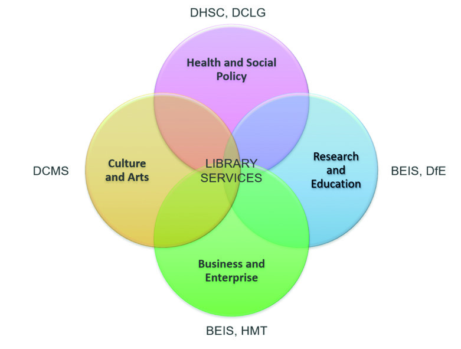

<!-- PAGE: 7 -->

A second framework concerns the fundamental components of a library service. It is a frequent tendency of public debates on public libraries to focus on just one element – the provision of books for lending, for instance, or the opening hours of a service. These are of course vital, but we have been keen to stress the interconnectedness of three essential, irreducible and enduring elements of libraries: (a) the content and collections on offer; (b) the spaces libraries occupy; and (c) that the users and professionals bring both to life. Whether in the physical or digital realms, all three of these pillars, we believe, need to remain strong for the fundamental architecture of the idea of the library to endure:

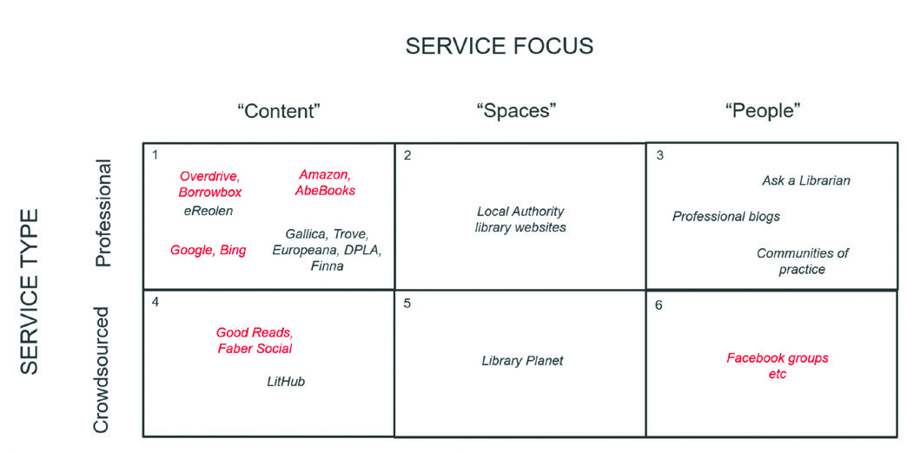

We have made use of these three broad ‘zones’ of library service to create a top-level map (Figure 3 below) of the current landscape of digital provision, both within the public library sector itself and in the adjacent sectors of knowledge discovery and book provision, where some of the global digital giants have successfully built international empires over the past two decades; commercial services are marked in red. We have found it helpful to divide the landscape further into two broad ‘types’ of service: those based on content and input from professional sources, whether publishers, content providers or formal organisations; and those where the content is fundamentally user-generated or crowd-sourced.

We will argue that both types of service may be relevant in considering where opportunities may exist to strengthen the digital presence of libraries, noting – for example – the lack of any distinctive ‘UK’ service in section 1, and the absence of any kind of social or community presence for libraries at all in section 6, where activity is wholly reliant on the major commercial social platforms.

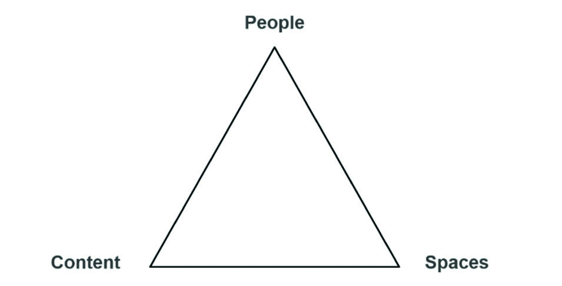

Alongside these frameworks, and the other multiple sources of research and feedback detailed in the Appendix, we have also attempted to take account of the role – current and potential – of the British Library itself, alongside the National Libraries of Scotland and Wales and their respective priorities. Therefore, our thinking has also taken account of the British Library’s own strategic plans under its Living Knowledge vision, launched in 2015, of which two strands are particularly relevant to the topic. First, the ‘Everything Available’ programme, which is seeking to reinvent the Library’s approach to content access, especially to reflect the revolution in Open Access publishing; and second, the parallel ‘Everyone Engaged’ portfolio, which includes the work of the UK’s three national libraries in creating and shaping the Living Knowledge Network of major public and national libraries across the UK.

Throughout the course of this project, we attended several roundtable events with the National Libraries of Scotland and Wales and bilateral meetings with Northern Ireland Public Library Authority (Libraries NI). These meetings were crucial in maintaining our pan-UK approach, and provided substantial and valued perspectives on library services in Scotland and Wales, directly contributing to and informing the specific themes and options outlined below, and reinforcing that:

> any UK-wide digital initiative will need to reflect the diversity of and devolved administrations of all nations within the UK.

England, Scotland, Wales and Northern Ireland already have longstanding policies and strategies in place, which will need further consideration with regard to the potential implementation of any future “single digital presence”, noting also that some areas of public library governance and joint working are already more cohesive and advanced in Scotland, Wales and Northern Ireland than they are in England.

Finally, we have also been guided by the British Library’s own values and vision about the enduring importance of the library sector. In a global and digitised world, public libraries are still a core service for a wide cross-section of society, not least those living in poverty or in remote areas who do not have access to the internet at home or, related to this, who do not have the level of digital literacy required to engage online, something increasingly demanded by government, banks and other commercial services.[^10] 46% of English local library authorities surveyed <!-- PAGE: 8 --> by Lorensbergs reported an increase in the number of requests from public library members to staff for help with digital skills and online resources during the roll out of a solely digital application for Universal Credit.[^11] A further 40% of these authorities have planned, or are planning, initiatives for better digital services.

The national strategy for public libraries in England *Libraries Deliver* published by the Public Libraries Taskforce in England, has pointed to the many ways in which public libraries can provide social, economic and cultural benefits for individuals.[^12]

Our research has found significant opportunities to promote and advocate for these opportunities through a digital platform, including a basic need for clearer information about the inspiring activities already happening.

> Public libraries worldwide are a civic reminder of the importance of personal connection and community within one’s own neighbourhood.

As a publicly funded asset, they are institutions that facilitate the universal civic right to access knowledge of all kinds, whoever you happen to be and wherever you come from. Like the NHS, public libraries offer universal services from cradle to grave, and the very fact that they are part of so many people’s own intellectual journey strengthens the affection we have for them. We see an opportunity through digital interaction to offer integration with UK-wide services, whilst also maintaining the familiarity and context of local spaces (and places), collections and individuals.

> “The [research] library of the future will be a mega library at different scales; it will aggregate vast amounts of data, text and media-rich content”, [but at the same time] “local collections and expertise will become increasingly valuable.”[^13]

<!-- PAGE: 9 -->

## Section 2: Libraries in a Changing World

UK library users belong to a large global library community, and it is clear that a revitalised and co-ordinated digital offer could forge stronger and more recognisable ties between public libraries across the United Kingdom – as well as providing the potential to create, build and reinforce relationships with higher education, National, and research libraries internationally.

Carnegie UK Trust’s 2016 *Shining a Light* reports found that around half the population in the UK had used a public library within the previous 12 months.[^14] However, according to DCMS’ *Taking Part* survey, there has been a steady and substantial decline in library attendance in England over the last decade, with attendance falling by 14% between 2005/06 and 2017/18.[^15]

> The continued popularity of the library as a concept stands in stark contrast to the fall in physical footfall.

For example, during this period the number of library authorities increased their expenditure on and acquisition of electronic and digital resources.

The International Federation of Library Associations (IFLA) estimates that there are around 414,000 public libraries worldwide, serving a global community of more than 1.4 billion people, with around 1.3 billion registered loans each year.[^16] These figures point to the sheer scale of the global public library user community, but also to a vast, active and engaged audience, and the huge potential for deeper forms of connection, both between libraries and between libraries and their users.

In the past 30 years, the internet and other digital innovations have fundamentally changed how information is curated, shared and accessed, enabling individuals to interact with one another across a diverse range of international platforms.

### The evolving role of physical library spaces

Many library spaces have been rapidly evolving to meet these challenges, actively repositioning themselves as community and digital hubs, co-working spaces and cultural and events venues. These transitions are not entirely new; modern libraries have long engaged with their local communities to identify which services they want or need.

Indeed, as Niegaard notes, very recent investment in public library infrastructure around the world has produced:

> The library of the future, or “the new library, [is] a holistic library where printed, physical, and traditional services are integrated with digital and virtual services and challenges.”[^17]

One of the key themes of *Living Knowledge* was that while users have access to a virtually limitless supply of digital information, this has not diminished the demand for inspiring physical spaces. In fact, footfall across the British Library and major public libraries has increased significantly over the same period.

> Libraries are increasingly seen as places not only to access information, but to produce and create ideas.

They are spaces to meet people and ideas they may not encounter otherwise; and to take part in events and activities, access free Wi-Fi, 3D printing and coding clubs.

This theme is one that forms a core part of the narrative for public libraries: their fundamental public value comes from those who can articulate their social and economic value, thereby creating a virtuous circle where they can attract (or at least uphold) funding and attract political <!-- PAGE: 10 --> capital for innovation and improvement. In late 2014, the Knight Foundation, a US philanthropic body with a mission to “foster informed and engaged communities”, launched an opportunities fund to help libraries become community platforms, highlighting that:

> “Public libraries can leverage the physical assets in their communities in combination with people and virtual services and content to build stronger, more resilient communities.”

### Changing patterns of cultural consumption

The transition from physical consumption of books, television, films and music to digital streaming and downloading has had a profound impact on cultural industries. Over the last decade, the mass market adoption of smartphones, tablets, e-readers and streaming devices has fundamentally changed the ways in which people discover and consume cultural content.

In 2018, Deloitte found that 85% of UK adults now own or have access to a smartphone, with 79% using their smartphone every day.[^21] The same report found that 58% of UK adults had access to a tablet, while 26% had an e-reader.[^22]

The shift towards on-demand digital content has been especially marked in television, film and music. The BBC iPlayer, launched in December 2007, has grown from 271 million requests in its first full year (2008) to 3.3 billion programme requests in 2017.[^23]

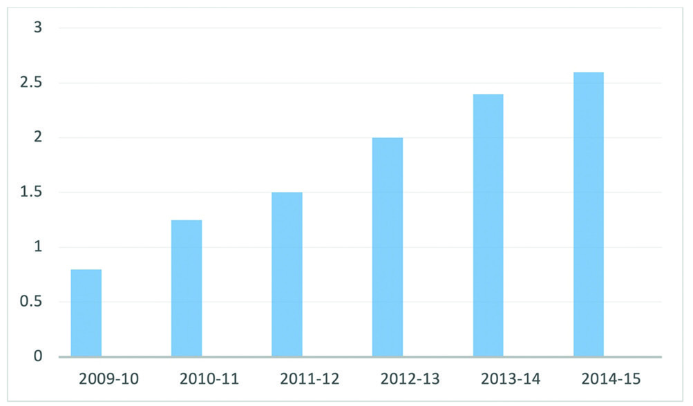

As Dan Taylor-Watt notes, this dramatic growth demonstrates how quickly user behaviour can transform when content is made available through an intuitive, accessible and trusted digital platform.[^24]

> The success of platforms such as BBC iPlayer, Netflix and Spotify underscores the importance of simple, friction-free access to content across all devices.

<!-- PAGE: 11 -->

Businesses, public organisations and governments are all invested in reaching and engaging the young ‘digital first’ consumer. This is no less the case with libraries, and an easy-to-use digital space attentive to the needs of young users could be a significant catalyst in increasing usage of public libraries among younger people.

However, as Deloitte show, the difference in digital engagement between age cohorts is stark. 18–24 year-olds are the heaviest consumers of streaming media, with 91% accessing video streaming services and 76% using music streaming services weekly.[^25] Meanwhile, older generations retain a strong preference for traditional media and physical formats.

Research by PwC confirms that convenience, ease of use and speed of delivery are the primary drivers of digital consumer choices.[^26] Consumers expect seamless user journeys, single sign-on authentication, personalized recommendations and instantaneous access to content. Where digital services fail to meet these expectations, users rapidly migrate to alternatives.

### Voice, artificial intelligence and predictive algorithms

The rapid rise of voice-activated assistants (such as Amazon Alexa, Apple Siri and Google Assistant) represents another frontier in digital discovery. By 2019, an estimated 20% of UK households owned a smart speaker.[^27] The Future Today Institute identified conversational computing and ambient artificial intelligence as major structural shifts in how information will be retrieved and consumed.[^28]

As artificial intelligence and automated curation become central to commercial platforms, public libraries face both an imperative and an opportunity. An algorithmic landscape governed solely by commercial interests risks creating filter bubbles and commercial distortion. Public libraries have an enduring mission to provide balanced, authoritative and unmonetised access to information, ensuring that diverse perspectives and minority voices remain discoverable.[^29]

<!-- PAGE: 12 -->

## Section 3: Industry Feedback and Perspectives

In conjunction with our research and analytical work, we have sought to ensure that our thinking is informed by the views and experiences of others in the system, particularly within the library and information service community, but also from important adjacent industries including publishing and bookselling.

The British Library’s role in convening these discussions was to facilitate an open, honest and evidence-based dialogue about the realistic prospects for a single digital presence, testing assumptions and exploring shared priorities across different sectors.

### Library sector

Between January 2018 and March 2019, the project team conducted extensive engagement with public library leaders, frontline library staff, sector organisations and partner bodies across the UK. This included:

- Four regional workshops with library staff and heads of service in England, Scotland, Wales and Northern Ireland;
- Dedicated sessions with the Society of Chief Librarians (now Libraries Connected);
- Bilateral discussions with the Scottish Library and Information Council (SLIC), the Welsh Government Museums, Archives and Libraries Division (MALD), and Libraries NI;
- Consultation with CILIP (the library and information association);
- Focus groups with library users and non-users to explore user journeys, discovery habits and perceptions of library digital offers.[^30]

Key themes emerging from these discussions included:

- **Fragmented user experience**: The current patchwork of 200+ local authority library websites, multiple catalogue interfaces and separate third-party vendor apps (for e-books, e-audio, e-magazines) creates unnecessary friction and confusion for users.
- **Brand dilution**: Public libraries lack a clear, unified digital identity. While individual local services are deeply valued locally, the absence of a national digital presence weakens public awareness of the breadth of services available.
- **Procurement and cost pressures**: Individual authorities duplicate effort and spend in procuring separate LMS systems, digital content licenses and web platforms. Collective bargaining and shared technical infrastructure could yield significant efficiencies.
- **Staff skills and capacity**: Frontline staff are increasingly called upon to deliver informal digital skills training and support, often with limited resources and variable technical infrastructure.

<!-- PAGE: 13 -->

identifiable at local and regional level but also at UK-wide level to inform advocacy and strategic decision-making, with secondary benefits also identified for the Public Lending Right. Several groups also discussed the possibility of a UK-wide 24/7 public library enquiry service, similar to the “Ask a Librarian” services used in higher education.

There was a clear view among those consulted that any digital presence must complement, rather than substitute for, physical library spaces. Participants emphasised that the distinctiveness of local collections, local history and community connections must be celebrated and made visible within any national digital framework.

### Publishing and bookselling

The project team met with representatives from the Publishers Association, the Booksellers Association, the Society of Authors, and major publishing houses including Bloomsbury, Hachette UK, Penguin Random House, HarperCollins, and Pan Macmillan.[^31] [^32]

These conversations highlighted both shared ambitions and areas of tension:

- **E-lending models**: Publishers expressed ongoing concern that frictionless remote e-lending could cannibalise retail sales of e-books and physical books. They stressed the importance of maintaining friction (e.g. one-copy-one-user models, embargoes on frontlist titles, or licensing terms) to protect author incomes and commercial book retail.
- **Author remuneration**: The Society of Authors emphasised that any expansion of digital lending must be matched by fair remuneration for creators through the Public Lending Right (PLR), which was extended to remote e-book loans in the UK in 2018.
- **Symbiotic relationship**: Both publishers and booksellers acknowledged the vital cultural role of libraries in fostering a love of reading, discovering new authors and cultivating the next generation of book buyers.
- **Data sharing**: Publishers expressed keen interest in aggregated reader data and borrowing trends from public libraries, noting that better data could inform editorial decisions and marketing strategies.
- **Local bookshop partnerships**: Booksellers expressed interest in exploring collaborative models where library digital platforms could provide links to purchase books from independent and high street bookshops, ensuring that libraries and bookshops mutually support local reading ecosystems.[^33]

<!-- PAGE: 14 -->

promoted through public library networks, as well as (potentially) promoting the locations of local bookshops as an additional offer.[^33]

A “single digital presence” would benefit the publishing sector by giving sellers access to reader data, providing valuable market and trend insight, and allowing publishers to better understand their consumer demographic and behaviours. In addition, a “single digital presence” could benefit publishers by creating a direct channel to readers, promoting author events and literary prizes, and providing an authoritative platform for backlist discovery.[^34] [^35]

The challenge, therefore, lies in designing a digital presence that respects the economic realities of the creative industries while delivering the maximum public benefit for library users.

<!-- PAGE: 15 -->

## Section 4: Options for a “Single Digital Presence”

As the feedback from stakeholders indicates, the term “single digital presence” within a libraries context is open to multiple interpretations, and a key objective of this project has been to arrive at a coherent definitional language within which policy decisions can be made.

While we have considered the current and emerging shape of the digital market and user expectations, we have grouped potential interventions into five distinct, tangible options:

- **Option A**: Deep Shared Infrastructure
- **Option B**: UK-wide Content Discovery
- **Option C**: Unified Digital Lending
- **Option D**: Safe Social Space
- **Option E**: One Library Brand

### A note on Business Models and Governance

Before examining each option in detail, it is essential to consider the underlying questions of ownership, governance and funding models. Any sustainable single digital presence will require clear governance structures, ongoing operational funding and appropriate legal arrangements.

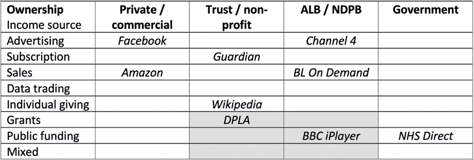

The spectrum of ownership ranges from fully state-owned and centrally funded platforms (as in Denmark and France) to independent charitable trusts, public-private partnerships, or commercially licensed models. Similarly, income models can blend central government grant-in-aid, local authority subscriptions, philanthropic support, commercial licensing or sponsorship, and value-added commercial services.

Each of the five options carries distinct implications for governance and funding, which must be carefully weighed in evaluating their feasibility.

<!-- PAGE: 16 -->

## Option A: Deep Shared Infrastructure

At the heart of any library service is its Library Management System (LMS) – the software that underpins all key functions that control the flow of stock, usage, and information across the service. Typically, this infrastructure is licensed to public libraries by specialist companies, usually on an authority-by-authority or, at most, region-by-region consortium basis.

Interventions to procure a single LMS at the national level are costly, technically intricate and commercially challenging, but can deliver profound long-term benefits in data interoperability, shared catalogue management and collective bargaining power.

A similar initiative has been undertaken at state level by the Australian state of South Australia through its ‘One Card’ network, which unified 130 public libraries across 68 local councils on a single LMS platform.[^36] In the Republic of Ireland, the Libraries Ireland project successfully migrated all 31 local authority library services to a single shared LMS and catalogue, creating a truly unified national library system.[^37]

In the United Kingdom, three companies held a 67.8% share of the LMS market across public library authorities in 2018 (Capita, Axiell, and Civica), creating a fragmented commercial ecosystem with substantial variation in licensing costs and contract terms.

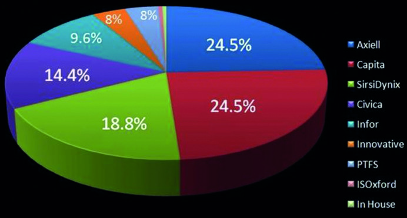

As the Republic of Ireland model shows, a shared LMS would undoubtedly facilitate seamless resource sharing, reciprocal borrowing and unified user authentication across the entire country.

The execution challenges would be formidable, however, at both logistical and contractual levels. Existing contracts across more than 200 authorities have different expiry dates, varying technical specifications and disparate legacy data structures.

> A UK-scale intervention at LMS level would represent a fundamental change in the operational architecture of the sector, requiring multi-year transition funding and centralised governance.

Issues would also be raised over the scale of monopoly power that a single LMS procurement could create, potentially stifling competition and innovation in the commercial software market.

For all these complexities, however, we would not argue that an initiative at LMS level is impossible. Regional consortia (such as the Libraries West consortium or the Scottish Consortium of Public Libraries) have demonstrated that shared LMS arrangements can deliver substantial efficiency and user benefits.

> **Conclusion**: Further development of a single mandatory UK-wide LMS is not recommended at this time due to high capital costs and contractual fragmentation, but support for voluntary regional consortia and national data standards should be actively pursued.

<!-- PAGE: 17 -->

## Option B: UK-wide Content Discovery

While ‘single presence’ interventions at LMS level are a relative global rarity, our research has identified many more instances of countries which have created unified discovery platforms which aggregate or facilitate access to digital content from libraries, archives and other public collections. Notable and relatively mature examples include:

- **Gallica** (Bibliothèque nationale de France): A comprehensive digital library aggregating millions of digitised books, manuscripts, prints, photographs and sound recordings from the BnF and hundreds of partner libraries across France.
- **Finna** (National Library of Finland): A unified public search portal that provides single-search access to the collections of over 300 Finnish libraries, archives and museums, built on the open-source VuFind platform.
- **Trove** (National Library of Australia): A celebrated discovery platform aggregating more than 600 million items from thousands of Australian institutions, renowned for its crowdsourced text-correction community.

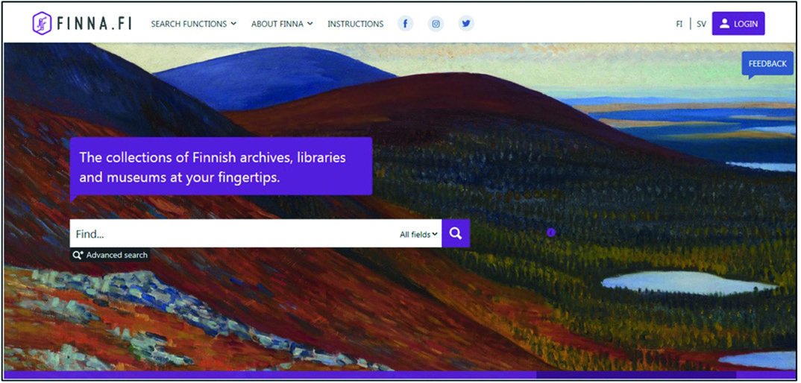

In the context of this report, a key test of such propositions is their ability to enhance user discoverability while respecting local institutional autonomy.

One especially interesting instance that presents potentially valuable lessons for the UK is Finland's Finna service. Finna provides a shared national search interface, but allows each participating public library and university to generate its own branded local portal with customized styling, local lending policies and integrated catalogue functions.

In developing a highly functional user-interface without majorly disrupting existing LMS investments, Finna demonstrates how national aggregation and local identity can successfully co-exist.

> This approach, if properly resourced, creates a single UK pathway to knowledge collections, celebrating local identity while providing national scale.

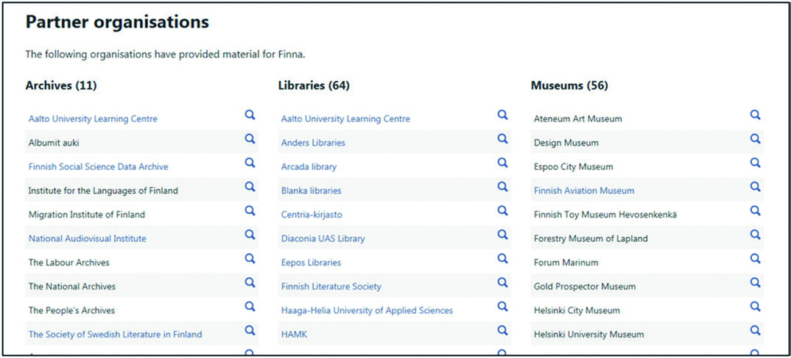

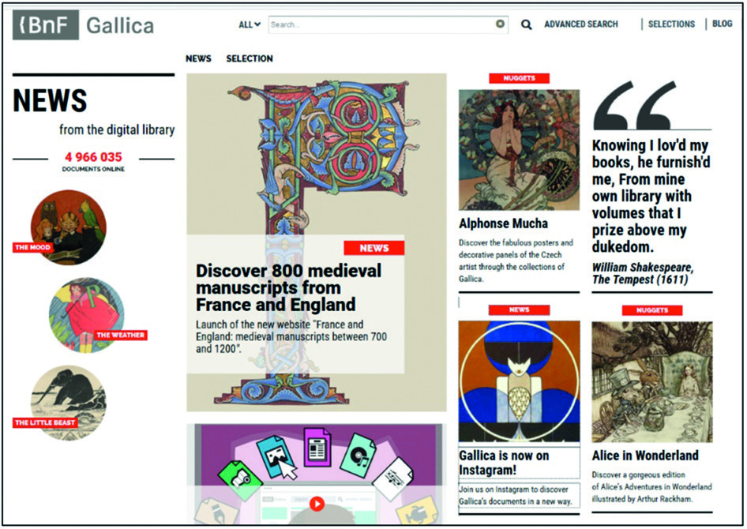

<!-- PAGE: 18 -->

Distinctive in a different way is the Australian national content discovery platform Trove, which – while sharing many characteristics with other such products – has successfully built an extremely active community of users committed to crowdsourced improvement of the optical character recognition transcriptions of its digitised newspaper collections.[^38] Trove’s homepage gives constant visibility to the volume of items corrected by users, creating a sense of shared civic ownership and community participation.

From an international perspective, the UK is arguably better placed than almost any other nation to develop a world-class content discovery platform. The UK possesses extraordinarily rich, internationally renowned cultural and scientific collections held by national libraries, public library local studies departments, university research libraries, the National Archives, and civic museums and galleries. Furthermore, the global status of English as a lingua franca ensures that a UK discovery platform would attract a vast worldwide audience of researchers, students and general readers.[^39]

From a British Library perspective, a “single digital presence” initiative focussed on discovery could build directly on existing national investments, such as the Living Knowledge Network, the British Library’s digitised newspaper collections, and emerging Open Access research repositories.[^40]

The momentum of this thinking has been increased by recent developments in national research policy, notably the Plan S initiative and UKRI's Open Access mandate, which require publicly funded research to be freely accessible without paywalls.[^41]

Public libraries have always been expected to play a role in Open Access and citizen science, yet members of the public currently have no easy, unified way to discover and access these scholarly and heritage resources.

A “single digital presence” initiative for libraries focussed on the discovery of trusted content would directly support the public library mission of promoting learning, research and intellectual curiosity.

This view was supported by representatives from various library authorities who stressed that public libraries hold unique local history collections that currently remain hidden within local catalogues or uncatalogued entirely.

In this context, the ‘crossroads’ position of libraries illustrated in Section 1 enables a national discovery platform to act as a vital bridge between scholarly research, civic heritage and everyday citizen enquiry.

> **Conclusion**: Further development of Option B (UK-wide Content Discovery) is strongly recommended as a viable, high-impact and strategically coherent path forward.

<!-- PAGE: 19 -->

## Option C: Unified Digital Lending

The question of e-lending and the appropriate model for the UK – balancing the needs of readers, authors, publishers and booksellers – has been a focus of renewed debate since the first Sieghart report (2013). Therefore, we have made it a central point of enquiry to determine to what a centralised ‘single digital presence’ intervention is required in this area.

Our research for international comparisons has found that there is no single international consensus on e-lending architecture. Different countries have adopted radically different models depending on their legal frameworks, market dynamics and publisher relationships:

- **Commercial vendor aggregation**: In the US, UK, and Canada, public libraries predominantly license e-books from third-party aggregators such as OverDrive (Libby), BorrowBox (Bolinda), CloudLibrary (Bibliotheca) and RBdigital.
- **National public platforms**: In Denmark, the public library sector established *eReolen*, a national public platform for e-books and e-audiobooks, negotiated collectively with publishers.[^42]

Overdrive is the largest e-book distributor on the global market, serving more than 40,000 libraries and schools worldwide. In the UK, however, authorities often hold contracts with multiple vendors, requiring users to navigate multiple apps and login credentials to access different formats.

Denmark provides an instructive model for centralised e-lending provision:

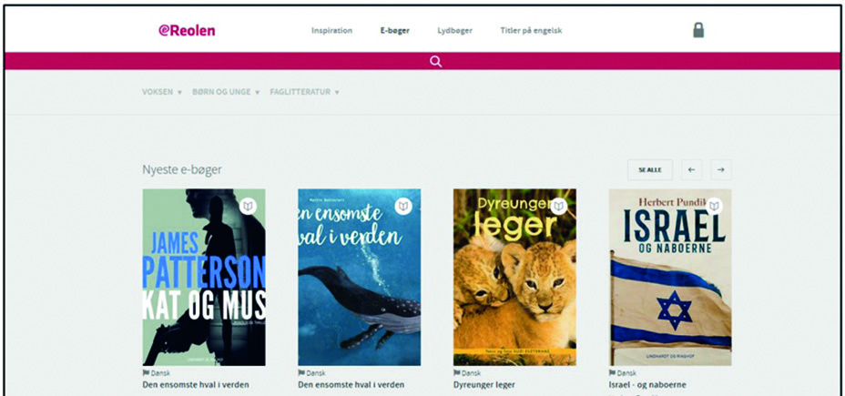

The eReolen platform has been controversial, with almost all major Danish trade publishers withdrawing from the service in 2016 due to concerns over cannibalisation, before a renegotiated compromise was achieved.[^42] The Danish government negotiated with the publishers to establish a dual licensing model, combining subscription-style access for backlist titles with pay-per-loan mechanisms for frontlist bestsellers.

A case can undoubtedly be made that an intervention at UK-wide level to create a single national e-lending platform could simplify the user experience, eliminate vendor silos and enable collective licensing negotiations.

> The fragmentation of activity means that consistent standards in terms of user experience, accessibility and collection depth are difficult to maintain across 200+ authorities.

Experience from Denmark and elsewhere suggests that even in markets much smaller and more cohesive than the UK, national e-lending platforms face intense friction with publishers and booksellers.[^43] Commercial publishers in the UK are deeply wary of any centralised platform that could threaten commercial book sales or create an e-lending monopoly.

We note also that a central recommendation of the Sieghart review – the extension of Public Lending Right to remote e-book loans – was enacted by Parliament in the Digital Economy Act 2017 and came into force in 2018, providing a stable statutory foundation for author remuneration.[^44]

> **Conclusion**: Further development of a centralised national e-lending platform is not recommended at this time due to commercial sensitivities, publisher resistance, and existing long-term aggregator contracts; sector focus should remain on improving aggregator interoperability and API integration.

<!-- PAGE: 20 -->

## Option D: Safe Social Space

Of all the digital product types that have gained global traction in the first part of this century, it is arguably the social media platforms that have had the deepest and most widespread impact on the lives of their users. Between them, Facebook (plus its subsidiary products such as Instagram and WhatsApp), Twitter, WeChat, Reddit, Tumblr and others engage an audience of billions worldwide.[^45]

If Google and Amazon have taken positions in one important part of the information landscape, the social networks dominate the spaces where people discuss ideas, share recommendations and form communities.

Most discussions of library digital services focus on platforms where content is professionally curated and consumed passively. Yet libraries have always been social spaces where people connect, converse and participate.

Several structural factors suggest that public libraries possess unique qualifications to offer a digital social space:

- **First, aggregate scale**: The sheer aggregate volume of library users around the world represents a massive, highly literate and civically minded community.
- **Secondly, the people factor**: If physical libraries were merely buildings holding books, they would have vanished decades ago. Their endurance is powered by the expertise, empathy and human support of library staff and the serendipity of human interaction.
- **Thirdly, organic community**: Libraries host thousands of reading groups, author talks, coding clubs and community forums every week, providing a natural bedrock for digital community extension.
- **Fourthly, trust**: The commercial social platforms, popular as they are, face growing crises of public trust around data privacy, surveillance capitalism, disinformation, algorithmic radicalisation and online toxicity.

> If a digital presence could be created that replicated even some of the warmth, safety and trust of the physical library, it would represent an alternative of genuine public value.

As with the ‘UK-wide Content Discovery’ section above, it is not the technology alone that defines this opportunity, but the ethical and social framework within which it operates.

The first consideration is the potential role and contribution of the professional librarian. In a digital social space, librarians could act as trusted facilitators, moderators and guides – recommending books, answering enquiries, and nurturing thoughtful discussion without commercial bias.

There have been some instructive instances of innovation in this space, such as Goodreads (acquired by Amazon in 2013), LibraryThing, and crowdsourced reading platforms. However, none of these combine public ownership, guaranteed privacy protection and integration with civic public services.

<!-- PAGE: 21 -->

The second point is to note that for this type of initiative, even more than for other potential incarnations of a single digital presence, questions of governance, ownership, a business model and behavioural rules will be fundamental to its chances of success – more so than questions of technology, which in this instance is likely to be based on fairly established models. The ethical principles that underpin public libraries – privacy, freedom of expression, absence of commercial exploitation – would need to be embedded in the platform's core design.

These are highly challenging questions. But success in addressing them could yield an exceptionally valuable public asset: a non-commercial, civic social platform for reading, learning and discussion that directly extends the public library mission into the digital public sphere.

> **Conclusion**: Further development of Option D (Safe Social Space) is recommended for exploratory development, potentially as a participatory community layer within a broader digital discovery or web platform.

<!-- PAGE: 22 -->

## Option E: One Library Brand

Sometimes overlooked in debates around the idea of a “single digital presence” is the difficulty of promoting a “single presence” for libraries of any kind, digital or otherwise. Unlike other notable public services with UK-wide presence – such as the NHS for health and the BBC for broadcasting – there is not, and never has been in the UK, a common brand identity for public libraries.

It is also an area of vulnerability in a world where brand presence and recognition are increasingly paramount in driving user adoption, search visibility and civic awareness.

Across the UK, public library services are commissioned by local authorities and presented under hundreds of disparate council logos, regional consortium identities and departmental sub-brands. While local pride and local authority accountability are important, this extreme fragmentation makes it difficult to conduct national advocacy campaigns, build cohesive digital marketing or establish a clear presence in app stores.

In their important 2011 study of branding in UK public libraries, Harriff and Rowley noted that the lack of brand consistency across the sector severely impedes public perception and undermines investment advocacy.[^46]

As such, there is a need for a unifying brand identity, building on the trusted public status of libraries while giving the sector a recognizable national profile.

> Such a brand identity would help to focus and reinforce awareness of the immense range of modern library services – from digital skills to maker spaces and cultural programming.

The importance of libraries in a wider reading culture could encourage publishers, retailers and technology platforms to engage more productively with a unified brand than with 200 separate local authorities.

Any intervention around the branding of a pre-existing service – especially one delivered by autonomous local government authorities – carries significant sensitivities and political challenges.

However, our contention is that in an extremely brand-focussed culture, a cohesive visual and brand identity is a prerequisite for any successful digital presence. Without a recognisable symbol and unified digital identity, even the best digital tools will struggle to cut through the noise of the commercial internet.

In that context, we leave it as an open question – to be addressed in the next phase of work – whether a new master brand should be created or whether existing initiatives (such as Libraries Connected or the Living Knowledge Network) could be adapted.

> **Conclusion**: Further development of Option E (One Library Brand) is strongly recommended as an indispensable horizontal enabler for all digital presence initiatives.

<!-- PAGE: 23 -->

## Section 5: Conclusions and Next Steps

Throughout this process, we have sought to balance the aspirational vision of a unified library digital service with the complex and sometimes challenging realities both of the digital marketplace and the UK library sector. We have also attempted to disaggregate the original, generic ‘single digital presence’ idea into a number of more discrete, manageable options.

There is also an implicit option of no further action at present, but our consultation indicates that doing nothing risks continued marginalisation of public libraries in the digital lives of citizens.

The table below sets out in summary form a top-level options appraisal across the five approaches:

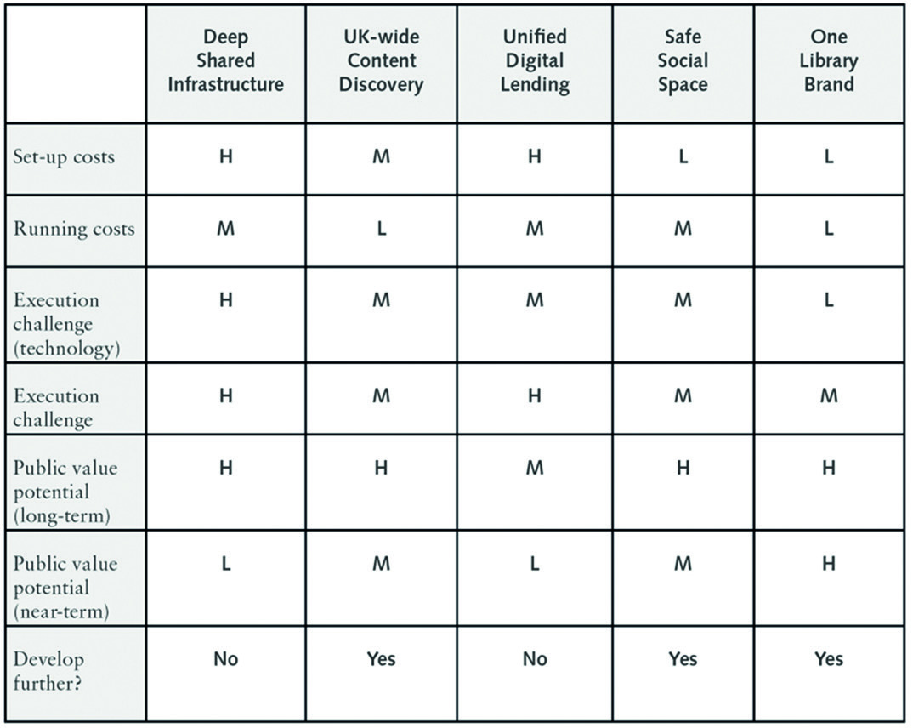

This indicates three potential paths for future strategic development:

- **UK-wide Content Discovery** – a UK-wide aggregator of free-to-view digitised cultural, heritage and Open Access content, built on open standards and celebrating local collections.
- **Safe Social Space** – an ethical, participatory online community for readers, learners and citizens, moderated by library professionals.
- **One Library Brand** – a unified national brand identity and marketing presence that provides a single recognizable front door to public library services.

It should be stressed that these are not mutually exclusive, nor necessarily sequential. In fact, they could be combined into a coherent, phased digital roadmap: a unifying brand (Option E) providing the visual identity for an integrated discovery and community platform (Options B and D).

Moreover, each addresses a somewhat different part of the library proposition, as mapped against our three pillars framework:

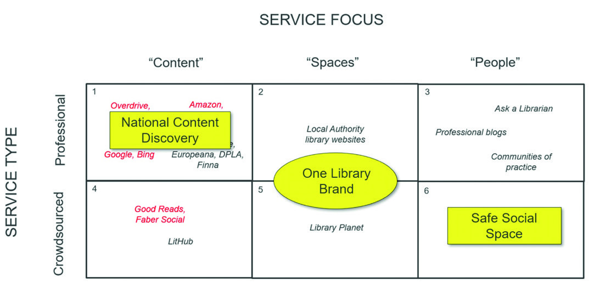

National Content Discovery takes its place in section 1, a sector already rich in digital assets but lacking unified public discoverability; Safe Social Space addresses the notable void in section 6; while One Library Brand underpins the entire ecosystem.

The British Library has welcomed the opportunity to work with Arts Council England and Carnegie UK Trust on this scoping study. We believe that a phased, pragmatic approach, rooted in user research and respectful of devolved governance, offers a genuine path toward realizing the transformative potential of a single digital presence for UK public libraries.

<!-- PAGE: 24 -->

## Selected Bibliography

- Bibliocommons, *Essential Digital Infrastructure for Public Libraries in England* (2015).
- Big Lottery Fund, *The People’s Network: evaluation summary* (2004).
- CILIP, *Public Library Legislation in the UK* (2014).
- CIPFA, *Public Libraries Statistics 2016-17 Actuals* (London: CIPFA, 2017).
- Crystal, David, *Evolving English: One Language, Many Voices; an Illustrated History of the English Language* (London: British Library, 2010).
- Deloitte Insights, *Digital Media Trends Survey: A New World of Choice* (London: Deloitte, 2018).
- House of Commons Library, *Briefing Paper: Public Libraries* (London: House of Commons, 2016).
- IFLA, *Library Map of the World* (The Hague: IFLA, 2018).
- Laine, Timo & Laitinen, Markku Antero, “The Finna service: meeting user needs in Finland”, *Information Discovery and Delivery*, 47:1 (2019), pp. 24–32.
- Lankes, R. David, *The Atlas of New Librarianship* (Cambridge, MA: MIT Press, 2011).
- Lankes, R. David, *A Manifesto for Expectant Librarianship* (2016).
- Libraries NI, *Annual Report and Accounts 2017/18* (Lisburn: Libraries NI, 2018).
- McMenemy, David, “Emergent digital services in public libraries: a domain analysis”, *Journal of Documentation*, 73:6 (2017), pp. 1111–1127.
- Niegaard, Hellen, “Library Space and Digital Challenges”, *Library Trends*, 60:1 (2011), pp. 174–189.
- The Publishers Association, *PA Publishing Yearbook 2017* (London: Publishers Association, 2018).
- SLIC, *Ambition & Opportunity: A Strategy for Public Libraries in Scotland 2015–2020* (Glasgow: Scottish Library and Information Council, 2015).
- Welsh Government, *Guidance on Community Managed Libraries and the Statutory Provision of Public Library Services in Wales* (Cardiff: Welsh Government, 2015).
- UK Research and Innovation, *Research Council Partners and Public Engagement* (Swindon: UKRI, 2018).
- Wilson, G. and Grant, A., *#NotWithoutMe: A digital world for all? Findings from a programme of digital inclusion for vulnerable young people across the UK* (Dunfermline: Carnegie UK Trust, 2017).
- Worsøe-Schmidt, Lisbeth, “The E-Book War in Denmark”, *Journal of Librarianship and Information Science*, 49:3 (2017), pp. 254–264.

<!-- PAGE: 25 -->

# Appendix: Supporting Data and Research

## Contents

- **I International Digital Offers** (p. 26)
  - I.1 Australia (p. 26)
    - I.1.A One Card (p. 26)
    - I.1.B LUCI (p. 26)
    - I.1.C Trove (p. 26)
  - I.2 Denmark (p. 27)
  - I.3 Finland (p. 27)
  - I.4 France (p. 27)
  - I.5 Republic of Ireland (p. 28)
  - I.6 Netherlands (p. 29)
  - I.7 USA (p. 29)
    - I.7.A Digital Innovation (p. 29)
    - I.7.B Digital Public Library of America (DPLA) (p. 30)
  - I.8 National Digital Library of India (p. 30)
- **II Other Platforms and Services** (p. 31)
  - II.1 Google Books (p. 31)
  - II.2 Google Scholar (p. 31)
  - II.3 Faber Social (p. 32)
  - II.4 HathiTrust (p. 32)
  - II.5 LibCrowds (British Library) (p. 33)
  - II.6 Library Planet (p. 33)
  - II.7 Literary Hub (p. 33)
  - II.8 Virtual Enquiry Service (p. 34)
- **III Resources and Usage** (p. 34)
  - III.1 Resources in UK Public Libraries (p. 34)
  - III.2 United Kingdom Public Library Use (p. 34)
  - III.3 UK Library Use: A More Positive Picture (p. 35)
  - III.4 Library Use in a Global Context (p. 35)
  - III.5 Bodies Consulted (p. 36)
- **IV Public Library Legislation & Policy in the UK** (p. 36)
  - IV.1 England (p. 36)
  - IV.2 Scotland (p. 37)
  - IV.3 Wales (p. 37)
  - IV.4 Northern Ireland (p. 37)
- **V Further Reading** (p. 38)

<!-- PAGE: 26 -->

## I International Digital Offers

International research was conducted through an extensive analysis of relevant secondary material, as well as published statistics, impact studies and trend reports. In cases where clear evidence was not readily available, the team engaged directly with international counterparts to discuss specific platforms and strategic lessons.

### I.1 Australia

#### I.1.A One Card

The One Card launched in 2012, bringing together 130 public libraries across 68 local councils in South Australia on a single shared Library Management System.[^a1] Cardholders can borrow and return items at any participating library across the state and access a combined catalogue of over 4 million items. 70% of librarians reported that cataloguing is more efficient with the shared database, and public satisfaction with book access increased significantly.

#### I.1.B LUCI Project

LUCI (Library Universal Content Integrator) was initiated in Victoria to develop a unified content discovery layer that sits across disparate LMS systems. LUCI emerged from a period of consultation with public library users, which identified that users wanted a single search experience without being aware of underlying software differences.[^a2]

LUCI provides seamless and secure integration with existing LMSs and digital content suppliers through robust APIs, allowing users to search, reserve physical books and borrow e-books through a clean, modern web interface. In 2016, UK-based software vendor Solus was awarded the contract to develop LUCI for Public Libraries Victoria Network.[^a3]

#### I.1.C Trove

Launched in 2009 by the National Library of Australia, Trove is one of the world's most successful national discovery platforms.[^a4] Trove aggregates over 600 million items from more than a thousand Australian libraries, archives, museums, galleries and research repositories. One of the most notable – and highly used – features of Trove is its digitised historical newspaper collection.

<!-- PAGE: 27 -->

Trove also prides itself on being an active, malleable and crowd-sourced platform, rather than a gateway for passive consumption. This is encapsulated in its tagline, “Trove is yours”, that also hints at how digital technology democratises access to public collections. Tens of thousands of volunteers have corrected over 300 million lines of OCR text, making historical Australian journalism freely searchable.

Many of Trove’s design aspects, such as clear and coherent user journeys and robust search filters, offer valuable inspiration for any UK discovery initiative.

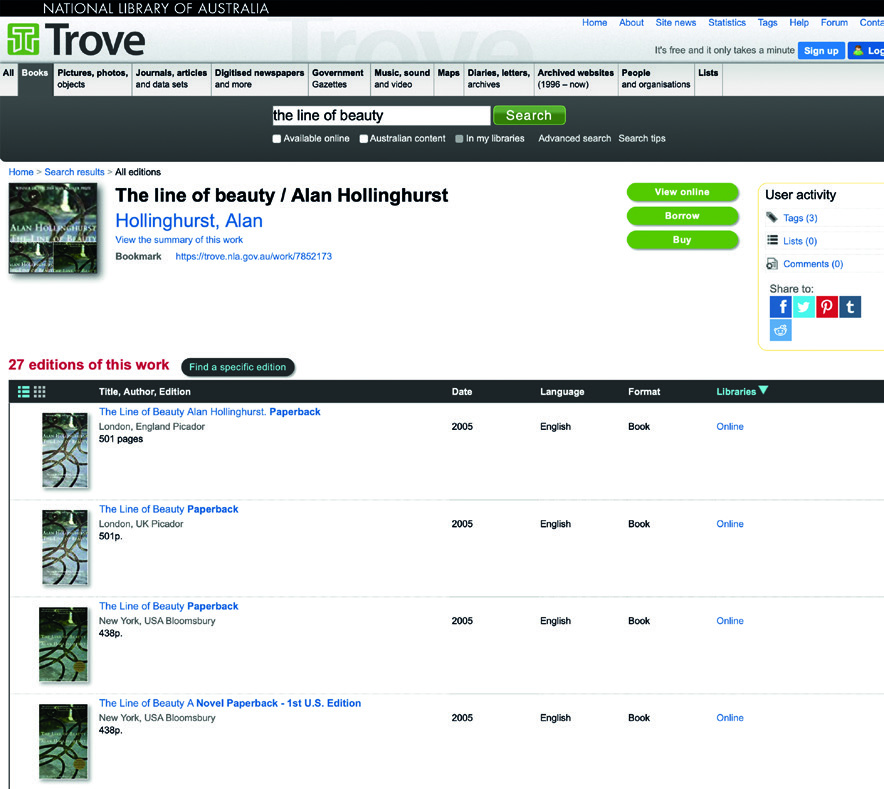

### I.2 Denmark

The Danish website bibliotek.dk (library.dk) offers a nationwide portal to all materials held in Danish public and research libraries.[^a5] Built and maintained by DBC (Danish Bibliographic Centre), bibliotek.dk allows any resident of Denmark to search the collective national holdings and request physical delivery to their local library branch free of charge.

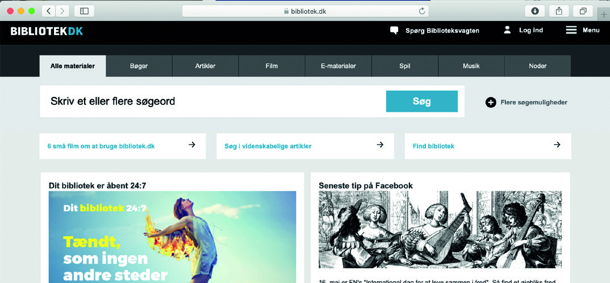

In addition to bibliotek.dk, Denmark developed *eReolen*, the national digital lending platform for public libraries, which provides unified access to e-books and audiobooks across the country.

### I.3 Finland

The National Library of Finland has developed an innovative discovery platform known as **Finna**. Finna integrates the collections and services of Finnish public libraries, university libraries, polytechnic libraries, museums and archives into a single national search service.

Finna creates a single national pathway to library materials, while keeping individual library organisations and collections autonomous and distinct. Local public library services can configure their own custom Finna views with tailored local branding, opening hours and library card management, while benefiting from shared national infrastructure and ongoing core funding from the Ministry of Education and Culture.

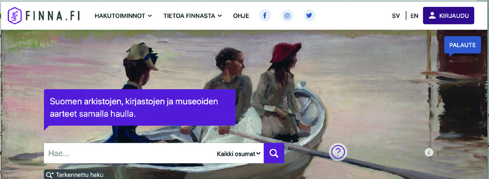

### I.4 France

The National Library of France (Bibliothèque nationale de France, BnF) operates **Gallica**, one of the oldest and largest national digital libraries in the world.

<!-- PAGE: 28 -->

The ‘Gallica collection’ forms the backbone of material available on the platform, however this is now supplemented by collections from partner organisations across France. This collection consists of digitised copies of BnF holdings, providing free access to selected titles from BnF’s collections spanning manuscripts, prints, maps, music scores, sound recordings and millions of digitized periodicals and books.

Most of the content is rights-free, however some items have required rights negotiation with commercial rights holders. In 2012, BnF launched ‘Gallica intra muros’, a version of the Gallica interface accessible within legal deposit library premises to consult in-copyright digitised works.

In contrast to other digital libraries, Gallica’s user-interface is polished and magazine-like, curating themed exhibits, blog posts and editorial highlights that contextualise historical treasures for the general public.

Gallica is a well-used platform, with over 15.8 million unique visits in 2017. In 2014, the BnF launched a commercial reproduction service, selling high-resolution prints and merchandise directly to users to generate revenue for ongoing preservation.

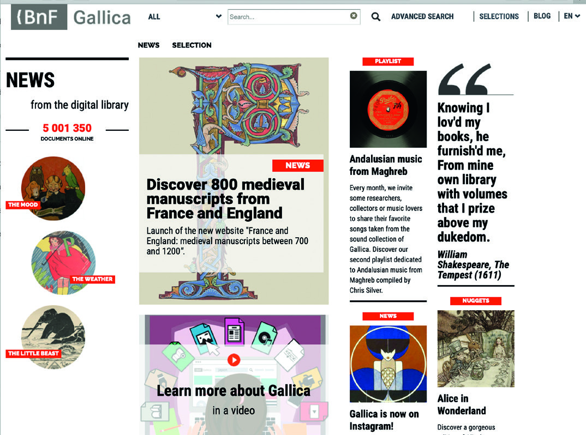

### I.5 Republic of Ireland

In May 2017, all public libraries in the Republic of Ireland completed migration to a shared national system called **Libraries Ireland**.[^a6] Developed under the *Opportunities for All* public library strategy, Libraries Ireland connects 333 branch libraries across 31 local authorities into a single unified service.

Libraries Ireland provides a single library membership card and PIN valid at every public library in the country, backed by a single national catalogue of over 15 million items. A patron in rural Donegal can request a book from a library in Cork or Dublin and have it delivered to their local branch within days via a nationwide van delivery network.

Libraries Ireland does not provide a central platform for e-lending or digital discovery; e-books, e-audiobooks and digital magazines continue to be provided via commercial aggregator apps (BorrowBox, RBdigital).

The task of developing Libraries Ireland fell to Libraries Development at the Local Government Management Agency (LGMA). Libraries Ireland opted to continue working solely with the private sector, procuring the cloud-based Sierra LMS from Innovative Interfaces Inc. (III) and partnering with DX delivery services for logistics.

The catalogue is accessible to users through the ‘Libraries Ireland’ web portal and mobile app, providing a seamless national interface while preserving local authority governance.

<!-- PAGE: 29 -->

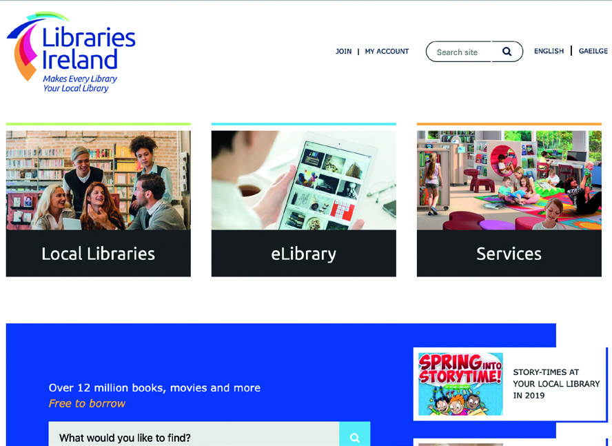

### I.6 Netherlands

In 2015 the Dutch parliament passed legislation that granted the National Library of the Netherlands (Koninklijke Bibliotheek, KB) sole responsibility for the purchasing and licensing of all digital content for Dutch public libraries.

Dutch library membership requires an annual subscription fee. Members can access the national digital library platform operated by the KB, which offers over 25,000 e-books and 4,000 audiobooks.

The KB receives a direct grant from the Ministry of Culture for the purchase of national digital licenses. Local libraries have no jurisdiction over what percentage of their total budget goes towards digital content; licensing is managed entirely centrally.

KB enjoys fairly positive relationships with Dutch publishers, in part because the Dutch market adopted a ‘one-copy-multiple-user’ download lending model on a multiple use license that somewhat replicates subscription streaming services.

The KB also runs and administers a national public library catalogue and portal (bibliotheek.nl), aggregating records across all Dutch public libraries.

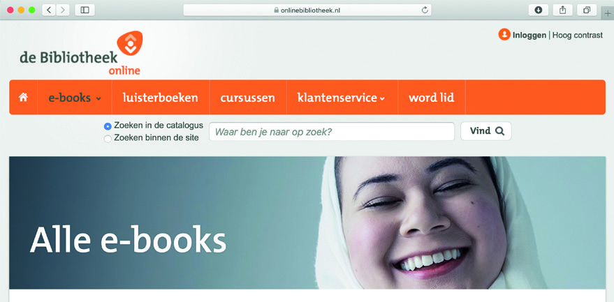

### I.7 USA

#### I.7.A Digital Innovation

Some of the most innovative digital services in public libraries have been pioneered in the United States. The New York Public Library (NYPL) has recently pioneered a number of digital reading initiatives, including *SimplyE*, an open-source e-reader app that integrates e-book collections from multiple vendors into a single patron interface, and the *#SubwayLibrary* project, which provided free e-books to subway commuters via Wi-Fi.[^a8]

However, it is not only large libraries with sizeable budgets who are innovating. Community libraries across the US have deployed mobile Wi-Fi hotspots, digital makerspaces, and community memory archiving platforms.

<!-- PAGE: 30 -->

#### I.7.B Digital Public Library of America (DPLA)

Launched in April 2013, the **Digital Public Library of America** (DPLA) acts as a national digital library platform, bringing together millions of digitized records from thousands of libraries, archives, museums and historical societies across the United States.

DPLA operates on an open metadata model, utilizing the Dublin Core and Europeana Data Model standards to harvest records from regional hubs.[^a10] In 2018, DPLA launched the DPLA Exchange, a non-profit e-book marketplace designed to give libraries greater control over digital acquisition terms.[^a11]

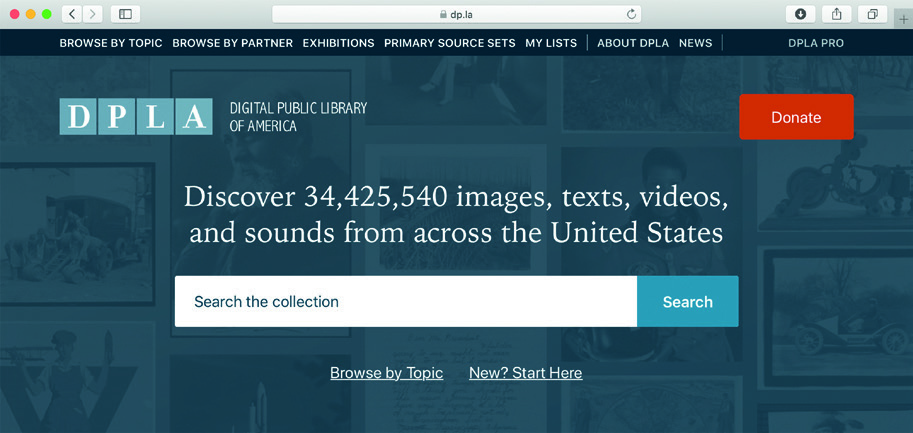

### I.8 The National Digital Library of India

Sponsored by the Ministry of Human Resource Development and developed by the Indian Institute of Technology Kharagpur, the **National Digital Library of India** (NDLI) is a virtual repository of learning resources. It integrates over 30 million educational items spanning textbooks, articles, audio lectures, video tutorials and question papers in over 300 Indian and international languages.[^a12]

NDLI is tailored specifically for students, lifelong learners and researchers across India, bridging geographical and socioeconomic divides by providing free, universal access to educational content through web and mobile apps.

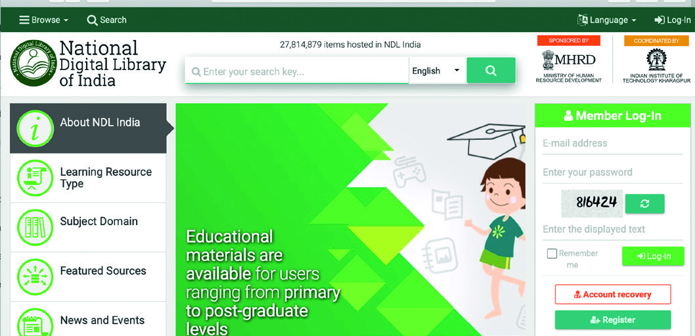

<!-- PAGE: 31 -->

## II Other Platforms and Services

### II.1 Google Books

The Google Books project emerged from Google founders Larry Page and Sergey Brin’s early vision for Google to operate as a single, integrated and universal digital library. Working in partnership with major research libraries (including Oxford, Harvard, Stanford and the University of Michigan), Google scanned tens of millions of volumes.[^a13]

While copyright litigation restricted full-text access to in-copyright works, Google Books transformed book search, allowing users to search full text and view snippets and preview pages.[^a14] Google Books remains one of the largest digital book discovery platforms in the world.

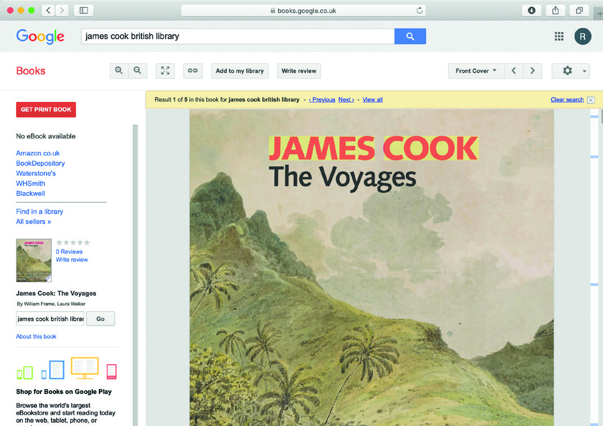

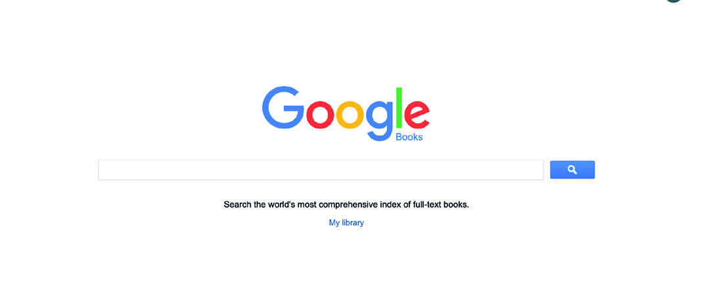

### II.2 Google Scholar

Launched in 2004, Google Scholar revolutionized academic discovery by indexing peer-reviewed journal papers, theses, books, preprints and court opinions across all disciplines.[^a15] Scholar provides simple citation tracking, author profiles and links to open-access versions of academic papers, demonstrating the power of simple, high-speed algorithmic search across scholarly literature.[^a16]

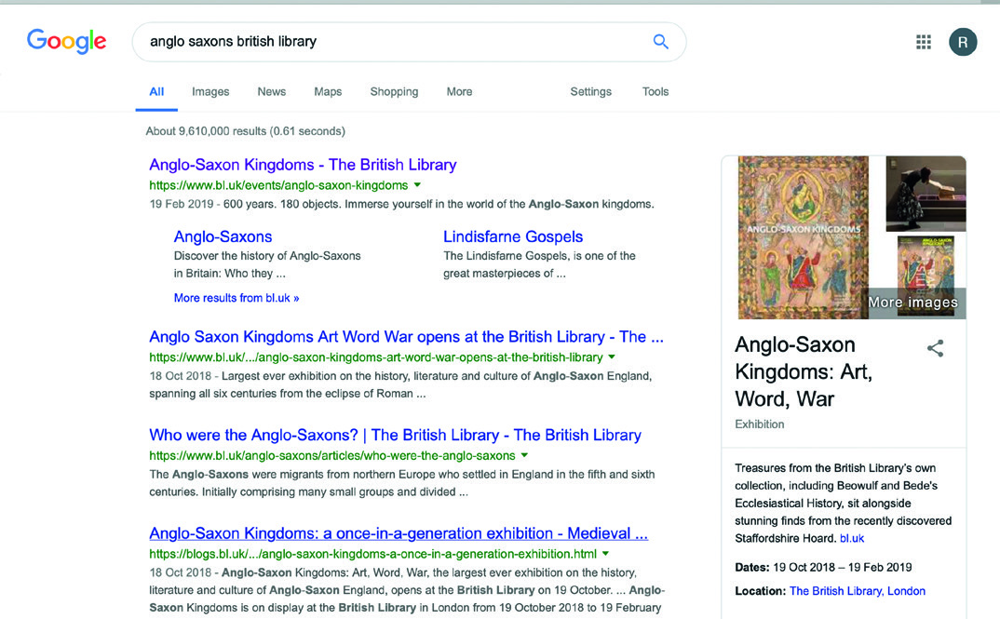

<!-- PAGE: 32 -->

### II.3 Faber Social

Founded by Faber & Faber, the UK’s largest independent publishing house, Faber Social puts books and music at the heart of independent publishing. The music-focussed arm publishes some of the greatest icons of pop music and culture; from Booker Prize winner DBC Pierre to Jarvis Cocker.[^a18]

Faber Social hosts live literary events, podcasts, curated playlists and digital salons, illustrating how a publisher can build a passionate, culturally engaged community around author conversations and contemporary creative culture.

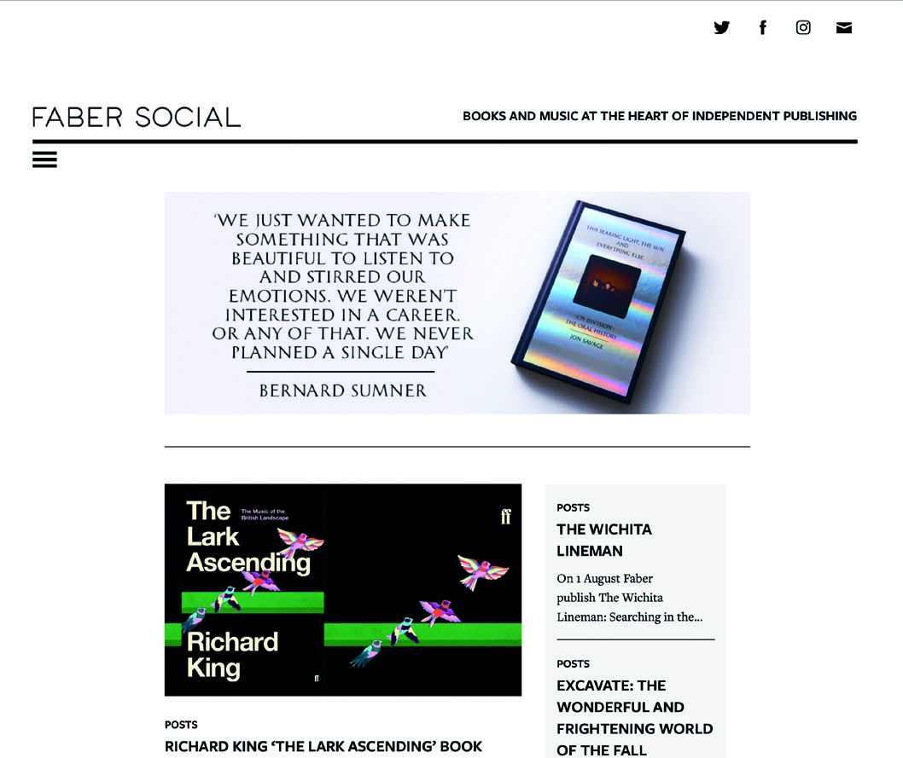

### II.4 HathiTrust

Formed in 2008, **HathiTrust** is a partnership of major academic and research libraries collaborating to preserve and provide access to digitized book and journal collections. HathiTrust hosts over 17 million digitized volumes, including works digitized by Google Books and the Internet Archive.[^a19]

HathiTrust provides specialized services for users with print disabilities and operates the HathiTrust Research Center (HTRC), which enables computational text analysis and data mining across millions of copyright-protected volumes under fair use provisions.

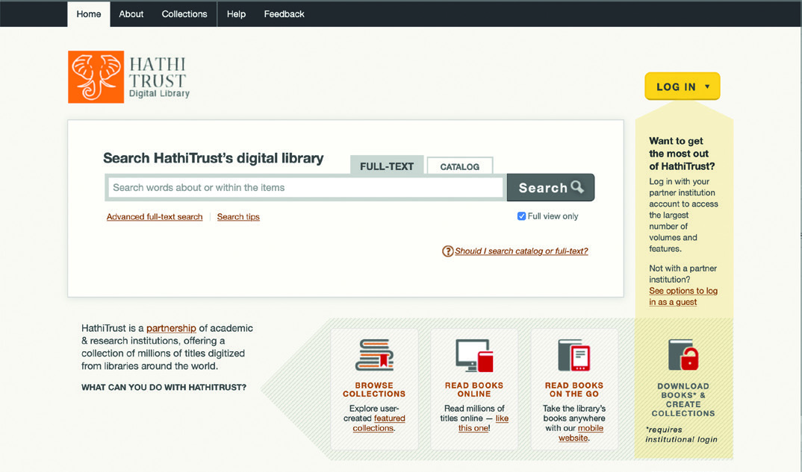

<!-- PAGE: 33 -->

### II.5 LibCrowds, British Library

LibCrowds is a crowdsourcing platform built by the British Library to create searchable catalogue records for some of the hundreds of thousands of items that can currently only be found in printed and card catalogues. The aim is to help researchers everywhere more easily access and improve the discoverability of the diverse collections held at the British Library.[^a20]

An example of LibCrowds in action is *In the Spotlight*. The British Library holds a significant collection of playbills dating from the 1730s to the 1950s, and In the Spotlight aims to make the digitised playbills more readily available by improving discoverability, allowing users to see past entertainment. Independent researchers and general visitors are invited to help transcribe titles, names and locations to make the playbills easier to find for the broader library community.

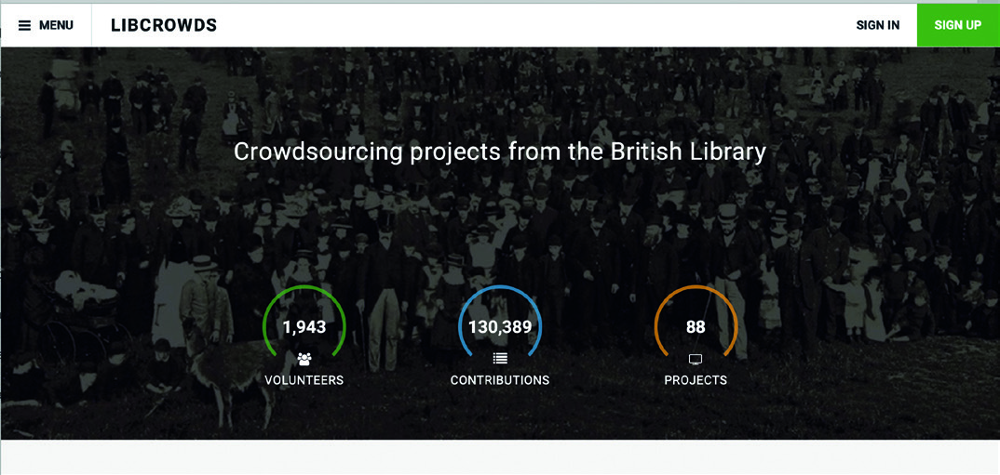

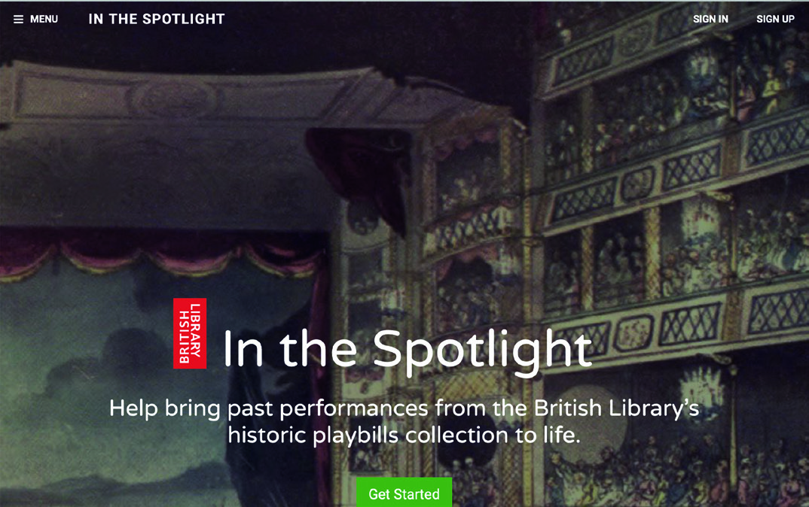

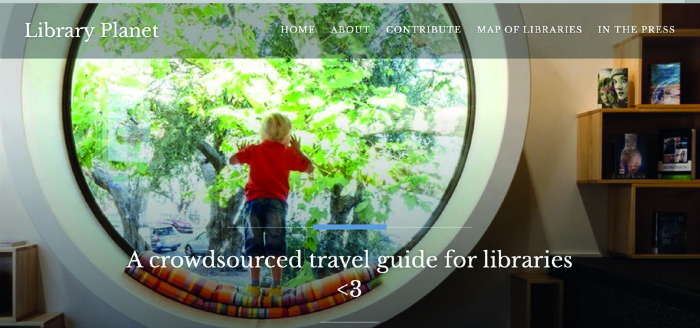

### II.6 Library Planet

Founded in December 2018 by Christian Lauersen of Roskilde Libraries and Marie Engberg Eiriksson of Gladsaxe Libraries, Denmark, Library Planet is a crowdsourced travel guide/blog for libraries around the world.[^a21] Travellers are encouraged to write about their library experiences and include information on what makes a particular library special or enjoyable to visit. Emphasis is placed on the individual’s first impressions of the place, and whether the library has any special collections or unique services. There is also a Google Maps extension embedded in the website, which allows users to pinpoint libraries around the world which they may like to visit.

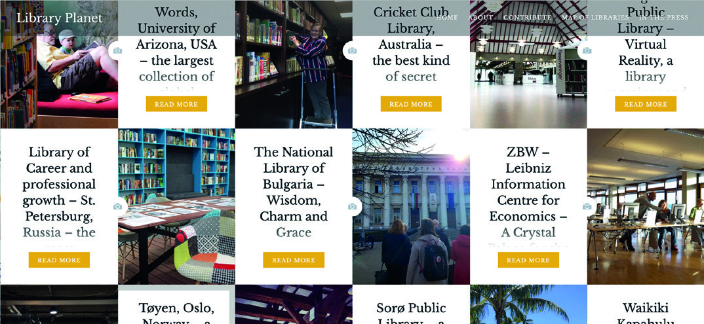

### II.7 Literary Hub

Created by Grove Atlantic and Electric Literature in 2015, Literary Hub (or Lit Hub) provides a single, trusted, daily source for all the news, ideas and richness of contemporary literary life.[^a22] The organisation boasts over 100 editorial partners who help to ensure that site readers can rely on smart, engaged and entertaining writing about all things books. Alongside daily original content, Lit Hub also showcases editorial features from its partners from across the literary spectrum. The website has been featured in *The Guardian*[^a23] and *The Washington Post*.[^a24]

In June 2016 Lit Hub launched a book review aggregation service called Bookmarks. The service aggregates reviews from numerous sources from professional critics, including newspapers, magazines and websites, before averaging them into a letter grade.[^a25]

<!-- PAGE: 34 -->

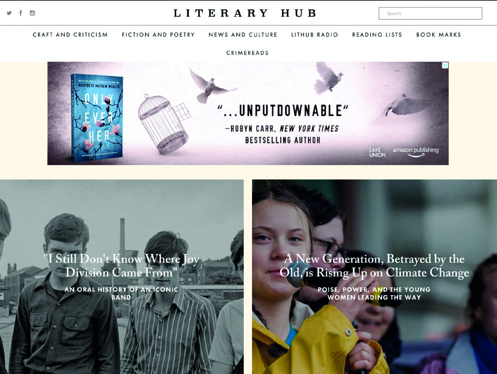

### II.8 Virtual Enquiry Service

Following a successful pilot between May 2013 to July 2014, SCONUL negotiated an agreement with OCLC which enabled libraries to access a Virtual Enquiry Service. The service covers periods when local library staff are not available to answer queries and allows members to offer their users access to support 24 hours a day, 365 days a year, with librarians in other time zones helping students with questions. Participating libraries also have access to both local and global knowledge, as each member contributes to the reference knowledge base that is cooperatively built. If users have a web browser, they have access. There are no client-side downloads or additional applications required.

## III Resources and Usage

### III.1 Resources in UK Public Libraries

According to the annual CIPFA statistics on public library use, net expenditure in public libraries has fallen by 20.2% since 2012, representing a cut of almost £160 million to the overall sector over the last six years. In addition, the sector has seen a 32% reduction in professional staff over the same period. This has coincided with a 42% increase of volunteers working in public libraries.

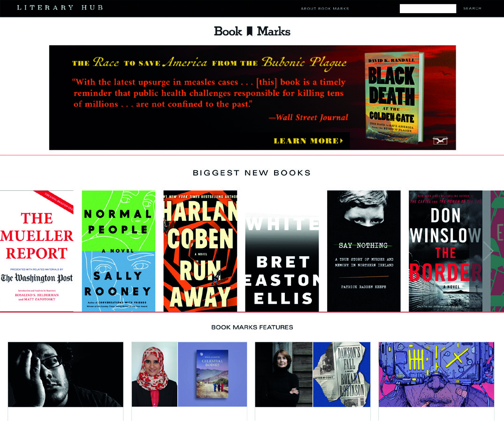

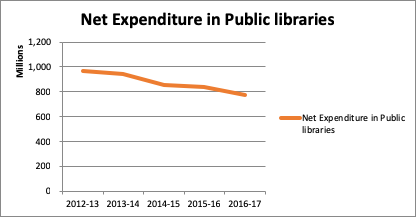

### III.2 United Kingdom Public Library Use

Usage of public libraries has declined over the last 6 years, these figures are part of a more complex set of causative factors than the resource reductions triggered by austerity measures. Since 2012 there has been a 26.7% decrease in physical borrowing with a 16.6% reduction in audio visual material (including digital loans). Visits to library premises have also reduced by 18.2%, with libraries seeing 55 million fewer visits in 2017 compared to 2012. As DCMS’ Taking Part Survey confirms, the majority of the UK population are now non-library users. It is important to stress here however that while numbers are decreasing quite dramatically, visits to public libraries still stood at over 250 million in 2016–17. By comparison, this is almost eight times the total number of spectators at professional football matches in England and Scotland over the same period.[^a26] <!-- PAGE: 35 --> The most striking trend in the Taking Part figures is that taken by age group, the largest decrease in attendance has come from those aged 16-25. Since 2005/6, the number of young people who have attended the library at least once a year has halved, with only 29% of respondents visiting in 2017/18.

Taking Part has also included more specific research on the use of resources, finding that 48% of visitors to libraries do not borrow books, but use the space for study, computing, Wi-Fi or community activities.

### III.3 UK Library Use: A More Positive Picture

Public libraries are still a valued and trusted institution. According to Ipsos MORI’s 2018 Veracity Index, librarians are among the most trusted professionals in Britain, with 89% of the public trusting them to tell the truth.

In addition, public libraries already reach a much more culturally and economically diverse cross-section of society than museums, galleries or heritage sites. Public libraries reach lower socioeconomic groups at higher rates than other publicly funded arts institutions.

### III.4 Library-use in a global context

The International Federation of Library Associations (IFLA) collates data on public libraries worldwide. Taking figures collected between 2014-2016, IFLA estimates that there are around 414,000 public libraries globally, serving more than 1.4 billion people, with over 1.3 billion registered loans each year.

The USA continues to boast the largest and most active public library system in the Western world, with over 1.3 billion visits and 2.1 billion physical loans annually.

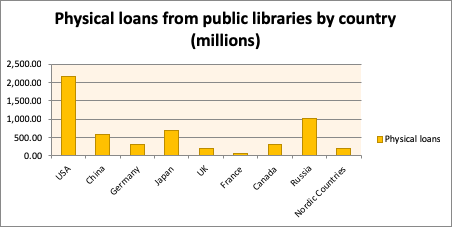

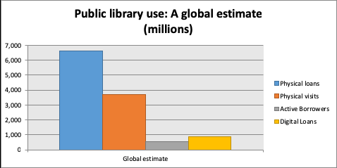

Chinese public libraries however issue more digital loans, with a world-leading 873 million digital issues.

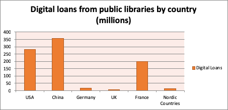

French public libraries issue the highest number of digital loans as a proportion of total loans in Europe. <!-- PAGE: 36 --> Republic of China is the only country surveyed here to have lower book issues (all formats) than physical visits.

Russia and Japan also contribute considerably to the global community of public library users. Russian public libraries issued over 1 billion physical loans in 2016 and welcomed 1.2 billion visits.

Comparing UK public libraries to those closest in total population size (France, Italy, Germany), the UK maintains higher levels of both visits and physical book issues per capita than Italy or Germany.

### III.5 Bodies Consulted

#### Key stakeholders
- CILIP
- Libraries Connected
- Libraries NI
- Library and Information Society (LIS)
- Local Government Association (LGA)
- Scottish Library and Information Council (SLIC)
- Welsh Government (MALD)

#### LMS Providers (via BIC)[^a27]
- Bibliotheca
- Capita
- Infor
- Insight Media Internet
- OCLC
- SirsiDynix
- Solus

#### Scotland
- Association of Public Libraries in Scotland
- BBC Scotland
- National Library of Scotland
- Scottish Government

#### Wales
- National Library of Wales
- Newtown Library
- Welsh Government

## IV Public Library Legislation & Policy in the UK

### IV.1 England

Public libraries in England are the responsibility of local authorities (unitary authorities, metropolitan boroughs, London boroughs, and county councils). Under the Public Libraries and Museums Act 1964, local library authorities have a statutory duty to provide a “comprehensive and efficient library service for all persons desiring to make use thereof”.[^a28]

The Act specifies:

> “that (a) facilities are available for the borrowing of, or reference to, books and other printed matter, and pictures, gramophone records, films and other materials, sufficient in number, range and quality to meet the general requirements and any special requirements both of adults and children; and (b) that encouragement is given to both adults and children to make full use of the library service.”[^a29]

The Secretary of State for Digital, Culture, Media and Sport holds responsibility for superintending library services in England, with powers to:

> “Inspect library premises or require public library authorities to provide information in regard to his duty of superintendence.”

Unlike Wales (see below), there are no set statutory standards for supervisory intervention in England. Public library budgets are allocated directly by local authorities from their general revenue funding. Strategic leadership for public libraries in England is split between DCMS, Arts Council England (as the national development agency), and Libraries Connected.

<!-- PAGE: 37 -->

### IV.2 Scotland

Public libraries in Scotland are entirely the responsibility of local authorities. They have a statutory duty to “secure the provision of adequate library facilities for all persons resident in their area”, under the Local Government (Scotland) Act 1994.[^a30]

Unlike England and Wales, public libraries in Scotland are funded via block grant to Scottish local authorities from the Scottish Government. Strategic direction is provided by the Scottish Library and Information Council (SLIC), an independent advisory body funded by the Scottish Government and member subscriptions.

In 2015, Scotland published the UK’s first national public library strategy, *Ambition & Opportunity: A Strategy for Public Libraries in Scotland 2015–2020*, which set out six strategic aims including digital inclusion, reading and literacy, and community wellbeing.

The Scottish Government also invests directly in public libraries through the Public Library Improvement Fund (PLIF), administered by SLIC, which awards competitive grants for innovative library projects across Scotland.

### IV.3 Wales

Public libraries in Wales are funded by and accountable to local authorities. Library policy and oversight sit with the Welsh Government through its Culture, Sport and Tourism department, specifically the Museums, Archives and Libraries Division (MALD).

Wales is unique in the UK in operating statutory Welsh Public Library Standards (WPLS). Under the 1964 Act, the Welsh Government assesses every local authority annually against a framework of Core Entitlements and Quality Indicators, publishing an annual report detailing performance.

The Welsh Government also funds strategic development through the *Libraries Inspire* strategy and provides capital support via the Cultural Capital Scheme.

### IV.4 Northern Ireland

Public libraries in Northern Ireland are administered under a unique single-authority model. Following the Libraries Act (Northern Ireland) 2008, the Northern Ireland Library Authority – operating as **Libraries NI** – was established as a regional non-departmental public body.

The 2008 Act stipulates that the Authority must “provide a comprehensive and efficient public library service for persons living, working or studying in Northern Ireland”.

Libraries NI operates all 96 branch libraries, heritage libraries and mobile libraries across Northern Ireland, managed under a single Chief Executive and Board accountable to the Department for Communities (DfC). This unified structure has enabled Northern Ireland to implement a single regional LMS, unified digital subscriptions, single library card and centralized procurement across the entire province.

<!-- PAGE: 38 -->

## V Further Reading

- House of Commons Library, *Briefing Paper: Public Libraries* (2016).
- CILIP, *Public Library Legislation in the UK* (2014).
- SLIC, *The National Strategy for Public Libraries in Scotland 2015–2020* (2015).
- Welsh Government, *Guidance on Community Managed Libraries and the Statutory Provision of Public Library Services in Wales* (2015).
- Libraries NI, *Annual Report and Accounts 2017/18* (2018).

### Legislation

- Public Libraries and Museums Act 1964 (c. 75)
- Local Government (Scotland) Act 1994 (c. 39)
- Libraries Act (Northern Ireland) 2008 (c. 8)
- Digital Economy Act 2017 (c. 30)

---

### Report Credits

Report compiled by:
- **Edmund Connolly**, Programme Manager, British Library
- **Jacob Fredrickson**, Research Officer, British Library
- **Jake Millar**, Project Officer, British Library
- **Liz White**, Head of Strategy Development, British Library

Published by the British Library on behalf of Arts Council England and Carnegie UK Trust, June 2019.

<!-- PAGE: 39 -->

---

## Notes

[^1]: Bibliocommons, *Essential Digital Infrastructure for Public Libraries in England* (2015).
[^2]: British Library, ‘British Library to Investigate possibility of a “single digital presence” for UK Public Libraries’, press release, August 2017.
[^3]: British Library, *Living Knowledge: The British Library 2015–2023* (London: British Library, 2015).
[^4]: American Association of Research Libraries, *Strategic Thinking and Design Initiative: Extended and Updated Report* (Washington DC: ARL, 2016), p. 21.
[^5]: Annabelle Gawer, ‘Bridging Differing Perspectives on Technological Platforms: Toward an integrative framework’, *Research Policy*, 43:7 (2014), p. 1241.
[^6]: Department for Culture, Media & Sport, *Independent Library Report for England* (London: DCMS, 2014).
[^7]: Bibliocommons, *Essential Digital Infrastructure for Public Libraries in England* (2015).
[^8]: Single Library Digital Presence Steering Group, Department for Digital, Culture, Media & Sport, 2016.
[^9]: Carnegie UK Trust, *Building a “single digital presence” for Public Libraries: Forging the Digital Future* (Dunfermline: Carnegie UK Trust, 2017).
[^10]: Carnegie UK Trust, *#Notwithoutme: A digital world for all? Findings from a programme of digital inclusion for vulnerable young people across the UK* (Dunfermline: Carnegie UK Trust, 2017).
[^11]: Lorensbergs, *Netloan Public Library Customer Survey Results* (2018).
[^12]: Libraries Taskforce, *Libraries Deliver: Ambition for Public Libraries in England 2016 to 2021* (London: DCMS, 2016).
[^13]: American Association of Research Libraries, *Strategic Thinking and Design Initiative*, p. 21.
[^14]: Jenny Peachey & Carnegie UK Trust, *Shining a Light: The Public’s View on Libraries in the UK and Ireland* (Dunfermline: Carnegie UK Trust, 2016).
[^15]: Department for Digital, Culture, Media & Sport, *Taking Part Survey: England, Adult Report 2017/18* (London: DCMS, 2018).
[^16]: IFLA, *Library Map of the World* (The Hague: IFLA, 2018).
[^17]: Hellen Niegaard, ‘Library Space and Digital Challenges’, *Library Trends*, 60:1 (2011), pp. 174–189.
[^21]: Deloitte Insights, *Digital Media Trends Survey: A New World of Choice* (London: Deloitte, 2018).
[^22]: Ibid.
[^23]: BBC, *BBC iPlayer grows 11% as 2017 becomes best year ever*, press release, 2018.
[^24]: Dan Taylor-Watt, ‘Putting BBC iPlayer performance in context’, BBC Internet Blog, 2018.
[^25]: Deloitte Insights, *Digital Media Trends Survey* (2018).
[^26]: PwC, *Global Consumer Insights Survey 2018* (London: PwC, 2018).
[^27]: ‘Digital transformation trends to watch in 2019 and beyond’, tech industry trends analysis, 2019.
[^28]: Future Today Institute, *2018 Tech Trends Report* (2018), pp. 8–11.
[^29]: Ibid.
[^30]: British Library Single Digital Presence project user research workshops, 2018.
[^31]: Living Knowledge Network consultation sessions, 2018.
[^32]: Publishing stakeholder roundtables: Bloomsbury, Scholastic, Hachette UK, Egmont, Penguin Random House, HarperCollins, Pan Macmillan, 2018.
[^33]: Booksellers Association, *Find Your Local Bookshop* initiative and bookseller research, 2018.
[^34]: Booksellers Association / Publishers Association research on retail discovery, 2018.
[^35]: Society of Chief Librarians & Publishers Association, *The Reading Journey: Libraries and Book Discovery* (2017).
[^36]: Department of the Premier and Cabinet, South Australia, *One Card Library Network* (2015).
[^37]: Consultation with National Library of Wales and Local Government Management Agency (Ireland), 2018.
[^38]: National Library of Australia, *Trove Homepage* (2019).
[^39]: David Crystal, *Evolving English: One Language, Many Voices* (London: British Library, 2010).
[^40]: British Library, *Annual Report and Accounts 2017/18* (London: British Library, 2018).
[^41]: University of Cambridge, *A Brief History of Open Access*, Office of Scholarly Communication, 2018.
[^42]: Lisbeth Worsøe-Schmidt, ‘The E-Book War in Denmark’, *Journal of Librarianship and Information Science*, 49:3 (2017), pp. 254–264.
[^43]: Ibid.
[^44]: The Publishers Association, *PA Publishing Yearbook 2017* (London: Publishers Association, 2018).
[^45]: We Are Social & Hootsuite, *Digital Report: 2018* (2018).
[^46]: Subnum Harriff & Jennifer Rowley, ‘Branding of UK Public Libraries: An exploratory study’, *New Library World*, 112:7/8 (2011), pp. 346–360.
[^a1]: Government of South Australia, *One Card Library Network Evaluation* (Adelaide, 2015).
[^a2]: SDP Project consultation with Jane Cowell, Chief Executive, Yarra Public Libraries, 2018.
[^a3]: SDP Project consultation with Neil Wishart, Chief Executive, Solus, 2018.
[^a4]: Marie-Louise Ayres, ‘Singing for their supper: Trove, Australian digital resources and crowdsourcing’, IFLA World Library and Information Congress (Singapore, 2013).
[^a5]: Danmarks Statistik, *Biblioteker* (Copenhagen: Danmarks Statistik, 2018).
[^a6]: SDP Project consultation with Eva McEneaney, Local Government Management Agency (LGMA), Ireland, 2018.
[^a8]: New York Public Library, ‘Announcing #SubwayLibrary: Free E-Books for Your Commute’, NYPL News (New York, 2017).
[^a10]: Dublin Core Metadata Initiative (DCMI), Dublin Core metadata standards (2019).
[^a11]: Institute of Museum and Library Services (IMLS), ‘New IMLS Funding Supports Digital Public Library of America National E-Book Project’ (Washington DC: IMLS, 2018).
[^a12]: National Digital Library of India (NDLI), Ministry of Human Resource Development & IIT Kharagpur (2019).
[^a13]: Steven Levy, ‘Making the world’s problem solvers 10% more effective: The Story of Google Books’, Backchannel (2015).
[^a14]: K. Bauer & N. Bakkalbasi, ‘An Examination of Citation Counts in a New Scholarly Communication Environment’, *D-Lib Magazine*, 11:9 (2005).
[^a15]: Anurag Acharya, ‘The Gentleman Who Made Scholar’, Backchannel (2014).
[^a16]: Jim Giles, ‘Start your engines’, *Nature*, 438 (2005), pp. 554–555.
[^a18]: Faber Social, Faber & Faber (London, 2019).
[^a19]: HathiTrust Digital Library, Annual Reports and Statistics (Ann Arbor: HathiTrust, 2019).
[^a20]: LibCrowds, British Library Crowdsourcing Platform (London: British Library, 2019).
[^a21]: Christian Lauersen & Marie Engberg Eiriksson, *Library Planet: A crowdsourced travel guide for libraries* (2018).
[^a22]: Literary Hub, Grove Atlantic & Electric Literature (New York, 2019).
[^a23]: Martha Bausells, ‘Literary Hub aims to be go-to website for literary culture’, *The Guardian*, 8 April 2015.
[^a24]: Ron Charles, ‘Literary Hub wants to bring together everything literary on the internet’, *The Washington Post*, 17 March 2015.
[^a25]: Bookmarks, Literary Hub book review aggregation service (2019).
[^a26]: Calculated by comparing CIPFA Public Library Statistics 2016-17 total visits (>250m) with cumulative professional football match attendance in England and Scotland (~31.8m); European Leagues, *Fan Attendance Report* (2018).
[^a27]: Book Industry Communication (BIC) Library Metadata and Technical Standards Committee, 2018.
[^a28]: UK Parliament, Public Libraries and Museums Act 1964 (c. 75), Section 7.
[^a29]: Ibid.
[^a30]: UK Parliament, Local Government (Scotland) Act 1994 (c. 39), Section 163.

