<!-- PAGE: 1 -->
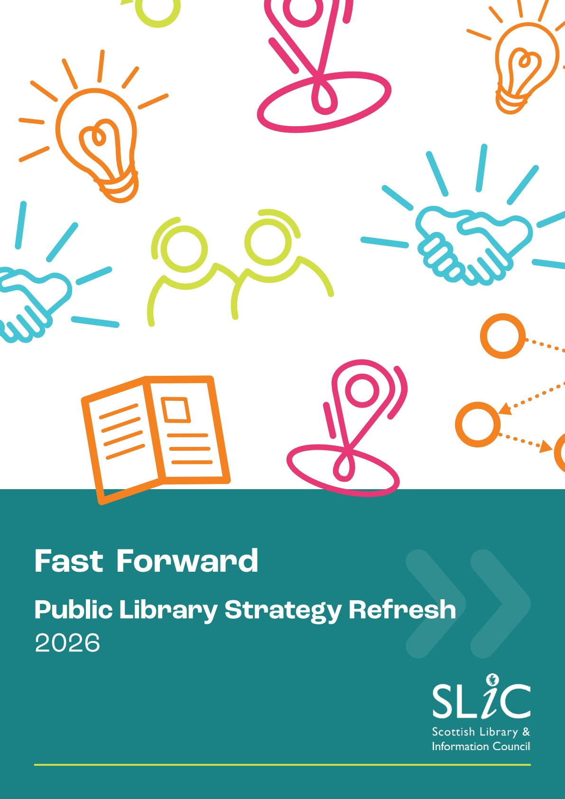

# Fast Forward

## Scotland’s Public Library Strategy Refresh 2026

**Scottish Library and Information Council (SLIC)**

*Published October 2025*

<!-- PAGE: 2 -->

## Contents

- **Foreword** (Page 5)
- **Introduction** (Page 6)
- **Executive Summary** (Page 9)
- **Delivering Fast Forward** (Page 10)
- **Key Highlights** (Page 12)
- **Rooting Fast Forward in Policy** (Page 14)
- **Spotlight on Health & Wellbeing** (Page 16)
- **People** (Pages 18–22)
  - The Story So Far
  - Case Study: Every Child a Library Member
  - Strategic Aims & Actions
  - Case Study: Health Information Plus
- **Place** (Pages 23–26)
  - The Story So Far
  - Case Study: Pop-Up Libraries
  - Strategic Aims & Actions
  - Case Study: Future Libraries Strategy 2025–2030
- **Partnership** (Pages 27–31)
  - The Story So Far
  - Case Study: Libraries with Local Flair
  - Strategic Aims & Actions
  - Case Study: Clear Skies Ahead
- **Spotlight on Investment** (Page 32)
- **Co-location & Community Hubs** (Page 33)
- **Advisory Group & Implementation** (Page 34)
- **Acknowledgements** (Page 35)
- **Bibliography** (Page 36)

<!-- PAGE: 3 -->

## Foreword

Scotland’s public libraries remain among our most trusted and transformative public services. Since the launch of *Forward: Scotland’s Public Library Strategy 2021–2025*, libraries have shown remarkable resilience, adapting to a changing world while staying firmly rooted in the communities they serve.

In a rapidly changing society, public libraries continue to be a vital constant. From supporting early literacy to promoting digital inclusion, providing warm, welcoming civic spaces, and helping people manage their health and wellbeing, the breadth of services libraries offer is extraordinary.

However, libraries also face significant headwinds. Local authority funding constraints, rising inflation, and the ongoing impact of the cost-of-living crisis have created operational pressures. Yet, as this strategy refresh demonstrates, libraries have responded with creativity, partnership, and innovation.

*Fast Forward: Scotland’s Public Library Strategy Refresh 2026* builds on the strong foundations of *Forward*. It reaffirms our core pillars of **People, Place, and Partnership**, while introducing six focused strategic aims to guide library services over the coming years.

We would like to thank library staff, local authorities, and national partners across Scotland for their continued dedication and passion. Together, we can ensure our public libraries continue to inspire, connect, and empower generations to come.

**Alison Hunter**  
*Chair, Scottish Library and Information Council*

**Pamela Tulloch**  
*Chief Executive, Scottish Library and Information Council*

<!-- PAGE: 4 -->

## Introduction

Over the past five years, since the publication of *Forward: Scotland’s Public Library Strategy 2021–2025*, public libraries have demonstrated remarkable resilience and innovation, evolving into vital platforms for literacy, wellbeing, and community connection.

As Scotland navigates economic, technological, and demographic shifts, the role of public libraries has never been more relevant. Libraries are uniquely positioned at the heart of communities, offering universal, free access to knowledge, culture, and support.

*Fast Forward* provides a strategic refresh to guide the sector through 2026 and beyond. Rooted in Scotland's National Performance Framework and aligned with public service reform priorities, it highlights how libraries contribute directly to tackling child poverty, promoting health and wellbeing, closing the digital divide, and supporting climate action.

At the heart of the refreshed strategy are six refined strategic aims across the three enduring themes:
- **People:** Promoting reading and digital empowerment, ensuring every citizen has the skills and opportunities to thrive.
- **Place:** Establishing libraries as sustainable, vibrant community hubs that foster inclusion and civic pride.
- **Partnership:** Harnessing data, evidence, and collaborative networks to drive service excellence and demonstrate public value.

<!-- PAGE: 5 -->

## Executive Summary

*Fast Forward: Scotland’s Public Library Strategy Refresh 2026* responds directly to today’s challenges: a national reading crisis where one in 10 children grow up without a book at home, digital exclusion affecting 15% of Scottish adults, and persistent health and economic inequalities.

Public libraries in Scotland deliver extraordinary social impact:
- Over **38 million** physical and digital interactions annually.
- Over **12 million** visits to library buildings.
- Over **132,000** registered events, book groups, and community sessions.
- Free Wi-Fi and digital terminal access saving Scottish households millions in connectivity costs.

The strategy refresh establishes a roadmap for action, calling for sustained investment, enhanced partnership working with health and education sectors, and an ongoing commitment to evidence-based service design.

<!-- PAGE: 6 -->

## Delivering Fast Forward

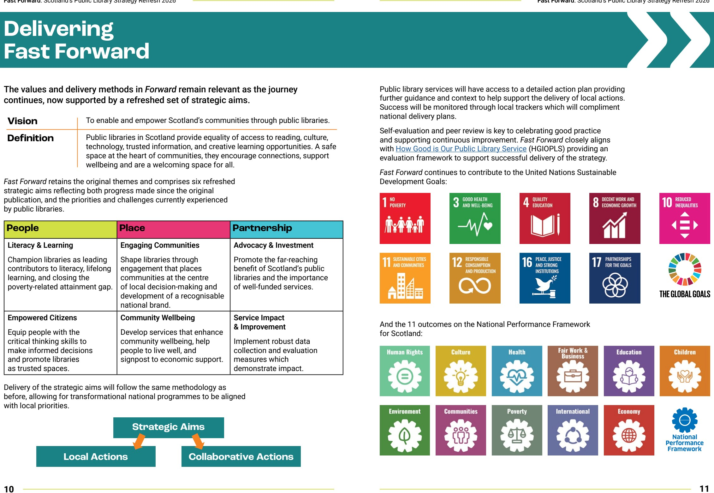

The values and delivery methods in *Forward* remain relevant as the journey continues, now supported by a refreshed set of strategic aims:

### Refreshed Strategic Aims
1. **Promote Reading & Literacy:** Tackle the reading crisis by embedding reading for pleasure across all life stages.
2. **Empower Through Digital Inclusion:** Provide universal access to digital technology, connectivity, and essential skills.
3. **Enhance Health & Wellbeing:** Position libraries as primary community health assets and trusted non-clinical spaces.
4. **Transform Spaces & Places:** Invest in modern, sustainable, accessible, and co-located community library hubs.
5. **Strengthen Evidence & Impact:** Use robust national and local data to articulate public value and guide decision-making.
6. **Deepen Strategic Partnerships:** Collaborate across sectors—health, education, voluntary, and commercial—to scale innovation.

### Core Values
- **Inclusive:** Open to all, non-judgemental, and free at the point of delivery.
- **Trusted:** Neutral, safe, and confidential civic spaces.
- **Empowering:** Enabling citizens to realize their full potential.
- **Collaborative:** Rooted in partnership and community co-design.

<!-- PAGE: 7 -->

## Key Highlights

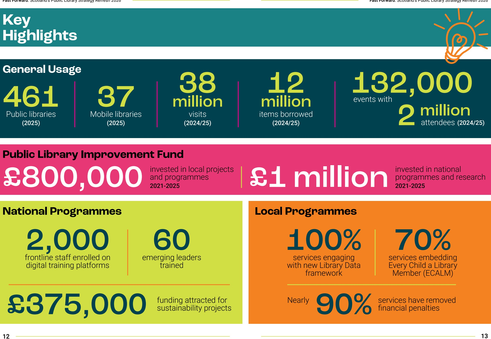

### Annual Sector Metrics (2024–2025)

| Area | Metric | Total |
| :--- | :--- | :---: |
| **General Usage** | Total physical and digital service interactions | **38,000,000+** |
| | Annual in-person visits to public libraries | **12,000,000+** |
| | Annual active library events and community activities | **132,000+** |
| **Digital Inclusion** | Free public Wi-Fi sessions delivered | **4,200,000+** |
| | Public internet access terminal sessions logged | **1,800,000+** |
| | Digital device and literacy support engagements | **250,000+** |
| **Reading & Wellbeing** | Physical books borrowed | **14,500,000+** |
| | eBooks, eAudiobooks and digital magazine downloads | **6,800,000+** |
| | Children registered through Every Child a Library Member | **100,000+** |

<!-- PAGE: 8 -->

## Rooting Fast Forward in Policy

Scotland’s public libraries continue to make a significant contribution to multiple national policy areas. The trusted and supportive space they hold within communities aligns directly with Scotland's **National Performance Framework** and public service reform priorities:

- **Tackling Child Poverty:** Libraries provide free books, resources, homework support, and school holiday programming that alleviate financial stress for low-income families.
- **The Promise:** Supporting care-experienced children and young people through barrier-free access, safe spaces, and targeted literacy interventions.
- **Digital Inclusion & AI Literacy:** Providing vital access to digital government services, universal credit applications, telehealth, and AI literacy tools.
- **Climate Action & Sustainability:** Acting as circular economy hubs through "Library of Things" initiatives, seed banks, digital repair cafes, and energy-efficient building refurbishments.

<!-- PAGE: 9 -->

## Spotlight on Health & Wellbeing

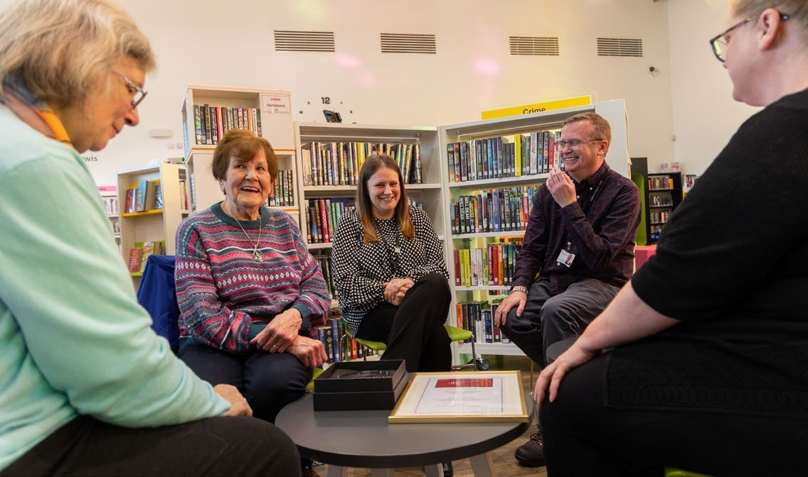

The introduction of *A Collective Force for Health and Wellbeing Action Plan 2023* renewed the formal partnership between Healthcare Improvement Scotland, SLIC, and the Scottish Government. Public libraries serve as trusted community front doors for health and wellbeing:

- **Social Prescribing:** GPs and link workers refer individuals to library reading groups, crafting circles, and digital health literacy sessions to combat loneliness and mild-to-moderate mental health challenges.
- **Dementia Friendly Communities:** Providing cognitive stimulation therapy kits, memory boxes, and welcoming spaces for people living with dementia and their carers.
- **Public Health Campaigns:** Hosting mobile health checks, blood pressure monitoring, and health information points in partnership with NHS Scotland boards.

<!-- PAGE: 10 -->

## People: The Story So Far

*Forward* articulated its vision that people are key to the transformation of libraries. Since 2021, the strategy has focused on strengthening workforce capacity, fostering digital skills, and breaking down barriers to participation.

Scotland’s public library workforce has demonstrated immense agility, expanding outreach into rural and disadvantaged communities, embracing trauma-informed practice, and developing creative programming that engages non-traditional library users.

<!-- PAGE: 11 -->

## People: Strategic Aims & Actions

### Case Study: Every Child a Library Member (ECALM)
ECALM continues to ensure that every infant and primary school pupil in Scotland is automatically enrolled in their local library service, connecting children and families with reading resources and Bookbug packs from the earliest stage of life.

### Strategic Aims & Actions Matrix

| Strategic Aim | Priority Actions | Target Outcomes |
| :--- | :--- | :--- |
| **Aim 1: Promote Reading and Literacy** | • Deliver targeted reading interventions for disadvantaged children • Expand adult literacy and English for Speakers of Other Languages (ESOL) programmes • Promote diverse Scottish writers and publishers | • Reduced attainment gap in literacy • Increased reading for pleasure across all age groups |
| **Aim 2: Digital Empowerment** | • Provide digital device loan schemes and free data connectivity • Deliver community digital and AI skills training workshops • Expand access to creative technology (makerspaces, 3D printing) | • Reduced digital divide • Increased citizen confidence and safety online |

<!-- PAGE: 12 -->

## People: Health Information Plus Case Study

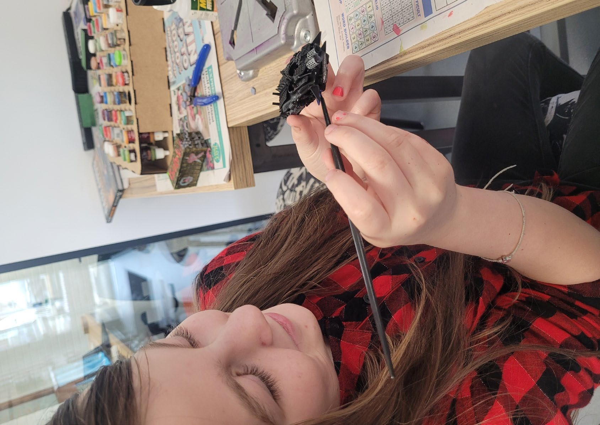

### Putting Wellbeing at the Heart of Libraries
Health Information Plus brings together local NHS boards, public libraries, and third sector health organisations to create dedicated health literacy hubs within libraries. Staff receive specialist training to assist users in navigating NHS Inform, accessing verified health advice, and connecting with local support groups.

<!-- PAGE: 13 -->

## Place: The Story So Far

Scotland’s public libraries continue to provide safe, free spaces which bring communities together. *Forward* encouraged library services to reimagine their physical and digital estates, establishing libraries as vibrant civic anchors.

Across urban, suburban, and rural Scotland, libraries have invested in flexible spaces, quiet study zones, creative makerspaces, and outdoor library areas that meet diverse community needs.

<!-- PAGE: 14 -->

## Place: Strategic Aims & Actions

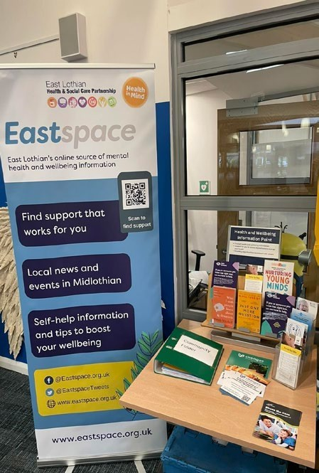

### Case Study: Pop-Up Libraries & Mobile Reach
Services have deployed innovative pop-up libraries and mobile library vehicles equipped with satellite broadband to bring borrowing, events, and digital training directly into remote rural communities, community centers, and healthcare settings.

### Strategic Aims & Actions Matrix

| Strategic Aim | Priority Actions | Target Outcomes |
| :--- | :--- | :--- |
| **Aim 3: Enhance Public Spaces** | • Modernise library interiors for multi-use community flexible working • Co-locate services with community, cultural, and public services • Improve physical and sensory accessibility | • Welcoming, accessible civic spaces • Increased community footfall and dwell time |
| **Aim 4: Environmental Sustainability** | • Upgrade library facilities to achieve net-zero carbon standards • Establish sustainability hubs, seed libraries, and tool libraries • Reduce energy consumption through smart building technology | • Sustainable public estate contribution • Enhanced community climate resilience |

<!-- PAGE: 15 -->

## Place: Future Libraries Strategy 2025–2030

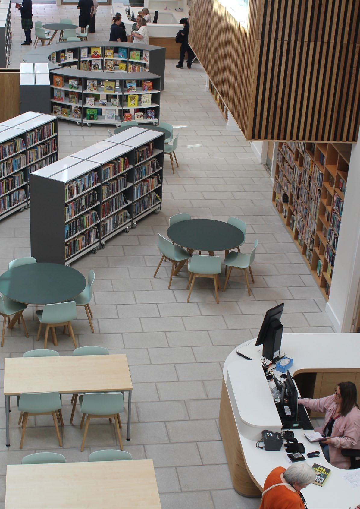

### Strategic Space Transformation
Local authorities have co-designed multi-year library estate strategies, integrating public libraries into broader town centre regeneration and community wealth building initiatives. Libraries act as footfall drivers, supporting local high streets and providing inclusive community infrastructure.

<!-- PAGE: 16 -->

## Partnership: The Story So Far

*Forward* has had a transformational impact on the importance of evidence-based service planning and delivery. Robust data has become the cornerstone of library advocacy and strategic alignment.

Scottish library services have established powerful cross-sectoral partnerships with health boards, enterprise agencies, cultural trusts, universities, and third sector bodies, amplifying the reach and impact of public library programmes.

<!-- PAGE: 17 -->

## Partnership: Strategic Aims & Actions

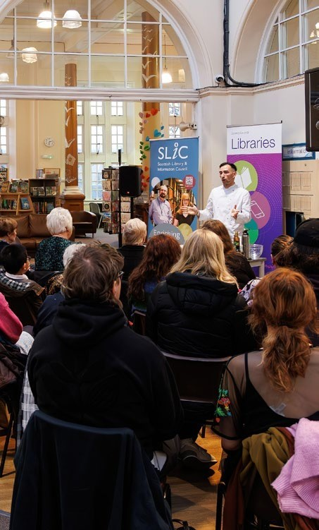

### Case Study: Libraries with Local Flair
Developing community-curated collections and hyper-local programming in partnership with local historical societies, arts groups, and community councils to celebrate local cultural heritage and foster community pride.

### Strategic Aims & Actions Matrix

| Strategic Aim | Priority Actions | Target Outcomes |
| :--- | :--- | :--- |
| **Aim 5: Strengthen Data & Evidence** | • Standardise national performance metrics across all 32 Scottish local authorities • Capture qualitative social impact stories and wellbeing evaluations • Publish transparent sector data dashboards | • Clear articulation of public value to funders • Data-driven resource allocation and service design |
| **Aim 6: Deepen Cross-Sector Partnerships** | • Formalise partnerships with health, education, and economic development agencies • Collaborate on national funding bids and innovation pilots • Expand co-delivery with third-sector and community organisations | • Scaled service delivery models • Maximised leverage of public investment |

<!-- PAGE: 18 -->

## Partnership: Clear Skies Ahead Case Study

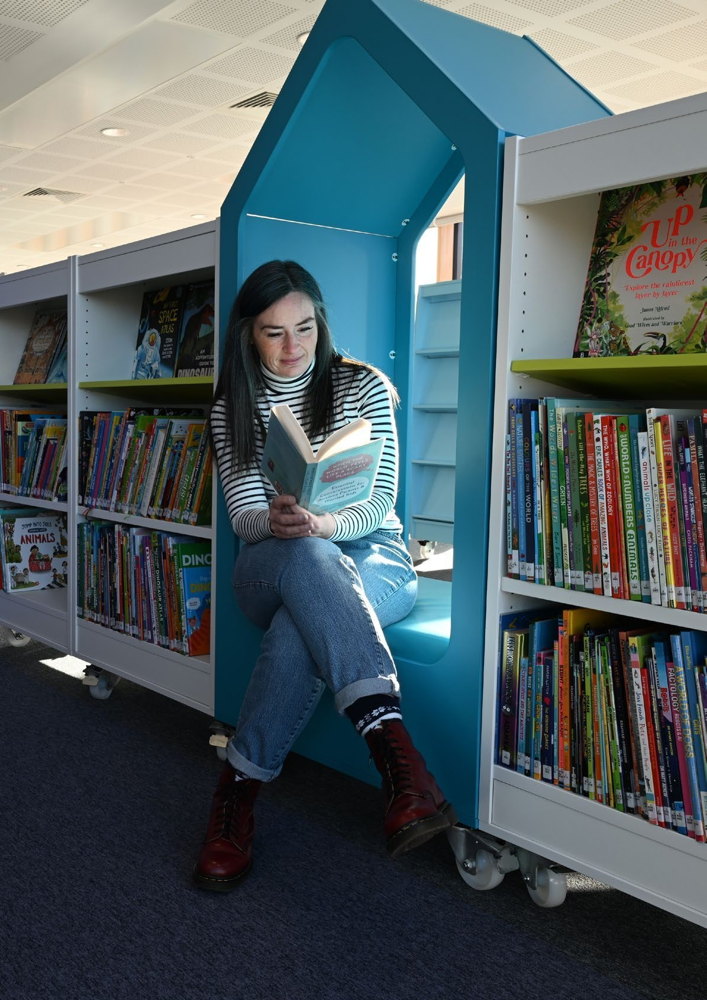

### Bringing Air Quality into Focus
In partnership with environmental research agencies, Scottish public libraries installed citizen science air quality monitors and hosted interactive workshops. Community members borrowed mobile sensors to map local air pollution, empowering citizens with data to advocate for environmental improvements.

<!-- PAGE: 19 -->

## Spotlight on Investment

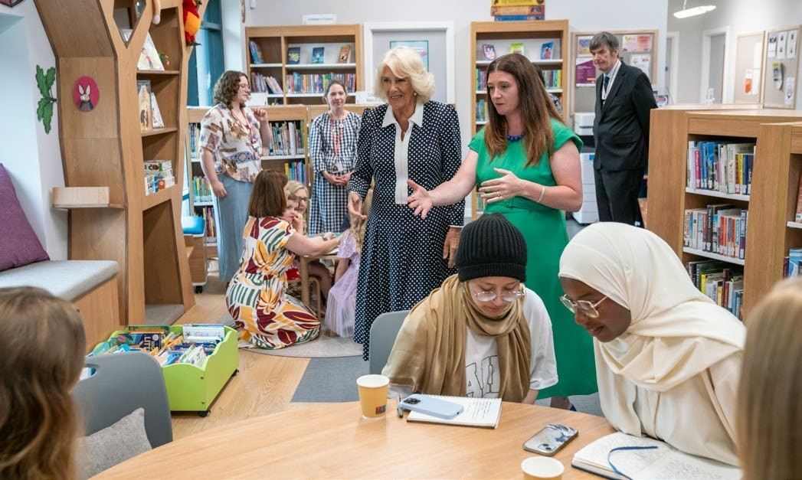

Over the lifecycle of *Forward*, Scotland has seen substantial capital investment in its public library buildings, reaffirming the sector’s role as a cornerstone of community infrastructure. Major capital refurbishments and new builds across Aberdeen, Dunfermline, Glasgow, and East Lothian have demonstrated the transformative power of modern library design.

<!-- PAGE: 20 -->

## Co-location & Community Hubs

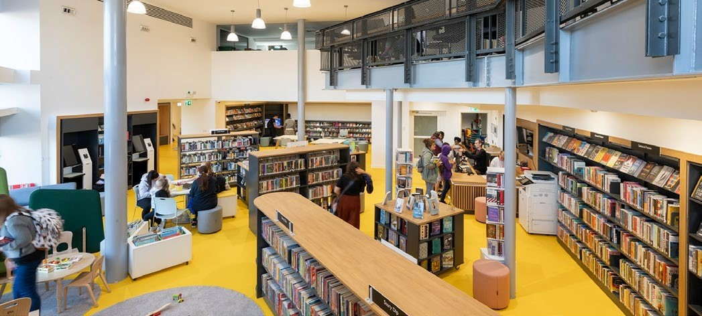

There has also been a move to invest in ambitious co-location projects that combine vital public services to create multi-functional community hubs. These integrated facilities bring together libraries with:
- Local council customer service points
- Healthcare and wellbeing clinics
- Community cafés and social enterprises
- Early learning and childcare centres
- Leisure, sports, and cultural performance facilities

<!-- PAGE: 21 -->

## Advisory Group, Implementation & Acknowledgements

The implementation of *Fast Forward* will be overseen by SLIC, and each strategic aim will be assigned to a sector champion to support delivery across Scotland's 32 local authority areas.

### Strategy Refresh Advisory Group
- Alison Hunter, Chair, SLIC
- Pamela Tulloch, Chief Executive, SLIC
- Representatives from the Association of Scottish Principal Educational Psychologists (ASPEP)
- Representatives from COSLA (Convention of Scottish Local Authorities)
- Representatives from Healthcare Improvement Scotland
- Representatives from the Scottish Government Culture and Major Events Directorate
- Heads of Public Library Services across Scotland

### Acknowledgements
SLIC wishes to thank all library leaders, frontline library staff, and partner organisations who contributed their insight, case studies, and evidence during the development of this strategic refresh.

<!-- PAGE: 22 -->

## Bibliography

- **Age Scotland (2023)** *The Big Survey.* [www.agescotland.org.uk](https://www.agescotland.org.uk)
- **Carnegie UK Trust (2014)** *Speaking Volumes: The impact of public libraries on wellbeing.* Dunfermline: Carnegie UK Trust.
- **Carnegie UK Trust (2017)** *Shining a Light: The future of public libraries across the UK and Ireland.* Dunfermline: Carnegie UK Trust.
- **Healthcare Improvement Scotland & SLIC (2023)** *A Collective Force for Health and Wellbeing Action Plan 2023.* Glasgow: SLIC.
- **Scottish Government (2021)** *Public Service Reform Strategy for Scotland.* Edinburgh: Scottish Government.
- **Scottish Government (2022)** *Best Start, Bright Futures: Tackling Child Poverty Delivery Plan 2022–2026.* Edinburgh: Scottish Government.
- **Scottish Library and Information Council (2015)** *Ambition & Opportunity: A Strategy for Public Libraries in Scotland 2015–2020.* Glasgow: SLIC.
- **Scottish Library and Information Council (2021)** *Forward: Scotland’s Public Library Strategy 2021–2025.* Glasgow: SLIC.
- **Scottish Library and Information Council (2024)** *Mobile Libraries in Scotland.* Glasgow: SLIC.
- **The Promise Scotland (2021)** *Plan 21–24.* Edinburgh: The Promise Scotland.

<!-- PAGE: 23 -->


**Scottish Library and Information Council (SLIC)**  
Suite 4.3, Turnberry House  
175 West George Street  
Glasgow  
G2 2LB

Tel: 0141 229 5520  
Email: info@scottishlibraries.org  
Website: [scottishlibraries.org](https://scottishlibraries.org)

*The Scottish Library and Information Council is a company limited by guarantee (SC131370) and a registered Scottish charity (SC023863).*
