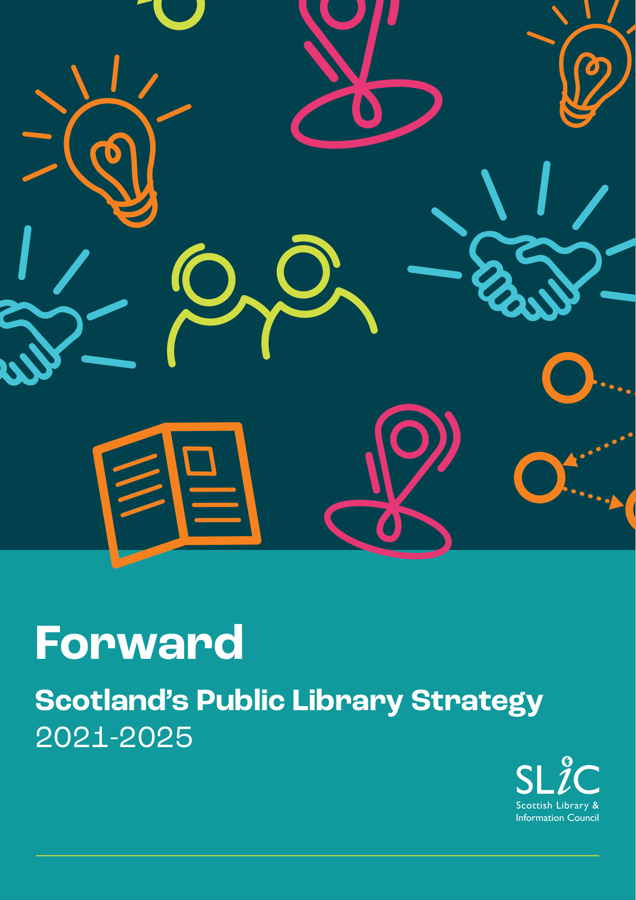
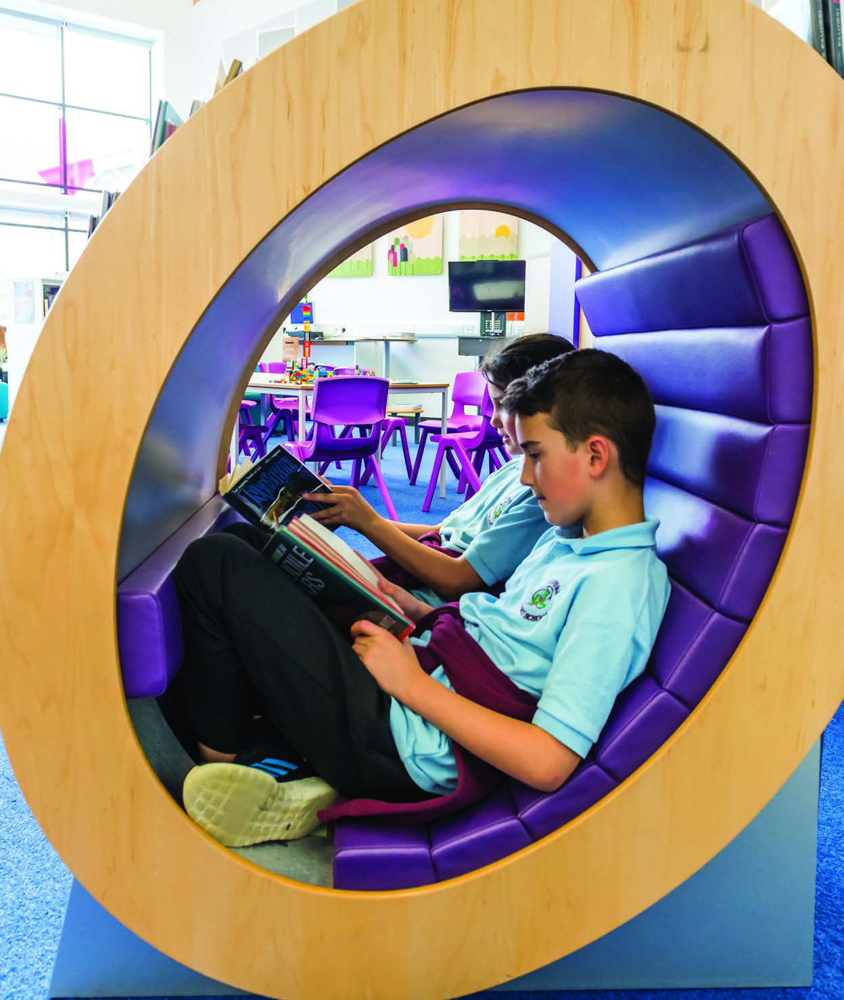
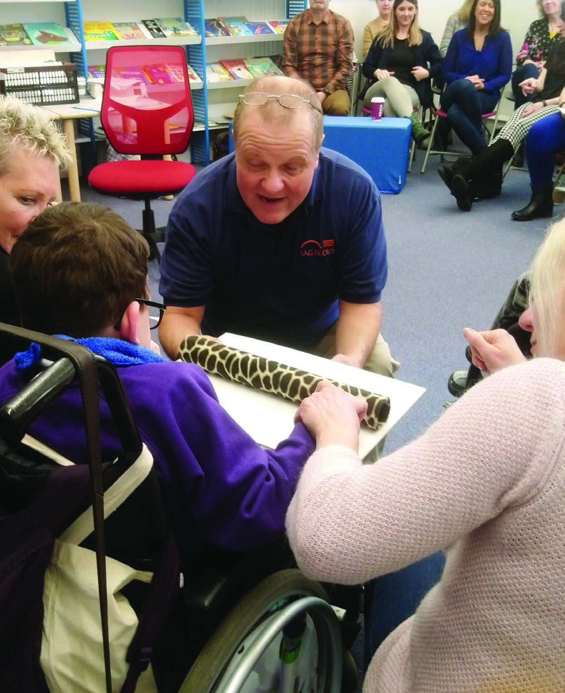
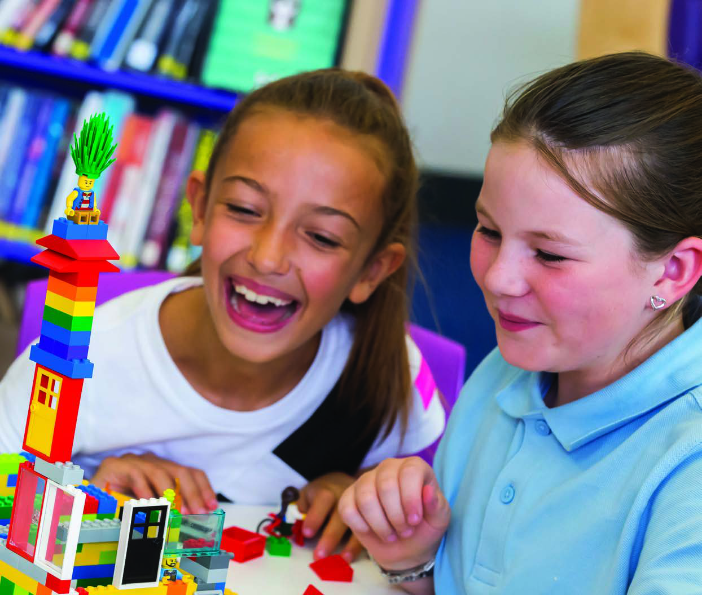
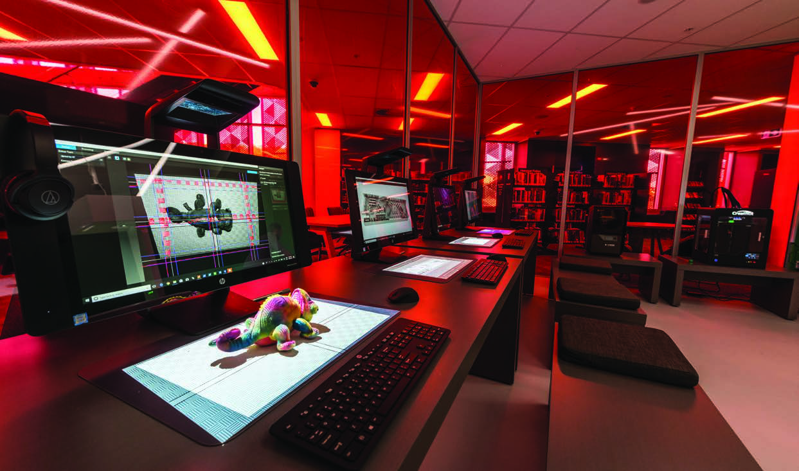
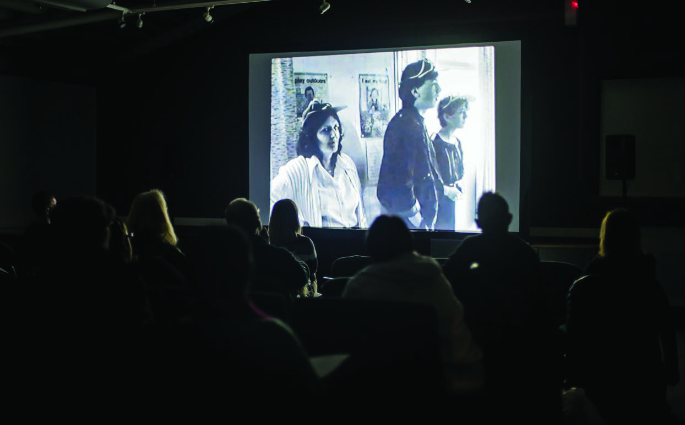
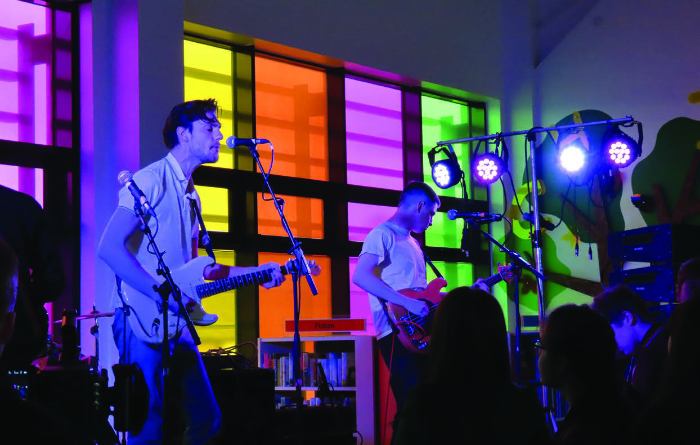
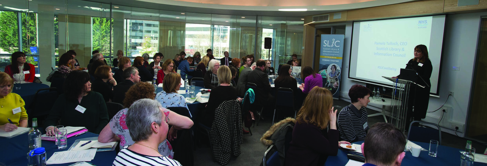

<!-- PAGE: 1 -->

Forward 
Scotland’s Public Library Strategy 
2021-2025 <!-- PAGE: 2 -->

Inspiring individuals and communities 
to reach their full potential through 
innovation and investment in Scotland’s 
public libraries.”
Contents 
Introduction: Advisory Group Chair 	 	
 2
Sustainable Development Goals 	
	
 3
Executive Summary 	
	
 4
Scotland’s Public Libraries 	
	
 6
National Policy & Public Libraries 	
	
 10
Delivering Services for Scotland’s Future 	
	
 14
Strategic Aims 2021- 25 		
 16
Foundations for Success 	
	
 18
Strategic Aims & Actions 	
	
 21
	
People 	
	
 21
	
Place 		
 31
	
Partnership 	
	
 45
Mapping Strategic Aims to 
The National Performance Framework 	
	
 56
Development Process 	
	
 58
Implementing the Strategy 	
	
 60
Advisory group members 	
	
 62
Acknowledgements 	
	
 63
Bibliography 	
	
 64
“
1
Forward: Scotland’s Public Library Strategy 2021-2025 <!-- PAGE: 3 -->

I was honoured to be asked to chair the Public Library Strategy 
Advisory Group and to facilitate the conversations that helped 
shape the vision set out in Forward: Scotland’s Public Library 
Strategy 2021-2025. 
The development of the strategy involved virtual meetings and 
library visits due to the COVID-19 pandemic. Rather than hinder 
the process it opened the dialogue to a wide audience and 
highlighted the strength of the global library network and the 
generous and co-operative nature of the profession. 
The Advisory Group brought together a range of people from 
across the library sectors and stakeholder organisations to 
examine the emerging trends and issues facing public libraries 
as well as broader societal issues. The group met over three 
informative and inspiring sessions, each of which focused 
in turn on the overarching themes of People, Place and 
Partnership. A programme of virtual visits provided practical 
examples of innovation and best practice. 
Introduction: 
Advisory Group 
Chair
The Advisory Group meetings highlighted common goals for 
members and provided opportunity for collaboration as part of 
a broader societal mission to help communities reset and thrive.  
Library staff across Scotland demonstrated their commitment 
to stay connected to their communities during lockdown, to 
really think outside the box and to design new models of delivery. 
Forward: Scotland’s Public Library Strategy 2021-2025 is a 
bold new vision for libraries in Scotland. It builds on strong 
foundations and demonstrates that public libraries are the 
cornerstone of communities. The impact which public libraries 
will make as a result of this strategy will support community 
cohesion over the coming years, build capacity and promote 
wellbeing.
I would like to thank the Advisory Group members, the Scottish 
Government, COSLA and SLIC for their time, commitment, and 
invaluable input to the development and production of this 
strategy.
 
The 17 Sustainable Development Goals are a global call to action 
to achieve a better and more sustainable future for all by 2030. 
Forward: Scotland’s Public Library Strategy 2021-2025 will 
contribute towards the following goals:
Sustainable 
Development 
Goals
Jeanette Castle
3
Forward: Scotland’s Public Library Strategy 2021-2025
2
Forward: Scotland’s Public Library Strategy 2021-2025 <!-- PAGE: 4 -->

People
Place
Partnership
1.1 Embed libraries as lead 
contributors to reading and 
literacy by closing the learning gap 
in communities, through national 
programmes and local initiatives.
2.1 Deploy people-centred design 
principles and decision making 
to ensure service development 
is collaborative. 
3.1 Develop partnerships which 
support more resilient, fairer, 
healthier communities.
1.2 Improve wellbeing and support 
post COVID-19 recovery with 
programmes which target health, 
economic growth, and strengthen 
communities.
2.2 Design library services which 
reach the heart of communities 
and engage with new audiences.
3.2 Amplify the voice of public 
libraries through inclusive 
communication to ensure 
key messaging reaches all 
stakeholders.
1.3 Encourage active citizenship 
through access to trusted, 
accurate information which 
empowers communities to make 
informed decisions.
2.3 Ensure the digital and 
physical space are blended 
to create a high-quality offer 
responsive to evolving needs.
3.3 Collaborate with partners 
to contribute towards the 
sustainable development agenda 
for 2030.
1.4 Equip library staff with the 
skills to deliver a progressive 
library service and nurture 
leaders at all levels.
2.4 Curate a diverse cultural 
offer which celebrates local 
and national heritage and 
encourages community led 
experiences.
3.4 Explore sustainable 
investment opportunities and 
preventative spend impact whilst 
demonstrating libraries return 
on investment.
1.5 Reflect the rich and diverse 
communities in both library 
resources and programming to 
make them accessible to all.	
2.5 Explore new ways to support 
business start-ups, economic 
growth and stimulate co-
production.
3.5 Develop a service 
improvement culture which 
embeds consistent data 
measurement and self- 
evaluation practices.
Executive 
Summary
5
Forward: Scotland’s Public Library Strategy 2021-2025
4
Forward: Scotland’s Public Library Strategy 2021-2025
Forward:  A Public Library Strategy for Scotland 2021-2025 
clearly marks the direction of travel for Scotland’s public 
libraries. It is the result of a comprehensive research and 
consultation process, global in reach yet firmly focused on the 
needs of individuals and communities in Scotland. 
As a result of the COVID-19 pandemic, this strategy embraces 
the collective desire to not simply return to normal but to 
do things differently, more efficiently, and more sustainably. 
Informed and shaped by key national policies and priorities, 
it places libraries at the heart of recovery. Three key themes 
underpin the vision for public libraries in Scotland from 
2021-2025:
People
Libraries will support people and 
communities to reach their full potential 
and celebrate the unique skill set of 
staff. 
Place
Libraries will be recognised as both 
valued places and place makers, with 
community led design at the heart. 
Partnership 
Libraries will deliver on local and national 
priorities through a strategic approach 
to collaboration and partnership. 
Strategic Aims
The aims are underpinned by five foundations 
for success which will ensure libraries deliver 
effective outcomes: 
•	Data Driven Service Design
•	Equality, Diversity & Inclusion
•	Seamless Customer Journey
•	Staff Culture
•	Sustainability
A corresponding set of local and collaborative 
actions will drive libraries forward over the 
next five years. These actions are accompanied 
by a series of case studies which bring to life 
the commitment and passion of public libraries 
in Scotland and inspire library services to grow 
with communities. An implementation group, 
with a membership of key stakeholders, will 
be formed to deliver the vision and monitor 
progress.
Forward celebrates public libraries in Scotland 
and the unique potential to deliver real and 
meaningful change. It makes a compelling case 
for sustained investment and celebrates the 
strength of the public library network as vital 
social infrastructure; trusted public spaces 
that deliver on a range of outcomes in every 
community in Scotland. 
The strength of public libraries lies in the ability 
to build on the core offer and evolve to meet 
changing needs. This strategy sets out how 
they will continue to listen, to grow and to move 
forward with intent.

<!-- PAGE: 5 -->

Forward: Scotland’s Public Library Strategy 2021-2025 is a 
dynamic strategy with a bold vision for the future of Scotland’s 
public libraries. With over 40 million visits per year1, 
Scotland’s public libraries are the most popular service local 
government provides. An infrastructure with over 490 local 
venues, 49 mobile libraries and a 24/7 digital offer sees 1 in 22 
of the public regularly use local libraries. They are an essential 
part of Scotland’s social fabric, supporting and inspiring people 
to fulfil their potential, for over 150 years. It is against this 
proud backdrop that this strategy sets out its vision to ensure 
public libraries in Scotland remain at the leading edge to 
empower communities.
Public libraries deliver a wide range of benefits which place 
them at the centre of the collective endeavour to improve 
literacy, close the attainment gap, promote health, champion 
wellbeing, pioneer sustainability, tackle social isolation, reduce 
inequality, and close the digital divide. Public libraries deliver 
significant economic benefits on preventative spend and return 
on investment. The health and wellbeing offer from libraries is 
estimated to bring a cost saving to NHS Scotland of £3.2 million 
each year.3 An Economic Impact Analysis of the British Library 
Business and the Intellectual Property Centre National Network 
carried out in 2019 highlighted the unrivalled value for money 
and return on investment that libraries deliver, standing at 
£6.95 generated for every £1 of public funding.4 With sustained 
investment, public libraries will deliver globally recognised 
innovation and transformational outcomes for the people of 
Scotland.
1	
CIPFA (2020) Public Library Statistics 2019-20 Actuals
2	
Carnegie UK Trust (2016), Shining a Light, Country Factsheet: 	
	
	
	
Scotland
3	
SLIC (2020), Health on the Shelf
4	
British Library (2019) Democratising Entrepreneurship: Libraries as 	
	
	
Engines of Economic Growth: A three-year economic impact analysis. 	
	
	
2016-18
Scotland’s 
Public 
Libraries 
The global COVID-19 pandemic saw public library 
services across Scotland respond quickly to develop 
an enhanced digital offer to support communities 
during lockdown. Creativity and innovation flourished 
as services introduced new models of delivery 
such as “click and collect”, extended home delivery, 
digital support and virtual programmes to address 
social isolation. The deployment of library staff to 
support the emergency response brought the unique 
customer service skill set of library staff to the fore, 
with kindness and empathy at the heart. Collaboration 
between services grew as did recognition of the vital 
role libraries have within communities.
‘The transferability of the core public library service 
skill set enabled staff to work outside of the library 
service to support communities across the UK 
during an intense and challenging time.’5 
The pandemic exacerbated existing issues, such as 
digital exclusion and social isolation, and brought new 
challenges into sharp focus. Many of the challenges 
are explored throughout this strategy alongside 
the vital support that libraries offer to aid recovery 
and growth. 
‘COVID-19 has shown how resilient libraries can be 
in delivering their services in new ways. There is an 
opportunity to review and adapt ‘normal’ pre-COVID 
practices and perhaps do things differently - in 
conjunction with communities and their needs.’6 
5	
Carnegie UK Trust (2020), Making a Difference: 	
	
	
Libraries, Lockdown and Looking Ahead
6	
Scottish Library & Information Council (SLIC) 	
	
	
	
(2020), Public Library Staff Survey
Strategy 
Development
Forward has been informed 
by a comprehensive process 
of research, international 
collaboration and staff and 
stakeholder engagement. A 
global literature review; a scan 
of national policy and context; 
independent deliberative 
research with users and non-
users; and a series of staff and 
stakeholder workshops have 
all helped to shape the aims 
and identify the key priorities 
that will see Scotland’s public 
libraries thrive over the five 
years of the strategy.
A more detailed look at the 
development process can be 
found on page 58.
©Celeste Noche
6
7
Forward: Scotland’s Public Library Strategy 2021-2025
Forward: Scotland’s Public Library Strategy 2021-2025 <!-- PAGE: 6 -->

CASE STUDY
Culture Perth and 
Kinross Libraries
Reaching out to communities during lockdown
National Performance Outcome 
Culture Perth and Kinross Libraries  
adopted an inclusive approach to 
communication during lockdown and as 
services reopened, to engage with as many 
communities as possible.
To ensure continuity of service, public 
libraries quickly pivoted to a digital offer, 
use of social media, website, and local 
press and media to promote key public 
health and community information. Online 
library services and e-resources were 
used to continue reader development 
activities through tailored digital events and 
workshops. A ‘Book Hero’ campaign was 
created which encouraged people to donate 
the average cost of a paperback book and 
raised £6300 for the service, which helped 
position the service in people’s minds. 
In advance of reopening, Culture Perth and 
Kinross Libraries consulted users through 
surveys to determine the impact of the 
pandemic and find out what users wanted, 
or needed, from the service going forward. 
Once able to re-open physical services, local 
radio was used to raise awareness of key information about 
new opening hours and how to access services. Utilising local 
radio gave a reach of several hundred thousand potential 
listeners, far greater than that of mailing lists or social media 
channels. Available information was translated into community 
languages and short welcome back films were used online and in 
venues. The films demonstrated new Covid-safe measures and 
were designed to be easily understood without commentary or 
captioning.  Engaging cartoon animations were used on social 
media to reinforce key messaging.
CASE STUDY
The staff and teams within Aberdeen City 
Libraries worked tirelessly to ensure people in 
Aberdeen could continue to access services 
and resources online during the COVID-19 
pandemic. Increased investment in eBooks and 
eNewspapers saw a rise in use of 189% and 
288% respectively across 2020/21, with online 
membership increasing by 237%.
Staff developed various digital activities for 
children and families and moved Bookbug 
sessions fully online via the library YouTube 
channel which generated over 35,500 views. 
In addition, many library staff were redeployed 
across the Community Planning Partnership 
to call lines and various care settings, and 
as digital champions for the Connecting 
Scotland programme. 
As doors re-opened following the first national 
lockdown in July 2020, libraries 
were recognised by the wider Council as 
a critical community service where local 
people could access support and resources, 
particularly as one of the only services 
available. This recognition and support ensured 
that libraries were able continue to deliver 
services to the most vulnerable during the 
subsequent lockdown.
Aberdeen City 
Libraries 
Shining a light on the flexibility of 
library staff and services
National Performance Outcome 
I would have been lost without the 
‘click and collect’ service...but I can’t 
wait to return to browsing in-house. 
Library visits are one thing 
I’ve missed the most! Can’t wait 
to get back.”
Aberdeen City Library User
“
9
Forward: Scotland’s Public Library Strategy 2021-2025
8
Forward: Scotland’s Public Library Strategy 2021-2025 <!-- PAGE: 7 -->

National Policy & 
Public Libraries
Healthy Communities
9	
The Poverty Alliance (2021), The Poverty Related Attainment Gap: A Review of the Evidence 
10	
CIPFA (2015-2020) Public Library Statistics 2015-2020 Average
The health and wellbeing of communities are inextricably linked 
with growth and renewal. Public libraries in Scotland offer a 
vast array of health and wellbeing services and are part of 
an important ecosystem of organisations who support self-
management and realistic medicine. Library staff play an active 
role in linking people to trusted sources of health information 
as outlined in Making it Easier:  A health literacy action plan 
2017-25 (2017).  A Collective Force for Wellbeing (2019)  and the 
recommendations in Health on the Shelf (2020) will see libraries 
continue to develop and grow this role. The COVID-19 pandemic 
has contributed to an increase in social isolation across a 
range of age groups. This strategy will align with A Connected 
Scotland (2018) in its commitment to reduce social isolation and 
loneliness.
Literacy & Learning
Studies show that the attainment gap, already a key priority 
before the COVID-19 pandemic, has increased. Robust evidence 
demonstrates early years interventions, targeted family 
learning approaches and parental engagement are key to 
tackling the attainment gap.9 The role of libraries in supporting 
literacy and learning has never been more important. Around 
6 million children’s10 books are borrowed annually in Scotland’s 
public libraries. Access to reading materials supports several 
articles of the United Nations Convention on the Rights of the 
Child (UNCRC). Libraries will work with schools, school libraries 
and partners to foster a reading culture within and beyond the 
school gates and align with Vibrant Libraries, Thriving Schools: 
A National Strategy for School Libraries in Scotland 2018-
23 (2018), The Scottish Reading Strategy and the new Adult 
Learning Strategy for Scotland. 
Reducing Inequality
Scotland’s public libraries offer services free to all at the point 
of access. Forward will bring equity across services, ensuring 
all communities have equal access to information, education, 
and support. With investment and commitment, public libraries 
will support the vision for a Fairer Scotland where people can 
become better skilled, healthier, more resilient and, ultimately, 
more empowered to make fair and informed decisions. 
The next step on the journey for public library services in Scotland 
will begin with recognition of the achievements and impact of the 
previous strategy. Libraries will reset using the lessons learned from 
the COVID-19 pandemic coupled with national policy and driven by 
research. This strategy celebrates the unique differences which make 
every library important to the local community.
Libraries are well placed to deliver against the outcomes identified in 
the National Performance Framework. The national outcomes are 
mapped to the strategic aims throughout this strategy, as are the 
contributions towards the UN Sustainable Development Goals.
Cultural Regeneration 
7	
Y Lab and Nesta (2021), Data Poverty in Scotland and Wales
8	
Scottish Government (2020) Towards 	a Robust, Resilient Wellbeing Economy for 	
	
	
	
Scotland: Report of the Advisory Group on Economic Recovery
Forward has been developed to align with A Culture Strategy 
for Scotland (2020), not only to celebrate diversity across 
communities but to champion the potential of libraries in culture-
led regeneration. There has been a growing global trend to place 
libraries at the heart of cultural and economic regeneration 
projects and recognise them as catalysts for positive change 
within communities.  Libraries foster local innovation, creativity 
and create a sense of belonging. Public libraries will support key 
strategic priorities of the National Library of Scotland’s Reaching 
People: Library Strategy 2020-25 around widening access and 
community engagement.
Data Poverty & Digital Exclusion 
Reliance on digital increased exponentially during significant 
national lockdowns and libraries are at the centre of the 
collaborative effort to ensure no one is left behind in the new 
digital landscape as envisioned in A Changing Nation: How 
Scotland will Thrive in a Digital World (2021). 1 in 7 people 
across Scotland experience data poverty, rising to 1 in 4 in lower 
income households. 1 in 5 of those experiencing data poverty 
depended on libraries for access pre-pandemic.7 Public libraries 
will continue to offer vital access and ongoing digital support 
that embrace both the challenges and the opportunities that the 
digital world presents. 
Economic Recovery 
COVID-19 has had a profound effect on the way people work resulting in a 
greater focus on the local. The need for a collaborative place-based approach 
to future growth and renewal is embedded in  The Economic Recovery 
Implementation Plan (2020)  and in the calls to action of  ‘If Not Now, When? The 
Social Renewal Advisory Board Report (2021).The Report from the independent 
Advisory Group on Economic Recovery, established by the Scottish Government 
to provide expert advice in the wake of the COVID-19 epidemic, advocates “an 
approach to recovery and economic development that is grounded in local and 
regional approaches and partnership”.8 Libraries are perfectly placed to be 
anchor institutions for the principles of Community Wealth Building and support 
the ‘20 Minute Neighbourhood’ model by offering a space for work, study, 
learning, recreation, and social interaction.
National Performance Framework
10
11
Forward: Scotland’s Public Library Strategy 2021-2025
Forward: Scotland’s Public Library Strategy 2021-2025 <!-- PAGE: 8 -->
SPOTLIGHT: UNCRC 
Scotland is the first country in the UK to 
directly incorporate the United Nations 
Convention on the Rights of the Child 
(UNCRC) into domestic law. The United 
Nations Convention on the Rights of the Child 
(Incorporation) (Scotland) Bill was introduced 
on 1 September 2020. Libraries support this 
landmark legislation and actively contribute 
towards:
•	Article 13 - Freedom of Expression                    
•	Article 17 - Access to Information from the 
Media
•	Article 28- Education                                         
•	Article 31 - Leisure, Play and Culture
Economic Recovery 
Implementation Plan: 
The Scottish Government’s 
response to the Advisory Group on 
Economic Recovery
Poverty and Inequality 
Commission Strategic 
Plan 2020-23 
If Not Now, When? 
Social Renewal Advisory 
Report January 2021 
Health on the Shelf: 
Health and Wellbeing in 
Public Libraries in Scotland
A Collective Force for 
Wellbeing: 
Libraries, Health and Social Care, 
and The ALLIANCE-Celebrating the 
Power of Knowledge
National Library of 
Scotland, Reaching 
People: 
Library Strategy 2020-2025
CILIP Libraries, Information 
and Knowledge Changes Lives 
Making it Easier: 
A Health Literacy Action Plan 
for Scotland 2017-25
A Connected Scotland: 
Our strategy for tackling social 
isolation and loneliness and 
building stronger connections
The United Nations 
Convention on the Rights of 
the Child
Scottish Reading Strategy: 
Report and Recommendations
Vibrant Libraries, 
Thriving Schools: 
A National Strategy 
for School Libraries in 
Scotland 2018-2023
A Changing Nation: 
How Scotland will 
Thrive in a Digital 
World
Scotland’s Artificial 
Intelligence Strategy: 
Trustworthy, Ethical 
and Inclusive 
STEM: 
Education and 
Training Strategy for 
Scotland, Second 
Annual Report
Forward: 
Scotland’s Public 
Library Strategy 
2021-2025 
A Culture 
Strategy 
for Scotland
13
Forward: Scotland’s Public Library Strategy 2021-2025
12
Forward: Scotland’s Public Library Strategy 2021-2025 <!-- PAGE: 9 -->
Delivering 
Library 
Services for 
Scotland’s 
Future
Definition 
Public libraries in Scotland 
provide equality of access to 
reading, culture, technology, 
trusted information, 
and creative learning 
opportunities. A safe space 
at the heart of communities, 
they encourage connections, 
support wellbeing and are a 
welcoming space for all.
Forward sets out 15 strategic aims and 
articulates the task ahead for library services 
from 2021-2025.The aims are accompanied by 
practical actions to drive forward progress locally 
and nationally:
Local 
Actions
Collaborative 
Actions
Strategic Aims
To enable and empower 
Scotland’s communities 
through public libraries	
Mapping the strategy against local priorities 
allows Scotland’s public library services 
to create and deliver against innovative 
library service plans which are responsive 
to local need. This is complemented by 
transformational, nationally driven programmes.
Vision
People
Libraries will support people and 
communities to reach their full potential 
and celebrate the unique skill set of staff.
Place
Libraries will be recognised as both 
valued places and place-makers, with 
community led design at the heart.
Partnership
Libraries will deliver on local and national 
priorities through a strategic approach to 
collaboration and partnership.
14
15
Forward: Scotland’s Public Library Strategy 2021-2025
Forward: Scotland’s Public Library Strategy 2021-2025 <!-- PAGE: 10 -->
Strategic Aims 2021-2025
People
1.1 Embed libraries 
as lead contributors 
to reading and literacy 
by closing the learning 
gap in communities, 
through national 
programmes and local 
initiatives.
1.2 Improve wellbeing 
and support post 
COVID-19 recovery 
with programmes 
which target health, 
economic growth, 
and strengthen 
communities.
1.3 Encourage active 
citizenship through 
access to trusted, 
accurate information 
which empowers 
communities to make 
informed decisions.
1.4 Equip library staff 
with the skills to deliver 
a progressive library 
service and nurture 
leaders at all levels.
1.5 Reflect the rich and 
diverse communities in 
both library resources 
and programming to 
make them accessible 
to all.
2.1 Deploy people-
centred design 
principles and decision 
making to ensure 
service development is 
collaborative.  
2.3 Ensure the digital 
and physical space 
are blended to create 
a high-quality offer 
responsive to evolving 
needs.
2.2 Design library 
services which 
reach the heart of 
communities and 
engage with new 
audiences.
2.4 Curate a diverse 
cultural offer which 
celebrates local and 
national heritage and 
encourages community 
led experiences.
2.5 Explore new ways 
to support business 
start-ups, economic 
growth and stimulate 
co-production.
3.3 Collaborate 
with partners to 
contribute towards 
the sustainable 
development agenda 
for 2030.
3.1 Develop 
partnerships which 
support more resilient, 
fairer, healthier 
communities.
3.4 Explore 
sustainable investment 
opportunities 
and preventative 
spend impact whilst 
demonstrating 
libraries return on 
investment.
3.5 Develop a service 
improvement culture 
which embeds 
consistent data 
measurement and self- 
evaluation practices.
3.2 Amplify the voice 
of public libraries 
through inclusive 
communication 
to ensure key 
messaging reaches all 
stakeholders.
Place
Partnership
16
17
Forward: Scotland’s Public Library Strategy 2021-2025
Forward: Scotland’s Public Library Strategy 2021-2025 <!-- PAGE: 11 -->
Seamless Customer Journey 
Deliberative research with library users and non-users presented strong evidence of the 
inconsistencies around service provision. Customers felt it was important to be able to move 
between local authority areas and still recognise core services and a cohesive brand.11 This has 
further cemented the need for libraries to offer a modern and financially supported digital offer 
which blends with the physical offer. Customers will be able to seamlessly transition between 
physical and digital library services with both areas offering quality and ease of use. Library 
services will collaborate on a core identity across the library offer which allows for creative, 
local delivery. 
Accompanying Actions: Strategic Aims 2.3 & 3.2 
Foundations 
for Success
The strategic aims provide a framework to allow 
public libraries to develop services that meet the 
changing needs and expectations of individuals and 
communities. These aims are underpinned by solid 
foundations which enable libraries to succeed:
Data Driven 
Service 
Improvement 
Public library services add value across 
society and evidence of the contribution is 
key to secure future investment. To drive 
forward continuous improvement and allow 
for meaningful benchmarking there will be a 
nationally consistent approach to measuring 
and reporting on impact, best practice, 
and service innovation. This method of data 
collection will create a strong evidence base 
to advocate for equitable services which 
contribute to local and national priorities. It will 
be crucial to examine the language around the 
value of libraries to reflect the deeper impact 
of libraries on individuals. 
Accompanying Actions: Strategic Aim 3.5
Equality, 
Diversity, 
and Inclusion
It is vital that barriers, both physical and 
organisational, are removed to ensure that 
all communities have fair and equal access 
to library services. Traditionally under-
represented groups do not always view 
libraries as inclusive and welcoming spaces. 
Equality, diversity, and inclusion will be key 
principles of all future service design. The 
overarching priority of the Poverty and 
Inequality Commission’s Strategic Plan 2020-
23 (2021) is to amplify the voice of experts 
by experience - people with lived experience 
of inequality and discrimination. Public 
libraries in Scotland will work with partners 
to increase diversity in the sector in line 
with the vision of the Chartered Institute for 
Library and Information Professionals (CILIP) 
report Libraries, Information and Knowledge 
Changes Lives (2019). 
Accompanying Actions: Strategic Aim 1.5 
Staff Culture
Successful translation of Forward to local 
outcomes depends on all staff being engaged 
and empowered. Staff development driven 
by the strategic aims is vital to equip the 
library workforce with the required skill set 
to support communities. Senior managers 
will raise awareness of national and local 
outcomes amongst all staff and provide a 
meaningful route for all to contribute to the 
achievement of shared goals.
Accompanying Actions: Strategic Aim 1.4
Sustainability
As one of the originators of resource sharing 
and responsible consumption, libraries will 
embrace the role in sustainable living. This will 
be reflected in internal policies and expansion 
of what can be borrowed to allow communities 
to share resources responsibly.  As providers 
of trusted information, public libraries will 
equip individuals with the facts they need to 
live more environmentally responsible lives. 
Through these practices, public libraries will 
make a meaningful contribution to Scotland’s 
progress towards the United Nations 
Sustainable Development Goals (SDGs). 
Accompanying Actions: Strategic Aim 3.3
11	
Blake Stevenson (2020), User and Non-User Deliberative Research
18
19
Forward: Scotland’s Public Library Strategy 2021-2025
Forward: Scotland’s Public Library Strategy 2021-2025 <!-- PAGE: 12 -->

“
Libraries are full of life and interaction!”
Deliberative Research participant
People
The greatest resource of any library are the people who make 
up the unique and diverse communities within which libraries sit, 
and the committed and highly valued workforce that help bring 
the library service to life. Library staff connect people to ideas, 
knowledge and learning whilst fostering a sense of belonging 
that connects communities. Libraries provide a crucial place 
for interaction and are at the forefront of combating the 
growing issues of loneliness and social isolation. Scotland’s 
public libraries are viewed as kind and supportive12, and this 
will be vitally important as people recover from the COVID-19 
pandemic. Experiences will be holistic. People will be made to 
feel welcome, and staff will be equipped with the skills to deliver 
services confidently. 
12	
Carnegie UK Trust (2018), Quantifying kindness, public engagement, and place: 	
	
Experiences of people in the UK and Ireland
21
Forward: Scotland’s Public Library Strategy 2021-2025
20
Forward: Scotland’s Public Library Strategy 2021-2025 <!-- PAGE: 13 -->

Literacy & 
Learning
Libraries support the aspiration that Scotland is a reading nation. Reading and 
literacy are the beating heart of library services. Not only do libraries support 
early and family learning, school readiness and attainment across the 5-18 
curriculum; they provide support for individuals to return to learning 
throughout their lives. Libraries will continue to create and innovate across the 
learning offer to attract new audiences and further enrich the experience of 
current participants. 
Embed libraries as lead contributors to reading and literacy by closing 
the learning gap in communities, through national programmes and 
local initiatives.
Sustainable Development Goals:
 
 
National Performance Outcomes:
 
 
Local 
Actions
Library service plans:
•	 Commit to under 5s early learning 
and school readiness using Every 
Child A Library Member (ECALM) 
delivery programme. 
•	 Define 5-18 relationship with 
schools and school libraries whilst 
articulating the contribution to 
closing attainment gap. 
Library services:
•	 Align with the Adult Learning 
Strategy for Scotland.
•	 Participate in National Libraries 
Reading Campaign.
Collaborative 
Actions
•	 Launch ECALM delivery programme.
•	 Coordinate a National Libraries 
Reading Campaign which supports 
mental health. 
•	 Develop a National Lending Strategy 
which contributes to Scotland 
becoming a reading nation.
Strategic Aim: 1.1
22
23
Forward: Scotland’s Public Library Strategy 2021-2025
Forward: Scotland’s Public Library Strategy 2021-2025
CASE STUDY
OnFife Libraries 
Supporting learning during lockdown
National Performance Outcome 
Following a successful 
bid to the Public Library 
Improvement Fund (PLIF), 
OnFife Libraries worked 
in partnership with the 
Children’s University Scotland 
(CUS) to encourage children 
to join as they signed up to the 
Summer Reading Challenge 
(SRC). The aim was to join 
families to CUS at the tick of a 
box and reward children for 
learning.
OnFife Libraries forged 
ahead with eight months 
of logistics, information 
sharing protocols, data dump 
schedules and online portals. 
However, just as the project 
was ready to launch - the 
pandemic hit, and physical library services closed. 
OnFife Libraries demonstrated flexibility and commitment 
to support children’s literacy and learning needs. Now in a 
virtual world, the partnership developed an alternative sign 
up to OnFife’s own bespoke online Summer Reading Challenge.  
CUS membership could no longer be ‘hand-sold’ by library 
staff but now took the form of a CUS/OnFife jotform.  Children 
received physical items through the CUS Wonderbox. This gift 
of creativity carried great weight with schools and delivery 
partners, and vitally, carried carefully crafted messages directly 
into homes.
Uptake outstripped expectations with nearly 500 children 
joining.  Bronze Awards were achieved and the gifting of 3 Azus 
Zenpads, thanks to local sponsorship, were delivered through 
doorstep award ceremonies. This programme has created a 
stronger Fife College partnership and funding has been secured 
for future OnFife Summer Reading Challenges.

<!-- PAGE: 14 -->

Community 
Wellbeing
The COVID-19 pandemic has highlighted the links between health, mental 
wellbeing, and economic stability. The local placement and variety of services 
accessible through public libraries offer a unique combination to provide holistic 
support to individuals. Libraries will continue to grow the health offer and further 
develop employability and business support services. 
CASE STUDY
Western 
Isles 
Libraries   
Connecting rural 
communities
National Performance Outcome 
The Western Isles has the highest percentage 
of ‘very remote rural’ populations in the whole 
of Scotland. The mobile libraries connect each 
person with books, DVDs, and other resources. 
Furthermore, each household in the area is 
connected. The service creates important links 
between people and communities through the 
sharing of stories, news, and information.
In 2019, the Comhairle nan Eilean Siar invested 
in two new mobile libraries to ensure that 
this important community service 
continued, enabling the four libraries 
to reach residents across the isles, no 
matter how isolated they may be.  For 
some, a visit from the mobile librarian 
is the only contact they may receive in 
several weeks.
The mobile librarians are at the 
forefront of delivering a project, Le 
Chèile, which engages with local people 
about feelings on place, culture, and 
community. Work is in progress to 
develop closer partnerships with 
organisations and communities 
to further tackle digital exclusion, 
promote health and wellbeing initiatives 
and find ways of sharing creative and 
cultural activities more widely. The 
mobile library service continues to 
strive to include and inspire even the 
most rurally isolated.
Improve wellbeing and support post COVID-19 recovery with 
programmes which target health, economic growth, and strengthen 
communities.
Sustainable Development Goals:
 
 
National Performance Outcomes:
 
 
 
 
Local 
Actions
Library service plans:
•	Incorporate recommendations 
made in ‘Health on the Shelf’.
Library services:
•	Adopt the National Economic 
wellbeing offer locally. 
•	Adopt community advice brand to 
strengthen national cohesion. 
Collaborative 
Actions
•	Deliver a Collective Force for 
Wellbeing Action Plan
•	Develop a National Economic 
wellbeing offer designed to ensure 
equity. 
•	Create and deliver a national brand 
for community advice and support 
which brings together key partners. 
Strategic Aim: 1.2
© John Maher
24
25
Forward: Scotland’s Public Library Strategy 2021-2025
Forward: Scotland’s Public Library Strategy 2021-2025 <!-- PAGE: 15 -->

CASE STUDY
North Ayrshire 
Libraries 
Empowering citizens through 
open data
National Performance Outcome 
Funded by the Public Library Improvement 
fund (PLIF), North Ayrshire Libraries launched 
an Open Data project to engage citizens in 
applications of publicly accessible information 
and data sets. The project invited library 
users to hackathons - rebranded as Data 
Stories - in local libraries to explore North 
Ayrshire Council’s Open Data Portal and other 
datasets. Open Data is non-personal and non-
commercially sensitive information, freely 
available via the Internet for anyone to access 
and reuse. A Library Development Officer (LDO) 
was recruited to engage the local community 
with this concept. A Data Stories’ event, 
facilitated by the LDO, included data specialists, 
groups and individuals who identified an ‘issue’ 
and a subject expert. All were equal partners 
ensuring inclusivity and collaboration to identify 
open data gaps to be further researched and 
added to the Portal.
Over 250 residents including carers and 
disability groups; library staff; students and 
council employees attended these events. 
Participants ranged from 8-90 years old.   
Issues discussed included recycling; portal 
accessibility; breastfeeding friendly venues 
and library events promotion. The participants’ 
input helped develop the Portal which now 
includes a guide; glossary and links to other 
open data sites/sets.
As part of the legacy of the project, 10 
data champions were trained to support 
communities access the portal, volunteers 
and library staff participated in joint Data 
Visualisation training, and a guidance document 
was created to help other library services 
organise Data Stories’ events. The project saw 
an increase of 100% in visits to the Portal with 
more people understanding how to access, 
manipulate and use the data, accessed by a 
desktop link on library PCs. In addition, the 
project funded air pollution monitors for coding 
clubs to monitor air pollution around library 
buildings, sharing the data with schools in 
North Ayrshire.
Empowered 
Citizens
Public libraries are an important communal space for conversation and debate. 
Self-directed learning has always been at the core of the public library offer, 
but as the mechanics of learning have moved beyond print, the role of libraries 
as curators of the vast array of information sources has been amplified. 
Evolution of this offer will help communities make informed decisions. Libraries 
will open access to and build trust in public data to increase participation in the 
democratic process.
Encourage active citizenship through access to trusted, accurate 
information which empowers communities to make informed decisions.
Sustainable Development Goals:
 
 
 
 
National Performance Outcomes:
 
Local 
Actions
Library services:
•	 Participate in media literacy 
awareness campaigns. 
•	 Promote spaces for conversation 
and debate.
Collaborative 
Actions
•	 Develop media literacy 
awareness campaigns. 
•	 Expand the use of Open Data, 
Wikimedia UK and Creative 
Commons through data literacy 
programmes.
Strategic Aim: 1.3
Strategic Aim: 1.3
27
Forward: Scotland’s Public Library Strategy 2021-2025
26
Forward: Scotland’s Public Library Strategy 2021-2025 <!-- PAGE: 16 -->
Strategic Aim: 1.5
Strategic Aim: 1.4
Staff Culture 
& Leadership 
Public library staff are a vital asset and integral part of library services. The 
delivery and development of vibrant library services will depend on investment in 
skills and leadership. With this investment, library services will attract and retain 
a talented workforce with attractive career pathways. 
Equality, Diversity 
& Inclusion
Viewed as a societal leveller, public libraries provide access to services free at 
the point of entry to all. Public libraries will address universal barriers - physical, 
financial, and cultural - to ensure equity of access. Inclusive service including 
stock and recruitment policies, will ensure that individuals and communities feel 
represented in collections and programming.
Equip library staff with the skills to deliver a progressive library service 
and nurture leaders at all levels.
Sustainable Development Goals:
 
National Performance Outcomes:
 
 
Local 
Actions
Library services:
•	 Enrol staff on the Digital Training 
platform and track progress. 
•	 Articulate a clear development and 
leadership pathway. 
•	 Identify future leaders and dedicate 
time to mentorship and national 
development programmes. 
Collaborative 
Actions
•	 Develop a national training 
programme for staff which can be 
used by library services. 
•	 Design a leadership programme 
which supports cohorts from 
across Scotland. 
•	 Host a seminar programme 
which supports emerging trends 
and ideas.
Strategic Aim: 1.4
Reflect the rich and diverse communities in both library resources and 
programming to make them accessible to all.
Sustainable Development Goals:
 
 
 
 
 
National Performance Outcomes:
 
 
 
Local 
Actions
Library services:
•	 Remove financial penalties for 
all borrowers.
•	 Publish stock policy detailing 
accessible options and diverse 
stock selection methods.
•	 Actively consult with communities 
with direct and lived experience to 
shape planning.
Collaborative 
Actions
•	 Monitor workforce demographics 
as part of national workforce 
data pilot.
•	 Produce standard accessibility 
guidelines to ensure equity of 
access across Scottish libraries.
Strategic Aim: 1.5
Strategic Aim: 1.5
29
Forward: Scotland’s Public Library Strategy 2021-2025
28
Forward: Scotland’s Public Library Strategy 2021-2025 <!-- PAGE: 17 -->

© Alan Cawley Photography
Place
The public library has long been one of the most important 
shared civic spaces. For many the doors to the library open up 
a world of exploration, escape, learning and research. Since 
inception, library spaces have flexed to meet the needs of the 
surrounding communities.  The ability to adapt and develop 
has never been more important as services emerge from the 
challenges of physical closures. Public libraries were historically 
designed to house books; the future will firmly focus on design 
to welcome people both physically and in the digital world. Co-
design where libraries listen and learn from communities is 
crucial to success. Libraries need to re-build confidence in 
physical spaces, level-up the digital space and make the library 
visible in the community. The place-making role libraries play 
in communities brings vital social benefit: a sense of belonging, 
companionship, support, and inspiration. Therefore, the notion 
of the library as a ‘Place’ continues to be essential.
“
Libraries are part 
of the fabric of local 
communities. They 
are vital hubs and 
safe places where 
the public can meet, 
exchange ideas and 
promote a sense of 
wellbeing.”
Staff survey
31
Forward: Scotland’s Public Library Strategy 2021-2025
30
Forward: Scotland’s Public Library Strategy 2021-2025 <!-- PAGE: 18 -->

Strategic Aim: 2.1
People-Centred 
Design 
Often referred to as ‘the community living room’, good public libraries foster a 
sense of belonging. Public libraries across Scotland worked together to produce 
a people-centred design toolkit examining the physical and digital future of 
libraries. Public libraries will apply the outcomes of this ground-breaking work to 
redefine the physical and digital spaces of libraries and ensure communities are 
included in the process.
CASE STUDY
Deichman 
Libraries, 
Oslo    
Embedding people-
centred service design
National Performance Outcome 
Oslo is a city of around 700,000 inhabitants 
which has seen increasing issues of inequality, 
particularly in educational attainment, 
loneliness and social isolation and an evident 
digital divide. Addressing these challenges 
was a key consideration when commissioning 
a new central library for the city. The 
Norwegian Library Act 2014 states that 
not only is the public library a provider of 
collections and services but as a space for 
conversation and debate, a third place – a 
home away from home, open to all members 
of the public, regardless of social status, race, 
gender, age, or spending abilities.  
The process of opening the new Deichman 
Bjørvika Central Library in Oslo was a lengthy 
one, initiated with an architectural competition 
to design the building in 2009. Planning for the 
programming in the new library began in 2014 
using service design practices before 
the building opened to the 
public in 2020. This substantial lead 
time allowed for simultaneous 
development across the library network 
- almost all community libraries were 
redesigned during this time, again in 
consultation with the local community 
using service design principles which 
helped to build anticipation and 
audiences for the new library. 
This timescale was used to completely 
overhaul the ICT systems - some 40 
different systems are required to 
support library services, and these 
were all designed in consultation with 
the public and subject to rigorous user testing 
before implementation. Self-service options 
were key to the design of the new library. Staff 
numbers did not increase significantly and the 
investment in technology allowed them to cater 
for the huge increase in visitor numbers.
Makerspaces were planned in consultation with 
the local maker community in Oslo as well as 
with Makerspace communities in Stockholm, 
Copenhagen, and Helsinki. Knowledge 
sharing with the rest of the Nordic countries 
is common practice. This has been hugely 
beneficial in the launch of Deichman Bjørvika 
Central Library and the regional network. 
Deploy people-centred design principles and decision making to ensure 
service development is collaborative.
Sustainable Development Goals:
 
 
National Performance Outcomes:
 
Local 
Actions
Library services:
•	 Evaluate current provision and 
consultation practices using the 
Forward toolkit.
•	 Investigate the potential use of 
outdoor spaces.
Collaborative 
Actions
•	 Implement Forward Toolkit.
•	 Commission staff development 
opportunities around people 
centred service design.
Strategic Aim: 2.1
© Marco Heyda
32
Forward: Scotland’s Public Library Strategy 2021-2025
Forward: Scotland’s Public Library Strategy 2021-2025
33 <!-- PAGE: 19 -->

CASE STUDY
South Lanarkshire Leisure 
and Culture Libraries
Thinking outside the library box
National Performance Outcome 
South Lanarkshire Leisure and Culture Library and Information Service 
created the Active-E brand as a recognisable symbol of quality for all 
digital resources and activities.  Newly acquired eResources, refreshed 
and bespoke learning sessions, and access to cutting edge technology, 
such as 3D printing and augmented reality, were gathered under the 
Active-E umbrella.
The resources and activities were 
accessible to non-members as part of 
community roadshows to highlight what 
the modern library service offered. The 
new Active-E design was the basis for an 
impressive portable display featuring a large 
spot lit backdrop, banners, and pedestals.
Promoting libraries to non-users has always 
been a priority for South Lanarkshire 
Libraries, generally achieved through 
traditional marketing and outreach work. 
However the Active-E roadshow combined 
a fresh new design with a chance for 
visitors to experience first-hand the digital 
opportunities available.
Around 7,000 people visited the roadshow and 3D printer demos, engaged 
with library staff, and gained a better appreciation of the library service.
The roadshow visited hospitals, a hospice, schools, job centres, rural 
festivals, community centres, a university campus, supermarkets, family 
fun days, and of course libraries, where members were often surprised 
by the resources that were already accessible.
The hands-on promotion of the eResources resulted in significant 
increases in usage, but perhaps the most valuable outcome of Active-E 
was in challenging people’s perceptions of the library service, including 
colleagues in the Council and Leisure Trust who were often surprised by 
the digital participation opportunities provided by the library service.
35
Forward: Scotland’s Public Library Strategy 2021-2025
34
Forward: Scotland’s Public Library Strategy 2021-2025
Strategic Aim: 2.2
Community 
Delivery 
The COVID-19 pandemic heightened the need to be flexible in how library services 
are delivered.  Many of the services introduced during this period offered 
convenience for customers, such as ‘click and collect’, virtual programmes and 
extended home delivery. Opportunities exist to explore innovative approaches to 
extend the reach of libraries to meet people where they are and raise the profile 
of library services to engage new audiences.
Design library services which reach the heart of communities and engage 
with new audiences.
Sustainable Development Goals:
 
 
National Performance Outcomes:
 
Local 
Actions
Library services:
•	 Embed ‘Click & Collect’ as a 
core service.
•	 Explore delivery models for out of 
hours services and community-
based engagement.
Collaborative 
Actions
•	 Develop a national community 
planning data set for libraries.
•	 Use national campaigns such as 
Mobile Libraries Day to engage new 
audiences within communities.
Strategic Aim: 2.2 <!-- PAGE: 20 -->

DIGITAL 
INNOVATION
Public libraries in Scotland are at the forefront 
of digital participation. They provide free 
Wi-Fi, digital skills training, and vital community 
access to equipment such as 3D printers and 
Virtual Reality kits, that would otherwise be 
unobtainable for many. The need to ensure 
that everyone in Scotland has the skills, 
connectivity and devices required to fully 
participate in a digital nation is underlined in 
A Changing Nation: How Scotland will Thrive 
in a Digital World (2021).  Libraries will have a 
crucial role in combatting digital exclusion and 
in providing ongoing support to those in receipt 
of Connecting Scotland devices. 
New and future trends in digital are identified 
and trialled by a dedicated, innovative network 
of Digital Champions from library services 
across Scotland. The cradle to the grave 
approach to learning is very much embedded 
in the digital offer. Library Code Clubs and 
Makerspaces introduce children  to STEM and 
AI technology from the earliest age and provide 
opportunities for meaningful intergenerational 
work which support the outcomes set out in 
the STEM Strategy for Education and Training, 
Second Annual Report (2020)  and  Scotland’s 
Artificial Intelligence Strategy (2021). 
Libraries will  play a pivotal role in supporting 
communities to reskill as the technology of 
the future becomes an everyday reality. The 
Digital Champion network will continue to seek 
out new and emerging technology and embed 
libraries as the place to go to access and 
experiment with it.
SPOTLIGHT ON 
© Ipswich Libraries 
37
Forward: Scotland’s Public Library Strategy 2021-2025
36
Forward: Scotland’s Public Library Strategy 2021-2025
Blended 
Services 
The digital offer in public libraries has grown over the last decade.  As key 
institutions tackling digital exclusion and supporting access to digital innovation, a 
strong digital presence is key to a high-quality blended service. Library services 
will work collaboratively to ensure physical and digital services are an integrated 
and immersive experience designed with a broad range of service users. 
Ensure that the digital and physical space are blended to create a high-
quality offer responsive to evolving needs.
Sustainable Development Goals:
 
 
 
 
National Performance Outcomes:
 
 
Local 
Actions
Library services:
•	 Establish local policy to replace & 
renew digital infrastructure. 
•	 Promote libraries as spaces to try 
new and emerging technology. 
•	 Ensure investment in physical and 
digital stock reflects the needs of 
users through robust consultation. 
•	 Invest in touchless and transactional 
technology to improve customer 
experience.
Collaborative 
Actions
•	 Create one digital portal for 
Scotland’s public libraries with 
accompanying social media.
•	 Explore potential for a national 
content database to support virtual 
and augmented reality.
•	 Curate national virtual programmes 
of events which can be accessed 
across Scotland.ammes of events 
which can be accesse
Strategic Aim: 2.3 <!-- PAGE: 21 -->

CASE STUDY
Inverclyde 
Libraries  
From physical to digital
National Performance 
Outcome 
Inverclyde Libraries increased the service 
online offer through targeted social media 
interactions, investment in e-resources and 
support for digital family learning during the 
COVID-19 pandemic. Device Advice, a face-to-
face service, moved to tailored video content 
and became “Techy Tea Breaks” with a focus 
on helping people stay connected digitally, 
particularly those feeling socially isolated.  The 
Inverclyde Chatty Café programme moved 
to virtual platforms. The sessions ensured 
continuation of delivery of externally funded 
projects and led to the upskilling of staff.
To support the digitally excluded, regular 
conversations were held with partners, 
including the Attainment Challenge team, 
Barnardo’s, the Health and Social Care 
Partnership (HSCP), Your Voice, and 
Community Learning & Development. 
This joint recognition that many patrons
 from disadvantaged backgrounds were 
facing multiple barriers, allowed them to 
work together to develop blended 
programmes, using shared distribution 
networks and collection services when libraries 
were open.  In tandem, libraries provided 
telephone assistance.
Digital services for children and young people 
were developed including weekly Bookbug 
sessions, monthly neuro-diverse AU-Some 
sessions with Makaton signing, and online 
sessions in partnership with HSCP.  Schools 
were provided with a blended programme 
of virtual library visits and resources with 
sessions tailored for each primary level.  
Libraries provided secondary pupils with 
an online creative writing competition with 
supporting digital workshops.  Existing after 
school clubs went online with virtual activity 
sessions and links to exclusive video content. 
The pandemic accelerated what librarians 
do best. The Inverclyde team learned ways 
to adapt, build new areas of expertise, to 
reconfigure and engage communities in 
different ways and to recognise that outreach 
and digital outreach will be essential to succeed 
in a post pandemic world. 
39
Forward: Scotland’s Public Library Strategy 2021-2025
38
Forward: Scotland’s Public Library Strategy 2021-2025
Strategic Aim: 2.4
Culture & 
Heritage 
Public libraries are vibrant local venues which provide varied opportunities 
to access culture. Partnerships such as those with the British Library’s Living 
Knowledge Network have shared collections and expertise to bring rich cultural 
experiences to Scotland’s public libraries. Forward encourages development 
beyond traditional, programmed culture to make spaces more diverse, 
representative, and inclusive. Public libraries will create the spark within 
communities and build capacity to take ideas forward which celebrate local 
identity and heritage.
Curate a diverse cultural offer which celebrates local and national 
heritage and encourages community led experiences.
Sustainable Development Goals:
 
 
National Performance Outcomes:
 
 
Local 
Actions
Library service plans:
•	 Embed Gaelic & Scots initiatives and 
events. 
Library services:
•	 Deliver programmes relating to 
Scotland’s themed years.
•	 Set local targets for events designed 
and led by the community.
•	 Engage with communities to 
programme events that amplify 
voices of those not often heard. 
Collaborative 
Actions
•	 Develop a national umbrella 
brand for promoting cultural 
activity in libraries.
•	 Expand and modernise the film 
education offer.
•	 Libraries to be embedded in Gaelic 
and Scots local plans and networks.
Strategic Aim: 2.4 <!-- PAGE: 22 -->

CASE STUDY
South Ayrshire 
Libraries 
Connecting communities 
through film
National Performance Outcome 
Girvan Library Film Club was initially formed 
with the purpose of providing community 
social inclusion for the elderly. With no local 
cinema available this proved to be incredibly 
successful, with two to three community film 
screenings a month.  Once established, South 
Ayrshire Libraries wanted to widen this unique 
opportunity to more community groups.
An open screening for a Local History Archive 
reached the maximum capacity of 70 very 
quickly with an extra event provided to meet 
demand.  Archive footage of Girvan and its 
surrounding area proved popular with local 
care homes and the local Age Concern group.
In addition to films, South Ayrshire Libraries 
incorporated illustrated talks with audiences 
providing images and narrations of past travels 
and experiences. The Girvan Harbourmaster 
provided harbour stories which complemented 
historical archive footage of the local area. For 
a Remembrance Day event the local men’s club 
were invited to a screening of the film “Lest 
We Forget”. Pop-up screenings were used to 
support a Scottish Opera tour to Girvan with 
the mobile opera.
Spurred on by the success at winning a Cinema 
for All Community Award, the service increased 
the level of activity with local schools.  In one 
year, all Primary 1 to Primary 7 children had 
the opportunity to experience the Film Club, 
linking with the curriculum and always including 
ice-cream!
Safe, friendly and enjoyable 
experience.
Appreciate meeting within the 
town on an afternoon as did not 
go out in the evening.
Brilliant films and lovely to meet 
up in social setting.”
“
CASE STUDY
Falkirk Libraries  
Connecting young people to quality 
live music experiences in libraries
National Performance Outcome 
A Public Library Improvement Fund (PLIF) 
funded collaborative project in partnership 
with Get it Loud in Libraries (GILIL), Library Live! 
ran music events which were accessible for 
young people. The project aimed to work with 
GILIL to develop the ability of public libraries 
to host live music events. More importantly 
the project engaged young people through 
relevant skills development workshops and 
work experience opportunities in the local area 
to enhance employability.
In April 2019, Falkirk Libraries held a music gig 
with Glasgow band Rascalton and local band 
The Vaunts in Denny Library. The gig went 
exceptionally well with a capacity audience of 
150 people and lots of positive feedback.
Falkirk Libraries recruited a group of six 
young volunteers who were given access to 
training and the opportunity to work at the 
event, either by taking photographs or videos, 
working the sound deck, or promoting the gig 
on social media.
The Rascalton gig was a great success   - 
letting the library team see what was involved 
in putting on a professional quality music 
event and going a long way to challenging the 
stereotype of public libraries as quiet spaces. 
It provided a safe, alcohol-free environment 
which opened the performances to young 
people who would normally be excluded by 
mainstream live music venues. The young 
volunteers enjoyed the experience with all 
involved keen to put on further music 
events in the future, perhaps featuring young 
local bands.
Great gig, wasn’t sure whether to 
return 2 books or join the mosh pit!”
“Well done… Brave idea but great.”       
“Great venue for a gig, the sound 
is great.”
“
40
41
Forward: Scotland’s Public Library Strategy 2021-2025
Forward: Scotland’s Public Library Strategy 2021-2025 <!-- PAGE: 23 -->

Cultural 
Regeneration 
in Scotland    
A new Paisley pattern 
National Performance Outcome 
We are creative and our vibrant and diverse 
cultures are expressed and enjoyed widely. 
Several capital investment projects are under 
way to strengthen the cultural infrastructure 
and bring about transformational change, 
including work to transform Paisley Museum 
into an international visitor destination. A 
very broad partnership was formed for the 
bid process and this broad coalition has 
continued within which partnerships can be 
activated depending on area of development. 
The new £7 million Paisley Learning and 
Cultural Hub will be a new modern home for 
library services, bringing a vacant former 
retail unit back into use. The building is 
viewed as a regeneration project, designed to 
drive footfall to the high street and create a 
vibrant space. Internationally renowned local 
artist Clare Barclay is designing some of the 
interior spaces in collaboration with Collective 
Architecture. The community have been 
involved since the service design stage and the 
strong partnership approach to shaping the 
vision for the town has created a new-found 
confidence and belief. The arts team have a 
pop-up space in the shopping centre that is 
used for various workshops, activities and 
exhibitions and a lot of this activity will take 
place in the library once open. 
Libraries have similarly been at the heart of 
culture-led planning approaches in Perth & 
Kinross  and Dundee. 
In 2014 Renfrewshire Council commissioned 
a strategy: Paisley, The Untold Story: 
Paisley Town Centre Strategy and Action 
Plan. The consultants behind the report 
recognised that Paisley’s unique selling 
point was its heritage and culture and 
recommended that the town amplify what 
it already had and sell it to the world. One 
of the key recommendations was to bid to 
be UK City of Culture 2021. Whilst the bid 
was unsuccessful, it was a hugely beneficial 
process. It generated an enormous 
amount of commitment, energy, and new 
partnerships all on a visible platform. This 
cemented a commitment to change Paisley 
with culture and creativity as the basis for 
that change.  
43
Forward: Scotland’s Public Library Strategy 2021-2025
42
Forward: Scotland’s Public Library Strategy 2021-2025
Strategic Aim: 2.5
Economic 
Growth
The Scottish Coworking Network and Business and Intellectual Property Centre 
(BIPC) Glasgow has enhanced the role Scottish libraries play in supporting 
economic growth. Libraries will further support economic recovery with access 
to vital skills and training, entrepreneurial support through access to technology, 
and collaborative workspaces. Libraries, as institutions at the forefront of the 
sharing economy, will support the creative industries by offering access to 
equipment which promotes sustainable practices.
CASE STUDY
Explore new ways to support business start-ups, economic growth and 
stimulate co-production.
Sustainable Development Goals:
 
 
National Performance Outcomes:
 
 
Local 
Actions
Library services:
•	 Promote libraries as suitable 
workspace through a core brand 
relating to economic wellbeing. 
•	 Implement ‘Make & Mend’ and 
makerspaces spaces which support 
new ways of working.
Collaborative 
Actions
•	 Investigate models to support 
changing business environment and 
pilot across services.
•	 Invest in appropriate kit for national 
rollout which supports business 
start-ups and entrepreneurs.
Strategic Aim: 2.5 <!-- PAGE: 24 -->

“
Libraries 
are placed 
to support 
Scotland’s people 
to become better 
skilled, healthier, 
more resilient.”
45
Forward: Scotland’s Public Library Strategy 2021-2025
Forward: Scotland’s Public Library Strategy 2021-2025
44
Partnership
Scotland’s public libraries have a strong track record of 
successful and innovative partnerships with national, regional, 
and local organisations. Partnerships have benefitted not only 
those organisations involved but especially the communities 
libraries serve. The opportunity exists to extend this working 
model and welcome partners to support economic wellbeing, 
to ensure sustainable communities, to reduce inequality and 
to eradicate poverty. Key partner organisations will provide 
expertise to capture the data needed to demonstrate the 
exceptional contribution libraries make across society. 
Public libraries return a healthy dividend on investment and 
relationships will support the further development of robust 
data sets which evidence this return. The global pandemic 
has highlighted a unique opportunity to learn from each other 
and an embedded service improvement culture will ensure 
Scotland’s public libraries benefit from these lessons for years 
to come.

<!-- PAGE: 25 -->

CASE STUDY
Midlothian Libraries   
Creating community partnerships to support 
literacy and learning
National Performance Outcome 
During lockdown Midlothian Libraries partnered with local teams 
from the Scottish Fire and Rescue Service to deliver books 
to children learning from home. The library service offers a 
non-fiction lending service to assist with the teaching of class 
projects and was previously only accessible 
to primary school teachers. With schools 
and libraries closed it was important to get 
books to as many children as possible by 
opening the service up to enable access to 
all library members.
The new service was promoted as widely 
as possible, getting information to parents 
in a variety of ways including emails, 
social media posts and alerts within digital 
classrooms.
Alongside non-fiction texts, Midlothian 
Libraries recommended the inclusion of 
fiction to ensure young people received 
a mix of different reading materials to 
encourage reading for pleasure alongside 
learning.
The service, delivered to pupils across 
Midlothian, received very positive feedback 
from both parents and teaching staff. 
It highlighted the demand for physical 
reading materials for young people during 
a difficult period. In addition, it helped to 
promote the public library service and 
provided a great example of community 
partnership working.
My daughter was very excited 
to see the fire officer, and the 
huge bag of books. It’s just what 
we were looking for, and a very 
generous helping!” 
Parent of 10-year-old girl
“
46
47
Forward: Scotland’s Public Library Strategy 2021-2025
Forward: Scotland’s Public Library Strategy 2021-2025
New 
Partnerships
Libraries consistently deliver services in partnership with organisations both 
locally and nationally. It is essential for libraries to develop new and innovative 
partnerships and evaluate existing partnerships.  Relationships will have a role 
to play to attract sustainable funding to the sector.  A national partnership 
strategy will be developed that covers different levels of partnership - strategic, 
programme and network based - that link to specific outcomes. Staff will be 
empowered to develop partnerships where personal relationships and local 
knowledge is key. 
Develop partnerships which support more resilient, fairer, 
healthier communities. 
Sustainable Development Goals:
 
 
 
 
 
National Performance Outcomes:
 
 
 
 
 
 
 
 
Local 
Actions
Library services:
•	Incorporate National Partnership 
strategy into library service plans 
recognising the value of local and 
service wide partnerships.
•	Represented at Community Planning 
Partnerships and in Local Outcome 
Improvement Plans (LOIPs). 
Collaborative 
Actions
•	Develop a National Partnership 
strategy which supports cross 
policy service delivery.
Strategic Aim: 3.1 <!-- PAGE: 26 -->

CASE STUDY
Orkney 
Library and 
Archive    
An island community 
with a global reach
National Performance Outcome 
Orkney Library & Archive’s popular 
Twitter account has been the main factor 
in the success of its social media reach. 
As of early 2021, it had 73,500 followers 
which compares favourably to the Orkney 
population of around 21,500. The immediacy 
and consistency of posts as well as having 
the right person to deliver this service has 
been key to its success. The correct blend 
of humour, current awareness and careful 
planning has helped to draw people in to 
unexpectedly discover more about the 
library and archive service, 
Orkney, or wider current 
affairs. 
During lockdown 2020, Twitter 
and Facebook were used to 
reach out – Lego and jigsaw 
challenges proved very 
popular, and the interaction 
received from all over the 
world demonstrated the 
reach of social media.  Weekly 
contributors from the United 
States sent entries to the Lego 
challenge and requests for 
jigsaws occurred regularly.
Orkney Library & Archive’s 
Twitter account demonstrates 
the potential of social media to 
bring library services to the 
attention of the wider world 
and showcase the wealth 
of materials in the service 
collection.
49
Forward: Scotland’s Public Library Strategy 2021-2025
48
Forward: Scotland’s Public Library Strategy 2021-2025
Advocacy & Inclusive 
Communication 
An awareness of the breadth of services public libraries offer is key to attracting 
new audiences and investment. It is essential there is effective communication 
to promote understanding amongst decision makers of the multiple outcomes 
public libraries deliver and to shift outdated perceptions. A nationally cohesive 
approach to advocacy will help to strengthen the voice of public libraries.
SPOTLIGHT ON THE LIBRARY DIVIDEND
SPOTLIGHT ON THE LIBRARY DIVIDEND 
Amplify the voice of public libraries through inclusive communication to 
ensure key messaging reaches all stakeholders. 
Sustainable Development Goals:
 
National Performance Outcomes:
 
Local 
Actions
Library services:
•	Implement advocacy and inclusive 
communication toolkit. 
•	Commit to reach out to under-
represented groups.
•	Adopt cohesive nationally branded 
programmes which promote 
consistency across the library offer.
Collaborative 
Actions
•	Develop advocacy and inclusive 
communication toolkit. 
Strategic Aim: 3.2 <!-- PAGE: 27 -->

“
CASE STUDY
North Ayrshire 
Libraries  
Promoting sustainability through 
a community gardening initiative
National Performance Outcome 
The PLIF-funded project ‘Grow North Ayrshire’ 
was developed to use library space indoors 
and outdoors to grow food and increase local 
access to low-cost food with dignity being a 
key priority. The project saw local community 
groups share gardening knowledge and 
experience with young people to develop 
local library and school gardens. Partners 
supported the project including Green Gym 
providing meaningful physical activity, making 
library grounds more attractive and a local 
Men’s Shed built a bespoke trough.
Library staff led information literacy sessions 
using books and the internet to research 
what food to grow and the growing process. 
Craft sessions were hosted to upcycle tyres 
to become planters. Fruit, vegetables, salad 
leaves and herbs harvested have been used 
in local community cafes and given away to 
library customers. Tomatoes grown in the 
windows of one library became a local talking point and an 
orchard was developed by Duke of Edinburgh volunteers in 
secondary school grounds. Staff have used Canny Cookers 
(low energy, portable tools) to produce healthy and quick one-
pot meals using fresh ingredients to provide hot soup at library 
events!
The project exceeded expectations and several different 
approaches have been developed using indoor and outdoor 
spaces, adapting all types of libraries to improve the health and 
wellbeing of local communities. Sustainability was in-built as the 
equipment purchased has become part of a tool library. Seed 
libraries were developed to encourage communities to grow 
produce during the 2020 pandemic.
51
Forward: Scotland’s Public Library Strategy 2021-2025
50
Forward: Scotland’s Public Library Strategy 2021-2025
Sustainable 
Development 
As the original trailblazers of resource sharing, public libraries have long been 
advocates for responsible consumption. The legacy of COP26 and the role 
libraries already play will act as a catalyst to drive forward ambitious aims around 
sustainability. An action plan that ties into the UN Sustainable Development Goals 
will be delivered through new and established partnerships. 
Collaborate with partners to contribute towards the sustainable 
development agenda for 2030. 
Sustainable Development Goals:
 
 
 
National Performance Outcomes:
 
Local 
Actions
Library service plans:
•	Commit to sustainable policy 
and practices. 
Library services:
•	Explore citizen science led projects 
which give opportunity to access 
science experiences and build open 
data collections.
•	Grow the variety of lending 
collections available to promote 
community resource sharing.
Collaborative 
Actions
•	Develop an Environmentalist 
in Residence project to investigate 
future opportunities for Scottish 
libraries. 
•	Create and deliver against a 
Sustainable Development Goals 
action plan.
•	Promote and support COP26 and its 
legacy. 
Strategic Aim: 3.3 <!-- PAGE: 28 -->
SPOTLIGHT ON 
53
52
Forward: Scotland’s Public Library Strategy 2021-2025
Forward: Scotland’s Public Library Strategy 2021-2025
The Library Dividend
13	
Moore Kingston Smith Fundraising and Management (2019) Suffolk Libraries a Predictive Impact 	
	
	
	
	
Analysis
14	
British Library (2019) Democratising Entrepreneurship: Libraries as Engines of Economic Growth A three-year economic 
impact analysis. 2016-18
15	
Oxford Economics (2019) Value Study of GLAMS in Canada: Report for the Ottawa Declaration 	
	
	
Working Group
16	
Copenhagen Economics (2015) The Economic Value of Public Libraries
Globally, over the past decade libraries have 
increasingly used return on investment studies 
to measure the value of work and demonstrate 
social and economic impact, using a variety 
of methodologies. The following studies are 
representative of the return on investment 
that libraries deliver across key areas in terms 
of wider social return and preventative spend.
Health and Wellbeing
•	In 2019 a Predictive Impact Analysis of 
Suffolk Libraries, which focused on three 
distinct programmes, with a focus on social 
isolation demonstrated a return of £8.04 for 
every £1 spent.1213
Economic Recovery 
•	The British Library’s Business and Intellectual 
Property Centres helped to create over 
12,000 new businesses and over 7,000 
additional jobs over the three-year analysis 
period of an economic impact report, 
generating £78m in Gross Value Added (GVA) 
for the economy. 14
Education 
•	A  2019 value study of galleries, libraries, 
archives and museums (GLAMs) in Canada 
showed that of all the GLAM institutions 
libraries offered the greatest value in terms 
of formal educational benefits at $1.3 billion.  
15
•	A study by Copenhagen Economics in 2015 
explored the potential link between Danish 
school children reading books borrowed 
from public libraries, PISA reading test 
scores, the likelihood of post-secondary 
educational entry and higher wages.  It 
suggested that child usage of public libraries 
in Denmark could equate to DKK 2.1 billion 
annually in social and economic benefit.16
The development of Scotland specific research 
and accompanying data sets are key to 
understanding the economic impact libraries 
have on communities and the wider economy. 
Funding libraries is an investment in building 
back better; ROI and preventative spend 
research will show just how successful that 
investment is. 
Future 
Investment 
Return on Investment (ROI) research is key to demonstrating the contribution 
libraries make across various policy areas and the impact on preventative 
spend. National procurement models and a strategic approach to national 
programming will be key to improving efficiency and attracting additional 
investment. Equity in recommended spend per head on library materials across 
Scottish local authorities is a key component in the delivery of better outcomes 
for all.
Explore sustainable investment opportunities and preventative spend 
impact whilst demonstrating libraries return on investment. 
Sustainable Development Goals:
 
 
 
National Performance Outcomes:
 
 
Local 
Actions
Library services:
•	Use ROI and preventative 
spend research to advocate for 
investment locally.
Collaborative 
Actions
•	Commission ROI research to create 
a data set for Scotland. 
•	Commission preventative spend 
research to demonstrate the cost 
savings libraries deliver. 
•	Commit to a nationally recognised 
spend per head on materials.
Strategic Aim: 3.4 <!-- PAGE: 29 -->

CASE STUDY
Ipswich Libraries, 
Queensland, Australia   
Data driven service design 
National Performance Outcome 
The City of Ipswich, which boasts the youngest population 
demographic in Australia, is a local government area in 
Queensland with a population of 200,000. The city is known for 
its architectural, cultural, and natural heritage and its innovative 
library service, which is at the heart of its community. Ipswich 
Libraries  have transformed library services in the city through 
substantial investment in the library estate. Between 2018 and 
mid 2021 two existing libraries were refurbished, a further 
four new facilities launched, and the digital platform rebuilt. In 
addition, a fully self-service pod was installed in 
a local shopping village. Innovation is a key focus 
for Ipswich Libraries who have invested heavily 
in future focused technology through a strong 
Makerspace offer that is developed and refreshed 
when necessary. 
This has been combined with the use of data-
driven policies, customer feedback and iterative 
service design to build collections that truly 
respond to community need.   Most notable 
has been the creation of a modern library 
“Marketplace” with a cohesive look and feel across 
both the physical and digital spaces to create a 
more retail like experience for users. Library 
staff are responsible for curating the collections, 
but robust data is used to ensure collections 
are performing.  Ipswich Libraries invested in 
Business Intelligence software through the library 
management system to ensure success can be 
monitored and staff can access meaningful, up to 
date performance information. Team members 
at all levels are responsible for the service 
with performance data provided daily, weekly, monthly, and 
quarterly depending on the required audience. The Marketplace 
strategy has seen a huge boost in borrowing rates with 80% of 
the collection on loan. It provides accurate information about 
reading patterns and user preferences meaning Ipswich 
Libraries truly tailor the book stock to match the choices of the 
surrounding communities. 
© Ipswich Libraries 
54
Forward: Scotland’s Public Library Strategy 2021-2025
Forward: Scotland’s Public Library Strategy 2021-2025
55
Service Impact & 
Improvement 
The pivotal role libraries play within communities and how they contribute 
towards local and national outcomes will be key to raising the profile of libraries. 
Library services will recognise the value in a continuous self-evaluation culture. 
The How Good is Our Public Library Service? (HGIOPLS) framework allows 
libraries to embed this continuous improvement culture with five Quality 
Indicators offering a framework for self-evaluation supported by a system of 
peer review. HGIOPLS will be updated to align with strategic aims and reflect local 
and national priorities. Standards and consistent impact data measures will allow 
for more effective benchmarking of success which builds a cohesive picture of 
the wealth of benefits library services deliver. 
Develop a service improvement culture which embeds consistent data 
measurement and self-evaluation practices. 
Sustainable Development Goals:
 
National Performance Outcomes:
Local 
Actions
Library services:
•	Report HGIOPLS and progress 
with Standards to COSLA, Scottish 
Government and the Strategy 
Implementation Group twice yearly.
•	Adopt comparable impact data 
measures and reporting schedule.
Collaborative 
Actions
•	Refresh HGIOPLS to align with this 
strategy. 
•	Establish a short life working group 
to develop library standards.
•	Develop a consistent method for 
collecting comparable impact 
data and accompanying reporting 
schedule. 
Strategic Aim: 3.5 <!-- PAGE: 30 -->
Mapping Strategic Aims to the National Performance Outcomes
National Performance Outcomes
We grow up 
loved, safe 
and respected 
so that we 
realise our full 
potential
We have 
a globally 
competitive, 
entrepreneurial, 
inclusive and 
sustainable 
economy
We live in 
communities 
that are 
inclusive, 
empowered, 
resilient and 
safe
We are well 
educated, 
skilled and 
able to 
contribute to 
society
We are 
healthy and 
active
We respect, 
protect and 
fulfil human 
rights and 
live free from 
discrimination
We are creative 
and our vibrant 
and diverse 
cultures are 
expressed and 
widely enjoyed
We have 
thriving and 
innovative 
businesses, 
with quality jobs 
and fair work 
for everyone
We tackle 
poverty 
by sharing 
opportunities, 
wealth and 
power more 
equally
We value, 
enjoy, 
protect and 
enhance our 
environment
STRATEGIC AIMS
1.1
Embed libraries as lead contributors to reading and literacy 
by closing the learning gap in communities, through national 
programmes and local initiatives.
•
•
1.2
Improve wellbeing and support post COVID-19 recovery with 
programmes which target health, economic growth, and 
strengthen communities.
•
•
•
•
•
1.3
Encourage active citizenship through access to trusted, 
accurate information which empowers communities to make 
informed decisions.
•
•
1.4
Equip library staff with the skills to deliver a progressive 
library service and nurture leaders at all levels.
•
•
1.5
Reflect the rich and diverse communities in both library 
resources and programming to make them accessible to all.
•
•
•
•
2.1
Deploy people-centred design principles and decision making 
to ensure service development is collaborative.
•
•
2.2
Design library services which reach the heart of communities 
and engage with new audiences.
•
•
2.3
Ensure the digital and physical space are blended to create a 
high-quality offer responsive to evolving needs.
•
•
•
2.4
Curate a diverse cultural offer which celebrates local and 
national heritage and encourages community led experiences.
•
•
•
2.5
Explore new ways to support business start-ups, economic 
growth and stimulate co-production.
•
•
3.1
Develop partnerships which support more resilient, fairer, 
healthier communities.
•
•
•
•
•
•
•
•
•
•
3.2
Amplify the voice of public libraries through inclusive 
communication to ensure key messaging reaches all 
stakeholders.
•
•
3.3
Collaborate with partners to contribute towards the 
sustainable development agenda for 2030.
•
•
3.4
Explore sustainable investment opportunities and preventative 
spend impact whilst demonstrating libraries return on 
investment.
•
•
•
3.5
Develop a service improvement culture which embeds 
consistent data measurement and self-evaluation practices.
•
56
57
Forward: Scotland’s Public Library Strategy 2021-2025
Forward: Scotland’s Public Library Strategy 2021-2025 <!-- PAGE: 31 -->
Development 
process
The development and strategic aims of the strategy were shaped by an 
extensive research and consultation process which sought the views 
of library users and non-users, staff, and key stakeholders on the 
priorities for the future of libraries in Scotland. Global best practice was 
also identified through a comprehensive literature review as well as 
input from international colleagues through a series of presentations 
and virtual visits.
Director of University of 
South Carolina’s School 
of Information Science, 
USA
Head of Libraries 
Development, 
Local Government 
Management Agency, 
Ireland
Library Director of 
Aarhus Public Libraries, 
Denmark
Head of Cultural 
Services, 
Renfrewshire 
Leisure, Scotland
Ipswich 
Libraries, 
Queensland, 
Australia
Deichman 
Bjørvika 
Library, 
Oslo, Norway
Stockton-on-Tees 
Libraries, 
England
3
 
Advisory 
Group 
Meetings
A wide cross-sectoral 
advisory group that 
focused on each of the 
three overarching 
themes of People, Place, 
and Partnership with 
international and 
national guest speakers 
at each session 
including:
Core skills  |  Organisational  |  Leadership
22
Staff members 
participated
Reading & literacy  |  Leadership  
Standards & HGIOPLS 
3
Staff and Stakeholder 
workshops 
40
Staff & stakeholders 
participated
People-Centred design project focusing on the 
physical and digital future of libraries.
Creative Design 
Project
5
Staff interviews
24
Staff from libraries as 
well as other key 
stakeholders to develop 
a toolkit for libraries 
6
Question shops with a 
cohort of
3
Staff Development 
workshops 
491
Responses 
32
Authorities 
represented.
8
90-minute online focus 
groups with 55 
participants
28
in-depth telephone 
interviews with users 
and non-users
82
Participants 
Deliberative Research with users 
and non-users
Staff & Stakeholder survey
3
Virtual 
Visits  
59
Forward: Scotland’s Public Library Strategy 2021-2025
58
Forward: Scotland’s Public Library Strategy 2021-2025 <!-- PAGE: 32 -->

Implementing 
the Strategy 
and Monitoring 
Progress
61
Forward: Scotland’s Public Library Strategy 2021-2025
60
Forward: Scotland’s Public Library Strategy 2021-2025
An Implementation Group will be formed to deliver the vision in this strategy. 
The Group, chaired by COSLA, will bring together key stakeholders to:
•		Develop a delivery action plan.
•		Monitor progress through How Good is Our Public Library Service (HGIOPLS).
•		Advocate for the continuous improvement of public libraries in Scotland 
through the aims and actions of this strategy. 
•		Develop infrastructure which supports new and emerging themes to be 
considered where appropriate.

<!-- PAGE: 33 -->

Chair 
•	Jeanette Castle
Members
•	APLS, Annabel Cavaroli
•	APLS, Andrew Olney
•	APLS, Frances Roberts
•	APLS, Karen Walker
•	Carnegie UK Trust, Jenny Peachey
•	CILIPS, Sean McNamara 
•	Creative Scotland, Karen Dick
•	Gaelic Books Council, Alison Lang
•	National Library of Scotland, John Scally
•	OnFife, Michelle Sweeney 
•	Publishing Scotland, Marion Sinclair
•	Scottish Book Trust, Marc Lambert 
•	SCURL, Robert Ruthven
•	SCVO, Sally Dyson 
•	SLIC, Lindsey Henderson 
•	SLIC, Pamela Tulloch 
•	Young Scot, Louise MacDonald
Observers
•	COSLA, Anil Gupta
•	Scottish Government, Jamie Begbie
•	Scottish Government, Maria Eleftheriadou
•	Scottish Government, Rachel McLellan
•	Scottish Government, Eleanor Stanley 
•	SLIC, Marion Kunderan
Advisory 
Group 
Acknowledgements
SLIC would like to thank everyone involved in the development of this strategy. 
A special thank you to:
•	The Chair and members of the Advisory Group for their input to the meetings 
and advice. 
•	Lyndsay Bloice, Research Assistant , Robert Gordon University; Dr Melanie 
Ramdarshan Bold, Senior Lecturer in Children’s Literature Studies, University 
of Glasgow;  Mark Freeman MBE, Library & Information Services Manager, 
Stockton-on-Tees Libraries; Dr Stuart Hamilton, Head of Libraries Development 
for the Local Government Management Agency (LGMA), Ireland; Lewis Hou, 
Director, Science Ceilidh; Jennifer Lambert,  Director, Blake Stevenson Ltd; 
Professor R. David Lankes, Director of the University of South Carolina’s 
Information Science Department; Morag McPherson,  Head of Cultural 
Services, Renfrewshire Leisure; Marie Østergård, Director of Aarhus 
Public Libraries, Denmark; Matt Pascoe, 
Customer Experience Manager, Ipswich 
Libraries, Queensland; Professor Peter Reid, 
Professor of Librarianship at Robert Gordon 
University; Annike Selmer, Head of Library 
Services, Deichman Bjørvika Library, Oslo 
for their invaluable contributions.
•	Library staff and stakeholders who 
participated in the various workshops and 
consultation that informed the development 
of the strategy.
63
Forward: Scotland’s Public Library Strategy 2021-2025
62
Forward: Scotland’s Public Library Strategy 2021-2025 <!-- PAGE: 34 -->

65
Forward: Scotland’s Public Library Strategy 2021-2025
64
Forward: Scotland’s Public Library Strategy 2021-2025
Bibliography 
•	British Library (2019)  Democratising Entrepreneurship: 
Libraries as Engines of Economic Growth A three-year 
economic impact analysis. 2016-18
•	Carnegie UK Trust (2016) Shining a Light: Country Factsheet, 
Scotland
•	Carnegie UK Trust (2020) Making a Difference: Libraries 
Lockdown and Looking Ahead
•	Carnegie UK Trust (2018), Quantifying kindness, public 
engagement, and place: Experiences of people in the UK 
and Ireland
•	Chartered Institute of Library and Information Professionals 
(2019) Libraries, Information and Knowledge Changes Lives
•	CIPFA (2015-2020), Public Library Statistics- Actuals 
•	Copenhagen Economics (2015) The Economic Value of Public 
Libraries
•	Moore Kingston Smith Fundraising and Management (2019)
Suffolk Libraries a Predictive Impact Analysis
•	National Library of Scotland (2020) Reaching People: Library 
Strategy 2020-2025
•	Oxford Economics (2019) Value Study of GLAMS in Canada: 
Report for the Ottawa Declaration Working Group
•	The Poverty Alliance (2021) The Poverty Related Attainment 
Gap: A Review of the Evidence
•	The Poverty and Inequality Commission (2021) Poverty and 
Inequality Commission Strategic Plan 2020-2023
•	Scottish Government (2016) Fairer Scotland Action Plan
•	Scottish Government (2017) Making it Easier: A Health 
Literacy Action Plan for Scotland 2017-25
•	Scottish Government (2018) A Connected Scotland: Our 
strategy for tackling social isolation and loneliness and 
building stronger connections
•	Scottish Government (2018) National Performance 
Framework
•	Scottish Government (2019) Scotland’s Wellbeing: Delivering 
the National Outcomes
•	Scottish Government (2019) STEM: Education and Training 
Strategy for Scotland, Second Annual Report
•	Scottish Government (2020)  A Culture Strategy for Scotland
•	Scottish Government (2020) Economic Recovery 
Implementation Plan: The Scottish Government’s response to 
the Advisory Group on Economic Recovery
•	Scottish Government (2020) Scotland and the Sustainable 
Development Goals: a National Review to Drive Action
•	Scottish Government (2020) The United Nations Convention 
on the Rights of the Child (Incorporation) (Scotland) Bill
•	Scottish Government (2020)  Towards a Robust, Resilient 
Wellbeing Economy for Scotland: Report of the Advisory 
Group on Economic Recovery
•	Scottish Government (2021) A Changing Nation: How 
Scotland will Thrive in a Digital World
•	Scottish Government (2021) If Not Now, When?  Social 
Renewal Advisory Report
•	Scottish Government (2021) Scotland’s Artificial Intelligence 
Strategy: Trustworthy, Ethical, and Inclusive
•	Scottish Library and Information Council (2014) How Good is 
our Public Library Service?
•	Scottish Library and Information Council (2018) Scottish 
Reading Strategy: Report and Recommendations
•	Scottish Library and Information Council (2018) Vibrant 
Libraries, Thriving Schools: A National Strategy for School 
Libraries in Scotland
•	Scottish Library and Information Council (2019) A Collective 
Force for Wellbeing
•	Scottish Library and information Council (2020) Health on the 
Shelf: Health and Wellbeing in Public Libraries in Scotland
•	United Nations (1990) United Nations Convention on the 
Rights of the Child 
•	YLab and Nesta (2021), Data Poverty in Scotland and Wales <!-- PAGE: 35 -->
Contact details etc here
Scottish Library and Information Council
Suite 5.5, Turnberry House
175 West George Street
Glasgow
G2 2LB
scottishlibraries.org
info@scottishlibraries.org
9
780948
705052
8/21
