<!-- PAGE: 1 -->

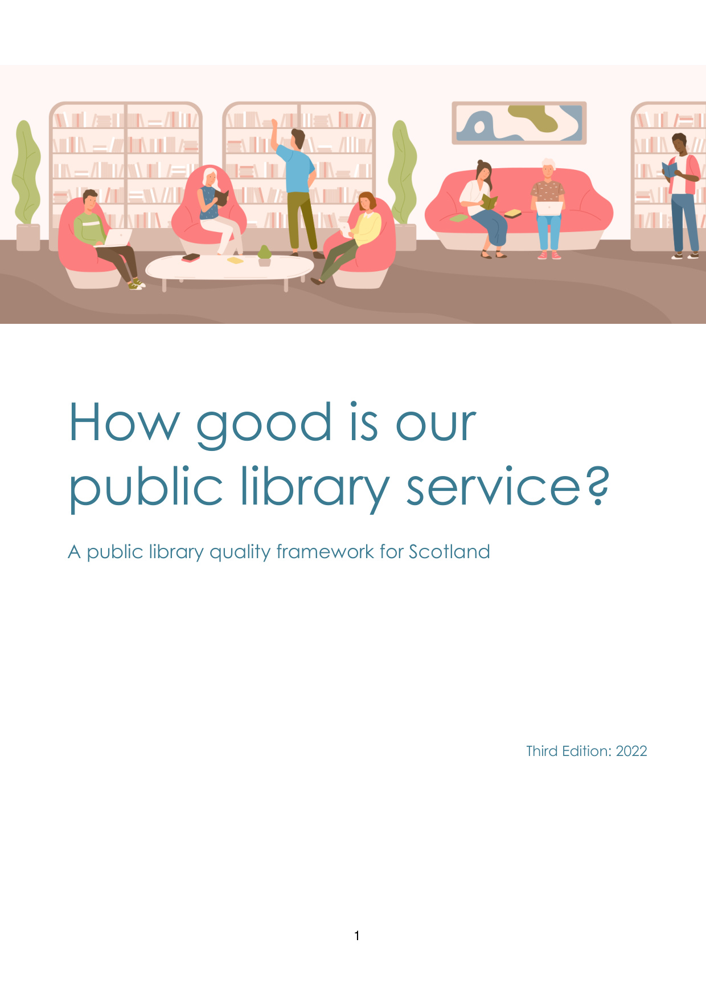

# How good is our public library service?

## A public library quality framework for Scotland

### Third Edition: 2022

### Scottish Library and Information Council

<!-- PAGE: 2 -->

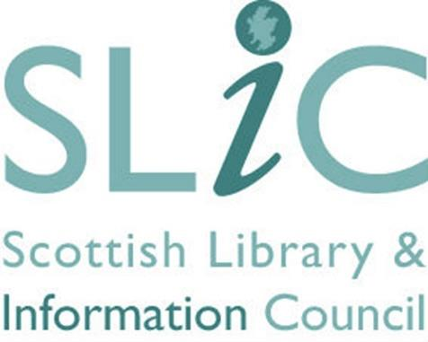

Scottish Library and Information Council  
Suite 5.5, 5th Floor, 180 West Regent Street, Glasgow G2 4RW  
[www.scottishlibraries.org](https://scottishlibraries.org)

<!-- PAGE: 3 -->

## Contents

- [Acknowledgements](#acknowledgements)
- [Part 1: Introduction](#part-1-introduction)
  - [Purpose](#purpose)
  - [Principles](#principles)
  - [Context](#context)
  - [Using this framework](#using-this-framework)
- [Part 2: The self-evaluation process](#part-2-the-self-evaluation-process)
  - [Planning for self-evaluation](#planning-for-self-evaluation)
  - [Gathering evidence](#gathering-evidence)
  - [Demonstrating impact](#demonstrating-impact)
  - [Determining the level](#determining-the-level)
  - [Sharing good practice](#sharing-good-practice)
  - [Peer review](#peer-review)
- [Part 3: The framework](#part-3-the-framework)
  - [The strategic context: the overarching questions](#the-strategic-context-the-overarching-questions)
  - [Quality Indicator 1: Supporting Reading](#quality-indicator-1-supporting-reading)
  - [Quality Indicator 2: Supporting Learning](#quality-indicator-2-supporting-learning)
  - [Quality Indicator 3: Engaging Communities](#quality-indicator-3-engaging-communities)
  - [The outcomes and impacts](#the-outcomes-and-impacts)
  - [Sources of evidence](#sources-of-evidence)
  - [The six point scale](#the-six-point-scale)
- [Bibliography](#bibliography)
- [Appendix 1: Mapping to National Outcomes and UN Sustainable Development Goals](#appendix-1-mapping-to-national-outcomes-and-un-sustainable-development-goals)
- [Appendix 2: Self-Evaluation Report Template](#appendix-2-self-evaluation-report-template)

<!-- PAGE: 4 -->

## Acknowledgements

This new version of *How good is our public library service: a public library quality framework for Scotland* was produced by Professor Peter Reid and Lyndsay Mesjar in 2022. It builds on the original framework commissioned by Scottish Library and Information Council in 2007, updated in 2014, and reflects the changing landscape of Scottish public library provision and local governance.

Grateful thanks are extended to the library staff and heads of service across Scotland who participated in the consultation process, shared feedback, and piloted elements of the revised framework.

<!-- PAGE: 5 -->

## Part 1: Introduction

### Purpose

*How good is our public library service: a public library quality framework for Scotland* builds on a mechanism originally developed in 2007, *Building on Success: a public library quality improvement matrix for Scotland*, produced by the Scottish Library and Information Council (SLIC), and its successor, *How good is our public library service?* (2014).

This third edition has been developed to provide a modern, streamlined and flexible quality assurance and self-evaluation framework for Scottish public library services. It is designed to assist services to:

- Reflect upon their current performance and identify areas of strength and areas requiring development;
- Engage in continuous quality improvement rooted in robust evidence;
- Demonstrate their contribution to local and national outcomes, including the Scottish Government’s National Performance Framework (NPF) and the United Nations Sustainable Development Goals (SDGs);
- Provide a coherent framework for external peer review and professional dialogue.

### Principles

The framework is founded upon core principles of self-evaluation and quality assurance:

- **Public-benefit focus:** Keeping the user and the community at the heart of all library service planning and delivery;
- **Reflective practice:** Encouraging an open, self-critical culture of continuous improvement across all levels of the workforce;
- **Proportionality:** Ensuring that self-evaluation is manageable, meaningful, and directly informs strategic service planning;
- **Peer learning:** Valuing external peer review as a collaborative learning experience rather than a compliance inspection.

<!-- PAGE: 6 -->

### Context

Public libraries in Scotland operate within a dynamic and evolving policy context. They are essential civic anchors that deliver on broad national priorities:

- Promoting social justice, civic engagement and democracy;
- Working in partnership with other agencies and organisations to offer value-added services;
- Supporting educational attainment, closing the poverty-related attainment gap, and fostering lifelong learning;
- Enabling digital participation and bridging digital divides;
- Supporting mental health, wellbeing, and social connection;
- Celebrating culture, creative expression, and local heritage.

The framework aligns directly with *Forward: Scotland’s Public Library Strategy 2021–2025*, connecting library service evaluation to the strategy’s three core pillars of **People**, **Place**, and **Partnership**.

### Using this Framework

The previous editions of *How good is our public library service* featured five quality indicators. In this revised edition, the framework has been streamlined into three core Quality Indicators:

- **Quality Indicator 1: Supporting Reading**
- **Quality Indicator 2: Supporting Learning**
- **Quality Indicator 3: Engaging Communities**

<!-- PAGE: 7 -->

### The Three Quality Indicators

| Quality Indicator | Focus Areas |
| :--- | :--- |
| **QI 1: Supporting Reading** | High quality spaces; diverse and suitable resources; active citizenship and trusted information; reading culture and literacy initiatives. |
| **QI 2: Supporting Learning** | Stimulating learning environments; formal and informal learning opportunities; improving life chances; physical and digital learning delivery. |
| **QI 3: Engaging Communities** | Reaching heart of communities; reflecting diverse cultures and heritage; economic and cultural growth; community wellbeing and resilience. |

<!-- PAGE: 8 -->

The former Quality Indicator 5, which looked at the vision and strategy for the service, has been removed and the aspects it covered are now embedded in a series of **overarching questions** that frame all three Quality Indicators:

- *How do we plan and manage high-quality people-centred services?*
- *How do we work in partnership to create more resilient, fairer and healthier communities?*
- *How do we use qualitative and quantitative evidence to support continuous improvement?*

Similarly, the outcomes and impacts of library services are evaluated through three concluding impact questions:

- *How do we communicate to ensure the voice of the library is heard by key stakeholders?*
- *What difference does this make to individuals, communities and society?*
- *How do we ensure that our service provision is sustainable?*

<!-- PAGE: 9 -->

## Part 2: The Self-Evaluation Process

Self-evaluation is a reflective process through which library services audit their performance, assess impact, and identify priorities for action.

*How good is our public library service* has a number of important elements:

- **Reflective audit:** Internal evaluation of strengths and areas for development by library managers and staff;
- **Evidence-based assessment:** Grounding assertions in verified quantitative metrics and qualitative user feedback;
- **Self-Evaluation Report (SER):** A concise written evaluative summary prepared by the library service;
- **Peer review visit:** A structured visit by external peer assessors who act as 'critical friends' to validate self-assessments and exchange best practice.

### Planning for Self-Evaluation

Effective self-evaluation requires careful preparation:

- **Scope:** Services may evaluate all three Quality Indicators across the whole service, or focus on selected indicators or specific service themes;
- **Team assembly:** Involving a cross-section of staff, including senior leaders, frontline staff, and specialist officers;
- **Timescale:** Establishing a realistic timeline for evidence gathering, stakeholder consultation, report drafting, and peer review.

<!-- PAGE: 10 -->

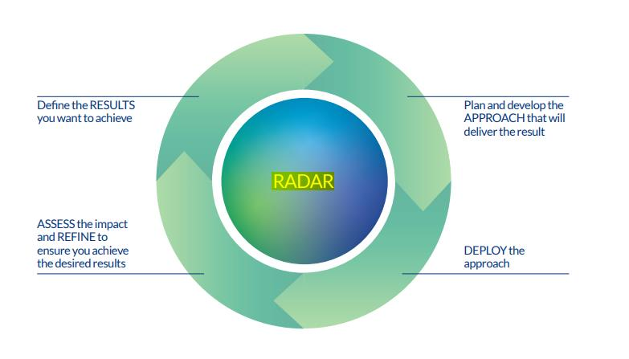

### The RADAR Methodology

The framework adopts the RADAR logic from the EFQM Excellence Model:

- **Results:** What is the service aiming to achieve and what results has it delivered?
- **Approaches:** What plans, policies, and activities are in place to achieve these results?
- **Deploy:** How effectively and consistently are these approaches implemented across service points?
- **Assess & Refine:** How does the service monitor performance, review impact, and refine approaches based on evidence?

### The Self-Evaluation Report (SER)

The Self-Evaluation Report should be evaluative rather than purely descriptive. It should answer the question: *How do we know how good our service is, and what difference are we making?*

<!-- PAGE: 11 -->

### Gathering Evidence

Evidence is the foundation of credible self-evaluation. It demonstrates performance, validates assertions, and shows impact. It can help in establishing how well the service is meeting users’ needs.

Evidence can be quantitative or qualitative:

- **Quantitative evidence:** Records what can be counted or measured:
  - Visitor numbers (physical and virtual);
  - Book lending and digital content circulation (eBooks, audiobooks, eMagazines);
  - PC usage and Wi-Fi sessions;
  - Event attendances (Bookbug sessions, coding clubs, author visits, digital workshops);
  - Performance against CIPFA and local authority performance indicators.

- **Qualitative evidence:** Demonstrates the quality, experience, and impact of services:
  - User feedback and satisfaction surveys;
  - Focus group feedback and user journey interviews;
  - Case studies demonstrating individual transformations;
  - Staff observations and stakeholder testimonials.

<!-- PAGE: 12 -->

Photographs, audio and video clips of library activities are also useful to demonstrate particular strengths.

### Demonstrating Impact

Demonstrating impact requires moving beyond counting outputs (e.g. number of books loaned) to evaluating outcomes (e.g. improved reading confidence in children, reduced social isolation in older people).

The 'So What?' test should be applied to every piece of evidence:
- *We held 200 digital skills classes — So what?* Users gained the confidence to book doctor appointments online, apply for welfare benefits, and stay in touch with families.
- *We introduced a sensory garden at the branch library — So what?* It created a calming, dementia-friendly space that increased visits by carers and local care homes.

<!-- PAGE: 13 -->

### Determining the Level

Based on the evidence gathered, the service awards itself a level for each Quality Indicator on a six-point scale:

- **Level 6:** Excellent (outstanding, sector-leading)
- **Level 5:** Very good (major strengths, high standard)
- **Level 4:** Good (important strengths outweigh weaknesses)
- **Level 3:** Satisfactory (strengths just outweigh weaknesses)
- **Level 2:** Weak (important weaknesses impact quality)
- **Level 1:** Unsatisfactory (major weaknesses requiring urgent remedial action)

A realistic and honest self-assessment is essential: over-grading obscures areas needing development, while under-grading fails to celebrate genuine excellence.

### Sharing Good Practice

An essential outcome of the evaluation process is identifying high-impact innovations and best practices that can be shared across Scotland's public library network.

<!-- PAGE: 14 -->

### Peer Review

The peer review process provides external validation and professional dialogue.

#### Peer Review Panel
The peer review panel consists of three members with one acting as convener:
- Two senior library practitioners from other Scottish local authorities;
- One external reviewer (e.g. from SLIC, Education Scotland, or academia).

#### The Peer Review Visit
The visit takes place over one or two days and includes:
- Meeting with the library leadership team to discuss the Self-Evaluation Report;
- Meeting with frontline library staff, partners, and community stakeholders;
- Visiting service points to observe activities and talk with library users;
- Reviewing documentary evidence and performance data.

#### Feedback and Report
At the conclusion of the visit, the panel provides verbal feedback to the head of service and prepares a concise written report confirming or adjusting the grades and highlighting key strengths and recommendations for development.

<!-- PAGE: 15 -->

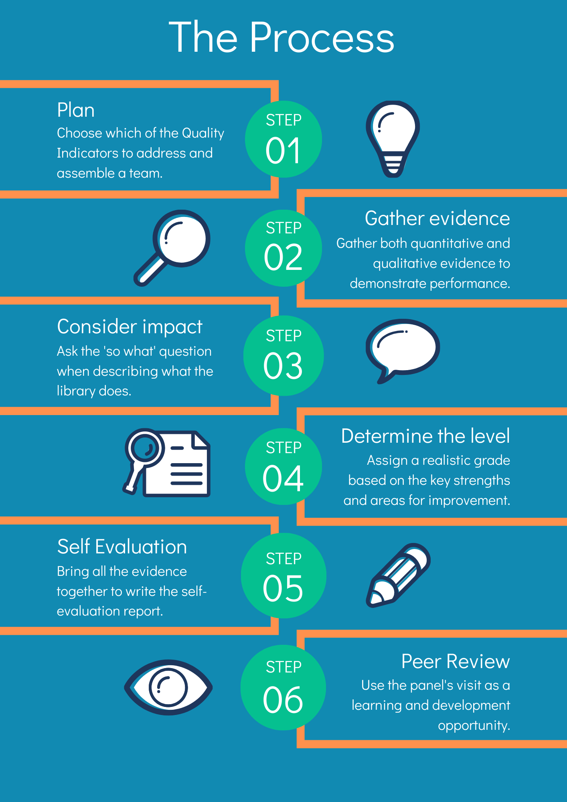

### The Self-Evaluation and Peer Review Process

| Step | Stage | Action |
| :--- | :--- | :--- |
| **01** | **Plan** | Choose which of the Quality Indicators to address and assemble a team. |
| **02** | **Gather Evidence** | Gather both quantitative and qualitative evidence to demonstrate performance. |
| **03** | **Consider Impact** | Ask the 'so what' question when describing what the library does. |
| **04** | **Determine Level** | Assign a realistic grade based on key strengths and areas for improvement. |
| **05** | **Self Evaluation** | Bring all the evidence together to write the self-evaluation report. |
| **06** | **Peer Review** | Use the panel's visit as a learning and development opportunity. |

<!-- PAGE: 16 -->

## Part 3: The Framework

The *How good is our public library service* framework is designed for public library services of all sizes and governance structures (local authority departments, arm's-length external organisations, and charitable culture trusts).

It comprises:

- **Overarching Questions:** Addressing strategic planning, partnership working, and evidence-based continuous improvement;
- **Three Quality Indicators:** Supporting Reading, Supporting Learning, and Engaging Communities;
- **Outcomes and Impacts:** Evaluating communication, societal value, and long-term sustainability;
- **Six-Point Scale:** Clear descriptors for assigning evaluative grades from Level 1 to Level 6.

<!-- PAGE: 17 -->

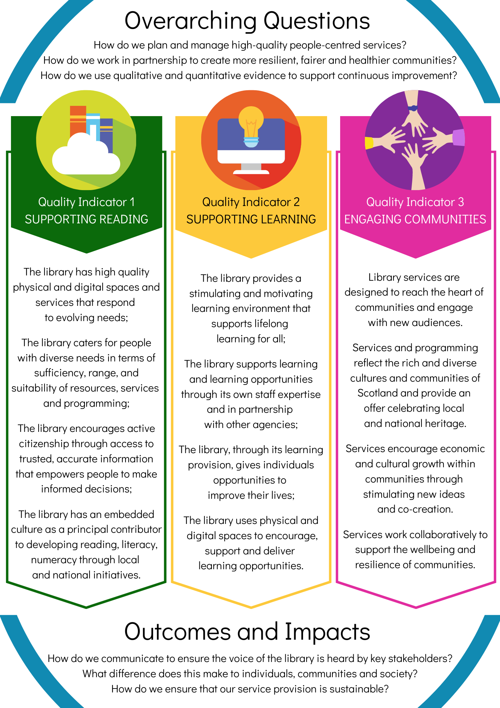

<!-- PAGE: 18 -->

### The Strategic Context: The Overarching Questions

The following questions apply to all of the quality indicators and should be addressed across the evaluation:

#### 1. How do we plan and manage high-quality people-centred services?
- How effectively do service plans reflect local community priorities and the Scottish Government's National Performance Framework?
- How are user needs identified and consulted upon, particularly those of under-represented or disadvantaged groups?
- How are staff deployed, supported, and trained to deliver responsive, high-quality services?
- How are physical buildings, mobile libraries, and digital services managed and maintained?

#### 2. How do we work in partnership to create more resilient, fairer and healthier communities?
- How actively does the library service participate in Community Planning Partnerships (CPPs) and Health and Social Care Partnerships (HSCPs)?
- How effectively does the service collaborate with third sector organisations, educational institutions, cultural bodies, and businesses?
- How do partnerships enhance service delivery, extend reach, and avoid duplication?

#### 3. How do we use qualitative and quantitative evidence to support continuous improvement?
- What performance indicators, data streams, and benchmark metrics are routinely collected and analysed?
- How is qualitative feedback from users and non-users gathered and acted upon?
- How is self-evaluation embedded into regular service planning cycles?

<!-- PAGE: 19 -->

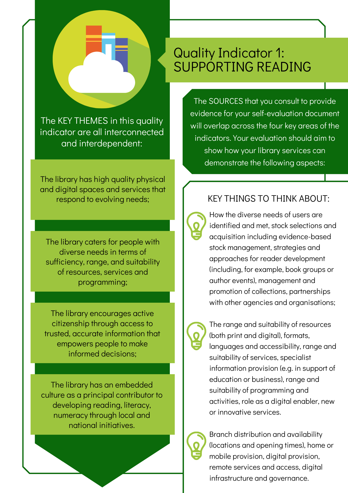

### Quality Indicator 1: Supporting Reading

#### Key Themes
1. **The library has high quality physical and digital spaces and services** that respond to evolving needs.
2. **The library caters for people with diverse needs** in terms of sufficiency, range, and suitability of resources, services and programming.
3. **The library encourages active citizenship** through access to trusted, accurate information that empowers people to make informed decisions.
4. **The library has an embedded culture as a principal contributor** to developing reading, literacy, numeracy through local and national initiatives.

#### Key Things to Think About
- Identification of diverse user needs; evidence-based stock selection, acquisition, and circulation management;
- Strategies for reader development, reading groups, author visits, and book festivals;
- Range and suitability of print and digital formats (eBooks, audiobooks, large print, dyslexia-friendly, community languages);
- Role as a digital enabler and trusted source of unbiased public information;
- Branch distribution, opening hours, mobile library coverage, home delivery, and digital accessibility.

<!-- PAGE: 20 -->

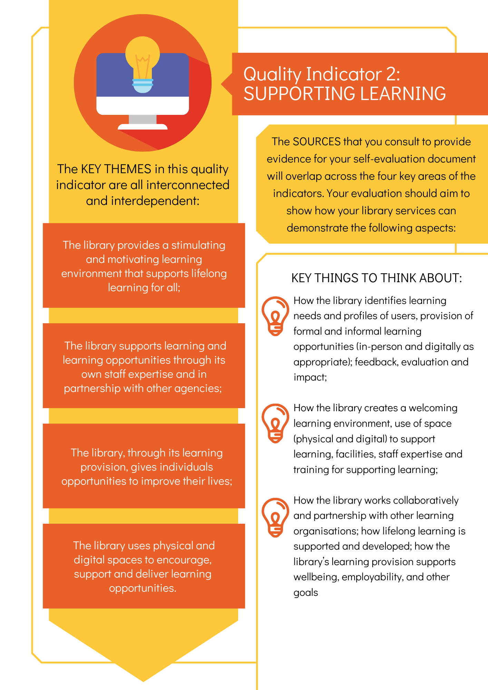

### Quality Indicator 2: Supporting Learning

#### Key Themes
1. **The library provides a stimulating and motivating learning environment** that supports lifelong learning for all.
2. **The library supports learning and learning opportunities** through its own staff expertise and in partnership with other agencies.
3. **The library, through its learning provision, gives individuals opportunities** to improve their lives.
4. **The library uses physical and digital spaces** to encourage, support and deliver learning opportunities.

#### Key Things to Think About
- Profiling learning needs across the community (early years, school pupils, jobseekers, adult learners, senior citizens);
- Formal and informal learning provision (digital skills classes, language learning, family history research, study space);
- Staff expertise in digital mentoring and learner support;
- Collaborative partnerships with adult learning providers, colleges, schools, and Skills Development Scotland;
- Contribution to employability, health literacy, and educational attainment.

<!-- PAGE: 21 -->

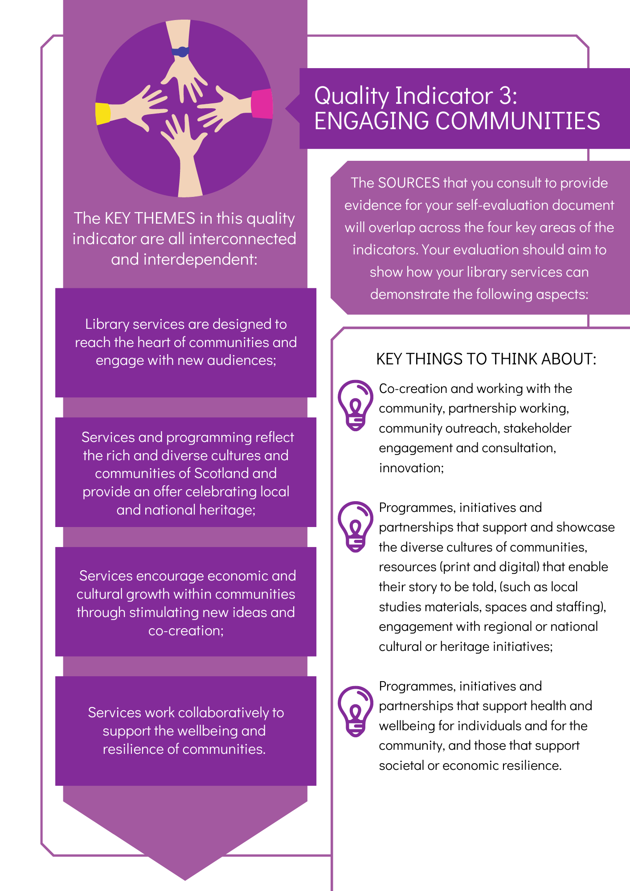

### Quality Indicator 3: Engaging Communities

#### Key Themes
1. **Library services are designed to reach the heart of communities** and engage with new audiences.
2. **Services and programming reflect the rich and diverse cultures and communities** of Scotland and provide an offer celebrating local and national heritage.
3. **Services encourage economic and cultural growth** within communities through stimulating new ideas and co-creation.
4. **Services work collaboratively** to support the wellbeing and resilience of communities.

#### Key Things to Think About
- Co-creation with community groups, active consultation, and participatory budgeting;
- Cultural programming, author residencies, local history archives, and Gaelic / Scots language initiatives;
- Support for local businesses, maker spaces, enterprise hubs, and creative industries;
- Health and wellbeing initiatives: social prescribing, dementia-friendly services, warm spaces, and combating social isolation.

<!-- PAGE: 22 -->

### The Outcomes and Impacts

Having considered the evidence in respect of both the overarching questions and the specific Quality Indicators, services evaluate their overall impact:

#### 1. How do we communicate to ensure the voice of the library is heard by key stakeholders?
- How effectively does the service advocate its value and impact to elected members, council directors, and community planning partners?
- How does the service use media, social channels, and public reporting to highlight achievements?
- Are performance reports clear, compelling, and outcome-focused?

#### 2. What difference does this make to individuals, communities and society?
- What evidence exists of improved health and wellbeing, higher educational attainment, or increased employability among users?
- How has library provision strengthened community cohesion and social capital?
- How do services measure social and economic return on investment (SROI)?

#### 3. How do we ensure that our service provision is sustainable?
- How are resources managed to ensure environmental, financial, and operational sustainability?
- How does the service adapt to demographic shifts and emerging community needs?
- What strategies are in place for workforce succession planning and continuous development?

<!-- PAGE: 23 -->

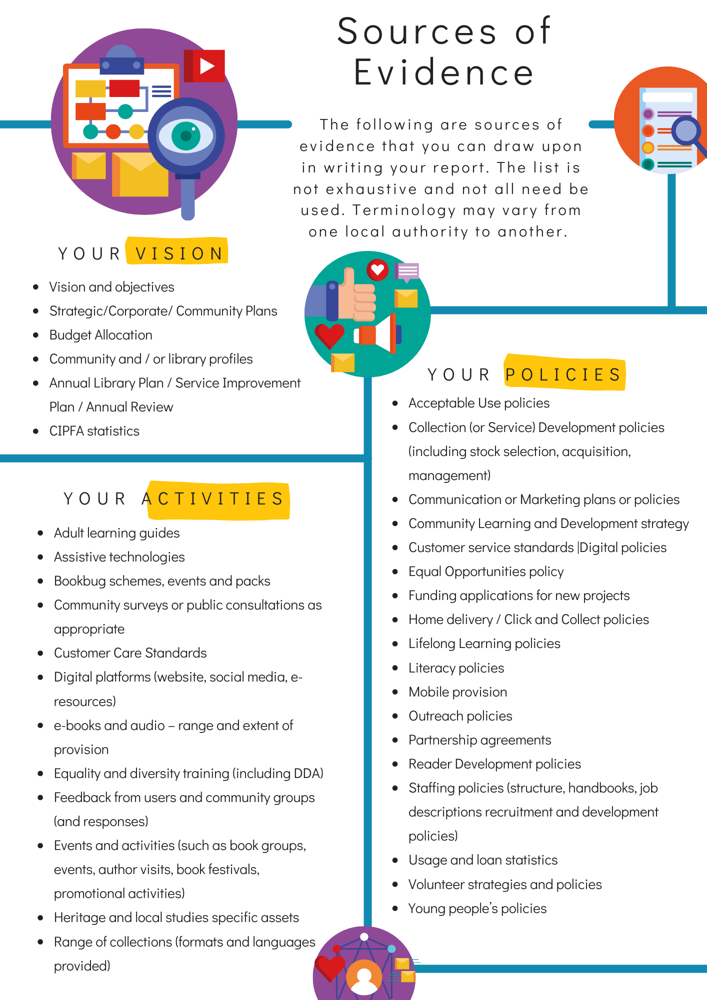

### Sources of Evidence

#### Your Vision
- Vision, mission, and strategic service objectives
- Strategic / Corporate / Community Plans
- Budget allocations and financial plans
- Community demographic and library catchment profiles
- Annual Library Plan / Service Improvement Plan / Annual Review
- CIPFA public library statistics and benchmarking data

#### Your Activities
- Adult learning guides and course programmes
- Assistive technologies and accessible equipment
- Bookbug schemes, events, and gift bags
- Community surveys and public consultation findings
- Customer Care Standards and service charters
- Digital platforms (websites, social media channels, mobile apps)
- eBook, eAudiobook, and online resource provision metrics
- Equality and diversity training records (including DDA/Equality Act compliance)
- User feedback, comments, and complaints logs
- Promotional events, reading groups, author tours, and exhibitions
- Local studies and heritage collections
- Stock distribution, format diversity, and language coverage

#### Your Policies
- Acceptable Use policies (computers and Wi-Fi)
- Collection (or Service) Development and Stock Management policies
- Communication, marketing, and social media policies
- Community Learning and Development (CLD) strategies
- Customer Service Standards and Digital policies
- Equal Opportunities and Diversity policies
- Project funding bids and grant evaluation reports
- Home delivery and Click-and-Collect policies
- Lifelong learning and literacy policies
- Mobile library service policies and route schedules
- Outreach and social inclusion policies
- Partnership agreements and Service Level Agreements (SLAs)
- Reader Development policies
- Staffing policies (job descriptions, induction, CPD programmes)
- Usage, loan, and visitor statistics
- Volunteer strategies and volunteer agreements
- Children and Young People's policies

<!-- PAGE: 24 -->

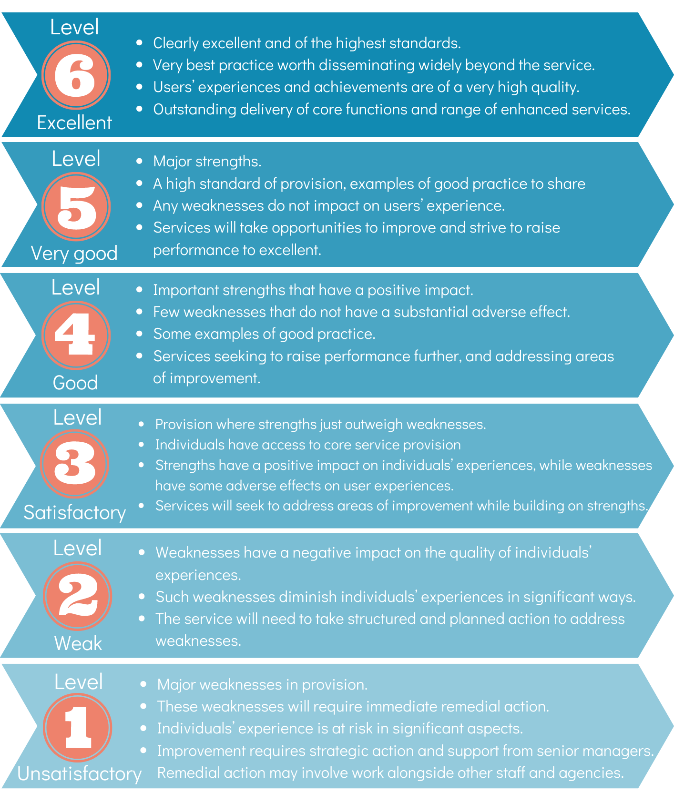

### The Six Point Scale

*How good is our public library service* operates using a six point scale. Awarding levels requires considerable professional knowledge both on the part of the library service itself as they create the Self-Evaluation Report and on the part of the Peer Assessors during the peer review process.

| Level | Grade | Evaluative Descriptor |
| :---: | :--- | :--- |
| **6** | **Excellent** | - Clearly excellent and of the highest standards. - Very best practice worth disseminating widely beyond the service. - Users’ experiences and achievements are of a very high quality. - Outstanding delivery of core functions and range of enhanced services. |
| **5** | **Very good** | - Major strengths. - A high standard of provision, examples of good practice to share. - Any weaknesses do not impact on users’ experience. - Services will take opportunities to improve and strive to raise performance to excellent. |
| **4** | **Good** | - Important strengths that have a positive impact. - Few weaknesses that do not have a substantial adverse effect. - Some examples of good practice. - Services seeking to raise performance further, and addressing areas of improvement. |
| **3** | **Satisfactory** | - Provision where strengths just outweigh weaknesses. - Individuals have access to core service provision. - Strengths have a positive impact on individuals’ experiences, while weaknesses have some adverse effects on user experiences. - Services will seek to address areas of improvement while building on strengths. |
| **2** | **Weak** | - Weaknesses have a negative impact on the quality of individuals’ experiences. - Such weaknesses diminish individuals’ experiences in significant ways. - The service will need to take structured and planned action to address weaknesses. |
| **1** | **Unsatisfactory** | - Major weaknesses in provision. - These weaknesses will require immediate remedial action. - Individuals’ experience is at risk in significant aspects. - Improvement requires strategic action and support from senior managers. - Remedial action may involve work alongside other staff and agencies. |

<!-- PAGE: 25 -->

## Bibliography

- Education Scotland, 2022, *How Good is Our Culture and Sport*, Livingston: Education Scotland.
- Scottish Government, 2018, *National Performance Framework*, Edinburgh: Scottish Government. [nationalperformance.gov.scot](https://nationalperformance.gov.scot)
- Scottish Library and Information Council, 2014, *How good is our public library service? A public library improvement model for Scotland*, Glasgow: SLIC.
- Scottish Library and Information Council, 2015, *Ambition & Opportunity: A Strategy for Public Libraries in Scotland 2015–2020*, Glasgow: SLIC.
- Scottish Library and Information Council, 2021, *Forward: Scotland’s Public Library Strategy 2021–2025*, Glasgow: SLIC.
- United Nations, 2015, *Transforming our World: The 2030 Agenda for Sustainable Development*, New York: United Nations.

<!-- PAGE: 26 -->

## Appendix 1: Mapping to National Outcomes and UN Sustainable Development Goals

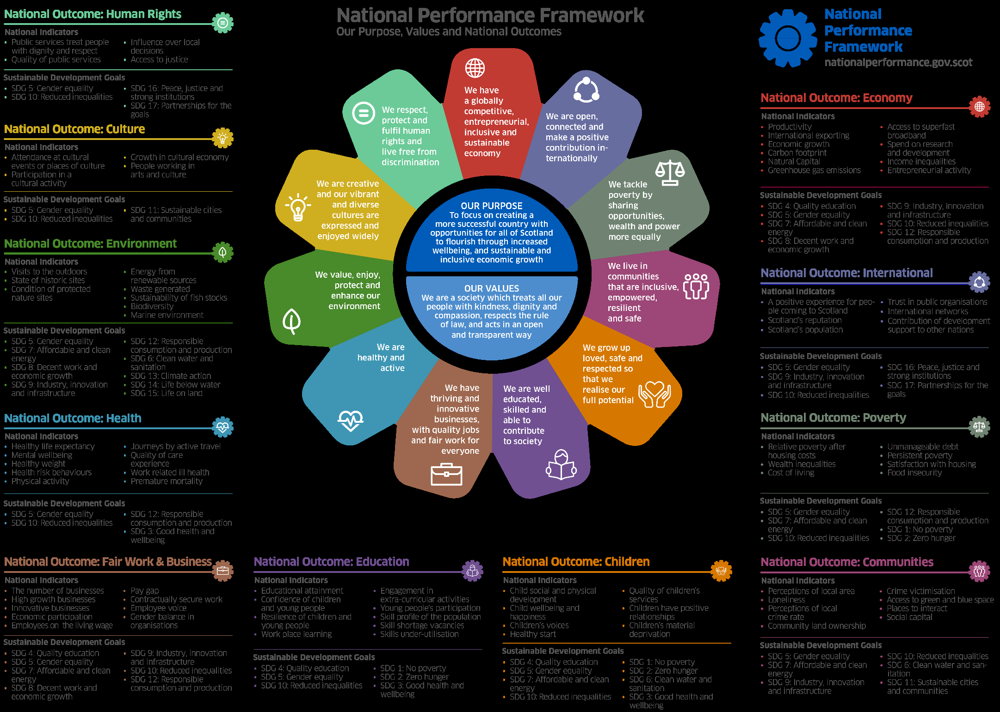

<!-- PAGE: 27 -->

### Alignment with the National Performance Framework

The *How good is our public library service* framework aligns directly with the vision of Scotland's public libraries:

> **Public Libraries: Connecting communities to learning, reading, information and technology.**

#### Alignment Matrix: Quality Indicators to National Outcomes & SDGs

| Quality Indicator | Scottish National Outcomes | UN Sustainable Development Goals (SDGs) |
| :--- | :--- | :--- |
| **QI 1: Supporting Reading** | - **Culture:** We are creative and our vibrant and diverse cultures are expressed and enjoyed widely. - **Education:** We are well educated, skilled and able to contribute to society. - **Children:** We grow up loved, safe and respected so that we realise our full potential. | - **SDG 4:** Quality Education - **SDG 10:** Reduced Inequalities - **SDG 11:** Sustainable Cities and Communities |
| **QI 2: Supporting Learning** | - **Education:** We are well educated, skilled and able to contribute to society. - **Economy:** We have a globally competitive, entrepreneurial, inclusive and sustainable economy. - **Fair Work & Business:** We have thriving and innovative businesses, with quality jobs and fair work for everyone. | - **SDG 4:** Quality Education - **SDG 8:** Decent Work and Economic Growth - **SDG 9:** Industry, Innovation and Infrastructure |
| **QI 3: Engaging Communities** | - **Communities:** We live in communities that are inclusive, empowered, resilient and safe. - **Health:** We are healthy and active. - **Poverty:** We tackle poverty by sharing opportunities, wealth and power more equally. - **Human Rights:** We respect, protect and fulfil human rights and live free from discrimination. | - **SDG 3:** Good Health and Well-being - **SDG 10:** Reduced Inequalities - **SDG 11:** Sustainable Cities and Communities - **SDG 16:** Peace, Justice and Strong Institutions |

<!-- PAGE: 28 -->

### National Performance Targets and Public Library Contribution

Public library services contribute to key National Indicators:

- **Attendance at cultural events and places of culture**
- **Participation in cultural and creative activities**
- **Workplace learning and adult literacy attainment**
- **Skill profile of the population**
- **Internet access and digital skills uptake**
- **Mental wellbeing and healthy life expectancy**
- **Perceptions of local area and community social capital**

<!-- PAGE: 29 -->

## Appendix 2: Self-Evaluation Report Template

Self-evaluation is an important diagnostic tool for any public service and it forms the foundation of *How good is our public library service*.

### Self-Evaluation Report Structure

#### 1. Context and Background
- Brief summary of the local authority area, population demographics, deprivation indices, and library service structure;
- Strategic priorities of the council / trust and the library service.

#### 2. Overarching Questions
- How the service plans, manages, and delivers people-centred provision;
- Key partnership arrangements and community planning integration;
- Mechanisms for gathering and evaluating performance evidence.

#### 3. Evaluation of Quality Indicators
For each Quality Indicator evaluated:
- **Key Strengths:** Specific achievements, innovations, and high-performing areas supported by evidence;
- **Areas for Development:** Candid assessment of challenges, service gaps, or improvement priorities;
- **Evaluative Level Awarded:** Grade on the six-point scale with clear rationale.

#### 4. Outcomes and Impacts
- Evidence of difference made to individuals, communities, and society;
- Stakeholder communication and advocacy;
- Sustainability and future planning.

#### 5. Action Plan
- Specific, measurable actions to address identified areas for development;
- Designated lead officers, target milestones, and review dates.

<!-- PAGE: 30 -->

### Key Information to Accompany the Report

When submitting the Self-Evaluation Report to the Peer Review Panel, services should provide:

| Category | Information / Evidence |
| :--- | :--- |
| **Coverage** | List of all physical service points, mobile libraries, opening hours, and staff establishment. |
| **Performance Data** | Latest annual CIPFA statistics, local authority KPI returns, and internal performance dashboards. |
| **Policy Documentation** | Current service strategy, collection development policy, customer charter, and CLD plan. |
| **Feedback Evidence** | Recent user survey results, public consultation summaries, and complaints analysis. |
| **Case Studies** | 2–3 detailed case studies demonstrating impact in reader development, learning, or community engagement. |

---

Published by the Scottish Library and Information Council (SLIC), 2022.  
Third Edition.  
[www.scottishlibraries.org](https://scottishlibraries.org)
