<!-- PAGE: 1 -->

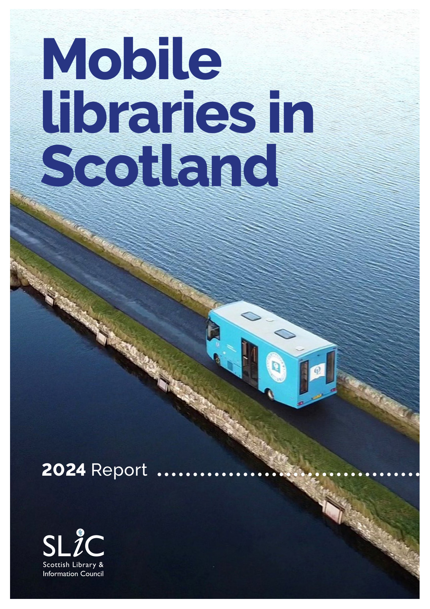

# Mobile Libraries in Scotland 2024 Report

**Scottish Library and Information Council (SLIC)**  
*July 2024*

---

Mobile libraries in Scotland

## 2024 Report

<!-- PAGE: 2 -->

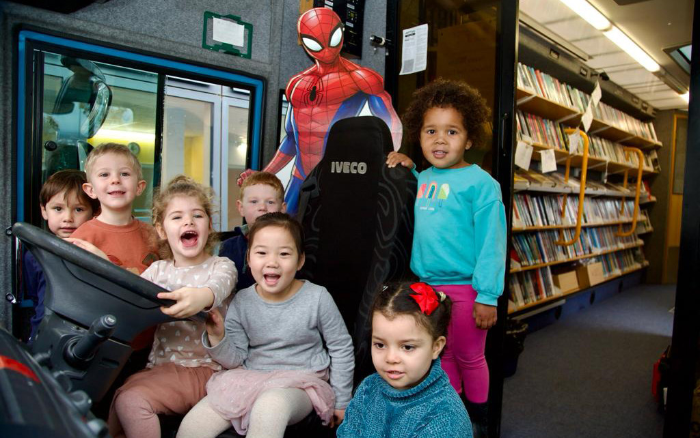

Contents

Executive Summary

Introduction

Mobile libraries during the pandemic

Current mobile library provision

Mobile library vehicles

Costs of mobile library provision

Benefits and strategic fit of mobile libraries

Rural and island communities

Alternatives to mobile libraries

Impacts of changes to provision

Recommendations for the future

Conclusion <!-- PAGE: 3 --> ## 1  Executive Summary

This report updates Libraries on the Move (2019) and outlines current mobile library provision in Scotland. It looks at how these services adapted during the pandemic, current usage levels, the vehicles and greener options, costs, and possible alternatives to public access mobile libraries.

The report is based on desk research, survey results, interviews with library staff, and analysis of data from various sources to assess changes in provision in the last five years.

* users range from families with young children to people in their 90s
* mobile library services can contribute up to 15% of a library service’s loans and visits
* Mobile Libraries Day in November encourages awareness and engagement, and has spread outwith Scotland
* there is scope for improved marketing and awareness of mobile library services, particularly information available on websites
* alternative services such as home delivery are appreciated by some customers but others miss the social connection of a public access mobile library
* the value of the mobile library service has been calculated (in East of England) at £49.70 benefit value per participant per year. In Scotland, this would equate to a value of £1.4m
* mobile library services and the staff are hugely valued by customers, and their loss can have negative impacts particularly on wellbeing and loneliness.

1.1 Key findings

* The report findings include:
* there are 11 fewer public access mobile library vehicles than five years ago
* it is an ageing fleet with 40% of the vehicles over 10 years old, and 68% over seven years old
* high cost of replacement vehicles is often one of the main reasons for discontinuing a mobile service
* some electric vehicles are being introduced, mainly as smaller delivery vehicles i.e. no public access
* few current vehicles are equipped with ICT facilities for the public (or staff), including internet access
* recovery of usage levels is mixed, with some routes now at pre-pandemic levels, and some below
* stops and routes with nurseries and primary schools have seen the best recovery and engagement post-pandemic

<!-- PAGE: 4 -->

Continued future provision is uncertain, with councils facing financial difficulties. Of prime concern is the ageing fleet. Scottish Government support to invest in modern, ICT equipped, and possibly electric public access vehicles is one of this report's main recommendations, to enable these valuable services to continue.

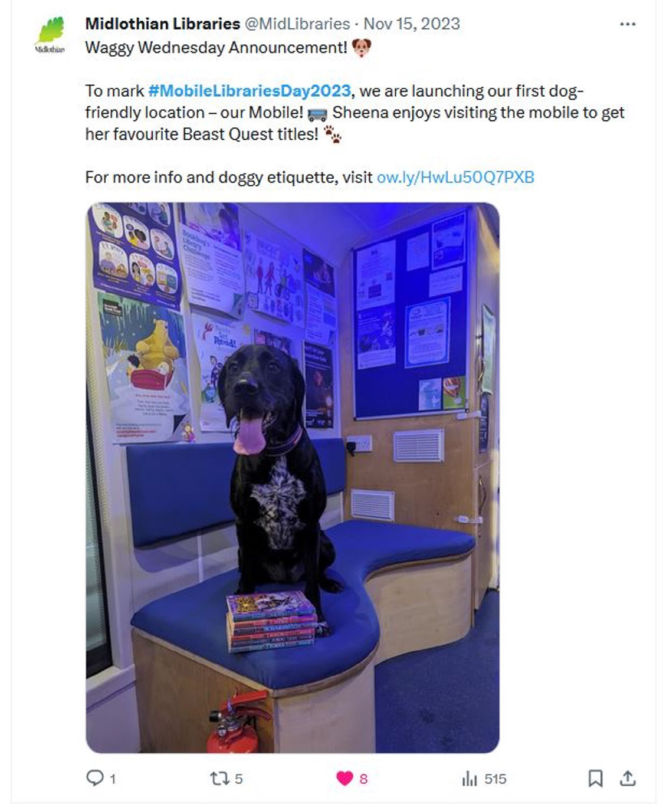

*Image: dog friendly mobile library service in Midlothian (source X/Twitter)*

<!-- PAGE: 5 -->

Highlights of Scottish mobile libraries in figures include:

ages of the vehicles range from 1 year to

37 mobile libraries in 19 authorities

16 years old*

330,585 loans made in 2022/23*

190,645 visits in 2022/23*

28,575 registered members*

317 routes across Scotland*

2239 stops*

(*figures for 17 of 19 library services)

<!-- PAGE: 6 -->

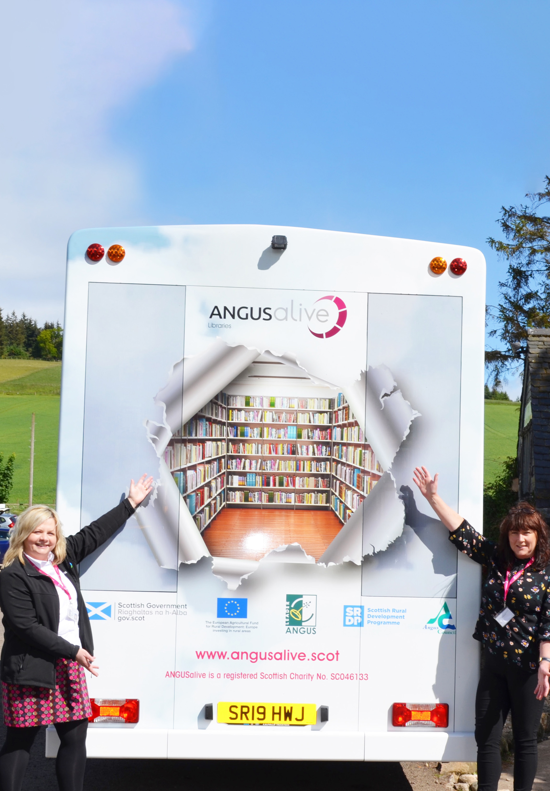

Introduction <!-- PAGE: 7 --> ## 2  Introduction

The five years since Libraries on the Move1 (a report on Scottish mobile library provision and benefits) was published have been tumultuous. The pandemic affected library services for over two years; the cost of living crisis led to many static libraries becoming official ‘warm spaces’; there are rising levels of rural poverty; and local government finances are under considerable pressure.

Alongside a literature review, desk research, and a review of library websites, surveys were issued to Scottish library services currently operating mobile libraries, and to those who had recently paused or removed mobiles. Almost all responded (20 out of 22), and follow up interviews were undertaken with four library managers. The time and effort of all staff involved to complete the survey and/ or discuss mobile libraries in more depth is gratefully acknowledged and appreciated. Quotes in this report are from the survey and interview responses and have been anonymised. Where services are named this is from information which is in the public domain.

Given fluctuating social, economic, environmental and political challenges, SLIC (Scottish Library and Information Council) commissioned an update to the Libraries on the Move report to review current mobile library provision in Scotland.

* The report’s aims were:
* to provide up to date figures on mobile library provision
* to review how mobile libraries adapted during the pandemic
* to look at the impact of loss of mobile library services
* to look at alternatives to mobile libraries
* to consider net zero targets for vehicles.

Libraries on the Move contained extensive evidence of the benefits of mobile library services, from published literature and a Scottish mobile library user survey. This has not been replicated here, and was not part of the brief; Libraries on the Move should be used for this information.

The research undertaken for this new report included an updated literature search using a variety of different databases and search terms. Very few relevant articles have been published since 2018/19. They have been included where appropriate within this report.

Scottish Library and Information Council (2019) Libraries on the Move. From: https://scottishlibraries.org/about- us/our-publications/special-studies/ <!-- PAGE: 8 --> The report continues with the following sections:

Mobile libraries during the pandemic

Rural and island communities

Current mobile library provision

Alternatives to mobile libraries

Mobile library vehicles

Impacts of changes to provision

Costs of mobile library provision

Recommendations and future ideas

Benefits and strategic fit of mobile libraries

Conclusion

But first, what does a mobile library service do? Here’s what one service does:

“

The mobile library service over recent years has provided the loan of library books, supported members of the public to connect digitally, supported our more rural vulnerable residents with resolving Council enquiries, provided school visits, provided social connections within rural communities to prevent isolation, provided valuable information and connections on activities, events and opportunities for individuals that may not have the means/connections to do so.”

(Moray2)

For a service which is essentially a person, a vehicle and a collection of resources, this is a very broad remit and an incredible achievement.

(NB Quotes are from survey responses by library managers unless otherwise specified.)

Moray Council (2023) Budget 2023/24. From: http://www.moray.gov.uk/moray_standard/page_150885.html <!-- PAGE: 9 -->

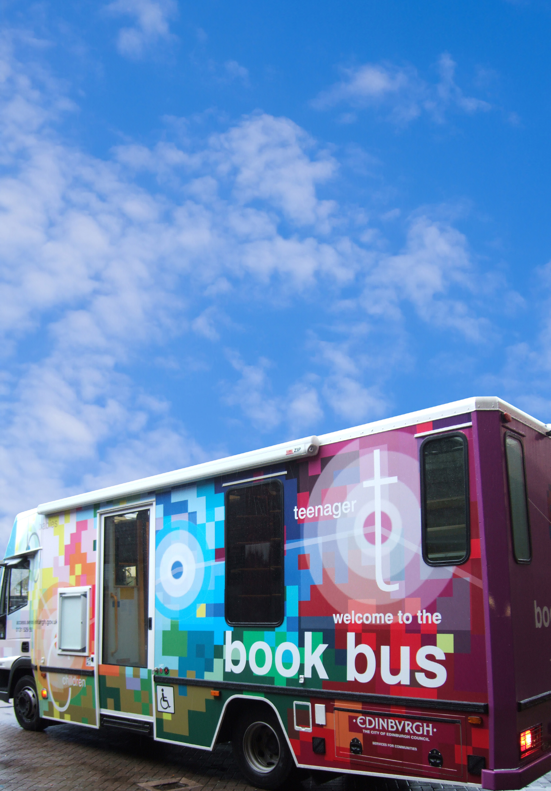
 Mobile libraries during the pandemic <!-- PAGE: 10 --> 3  Mobile libraries during the pandemic

Along with nearly all public services, Scottish public libraries went into lockdown on 24th March 2020. No mobile library services operated from this date, and static library buildings were shut.  People were able to access digital library services, e.g. to borrow e-books, e-magazines.

From June to August 2020 restrictions were gradually eased across Scotland, with public libraries allowed to re-open from 15th July 2020. However, as outlined in the Libraries in Lockdown report,3 this did not mean all branch libraries and all mobile libraries started up in all councils on this day. A lot of new processes had to be put in place including changes for physical distancing, cleaning, quarantining books etc. The re-opening of library services including mobiles was patchy, both locally and at a national level. From autumn 2020 onwards more restrictions were gradually reintroduced, with another full lockdown across Scotland from January to late April 2021. On 9th August 2021 Scotland moved ‘beyond level zero’, effectively meaning the end of most restrictions.4

3.1 Adapting to deliver during the pandemic

The Libraries in Lockdown report details what public libraries in Scotland did during the first lockdown and up to autumn 2020, with nearly all 32 services offering some sort of ‘click and collect’ service once this was allowed from late July 2020 onwards. This enabled people to order a selection of books and to collect them from a static library or other community location, or from a mobile library stop, often at a pre-arranged time to avoid queues. NB The ‘click and collect’ style service had different names across Scotland; for simplicity this report refers to all of them as ‘click and collect’.

Home deliveries were possible from late summer 2020 once the restrictions were eased. Traditionally most library services only provide a home or housebound delivery service to those who are vulnerable or poorly, unable to leave their home, or over a certain age, but during the pandemic it was often broadened to include more people, especially mobile library customers. For housebound and mobile library users, many services used their smaller home delivery (housebound) vans to provide bags of books on people’s doorsteps. Often this home delivery service was expanded to other people who preferred this option over collecting from elsewhere.

The survey found that some mobile library services didn’t return to full on-board public access until September 2021, and some had ongoing staff or vehicle issues for longer.

The Accounts Commission’s 2022 report on local government said that “most library services were still operating a reduced service in early 2022, compared to pre-pandemic.”5

SLIC/ Peter Reid & Lyndsay Bloice (2021) Libraries in Lockdown. From https://scottishlibraries.org/about-us/ our-publications/special-studies/ The Scottish Parliament (2023) Timeline of Coronavirus (COVID-19) in Scotland. From: https://spice-spotlight. scot/2023/05/10/timeline-of-coronavirus-covid-19-in-scotland/ Accounts Commission (2022) Local government in Scotland Overview 2022. From https://www.audit-scotland. gov.uk/publications/local-government-in-scotland-overview-2022 <!-- PAGE: 11 --> These efforts were greatly appreciated by customers. One service provided sample comments received from users during the pandemic:

### 3.1.1 Engaging with customers

Several services phoned all their existing mobile and home delivery customers to discuss their requirements and to provide options during lockdown. Before the resumption of any physical book exchanges, this was limited to digital books, magazines etc.

“

What a great service. An absolute lifesaver in these difficult times. Thank you for keeping the service going through the pandemic. The staff have been so helpful and provided a really good service.” [public library user] “

This level of customer engagement perhaps wouldn’t be possible under normal circumstances given resource pressures, but particularly where staff were available it was something which could be achieved whilst working from home.

Many thanks for keeping us supplied with reading matter for the last 18 months. It has been very much appreciated and has helped us through this awful pandemic.” [public library user]

Both the Libraries in Lockdown report and Making a Difference: Libraries during Lockdown note how valuable engagement from staff was to customers. For example, Perth and Kinross ran a Letters of Kindness project delivered by the mobile library service.7

Many services reported that this home delivery service remains popular and most have continued the expanded service i.e. open to more people than the traditional housebound categories.

“

During the second lockdown the drivers went out and delivered books and the project ‘Letters of Kindness’. ‘Letters of Kindness’ was a staff suggestion that was funded by The Carnegie Trust. Staff wrote letters to housebound readers, many of them returning letters. This was all delivered via the mobile service.”

“

The library service provided home delivery bags to our usual mobile library customers, delivered using a smaller delivery van. The mobile library van was in the garage during this time. This was the first service we resumed after lockdown, and very quickly we expanded and offered it to anyone who wanted it as well as current mobile customers.”

However, some services were thwarted in what they were allowed to do. Quotes from library managers in Scotland in the Carnegie UK Trust report Making a Difference reveal that risk assessments and fear meant they couldn’t deliver some sort of home delivery service.

“

We have tried three to four times to get the home library service up and running but we haven’t been able to pass the risk assessments.”6

Carnegie UK Trust (2020) Making a Difference: Libraries, lockdown and looking ahead. From: https:// carnegieuktrust.org.uk/publications/making-a-difference-libraries-lockdown-and-looking-ahead/ Diouri, A. (2021) Library Letters: Pen-pal project that brought Perth and Kinross community together to continue. The Courier. From: https://www.thecourier.co.uk/fp/news/perth-kinross/2382541/library-letters-pen-pal- project-that-brought-perth-and-kinross-community-together-to-continue/ <!-- PAGE: 12 --> 3.1.2 Use of mobile vehicles during the pandemic

### 3.2 Post-pandemic recovery

For public library services in general, recovery was initially not very rosy. The 2023 report from the Accounts Commission said:

Survey responses indicate that during the various lockdowns and phased tiers of opening up, mobile library vehicles were nearly all off the road. Some library services used their mobile library vehicles and staff to deliver the expanded home delivery service, whilst others used their smaller housebound vans. Some used the public access mobile vehicles or transit vans to partially replace branch libraries which were shut, with customers able to collect their pre-ordered books from the mobile library vehicle parked at the branch library.

“

[L]eisure services and museums saw a partial recovery in 2021/22 but library services saw little rebound. With little resilience in these services owing to long-term funding reductions, future challenges are significant.”10

Challenges, particularly financial, are discussed later (section 6), but in terms of the mobile library service, there are mixed views on recovery.

“

We ran a click and collect service from the mobiles using the location of the physical libraries that were shut.”

Despite the success of ‘click & collect’ or home delivery bag services during the pandemic, as one service noted, many customers wanted the full mobile service back.

Processes were put in place to ensure the customers and staff were as safe as possible, including a deep clean of the vehicles every day, social distancing, mask wearing, quarantine for the books, and limited numbers on the vehicle (once people were allowed back on board).

“

People in the communities were keen to get the mobile library service back in operation as soon as was possible.”

This was often due to the social engagement and wider benefits of the mobile service (see Libraries on the Move). One service noted that one route where the vehicle was off the road for repairs received a door-to-door delivery service of books instead. But,

In Edinburgh, one mobile library vehicle was used in 2022 to provide a library service for a community whose static library was taken over as a Covid testing site, and is now used to delivery a library service in lieu of a branch library which is temporarily closed.8

“

There is low uptake for this service as customers have fed back that it’s the social interaction and independence of browsing and choosing their own books that meets their needs as opposed to a book delivery. Similarly rural schools miss the social interaction, independence and life skills for pupils that the ‘library experience’ brings as opposed to a drop off of book stock to their door.”

Some library services used their mobile vehicles for outreach activities at community events or as a pop-up library, once restrictions eased during the pandemic.

Some mobiles were used for other purposes, including non-library roles. For example, in summer 2021 Aberdeenshire converted its mobile libraries into mobile testing centres for Covid-19.9

Swanson, I. (2022) Edinburgh council performs partial u-turn in row over libraries closed to provide Covid test centres. Edinburgh Evening News, 7 Feb. Accessed via NewsBank. Robertson, L. (2021) Council rolls out more mobile testing across Aberdeenshire. The Press & Journal. From: https://www.pressandjournal.co.uk/fp/news/aberdeen-aberdeenshire/3271654/council-takes-mobile- testing-to-residents-across-aberdeenshire/ 10	 Accounts Commission (2023) Local Government in Scotland: Overview 2023. From https://www.audit-scotland. gov.uk/publications/local-government-in-scotland-overview-2023 <!-- PAGE: 13 --> Other services have taken the opportunity to continue or tweak pandemic schemes which proved successful, sometimes enabling other positive changes to take place as well:

This has implications for services which have, or are considering, blending the mobile and home delivery service into one (discussed later in section 9). However it’s not universal, as another service found that some customers prefer the door to door service.

“

Changes were made during the Covid period with fewer stops of longer length in some areas. All areas continued to be visited. This has continued since the pandemic as it has worked well.”

“

Some people have opted to stay with the home delivery service and let someone else choose their reading material for them.”

In some ways, the disruption of the pandemic has given services the chance to review and change things for the better, with evidence from pandemic activity to help them plan. One service said:

“

I think because we are using the mobile library differently, in that we are not using it as much as a delivery vehicle because home delivery is generally done separately, this has allowed us to expand the service a little e.g. more outreach events. Usage levels have now exceeded pre-pandemic levels.”

“

We are very proud of the way in which we have developed the mobile library service to serve the changed needs of our community, and how committed our staff team is. Five years ago there was a stereotype attached to the mobile library service in that it was thought to be only for elderly customers. We are working hard to change this image and promote the service as being accessible for everyone in the community – particularly families in rural communities.”

Library services, and the staff in particular, adapted well to the fluctuating regulations during the pandemic and managed to deliver library services of some description as best they could, including to mobile library users.

<!-- PAGE: 14 -->

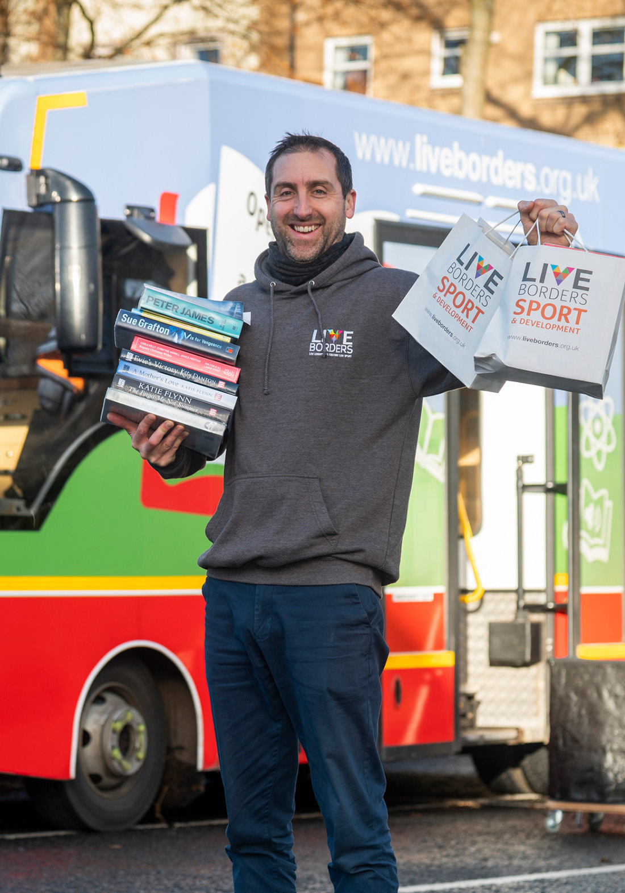

Current mobile library provision <!-- PAGE: 15 --> 4  Current mobile library provision

Several sources of information were used to establish current provision of mobile libraries in Scotland. This included a review of library websites, CIPFA Public Library Actuals, SLIC’s public library data framework returns, and a survey of 22 library services in Scotland i.e. those with mobile services at the time of the Libraries on the Move report in 2018/19.

In the survey, library managers were asked to provide figures relating to 2022/23 as the most recent complete year of activity. However, narrative comments and follow up interviews indicate that there are changes taking place in 2023/24 which may not be reflected in the figures, and new policy decisions for April 2024 onwards which will change the figures presented here.

### 4.1 Mobile libraries across Scotland

The figures below relate to public access mobile library vehicles, i.e. large vehicles where people can go on board and browse the collections. It doesn’t include small home delivery vans.

Table 1: Mobile library numbers in Scotland, Wales and the UK

2000/01 CIPFA

2004/05 CIPFA

2010/11 CIPFA

2017/18 CIPFA

2018 Survey

2019/20

2023 Survey

CIPFA

Scotland 37*

Wales n/a 33  (or 19) n/a

UK (GB from 2016)

655 585 503 191 n/a 200 n/a

Sources: CIPFA Public Library Statistics Actuals; 2018 and 2023 Scottish survey figures; Wales 2019/20 alternative figure in brackets from the Welsh Public Library Standards. NB From 2016 the CIPFA Actuals did not include Northern Ireland. Also note that fewer authorities submit returns to CIPFA than previously; to account for this CIPFA applies a formula to the last known figures from an authority to adjust for potential change, and may account for the increase on paper of mobiles reported in Wales and GB as a whole in 2019/20.

* Caveat: two services did not respond to the survey so this figures includes their number of mobiles from 2018.

In Scotland, the number of mobile libraries has fallen by 23% since 2018/19. The National Benchmarking Overview Report 2020/21 notes that Scottish public library expenditure has fallen 29% since 2010/11 to 2020/21 as a whole. But the figures above show a fall in mobiles from 2010/11 to 2023 of 50%. This may be in part because the benchmarking report also noted that rural authorities saw greater cost reductions on average than urban or semi-rural authorities in the 10 year period,11 and it is predominantly rural authorities which have mobile libraries.

11	 Improvement Service (2021) National Benchmarking Overview Report 2020-21. From: www.improvementservice. org.uk/benchmarking <!-- PAGE: 16 -->

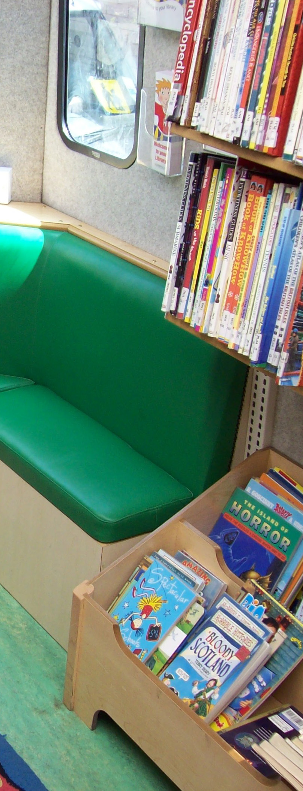
 ### 4.1.1 Comparison with 2018/19

The number of mobiles withdrawn from service in Scotland in the last five years and not replaced is 11. Although the above table would suggest it’s fallen by 12, one additional vehicle was reported in 2019 but not this time as it’s not a mobile library in the way the others are. The 11 withdrawn mobiles were from Aberdeenshire (3), Dundee (1), Highland (2), North Ayrshire (1), Perth & Kinross (1), South Lanarkshire (2), and Western Isles (1).

In most cases they are a service’s oldest vehicles which have been removed and not replaced. This is invariably because they become too old and no longer economical to repair, and there is no funding available to replace them.

The number of authorities providing a mobile library service has fallen from 22 to 19 since the 2018/19 survey. Three library services have either temporarily or permanently withdrawn all their mobiles in the last five years; these are Aberdeenshire, Dundee and South Lanarkshire. For example, Aberdeenshire council removed the three mobile library vehicles permanently in October 2021. They had previously been turned into temporary Covid-19 testing centres. It has replaced them with two smaller vans for home delivery.12

12	 Proctor, D. (2021) Mobile libraries scrapped in favour of home deliveries. The Press & Journal. From: https:// www.pressandjournal.co.uk/fp/education/schools/3542988/mobile-libraries-scrapped-in-favour-of-home- deliveries/ <!-- PAGE: 17 --> In 2023 the following 19 local authorities had mobile libraries.

Table 2: Local library services with mobiles

Library service Number of mobile

libraries in 2023

Angus

Argyll & Bute

East Ayrshire 2*

Edinburgh, City of

Fife

Highland

Midlothian

Moray

Na h-Eileanan Siar/ Western Isles

North Ayrshire

North Lanarkshire 3*

Orkney Islands

Perth & Kinross

Renfrewshire

Scottish Borders

Shetland Islands

South Ayrshire

Stirling

3*

West Dunbartonshire

Total

2*

* Number from 2018/19 survey

In addition, East Lothian has a mobile library service which is provided by both Midlothian and Scottish Borders using their vehicles and their stock. East Lothian customers join the appropriate library service in order to use the mobile library.

<!-- PAGE: 18 -->

Since the survey for this report was undertaken (Oct-Dec 2023), recent decisions by one or two councils (e.g. Moray Council's decision to review alternative options) indicate that the numbers may fall to 18 authorities by April 2024.13

“

The library service is finding it increasingly difficult to recruit mobile librarians who have the required driving skills. People born after 1993 do not have the C1 category on their driving licences, so there is need to help new drivers to gain that category, as well as putting them through CPC driver training and providing digital tachograph cards for them. This creates a big financial investment in any new staff, particularly relief staff, to keep their driving qualifications up to date.”15

It should be noted this loss of mobile vehicles is not restricted to Scotland. In Wales according to the Welsh Public Library Standards report for 2019/20 there were 19 mobile library vehicles in 11 (out of 22) library services. However, in the report for 2021/22, the number of vehicles was almost half, with only 10 vehicles being reported.14 The report for 2022/23 performance is not yet available, but a review of the library websites indicates mobiles may now be available in only seven out of 22 Welsh local authorities.

This may also be a factor in services shifting to smaller vehicles.

### 4.1.3 Users and usage

### 4.1.2 Staffing

Current usage levels are mixed across Scotland. Some mobile libraries have seen usage reach pre-pandemic levels; others have found that whilst usage on some routes has recovered, other routes are still below 2019/20 levels. Some services noted that whilst 2022/23 figures were still below pre-pandemic levels, they could see that usage for the first six months of 2023/24 was already higher than the previous full year. But one service noted that usage, e.g. visits and loans, are still down 50% compared with five years ago.

With the fall in number of mobile libraries there has also been a decrease in staffing levels since 2018/19. The number of staff providing mobile library services in Scotland has reduced from 60 to 53 (actual people) a fall of 11%. (Figures for 17 of 19 services with mobiles).

A couple of respondents to the survey noted that they have had trouble filling driver posts. One service commented that if someone can drive such a large vehicle they can earn more elsewhere, which affects desirability of the job. Another said:

Table 3: Usage levels

“

We have had vacancies to fill and it is getting harder and harder to fill them.”

2022/23*

Total loans via the mobiles 330,585

Outwith Scotland, Powys noted a problem of attracting drivers born after 1993 because of driving licence issues.

Total visits to mobiles 190,645

Registered mobile users 28,575

*Figures from 17 of 19 mobile library services

13	 Moray Council (2023) Moray Council publishes summary of latest budget consultation feedback. From: https:// newsroom.moray.gov.uk/news/moray-council-publishes-summary-of-latest-budget-consultation-feedback 14	 Welsh Government. Public library service annual reports 2019 to 2020; Welsh public library standards: annual reports 2021 to 2022. From: https://www.gov.wales/libraries-archives 15	 Powys County Council (2021) Transformation of mobile library service into an outreach and housebound model. From at: https://powys.moderngov.co.uk/documents/s66432/Mobile%20library%20transformation%20 paper%20FINAL.pdf <!-- PAGE: 19 --> Although it’s not possible to directly compare usage figures with 2018/19 because there are fewer mobile libraries now, current usage levels are lower than five years ago from between 22% to nearly 50%. This is not only because of 11 fewer mobile vehicles and no figures from two services but also from the impact of the pandemic.

During one interview, a manager noted that, anecdotally, lower usage seems to be a result of people having got out of the habit of using the mobile, rather than being concerned about touching shared books, or mixing on the van. Indeed, another service noted that because the vehicles were off the road for one to two years during the pandemic, when consulted many customers no longer required a mobile library service as they’d found alternatives, or needed a more personalised doorstep delivery option.

Locally, where usage has returned this is often due to successful engagement with nurseries and primary schools; changing routes to match new demands e.g. from schools; and removing stops which had little to no usage.

Some services noted that lower usage levels is often linked to routes where the vehicles have become old and unreliable and thus frequently in the garage for repairs, or where there have been staffing issues. When customers can’t rely on the library visit, they find alternatives.

“

We have nearly returned to pre-pandemic numbers for our mobile service. Some customers have switched to our digital resources (e-books and e-audio), but the majority still like to visit the mobile.”

Very few services noted a change post-pandemic in who uses the mobiles. One said it was the same uses as before: “elderly at home, care home residents, pupils in rural primary schools/nursery pupils, home educated learners, rural families.” Although there has been an increase in remote working at home as result of the pandemic16 (particularly for some occupations) few services felt that this had led to a change in the make-up of mobile library users.

“

We now have more school pupils using the mobile library, and more young families.”

The number of registered mobile library users which are children ranges from 4% to 65%. This is excluding Renfrewshire whose mobile is exclusively for children and families.

Routes with new vehicles tend to have seen a return to pre-pandemic levels of use. And in general, routes which visit schools and other educational establishments have also seen strong usage. One service noted “stops near or for schools are doing well, but the rest are taking longer to recover.”

One possible reason for lower usage levels than pre-pandemic is because a large cohort of mobile library users are older people, some of whom may feel uncomfortable with socialising in a small space. Some services noted that whilst many customers have returned to the mobiles, some have stopped using the public access vehicle and switched to home delivery (where available), the digital library offer, or are no longer using the library service. And, as one service delicately put it, usage is lower than pre-pandemic, partly due to “an unfortunate reduction in older users since the pandemic.”

16	 ONS (2022) Homeworking in the UK – regional patterns: 2019 to 2022. From: https://www.ons.gov. uk/employmentandlabourmarket/peopleinwork/employmentandemployeetypes/articles/ homeworkingintheukregionalpatterns/2019to2022 <!-- PAGE: 20 --> ### 4.1.4 Children’s mobiles

4.1.5 The mobile library service within the wider service

All bar one service currently visit nurseries and primary schools on their routes. Fewer services noted that they also serve secondary schools. One service noted that they prioritise schools that aren’t close enough to walk to a public library branch.

Mobile libraries are often a small part of what a library service offers. Although as the Libraries on the Move report highlighted, their value extends to many beneficial outcomes, often less obvious or infrequently captured, particularly around health and wellbeing, learning and literacy, and social isolation and loneliness.

Four services have mobile libraries which are solely for children, families and educational establishments. For one authority (Renfrewshire) the Skoobmobile is their only mobile library vehicle.

In the survey for this report, services reported their 2022/23 mobile library usage. These figures have been compared against their data framework responses to SLIC to look at the proportion mobiles contribute to library services. A caveat to the figures below is that one service specifically noted that the first six months of 2023/24 have already better than the whole year of 2022/23. A similar position may be found for other services.

The larger mobiles have enough space for groups of children to come onto the van to browse and choose their own books; in other cases where a transit van is currently used, trolleys and crates of books are taken into the school for children to browse. However this requires the schools to have a large enough empty space not being used in the timetable when the mobile visits.

Table 4: Mobile library use as proportion of general library use

Average Range

Mobile users as % of all registered library users 4.5% From 0.2% to 11.6%

Mobile loans as % of all loans (print and electronic) 6% From 0.2% to 15%

Mobile visits as % of all physical visits 4.8% From 0.1% to 15.7%

NB Figures are for 2022/23. Figures are for 13 of 19 mobile library services. Sources: mobile library survey and submissions to SLIC public library data framework.

For others, the mobile may be outperforming in one area; for example, for one service the mobile library represents 6% of the budget but 13% of their loans; for another service it is 4% of their budget but 9% of their loans.

The figures show a large variation as to the usage made and the role played by mobile libraries across Scotland. To some extent the island services tend to have slightly higher usage figures, i.e. mobiles are a bigger part of the service, but this is not always the case.

This approach may be helpful for some services as evidence of the importance of the mobile library service and the contribution made.

For some services, their mobile usage is fairly consistent across the indicators. For example in one service their registered mobile members represent 7.6% of all library members, the mobile issues are 7.1% of all print and electronic issues, and mobile visits are 7.9% of all physical library visits.

<!-- PAGE: 21 -->

Another service had to remove an old vehicle but kept the impact on customers to a minimum, partly by moving from a fortnightly visit to every three weeks, and rearranging the routes so that only two stops were lost, despite the loss of one vehicle. The service noted that both stops were underused.

### 4.2 Routes and stops

There are over 300 mobile library routes in Scotland (317 for 17 of 19 library services with mobiles). This varies per authority from two to 60+, reflecting the large size of some rural authorities.

Most routes are served fortnightly, or every three weeks. There are some which are visited less frequently, e.g. some of the island routes. Almost all services operate during the daytime, with very few operating evening or weekend stops. The average length of time at stops varies, from 10 minutes to 30+ minutes. For most services the longest stop is 60 minutes, although some stay for longer, particularly if serving schools, where one stop may be for two hours. One route’s longest stop is only 15 minutes.

Other services said:

“

We review routes and stops by asking customers for feedback and with drivers’ input so we have reviewed the routes since we came back from Covid at least 3 times.”

“

We have introduced more fixed stops at busy community areas, e.g. housing schemes and community shops. We are also visiting more remote primary schools, where the pupils do not have access to a staffed school library. We carry more resources for children and families now.”

Few services appear to have undertaken formal community profiling for the mobile routes, but tend to have engaged with customers through informal ongoing open communication channels (particularly during the pandemic), reviews of routes, or customer surveys.

One interview participant said that they will introduce more rural schools into the normal routine as primary schools love the mobile library visit.

Some services review routes every six months or annually, and make changes as necessary e.g. adding new stops and removing un- or under-used stops, or prioritising stops where there are few local alternatives to access books. One service noted,

“

We recently did some community mapping of schools and nurseries that aren’t located near a physical branch and changed the route to give them a stop. I think this has proved to be positive given the increase in the footfall and issues.”

<!-- PAGE: 22 -->

However, very few services mentioned these additional services on their websites, which is a missed opportunity.

4.2.1 Possible expansion of mobile library services

Proposals by Stirling Council appear to be the opposite of many other councils, with a recent consultation to replace branch libraries with mobiles. The public consultation proposes closing either 50% of their branch libraries or all static libraries bar the central library. In both scenarios the mobile libraries would be the replacement. This is part of the budget planning for making savings and a consultation across many public services.17 Stirling Council decided not to progress with either proposal.

Larger scale non-library services are generally not available on mobiles. This is often due to lack of space, with some mobile vehicles lacking an additional passenger seat for someone from a charity or other council service. Some services noted that they display leaflets and posters from other organisations but are otherwise limited in scope. There are a few examples of partnership, e.g. with advice services, council employability team, and hearing aid tests. A couple of services with newer vehicles with space are planning to do more partnership activities in the future.

Stirling recently invested in two new mobile vehicles with Wi-Fi (2019). The Council is separately consulting on revised mobile library timetables with longer stops, enhanced digital opportunities, delivering school and community stops from different vehicles, and working more effectively with partners in rural and urban areas, spending longer in communities.18 Feedback is due in February 2024.

### 4.4 Promotion

* Marketing is always needed, and since the pandemic library services have tried many ways to re-engage with customers and the public to let them know that mobile libraries are available again. Different services have tried various marketing ideas, with varying levels of success. These include:
* social media
* leaflet/mail drop
* working with local community councils
* arranging stops near community centres
* posters in local community and other venues e.g. post offices en route
* attending local events
* working with other local services/ organisations
* promotions via schools.

4.3 Non library services available on board

As well as providing library services, several mobiles also provide additional services. These are often things which are available in static libraries, ensuring equity of access. The main additional service was hearing aid batteries, and currently just under half the local authorities provide this on their mobiles. New during this survey is free period products, with four providing these items. One or two services also mentioned they process National Entitlement Cards and bus passes, collect batteries for recycling, or provide ferrules for walking sticks.

17	 Stirling Council (2023) The big conversation: Stirling Council budget. From: https://engage.stirling.gov.uk/en-GB/ projects/stirling-council-budget 18	 Stirling Council (2023) Mobile Libraries Consultation. From: https://engage.stirling.gov.uk/en-GB/projects/ mobile-libraries-consultation/3 <!-- PAGE: 23 --> Word of mouth was noted by some services as a powerful marketing tool, although not one a service can directly influence.

### 4.4.1 Websites

Web pages are a great marketing tool, with opportunities for text, images, videos, quotes from happy customers and maps of routes. Unfortunately, very few services provide much information on their pages about the mobile service.

One service’s comment on promotion post- pandemic reflects what several services said:

“

Social media showcasing our mobile services usually do well, but this doesn’t necessarily lead to greater use or new members. Visits to schools tends to generate high issues and visits as well as new members.”

The Libraries in Lockdown report also found this with regard to library web pages as a whole, so this is not just an issue with the mobile library information. That report found that libraries were hard to find initially on the main site, pages were hard to navigate and it was hard to find specific information.19

Another commented:

To be fair to library services, they may have little or no influence on the structure of the site and the visibility of library service on the home page. They may also be limited in what they are able to have on their pages, e.g. a map or video may not be allowed. Although about half the mobile library services (and their websites) are operated by trusts, this did not seem to hugely influence the information provided about mobiles.

“

We did survey our non-users from both the mobile and library service and the people who responded either did not know we were back! Or they now swapped books within a group.”

The less helpful pages had no contact details, had not been updated for several years, and presented the route information by day or week only, so you have to look at each one to find your village or nearest named stop.

* Web pages which are better for user engagement tended to feature:
* contact information (telephone and email)
* maps of the routes
* route and timetable information in pdf and html/text formats
* timetables in colour and plain versions
* downloadable format of timetables and routes
* images of the vehicles inside and out (so people know what to expect)
* videos (e.g. Western Isles).

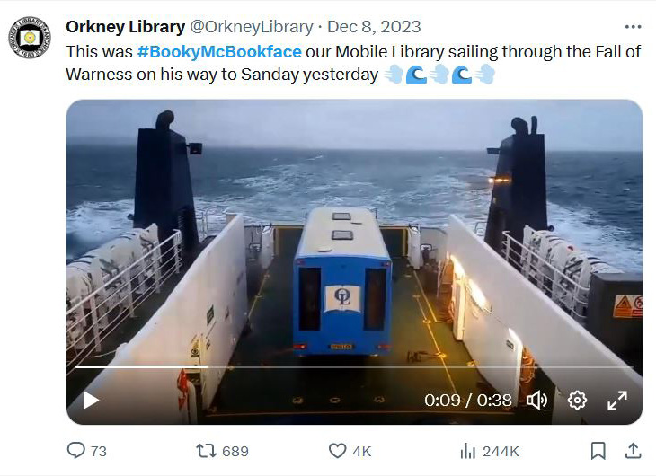

*Image: a still from a video of the Orkney mobile library service on X/Twitter, which has been liked 4000 times*

Some mobile libraries have names (particularly new vehicles, and often chosen through school competitions which is good for publicity), and some have social media presence such as BookyMcBookface (Orkney), with impressive reach and engagement on X/Twitter.

19	 SLIC/ Peter Reid & Lyndsay Bloice (2021) Libraries in Lockdown. From https://scottishlibraries.org/about-us/ our-publications/special-studies/ <!-- PAGE: 24 --> Only three services have maps (Angus, Edinburgh and Midlothian) and unfortunately one of these has out of date links in it. With mobiles service covering large geographic areas, it’s a shame there are not more maps which would highlight how they reach dispersed populations and bring services to people.

### 4.4.2 Mobiles Libraries Day

It is heartening to see a recommendation from the 2019 report implemented with success. The first Scottish Mobile Libraries Day was held in November 2019 with a large amount of activity and buzz particularly on social media. Although the pandemic interrupted some plans in 2020, the day has been marked annually since, during Book Week Scotland.

Activities on the day vary: for example in 2021 the Scottish Government culture minister visited Stirling mobile libraries.

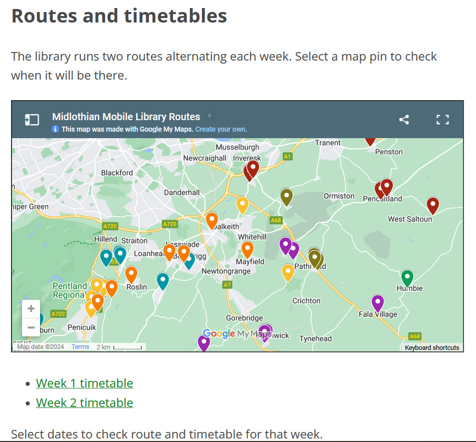

*Image: Screenshot of Midlothian’s mobile library map*

Providing information in accessible and different formats is important. Best practice would cover different options so people who find PDFs inaccessible can use a screen-reader to read out the text from the page. Information which is also provided in a format to download is also good so that someone doesn’t have to be online in order to find out the information.

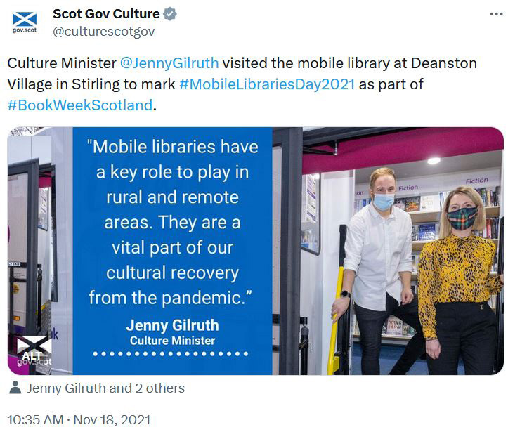

*Image: X/Twitter screenshot from Scottish Government account for Mobile Libraries Day 2021* <!-- PAGE: 25 --> Library services with social media accounts share content on their platforms about their mobile libraries, and use infographics and other resources commissioned centrally by SLIC, e.g. about the value of mobile libraries. The best photo competition is popular and creates popular content for social media and engagement.

### 4.5 Consulting users

In some ways the pandemic led to some library services engaging more with their users, through keeping them informed of closures or re-opening, replacement schemes like ‘click and collect’ or home delivery, and promoting the digital offer of e-books, e-audio books, e-magazines etc. As noted earlier, some services also spoke to all their mobile and home delivery customers to find out what would suit them best.

Mobile Libraries Day, although a Scotland initiative, has also been picked up by services elsewhere e.g. in England and beyond (see screenshots below from Lancashire and Australia).

But the pandemic also tended to affect more established surveys or consultations, with few having carried these out in the last five years, either for mobiles or service-wide.

Where surveys have been undertaken they have often been for very specific issues, e.g. particular stops or route changes, rather than the mobile library service as a whole.

And in some cases where reviews of either the mobile service or the whole public library service were undertaken, they didn’t involve consulting users or non-users. For example, Perth & Kinross Council’s paper to consider the ‘Transformation review of arms length external organisations’ (i.e.  leisure and library services) noted that the report was assessed as “not relevant” for the purposes of Equalities Impact Assessment process.20

Even for paused or permanent changes to provision, few services appear to have undertaken formal or informal consultations with their users over proposed changes. This could leave councils not fulfilling their duties under the Public Sector Equality Duty.21

Images: X/Twitter screenshots of English and Australian organisations promoting Mobile Libraries Day

20	 Perth and Kinross Council (2023) Transformation review of arms length external organisations. From: https:// perth-and-kinross.cmis.uk.com/perth-and-kinross/Meetings/tabid/70/ctl/ViewMeetingPublic/mid/397/ Meeting/3465/Committee/7/Default.aspx 21	 Equality and Human Rights Commission (2022) Public Sector Equality Duty: specific duties in Scotland. From: https://www.equalityhumanrights.com/guidance/public-sector-equality-duty/public-sector-equality-duty- specific-duties-scotland <!-- PAGE: 26 --> To be fair to library services though, this finding is echoed across Scottish councils, for all their services, as noted by the Accounts Commission:

In more positive news, some services are either exploring options for buying a new vehicle, or are nearing completion of placing an order. However, even when an order is placed it can take 6 months to a year before the vehicle is ready and delivered for use, depending on the specifications required and supply chain delays.26

“

[I]t is not clear that councils have carried out equality impact assessments or community consultation where they have made changes or plan to continue changes made to service delivery during the pandemic.”22

### 4.7 Summary of current provision

Mobile library services have in general performed well to recover to near pre- pandemic levels, with primary schools being very keen to re-engage. Financial constraints have led to a significant number of vehicles being discontinued, which has affected overall usage levels.

4.6 Recent or upcoming changes to provision

At the time of this research, several services noted that either the mobile or the whole library service was being reviewed, and so there may be changes to provision by April 2024. This includes mobile services potentially being withdrawn and replaced with an alternative delivery model, e.g. Moray,23 but also mobiles replacing static library provision, e.g. Stirling.24

The staff remain a hugely important part of the service, and anecdotal evidence from the interviews and survey indicate that their enthusiasm, dedication and customer focus is central to how much people value the mobile library service.

There is scope for improvements to marketing and promotion, particularly with websites, and Mobile Libraries Day is important for visibility and awareness.

Unfortunately this is often due to funding issues. Moray Council’s website states that removing the old mobile library vehicle could save £20,000 p.a., but it acknowledges that “for some individuals it is the only in person social connection they may have during the week” and that “[s]ince the pandemic the function of the mobile library service has changed significantly, with the footfall exceeding some of our smaller rural libraries.”25

22	 Accounts Commission (2022) Local government in Scotland overview 2022. From https://www.audit-scotland. gov.uk/publications/local-government-in-scotland-overview-2022 23	 Moray Council (2023) Budget 2024/25. From http://www.moray.gov.uk/moray_standard/page_150885.html 24	 Stirling Council (2023) Stirling Council budget saving proposals 2023. From: https://engage.stirling.gov.uk/en- GB/projects/stirling-council-budget 25	 Moray Council (2023) Budget 2024/25. From: http://www.moray.gov.uk/moray_standard/page_150885.html 26	 MV Tech (2022) Mobile library repair and refurbishment. From: https://www.multivehicletechnology.co.uk/blog/ mobile-library-repair-and-refurbishment/ <!-- PAGE: 27 -->

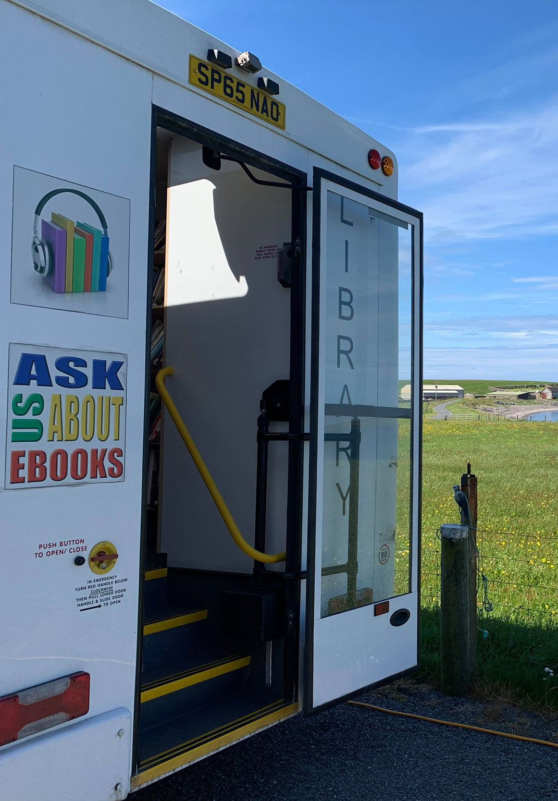
 Mobile library vehicles <!-- PAGE: 28 --> 5  Mobile library vehicles

Mobile library vehicles do not have a very long lifespan: 10 years is generally a good age, before repairs are increasingly needed. For vehicles on long and/or geographically rigorous routes, the wear and tear is considerable. Councils may have conditions of fleet management, e.g. every vehicle to be reviewed at seven years, which may identify when the mobiles need replacing.

This situation is not confined to Scotland. Devon County Council recently voted to remove its four remaining mobile libraries because they needed replacing “at a predicted cost of between £600,000 and £800,000”.27

In the survey, several services noted that when the service becomes unreliable, e.g. if the vehicle is frequently off the road for repairs, some customers do not return even if things improve. One service found that most of their routes have generally recovered in terms of usage since the pandemic, apart from the one which has suffered from the vehicle frequently breaking down.

### 5.1 Scottish mobile library vehicles

There are 37 public access mobile library vehicles operating in Scotland. Nearly all are towards the larger size, 7.2 tonnes and above, although one service is considering a slightly smaller 6.5 tonnes, which will still allow class visits on board but is more efficient, economical and easier to drive and access some locations.

New vehicles are costly however, and the survey found that where a vehicle has been removed and not replaced, it was often due to the costs involved. One service noted that pre- pandemic the council had agreed to replace the vehicles, but can no longer afford to do so.

Table 5: Size of the mobile library vehicles in Scotland

Size 6.5 tonnes 6.7 tonnes 7.2 tonnes 7.44 tonnes 7.5 tonnes 8.45 tonnes

Number of vehicles (29)

NB There are eight additional vehicles with unknown size in tonnes; figures are for 2022/23.

27	 Dawlish Gazette (2023) Mobile libraries axed by cash-strapped DCC. From: https://www.dawlish-today.co.uk/ news/mobile-libraries-axed-by-cash-strapped-dcc-650970 <!-- PAGE: 29 --> One service said the large old vehicles were “expensive to run, not environmentally sustainable being diesel powered and not as accessible to remote parts of the authority as the vehicles were large.”

### 5.2 New vehicles since 2019 report

Five library services have new vehicles in the five years since the first mobile library report. These are Angus, Fife, Highland, Stirling and the Western Isles. Services noted the benefits of this:

Services opting for smaller vehicles note that this is partly as they are cheaper. Also, depending on what is chosen, may mean a special driving licence category is not needed, can be easier to drive and a more appealing job, and can access different locations.

“

The new vehicles have improved reliability and provide a more pleasant experience for users”

“

“

Possibly would look at a smaller vehicle, which would be easier to drive and may be more appealing job.”

Brighter, more welcoming spaces and through public comments made, users saw this as investment in the service and a commitment for it to continue.”

“

With a smaller van we would be able to access areas that we previously couldn’t because of van size.”

Smaller vehicles have helped one service be more appealing.

“

[They can] navigate busier streets and be more efficient.... they carry less stock, but are more eye-catching, attractive, and more modern inside and out.”

The public access vehicles are becoming an ageing fleet: nearly 40% of the vehicles are over 10 years old, and 68% are over 7 years old. This has implications for the future.

Table 6: Age of the mobile libraries in Scotland

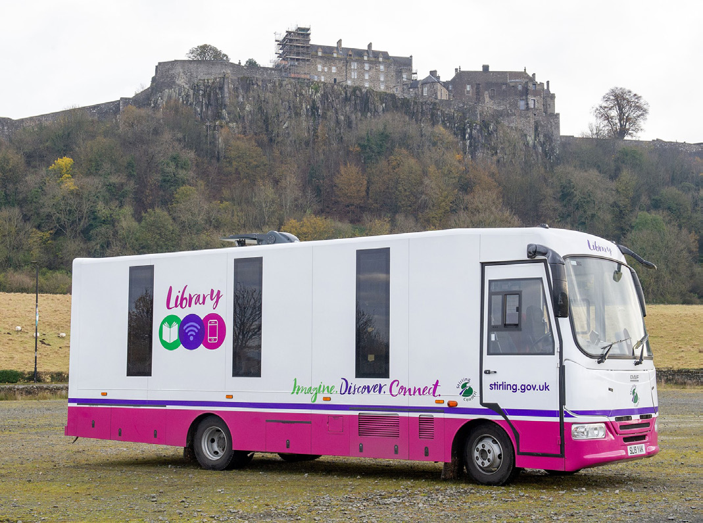

*Image: new Stirling mobile, courtesy of Stirling Council*

Age Under 5

5 to 9 years

10+ years old

years

Number of vehicles (33)

NB There are four additional vehicles of unknown ages; figures are for 2022/23.

<!-- PAGE: 30 -->

One library service in Scotland is near to completing plans to purchase a new electric mobile library which will also have a small room on board. The room could be used for meetings for up to four people and will enable the service to work with third sector partners as well potentially delivering council services in communities, or for the library service to offer informal training as happens in static branches.

### 5.2.3 Facilities on board

In general most of the mobile libraries don’t have much ICT equipment for staff or public use, due to connectivity and on- board space issues. It is generally the newer vehicles which have Wi-Fi capability and ICT equipment for public and staff use, e.g. Angus, Fife and Stirling. Mobile and internet connectivity in rural areas, which is predominantly where the mobiles operate, is an issue.

Facilities on board can be altered for different audiences. For example, a mobile library in Essex is used in the evenings by converting it into a youth space, to maximise the cost effectiveness of the vehicle.31

One mobile vehicle has a printer available and some mobile library services lend tablets to customers, e.g. Stirling, whose tablets also come with free Mi-Fi so that the person can access the internet for free at home.28

### 5.3 Is the future electric?

Improved ICT facilities on board can bring benefits for customers and staff. Customers can undertake online activities, particularly at longer stops, which is helpful if they don’t have access to the internet at home. One service noted that:

Nearly all the current public access mobile library vehicles in Scotland are diesel, with one hybrid diesel and battery. There are some small delivery vans which are electric, although these are generally for home delivery/housebound services and are not public access.

“

Satellite technology has meant better communications and greater ability to assist readers with enquiries. Previously our system was offline in various areas due to poor mobile coverage.”

* Some services which are looking to replace one or more vehicles in the future are thinking about going electric. However, there are several factors to consider before decisions are made. These include:
* initial capital cost
* mileage range and local charging infrastructure
* weight of the vehicle.32

Carnegie UK Trust notes that “since the outbreak of Covid-19, the scale of digital exclusion in the UK has been exposed and exacerbated beyond previous understanding.”29 Although libraries in general are recognised and well placed to help address digital exclusion, it’s harder for mobile libraries which predominantly operate in rural areas where digital exclusion is already more likely.30

28	 Stirling Observer (Scotland) (2023) Tablets join books on library shelves. 5 April, p.10 (NewsBank). 29	 Carnegie UK Trust (2020) Learning from lockdown: 12 steps to eliminate digital exclusion. From: https:// carnegieuktrust.org.uk/publications/learning-from-lockdown-12-steps-to-eliminate-digital-exclusion/ 30	 Scottish Government (2021) A changing nation: How Scotland will thrive in a digital world. From: https://www.gov. scot/publications/a-changing-nation-how-scotland-will-thrive-in-a-digital-world/documents/ 31	 Neat Vehicles (n.d.) Essex County Council Mobile Library Vehicles. From https://www.neatvehicles.com/our- products/essex-county-council-mobile-library-vehicles/ 32	 Admiral (2023) Pros and cons of running an electric van. Admiral. From: https://www.admiral.com/magazine/ guides/van/pros-and-cons-of-running-an-electric-van <!-- PAGE: 31 --> Electric vehicles cost more initially, although they have lower operational costs. But for financially-challenged councils, an electric vehicle may not be possible. Whilst they have broader positive impacts, such as reduced air pollution, reduced noise pollution and reduced impact on climate change,33 these aren’t tangible financial savings for a council or library trust.

For island, very rural and sparsely populated areas, availability of charging infrastructure is a key concern. Some routes may be very long and lack charging opportunities. Until the infrastructure is in place across Scotland, particularly the Highlands and islands, electric mobiles may not be a viable option for some library services. Having said that, Orkney library service does have a small electric delivery van.

In the transport industry there is also some unhappiness around legislation for larger electrical vehicles; for example tachograph regulations for EU driver hours if the vehicle travels more than 100kms (62 miles) from base, allegedly limiting take up of electric vans.37

A council is likely to be concerned about the additional weight of electric vehicles as they can potentially do more damage to roads, exacerbating pot hole problems for example. It’s estimated that electric vehicles place 2.24 times more stress on roads than conventional vehicles.34

Whilst there are currently no public access electric mobile library vehicles in Scotland, there are some in England (e.g. Cheshire West and Chester,38 Warwickshire39), Finland,40 Sweden41 and Colorado, US.42

The heavier weight of electric vehicles is not just a concern for roads, but also pedestrians, cyclists and other road users. Articles citing the growing size and weight of consumer-focused electric cars highlight that the additional weight puts other roads users at risk if they were to crash, as they could do more harm.35, 36

33	 Borén, S. (2020) Electric buses’ sustainability effects, noise, energy use, and costs. International Journal of Sustainable Transportation, 14:12, 956-971, DOI: 10.1080/15568318.2019.1666324. From https://www.tandfonline. com/doi/full/10.1080/15568318.2019.1666324 34	 Techround Team (2023) EVs Damage Roads Twice As Much As Petrol Vehicles, Study Finds. From: https:// techround.co.uk/news/electric-vehicles-impact-uk-roads/ 35	 Gitlin, J. (2023) EVs are getting too heavy and too powerful, safety chief says. ARS Technica. From: https:// arstechnica.com/cars/2023/01/top-safety-advisor-raises-alarm-about-ever-heavier-evs/ 36	 Peters, A. (2021) Electric vehicles have a weight problem. Fast Company. From: https://www.fastcompany. com/90686171/electric-vehicles-have-a-weight-problem 37	 Roberts, G. (2023) Updated: Driver training dropped for 4.25 tonne electric van licensing. Fleet News. From: https://www.fleetnews.co.uk/news/driver-training-requirement-dropped-for-425-tonne-electric-van-licensing 38	 Cheshire West and Chester (2023) Library service introduces new electric mobile library. From:  https://www. cheshirewestandchester.gov.uk/news/library-service-introduces-new-electric-mobile-library 39	 Warwickshire County Council (2023) New timetables coming soon to Warwickshire’s mobile libraries. From https://www.warwickshire.gov.uk/news/article/4571/new-timetables-coming-soon-to-warwickshire-s- mobile-libraries 40	 Kempower (2021) The world’s first electric mobile library bus in Turku runs on power from Kempower’s charger. From: https://kempower.com/news/electric-mobile-library-bus/ 41	 Volvo (2020) Electric mobile libraries on a silent mission for an equitable city. From: https://www.volvobuses. com/en/news/2020/sep/electric-mobile-libraries-on-a-silent-mission-for-an-equitable-city.html 42	 Udell, E. (n.d.) Meet Evie, Colorado’s first all-electric mobile library. Coloradoan. From: https://eu.coloradoan. com/story/life/2023/04/08/meet-evie-colorados-first-all-electric-mobile-library/70075757007/ <!-- PAGE: 32 --> In Chester, the new electric library vans also have additional features most older vehicles don’t have:

### 5.3.1 Smaller electric delivery vans

There are several library services (in Scotland and outwith) with smaller electric delivery vans which are used for direct home delivery/housebound services, rather than for public access on board. These include Aberdeenshire,46 East Dunbartonshire, Orkney (called BabyMcBookface), Gwynedd (Wales), Neath Port Talbot (Wales) and Warwickshire47 (England) from 2024.

“

As well as having sustainable features such as solar panels and LED lighting, the vehicle also includes awning for summer activities and on- board Wi-Fi and digital access for visitors.”43

Warwickshire’s two new electric vehicles are being delivered in 2024 and will have a lift to improve accessibility. The council notes that being electric they will reduce local air and noise pollution. 44

There are more electric buses in the UK (and other large vehicles such as waste collection lorries), than there are electric mobile libraries. A 2018 study of the electric bus market suggested they will become cost competitive in 2023.45 It’s therefore likely to be some time before large electric mobile libraries are cost competitive, as it’s a much smaller market than electric buses.

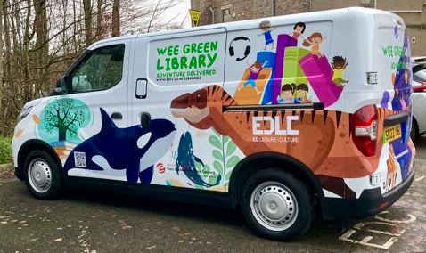

*Image: East Dunbartonshire’s Wee Green Library electric van*

43	 Cheshire West and Chester (2023) Library service introduces new electric mobile library. From: https://www. cheshirewestandchester.gov.uk/news/library-service-introduces-new-electric-mobile-library 44	 Warwickshire County Council (2023) New timetables coming soon to Warwickshire’s mobile libraries. From https://www.warwickshire.gov.uk/news/article/4571/new-timetables-coming-soon-to-warwickshire-s- mobile-libraries 45	 Sustainable Bus (2018) Electric buses, including costs on climate and health, are cheaper than diesel. From: https://www.sustainable-bus.com/news/taking-into-account-external-costs-health-and-climate-electric- buses-already-offer-a-lower-tco-than-diesel/ 46	 Proctor, D. (2021) Mobile libraries scrapped in favour of home deliveries. Press & Journal. From: https://www. pressandjournal.co.uk/fp/education/schools/3542988/mobile-libraries-scrapped-in-favour-of-home- deliveries/ 47	 Warwickshire County Council (2023). Warwickshire Libraries unveils service’s first electric-powered vehicle at celebration event for library volunteers. From: https://www.warwickshire.gov.uk/news/article/4794/ warwickshire-libraries-unveils-service-s-first-electric-powered-vehicle-at-celebration-event-for-library- volunteers <!-- PAGE: 33 --> A new small electric van was recently procured in East Dunbartonshire48 with a grant from the Scottish Government Public Library Covid Relief Fund, to help reconnect libraries with their communities. The new library van is specifically for children and family engagement. The Wee Green Library takes books to primary schools and community groups, and also transports materials for craft workshops and classes. Outside of these activities it supports the local libraries, for example, moving books between branches to fulfil customer requests.

Instead of a traditional small delivery van, Portsmouth51 library service has invested in two electric ‘tuk-tuks’ (automated rickshaws) more commonly seen across Asia. The three wheel vehicle is small and well suited to busy urban streets. Whilst no on-board access is available, it does allow users to browse the collection which is stored along the outsides of the vehicle, under shutters, and chat to other users. Whilst probably not suitable for routes with extensive mileage and rigorous conditions, such as those in more exposed weather conditions, it could be an interesting option for some authorities.

Gwynedd council undertook a review of the mobile library service during the pandemic, and decided to replace its three public access vehicles with two smaller electric delivery vans. In its published report it noted that the delivery service which was implemented as a result of lockdowns was appreciated by customers who were happy for this service to continue. Gwynedd now provides a monthly home library service (housebound), and an on- demand book delivery request service where people order specific items.49

Although the main reasons for switching to smaller electric delivery vehicles may be cost and reducing carbon emissions, one interviewee noted that the smaller size makes them more practical on rural roads particularly in tourist hotspots, where traffic has increased since the pandemic. Being electric they are quiet, and Orkney staff note it is easy to drive being automatic.50 However, the staff note that additional planning is needed to account for charging locations and times.

Image:  X/Twitter screenshot of Portsmouth’s new electric tuk-tuk mobile library

48	 East Dunbartonshire Council (2023) Green machine is a novel way to spread the word about libraries. From: https://www.eastdunbarton.gov.uk/news/green-machine-novel-way-spread-word-about-libraries 49	 Cyngor Gwynedd (2021) Review of the mobile library service. From https://democracy.gwynedd.llyw.cymru/ documents/s29882/Review%20of%20the%20Mobile%20Libraries%20Service.pdf 50	 CILIPS (2021) #CILIPSGoGreen x Orkney Library & Archive. From: https://www.cilips.org.uk/cilipsgogreen-x- orkney-library/ 51	 Portsmouth City Council (2024) Library tuk-tuk ready to deliver books. From: https://www.portsmouth.gov. uk/2024/01/17/library-tuk-tuk-ready-to-deliver-books/ <!-- PAGE: 34 --> ### 5.3.2 Low carbon and net zero targets

### 5.4 Summary of vehicle provision

With net zero an important Scottish Government target, fuel use of the mobile vehicles is important. One service said that they had recently reviewed the mobile routes for fuel efficiency as part of a new sustainability project, but no changes were made following the review. Planning routes is a complex logistical task and most services have already optimised their routes to be as efficient with time and fuel as possible.

The ageing mobile library fleet is a problem for library services as it tends to lead to unreliability, which leads to reduced usage, and also leads to increased costs of repairs. It is also creating a difficult situation for library services who can’t afford to replace old vehicles.

Large electric public access mobile libraries are gradually being introduced in the UK, but for some areas the infrastructure may not yet be in place to fully support them. Other environmental options could be implemented on the existing fleet, such as solar panels. Although smaller electric delivery vans are becoming more prevalent, they are not a direct equivalent of a public access vehicle.

As well as the fuel, there are some other environmentally friendly options coming to mobile libraries, including solar panels. For example Essex52 and Kent53 have public access mobile libraries with solar panels on the roof. On the Essex vehicle, the panels are linked to an inverter charger and charge up two large banks of batteries to provide mains power. There is also the facility to charge back at base at night and the vehicle charges the batteries as it goes along.

The lack of ICT equipment on many of the older vehicles limits digital inclusion and support work.

Mobile library services have health, social, cultural, and learning impacts, and investment from the Scottish Government, from net zero, digital inclusion, community cohesion, rural, or wellbeing funding, could help services replace ageing vehicles and maintain the service.

Whilst the Scottish Government has a commitment to decarbonise the public sector car fleet by 202554, it would be beneficial if funding could be allocated to update and decarbonise the mobile library fleet as well.

52	 Neat Vehicles (n.d.) Essex County Council Mobile Library Vehicles. From https://www.neatvehicles.com/our- products/essex-county-council-mobile-library-vehicles/ 53	 Iveco (2021) Kent County Council takes delivery of five new IVECO Daily 7.2 tonne mobile libraries to modernise its fleet. From: https://www.iveco.com/uk/press-room/release/Pages/Kent-County-Council-takes-delivery-of- five-new-IVECO-Daily-7-2-tonne-mobile-libraries-to-modernise-its-fleet.aspx 54	 Scottish Government (2021) Climate Change: Leadership in the public sector. From: https://www.gov.scot/ policies/climate-change/decarbonisation-in-the-public-sector/ <!-- PAGE: 35 -->

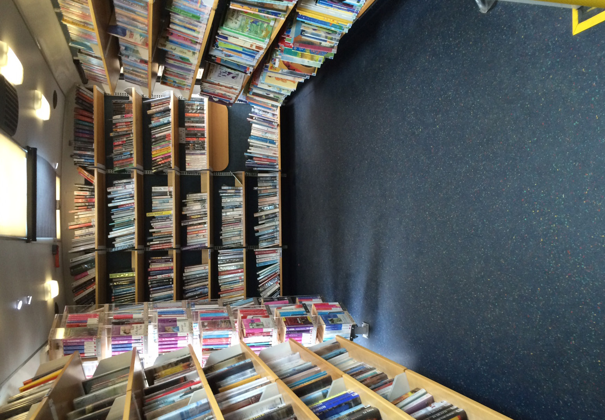
 Costs of mobile library provision <!-- PAGE: 36 --> 6  Costs of mobile library provision

It’s difficult to produce definite costs of a mobile library service, as the situation varies across Scotland. Some are 100% council funded and operated, some are delivered by the trust but the council pays for the vehicle, some are funded fully by the trust, some receive external project funding for some of the staff time.

Despite these variations, running costs are around £40,000 to £70,000 per vehicle with staffing each year. This generally excludes the stock as this is allocated service-wide. The cost of the mobile library service as a percentage of the total library budget varies from 1% to 10%. However, for some services the mobile library serves a larger proportion of total library users, as seen in the usage figures in section 4. Therefore a higher percentage may be proportionate.

An additional problem for library services operated by trusts is that the council ultimately controls the finances and the capital budget, thus the final decision to replace an old vehicle may not be in the trust’s power.

The nature of mobile libraries services is that they are primarily serving rural areas of low population density (see table 8 below), and therefore have relatively low user numbers. Although they have a range of educational, social, health and wellbeing benefits, these are often difficult to quantify in costs. When based purely on cost and usage, mobile libraries often look more expensive on paper, and thus vulnerable to budget cuts. As one service said, the mobile library is a “[v]ery expensive service to provide compared to facility based services.”

New vehicles can cost upwards of £100,000. With full kit-out inside, branding outside, and additional IT features, the total costs are usually more. For example, the two new public access mobile libraries with ICT cost £270,000 in Angus;55 two in Fife cost £280,000,56 and £340,000 for two ICT enabled vehicles in Stirling.57

In additional there may be other costs and logistics the library service has to factor in, such as the cost of ferry services. One island service noted that ferry fares can be between £500 and £1000 a month.

Survey evidence indicates that lack of funding is one of the main reasons why mobile library services cease. With most councils facing significant budget deficits many are unable to afford either new vehicles or ongoing running costs.

55	 Brown, G. (2018) New Angus mobile libraries lined up at cost of £270,000. The Courier. From https://www. thecourier.co.uk/fp/news/angus-mearns/639833/new-angus-mobile-libraries-lined-up-at-cost-of-270000/ 56	 OnFife (2021) Welcome aboard Fife’s new mobile libraries. From: https://www.onfife.com/2021/12/08/welcome- aboard-fifes-new-mobile-libraries/ 57	 Marjoribanks, K. (2019) Van-tastic mobile libraries hit roads: Ageing vehicles replaced, Stirling Observer (Scotland), 7 Jun, p. 5, (online NewsBank).

<!-- PAGE: 37 -->

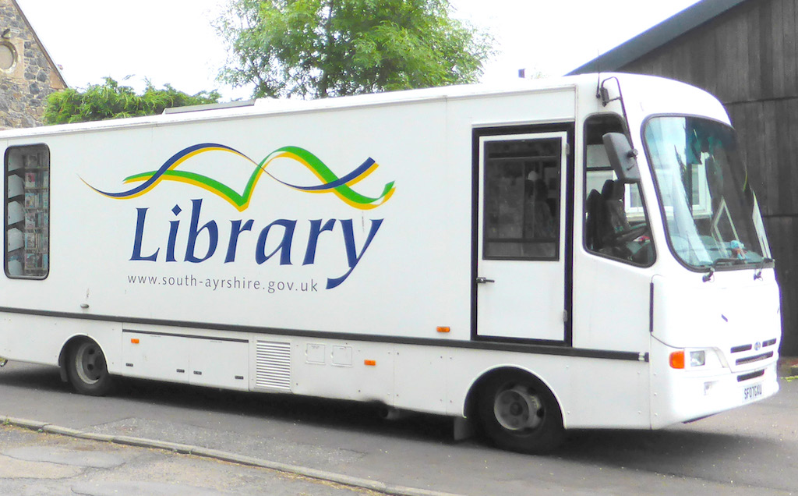

Unfortunately for Scottish public library services, “Covid-19 has impacted on capital projects and volatility in capital funding allocations could affect councils’ recovery and investment plans”.58 In addition, public library services have seen a 29 per cent reduction in spend 2010/11 to 2020/21, yet the same period saw a 42 per cent growth in visit numbers (physical and virtual visits).59

### 6.1 Finance options

The survey found that two services had been able to access external funding to buy replacement vehicles. External options are helpful if a council does not have capital funding available: for example, Angus library service accessed the LEADER European Rural Development Programme with match funding from the local council.62

“

Capital investment is likely to play a key role in councils’ recovery from Covid-19 and in particular address the impact of climate change. The local government estate, comprising buildings and vehicles, will need some modernising to deliver councils’ carbon reduction targets and wider investment needed to mitigate and adapt to the impacts of climate change. Funding will need to be in place to support this.”60

One service noted that they hope to utilise the local authority’s Place Based Investment Funds63 (provided by Scottish Government) in order to purchase a new vehicle. Another service is exploring accessing Scottish Government capital funding alongside a private donation in order to replace an ageing vehicle.

This funding situation is not restricted to councils in Scotland. Powys County Council in Wales recently reviewed its mobile library service and noted that it cost £90,000+ to provide each year, but changing it into a volunteer home delivery service could bring the annual costs down to £10,000 per year.61

58	 Accounts Commission (2022) Local government in Scotland Overview 2022. From https://www.audit-scotland. gov.uk/publications/local-government-in-scotland-overview-2022 59	 Accounts Commission (2022) Local government in Scotland Overview 2022. From https://www.audit-scotland. gov.uk/publications/local-government-in-scotland-overview-2022 60	 Accounts Commission (2022) Local government in Scotland Overview 2022. From https://www.audit-scotland. gov.uk/publications/local-government-in-scotland-overview-2022 61	 Cyngor Sir Powys County Council (2021) Transformation of mobile library service into an outreach and housebound model. From: https://powys.moderngov.co.uk/documents/s66432/Mobile%20library%20 transformation%20paper%20FINAL.pdf 62	 Strachan, G. (2019) New mobile libraries ready to serve rural Angus communities, Dundee Courier, 24 June, p. 9, (online NewsBank). 63	 Our Place (n.d.) Place Based Investment & Infrastructure. From: https://www.ourplace.scot/about-place/ themes/place-based-investment/place-based-investment-infrastructure <!-- PAGE: 38 --> Outwith Scotland, Libraries Unlimited, which is an external body delivering library services in Devon, crowdfunded to raise £13,500 to refurbish a secondhand mobile library which the council bought for £15,000.64 However, just three years later Devon County Council made UK news headlines when it proposed to remove all four mobile libraries. Despite public support from a number of celebrities and petitions, the council voted to end the mobile library service in 2023. Members of the public urged the council to look at alternatives such as sponsorship, but the response was not favourable:

### 6.1.1 Is leasing a viable option?

Some local authorities are considering leasing options instead of purchasing new vehicles outright. A leasing model means the maintenance would be outsourced, and although this could remove significant costs over time, it may not work out cheaper overall. For example, Devon County Council said that it would cost “£637,000 to replace [all 4 of] them, £736,000 to lease the vehicles over three years and £799,000 for five years.”67

Another option for electric vehicles may be to lease the battery and buy the vehicle outright. Although the capital costs are high initially, running costs are lower, and the longer the vehicle’s life, the more money can be saved. This happens in the electric bus market, with one report noting that “the batteries are guaranteed for eight years, and the actual vehicle life will far exceed that, helping further reduce the total cost of ownership.”68

“

Whilst there are opportunities for sponsorship, commercial activity, additional charitable donations and alternative funding models – most of which have been previously pursued – it is unlikely that any combination in the current context would generate and sustain the required funding to maintain the existing level of service delivery indefinitely and to generate the initial outlay required to source and maintain a new fleet of vehicles,’ [Mr Kitchen, Head of Communities] told councillors.”65

### 6.2 Summary of costs

With many Scottish councils facing financial difficulty, replacing or even maintaining mobile libraries may be too costly for some. However, the value of the service crosses many important Scottish Government priorities such as equality, education, social and community connection, rural populations, and net zero targets. It could therefore be a beneficial strategic fit for national investment in mobile libraries.

The Isle of Man also recently lost funding for its mobile library service. This is now delivered by a charity with one vehicle visiting rural communities across the island. The charity also operates a home delivery service from a smaller van.66

64	 Libraries Unlimited (2022) New mobile library connects rural communities in the South Hams and West Devon. From: https://www.librariesunlimited.org.uk/news/new-mobile-library-connects-rural-communities-in-the- south-hams-and-west-devon/ 65	 Mid Devon Advertiser (2023) Devon County Council’s new drive to create bespoke community libraries. From: https://www.middevonadvertiser.co.uk/news/devon-county-councils-new-drive-to-create-bespoke- community-libraries-649437 66	 Family Library (n.d.) Mobile Service. From: https://www.familylibrary.im/mobile 67	 Mid Devon Advertiser (2023) Devon County Council’s new drive to create bespoke community libraries. From: https://www.middevonadvertiser.co.uk/news/devon-county-councils-new-drive-to-create-bespoke- community-libraries-649437 68	 Transport Engineer (2022) On a charge – the economics of electric buses. From: https://www.transportengineer. org.uk/transport-engineer-features/on-a-charge-the-economics-of-electric-buses/246924/ <!-- PAGE: 39 -->

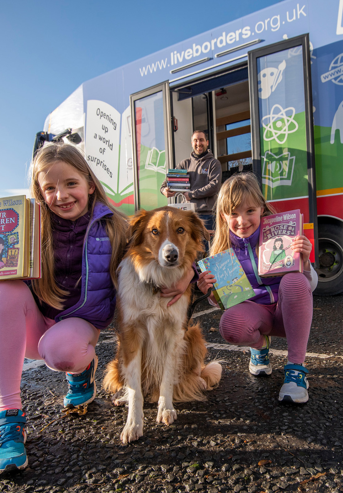
 Benefits and strategic fit of mobile libraries <!-- PAGE: 40 --> 7  Benefits and strategic fit of mobile libraries

The many benefits of mobile library services were set out in Libraries on the Move. These include positive impacts on social and community engagement, health and wellbeing, learning and development, children and families, rural life, culture and leisure, finances and independence. Loneliness and social isolation are particularly important, especially as they are key priorities of the Scottish Government. The government’s strategy, Recovering our Connections 2023 to 2026,69 references libraries through supporting Forward.

It was not part of the remit of this report to seek new evidence of the benefits of mobile libraries. However, one recent published journal article stated that:

This has not changed in the last five years, and in fact, with more people feeling isolated or suffering from mental health issues as a result of the pandemic,71 the wider benefits of the mobile library could be even more in demand now. Indeed, one interviewee said that loneliness could be seen as the new pandemic.

“

… mobile libraries have the potential to function as a ‘social equaliser’ by extending the philosophy of social equality and erasing social, economic and educational barriers through the provision of literacy and learning opportunities for community members of all ages, abilities and backgrounds.”70

Follow up interviews for this report found that anecdotal evidence from mobile library staff suggests that many people missed the mobile library service during the pandemic, particularly from a social aspect. One interviewee said that the social side of using the mobile library had become more important and meaningful since the pandemic and lockdowns.

69	 Scottish Government (2023) Recovering our Connections 2023-2026. From: https://www.gov.scot/publications/ recovering-connections-2023-2026/ 70	 Lo, P. & Stark, A. (2020) Examining the relationship between social inclusion and mobile libraries in the age of Internet connectivity: A qualitative study of mobile librarians around the globe. Journal of Librarianship and Information Science, 53 (2), pp 245-270. From: https://journals.sagepub.com/doi/10.1177/0961000620935476 71	 Scottish Government (2020) Scotland’s Wellbeing: The Impact of COVID-19. From https://nationalperformance. gov.scot/scotlands-wellbeing-impact-covid-19; Scottish Government (2023) Recovering our Connections 2023- 2026: A Plan to take forward the delivery of A Connected Scotland. From https://www.gov.scot/publications/ recovering-connections-2023-2026/ <!-- PAGE: 41 --> Another service commented:

The SHS also found that 17% of respondents had attended a library in the previous 12 months; this was the 7th most popular cultural activity in list. This activity came with high satisfaction results: “In 2022, just under nine out of ten users were satisfied with local authority libraries (89%).”

“

Mobiles are about more then delivering books. They help to tackle social isolation and ensure that everyone has equity of access. Our drivers/team members establish real rapport and personal relationship with their customers.”

### 7.1 Strategic connections

* With such a broad range of impacts, library services are able to tailor messages around the strategic value of mobile libraries to different audiences and priority agendas. When asked what strategic areas they found useful to concentrate on, a broad range of answers was provided. These included:
* rural inequality and rural poverty
* digital poverty and digital inclusion
* social isolation and loneliness
* health and wellbeing
* lifelong learning
* promoting a love of reading
* quality of life
* help communities thrive
* “closing the attainment gap by delivering service to rural schools”
* “promoting literacy to groups such as rural pupils, the elderly, care home residents, home learners”
* “promoting social inclusion and improving health and wellbeing of communities at risk of rural poverty”
* “improving economic wellbeing of communities by offering volunteering/ placements for young people on our mobile service.”

And in an incredibly moving anecdote, one interviewee recounted how a driver noticed a customer wasn’t waiting for the mobile as usual. Concerned, they decided to go to their house and ended up calling the emergency services with the person taken to hospital.

A person, a vehicle and books can achieve so much:

“

The mobile library is a very visible and much appreciated service in rural communities, and can be one of the few visits more isolated people get in remoter areas. It has a direct effect on the disadvantaged and isolated – we get continual direct feedback about the contribution to wellbeing, and the staff are particularly valued. Partners appreciate the impact of the service and there is demand for joint visits/ events. Therefore the mobile is useful both as a valued service and an icon to promote libraries and reading.”

As noted in the above quote, alongside the social, health and wellbeing benefits of mobile libraries, the books are loved by many. Reading for pleasure is the main cultural activity for people in Scotland, according to the latest Scottish Household Survey (SHS). When asked about participation in cultural events in the previous 12 months, 64% of respondents said they had read for pleasure. The next highest activity was viewing performances online at 20%.72

72	 Scottish Government (2023) Scottish Household Survey 2022: Key Findings (2023). From: https://www.gov.scot/ publications/scottish-household-survey-2022-key-findings/ <!-- PAGE: 42 --> Services emphasised the inclusive nature of the mobile library in many spheres including rurality, digital engagement, and learning. One service noted that they ensure their mobile serves areas of high multiple deprivations. Another said “equality is the key behind the mobile, to increase accessibility”.

7.3 Putting a price on the value of mobile libraries

New research from England has calculated that mobile library services have an estimated benefit value of of £49.70 per participant per year.74

In Scotland, with 28,575 registered mobile library members (figures from 17 of 19 Scottish mobile library services), this creates a total value of £1,414,463. Although the Scottish survey does not have full costs for all the mobile services, the figures provided from 15 services total £1,429,772.

Especially if there is space on board for an additional passenger, and even better a small meeting room, they could be used for community delivery of strategic priority agendas to help meet local and national goals.

7.2 Forward: Scotland’s Public Library Strategy 2021-2025

Therefore, although on paper mobile library services can look expensive per use, in terms of wider value for people, it is almost equivalent to what it costs to provide.

* Scotland’s library strategy, Forward,73 has three strategic areas of people, place and partnership. Mobile libraries help contribute to many of the specific aims under these including:
* reading and literacy, closing the attainment gap
* wellbeing post Covid-19, targetting health and communities
* making libraries accessible to all
* diverse cultural offer.

### 7.4 Summary of strategic benefits

The evidence from users quoted in Libraries on the Move provided direct examples of how mobile libraries meet many strategic priorities of councils and the Scottish Government.

They are key ways for people in rural and island communities to engage with culture, learning and each other, and bring diverse benefits from decreased feelings of social isolation to financial savings. This has been confirmed by English research which has estimated a monetary amount of how much the service is worth to a mobile library participant.

Forward also references nine of the global sustainable development goals of 2030. Mobile libraries contribute towards these including poverty, health and wellbeing, education, inequalities, sustainable communities, and responsible consumption.

Library services are able to utilise the broad scope of mobile libraries to promote their strategic importance. However, despite this and the value they bring at an individual level, they are often at risk of being discontinued.

The Mobile Libraries Day is part of strategic aim 2.2 (community delivery) and it’s pleasing to note that despite the pandemic this national day has been maintained, and even spread outwith Scotland.

They are therefore a key element for many library services in contributing towards the successful delivery of Forward.

73	 SLIC (2021) Forward: Scotland’s Public Library Strategy 2021-2025. From: https://scottishlibraries.org/advice- guidance/national-strategies/forward-scotlands-public-library-strategy/ 74	 Gordon, J. et al (2023) Libraries for living, and for living better: The value and impact of public libraries in the East of England. UEA Publishing Project. From: https://www.ueapublishingproject.com/ A report for Libraries Connected East, see p.18 and p.71.

<!-- PAGE: 43 -->

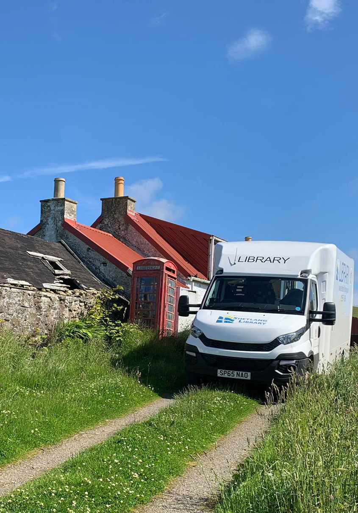

Rural and island communities <!-- PAGE: 44 --> 8  Rural and island communities

“

The mobiles reach areas where no other services go.”

The proportion of the Scottish population living in rural areas has remained at 17% since 2011; however, rural areas make up 98% of the Scottish land mass.75

8.1 Mobile library provision and rural Scotland

Currently 19 of the 32 Scottish local authorities have mobile libraries. We can use the Scottish Government’s rural classification system to see whether the most rural areas are served by mobile libraries.

The Scottish Government recognises that people living in rural and remote areas have higher living costs than other parts of Scotland,76 including food and household shopping, transport, housing, delivery/postage costs, and home heating. The cost of travel was identified as the dominant extra cost. People in rural areas are also less likely to be connected to the internet using superfast broadband.77

The government’s system distinguishes between rural and urban areas, as well as accessibility and whether somewhere is remote or very remote.79 The classification is presented in two, four, six or eight fold categories. The six fold classification was used in the previous mobile library report and is used again here because it combines both rurality with accessibility. Under the six fold system there are four urban categories plus ‘accessible rural’ (areas with a population of less than 3,000 people, and within a 30 minute drive time of a settlement of 10,000 or more) and ‘remote rural’ (areas with a population of less than 3,000 people, and with a drive time of over 30 minutes to a settlement of 10,000 or more). The percentage of each council’s population in the six categories is recorded. When the two rural categories are combined this give a single rural population percentage.

People living on islands or in rural areas are likely to be some distance away from their nearest static library branch. Even if there is a library 10 miles away, a number of factors may prevent them from using it, such as no private transport vehicle available, cost of fuel and cost of public transport (both higher in rural and island areas78), little or no public transport, inconvenient opening hours, or opening hours which don’t align with transport availability, and personal factors such as inability to use public transport. For these reasons, access to a mobile library service (or a home delivery service) is essential.

75	 Scottish Government (2021) Rural Scotland Key Facts 2021. From: https://www.gov.scot/publications/rural- scotland-key-facts-2021/documents/ 76	 Scottish Government (2021) Poverty in rural Scotland: evidence review. From: https://www.gov.scot/ publications/poverty-rural-scotland-review-evidence/ 77	 Scottish Government (2021) Rural Scotland Key Facts 2021. From: https://www.gov.scot/publications/rural- scotland-key-facts-2021/documents/ 78	 UK Parliament (2023) Scottish Affairs Committee: Inquiry Cost of living: impact on rural communities in Scotland. Oral evidence, 3 July 2023. From: https://committees.parliament.uk/event/18562/formal-meeting-oral- evidence-session/ 79	 Scottish Government (2022) Scottish Government Urban Rural Classification 2020. From:  https://www.gov.scot/ publications/scottish-government-urban-rural-classification-2020/ <!-- PAGE: 45 --> The table below shows in bold the council areas which have accessible rural or remote rural populations above the Scottish average, and if the combined rural population is above the Scottish average of 17.1%.

Table 7: Percentage of population in rural classifications, and number of mobiles, presented alphabetically by council area

Council Area Accessible rural Remote rural Combined rural Number of mobiles 2023

Aberdeen City 1.5% 0.0% 1.5% Aberdeenshire 36.4% 12.3% 48.6% Angus 26.1% 0.7% 26.8% Argyll and Bute 4.4% 43.2% 47.6% Clackmannanshire 14.6% 0.0% 14.6% Dumfries & Galloway 25.0% 20.1% 45.1% Dundee City 0.9% 0.0% 0.9% East Ayrshire 22.0% 6.4% 28.4% 2* East Dunbartonshire 5.2% 0.0% 5.2% East Lothian 25.2% 0.0% 25.2% 0* East Renfrewshire 3.8% 0.0% 3.8% Edinburgh, City of 1.0% 0.0% 1.0% Falkirk 8.4% 0.0% 8.4% Fife 18.2% 0.0% 18.2% Glasgow City 0.4% 0.0% 0.4% Highland 10.4% 37.0% 47.4% Inverclyde 5.1% 0.0% 5.1% Midlothian 11.4% 0.0% 11.4% Moray 32.6% 9.5% 42.1% Na h-Eileanan Siar 0.0% 72.5% 72.5% North Ayrshire 6.5% 4.3% 10.8% North Lanarkshire 8.6% 0.0% 8.6% 3* Orkney Islands 0.0% 66.5% 66.5% Perth and Kinross 35.0% 10.9% 45.8% Renfrewshire 4.2% 0.0% 4.2% Scottish Borders 38.3% 8.8% 47.1% Shetland Islands 0.0% 70.4% 70.4% South Ayrshire 17.9% 3.5% 21.4% South Lanarkshire 8.7% 1.6% 10.4% Stirling 29.5% 4.3% 33.7% West Dunbartonshire 1.2% 0.0% 1.3% West Lothian 8.2% 0.0% 8.2% Scotland average 11.6% 5.5% 17.1%

Sources: rural figures from Scottish Government Urban Rural Classification 2020. Mobile numbers from 2023/24 survey. *East Ayrshire unconfirmed number of mobiles; *East Lothian mobile service is provided by both Midlothian and Scottish Borders; *North Lanarkshire unconfirmed number of mobiles

Bold indicates council area with average or above average rural population for the separate categories.

<!-- PAGE: 46 -->

If we focus on just the 16 council areas with above average combined rural population (+17.1%) we can see that nearly all of them do have mobile library services.

8.2 Reading is important for people in rural areas

The Scottish Government’s most recent information about rural Scotland highlights the importance of reading to rural populations. The key facts document uses evidence from the 2019 Scottish Household Survey and shows that if reading is removed from cultural participation, 33% of remote rural respondents, 30% of accessible rural participants and 26% of respondents from the rest of Scotland only engage with culture through reading (see table below).

Table 8: Combined rural population, and number of mobiles, presented by highest rural population first

Council Area Rural pop

No. of Mobiles

%

Na h-Eileanan Siar 72.5 Shetland Islands 70.4 Orkney Islands 66.5 Aberdeenshire 48.6 Argyll and Bute 47.6 Highland 47.4 Scottish Borders 47.1 Perth and Kinross 45.8 Dumfries and Galloway 45.1 Moray 42.1 Stirling 33.7 East Ayrshire 28.4 2* Angus 26.8 East Lothian 25.2 [Yes] South Ayrshire 21.4 Fife 18.2

Remote

Accessible

Rest of Scotland

Rural

Rural

Yes 80% 77% 74%

Excluding reading

47% 47% 40%

No 20% 23% 26%

Total 100% 100% 100%

Source: table from Scottish Government Rural Scotland Key Facts 202180

These figures show why access to books and reading materials are important to rural communities, and particularly remote rural populations, and thus highlights the role the library service has in rural areas.

*East Ayrshire unconfirmed number; *East Lothian’s provided by Midlothian and Scottish Borders.

### 8.3 An ageing rural population

The table highlights Aberdeenshire and Dumfries and Galloway as having a high rural population but with no mobile library provision in terms of public access vehicles. This could apply to Moray by April 2024. However, they do have home delivery services providing books directly to those unable to get to a static library, and one uses a ‘Good Neighbour’ scheme where a neighbour collects books from a local static branch on behalf of their neighbour.

Communities in rural and island areas of Scotland are ageing at a faster rate than those in cities.81 Across Scotland in general, the older population is increasing faster than in other parts of the UK, with an 85% increase in those aged 75+ in Scotland.82 There is a higher proportion of older people in rural Scotland, particularly in areas categorised as ‘remote rural’.83

80	 Scottish Government (2021) Rural Scotland Key Facts 2021. From: https://www.gov.scot/publications/rural- scotland-key-facts-2021/documents/ 81	 National Records of Scotland (2020) Population ageing in rural communities. From https://www.nrscotland.gov. uk/news/2020/population-ageing-in-rural-communities 82	 University of Stirling (n.d.) Healthy Ageing in Scotland. From: https://www.stir.ac.uk/research/research- spotlights/healthy-ageing-in-scotland/ 83	 Scottish Government (2021) Rural Scotland Key Facts 2021. From: https://www.gov.scot/publications/rural- scotland-key-facts-2021/documents/ <!-- PAGE: 47 --> This has implications for rural councils as a large proportion of mobile library users are elderly. Library services may need to increase their mobile library and home delivery/ housebound services in order to meet any increase in demand from a growing ageing population.

8.4 Summary of rural and island aspects

Most of the Scottish mobile libraries operate in accessible rural and remote rural areas, including the islands. This poses challenges because such areas are by their nature, low in population, and as a result cost per use for the mobiles tends to be high on paper. But with higher living costs, people living in rural and island areas may depend more on mobile library services than other people, and for equality of opportunities, these services may be seen as vital for many.

<!-- PAGE: 48 -->

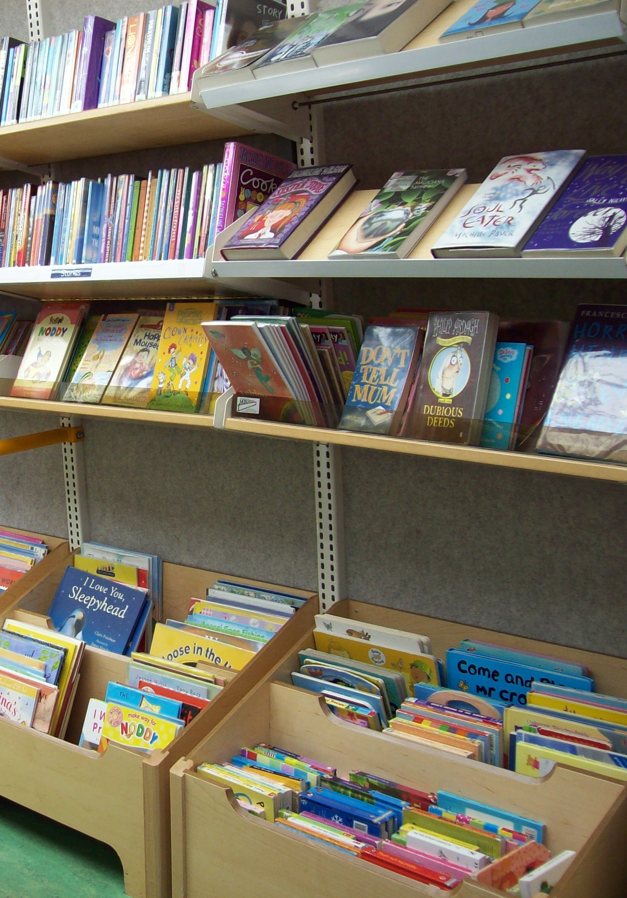

Alternatives to mobile libraries <!-- PAGE: 49 --> 9  Alternatives to mobile libraries

With several library services in Scotland recently withdrawing their mobile library offer, and more possibly to follow, what are the alternatives?

One service in Scotland is looking into the option of working with the local council’s on- demand community minibus which collects people from areas where public transport doesn’t operate in order to take them to their nearest branch library.

This is to overcome the loss of four mobile vehicles which have been withdrawn. These community ‘libraries’ are in parish and community halls where there is no current mobile library stop. The council said “There is an emerging network of community libraries across Devon from small informal bring and borrow schemes to thriving and formal independent libraries, with regular stock updates and access to wider services.”85 However, these informal ‘libraries’ rely on considerable volunteer support and dedication and are not always a sustainable solution.86 87

Cross border cooperation could also be an option for some councils. Currently Scottish Borders and Midlothian deliver a mobile service to parts of neighbouring East Lothian. A resident of East Lothian joins the appropriate other council library service and can then use the mobile that serves their village/area. Whilst not an option for the island library services, where council areas are close to each other it may facilitate co-operation on particular routes.

In Wales, Powys library service is exploring delivering books with food or community visits:

“

The library service has been working with some of the community response teams across Powys, to include book loans in their volunteer deliveries of groceries, prescriptions, and hot meals, as a valued boost to mental health and wellbeing. These groups support a similar demographic to the mobile library, but in all of the main towns as well as in the rural areas.”88

Devon County Council announced a £25,000 “transition fund to help vulnerable mobile library users, and an additional £15,000 for community groups and parish councils to apply for small grants to facilitate local community library development”.84

84	 Dawlish Gazette (2023) Mobile libraries axed by cash-strapped DCC. From: https://www.dawlish-today.co.uk/ news/mobile-libraries-axed-by-cash-strapped-dcc-650970 85	 Mid Devon Advertiser (2023) Devon County Council’s new drive to create bespoke community libraries. From: https://www.middevonadvertiser.co.uk/news/devon-county-councils-new-drive-to-create-bespoke- community-libraries-649437 86	 Gov.uk (2017) Research and analysis to explore the service effectiveness and sustainability of community managed libraries in England. From: https://www.gov.uk/government/publications/research-and-analysis-to-explore- the-service-effectiveness-and-sustainability-of-community-managed-libraries-in-england 87	 Public Library News (n.d.) Cons: reasons against volunteer “community libraries”. From:   https://www. publiclibrariesnews.com/campaigning/volunteer-run-libraries/cons 88	 Powys County Council (2021) Transformation of mobile library service into an outreach and housebound model. From: https://powys.moderngov.co.uk/documents/s66432/Mobile%20library%20transformation%20paper%20 FINAL.pdf <!-- PAGE: 50 --> This can include reading packs prepared by staff members or requests for particular books”.89

### 9.1 Home delivery

The most common example of an alternative to the public access mobile library service is doorstep/home delivery. Traditionally most public library services provide a housebound service, which may be delivered by volunteers, and which delivers books direct to people who, usually due to ill health or age, are unable to leave their homes.

9.1.1 Advantages and disadvantages of home delivery service

Gwynedd’s review highlighted the financial savings which could be made from changing to smaller vehicles and direct delivery, but also noted the disadvantage of users not being able to enter the vehicle, browse or meet other people.

During the pandemic many library service expanded this to include mobile library users, and also others users who wanted it. Survey responses indicated that this expanded service was well received, and one service noted that that eligibility for the home delivery service now included not only physical or mental health issues, but “financial pressure with the cost of living crisis where they no longer have access to a vehicle and live in a very rural location.”

The review goes on to say that “During this period [i.e. lockdown] we have not received a single comment regarding the lack of availability of [the] Mobile Library in a village or housing estate.”

However, lockdown and the pandemic years of 2020 and 2021 were atypical, and people were perhaps more accepting of any type of service, if they could not have their usual mobile or static library. People adapted to, and accepted, new rules and situations. It’s therefore difficult to say if those customers would answer the same way now, and if they now do feel the lack of the traditional public access mobile.

As noted in section 5, some of the small home delivery vehicles are new electric vans. This is helping councils meet targets on decarbonising the transport infrastructure. Aberdeenshire is one Scottish example of this switch from public access mobile to home delivery.

In Scotland there appears to be a mixed picture regarding the preference for home delivery services. Whilst some people appreciate having the books delivered to them, some services noted that people like to browse, some people don’t want to or can’t pre-order from the online library catalogue, and some don’t want the driver or other library staff to choose books for them.

Some services also use the smaller vans to deliver to nurseries and primary schools, although without on-board access. Instead the books are taken into the school for perhaps a Book Bug session or to promote the summer reading challenge.

Outwith Scotland, the switch from public access mobiles to home delivery is also evident. For example, Gwynedd in rural north Wales, extended its home delivery offer during the pandemic, and undertook a review of the mobile library service in 2021. 83% of the respondents to Gwynedd’s survey said they would like the service to continue even after branch libraries reopened. Following the review it removed its three public access mobiles and bought two new small electric vans for the delivery service. Gwynedd now offers a “monthly home library service for users, and a book delivery service on request to the home for anyone who lives in Gwynedd.

And if the home delivery isn’t expanded beyond the traditional ‘housebound’ customer, what do younger fitter people do if they are living in a rural area and lack transport to get to a branch library? This could apply particularly to parents at home with young children.

From a service wide perspective, home delivery may be more economical, and easier driving conditions for staff. However, there is also a potential negative impact on staff, as noted by one interviewee who said that some drivers may be less keen on carrying crates of

89	 Cyngor Gwynedd (2021) Review of the mobile library service. From https://democracy.gwynedd.llyw.cymru/ documents/s29882/Review%20of%20the%20Mobile%20Libraries%20Service.pdf <!-- PAGE: 51 --> books in and out of the vehicle for school visits. There is also less public socialising, and there may be less staff/public engagement with a home delivery service, and we know from user evidence that this is a key part of the mobile library service.

The Carnegie UK report also recognised that whilst beneficial, digital services are not equivalent to, or replacement for, usual contact with the library service:

“

Of particular note is how digital versions of in-person library activities were not like-for-like replacements and did not deliver the same outcomes as the in-person offer.”93

### 9.2 Digital library provision

The digital library became essential during the first lockdown, when no static library branches or home delivery services could operate. Usage increased dramatically, up 100% or 200% for many services across the UK, although admittedly from a low base for many library services, and with e-loans only compensating for about 10% of previous physical loans.90

In addition, library respondents to the Scottish mobile library survey noted that some customers were unable to access e-books in text or audio format due to lack of personal equipment and digital skills.

One respondent to the Scottish mobiles survey noted that the “[a]ccessibility of a digital offer has been attractive and embraced by digitally aware customers.”. Certainly it was an opportunity for library services to promote their digital service with many diverting their bookfund into digital materials. Despite this, the University of Strathclyde research found that across the UK, although digital library services increased by 11% in 2020-21 from pre- pandemic levels, they still amounted to only a fifth of all library users. 94

The Carnegie UK Trust report on libraries during lockdown found that there are benefits of digital library services, and this was also found by the YouGov survey for the University of Strathclyde study. Benefits included people accessing e-audio books and e-magazines for the first time, saving them money.

The YouGov survey found 32% of people surveyed used library e-resources during lockdown.91 However, it also found that 57% of people surveyed tended to disagree or strongly disagreed that “digital services are an adequate replacement for traditional library services.”92

90	 McMenemy, D. et al (2023) The Impact of COVID-19 Lockdowns on Public Libraries in the UK: Findings from a National Study, Public Library Quarterly, 42:1, pp 92-110, DOI: 10.1080/01616846.2022.2058860. From https:// www.tandfonline.com/doi/full/10.1080/01616846.2022.2058860 91	 Carnegie UK Trust (2020) Making a Difference: Libraries, lockdown and looking ahead. From: https:// carnegieuktrust.org.uk/publications/making-a-difference-libraries-lockdown-and-looking-ahead/ 92	 University of Strathclyde Glasgow (2022) Digital services “are no substitute” for traditional libraries. From: https:// www.strath.ac.uk/whystrathclyde/news/2022/digitalservicesarenosubstitutefortraditionallibraries/ 93	 Carnegie UK Trust (2020) Making a Difference: Libraries, lockdown and looking ahead. From: https:// carnegieuktrust.org.uk/publications/making-a-difference-libraries-lockdown-and-looking-ahead/ 94	 University of Strathclyde Glasgow (2022) Digital services “are no substitute” for traditional libraries. From: https:// www.strath.ac.uk/whystrathclyde/news/2022/digitalservicesarenosubstitutefortraditionallibraries/ <!-- PAGE: 52 --> Whilst the quality of library services inevitably varies by council, this became more apparent during lockdown when some services could offer extensive digital collections of e-books, e-audio books, e-magazines, digital newspapers etc, and others had a much smaller collection and long waiting lists. This was noted in the Carnegie UK Trust report. That report also noted that England, Wales and Northern Ireland governmental bodies provided additional money for public library e-books and digital stock at the beginning of the pandemic.95 (The Scottish Government provided financial support for libraries to reconnect with their communities via grant funding administered by SLIC, in November 2021.96)

9.3 What else can you do with a mobile library?

During a consultation about the mobile library service in Cheshire West and Chester, people were asked what else they wanted from the mobile library and the library stops. Responses included: health checks like blood pressure, Wi-Fi, story time, adult events and longer stop times. People also said the mobile library service needed more publicity and not just internet based promotion, e.g. signage at mobile stops.97

As noted in section 4, availability of additional services on board or at the stops is limited to some extent by the capability of the vehicles, e.g. space and internet connectivity.

Currently in Scotland each library service purchases its own digital collections, and people can thus compare what’s available in one area with another, with provision varying across the country. In Wales, a national scheme has central procurement for e-books (text and audio) and e-magazines and thus all members of the public access the same collection, which is much larger than any individual service could offer, and coverage is the same across Wales. This could be an option for Scotland to explore with the Scottish Government and public library services.

Two services in Scotland have received Scottish Government Public Libraries Improvement Fund grants to try using mobile libraries outside the normal timetable and to take them directly into communities for different activities. Both Angus Alive and East Ayrshire are working with local partner groups to reach people and community groups who would not usually consider using the library service. This has included using mobile library vehicles for Bookbug session, learning activities, digital engagement, author events, and showcasing other services libraries have to offer.

However, as noted in the first mobile library report, a digital service does not replace the human connection and wider benefits of a mobile library service.

95	 Carnegie UK Trust (2020) Making a Difference: Libraries, lockdown and looking ahead. From: https:// carnegieuktrust.org.uk/publications/making-a-difference-libraries-lockdown-and-looking-ahead/ 96	 Scottish Government (2021) Lifeline for libraries. From: https://www.gov.scot/news/lifeline-for-libraries/ 97	 Cheshire West and Chester (2023) Mobile Library Service consultation. From: https://www. cheshirewestandchester.gov.uk/your-council/consultations-and-petitions/consultations/closed-council- consultations/mobile-library-service-consultation <!-- PAGE: 53 --> A more unusual use for a mobile library vehicle can be seen in Essex. There, a new mobile vehicle provides the library service by day, but a youth space by night. After the library route has finished for the day, the vehicle goes back to base and has its books and shelves removed, and fold down desks and folding chairs are deployed to transform it into a youth vehicle with desks, laptops, screen, internet and Wi-Fi. The vehicle is energy efficient and also self sufficient and has solar panels on the roof. On board is a toilet, a kitchen area with hot and cold running water and a fridge and microwave, a laptop cupboard with charging station, literature holders, pinboard display panels, child-safe barriers, diesel fired heater systems and blowers which run from the batteries, a lift, double air-powered doors, third passenger seat which slots into rails on the floor, and a wind-out awning for outdoor exhibitions.98

9.4 Summary of alternatives to mobiles

Some services, in Scotland and beyond, are opting to provide a library service to rural and island communities via an extended ‘housebound’ home delivery service. Some have removed the traditional eligibility criteria for housebound customers, e.g. illness and age, and enable anyone to request a home delivery of library books and other items. There is mixed evidence of the benefits of this approach. It does save the library service money, and can mean smaller electric vehicles can be used, but it removes the public socialising, engagement and connection element of public access mobiles. Whilst some customers like it, others do not.

The same is true of digital library provision – some customers like having e-audio books, e-magazines, and e-books to read, whereas other people don’t have the equipment, skills or inclination to use digital resources. Digital versions can satisfy the desire to read and learn, but they don’t replace the social engagement of a public access mobile library.

Other than also using the mobile library vehicles at night for different purposes, there could be scope for additional council services to be offered via the mobiles. However, for many vehicles there is no space for an additional passenger or separate space inside to hold a 1-2-1 session with a member of the public.

Although third party private services, or additional council services, could work in partnership with mobile libraries to deliver the library service plus something else, the reality is that most of the current vehicles in Scotland couldn’t offer this functionality. However, if there is investment in the mobile library fleet, and new vehicles were designed with this in mind, it does present a possible option to make mobiles more financially viable.

With many rural areas losing banking and post office services, is there scope to have a combined public service with a private company? A funding agreement could be established whereby the bank or post office could pay for being able to conduct business on the mobiles, accessing customers in areas where there may be little or no banking or post office provision. Although this could make mobile libraries more financially viable, it again depends on enough space and internet connectivity for the services to operate, and so would be currently impossible for most of the mobiles to offer.

98	 Neat Vehicles (n.d.) Essex County Council Mobile Library Vehicles. From https://www.neatvehicles.com/our- products/essex-county-council-mobile-library-vehicles/ <!-- PAGE: 54 -->

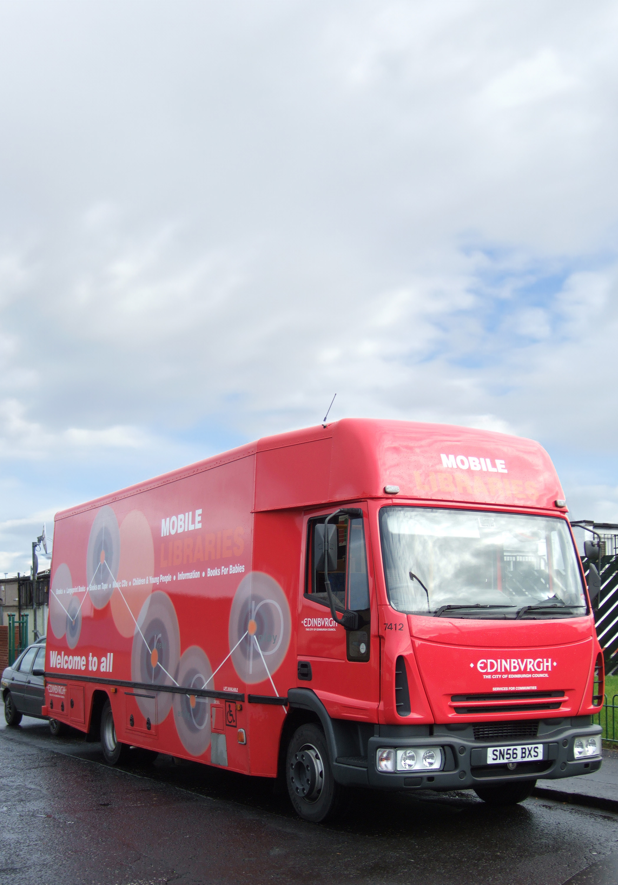
 Impacts of changes to provision <!-- PAGE: 55 --> 10  Impacts of changes to provision

Most respondents to the survey indicated that they haven’t gathered evidence of any impact of change to the mobile library service. This may be because the pandemic caused a lot of upheaval and services have only in the last year or so been able to return to normal. But as noted in section 4, there is a danger that if users aren’t consulted about changes and the potential or actual impacts gathered, councils could be at risk of failing equalities duties.

When asked about the impact of the loss of any mobile library routes or vehicles, one service in Scotland noted:

For schools and nurseries, library services have tended to adapt provision to maintain some sort of service, e.g. to provide a drop-off collection/book exchange as a replacement to a withdrawn public access mobile vehicle. However, one service said:

“

Although not measured, the likely impact will have been a decrease in social inclusion and a negative impact on health and wellbeing, literacy, educational attainment, and an increased risk of rural poverty.”

“

Educational establishments are delighted with the contact from [the library staff], however have indicated they miss access to physical collections.”

This is because of the wide benefits a mobile library service brings.

Moray’s recent review of a number of services including the mobile library noted that a “reduction in social connection and increased travel” were cited as the most common impacts if the mobile library service was removed.99 This ties in with the social value of the mobile library service.

99	 Moray Council (2023) Moray Council publishes summary of latest budget consultation feedback. From: https:// newsroom.moray.gov.uk/news/moray-council-publishes-summary-of-latest-budget-consultation-feedback <!-- PAGE: 56 --> A consultation in Powys, rural mid Wales, found what people valued about the mobile library when asking about proposed changes to the services. Some people said they wouldn’t use alternatives, and that the “mobile library is one of very few services received by taxpayers in rural areas, highly valued for the knowledgeable friendly staff, opportunities to browse books, meet with neighbours, and obtain information. … Others value their independence highly, and do not want others to bring books for them. The impact on playgroups and children who use the mobile library was also highlighted.”100

Another impact of the loss of a mobile vehicle noted by services includes increased wear and tear on any remaining vehicles which then have to cover a larger geographic area. This can also have a knock-on effect on staffing, particularly longer days for drivers.

Given the number of mobile vehicles discontinued in the last five years it’s disappointing there is not much rigorous evidence of the potential and actual impact on people from the loss of the mobile service. This could be useful at a local level for planning alternative services, as well as helping inform national discussions and help other library services minimise any impact of loss of service.

100	Powys County Council (2021) Transformation of mobile library service into an outreach and housebound model. From: https://powys.moderngov.co.uk/documents/s66432/Mobile%20library%20transformation%20paper%20FINAL.pdf <!-- PAGE: 57 -->

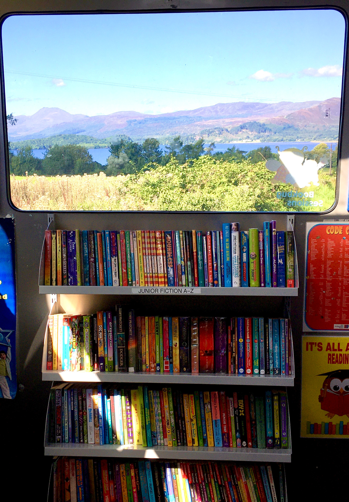
 Recommendations for the future <!-- PAGE: 58 --> 11  Recommendations for the future

The recommendations below fall into two broad categories: marketing and management at the local level, and investment and strategic oversight at the national level.

* Local level – Marketing and engagement
* Better website information – pictures of the vehicles (and staff if willing) inside and out so people know what to expect and can be enticed by the look, clickable map of routes, accessible HTML and downloadable timetables, mobile libraries to be an obvious heading or section, contact details for the mobile service, explanation of how the mobile library service works, and information about additional services offered e.g. hearing aid batteries, NEC cards.
* More marketing – localised in community areas with stops tends to work well for services, and raises the profile locally; usage for some routes has not returned to pre- pandemic levels, so trying different ways to reach former and new users would be beneficial.
* Review routes and stops annually or more often, and potentially engage with more schools – services which have seen usage recover have generally been undertaking frequent reviews of routes and stops to remove underused stops and optimise the table to fit in more schools if possible.
* Engage with Mobile Libraries Day – this raises the profile of mobile libraries nationally, captures the attention of users and non-users and has spread outwith Scotland.

* Local – management
* Ensure consultations of provision of mobile library services meets equality and other requirements for user engagement.
* Gather more evidence from mobile library users of benefits and potential impacts of change – the more evidence which is available the better informed decisions can be about changes.
* If bordering another authority with (or without) a mobile library service, consider cross provision of routes for some hamlets and villages, e.g. areas of East Lothian have mobile library services provided by Midlothian and Scottish Borders.

* National – investment and oversight
* Capital investment in vehicles – investigate the potential for a capital investment fund for mobile library vehicles, from Scottish Government or other sources, to upgrade existing vehicles and replace the oldest vehicles; this could include lower carbon vehicles e.g. electric, and additional features such as solar panels. New vehicles with space for partners to deliver activities could also be beneficial.
* Capital investment fund to improve the digital capabilities of the mobile libraries and internet connectivity in the areas served by the mobiles. The newer mobiles tend to have better ICT equipment for public and staff, with internet access, which enables mobile libraries to contribute more towards digital inclusion, with longer stops where digital skills support can be provided to users.

<!-- PAGE: 59 -->

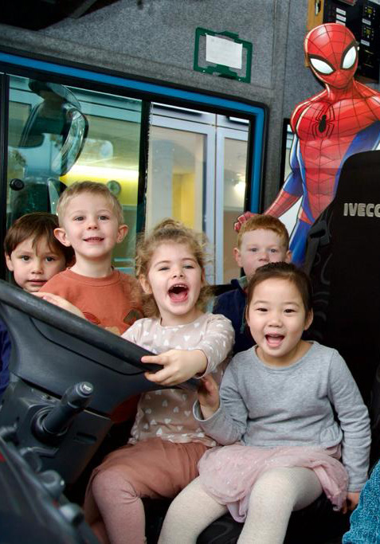

Conclusion <!-- PAGE: 60 --> 12  Conclusion

Public access mobile library vehicles help achieve local and national objectives including equality, opportunity and community – the key components of the current Programme for Government in Scotland.

They embrace young and old people, rural and urban areas, and reach places which have few other public services, addressing spacial inequality. They are valued for helping with health and wellbeing, particularly loneliness and social isolation. This is especially important post-pandemic, as governments and services look for ways to engage and reconnect.

As one interviewee said “the public value them greatly, and their benefit is very broad.”

Alongside this they are vital for learning and literacy, formal and information education, digital inclusion, providing access to diverse cultures, as well as saving people money. With rural poverty on the rise, this is important for the mobiles serving rural and island communities.

Older people make up a significant proportion of mobile libraries users. With an ageing population in Scotland this creates a growing cohort of people who may benefit from such services.

Mobile libraries are a remarkable blend of people and public space – a recipe which is hard to replicate: one library manager said mobile libraries are ‘an icon’.

But, despite all their strengths, mobile libraries are vulnerable to funding cuts, often because they look expensive on a cost per use basis which doesn’t take into account additional benefits of using them. Unfortunately older vehicles are increasingly being discontinued without replacement. Funding to replace ageing vehicles is probably the biggest challenge most mobile library services are currently facing.

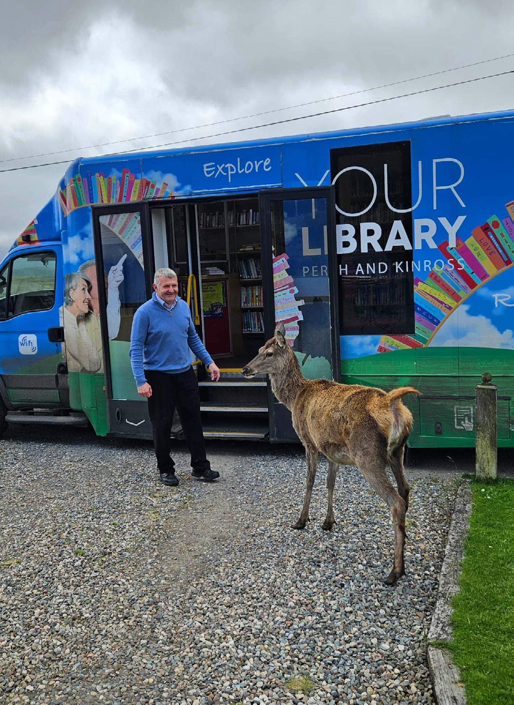

*Image: Perth and Kinross mobile at Rannoch Moor, with a new type of customer* <!-- PAGE: 61 --> Acknowledgements

This report would not have been possible without the time and input from library services who responded to the survey, and the follow up interviews. I am very grateful for the staff time and effort taken to complete the survey. I’m also grateful to SLIC for provision of additional information.

Dr Alyson Tyler, independent researcher, https://alysontyler-research.uk/

January 2024 <!-- PAGE: 62 --> Scottish Library and Information Council Turnberry House 175 West George Street Glasgow G2 2LB

scottishlibraries.org info@scottishlibraries.org

6/24
