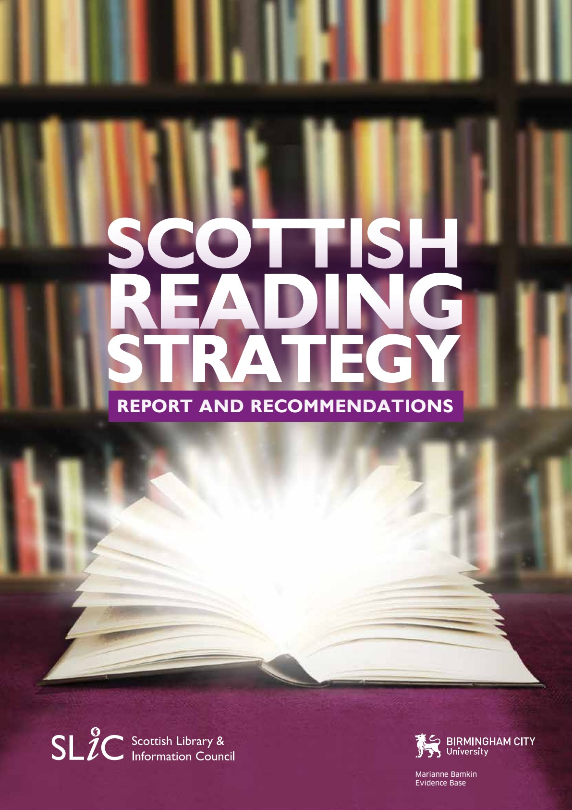
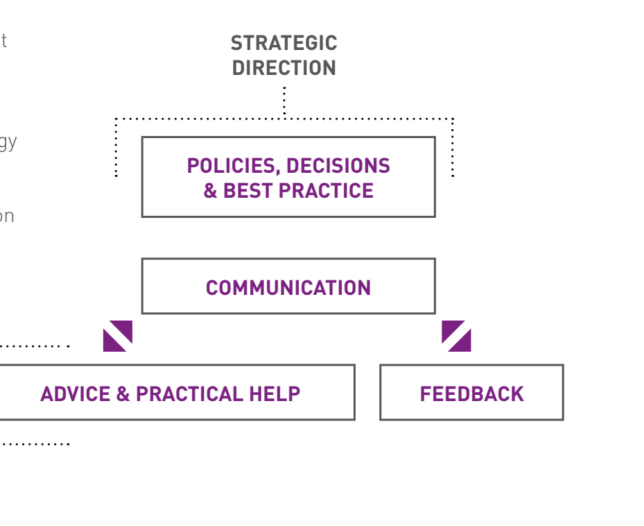

<!-- PAGE: 1 -->

# SCOTTISH READING STRATEGY

## Evidence Base: REPORT AND RECOMMENDATIONS

**Marianne Bamkin**

*Scottish Library and Information Council.*

<!-- PAGE: 2 -->

*(This page is intentionally blank in the original document)*

<!-- PAGE: 3 -->

## Contents

- [1 The role of public libraries as a conduit to literacy](#1--the-role-of-public-libraries-as-a-conduit-to-literacy) 4
- [2 The Scottish Reading Strategy for Public Libraries](#2--the-scottish-reading-strategy-for-public-libraries) 4
- [3 Approach to SRS refresh](#3--approach-to-srs-refresh) 5
- [4 Effectiveness of SRS](#4--effectiveness-of-srs) 6
  - [4.1 Perceptions of implementation of SRS](#41--perceptions-of-implementation-of-srs) 6
  - [4.2 Working well](#42--working-well) 6
  - [4.3 Concerns](#43--concerns) 7
  - [4.4 Additions](#44--additions) 8
  - [4.5 Alignment with the national strategy for public libraries: Ambition and Opportunity](#45--alignment-with-the-national-strategy-for-libraries-ambition--opportunity) 8
    - [4.5.1 Strategic Aim 2: Digital inclusion](#451--strategic-aim-2-digital-inclusion) 8
    - [4.5.2 Strategic Aim 5: Culture and creativity](#452--strategic-aim-5-culture-and-creativity) 8
    - [4.5.3 Strategic Aim 6: Excellent public services](#453--strategic-aim-6-excellent-public-services) 8
  - [4.6 Delivering a public library reading and literacy strategy](#46--delivering-a-public-library-reading-and-literacy-strategy) 10
    - [4.6.1 Documentation](#461--documentation) 10
    - [4.6.2 Communication](#462--communication) 10
- [5 Future shape of SRS](#5--future-shape-of-srs) 11
  - [5.1 Recommendations](#51--recommendations) 12
  - [5.2 Recommendations summarised in order of priority](#52--recommendations-summarised-in-order-of-priority) 14
  - [5.3 Further work](#53--further-work) 14
- [6 Appendix 1](#6--appendix-1) 16
- [7 Appendix 2: Draft framework for delivery of the Scottish Reading Strategy](#7--appendix-2-draft-framework-for-delivery-of-the-scottish-reading-strategy) 22

<!-- PAGE: 4 -->

# SCOTTISH READING STRATEGY REPORT & RECOMMENDATIONS

## 1  The role of public libraries as a conduit to literacy

Governments the world over are aware that their citizens must be literate to contribute to modern society. Libraries stimulate literacy because they not only provide free access to books and other literature, but also allow individuals to become familiar with the written word in a variety of formats and languages within a neutral, safe, word rich environment. Studies show that the act of reading improves cognition, reduces stress and increases wellbeing. However, the skill of reading requires practice and is not a natural instinct. The action of reading must be performed repeatedly in an individual’s first spoken language for them to become proficient, just like learning to swim or play a sport.

Public libraries hold a special role in enhancing the literacy of a population because they are freely available to any member of society. A public library supplies the space and medium by which individuals can practice reading in a personal way driven by their own motivations to read about their interests and stories that they enjoy in their chosen language. The Scottish Government understands this role and has funded initiatives enabling public libraries to enhance literacy and reading in partnerships with other agencies. For example, Read, Write, Count and Book Week Scotland.

## 2  The Scottish Reading Strategy for public libraries

Librarians and library staff also understand the powerful effect that libraries have on literacy and learning.

Therefore, the Scottish Library and Information Council (SLIC) collaborated with representatives from libraries and partnering agencies to develop the Scottish Reading Strategy for Public Libraries (SRS). It was implemented in 2014 with the commitment by each library authority in Scotland to deliver a consistent, standardised service that promoted reading and literacy to every individual. This is to ensure that any customer regardless of age, ability or demographic will have the same level of service at any library they visit in any part of Scotland such as Bookbug sessions, books on parenting or reading groups and author events.

> **The vision of the strategy as it stands is:**
>
> Through free access to the life enriching, creative activity of reading, contribute to health and wellbeing, improved level of literacy, inspiring reading across all interests and age groups, drawing communities together to bring reading alive

Each of the points in the vision are supported by five outcomes:

- Inspire reading across all interests and age groups, from pre-literate to fluent readers
- Encourage people to read widely, trying new genres and exploring new ways of sharing their reading experiences
- Contribute to the overall health and wellbeing of the individual
- Support literacy development and increase the number of confident and capable readers
- Recognise and support language and diversity

The strategy document lists five strategic elements, which set out the responsibilities and level of involvement to which authorities are expected to commit – the way that the SRS will be implemented. In summary, all Scottish <!-- PAGE: 5 --> library authorities are asked to deliver the SRS by working with the strategic groups and partner agencies to hold a baseline level of events and increase the number of events over time. They are also required to develop “a shared evidence bank and advocacy statements which illustrate social impact”. These elements are key to the delivery and management of the SRS.

The SRS is administered through a steering group and three strategic teams: Early Years, Young People, and Adults, that write action plans for its implementation, liaise with partner organisations and organise annual team training workshops. Since the SRS was implemented other policies have been introduced, such as the national strategy for public libraries, Ambition & Opportunity, and How Good is Our Public Library Service?, as well as several government initiatives for literacy and numeracy. This report examines the present SRS in the context of the six aims of the national strategy with the intention to align it more closely to recent policies and to make recommendations for the delivery framework and infrastructure for a refreshed SRS.

## 3  Approach to SRS refresh

The overall focus of this review is to understand whether the implementation of the current SRS contributes to fostering literacy and learning for individual people across Scotland and how the SRS can be updated to reflect the current reading climate. Therefore, the aims of this review of the SRS are to:

- Ensure that the strategy aligns with the current reading landscape in Scotland
- Make a contribution to the successful delivery of Ambition & Opportunity
- Suggest ways to support the Scottish library community with implementation of the Scottish Reading Strategy

The main objectives include: examining documentation and practise of the SRS as it currently stands; identifying best practice and areas for improvement; comparing the strategy against *Ambition & Opportunity: A Strategy for Public Libraries in Scotland 2015-2020*; investigating the practices of other nations collaborating to deliver a national reading strategy.

Key individuals from libraries and partnership organisations were interviewed by telephone or Skype to collect perceptions of the effectiveness of SRS as it currently stands and to gather examples of best practice. The main conclusions of this project were reached through comparative analysis of the interviews and relevant literature, such as strategy documents, policy documents, reports and online information about the reading landscape in Scotland, other parts of the UK and other countries. The data were analysed by comparison tables and thematic coding and it was quickly found that distinct patterns of success and concern emerged.

<!-- PAGE: 6 -->

# SCOTTISH READING STRATEGY REPORT & RECOMMENDATIONS

## 4  Effectiveness of SRS

### 4.1  Perceptions of implementation of SRS

In order to get a well balanced view, the participants were drawn from three groups: partnership organisations, those in libraries implementing the strategy and those overseeing the strategy. The interviews were conducted informally. The participants were asked whether they considered that SRS was working, what should stay in SRS, what could be dropped and should anything be added. Their replies showed that although they considered that SRS was successfully being implemented by libraries they all identified issues with the delivery infrastructure. Here is a summary of the points made:

### 4.2  Working well

- **Relevance** - the priorities of SRS are still relevant
- **Commitment** - the authorities are committed to a baseline of events and the SRS strategic groups
- **Partnership** - there are strong partnerships with other national agencies. For example, Book Week Scotland is an annual initiative organised by the Scottish Book Trust in partnership with libraries and other agencies. The Scottish public libraries work closely with the Scottish Book Trust and fulfil a major role in the annual programme. “They are absolutely the backbone of that programme and the reading strategy has a huge part to play in that”. Some libraries go “above and beyond” what is expected from them and the funding they have been given to stage the events. Similarly, the Scottish Book Trust gifting scheme (Bookbug) is delivered locally with “absolute buy in” from local libraries. “It’s their programme, it belongs to them… They run it and organise it for their customers.”
- **A library strategy** - the libraries feel ownership of the strategy because they are administering it through their own action plans, “It’s not an external organisation telling us what to do”. That sentiment was emphasised by partnership organisations as well as library practitioners and is an essential motivation to the delivery of the strategy
- **Empowerment** - the existence of SRS is empowering libraries to hold events and provide services that otherwise they may not be able to do because it solicits support from managers, some of whom do not have a library background.

> #### Jane Austen in Shetland: A local library led event
>
> The staff of Shetland Library dressed up in period costume on 18 July 2017 to commemorate the 200th anniversary of Jane Austen’s death. An evening event included more costumes and Austen inspired refreshments. Costumed staff handed out copies of her books to island visitors.

> #### Book Week Scotland: Collaborative Working
>
> Fife Libraries organised a Banned Books and Prohibition Cocktails event at Kirkcaldy Galleries during Book Week Scotland 2016. Cocktails made from prohibition recipes were served, passages were read aloud from previously banned books with copies for guests to borrow. The event attracted a different audience to the regular library customer and increased their audience for book events. “That is the Holy Grail, getting people in through the door that would not be coming in the door otherwise.”

> #### South Lanarkshire: Engaging new readers
>
> Libraries in South Lanarkshire collaborated with Big Glasgow Comic Page to hold Comic Cons in three libraries during 2016-17, with the aim of encouraging more adults to attend events, increase library membership and launch an e-comic service. They welcomed audiences in their thousands.

<!-- PAGE: 7 -->

- **Funding** - initiatives and events are financed by grants from SLIC or Scottish Book Trust. The team chairs take considerable effort in applying and securing the funding on behalf of all libraries
- **Library network** - a strong informal professional support network has developed which is considered to be of great value and support. “We all speak to each other. It’s a great network of librarians in Scotland”. The network is non-exclusive and prepared to help where it is needed. “If you are in the position that you are a non-library professional and you are managing a service, you know that you can go to one person, or you can go to 32 and you can get advice”
- **Training** - help, support and training provided by SLIC is appreciated. Training organised by the steering group as “reading day” workshops for all members of each of the three teams are highly valued and supply a platform where good practice can be shared
- **Flexible** - the strategic teams are open to operational change and readily adapt to feedback from the team members.

### 4.3  Concerns

The infrastructure for the delivery of SRS worked well at its outset, but changes to the management structures of some libraries, reduction in local authority budgets and staffing has meant that the infrastructure is now not as effective as it was. The following concerns were raised:

- **Management structure** - each authority belongs to a team and is expected to send a representative to meetings and feedback the proceedings to their service. The team representatives are meant to be supported by a buddying system. Changes to library management structures have meant that this does not always work. A non-library service manager might have responsibility for delivering the SRS, or a team member might not have direct communication with other service managers. There is no feedback from some services to team meetings. Several participants were concerned that their colleagues did not appreciate the importance of attending meetings and that this leads to an unfair balance of effort over the teams.
- **Capacity** - with the reduction of staff in libraries, it is difficult to find the time to commit to attending meetings. The administrative burden of chairing a team or hosting a meeting has become too great for individuals who have full-time posts elsewhere. “You are asking people who have extraordinarily busy full-time jobs to carry out administrative tasks as well.”
- **Communication** - this is the greatest concern to the participants. The team structure was designed to ensure direct communication between SLIC, the strategic teams and the authorities. Communication within each team is not always successful. It relies on the team representative to be the point of contact between their library and the SRS team and not all representatives are able to carry this out. The buddying system has proved to be ineffective in this respect.
- **Advocacy** - the need for the strategy is not always understood by managers, who have other priorities. More advocacy is needed to demonstrate to other agencies and stakeholders the power of libraries to influence reading and literacy.
- **Baseline events** - the baseline of events is now no longer considered useful by some authorities, although other authorities find it helps them to justify holding events. It was suggested that the baseline should be replaced by a flexible framework where individual authorities can set their own goals.
- **Training** - there is a need for more training on specific areas of reading development, such as working with teenagers, digital reading and health and wellbeing.
- **Monitoring and evaluation** - there is no formal method of measuring the success of the SRS outcomes. A shared evidence bank was never fully developed.

<!-- PAGE: 8 -->

# SCOTTISH READING STRATEGY REPORT & RECOMMENDATIONS

### 4.4  Additions

None of the people interviewed considered that any point should be dropped from the strategy, but they did make the following suggestions for points that should be emphasised or are missing and should be included.

**Greater emphasis on:**
- Literacy
- Reading advocacy
- The social importance of libraries
- Innovative ideas
- Creativity
- Clarity of purpose

**Include:**
- Writing activities
- Methods of implementation and achieving improvements
- Alignment with government policies

Other proposals included a wider promotion of achievements made through SRS, a “virtual” meeting space for the three teams and a central online resource to deposit and share information and evidence.

### 4.5  Alignment with the national strategy for libraries, Ambition & Opportunity

In order to align with *Ambition & Opportunity*, the SRS vision statement can be broken down into five aims:

- **1.** Contribute to health and wellbeing
- **2.** Improve levels of literacy
- **3.** Inspire reading across all interests and age groups
- **4.** Draw communities together
- **5.** Bring reading alive

Table 1 on page 9 shows the outcomes, strategic elements and aims of the SRS mapped against the six strategic aims of the national strategy. A full mapping of the SRS with *Ambition & Opportunity* and Scottish Government National Outcomes can be seen in Appendix 1.

Some SRS aims fit into more than one national strategy aim, therefore, they are repeated in the table. Even so, as can be seen above, not every one of the national strategic aims has an applicable corresponding SRS aim although there is a corresponding SRS outcome. In order to ensure that the refreshed SRS includes aims that entirely correspond to the national strategy, examining the approach of other nations to their reading strategy can provide useful suggestions. Therefore, collaborations between public and other sector libraries from other countries were examined to resolve the missing or weak aims.

#### 4.5.1  Strategic Aim 2: Digital Inclusion

The Norwegian National Strategy for Libraries 2015-2018[^1] includes a policy for the purchase of e-books and considers that they should be permanent features in a library’s collection. With the rise in popularity of e-books and e-book readers Norwegian libraries realise that some readers may prefer to read in a digital format and offer digital literacy classes to older people as part of their reading strategy.[^2]

#### 4.5.2  Strategic Aim 5: Culture and Creativity

A language can be “brought to life” by promoting its use and supporting its writers. Norway and Wales are mindful of their linguistic cultural heritage. For that reason, Norwegian libraries hold Language Cafés for non-native speakers to improve their Norwegian. Wales’ Sixth Quality Framework for Libraries includes provision for “access to services, cultural activities and high quality resources in the Welsh language”.[^3] Facilitating events, groups and workshops in community languages will both strengthen a language and an individual’s literacy.

#### 4.5.3  Strategic Aim 6: Excellent Public Services

Excellent customer service comes from having a well-trained and knowledgeable workforce especially in some specialist areas. In order that library staff can guide library users and help enhance literacy they should have the opportunity to attend training courses. For example, the Korean Republic renewed its Library Act and introduced a Reading Culture Promotion Act in 2006. Korea’s National Library holds Reading Class Workshop training targeted at children’s librarians so that public libraries can implement the policies from those acts.[^4] Staff that achieve well at the workshops are given prestigious awards. In England and Wales the Society of Chief Librarians in partnership with The Reading Agency developed the “Libraries’ Universal Reading Offer” and is developing online training courses and resources for library staff to be better equipped to deliver the offer.

However well trained the workforce, they can only operate efficiently when they have easily available resources. The organisation of an event can be time consuming, therefore sharing experiences and resources cuts down time, effort and financial outlay. Easily accessible shared online toolkits and checklists are used by the Australian State of Victoria in support of their reading and literacy strategic framework.[^5] Similarly, the UK’s Reading Agency provides online resources for library staff that support its various initiatives such as the Summer Reading Challenge or Reading Well (books on prescription).[^6]

Any strategy that is designed to improve a public service has to be monitored and assessed in order to understand when goals are met and whether adaptations are needed. In order to track the progress of their reading initiatives, the State of Victoria public libraries “measure and monitor participation in and the impact of these activities…” and the Reading Agency has developed the Reading Outcomes Toolkit[^7], which provides guidance for the evaluation of reading promotion activities. For example, methods of gathering existing evidence for the personal outcomes of reading for pleasure; ways of evaluating the activity being offered; how to understand the impact of activities and to communicate that impact.

<!-- PAGE: 9 -->

### Table 1: SRS aims, outcomes and elements mapped against Ambition & Opportunity

| Strategic Aim A&O | Aims SRS (from vision) | Outcomes and elements SRS |
|:---|:---|:---|
| **Strategic Aim 1: Libraries promoting reading, literacy and learning** | • To inspire reading across all ages and interests • To improve literacy levels • To bring reading alive | • To inspire reading across all interests, age-groups and abilities • To encourage people to read widely, trying new genres and exploring new ways of sharing their reading experiences • Support literacy development and increase the number of confident and capable readers |
| **Strategic Aim 2: Digital inclusion** | *(No applicable SRS aim)* | • To encourage people to read exploring new ways of sharing their reading experiences |
| **Strategic Aim 3: Economic wellbeing** | • To make closer communities | • To encourage people to read widely trying new genres |
| **Strategic Aim 4: Social wellbeing** | • To make closer communities • To improve health and wellbeing | • Commitment to work with national partners to deliver the strategy • Recognise and support language and diversity • Continuous development of shared evidence bank and advocacy statements illustrating social impact • To contribute to the overall health and wellbeing of the individual |
| **Strategic Aim 5: Culture and creativity** | • To bring reading alive *(Weak SRS aim)* | • Recognise and support language and diversity |
| **Strategic Aim 6: Excellent public services** | *(No applicable SRS aim)* | • Commitment to Reader Development Network, Young People’s Strategic Group and Early Years Strategic Group • Commitment of all authorities to the ongoing enhancement of the agreed baseline • 100% of authorities offering agreed baseline activities and events |

<!-- PAGE: 10 -->

# SCOTTISH READING STRATEGY REPORT & RECOMMENDATIONS

## 4.6  Delivering a Public Library Reading and Literacy Strategy

### 4.6.1  Documentation

To effectively and efficiently implement a national library reading strategy libraries must collaborate towards achieving the strategy goals. Working together ensures that effort used for developing promotions, organising events and producing resources is not duplicated and, by economies of scale, overall financial outlay is decreased. However, achieving a state where each library can deliver programmes and initiatives to the same level, certain strategic elements must be put into place:

- The strategy has to be clearly and unambiguously documented stating a focused vision and specific goals with achievable outcomes
- The need for the strategy has to be expressed
- The documentation must set out the management structure of how the strategy is developed and implemented: its administration and delivery framework
- The strategy should include measures for success

Jointly developed between the 47 public libraries and regional library corporations in Victoria, Australia, their reading and literacy strategic framework[^8] is an excellent example of such a clear approach. Targeted at a lay audience, the main document, “Reading and Literacy for All: A strategic framework for Victorian public libraries”, sets out the framework, the reason for the framework, the vision, guiding principles, key goals, activities and the way that progress of the strategy will be assessed.

This is supplemented by further documents targeted at library practitioners: an in-depth industry report; guidance and information on selecting or developing adult or early years reading programmes; evaluation checklists and case studies outlining best practice. Specific activities are mentioned as examples of the type of initiative of which individual libraries may want to be part. There is no baseline level of activity expressed, but the documents give very full guidance on how an individual library can implement the reading strategy. The Victorian strategy is part of Victoria State Library’s collaborative programme with the public library network. To support the strategy the State Library also offers staff training and grants for adult literacy development.

### 4.6.2  Communication

Documentation of a strategy is useless unless its goals and principles are communicated with the practitioners expected to implement them. A degree of facilitation is necessary to oversee the wider communication and ongoing development of a strategy. As the participants in this study have stated uncertainty about internal and external communication of the SRS and that libraries are lacking capacity in staffing, then a solution could be found by creating a role of facilitator. Collaborative groups of libraries have appointed a staff member to administer the smooth running of the group. For example, South West Regional Library Services (SWRLS) is a cross sector library and cultural organisation in the South West of England. Although it is governed by a board of trustees it also engages a director to facilitate internal and external communication, co-ordination and liaison, administer the website and oversee activities.[^9]

<!-- PAGE: 11 -->

# SCOTTISH READING STRATEGY REPORT & RECOMMENDATIONS

## 5  Future Shape of SRS

The purpose of this review of the SRS was to understand whether the implementation of the current strategy contributes to fostering literacy and learning for individual people across Scotland, as well as to identify ways that the strategy can be updated to reflect the current reading climate. Many positive aspects of the effect of having a strategy were uncovered but a general breakdown of the system of administering the strategy was identified.

The positive aspects of implementing a reading strategy for public libraries include the following points:

- **Justification** – it provides the justification for a library to hold the basic provision of holding bookbug sessions and for a more inventive event designed to attract a new audience, such as a Comic Con.
- **Support** - from management or local government, giving them a deeper understanding of the contribution of libraries to learning, health and wellbeing
- **Efficiency** - good business practice to share ideas, advice and resources
- **Equality** - for the library as well as for individuals, communities and society
- **Quality** – a documented strategy provides the means of a measurable, assessable benchmark
- **Cohesion** – the unintended consequence of implementing a strategy formed informal professional network which draws together staff working in libraries all across Scotland
- **Training** – it gives the basis for staff training and professional development
- **Advocacy** - it provides evidence to showcase what libraries are achieving
- **Informs** - tell all parties involved what libraries are expected to do and why they do it
- **Direction** – a strategy is a master plan, something that is necessary for good business practice showing the purpose and future development of that organisation

Contradictory opinions were expressed about the strategy process. On one hand, poor communication and lack of time and capacity to fully develop the strategic direction of the SRS through face-to-face meetings was a common concern to the participants of this review. However, a number of participants spoke passionately about the informal network of librarians and library staff across Scotland that has been built up around the reading strategy. Similarly, through the reading strategy, strong partnerships have developed between libraries and other agencies such as the Scottish Book Trust.

Looking deeper into the situation it is apparent that the breakdown of the system is due to a knowledge management problem – the flow of information through the teams, the authorities and relevant partners. What is not being communicated and what is being communicated are the salient questions. Figure 1 depicts the problem; what is being communicated is advice, support, ideas and practical help through the informal network of 32 library authorities. What is not being communicated are policies, meeting decisions and examples of best practice, which impedes the strategic direction of the SRS. There is insufficient feedback on attempts to communicate which slows the flow of information in the teams.

*Figure 1: Information flows of SRS teams*

<!-- PAGE: 12 -->

# SCOTTISH READING STRATEGY REPORT & RECOMMENDATIONS

The solution to this problem is to shorten the chain of communication by using an information hub – a central point of communication where knowledge can be gathered and shared. In order for a reading strategy to grow and develop this situation has to be resolved as a matter of priority and some suggestions are made below.

The existence of a formal, collaborative policy for reading promotion and literacy enhancement for all Scottish public libraries has been shown to empower libraries. The belief that libraries feel ownership of the current Scottish Reading Strategy for Public Libraries is an essential part of its success. Any development or change to the strategy has to be willingly adopted and ratified by representatives of the libraries. Therefore, the recommendations given in this report are offered as suggestions to be discussed before any implementation.

### Vision, aims and objectives

In order to align the SRS to *Ambition & Opportunity* and the government national outcomes it is recommended that the vision statement of the Scottish Reading Strategy should be amended as follows:

> **Proposed Vision Statement:**
>
> To promote a trusted, consistent service across all Scottish public libraries which enriches all individuals and society

And the following mission statement added:

> **Proposed Mission Statement:**
>
> To give all individuals and communities in Scotland the power to enhance their literacy through free access to resources and by developing and sharing innovative practices

### Strategic aims of the refreshed SRS:

- **1.** To inspire reading across all ages, interests and abilities
- **2.** To enable all readers to freely access and read literature in digital format
- **3.** To enrich individuals' literacy so that they can achieve their economic potential
- **4.** To provide access to literature, events and resources that enrich the health and social wellbeing of people and communities in Scotland
- **5.** To foster creativity and understanding of arts, culture and languages found in Scotland
- **6.** To develop a high quality, continually improving, efficient library service which is responsive to local people’s literacy and learning needs

<!-- PAGE: 13 -->

## 5.1  Recommendations

In order to address the concerns identified by participants and build on the successes of the strategy, the following recommendations are proposed:

- **Documentation** – produce a suite of clear, professional documents:
  - A main document suitable for any audience that clearly narrates: reasons for a public library reading strategy; its overall goals; the types of activities; the method of implementation; and evaluation of the strategy.
  - Practitioner guidance and resources: detailed action frameworks, case studies of best practice, evaluation toolkits, and promotional templates.
- **Strategic team structure** – review the structure and meeting formats of the strategic teams:
  - *Option 1*: Reorganise into regional groups (e.g. North, East, West, South) rather than age-based teams. The advantage would be easier travel and higher team engagement. The disadvantage would be losing the specialisations of early years, young people and adult.
  - *Option 2*: Change the buddying clusters into local “sub-groups” of geographically close members. Consider increasing the size of the sub-group and rotate meeting attendance between each sub-group member. Regularly change meeting locations to allow easier attendance. The advantage would be greater engagement of members and the preservation of team specialisms. The disadvantage would be inconsistency - different individuals at each meeting, which would need strong communication within each sub-group.
  - *Option 3*: Do not change the team structure. Complete reorganisation of the structure could be more disruptive than leaving the current system as it is and dealing with issues of meeting attendance and communication.
- **Capacity** – team members are finding face-to-face meeting attendance and fulfilling their administrative role in the strategic teams difficult due to the responsibilities and priorities at their place of work. In order to release capacity, it is recommended that virtual conferencing is encouraged and increased to supplement face-to-face meetings. Similarly, the organisation of individual events is time-consuming and can result in duplication of effort over all the libraries. When an interesting and innovative event or activity is devised by a library, this should be shared with other libraries as best practice or as a toolkit. It is recommended that examples of best practice and toolkits of events are placed on a central online resource.
- **Communication and feedback** – confirming that internal communications are successfully passed between individual libraries, the strategic team and strategic partners, is proving to be difficult and information is not being sufficiently circulated. Similarly there is a feeling that external communication and advocacy of the power of libraries to influence literacy is not occurring. In order to facilitate internal and promote external communication as well as to increase capacity and reassign working hours it is recommended that:
  - A central online resource is developed which can be used to communicate meeting minutes, strategic decisions, a calendar of events, examples of best practice, staff resources, toolkits of events, useful links and a public facing element that displays the achievements of libraries working with the Scottish public libraries strategy for literacy and reading. A public facing part of this resource would help to communicate the good practice that is already happening in libraries to a much wider audience.
  - The role of facilitator is created as an independent paid employee. The post could be part-time; a secondment opportunity or a permanent position. The responsibilities of the post holder would include: overseeing the general implementation of the strategy; liaison between libraries, partners and strategic teams; advocacy for the strategy and Scottish libraries; administration of the online resource including collecting and collating examples of best practice and useful resources.

Further research is also needed to discover what is actually happening in libraries demonstrating the reading strategy in action and to measure the success of the strategy outcomes.

<!-- PAGE: 14 -->

# SCOTTISH READING STRATEGY REPORT & RECOMMENDATIONS

## 5.2  Recommendations summarised in order of priority

- **1.** Adopt the revised vision, mission, aims and objectives of the draft framework for the reading strategy (Appendix 2)
- **2.** Produce documentation that clearly articulates the concepts of the reading strategy to lay and professional audiences
- **3.** Set up a dedicated website - online resource for the reading strategy in order to provide toolkits, resources and aid communication and advocacy
- **4.** Create a paid position for a strategy facilitator to provide cohesion, advocacy and oversight and to increase capacity
- **5.** Consider options for developing the strategic team structure

## 5.3  Further work

In order to achieve the recommendations the following further work should be carried out:

- A scoping exercise to select the most appropriate online resource and video conferencing software
- Research into all the ways that individual Scottish libraries are enhancing literacy
- Devising an annual survey for Scottish libraries to demonstrate their compliance with the strategy and to measure the success of the outcomes

<!-- PAGE: 15 -->

*(This page is intentionally blank in the original document)*

<!-- PAGE: 16 -->

# SCOTTISH READING STRATEGY REPORT & RECOMMENDATIONS

## 6  Appendix 1

### Aims and outcomes of the SRS mapped against Ambition and Opportunity and Scottish Government National Outcomes

In order to align the refreshed Scottish Reading Strategy with the latest policies and initiatives the following comparison tables were created. The first table takes the mission and vision statements from *Ambition and Opportunity* and compares them with the vision statement of the current Scottish Reading Strategy for Public Libraries to devise mission and vision statements for the new strategy.

| Vision Ambition & Opportunity | Vision SRS | Proposed rewrite |
|:---|:---|:---|
| Scotland’s public libraries are trusted guides connecting all of our people to the world’s possibilities and opportunities | Through free access to the life enriching creative activity of reading, contribute to the health and wellbeing, improved levels of literacy, inspiring reading across all interests and age groups, drawing communities together to bring reading alive | To promote a trusted, consistent service across all Scottish libraries which enriches individuals and society |

| Mission Ambition & Opportunity | Mission SRS | Proposed rewrite |
|:---|:---|:---|
| Scotland’s public libraries are part of a shared civic ambition to fulfil the potential of individuals and communities | *(Not formally articulated in original SRS)* | To give all individuals and communities in Scotland the power to enhance their literacy through free access to resources and by developing and sharing innovative practises |

The next table compares the strategic aims, recommendations and outcomes of *Ambition & Opportunity*; the aims, outcomes and strategic elements of the current SRS and maps them against the 16 Scottish Government National Outcomes. The mapping exercise revealed gaps in the SRS and provided the blueprint for the draft framework for delivery.

<!-- PAGE: 17 -->

### Mapping: Strategic Aim 1 (Reading, Literacy and Learning)

| Strategic Aim Ambition & Opportunity | Recommendations Ambition & Opportunity | Aims SRS (from vision) | Outcomes Ambition & Opportunity | Outcomes and elements SRS | Government National Outcomes |
|:---|:---|:---|:---|:---|:---|
| **Strategic Aim 1: Libraries promoting reading, literacy and learning** | To ensure access to library services for all citizens using new technology | To inspire reading across all ages and interests | We have tackled the significant inequalities in Scottish society | To inspire reading across all interests, age-groups and abilities | • Our children have the best start in life and are ready to succeed • We have tackled the significant inequalities in Scottish society • We have improved the life chances for children, young people and families at risk |
| | To develop and promote the core offer from public libraries in Scotland | To encourage people to read widely trying new genres and exploring new ways of sharing their reading experiences | | | • Our young people are successful learners, confident individuals, effective contributors and responsible citizens |
| | To improve literacy levels | | We are better educated, more skilled and more successful, renowned for our research and innovation | Support literacy development and increase the number of confident and capable readers | • We are better educated, more skilled and more successful, renowned for our research and innovation • We have tackled the significant inequalities in Scottish society • We live our lives safe from crime, disorder and danger |
| | To bring reading alive | | | | • Our young people are successful learners, confident individuals, effective contributors and responsible citizens |

<!-- PAGE: 18 -->

# SCOTTISH READING STRATEGY REPORT & RECOMMENDATIONS

### Mapping: Strategic Aims 2 & 3 (Digital Inclusion and Economic Wellbeing)

| Strategic Aim Ambition & Opportunity | Recommendations Ambition & Opportunity | Aims SRS (from vision) | Outcomes Ambition & Opportunity | Outcomes and elements SRS | Government National Outcomes |
|:---|:---|:---|:---|:---|:---|
| **Strategic Aim 2: Digital inclusion** | Develop Scotland-wide digital access resources | To encourage people to read exploring new ways of sharing their reading experiences | | | • We have tackled the significant inequalities in Scottish society • We have improved the life chances for children, young people and families at risk |
| | Ensure Wi-Fi is available and accessible in all public libraries | | | | |
| **Strategic Aim 3: Economic wellbeing** | Develop partnerships with advice services, job centres and enterprise organisations | To make closer communities | We realise our full economic potential with more and better employment opportunities for our people | | • We realise our full economic potential with more and better employment opportunities for our people • We live our lives safe from crime, disorder and danger • Our people are able to maintain their independence as they get older and are able to access appropriate support |

<!-- PAGE: 19 -->

### Mapping: Strategic Aim 4 (Social Wellbeing)

| Strategic Aim Ambition & Opportunity | Recommendations Ambition & Opportunity | Aims SRS (from vision) | Outcomes Ambition & Opportunity | Outcomes and elements SRS | Government National Outcomes |
|:---|:---|:---|:---|:---|:---|
| **Strategic Aim 4: Social wellbeing** | Develop national initiatives for health and wellbeing | Contribute to health and wellbeing | Our people are able to maintain their independence as they get older and are able to access appropriate support | Contribute to the overall health and wellbeing of the individual | • We live longer, healthier lives • Our people are able to maintain their independence as they get older and are able to access appropriate support |
| | Promote the contribution of libraries to combatting social isolation and loneliness | Draw communities together | Our public services are high quality, continually improving, efficient and responsive to local people’s needs | Recognise and support language and diversity | • We have strong, resilient and supportive communities where people take responsibility for their own actions and how they affect others |

<!-- PAGE: 20 -->

# SCOTTISH READING STRATEGY REPORT & RECOMMENDATIONS

### Mapping: Strategic Aim 5 (Culture and Creativity)

| Strategic Aim Ambition & Opportunity | Recommendations Ambition & Opportunity | Aims SRS (from vision) | Outcomes Ambition & Opportunity | Outcomes and elements SRS | Government National Outcomes |
|:---|:---|:---|:---|:---|:---|
| **Strategic Aim 5: Culture and creativity** | Promote local cultural identity and heritage | Creative activity of reading | We take pride in a strong, fair and inclusive national identity | | • We take pride in a strong, fair and inclusive national identity • Our young people are successful learners, confident individuals, effective contributors and responsible citizens |
| | Support creative writing and reading initiatives | Bring reading alive | | | • We have improved the life chances for children, young people and families at risk |

<!-- PAGE: 21 -->

### Mapping: Strategic Aim 6 (Excellent Public Services)

| Strategic Aim Ambition & Opportunity | Recommendations Ambition & Opportunity | Aims SRS (from vision) | Outcomes Ambition & Opportunity | Outcomes and elements SRS | Government National Outcomes |
|:---|:---|:---|:---|:---|:---|
| **Strategic Aim 6: Excellent public services** | Develop and implement a learning and development programme for all library staff | | Our public services are high quality, continually improving, efficient and responsive to local people’s needs | | • Our public services are high quality, continually improving, efficient and responsive to local people’s needs |
| | Embed *How Good is Our Public Library Service?* quality framework across all authorities | | | Shared evidence bank and advocacy statements | • Our public services are high quality, continually improving, efficient and responsive to local people’s needs |

<!-- PAGE: 22 -->

# SCOTTISH READING STRATEGY REPORT & RECOMMENDATIONS

## 7  Appendix 2: Draft framework for delivery of the Scottish Reading Strategy

The following draft framework for the delivery of the strategy was compiled by taking a number of the recommendations and outcomes from *Ambition & Opportunity* and Scottish Government National Outcomes (Appendix 1). Onto that framework, participant suggestions were applied and the quality indicators from *How Good is Our Public Library Service?* were taken into consideration. In order to find concepts to support new aims and objectives that were missing in the Scottish Reading Strategy, reading strategies from around the world were explored.

### Vision

To promote a trusted, consistent service across all Scottish public libraries which enriches all individuals and society.

### Mission

To give all individuals and communities in Scotland the power to enhance their literacy through free access to resources and by developing and sharing innovative practices.

---

### ENRICHING INDIVIDUALS

#### Complying with national strategy aim 1

**To inspire reading across all ages, interests and abilities**

| Objectives for every Scottish public library: | Measurable outcomes | Example measures of success (per year) |
|:---|:---|:---|
| Provide accessible literature and book promotions for all ages, stages of literacy, abilities and languages found in the local community | Individuals in Scotland read widely and try new genres | • X% increase in active borrowers across all age groups • Lending of books in community languages and accessible formats increases by X% |
| Organise and host events that promote reading for pleasure and literacy across all life stages | Children, young people, adults and families participate in reading events | • Baseline of Bookbug sessions maintained and expanded • Attendance at author visits, reading groups and Book Week Scotland events increases by X% |
| Work with local partners, schools, early years centres and community organisations | Collaborative initiatives reach non-traditional library users | • Formal partnerships established with local education and community providers |

*Complying with Quality Indicators:* 1 - Staff knowledge, interaction and user support; 2 - Readers Experience; 3 - Learning Culture.

<!-- PAGE: 23 -->

#### Complying with national strategy aim 2

**To enable all readers to freely access and read literature in digital format**

| Objectives for every Scottish public library: | Measurable outcomes | Example measures of success (per year) |
|:---|:---|:---|
| Provide access to digital reading platforms, e-books, e-audiobooks, e-magazines and online reading resources | More people access reading materials through digital library services | • X% increase in digital downloads and e-lending issues • Number of active digital library users increases by X% |
| Offer support and digital literacy sessions to help readers use digital reading devices and apps | Readers gain confidence in discovering and downloading digital books | • X digital reading support sessions delivered per year with X participants |

*Complying with Quality Indicators:* 2 - Readers Experience; 3 - Learning Culture.

#### Complying with national strategy aim 3

**To enrich individuals' literacy so that they can achieve their economic potential**

| Objectives for every Scottish public library: | Measurable outcomes | Example measures of success (per year) |
|:---|:---|:---|
| Host courses or tuition to improve writing and comprehension for business uses | Adults improve literacy and communication skills for the workplace | • X adults complete workplace literacy and business writing sessions |
| Provide access to literature relevant to small businesses and STEM subjects | Increased understanding about business, Science, Technology, Engineering and Maths | • Business and STEM literature collection usage increases by X% |
| All Scottish libraries develop partnerships with local FE colleges, universities and education providers | Learners seamlessly access library resources and study support | • Formal referral pathways established with local FE colleges |

*Complying with Quality Indicator:* 3 - Learning Culture.

---

### ENRICHING SOCIETY

#### Complying with national strategy aim 4

**To provide access to literature, events and resources that enrich the health and social wellbeing of people and communities in Scotland**

| Objectives for every Scottish public library: | Measurable outcomes | Example measures of success (per year) |
|:---|:---|:---|
| Ensure that individuals who are unable to visit a static library have access to a library outreach service | Harder to reach individuals and communities feel included in the library service and society as a whole | • Mobile and housebound library services reach X vulnerable readers |
| Treat volunteers that help with reading promotion and literary events in accordance with national strategy guidelines | The individuals who volunteer gain higher self-esteem and competencies | • Volunteers volunteer over a longer time period – X% increase of volunteer hours shown in CIPFA report |
| Have bibliotherapy resources and literature for all ages to read that helps individuals develop life skills and emotional resilience | • Individuals gain knowledge of their own conditions and how they can be managed • Parents and carers gain knowledge and confidence in caring for their children • More children understand and are able to express their own emotions | • X more bibliotherapy and parenting books are borrowed per year |

*Complying with Quality Indicators:* 2 - Readers Experience; 3 - Learning Culture; 4 - Individual and community engagement.

<!-- PAGE: 24 -->

# SCOTTISH READING STRATEGY REPORT & RECOMMENDATIONS

#### Complying with national strategy aim 5

**To foster creativity and understanding of arts, culture and languages found in Scotland**

| Objectives for every Scottish public library: | Measurable outcomes | Example measures of success (per year) |
|:---|:---|:---|
| Bring reading alive by facilitating arts, culture and creative events, groups and workshops that foster reading and writing in English and other community languages | An increase of author visits, live events (plays, poetry readings, films, or special subject conventions) across Scottish libraries | • Live events attract X% greater audiences • X% more literature in community languages or by local authors are borrowed |
| Support their local writers and publishers by promoting and providing access to their work | The audience for arts, culture and creativity in Scotland increases as more individuals gain knowledge and understanding | • Local author showcases and Scottish publishing displays held annually |

*Complying with Quality Indicators:* 2 - Readers Experience; 3 - Learning Culture; 4 - Individual and community engagement.

#### Complying with national strategy aim 6

**To develop a high quality, continually improving, efficient library service which is responsive to local people’s literacy and learning needs**

| Objectives for every Scottish public library: | Measurable outcomes | Example measures of success (per year) |
|:---|:---|:---|
| Ensure that staff are given the training they need to implement the Scottish Reading Strategy | Library staff are trained to guide readers of all ages and abilities to: • Select alternative authors, subject or genre • Find the literature they want • Use digital formats for reading and writing | • Customers report they have broadened their reading tastes, can independently access material, and confidently use digital reading formats |
| Contribute to and take information, advice, best practice and toolkits from a Scottish Reading Strategy shared online resource | A specific online resource for the implementation of the Scottish Reading Strategy is established where libraries will: • Feedback and share examples of good practice, social impact and successful events • Link to useful services and resources (e.g. Reading Agency Reading Outcomes Framework Toolkit) • Read records of the proceedings of the Scottish Reading Strategy management team • Communicate with the Scottish Reading Strategy management team | • A flourishing online sharing resource is well used by the staff of Scottish libraries |
| Annually measure the success and impact of the aims and objectives of the Scottish Reading Strategy | There is a high quality, consistent service in every library in Scotland | • Scottish libraries perform at levels 5-6 of HGIOPLS quality indicators |

*Complying with Quality Indicators:* 1 - Staff knowledge, interaction and user support; 2 - Readers Experience; 3 - Learning Culture; 5 - Vision Strategy and continuous improvement.

<!-- PAGE: 25 -->

*(This page is intentionally blank in the original document)*

<!-- PAGE: 26 -->

# SCOTTISH READING STRATEGY

## REPORT AND RECOMMENDATIONS

**Scottish Library and Information Council**

Suite 5.5, Turnberry House  
175 West George Street, Glasgow, G2 2LB  
info@scottishlibraries.org  
0141 202 2999  
Registered company number: 129889  

02/19

## Footnotes

[^1]: https://bibliotekutvikling.no/content/uploads/2016/09/LibraryStrategy-EnglishVersion.pdf
[^2]: http://www.librariesireland.ie/wp-content/uploads/2016/04/Norwegian-perspective-on-public-libraries_Leikny-Haha-Indergaard.pdf
[^3]: http://gov.wales/docs/drah/publications/170331-connected-and-ambitious-libraries-en.pdf
[^4]: https://www.ifla.org/past-wlic/2011/114-lee-en.pdf
[^5]: https://www.slv.vic.gov.au/about-us/collaborations-affiliations/public-libraries/reading-literacy-strategic-framework
[^6]: https://readingagency.org.uk/resources/2440/
[^7]: https://readingagency.org.uk/news/OutcomesFrameworkToolkit_FINAL.pdf
[^8]: https://www.slv.vic.gov.au/sites/default/files/Reading-and-literacy-for-all-strategic-framework.pdf
[^9]: http://www.lboro.ac.uk/microsites/infosci/lisu/downloads/swrls_review_final_report.pdf
