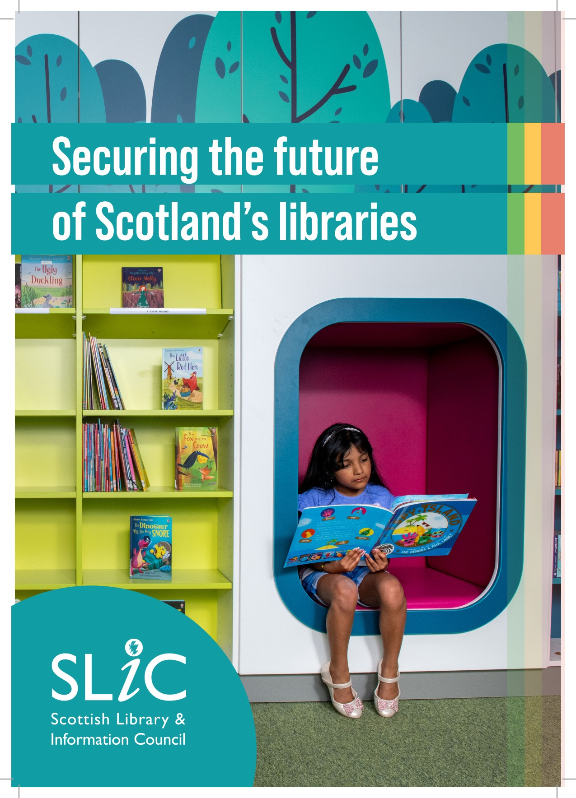
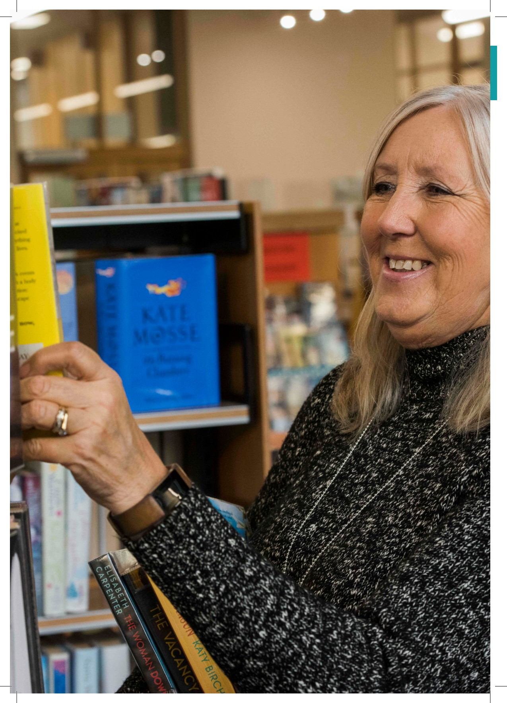
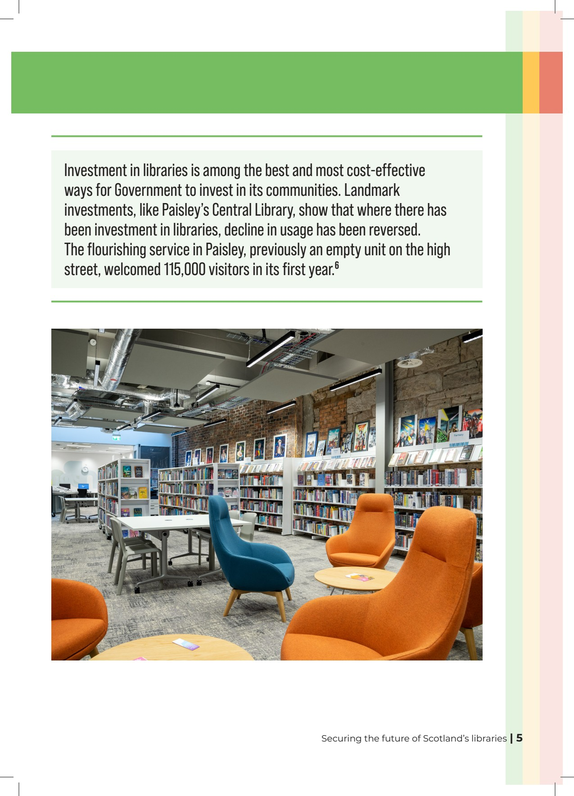
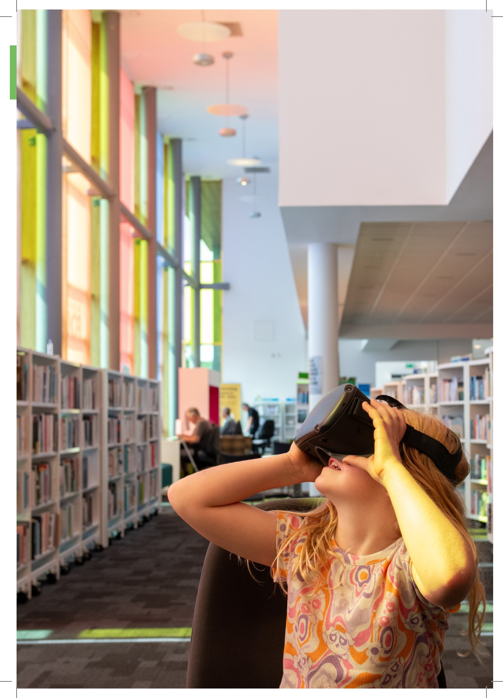
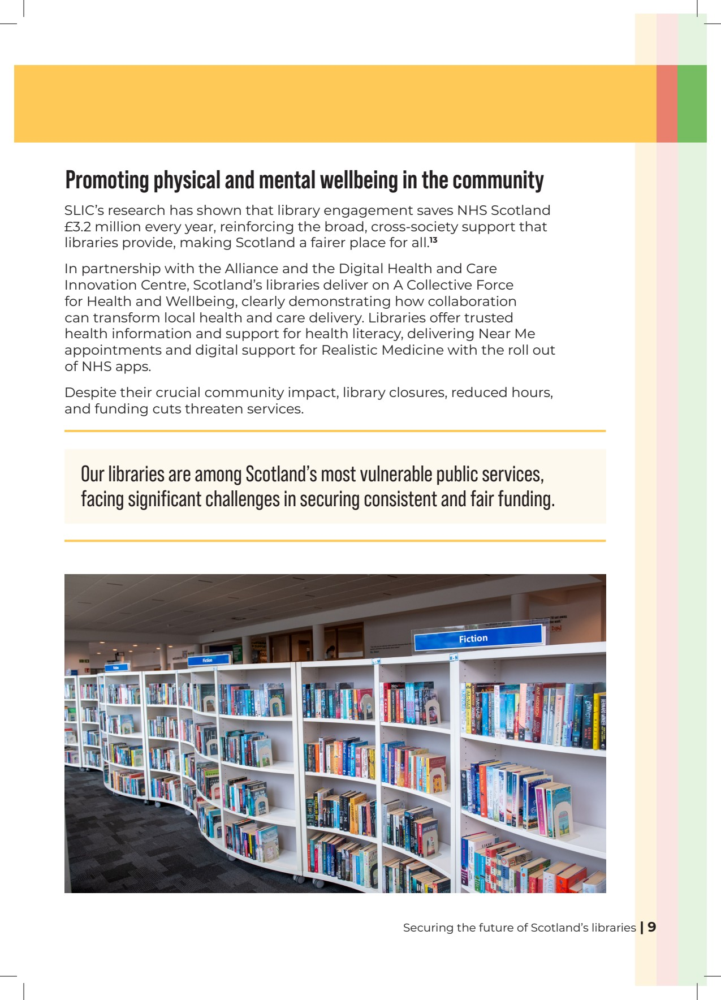
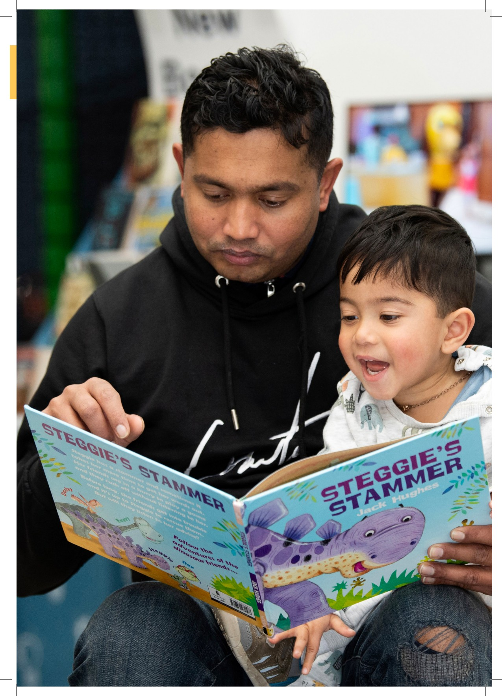
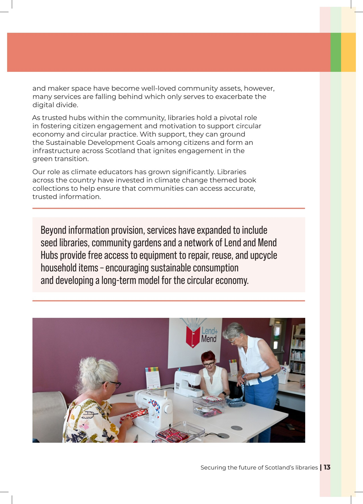

<!-- PAGE: 1 -->

# Securing the Future of Scotland’s Libraries

<!-- PAGE: 2 -->

<!-- PAGE: 3 -->

# Scotland’s Libraries

Libraries are essential public infrastructure: they are the heart of our communities. Providing free access to books, information and technology. They are a place to meet, socialise, study and work. Libraries create a safe, warm space where people can explore new ideas.

The current political and economic landscape brings acute challenges to all areas of public finance, meaning it’s never been more important to highlight that libraries are dynamic and inclusive spaces accessible to all.

We need libraries to be financed, we need fairer provision across the country, and we need them to be prepared for the future.

However, across Scotland, the landscape is far from even.

### Financed

Libraries need to be financed in a sustainable way that recognises the role they play in supporting economic and cultural wellbeing. With 32 local authorities providing varied funding settlements, library provision is far from consistent. The public library offer across Scotland is not universal and the quality of service you receive can depend heavily on where you live.

### Fairer

Libraries help make Scotland a fairer country and so they deserve investment and funding security that guarantees everyone access to a well-resourced local service, regardless of location. No one should be excluded from enjoying the benefits libraries provide.

### Future

Libraries must be properly equipped for the future as digital access becomes increasingly essential. Libraries are central to building a more connected, forward-thinking country as we drive towards the net zero goal and support Scotland’s ambition to be an innovation nation.

That’s why, ahead of the 2026 Holyrood Election, we’re setting out our vision statement to Secure the Future of Scotland’s Libraries.

We need your support to make this happen. As cultural institutions that depend on public funding, your support will be vital as we continue our work to secure the future of our libraries.

Visit your local library and see first-hand the exciting, innovative work that’s taking place on your doorstep.

Join us as we work to secure the future of Scotland’s libraries.

<!-- PAGE: 4 -->

## Financed: Libraries Play an Important Role in Economic and Cultural Wellbeing

Investigations by the Scottish Library and Information Council (SLIC) have shown that for every £1 invested into libraries, local economies stand to gain £6.95 of benefit.[^1] We provide job skills training, free and low-cost activities for all ages, and a warm, welcoming space which serves as a lifeline to the 1 in 5 adults, and 1 in 4 children across Scotland, who are living in poverty.[^2]

For many people living in Scotland, including nearly 3 million library members across the country, their first interaction with culture takes place in a library.[^3] Our provision of trusted physical and digital collections serves as a gateway to new perspectives and voices.

In 2023/24 we welcomed 14.5 million visitors through our doors: compared to the 3.8 million who attended Scottish Premiership football matches in the same period, it’s no wonder libraries are seen as cornerstones of communities, right across the country.

### Libraries Continue to Deliver Support During Incredibly Challenging Times

54 libraries have been lost since 2013/14, in addition to around 612 full-time equivalent (FTE) staff between 2012/13 and 2022/23.[^4] This comes as little surprise when we remember that the spend per head on library resources in Scotland varies between 50p and £2.41. This is in sharp contrast with our neighbours: Ireland spends £3 per head on library resources and the Netherlands has an annual investment of €29.41 per capita on library provision.

The University of Strathclyde has shown that public libraries provide a vibrant, inclusive, and trusted community hub for people from all walks of life to come together to access, share, create, appropriate, and appreciate cultural resources and materials. This can alleviate inequality by enabling wider cultural consumption, participation, and engagement.[^5]

<!-- PAGE: 5 -->

Investment in libraries is among the best and most cost-effective ways for Government to invest in its communities. Landmark investments, like Paisley’s Central Library, show that where there has been investment in libraries, decline in usage has been reversed.

The flourishing service in Paisley, previously an empty unit on the high street, welcomed 115,000 visitors in its first year.[^6]

<!-- PAGE: 6 -->

### We Envision a Scotland Where:

#### We Invest in Communities by Investing in Libraries
We recognise that capital investment in modern, progressive libraries reverses any trending decline in usage and factor this into any future growth or investment deals with regions or local authorities.

#### Libraries Are Supported to Be Successful
We establish a national policy framework that positions public libraries as essential, universally accessible community infrastructure capable of addressing key societal challenges, by implementing a coordinated financial strategy that ensures a consistent minimum level of investment across all of Scotland’s library services.

> "Libraries are engines of empathy. They are free, safe, and warm. They are places of community and connection. In libraries, we find ourselves, and each other. We must protect them for ourselves and for future generations."
> 
> — **Damian Barr**, FRSL, Author and Broadcaster[^7]

<!-- PAGE: 7 -->

<!-- PAGE: 8 -->

## Fairer: Our Libraries Are for Everyone Who Calls Scotland Home

Regardless of age, education level, income, ethnicity or ability, libraries are for all. The resources and information that they provide go a long way to making Scotland a fairer country – helping develop literacy skills and encourage lifelong learning, while also supporting community wellbeing.

Building early literacy and language skills has been shown to be instrumental in closing the attainment gap. Libraries play a key role in fostering an early love of reading through free and low-cost activities like Bookbug, offering whole family support for learning.

Around 1 in 8 children across Scotland don't have a book of their own at home.[^8] Research shows that children who read for pleasure daily have higher reading scores, wider vocabularies, and a greater general knowledge than those who don't.[^9] Regular readers are also more empathetic and have better mental health.

As the population ages, public libraries can help address the public health challenge of chronic loneliness, with 100,000 older people in Scotland reporting that they feel lonely all or most of the time.[^10]

Public libraries provide an open and inclusive community space where everyone is welcome. When surveyed, 88% of users said their library helped them to feel part of a community,[^11] with 86% saying they would be sad if their library closed.[^12]

<!-- PAGE: 9 -->

### Promoting Physical and Mental Wellbeing in the Community

SLIC’s research has shown that library engagement saves NHS Scotland £3.2 million every year, reinforcing the broad, cross-society support that libraries provide, making Scotland a fairer place for all.[^13]

In partnership with the Alliance and the Digital Health and Care Innovation Centre, Scotland’s libraries deliver on *A Collective Force for Health and Wellbeing*, clearly demonstrating how collaboration can transform local health and care delivery. Libraries offer trusted health information and support for health literacy, delivering Near Me appointments and digital support for Realistic Medicine with the roll out of NHS apps.

<!-- PAGE: 10 -->

### We Envision a Scotland Where:

#### An Excellent Library Service Is Defined
Establish a minimum universal standard for community library provision, as outlined in the Local Government (Scotland) Act (1973), with ambitious yet realistic targets for implementation.

#### Libraries Are Recognised for the Range of Public Services They Support
Foster cross-sectoral collaboration with the educational, health, and social sectors by embedding the multiple roles of public libraries in overarching policy goals and legislation.

> "The first page that you turn of a book that grabs you is like a portal to the rest of the world. The doors of a library are the doorway to your imagination, to knowledge, to history, to the future. Everything’s in there."
> 
> — **Sir Billy Connolly**, CBE[^14]

<!-- PAGE: 11 -->

<!-- PAGE: 12 -->

## Future: Libraries Continually Evolve to Meet the Changing Needs of Their Communities

We are often the first point of contact for the 15% of adults living in Scotland who lack basic digital skills, playing an important role in helping to ensure that everyone has the equipment, skills, and confidence that they need to navigate the digital world.[^15]

Access to reliable digital devices and Wi-Fi underpins much of what a modern library can do. This is as true for those seeking to learn how to use digital equipment, as it is for more advanced users who make use of the cutting-edge technology available including 3D printers, VR <!-- PAGE: 13 --> and maker space have become well-loved community assets, however, many services are falling behind which only serves to exacerbate the digital divide.

As trusted hubs within the community, libraries hold a pivotal role in fostering citizen engagement and motivation to support circular economy and circular practice. With support, they can ground the Sustainable Development Goals among citizens and form an infrastructure across Scotland that ignites engagement in the green transition.

Our role as climate educators has grown significantly. Libraries across the country have invested in climate change themed book collections to help ensure that communities can access accurate, trusted information.

Beyond information provision, services have expanded to include seed libraries, community gardens and a network of Lend and Mend Hubs provide free access to equipment to repair, reuse, and upcycle household items – encouraging sustainable consumption and developing a long-term model for the circular economy.

<!-- PAGE: 14 -->

### We Envision a Scotland Where:

#### Our Libraries Are Equipped with the Tools They Need
Libraries help to bridge a poverty-related digital divide, so it’s crucial they remain up to date with access to computers, printing services, and fast, reliable Wi-Fi. We envision a Scotland where we have a minimum standard of digital access across the country, recognising libraries as essential hubs for digital inclusion, innovation, and data literacy.

#### The Extensive Network of Physical Libraries in Scotland Is Leveraged
Tap into their potential to lay the groundwork for a more sustainable Scotland. This would involve initiatives to enhance capacity through funding, certification programmes and training, and empowering libraries to become hubs for sustainability. This can help support wider strategies, for example Net Zero Cities.

> "We live in a digital age which is rife with misinformation and encourages a narrowing, not a broadening, of viewpoints. A library full of real, physical books, the contents of which cannot be manipulated or altered, is a fortress against this trend, and equally vital are the professional librarians who staff it and who uphold the basic principles of free thinking and free speech.
> 
> A society that does not nurture, protect and properly resource its network of libraries is heading for trouble."
> 
> — **James Robertson**, poet, novelist, short story writer, editor, library member[^16]

<!-- PAGE: 15 -->

## References

*(Published on page 15 of the original document; consolidated under [Footnotes](#footnotes) at the end of this transcript).*

<!-- PAGE: 16 -->

## What You Can Do

- Visit your local library
- Support our vision
- Publicly promote libraries
- Advocate for sustainable funding
- Meet with library and information sector professionals

*Help us to secure the future of Scotland’s libraries.*

### Scottish Library & Information Council

- **Address:** 4.3 Turnberry House, 175 West George Street, Glasgow, G2 2LB
- **Telephone:** 0141 611 3160
- **Website:** <https://scottishlibraries.org>

## Footnotes

[^1]: British Library, (2019) *Democratising Entrepreneurship: Libraries as Engines of Economic Growth: A three year economic impact analysis. 2016-18*
[^2]: Scottish Government (2025) *Poverty and Income Inequality in Scotland 2021-24* <https://data.gov.scot/poverty/>
[^3]: SLIC, *Library Data 2023/24*
[^4]: CIPFA, *Library data 2013/14*; SLIC, *Library data 2023/24*
[^5]: University of Strathclyde (2018), *Public Libraries as Cultural Hubs in Disadvantaged Communities: Developing and Fostering Cultural Competencies and Connections*
[^6]: OneRen, (2024), *A blockbuster first year for Paisley’s new central library*, <https://www.oneren.org/news/posts/a-blockbuster-first-year-for-paisley-s-new-central-library/>
[^7]: CILIPS, *#LibrariesAreEssential – Supportive Quotes*, <https://www.cilips.org.uk/essential-supportive-quotes/>
[^8]: National Literacy Trust (2024) *Children and young people’s book ownership in 2024*, <https://literacytrust.org.uk/research-services/research-reports/book-ownership-in-2024/>
[^9]: Book Trust (2024) *The benefits of reading*, <https://www.booktrust.org.uk/what-we-do/impact-and-research/Research/the-benefits-of-reading/>
[^10]: Age Scotland (2023) *The Big Survey 2023*, <https://www.agescotland.org.uk/assets/000/000/376/big-survey-full-report-final_original.pdf?1707746410>
[^11]: SLIC, (2023), *Scottish Public Library Survey 2023*
[^12]: SLIC, (2023), *Scottish Public Library Survey 2023*
[^13]: SLIC (2019) *Health on the Shelf*, <https://scottishlibraries.org/health-on-the-shelf/>
[^14]: Billy Connolly, (2018), *Made in Scotland*
[^15]: Audit Scotland (2024) *Tackling digital exclusion*, <https://audit.scot/publications/tackling-digital-exclusion>
[^16]: CILIPS, *#LibrariesAreEssential – Supportive Quotes*, <https://www.cilips.org.uk/essential-supportive-quotes/>
