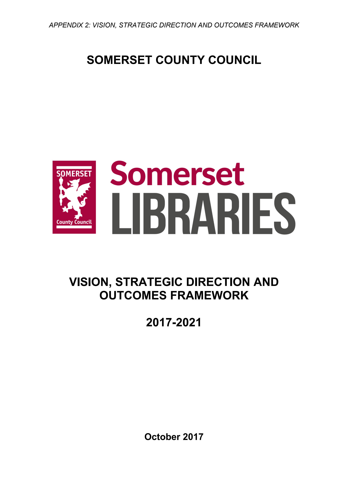
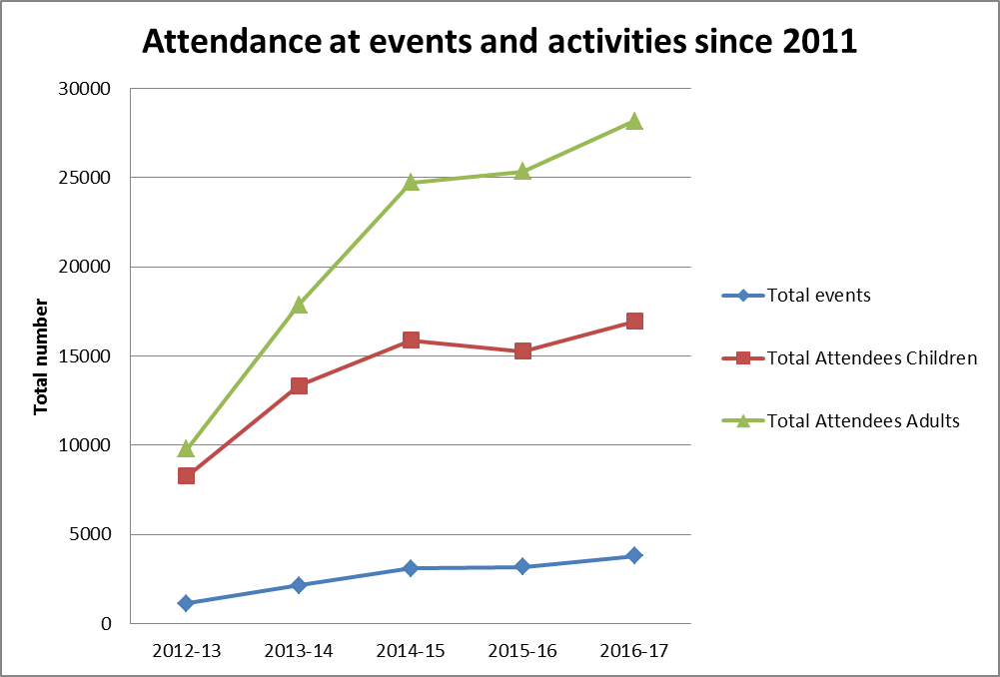
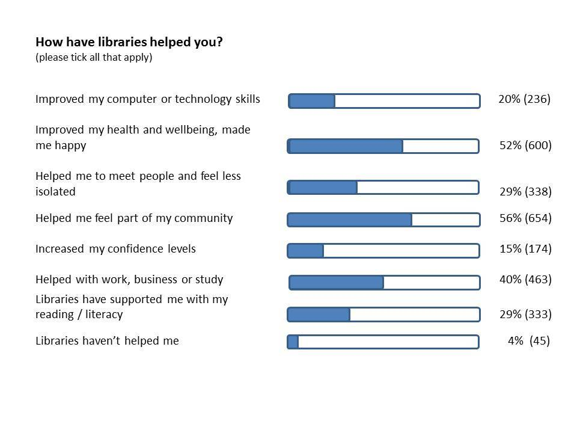
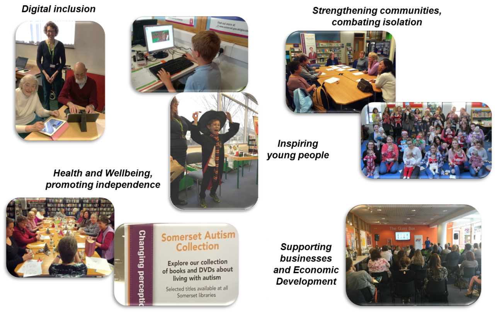

<!-- PAGE: 1 -->

# Somerset County Council

## Vision, Strategic Direction and Outcomes Framework 2017–2021

**October 2017**

*Appendix 2: Vision, Strategic Direction and Outcomes Framework*

<!-- PAGE: 2 -->

CONTENTS
## 1. Executive Summary Page 3
## 2. The need for a Library Service in Somerset Page 5
## National Public Library Service Policy in a Local Context Page 12
## Somerset’s Library Service: Current Position and Future Challenges Page 19
- **5.** A vision for Somerset Libraries Page 21
- **6.** Council priorities and Commissioned Outcomes Page 23
- **7.** 3 year plan for service development
- **7.** 1.Service delivery model Page 25
- **7.** 2.Service Re-design Page 25
- **7.** 3.Other Strategic Objectives Page 27
- **8.** Taking the vision forward Page 30 Annex A: Proposed Outcomes Framework Page 31 <!-- PAGE: 3 --> ## 1. Executive Summary This document sets out a vision, strategic direction and purpose for the Library Service in Somerset, setting a direction of travel as a foundation for the development of more detailed proposals.  The approach proposed is grounded in national priorities for Public Library Services and the vision developed by the national Libraries Taskforce, as well as the needs of Somerset’s population and the strategic objectives of the wider County Council.  It describes a continuation of the modernising journey that Somerset Libraries have undertaken in recent years – by building on the vision and outcomes framework set by the County Council’s cabinet in December 2015.  However, to ensure the Council has a sustainable future, all services (including the Library Service) will need to consider efficiency and cost reduction options.  In order to continue to deliver a thriving, modern Library Service across a wide range of outcomes within a reducing affordability envelope changes will be required. Somerset is a rural county with a rising population and significant variations in deprivation.  Many communities lack good transport links and there are significant inequalities in health, social mobility and educational attainment across the population.  Many people within our urban neighbourhoods are vulnerable to social isolation; long term health conditions, particularly dementia and diabetes, are likely to be an increasing challenge in the future and the population of older people is increasing rapidly.  Library Service provision needs to take account of the rurality of the county and the paucity of transport links, but also be focussed on targeting services to more deprived communities to be most effective.  Somerset Libraries offer much valued support to people seeking employment, looking to start a business, coping with a long term health condition; it also plays a crucial role in developing confidence and improving well-being for young people and adults of all ages.  By focussing on a range of outcomes and continuing to develop a more targeted and richer level of engagement with service users, the Library Service has a significant role to play in improving the lives of Somerset residents, and the resilience and strength of Somerset communities. The County Council supports the Department for Digital, Culture, Media and Sport’s ambition to develop and sustain thriving, quality national library services.  Our vision is supplemented by an outcomes framework setting key priorities to support reading, digital inclusion, stronger communities, health and wellbeing, economic growth and children and young people.  The outcomes framework proposed reflects local priorities, but will also ensure that the ‘offer’ in Somerset Libraries is aligned with national best practice.  The approach to developing the service to date, and the implementation of further service re-design, will be undertaken in line with the ‘design principles’ set out by the Libraries Taskforce – in particular, communities and stakeholders will be actively engaged in co-designing local proposals, which will be grounded in a robust analysis of needs. The Libraries Service has many strengths, but it is becoming overstretched, and there is a lack of capacity within the current workforce model which prevents the service from reaching its full potential.  In order to reduce costs further and continue to deliver a thriving, modern service, effectively targeted to meet the needs of the population, we feel it is necessary to review and re-design the network of library <!-- PAGE: 4 --> premises and the roles and structure of the frontline workforce.  We intend to engage and consult with stakeholders and community groups to re-determine how we provide a comprehensive and efficient library service in Somerset.  Specific proposals are yet to be developed and will be subject to full consultation, needs analysis and impact assessment, and the objective will be to keep all of our current libraries open.  However, we expect that community support will be necessary to sustain ‘static’ library provision in some areas; we will also look to develop outreach service delivery models to improve or sustain the delivery of outcomes (particularly in areas of high need) - moving beyond the traditional focus on library buildings towards a more holistic and innovative model of library service delivery.  To do this we will need to build capacity and realise the full potential in our frontline workforce, and we will review the use of volunteers within the service to try to provide additional support to our skilled staff in an increasingly challenging financial climate.  Finally, we will develop an investment programme in library assets – initially to improve technology and public computer access, but also in the longer term to improve some of our library buildings, where these are retained by the council.  In addition to seeking traditional local authority sources of capital investment, we will also explore innovative forms of financing to fund investment. Alongside these more fundamental changes to the design of Somerset’s Libraries Service, we will continue to improve performance and value for money by building on ongoing business development initiatives, focussing on income generation, promoting Somerset Libraries, improving performance and quality management, and developing local partnerships with communities and friends groups.  Working with the One Public Estate programme in Somerset we are actively exploring new shared asset opportunities in our larger libraries and this work will continue; in our smaller libraries we will work with communities and local partners to make the best use of community assets to improve value and sustain services. This vision document is a foundation for the development of specific options, and does not set out any specific proposals for change.  The detail of the key service re- design changes proposed – a review of the network and the frontline workforce – will be developed through extensive engagement and consultation with communities, stakeholders and staff.  We will undertake and consult on a comprehensive needs assessment, and will also review the potential impact of any changes on groups with protected characteristics, before coming to any decisions about changes to the library network.  The re-design of the service will be grounded in evidence and co- produced with stakeholders and communities.  In this way, we will take forward changes in line with the seven ‘design principles’ developed by the national libraries taskforce.  Final decisions will not be taken until after a full public and staff consultation.

<!-- PAGE: 5 -->

## 2. The need for a Library Service in Somerset
1.1. Somerset’s population and geography
As at June 2015, an estimated 545,390 people lived in Somerset.  Around 12% 
of the population regularly borrow items through the library service, and on 
average each person in Somerset visits a Somerset library four times per year.  
Somerset's population is projected to continue rising by at least 3,000 a year for 
the next two decades or so, reaching 600,000 by 2030.  Somerset's population 
is older than the national average, and is becoming older - the number of 
people aged 75 or more is projected to double by 2039.  The under-16 
population is projected to increase by 9% by 2039, with the great majority of 
this increase in the next ten years; however, the ‘working age’ population is 
projected to witness a 2% decline over the next twenty-five years.  Somerset 
does not have a university, and there is a net flow of 18-24 year olds out of the 
county.  The majority of Somerset residents are ‘White British’, that is, White: 
English, Welsh, Scottish or Northern Irish. At the time of the 2011 Census there 
were 28,414 Somerset residents whose ethnicity was not White British, 
equating to 5.4% of the county’s overall population.
Somerset is a rural county, which creates problems with accessing services.  
48% of the population live in a rural area – the 8th most rural of all English 
counties.  This rurality is reflected by the relatively high number of libraries (35, 
including one mobile library) maintained across the county.  Away from the 
main transport corridors transport links can be poor; 88% of Somerset's roads 
are categorised as 'rural' compared with 64% in Great Britain as a whole. 
Communities in rural West Somerset are particularly isolated; in parts of 
Exmoor households can be on average around 40 minutes by public transport 
from their nearest food store and 50 minutes from a GP. As may be expected, 
car ownership is high in rural Somerset with around half of households having 
at least two vehicles. However, around one in nine households in rural 
Somerset have access to only one car/van or no vehicles at all.
Generally, Somerset is better than the national average in terms of overall 
levels of deprivation, however levels of deprivation are variable across the 
county.  The number of ‘highly deprived’ neighbourhoods in Somerset 
(categorised as being within the 20% most deprived in England according to 
the ‘Index of Multiple Deprivation’) increased to 25 in 2015, up from 14 in 2010. 
Around 38,000 Somerset residents now live in a neighbourhood identified as 
one of the 20% most deprived in England, with the highest levels of deprivation 
found within the county’s larger urban areas.
What does this mean for the Library Service?
- Populations of older people and younger children – key user groups for  Library Services - are expected to rise.
- The design of Library Service provision needs to take account of the  rurality of the county and the paucity of transport links in some areas.
- Deprivation is variable across the county and there are a significant  number of residents living in deprived neighbourhoods, even though the County as a whole is less deprived than the national average.

<!-- PAGE: 6 -->

1.2. Somerset’s economy & employment
In 2014, the Somerset economy was worth £9.586 billion, an increase of 3.2% 
since 2013.  The credit crunch caused Somerset’s economic output (measured 
by GVA – gross value added) to contract by 4.6% between 2007 and 2010; 
however since 2012 the Somerset economy has been growing at a faster rate 
than the Local Economic Partnership (LEP) area and the UK as a whole. 
Somerset’s economic productivity consistently lags behind the UK level, with a 
difference of 18.4% in GVA per full-time equivalent job in 2014.  
The majority of Somerset’s GVA (£6.7bn in 2014) is generated by service-
based industries, but production and manufacturing play a greater role in the 
County than at a national level.  Somerset’s economy is predominantly made 
up of small businesses - 76.3% of the County’s businesses have fewer than 5 
employees and a further 13% have 5-9 employees.  Somerset has higher levels 
of self-employment than the UK (17.5% compared to 14.7%).  In 2013, there 
were 2,355 ‘business births’ in Somerset, a rate of 11.2%. This is lower than 
the birth rates of 14.1% for the UK and 11.5% for the LEP area. 
Average earnings in Somerset are consistently lower than the UK level.  
Although gross disposable household income is higher than the UK average, 
housing affordability in Somerset is worse than at national level. In 2013, the 
lower quartile house price was 7.5 times the lower quartile wage, compared to 
6.5 times nationally. Affordability ratios escalated significantly after 2001 and 
have not returned to these lower levels since, despite the economic downturn.
In December 2014, 13,500 people in Somerset were unemployed; equating to a 
rate of 5.2%, which is slightly below the average national rate of 
unemployment.    Construction and operation of the Hinkley Point C nuclear 
reactor will bring new jobs.
What does this mean for the Library Service?
- Libraries can help small businesses and self-employed entrepreneurs to  start up and grow, providing a range of quality business information and signposting services.  Small businesses and self-employed people are more prevalent in Somerset than the national average.
- Somerset has a relatively small but significant number of unemployed  people; through providing digital access and resources to support start- ups and micro-businesses, Somerset Libraries have a role to play in supporting people into work or self-employment. 1.3. Health and wellbeing in Somerset Health in Somerset is better than, or not significantly different from, the England average in respect of most of the 2017 Health Profile indicators published by Public Health England.  However, Somerset is worse than the national average for child obesity, smoking in pregnancy and alcohol-related hospital admissions amongst under-18s.   The number of people being diagnosed with Diabetes is increasing rapidly.  Life expectancy for both men and women is higher than the England average but inequalities exist: life expectancy is 6.3 years lower for <!-- PAGE: 7 --> men and 4.3 years lower for women in the most deprived areas of Somerset than in the least deprived areas.   Somerset has a higher prevalence of dementia than the national average, and the ageing population is likely to increase the health burden of dementia. Results from the Measuring National Well-being programme suggest that personal well-being in Somerset is better than the national average, but not significantly so. In line with overall national trends, rural areas tend to have higher levels of subjective well-being than urban areas.  In comparison to Somerset's statistical neighbours (i.e., areas with similar population demographics), people in Somerset report higher levels of happiness. Research has shown how loneliness can affect both mental and physical wellbeing, and reducing levels of social isolation is a key role for Public Library Services in improving health and wellbeing.  Analysis of the 2011 census shows that 33,500 people in Somerset aged 65 or older live on their own (1 in 7 households), and there are more than 27,000 one-person households in which the resident has a long-term health problem or disability. The results of a 2015 analysis of social isolation risk factors suggested that the Somerset neighbourhoods most vulnerable to social isolation are mostly urban, with ‘hotspots’ in parts of Bridgwater, Highbridge, Taunton, Chard, Yeovil, Martock, Wellington and Minehead. What does this mean for the Library Service?
- As with deprivation, there are inequalities in health and neighbourhoods  that are vulnerable to social isolation, and the design of Library Services needs to take account of a varying level of need around the County.
- Somerset’s Library Service could have a significant role both in  preventing and supporting those affected by conditions like dementia and diabetes, which are likely to be an increasing challenge for Somerset in the future. This includes social prescribing schemes which typically supports activities such as dance classes, knitting, reading groups. Somerset Libraries have a huge asset in the community spaces they provide.  Research shows that library usage can play an important role in people’s quality of life and wellbeing1.
- Regular readers report fewer feelings of stress and depression with self- esteem and greater self-acceptance2. 1.4. Children and young people in Somerset Children and young people’s educational attainment has improved but Somerset's GCSE pass rates remain below average.  Vulnerable groups, particularly those with special educational needs and disabilities, those eligible for free school meals, children who are looked after and care leavers continue 1 Debbie Hicks et al, Museums, Libraries & Archives, (2010), Public library activity in the areas of health and wellbeing, final report; Rachel Williams, The Guardian (5 Nov 2013), Why social prescriptions are just what the doctor ordered: Social prescriptions, from fishing to knitting groups, are helping patients back on to the road to recovery. 2 Centre for Research into Reading, Literature and Society (CRILS) at the University of Liverpool (2014), ‘A study of the benefits to adults of regular reading for pleasure’; Report from Quick Reads in partnership with Dr Josie Billington.

<!-- PAGE: 8 -->

to experience relatively poor outcomes.  Those in more deprived areas 
experience much lower attainment.  
About 14,300 Somerset children live in low-income households. Whilst not all 
will be ‘vulnerable’, poverty is a strong indicator of poor wellbeing and lack of 
opportunity.  In the main, these households are tightly clustered in specific 
localities of Taunton, Bridgwater and Yeovil.  West Somerset is the worst 
performing area for social mobility in the whole of England, ranking lowest 
against adulthood social mobility indicators and second-lowest against Early 
Years indicators.
The Somerset Children and Young People’s Survey found 29% of primary age 
children reported high self-esteem, compared to 38% nationally.  The rate of 
young person hospital admissions due to substance misuse and the rate of 
hospital admissions as a result of self-harm are both higher in Somerset than 
nationally.
What does this mean for the Library Service?
- Library Services can play an important role in inspiring and engaging  children who feel less confident in a school setting; by targeting services towards vulnerable groups the service could improve educational outcomes and social mobility.
- Research provides compelling evidence that library usage is an  important factor in literacy skill levels and general educational attainment3.
- There is some evidence that Children and Young People in Somerset  are likely to be more affected by problems with mental health and wellbeing than is the case nationally.  Library Services can improve young people’s confidence and wellbeing.
 
1.5. Use of the Library Service in Somerset
The way people use Library Services is changing.  In Somerset, physical visits 
to libraries have been reducing in line with a national trend. However, a richer 
level of engagement with the Library Service is occurring; levels of participation 
in a diverse programme of events and activities that make use of library space 
and resources have increased significantly in recent years:  
3 Arts Council England, (2014), Evidence review, economic value of libraries (studies on libraries’ 
educational and social impact)

<!-- PAGE: 9 -->

### Fig. 1: Participation in Somerset Libraries events and activities

Libraries are uniquely placed to reach the whole community, as a ‘cradle to the 
grave’ service. They do not operate in isolation, and help people to connect 
with the services they need. Their strengths as trusted and popular places 
results in the delivery of a range of services that extend beyond the traditional 
loaning of printed material. In Somerset, Libraries play a substantial role in the 
lives of many of the people who use them, contributing in a meaningful way to 
people’s quality of life. People are using libraries in new ways that encourage a 
love of reading but also help build digital skills, provide business support, acting 
as venues for a variety of community and collaborative activities, strengthening 
community resilience and wellbeing.

<!-- PAGE: 10 -->

Fig. 2: Key usage metrics – 2016/17 financial year
Total number of children attending reading activities 13,960
Total number of adults attending reading activities 14,971
Number of items borrowed 2,184,250
Take up of People's Network sessions 33%
Number of UK Online learners 539
Number of digital event attendees 1408
Number of Wi-Fi sessions 87,806
Number of volunteer hours 18,851
Number of active friends groups 18
Number of library visits 1,801,765
Number of attendees at Health activities in libraries 1,243
Number of attendees at Wellbeing activities in libraries 9,859
Number of Books on Prescription issues 7980
Number of Home Library Service customers 532
Participation in Glass Box activities 91 events, 449 
adults, 430 
children
Number of searches on online business resources 1442*
Number of business providers or businesses using the Glass Box or 
libraries to deliver services
12
Number of Glass Box visits 15,411
1. More people enjoy a vibrant and dynamic reading experience
2. More people are enabled and inspired to make the most of the digital world
3. Library Services strengthen and enable communities
4. People, in particular the most vulnerable, are enabled to make informed 
choices for their health and wellbeing
5. Libraries contribute to economic growth
*Data only available for part year
1.6. Customer feedback on the Library Service in Somerset
A customer satisfaction survey was undertaken in June / July 2017, with over 
1200 responses received.  Results indicate that customers value the service 
and are overwhelmingly positive about their experience:
- 99% of respondents rated the quality of staff support as Very Helpful or  Helpful (87% Very Helpful).
- 98% of respondents said the library was Important or Very Important to  them and their family (81% Very Important).
- 90% of respondents rated the service overall as ‘Excellent’ or ‘Very Good’  (51% ‘Excellent’).  9% of the remaining participants rated the service as ‘Good’; only 1% of respondents rated the service as ‘Poor’. The responses to the question ‘How have library services helped you?’ illustrate how Somerset’s Library Service has a positive impact across the
range of outcomes, and how customers value this broad range of services:

<!-- PAGE: 11 -->

The main themes emerging from the question ‘how might libraries be 
improved?’ were improving the range and selection of book stock, improving 
technology, and increasing opening hours.  However, 112 respondents (the 
second largest theme) answered this question positively, e.g. by saying that 
they were satisfied with the service as it was, or complimenting the way the 
service was run at present.
1.7. Data sources and further information
Information in this section is taken from the following sources:
- Somerset Intelligence website – see www.somersetintelligence.org.uk. 
- State of the Somerset Economy Report – available from  www.somerset.gov.uk.
- Joint Strategic Needs Assessment – available from  www.somersetintelligence.org.uk.
- Somerset Children’s and Young People’s Plan – available from  www.somerset.gov.uk.
- Library Service Customer Satisfaction survey 2017 – available from  www.somerset.gov.uk.

<!-- PAGE: 12 -->

## National Public Library Service Policy in a Local Context
2.1. The national vision for public library services
Following the publication of the Sieghart report in 2014, a national ‘Libraries 
Taskforce’ was asked by the Department for Digital, Culture, Media and Sport 
(DCMS) and the Local Government Association (LGA) to provide leadership 
and help to reinvigorate the public library sector in England, as well as 
showcasing and promoting the excellent work already happening in libraries 
across the country.  The taskforce was asked to develop a vision for the future 
of public libraries in England.
‘Libraries Deliver: Ambition for Public Libraries in England 2016-2021’ was 
published by the national Libraries Taskforce during 2016 challenging local and 
central government to ‘think and act differently to transform library services’.  
This key report outlines a vision for Public Libraries – an ambition that people 
will:
- choose to use libraries because they see clear benefits and positive  outcomes from doing so
- understand what library services offer and how they can make the most  of what’s available to them
- be introduced to new ideas and opportunities, then given confidence and  quick and easy access to tools, skills and information they need to improve their quality of life
- receive trusted guidance through the evolving information landscape and  build the skills needed to thrive in a changing world
… and a further ambition for communities to have:
- a library service that helps different groups come together, co-designed  with local people to meet local needs and strengthen the local community.
- local services available through well-designed and well-regarded  ‘community hubs’, bringing together different partners’ offerings in a seamless way.
- safe, welcoming and accessible physical and virtual environments freely  open to all, which encourage participation, creativity and mutual learning and support. Drawing on work carried out by the Society of Chief Librarians, the Libraries
Taskforce has set an objective for all Public Library Services to:
- Support the delivery of 7 outcomes, and the Society of Chief Librarians  Universal Offer framework; and
- Ensure that major changes to service delivery are developed in line with  7 design principles.

<!-- PAGE: 13 -->

The 7 outcomes are set out in the Libraries Deliver report in detail; broadly they 
cover:
- Cultural and Creative enrichment
- Increased reading and literacy
- Increased digital access and literacy
- Helping everyone achieve their full potential
- Healthier and happier lives
- Greater prosperity
- Stronger, more resilient communities. The Society of Chief Librarians’ ‘Universal Offers’ were developed in partnership with the Reading Agency and Arts Council England, and informed by customer research. They demonstrate the cross-cutting nature of public libraries' work. The aim of each of the offers is to develop a core package of partnerships, resources and advocacy messages at a national level which can then be delivered locally and shaped to meet differing local needs.  The
Universal Offers overlap with the 7 outcomes:
- Reading offer
- Digital offer
- Learning offer
- Information offer
- Health offer
- Culture offer … and also include further specific standards, articulated as two ‘Promises’, for Public Library Services for children and blind and partially sighted people. In developing local Library Services, the Libraries Taskforce suggested that authorities need to “radically rethink the way that they view library services”, and noted that “across the country, local authorities are taking bold steps to transform these services, collaborating with others to find new and effective delivery models”.  In developing local plans for library service provision, the Taskforce suggested that local authorities should consider service accessibility (physical accessibility, virtual services and outreach services), quality of service (mapped to local needs), the availability of services, and sustainability of service provision.  The taskforce called for library services to be designed in
line with 7 Design Principles:
- Compliance with legal requirements, including the Equality Act and  Public Sector Equality Duty.
- Co-design and co-creation – service re-design should be shaped by  engagement and participation of local communities.
- Focus on public benefit and a high-quality user experience.
- Evidence based decision making, sharing best practice.

<!-- PAGE: 14 -->

- Consistent delivery of the Taskforce’s 7 Outcomes and SCL’s Universal  Offers (acknowledging that not every library will deliver every Offer and that local needs and circumstances may differ).
- Promote partnership working, innovation and enterprise – encouraging  staff to be entrepreneurial.
- Use public funds effectively and efficiently – councils should actively  examine alternative delivery models and regularly review how they provide library services. Further information on national Public Library Policy and the reports, outcomes
and the Universal Offers can be found at:
- The Libraries Taskforce website (www.gov.uk/government/groups/  libraries-taskforce) and blog (https://librariestaskforce.blog.gov.uk/).
- The Society of Chief Librarian’s Universal Offers website -  http://goscl.com/universal-offers/.
- The Independent Library Report for England (the Sieghart report) -  https://www.gov.uk/government/publications/independent-library-report- for-england. 2.2. Delivering national policy in Somerset Somerset County Council supports the national ambition, set out in the Libraries Deliver report, to develop and sustain thriving, quality library services, meeting local needs and embedded in the fabric of local communities, and offering a wide range of services to achieve a range of outcomes.  We support the 7 design principles and will ensure that these principles guide service development. Somerset have already been actively modernising and developing the Library Service in line with national policy.  Recent key achievements on this journey
include:
- The launch of the Glass Box at Taunton Library and associated outreach  activities across Somerset.  The Glass Box supports digital and economic development activities through an innovative programme of business events and digital making activities, as well as a collection of technology resources that can be used to support individual entrepreneurs, businesses and technology enthusiasts.  The Glass Box was nominated in the ‘digital innovator’ category at the 2017 Taunton Deane business awards, and has been cited as an example of best practice by the Libraries Taskforce.  We were one of two Library Services invited to speak at the ‘Innovation Zone’ at this year’s LGA conference.
- The development of specialist collections and wellbeing zones, in  conjunction with Somerset Public Health and the Reading Agency, to support health and wellbeing.  We maintain collections to help people and their carers cope with mental health problems, autism, dementia and a wide range of other conditions.  Many customers refer to the accredited Somerset Library ‘books on prescription’ service to help them to manage particular conditions.  Somerset’s autism collection was cited as an example of best practice by the Libraries Taskforce.

<!-- PAGE: 15 -->

- Somerset Library Service supports a range of government departments  and local council services by enabling digital access to essential services for customers who cannot easily access digital services from their home.  The delivery of the Glastonbury Library Hub, through the council’s Customer Access and Shared Assets programme, was a key milestone in the further development of this customer access role – libraries staff provide a signposting and meet and greet function for five other services delivered at the hub.  Other recent developments include a meet and greet / booking service for registration customers, and the provision of drop-in advice for adult social care customers at Taunton library.
- We have a growing online presence – in addition to the new Libraries  West portal and app to deliver transactional services online, the service has developed an online events calendar, and we have an active social media presence across Facebook, Twitter and Instagram. Perhaps the most significant milestone was the agreement (by the County Council’s Cabinet in December 2015) of a tailored outcomes framework for the libraries service in Somerset which set clear, wider objectives – reflecting the national priority outcomes but also the priorities of Somerset’s County Plan. The table below sets out how this current outcomes framework for Somerset
maps to the Taskforce’s 7 Outcomes and SCL’s Universal Offers:
Somerset County 
Council Library Service 
Outcomes Framework
Libraries Deliver 7 
Outcomes
Society of Chief 
Librarians - 
Universal Offers
### Outcome 1: More people 
enjoy a vibrant and 
dynamic reading 
experience
Increasing reading and 
literacy
Reading
### Outcome 2: More people 
are enabled and inspired 
to make the most of the 
digital world
Improved digital access 
and literacy
Digital
Information
Learning
### Outcome 3: Library 
services strengthen and 
enable communities
Stronger, more resilient 
communities
Cultural and creative 
enrichment
Learning
### Outcome 4: People, in 
particular the most 
vulnerable, are enabled to 
make informed choices for 
their health and wellbeing
Healthier and happier 
lives
Health
Information
### Outcome 5: Libraries 
contribute to economic 
growth in Somerset
Greater prosperity
Helping everyone 
achieve their full potential
Information
Learning <!-- PAGE: 16 --> The 5 Somerset outcomes provide a focus for service delivery within 
Somerset’s Library Service, and represent the priority objectives for the service.  
Many of the outcomes map directly to the national outcomes and universal 
offers; they also reflect Somerset County Council’s wider strategic priorities.  
The Society of Chief Librarian’s (SCL) Learning and Information Offers (and the 
related ‘helping everyone achieve their full potential’ outcome) map less directly 
to the Somerset Library Service outcomes framework; however, there is a 
considerable overlap and the Somerset Library Service delivers in these areas 
in the following ways:
- Frontline staff  have completed the training modules developed by SCL  to support digital and information services, and we have developed further local information training for frontline staff at our new Library Hub in Glastonbury.  Work is ongoing to embed the delivery of this offer in frontline service delivery, and this will form part of our workforce strategy going forward.
- We deliver UK Online courses, advice clinics to support new tablet users  and access to online learning resources (for example, MOOCs and Google digital garage).  We also signpost service users to education and adult learning partners and promote local learning opportunities within Libraries. Although cultural and creative enrichment is not an explicit, priority outcome for Somerset, we have a regular programme of literary and other cultural events
running across the Somerset Library network:
- Hosting and running arts and theatre activities – for example, the ‘Out of  the Mouth of the Parrett’ project (funded by the Arts Council) in 2016/17.
- Regular author talks and ‘Fun Palace’ events in libraries.
- A significant role in local literary festivals, most notably the Yeovil  Literary Festival. We have signed up to the SCL Promise for Blind and Partially Sighted People, and the Children’s Promise.  Our delivery of the Children’s Promise is strong, although there is more work to do to ensure that children and young people have an active role in shaping the development of library services.  Compliance with the Six Steps Promise is an area for improvement; we support ‘Make a Noise in Libraries’ fortnight and addressing other aspects of the Promise for Blind and Partially Sighted People will form part of our development team work programme going forward.  In addition to these national objectives, we are working in partnership with our Adult Social Care team locally to ensure that Libraries across Somerset are dementia friendly. The development of the service to date has been undertaken in line with the 7
design principles set out in the taskforce report:
- Where changes have been made to service availability (for example to  opening hours and the mobile library network), these have been co- produced through engagement and consultation with service users, stakeholders and staff.  All impacts have been assessed and mitigated as far as possible, and decisions have been evidence-based, drawing on a wide range of data.

<!-- PAGE: 17 -->

- The modernisation of the service has focussed on delivering improved  public benefits – through the development of a wider range of services, reaching new customers and delivering a wider range of outcomes.  The resulting high-quality user experience is evidenced by our recent customer satisfaction results.  We have taken steps to address relatively low levels of spending on book stock by increasing the annual book purchasing budget.
- We have developed new income streams through a range of initiatives -  providing chargeable front-of house and customer contact services for a range of public partners; by generating external grant funding; and by sharing buildings.  The LibrariesWest partnership, led by Somerset County Council, has expanded to a coast-to-coast shared service – stretching from Poole to Porlock and Bath to Bridport.
- A comprehensive management and back-office service restructure  undertaken in 2015 focussed on developing a more innovative and enterprising workforce – in particular through the development of a dedicated development team which has been instrumental in gaining the service national and local acclaim.
- Small scale alternative delivery models have been successfully  developed – we have a new community library at Porlock which is delivering improved opening hours and a higher level of usage; working with district and county council partners we have created a Library Hub building at Glastonbury, delivering library services, midwifery, family support, registration, citizen’s advice and housing benefits advice services from one shared facility; and we recently launched a new website and app which is increasing take up of online services. Finally, the Taskforce is developing a set of Progress Indicators aiming to develop a set of outcomes-focused measures of impact (as opposed to those that are mostly input and activity based). These measures will span the Libraries Deliver Outcomes; SCL Universal Offers and other performance data sources including CIPFA and the DCMS Taking Part survey.  These indicators will be reviewed and incorporated, where appropriate, into our local performance management framework for Library Services.

<!-- PAGE: 18 -->

### Fig. 1: Somerset libraries deliver a range of outcomes

Further information on how we are delivering the Somerset Outcomes framework 
can be found in a short video produced to showcase our achievements in 2016/17 – 
available at:
https://www.powtoon.com/online-presentation/cY4Ng815UFg/libraries-
v3/?mode=movie <!-- PAGE: 19 --> ## Somerset’s Library Service: Current Position and Future Challenges 
challenges
3.1. Strengths, Weaknesses, Opportunities and Threats
Our current assessment of Strengths, Weaknesses, Opportunities and Threats 
is set out below:
Strengths
- Strong evidence that Somerset Libraries provide good value for money  and are valued by customers (2015/16 CIPFA benchmarking and 2017 customer survey).
- Clear vision and outcomes framework effectively guides service  development.
- Strong and capable teams with good skills and knowledge at all levels.
- LibrariesWest consortium delivers great value and offers a highly skilled  technical support resource.
- Strong local networks and a good relationship with commissioning  departments (public health, economic development, adult’s social care and early help).
- Good relationships with library friends groups and Friends of Somerset  Libraries.
- Thriving, burgeoning activities and events portfolio.
- Political commitment to the service. Weaknesses
- Service is becoming stretched – we lack resilience.
- Lack of workforce capacity to meet potential – of individual staff and the  service as a whole.
- Some assets (buildings, technology, fixtures and fittings) are in need of  investment.  Feedback from staff and customers indicates that technology infrastructure, in particular, is not performing as well as it should.
- Historical static library network is not as well-aligned to need and  demand as it could be.
- Some libraries do not reach those most in need of our services  effectively; in our smaller libraries service delivery is often constrained by a lack of space and / or limited opening times.
- We need to improve our delivery of certain aspects of the National  universal ‘offers’ by further embedding the information offer, and improving our delivery of the Six Steps Promise for Blind and Partially Sighted people.  This ambition is constrained by workforce capacity.
- Some evidence of low morale and dissatisfaction in some areas of  workforce. Opportunities
- Significant potential for skilled frontline workforce to do more (if capacity  issues can be unlocked).

<!-- PAGE: 20 -->

- Good service ‘fit’ with wider SCC and partner priorities – commissioning  departments are happy to ‘think libraries’.
- Somerset County Council corporate programmes (Technology and  People, One Public Estate) are delivering significant benefits for Somerset Libraries and have the potential to do more.
- Potential to utilise community support to provide a more effective service  in our smaller static libraries.
- Potential to more effectively promote service, brand and events (if  capacity issues can be unlocked).
- Potential for more effective partnership working with local District  Councils. Threats
- Reduction in central government grant likely to mean further cost  reduction is required to put the service on a sustainable financial footing.
- National Minimum Wage and high employment levels could lead to  difficulties recruiting skilled frontline staff in the future.
- Large proportion of workforce approaching retirement age – risk of  significant loss of experience. 3.2. Forecast of available resources The biggest challenge facing most public library services in the future is the squeeze on local government finance.  The Government has significantly reduced the levels of funding for Local Authorities and like many other Counties, Somerset faces on-going challenges in developing a balanced budget for its Medium Term Financial Plan (MTFP).  To ensure the Council has a sustainable future, all services (including the Library Service) will need to consider further efficiency and cost reduction options. Working with the finance service, officers have developed an estimated budget profile for the Library Service over the next three years, set out here as a
forecast reduction in the net budget available to the service:
 
2017/18 
(£'000)
2018/19 
(£'000)
2019/20 
(£'000)
2020/21 
(£'000)
Estimated service 
budget for the year: 3,890 3,690 3,560 3,570 
After accounting for the absorption of inflation (likely to be unfunded in the 
2018/19 budget, in line with corporate financial planning assumptions) the 
service is likely to have to deliver a real terms cost reduction of around 
£500,000 over the next three years.  This cumulative level of reduction, whilst 
challenging, is at a lower level per annum than the service has delivered in 
recent years.  
The estimated budget reduction set out above is only an estimate at this stage.  
No decisions have been made on budget reductions; indeed, final decisions will <!-- PAGE: 21 --> only be taken after specific proposals have been developed and consulted on, 
and impacts have been assessed and considered.  The budget reduction has 
been modelled as a first step in determining what sort of Library Service the 
County Council can afford; taking this into account will inform the development 
of a strategy, the evaluation of impact, and the development of proposals to 
meet assessed need whilst reducing cost.  In due course, this iterative process 
will enable decision-makers to weigh up these various factors in order to form a 
judgment on the allocation of diminished resources.

<!-- PAGE: 22 -->

## 4. A vision for Somerset Libraries

The level of financial challenge envisaged is significant.  However, the likely budget 
available to the service at the end of the financial planning horizon will be sufficient 
to fund an ambitious level of service delivery.  The service is therefore proposing to 
retain its existing vision statement:
We will continue to develop a modern, innovative library service in Somerset, which 
aims to:
- Improve the lives of Somerset citizens by delivering a wide range of  outcomes.
- Maintain library services based on people’s needs appropriate to each stage  of life – including children and young people, learners, people as active members of their communities, and into old age.
- Provide a customer focused service that results in a positive experience  however people interact with libraries e.g. face to face or digitally.
- Deliver high quality innovative library services, able to respond flexibly to  changing need and demand, and delivering services beyond traditional library buildings.
- Involve local communities to help shape libraries for the future in a way that is  sustainable with a clear identity.
- Create a forward looking culture for all those that work with Somerset  Libraries to provide a great place to work and a service that potential partners are excited to work with.
- Increasingly provide services on behalf of the wider council and other partners  through integrated customer service hubs. Somerset Libraries are a dynamic, evolving and integral part of the community that open up a world of opportunities for reading, understanding and discovery <!-- PAGE: 23 --> ## 5. Council priorities and commissioned outcomes for the Library Service 5.1. County Council priorities and the Library Service The current Somerset County Plan sets out a vision of reducing inequalities in education, employment and health, and to ensure the Council is financially sustainable, and a series of key targets across the priority areas of Adult’s Social Care & Public Health, Children’s Services, Stronger Communities, Economic Development and ensuring the financial sustainability of the Council. The Library Service has a role to play in the delivery of the County Plan by
supporting the following objectives:
- Helping vulnerable and elderly people to access support in their own  communities.
- Reducing preventable long term health conditions.
- Improving education and opportunities for young people, particularly  disadvantaged children.
- Making it easier for families to find the right information and support to  help themselves.
- Building stronger communities.
- Working with communities and residents to shape service delivery.
- Helping small businesses and start-ups.
- Sharing buildings with partners, in order to make the best use of assets.
- Living within our means – ensuring that services are put on a sustainable  financial footing. Following the County Council elections in May 2017, a new County Vision document is being developed which will replace the current County Plan.  The new document is still taking shape, but it is likely to continue to emphasise key priority areas in Economic Development, Children’s Services, and Health and Care.  The emerging document also sets an objective for the council to work in partnership, to prioritise and promote preventative and self-help solutions, in order to help people to help themselves.  There is an emphasis on reducing inequalities and building stronger, more resilient communities. We have also consulted with senior officers and directors in key commissioning departments over how Somerset’s Library Service can support the delivery of
their priorities.  They said that they want Somerset Libraries:
- To focus on reducing inequalities in educational attainment,  employment, health and social mobility.  They feel this can be accomplished by a greater focus on targeting Library Services to more deprived communities, through outreach services or otherwise.
- To support economic development, particularly in the ‘pre-start up’  phase by providing potential entrepreneurs with access to information, support and signposting services.
- To support Somerset’s Children and Young People’s Plan.
- To support the development of stronger, more resilient communities.
- To align with other service transformation programmes – particularly in  Family Support / Early Help, Adult Social Care and asset rationalisation <!-- PAGE: 24 --> (through the One Public Estate programme), to maximise use of scarce resources across the council. 5.2. Outcomes framework for Somerset Library Service: 2017-2020 Taking into consideration the evidence and needs assessment set out in section 1, the national priorities explained in section 2.1 above, and the current priorities for the County Council, we have reviewed the current outcomes framework.  We propose to retain the current framework in a slightly modified form, with the addition of a further, specific outcome focussing on Children and Young People.  The proposed outcomes framework is set out in full in Annex A
to this document.  In summary:  
- Outcomes 1 and 2 (reading and digital literacy) are commissioned by the  Community Infrastructure commissioning team and are focused on delivering the modern expectations of a ‘comprehensive and efficient’ Library Service, as well as recognising the lead role the Library Service plays in digital inclusion, supporting the Council’s digital strategy.
- Outcome 3 (supporting communities) plays a core role in the Council’s  ambition to develop stronger, more resilient communities and to deliver services through different ‘hub’ models, as well as recognising the key role that libraries play in combating social isolation and bringing people together within localities or through communities of interest.
- Outcomes 4 (health & wellbeing), 5 (economic development) and 6 (new 
- supporting children & families) support wider council objectives and are  aligned to key commissioning intentions and service plans in Adults, Public Health, Economic Development and Children’s Services.  They draw on a number of the core Public Library ‘offers’ developed nationally. As with the current outcomes framework, the proposed framework supports the delivery of consistent England-wide core offers, with a greater focus on supporting the learning, health and reading outcomes for Children (and sustained focus on the delivery of the Children’s Promise).  We will continue to deliver a programme of cultural and creative activities in libraries, and we will also continue to develop our information offer and compliance with the Six Steps Promise, but these will be secondary objectives for the service.

<!-- PAGE: 25 -->

## 6. Service development: Re-design and strategic priorities
6.1. Service delivery model
Somerset Library Service commissioners have examined the potential benefits 
and dis-benefits of alternative service delivery models for the Library Service, 
and following this analysis have recommended that Somerset maintains an in-
house service delivery model for the next three years. This is for the following 
reasons:
- The Library Service is highly integrated with a wide range of SCC  departments and external partners, and this is an area of rapid, ongoing development.  The growth in joint work between the Library Service and other SCC services is likely to be more productive and un-constrained whilst the service remains in-house.
- In order for the service to further reduce costs in line with the forecast  funding reduction for the council as a whole, fundamental service re- design will be necessary.  This re-design can be more effectively managed in-house – externalisation may subsequently be considered from a more sustainable financial position.
- Although some Library Services have externalised successfully, and  there is some evidence of the benefits of externalisation, many Library Service alternative delivery models are relatively new.  As such, evidence of the long term success of alternative delivery models is limited.
- Substantial one-off resources would be needed to fund specialist legal  and project support, and to address pension deficit and backlog maintenance issues.  These costs materially impact on the business case for externalisation, and are likely to be unaffordable at the present time given the County Council’s general reserve position. This is not to say that externalisation or a shared service option with another Library Service is not the right solution for Somerset’s Library Service in the longer term.  Service commissioners will review the case for externalisation in 2020, by which time there is likely to be more evidence on the track record and potential benefits of alternative delivery models. In the meantime, if any specific shared service opportunities arise for the Library Service these will be considered on their own merits.  We will also continue to be the lead partner in the LibrariesWest partnership, and work with the other LibrariesWest partners to develop the partnership, building on the significant value for money gains and financial savings achieved to date. 6.2. Service Re-design The vision and outcomes framework set out in sections 4 and 5 above sets out a high level of ambition for the Library Service, particularly given some of the challenges noted in section 3 of the report – in particular, the likely need to reduce the cost of the service in order to make savings.  However, we believe that to deliver value commensurate with significant ongoing revenue expenditure funding, and to remain relevant as we approach the centenary year <!-- PAGE: 26 --> of the service, Somerset Libraries should remain a dynamic service directly supporting wider County Council and partner objectives. In order to continue to deliver a thriving Library Service and a broad range of outcomes within a reducing affordability envelope, a long term, strategic approach to service re-design is required.  We are proposing to maintain the current, modernising direction of travel.  We will also aim to address the most critical investment needs whilst re-designing aspects of the service to make it more sustainable, putting Somerset Libraries on a more secure financial footing in the longer term.    We will focus our resources on delivering support where it is needed most; using innovative approaches to reduce inequalities.  The
proposed approach is summarised below:
1. We will continue to offer and develop a broad spectrum of services 
focused on delivering a range of outcomes.  This is necessary to maximise 
the support the Library Service provides to a wide range of service users, 
including vulnerable people and certain groups with protected characteristics.  
To achieve this we will build on the existing delivery of economic 
development, health and wellbeing, reading and digital inclusion outcomes, as 
well as exploring new opportunities to support wider health outcomes.  We will 
engage with the Sustainability and Transformation Programme team, and 
extend and develop our current offer to Children and Young People.  As a 
secondary objective, we will improve our delivery of the SCL information offer 
and our compliance with the Six Steps Promise for blind and partially sighted 
people.  This work will be resourced through the existing libraries 
development team and frontline workforce (working closely with partners, 
volunteers and communities), utilising external funding where appropriate and 
available.  
2. We will review and re-design the libraries network, seeking community 
solutions where possible to sustain library provision and maximise 
value for money and service effectiveness across the network.  This is 
necessary to improve value for money in some of our less well-used libraries, 
and to ensure the service is sustainable within a diminishing resource 
envelope.  To achieve this we will work with stakeholders to develop the 
criteria we will use to analyse need, access and demand in each area.  We 
will also consult with communities and stakeholder groups to re-determine the 
statutory ‘comprehensive and efficient’ library network and the funding 
provided beyond that network.  Working with other council programmes and 
communities, we will improve the utilisation of library buildings, co-locating 
and integrating with other services wherever possible and appropriate to 
share premises and staff costs.  Where funding might be withdrawn or 
reduced to individual libraries, we will work with community groups to consider 
transferring assets to community management where appetite exists.  In 
parallel, we will develop outreach service delivery models to improve the 
delivery of outcomes in areas where we are not addressing need through the 
current network – moving beyond the traditional focus on library buildings 
towards a more holistic and innovative model of library service delivery, more 
targeted on supporting people who need our help most.  This objective will be 
developed and informed by an extensive process of engaging with <!-- PAGE: 27 --> stakeholder groups and consulting with the public and communities.  We will 
also assess and evaluate the impact of potential changes on staff and service 
users, including those with characteristics that are protected under the 
Equality Act.
3. We will review the roles of our frontline library workforce, including 
reviewing the use of volunteers, which may lead to a workforce re-
structure.  This is necessary to enable the service to reach its potential, to 
address current service resilience issues, and to recognise that the role of our 
frontline workforce is changing.  Volunteers already play a significant role in 
our service delivery.  Making better use of volunteers will ensure that the 
Library Service has a more vibrant and sustainable future – for example, by 
working with volunteers and communities, we aim to reverse the decline in 
library opening hours.  Across the service, any use of volunteer resource will 
be supported by skilled staff who will support volunteers, and focus on higher 
level tasks such as developing links with partners and the delivery of activity 
programmes – both within libraries and through outreach services.  Most of 
our libraries are likely to retain a predominantly paid workforce, with 
volunteers providing ‘added value’ activities as they do now and enabling our 
paid workforce to make the most of their skills, delivering more to our 
customers, and in particular to groups who need our support. Again, we will 
assess and evaluate the impact of potential changes on staff and service 
users, including those with protected characteristics. We will work closely with 
our staff and unions in developing this objective, with full consultation at 
appropriate stages.  
4. We will invest in and develop technology infrastructure in libraries, and 
seek longer term financing solutions to improve library buildings.  This is 
necessary because some of our technology is reaching the end of its normal 
life.  Improved technology will also improve the productivity of our workforce.  
Good quality digital access and self-serve RFID technologies are fundamental 
to our current operations, and are also core to our continuing role in delivering 
digital inclusion and economic development outcomes.  We will also pilot 
technology solutions that could extend opening hours, and enable greater 
community use of library buildings. This objective represents a significant 
investment in the Library Service, much of which is funded through current 
capital investment budgets – where funding has not currently been allocated, 
we will develop business cases and bids for further investment.  Where 
changes are made to existing technologies used in service delivery, we will 
consider the implications for service users and staff, including those with 
protected characteristics.  In the longer term (following the completion of the 
network re-design exercise) we will explore innovative forms of financing to 
fund investment in the condition of some of our library buildings, where these 
are retained by the council.
The service re-design strategy set out above will be taken forward in line with 
the 7 design principles set out in the Libraries Deliver: Ambition report – for 
more detail, see section 7 below.  The implementation of the strategy will be 
subject to a full needs assessment, Equalities Impact Assessment, and staff 
and public consultation.

<!-- PAGE: 28 -->

6.3. Other strategic objectives
Other strategic objectives are less transformational and will represent a 
continuation of work already underway within the service; however, they are no 
less important and will remain a significant aspect of ‘business as usual’ service 
development.
6.3.1. Income generation
The library service has already begun to generate additional income streams 
for commissioned services and we will continue to seek opportunities to grow 
this source of funding.  We have been successful in bidding for a number of 
grants – both for specific projects and initiatives and for ongoing activity.  We 
are also being funded by other public bodies – the NHS, District Councils and 
other County Council services – for delivering a range of services on their 
behalf (for example, customer ‘meet and greet’ services and appointment 
booking, support for business start-ups, health checks and maintaining 
specialist collections).  We will build on progress in this area by:
- Continuing to maintain strong links with our key internal partners and  develop relationships with District Councils and NHS bodies locally.
- Build commercial and bid-writing skills in our development team, and  encourage and enable frontline teams to develop new income streams at a local library level. 6.3.2. Sharing assets and shared services We share premises costs with other partners at 11 of our libraries, a number that grows each year.  At a local library level, we will build on work already underway to share assets and develop shared customer service teams to improve efficiency and financial sustainability.  The Library Service will continue to be key partner in the County Council’s One Public Estate programme, which is building on the success of the Glastonbury Library Hub by actively exploring shared asset opportunities in Yeovil and Shepton Mallet.  Local communities and library friends groups will be involved in shaping these local solutions, and all shared asset and shared service proposals will need to align with the strategic re-design of the library network. 6.3.3. Marketing and Promotion Somerset Libraries have established a digital marketing presence with a new events calendar website and an active social media presence across facebook, twitter and Instagram.  In partnership with the County Council’s communications function we have a good local media profile, with regular positive media coverage of events and a regular morning radio slot on BBC
Somerset.  We will build on this progress by: 
- Continuing to develop a service-wide web and social media presence  within existing development team resource constraints.

<!-- PAGE: 29 -->

- Working with local friends groups and partners to promote libraries at a  local level.
- Monitoring societal changes to the ways in which people access  information, in order to develop the market position of the library service and respond to current and future demands.
- Using the opportunity of Somerset Libraries’ centenary year in 2018 to  generate positive news coverage.
- Developing promotional offers with local businesses to entice new  service users into libraries.

<!-- PAGE: 30 -->

## 7. Taking the vision forward
We will take the vision and strategic direction set out in this document forward in 
stages as follows:
- Informal engagement with staff and stakeholders is already underway and will  conclude in November 2017.
- Feedback from this informal engagement will inform the development of a  comprehensive needs assessment, as well as the further development of an Equalities Impact Assessment (EIA).  Staff and stakeholder views will also shape proposals for workforce re-design and potential volunteer roles.
- The needs assessment and EIA will be used to develop specific proposals for  each of our current libraries, as well as a proposed overarching plan for the delivery of Library Services in Somerset (which will include outreach services). In parallel, we will also develop detailed proposals for the restructure of the frontline workforce and potential volunteer roles.  We envisage that these proposals will be finalised during December 2017.
- Early in 2018, we will consult thoroughly (with staff, customers, Somerset  residents and stakeholder and community groups) on all of these proposals. Results of the consultation will be analysed, and proposals will be reviewed in the light of this analysis and changed where appropriate.  The consultation results will also be used to further refine and develop our needs assessment and EIA.
- A final decision on specific proposals is likely to be taken in May or June  2018.

<!-- PAGE: 31 -->

## Annex A to Appendix 2: PROPOSED OUTCOMES FRAMEWORK
### Outcome 1: More people enjoy a vibrant and dynamic reading experience
What this will result in: 
- More people – of all ages and from all backgrounds – will enjoy reading more on their own, through groups and social activities. 
- People will be inspired by what we offer and how we offer it and engage with them. 
- It will support improved literacy amongst the young and contribute to efforts to improve Somerset’s educational outcomes. 
- Vibrant libraries will be a key part of Somerset’s cultural offer.  Why does this matter?
- Reading is pleasurable and enhances people’s life chances. 
- Enjoying reading improves literacy and through that, educational outcomes. 
- It will improve people’s health and wellbeing: for example reading can help improve mental health and delay the onset of dementia. 
- Reading-related activities can bring people together from across generations and diverse sections of the community and combat social  isolation, particularly amongst the elderly.
- Our statutory duty is to provide a comprehensive and efficient Library Service for all persons that want to make use of it, to promote the  service, and to lend books and other printed material free of charge for those that who live, work or study in Somerset.
### Outcome 2: More people are enabled and inspired to make the most of the digital world
What this will result in: 
- Libraries will work in partnership with others to support digital inclusion through addressing access, skills, motivation and trust. 
- Libraries will lead by example through the digital services it offers its customers and the skills of our staff in helping people access  digital information.
- Libraries will enable people to effectively benefit from digital information and services (both governmental and non-governmental).
- Libraries inspire people to make the most of the digital age, meet the rising expectations of a new generation, and open people’s eyes  to what is possible.

<!-- PAGE: 32 -->

Why does this matter? 
- We need to evolve what we do and how we do it to respond to the needs and demands of digital natives. 
- It will benefit individuals and the public sector if we can raise the pace at which the number of people digitally included increases.
- We are uniquely placed to support people to become digitally included and to benefit from everything the digital world enables: this role  for libraries is increasingly an expectation of a comprehensive service.
- Being digitally included can help people live independently in their own home for longer. 
- Digital transactions and signposting to digital information is often more cost effective to provide: libraries have a crucial role in enabling  savings across the public sector.
- Inspiring people by the possibilities the digital world updates the traditional role of public libraries and will raise aspirations.
### Outcome 3: Library services strengthen and enable communities 
What this will result in: 
- Libraries making a meaningful contribution to the creation of thriving and resilient communities.
- Communities feeling that they have a real role in supporting and shaping how the Library Service works with them. 
- Library services proportional to need and targeted to the areas, groups and individuals that need them most. 
- Libraries being seen (within SCC and by our partners) as key places through which to connect with local communities. 
- Communities will feel ownership of their library and feel that it enables them to make things happen within their community. 
- Library services support communities of interest as well as local communities in towns and villages.  Why does this matter?
- The nature of what a library is, what it does, and how people interact with it is changing – but what is special about libraries isn’t. 
- People value their local library highly and see it as a key part of a thriving and resilient community. 
- By working with local communities and partners we can make libraries more sustainable, and improve value for money.
- Many people identify more with their community of interest than their local community. 
- Where and how we deliver Library Services will change over time, potentially including the development of community run or community  supported Library Services.

<!-- PAGE: 33 -->

### Outcome 4: People, in particular the most vulnerable, are enabled to make informed choices for their health and wellbeing 
What this will result in: 
- People’s health and wellbeing is advanced through what the Library Service offers and through what we enable through the  partnerships (with associated funding) we develop.
- Libraries enable people to make informed choices to help themselves improve their health and wellbeing, but which provide particular  support for those most in need (including the socially isolated and vulnerable).
- Libraries will be seen, by both customers and potential partners, as one of the key places to access trusted/assured information and  government services through the way it works in partnership and as part of the Council’s integrated information offer.
- Libraries will be increasingly commissioned to deliver targeted interventions to support prevention and health and wellbeing. Why does this matter?
- Libraries are trusted, safe and creative spaces which are free to enter and open to all, providing crucial non-clinical infrastructure in the  heart of many communities – for information, digital access, promotion, signposting, referrals and activities.
- By building strong strategic partnerships libraries can make a key contribution to improving health and wellbeing.
- There is an increasing demand for quality mental and physical health information. 
- Libraries can make a key contribution to the preventative aspects of adult social care and health. 
- Libraries have a statutory duty to provide information as may be required by persons using it.
### Outcome 5: Libraries contribute to economic growth
What this will result in: 
- Libraries will have a key part to play creating a more dynamic and entrepreneurial population and through that encourage innovation,  help raise the level of successful business start-ups and help existing businesses survive and grow.
- Libraries will provide access to business information and facilities as part of the Council’s integrated approach to supporting growth.
- Libraries, working in partnership, will help people develop skills and access the labour market.  Why does this matter?

<!-- PAGE: 34 -->

- Libraries have a key part to play in the Council’s priority around economic growth through the facilities they offer within communities and  the resources they provide, particularly for less experienced entrepreneurs at the pre-start up phase.
- Libraries provide safe and trusted space and facilities which, through working in partnership, can help people into employment or self- employment and provide a valuable space for business networking, learning and collaboration.
- Being in employment is a crucial element of people’s health and well-being and supports social mobility.
### Outcome 6: Libraries support Children and Young People to be safe, healthy & happy; and inspire them to develop skills and be ambitious for 
their future.
What this will result in: 
- The Library Service will promote innovation and creativity in the development of a rich offering of resources and activities for children  and young people, in a safe and universal environment.  Libraries will develop skills and enhance ambition in young people empowering them to be active voices in their communities.
- Children and young people will be active participants in the ongoing development of the Library Service. 
- As a universal service library staff and volunteers will be trained to recognise where a child or family are starting to struggle and may  have additional needs; to ‘think family’ and to listen to what families want.
- Libraries support children and families to develop the skills and provide them with the tools they need to manage their own health and  wellbeing. They also provide a wide range of health promoting information and activity.
- Libraries provide a safe environment where children and families can form supportive communities of interest without barriers,  regardless of their social and personal backgrounds, special educational needs or disabilities.
- Libraries will work in partnership with health professionals, schools, charities and other council services to support families’ needs,  sharing information and providing creative solutions to help children and young people to fulfil their aspirations. Why does this matter?
- Public sector agencies can no longer afford to support the number of people in the way they once did, so a joined-up approach to  building resilience in individuals, families and communities is required for those that need it the most.  By aligning our Libraries and Early Help services, we will be able to make scarce resources go further to support families.
- Community resources, including libraries, help to promote health and wellbeing in local communities. National public health campaigns  and other resources can be used to promote community solutions and improve outcomes for children and families in Somerset.

<!-- PAGE: 35 -->

- We want children and young people in Somerset to enjoy good emotional wellbeing and mental health. This will reduce the need for  access to more specialist services. Mental health is everyone’s business.
- Somerset has a strategic vision of Achieving Excellence for All to drive aspiration and ambition for all children and young people,  equipped well for achievement in life.
- Every young person will benefit from a broad range of pathways to further learning and employment, for their own achievement and for  the success of the Somerset economy.
