<!-- PAGE: 1 -->

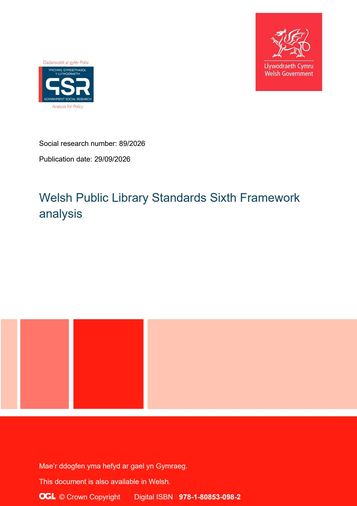

**Social research number: 89/2026**  
**Publication date: 29/09/2026**  

# Welsh Public Library Standards Sixth Framework analysis

*Mae’r ddogfen yma hefyd ar gael yn Gymraeg.*  
*This document is also available in Welsh.*  

*© Crown copyright 2026. Digital ISBN 978-1-80853-098-2.*

<!-- PAGE: 2 -->

# Welsh Public Library Standards Sixth Framework analysis

**Pete Dalton and Sarah McNicol**

**Full Research Report:** Dalton, P and McNicol, S. (2026). *Welsh Public Library Standards Sixth Framework analysis*. Cardiff: Welsh Government, GSR report number 89/2026.  
*Available at: Statistics and research | Released | GOV.WALES*

*Views expressed in this report are those of the researcher and not necessarily those of the Welsh Government.*

**For further information please contact:**  
Culture Division  
Welsh Government  
Cathays Park  
Cardiff CF10 3NQ  
<Culture@gov.wales>

<!-- PAGE: 3 -->

Table of contents
List of tables ........................................................................................................................... 5
List of figures.......................................................................................................................... 7
Glossary ................................................................................................................................. 8
# 1. Introduction ............................................................................................................... 9
## 1.1. Aims of the research .............................................................................................. 10
## 1.2. Research questions ............................................................................................... 10
# 2. Methodology ............................................................................................................ 12
## 2.1. Approach ............................................................................................................... 12
### 2.1.1. Data sources .................................................................................................. 12
### 2.1.2. Data consolidation .......................................................................................... 12
### 2.1.3. Quantitative analysis ...................................................................................... 12
### 2.1.4. Qualitative analysis ......................................................................................... 13
### 2.1.5. Additional data sources .................................................................................. 14
# 3. Changes to Core Entitlements ................................................................................ 15
# 4. Barriers and enablers to meeting Core Entitlements ............................................... 19
## 4.1. Staffing .................................................................................................................. 19
### 4.1.1. Qualified staff.................................................................................................. 20
### 4.1.2. Volunteers ...................................................................................................... 22
## 4.2. Service points and opening hours ......................................................................... 22
## 4.3. Financial resources................................................................................................ 23
## 4.4. Summary ............................................................................................................... 25
# 5. Changes in the results of the WPLS Quality Indicators ........................................... 27
## 5.1. QI 3: Support for individual development ............................................................... 27
## 5.2. QI 4: Support for health and wellbeing................................................................... 28
## 5.3. QI 6: User attendance at library events ................................................................. 28
## 5.4. QI 7: Location of service points ............................................................................. 29
## 5.5. QI 9: Up-to-date and appropriate reading material ................................................ 29
## 5.6. QI 10: Welsh language resources ......................................................................... 30
## 5.7. QI 11: Online access ............................................................................................. 31
## 5.8. QI 12: Supply of requests ...................................................................................... 31
## 5.9. QI 13: Staffing levels and qualifications ................................................................. 32.

<!-- PAGE: 4 -->

## 5.10. QI 16: Opening hours ......................................................................................... 33
## 5.11. Summary ............................................................................................................ 33
# 6. Contribution of Welsh Public Libraries to the Wellbeing of Future Generations
(Wales) Act 2015 ..................................................................................................... 34
## 6.1. The Wellbeing of Future Generations Act overview ............................................... 34
## 6.2. Contribution to the Seven National Goals .............................................................. 35
### 6.2.1. A Prosperous Wales ....................................................................................... 35
### 6.2.2. A Resilient Wales ........................................................................................... 36
### 6.2.3. A Healthier Wales ........................................................................................... 36
### 6.2.4. A More Equal Wales ....................................................................................... 37
### 6.2.5. A Wales of Cohesive Communities ................................................................ 38
### 6.2.6. A Wales of Vibrant Culture and Thriving Welsh Language ............................. 39
### 6.2.7. A Globally Responsible Wales........................................................................ 40
## 6.3. Welsh library examples .......................................................................................... 40
### 6.3.1. Strengthening family wellbeing through advice and community connection ... 41
### 6.3.2. Supporting integration and community connection for Ukrainian residents .... 41
### 6.3.3. Supporting young people’s skills and aspirations through Makerspaces ........ 41
### 6.3.4. Supporting language learning, confidence and social connection through
Welsh conversation groups ........................................................................................... 42
### 6.3.5. Reducing digital poverty and inequality through device lending and access to
technology .................................................................................................................... 42
# 7. Changes in stock expenditure ................................................................................. 44
## 7.1. Summary ............................................................................................................... 47
# 8. Welsh language resources spend ........................................................................... 49
## 8.1. Summary ............................................................................................................... 51
# 9. Changes in the resource allocation of spend on e-resources .................................. 52
# 10. Changes in library service loans ............................................................................. 54
## 10.1. Adult book issues ............................................................................................... 56
## 10.2. Children’s book issues ....................................................................................... 57
## 10.3. Audio Visual (AV) issues .................................................................................... 58
## 10.4. Welsh language issues ...................................................................................... 59
## 10.5. E-issues ............................................................................................................. 60
## 10.6. Summary ............................................................................................................ 62
# 11. Changes in opening hours ...................................................................................... 64.

<!-- PAGE: 5 -->

## 11.1. Summary ............................................................................................................ 66
# 12. Changes in service points ....................................................................................... 67
# 13. Changes in digital engagement ............................................................................... 69
## 13.1. Online access .................................................................................................... 69
## 13.2. Website visits ..................................................................................................... 70
## 13.3. Summary ............................................................................................................ 72
# 14. Changes in services targeted at disadvantaged or minority groups and individuals 74
## 14.1. Supporting wellbeing and reducing social isolation ........................................... 75
### 14.1.1. Illustrative example: the value of the Home Delivery Service ..................... 75
### 14.1.2. Illustrative example: supporting social inclusion amongst young adults ...... 76
### 14.1.3. Illustrative example: supporting wellbeing and social connection through
community hub activities ............................................................................................... 76
## 14.2. Supporting people with disabilities, dementia and Additional Learning Needs
(ALN)  ........................................................................................................................... 76
### 14.2.1. Illustrative example: supporting independence and life transitions for
individuals with learning difficulties ............................................................................... 77
### 14.2.2. Illustrative example: supporting independence and wellbeing for people
living with dementia ...................................................................................................... 77
## 14.3. Supporting refugees, migrants and new communities ........................................ 77
### 14.3.1. Illustrative example: supporting refugee integration and community
connection through partnership working ....................................................................... 78
### 14.3.2. Illustrative example: supporting refugee integration and access to services ...
.................................................................................................................... 78
## 14.4. Supporting people experiencing economic hardship, homelessness and related
vulnerability ...................................................................................................................... 78
### 14.4.1. Illustrative example: supporting a homeless individual to rebuild
independence ............................................................................................................... 78
### 14.4.2. Illustrative example: supporting wellbeing during financial hardship through
warm spaces ................................................................................................................. 79
## 14.5. Addressing digital exclusion and enabling access to services ........................... 79
### 14.5.1. Illustrative example: supporting digital inclusion and connection through
tablet lending ................................................................................................................ 79
### 14.5.2. Illustrative example: supporting older and vulnerable people through home
based digital support ..................................................................................................... 79
### 14.5.3. Illustrative example: supporting wellbeing and connection through digital
access and learning ...................................................................................................... 80
## 14.6. Supporting young people and reducing risk of disengagement .......................... 80.

<!-- PAGE: 6 -->

### 14.6.1. Illustrative example: supporting young people’s skills, confidence and
employability through Makerspaces .............................................................................. 80
### 14.6.2. Illustrative example: engaging young people and supporting creativity
through arts based activities ......................................................................................... 81
### 14.6.3. Illustrative example: engaging children and strengthening school
partnerships through library visits ................................................................................. 81
# 15. Impact of the coronavirus (COVID-19) pandemic .................................................... 82
## 15.1. Usage patterns ................................................................................................... 82
### 15.1.1. Illustrative example: the value of the home library service .......................... 83
### 15.1.2. Illustrative example: reducing isolation through digital inclusion and
partnership working ...................................................................................................... 83
## 15.2. Strategy and planning ........................................................................................ 84
## 15.3. Activity, event and customer training provision .................................................. 85
### 15.3.1. Illustrative example: supporting wellbeing and reducing social isolation
through online reading groups ...................................................................................... 85
### 15.3.2. Illustrative example: supporting care home residents’ wellbeing through
digital outreach activities ............................................................................................... 86
### 15.3.3. Illustrative example: building digital confidence and social connection
through virtual book groups .......................................................................................... 86
## 15.4. Customer satisfaction and impact of library services ......................................... 87
## 15.5. Staffing and volunteers ...................................................................................... 88
### 15.5.1. Illustrative example: library staff redeployment to support vulnerable
residents  .................................................................................................................... 88
### 15.5.2. Illustrative example: library staff supporting community wellbeing and
connection  .................................................................................................................... 88
## 15.6. Summary ............................................................................................................ 89
# 16. Conclusions ............................................................................................................. 90
# Annex A: Changes in Core Entitlement and Quality Indicator data ...................................... 93
# Annex B: Classification of local authorities .......................................................................... 95
# Annex C: Summary of statistical analysis ............................................................................ 96
# Annex D: Sixth framework Core Entitlements .................................................................... 100.

<!-- PAGE: 7 -->

List of tables
### Table 3.1: Library services meeting Core Entitlements in full (n=22) ................................... 16
### Table 4.1: Per capita staffing ............................................................................................... 20
### Table 4.2: Per capita qualified staff ...................................................................................... 21
### Table 4.3: Qualified staff as a percentage of total staff ........................................................ 22
### Table 4.4: Per capita total revenue expenditure................................................................... 25
### Table 5.1: Number of services meeting QI 3 targets (n=22) ................................................ 27
### Table 5.2: Number of services meeting QI 4 targets (n=22) ................................................ 28
### Table 5.3: Number of services meeting QI 6 target (n=22) .................................................. 29
### Table 5.4: Number of services meeting QI 7 target (n=22) .................................................. 29
### Table 5.5: Number of services meeting QI 9 target (n=22) .................................................. 30
### Table 5.6: Number of services meeting QI 10 target (n=22) ................................................ 30
### Table 5.7: Number of services meeting QI 11 targets (n=22) .............................................. 31
### Table 5.8: Number of services meeting QI 12 targets (n=22) .............................................. 31
### Table 5.9: Number of services meeting QI 13 targets (n=22) .............................................. 32
### Table 5.10: Number of services meeting QI 16 target (n=22) .............................................. 33
### Table 7.1: Stock expenditure per capita ............................................................................... 44
### Table 7.2: Percentage of stock expenditure allocated to children’s resources ..................... 46
### Table 8.1: Spend data per capita Welsh speaker ................................................................ 49
### Table 9.1: E-resources spend .............................................................................................. 52
### Table 10.1: Per capita issues ............................................................................................... 55
### Table 10.2: Per capita adult issues ...................................................................................... 57
### Table 10.3: Per capita children’s issues ............................................................................... 58
### Table 10.4: Per capita AV issues ......................................................................................... 59
### Table 10.5: Per capita Welsh issues .................................................................................... 60
### Table 10.6: Per capita e-issues ............................................................................................ 61
### Table 11.1: Median staffed opening hours ........................................................................... 65
### Table 13.1: Devices per 10,000 resident population giving public internet access in static
libraries .................................................................................................................... 70
### Table 13.2: Per capita website visits .................................................................................... 72
### Table C.1: Total staff and opening hours ............................................................................. 96
### Table C.2: Opening hours and total issues .......................................................................... 96
### Table C.3: Resource spend and total issues ....................................................................... 96
### Table C.4: Total resource spend and adult issues ............................................................... 96.

<!-- PAGE: 8 -->

### Table C.5: Children’s resource spend and children’s issues ................................................ 97
### Table C.6: E-resource spend and e-resource issues ........................................................... 97
### Table C.7: Total resource spend and e-resource spend ...................................................... 97
### Table C.8: Welsh language resources and Welsh spend .................................................... 97
### Table C.9: Per capita Welsh resource spend in urban/rural authorities ............................... 98
### Table C.10: Opening hours per capita in urban/rural authorities .......................................... 98
### Table C.11: Welsh spend and Welsh speakers ................................................................... 98
### Table C.12: Per capita adult issues in urban and rural authorities ....................................... 98
### Table C.13: Total issues and qualified staff ......................................................................... 99
### Table C.14: Total issues and total staff ................................................................................ 99
### Table C.15: Change in mobile provision in urban/rural authorities ....................................... 99
### Table C.16: Total staff and total event attendance............................................................... 99.

<!-- PAGE: 9 -->

List of figures
### Figure 4.1: Percentage trend analysis of staffing numbers .................................................. 19
### Figure 4.2: Percentage trend analysis of revenue expenditure ............................................ 24
### Figure 4.3: Wider context for staffing and expenditure ......................................................... 26
### Figure 6.1: Wider context for event attendance ................................................................... 39
### Figure 7.1: Percentage trend analysis of stock expenditure ................................................ 45
### Figure 7.2: Median spend per item ...................................................................................... 46
### Figure 7.3: Percentage trend analysis of spend on children’s resources ............................. 47
### Figure 7.4: Wider context for library resources spend .......................................................... 48
### Figure 8.1: Percentage trend analysis of spend on Welsh language materials .................... 50
### Figure 9.1: Wider context for e-resources spend ................................................................. 53
### Figure 10.1: Trends in total issues per capita ...................................................................... 54
### Figure 10.2: Percentage trend analysis of issue categories ................................................. 56
### Figure 10.3: E-issues percentage trend analysis ................................................................. 61
### Figure 10.4: Wider context for issues and loans .................................................................. 62
### Figure 11.1: Opening hours per capita across Welsh libraries ............................................. 64
### Figure 11.2: Wider context for opening hours ...................................................................... 66
### Figure 12.1: Wider context for statutory provision, library loss and location of service points
................................................................................................................................ 68
### Figure 13.1: Percentage trend analysis for website visits .................................................... 71
### Figure 13.2: Wider context for website visits ........................................................................ 72
### Figure 15.1: Wider context for book loans, in-person visits and library visits ....................... 84
### Figure 15.2: Wider context for activities and events ............................................................. 86
### Figure 15.3: Wider context for volunteer numbers ............................................................... 89.

<!-- PAGE: 10 -->

Glossary
Additional Learning Needs (ALN)
ALN refers to children, young people or adults with learning, physical or sensory needs that
make it harder to learn than people of the same age.
Audiovisual (AV)
AV resources are any recorded materials that convey information through sound and/or
moving images.
Consumer Prices Index (CPI)
The CPI measures the average change over time in prices paid by consumers for a
representative "basket" of goods and services.
Core Entitlement (CE)
CEs are the basic entitlements that members of the public can expect from their library
service.
Full Time Equivalent (FTE)
Equal to the working hours of a full-time staff member.
Interquartile Range (IQR)
A statistical measure of the spread of data. It is the difference between the 75th and 25th
percentiles of the data.
Library Management System (LMS)
An LMS is software designed to manage library operations including cataloguing, borrowers
and loans.
Quality Indicator (QI)
Qis measure the performance of Welsh library services. Some have targets and others can
be used for benchmarking and monitoring.
Welsh Public Library Standards (WPLS)
The WPLS provide a national framework for assessing the performance and development of
local authority library services.

<!-- PAGE: 11 -->

# 1. Introduction
Public libraries in Wales play an important role in supporting literacy, education, digital
inclusion, community participation, and wellbeing. Under the provisions of the Public
Libraries and Museums Act 1964, local authorities are required to provide a comprehensive
and efficient library service for all residents wishing to make use of it. Welsh Ministers hold
responsibility for ensuring that this statutory duty is fulfilled. In Wales, this oversight is
exercised through the Welsh Public Library Standards (WPLS), which provide a national
framework for assessing the performance and development of local authority library
services.
The WPLS process involves the independent assessor producing a formal written
assessment report for each authority. The reports are moderated by the Peer Reference
Group which include Welsh Government officials, senior public librarians and a
representative from Welsh Local Government Association. Their role is to ensure
consistency throughout the reports and to represent the voice of the sector. Local
authorities have the opportunity to fact check the reports before they are formally published.
The WPLS enable the Welsh Government to collect a consistent body of evidence about
public library provision across Wales. Each framework combines a range of quantitative and
qualitative information, including data on Core Entitlements and Quality Indicators,
alongside narrative evidence such as impact statements, case studies, and statements on
strategic direction. Together, these elements provide insight into the resources available to
library services, patterns of service use, and the wider social outcomes and impacts
associated with public library provision. The evidence gathered through the WPLS
contributes to monitoring statutory compliance, informing policy development, and
supporting advocacy and decision-making relating to the future of public library services.
The Sixth Framework of the WPLS originally ran from 2017 to 2020. However, due to the
disruption caused by the coronavirus (COVID-19) pandemic, the framework was extended
until March 2025. During this period the reporting requirements were temporarily adjusted,
including the use of a reduced dataset during the most acute stages of the pandemic. The
framework was later revised through an addendum to cover the 2023 to 2024 and 2024 to
2025 reporting years. Over its extended lifespan, the Sixth Framework therefore generated
an eight-year body of evidence documenting changes in library provision during a period
that included both pre-pandemic conditions and the significant operational challenges
associated with the pandemic.
The completion of the final reporting cycle in 2025 meant that the full dataset for the Sixth
Framework was available for retrospective analysis. This provided an opportunity to
examine trends in public library provision across Wales over the duration of the framework.
As a result, in January 2026 Evidence To Action Limited was commissioned by the Welsh
Government to undertake this analysis. The project was undertaken between January and
March 2026.
The analysis considers patterns in the quantitative indicators, alongside insights drawn from
the accompanying qualitative evidence submitted by library services. Particular attention is <!-- PAGE: 12 --> given to identifying how services changed over time, how they responded to the disruption
caused by the pandemic, and what the available evidence suggests about emerging trends
within the sector.
## 1.1. Aims of the research
This aims of the research are to:
• identify the trends present in the Sixth Framework data supplied by library services in
Wales
• provide insight into the changes in library services in Wales during the Sixth
Framework Period
By drawing together the evidence collected across the framework period, the research
sought to provide a clearer understanding of developments within the sector and to
contribute to the evidence base supporting future policy, planning, and service
development.
## 1.2. Research questions
In consultation with the Welsh Government, a set of research questions was agreed. The
aim of the research was to interrogate the available data and, as far as possible, provide
answers to the following questions:
• To what extent have the results of the WPLS Core Entitlements changed over the
Sixth Framework period?
• What barriers and enablers affected Library services’ ability to meet the WPLS Core
Entitlements?
• To what extent have the results of the WPLS Quality Indicators changed over the
Sixth Framework period?
• How have Welsh Public Libraries contributed to goals of the Welsh Government’s
Wellbeing of Future Generations Act?
• To what extent has the expenditure on stock in library services changed over the
WPLS Sixth Framework period?
• To what extent has the spend on Welsh Language resources changed over the Sixth
Framework period?
• To what extent have there been changes in the resource allocation being spent on e-
resources?
• To what extent have there been changes in library services issues during the WPLS
Sixth Framework period?

<!-- PAGE: 13 -->

• Have opening hours of library services changed over the WPLS Sixth Framework
period?
• What changes in service points have happened over the WPLS Sixth Framework
period?
• To what extent have there been changes in digital engagement over the WPLS Sixth
Framework period?
• Have there been changes in services/activities targeting disadvantaged or minority
groups or individuals?
• What can the WPLS Sixth Framework data tell us about the impact of the COVID-19
pandemic on Welsh Library services?

<!-- PAGE: 14 -->

# 2. Methodology
The following outlines the approach taken to data analysis.
## 2.1. Approach
The research took a desk-based analytical approach designed to make full and appropriate
use of the existing Welsh Public Library Standards (WPLS) Sixth Framework dataset.
Because the study was retrospective and the data had already been collected across an
eight-year period, a structured analysis of this material provided the most proportionate and
robust means of meeting the aims of the research. The approach is consistent with the
principles of the Green Book, Magenta Book and AQuA Book, emphasising transparency,
clear documentation, reproducibility and an evidence-driven rationale for analytical choices.
### 2.1.1. Data sources
The main source of data was in the form of Excel spreadsheets provided by the Welsh
Government which were used to produce the WPLS returns for each of the eight years of
the Sixth Framework (2017 to 2025). In addition, qualitative data from the publicly available
WPLS reports was included.
### 2.1.2. Data consolidation
A significant early task involved preparing the dataset for analysis. The data from 2017 to
2025 were held across multiple spreadsheets, reflecting changes in indicators, definitions
and reporting practices over the extended lifetime of the Sixth Framework. The data were
consolidated into a single harmonised spreadsheet which allowed a robust assessment of
where indicators could be compared across the full period; where only partial comparisons
were possible; and where data are missing or inconsistent, for example, due to data
migration issues with the Library Management System (LMS) Cymru in 2024 to 2025 and as
a result of the COVID-19 pandemic This preparatory stage ensured that subsequent
quantitative work was grounded in a clear understanding of the structure, strengths and
limitations of the dataset.
A summary of the changes in the Core Entitlement and Quality Indicator data over the
course of the Sixth Framework is provided in Annex A. This describes the changes in
definitions and availability of data, and reflects on the impact of these changes on data
analysis.
### 2.1.3. Quantitative analysis
In relation to the quantitative data, the analysis used data available in the spreadsheets that
were provided for each Quality Indicator. For Core Entitlements, the relevant data were
extracted from individual published reports. The analysis is based on the final decision in
the published reports (met, partially met, not met). In some cases, this may not correspond
with local authority reported decisions.
Where figures were not explicitly provided for a particular measure in one or more years, but
could be calculated using other available data, these values were derived and added to the <!-- PAGE: 15 --> collated dataset. For example, book budget figures were calculated using the reported
percentage materials expenditure and total revenue expenditure.
Where authorities reported figures to different levels of precision, values were rounded so
that all authorities and all years were presented to the same number of decimal places for a
given indicator.
When data were missing for a particular year, but values were available for the preceding
and succeeding years, and where there were no substantial changes in the reported figures,
the missing total value was estimated by taking the average of the two surrounding years.
The corresponding per capita value was left as “not available”, as the analytical approach
used for per capita data differs from that applied to total figures. Where per capita figures
are used in this report, these refer to per 1,000 population, unless otherwise stated.
The quantitative analysis focuses on identifying trends across the period. Descriptive
statistics were calculated to explore trends in median, mean, range and quartile data for
each year to highlight changes in key areas such as issues, opening hours, service points,
library activities, Welsh language provision, staffing, digital engagement and budgets. In
addition, percentage trend analysis was used to track changes over time. This method
calculates the annual percentage change in data and allows for standardised comparisons
of trends between datasets. The first year of the Sixth Framework, 2017 to 2018, was used
as the base year (100%) for comparison to subsequent years. For spend measures, this
process includes a comparison to inflation trends using Consumer Prices Index (CPI) data.
The quantitative analysis also investigates whether there is evidence to support a
hypothesis of correlations between particular indicators or data points, for example,
between resource spend and issues. Pearson’s correlation coefficient is used to explore
such correlations over the course of the Framework (with Spearman’s rank correlation
coefficient being calculated as an addition check). In addition, potential differences between
urban and rural library authorities are explored using Mann-Whitney U tests. A list of
authorities classified as urban and rural according to DataMapWales is available in Annex
B. Student’s t-test was used to explore difference between pre- and post- COVID-19 data.
Details of the results obtained from statistical tests can be found in Annex C.
### 2.1.4. Qualitative analysis
This analysis draws on qualitative evidence submitted by local authorities including:
• case studies submitted between 2017 to 2018 and 2021 to 2022
• impact statements submitted from 2022 to 2023 onwards
• strategic statements describing how library services contribute to national and local
policy priorities submitted from 2017 to 2018 onwards
• future direction statements outlining planned service developments submitted
between 2017 to 2018 and 2019 to 2020 and between 2022 to 2023 and 2024 to
2025.

<!-- PAGE: 16 -->

Case studies and impact statements typically describe specific examples of activities,
services or individual experiences. Strategic statements and future direction statements
tend to provide higher level descriptions of service priorities, policy alignment and planned
developments.
These submissions were produced by library authorities as part of the annual reporting
process and were therefore self-selected by services. The format, length and level of detail
vary between authorities and across reporting years. In addition, the reporting framework
evolved during the period, with impact statements replacing case studies in later years.
As a result, the qualitative evidence should be interpreted as illustrative rather than
comprehensive. The qualitative analysis presented in this report therefore focuses on
identifying examples of activities, priorities and reported impacts rather than attempting to
measure the overall scale or distribution of provision across Wales.
Several methodological considerations should be noted:
• the analysis describes self-reported activities, experiences and contributions rather
than independently measured outcomes
• frequency of reference to a theme does not indicate the scale, reach or effectiveness
of activity
• absence of reference to a theme, activity or group should not be interpreted as
absence of provision
• differences between years may reflect changes in reporting practices, evolving policy
priorities and external context
### 2.1.5. Additional data sources
Where similar data to that reported by Welsh library services are available from library
services in other nations, this is referenced in a ‘wider context’ section. The inclusion of
wider context sections is, naturally, dependent on data availability and it is not possible to
include such information in relation to all WPLS measures. It is important to note that it is
not possible to make direct comparisons between data from Welsh libraries and
those elsewhere as definitions, data collection periods and other factors vary from
country to country. It is beyond the scope of this research to reflect on the potential
limitations of external datasets referenced in this section. However, these data may be
helpful in providing a wider context to the trends observed in Wales.

<!-- PAGE: 17 -->

# 3. Changes to Core Entitlements
The research sought to answer the question ‘To what extent have the results of the WPLS
Core Entitlements changed over the Sixth Framework period?’
Core Entitlements enable the public to know what they can expect from their public library
service. Through the WPLS process, these entitlements are initially self-assessed by each
authority before being moderated by independent assessor and Reference Group to ensure
consistency. A list of the Core Entitlements at the start of the Framework and those included
in the Addendum can be found in Annex D. The results of the Core Entitlements discussed
in this report are those moderated assessments that have been published in annual reports.
It should be noted that, whilst criteria are provided for each Core Entitlement, determining
whether a service has met, partially met or not met a Core Entitlement is, to an extent,
subjective and based on the narrative commentary provided by services. The way in which
services present data, and the detail provided in relation to Core Entitlements can vary.
Table 3.1 outlines the number of library services meeting each Core Entitlement in full over
the course of the Sixth Framework.

<!-- PAGE: 18 -->

### Table 3.1: Library services meeting Core Entitlements in full (n=22)

|  | 2017 to 2018 | 2018 to 2019 | 2019 to 2020 | 2020 to 2021 | 2021 to 2022 | 2022 to 2023 | 2023 to 2024 | 2024 to 2025 |
|:---|---:|---:|---:|---:|---:|---:|---:|---:|
| CE 1: Free & Open to All | 22 | 22 | 22 | 22 | 22 | 22 | 22 | 22 |
| CE 2: Knowledgeable & Qualified Staff | 22 | 22 | 22 | 22 | 22 | 22 | 21 | 22 |
| CE 3: Range of Services & Activities | 22 | 22 | 22 | 22 | 22 | 22 | 22 | 22 |
| CE 4: Services for Special Needs | 22 | 22 | 22 | 22 | 21 | 22 | 22 | 22 |
| CE 5: Safe, Accessible Spaces | 21 | 22 | 22 | 22 | 21 | 22 | 20 | 18 |
| CE 6: Free Lending & Access to Info | 20 | 20 | 20 | 20 | 21 | 21 | 21 | 21 |
| CE 7: Free Use of Internet & IT | 20 | 21 | 21 | 21 | 21 | 22 | 22 | 21 |
| CE 8: Welsh Language Provision | 22 | 22 | 22 | 22 | 22 | 22 | 22 | 22 |
| CE 9: Shared Catalogue & Resources | 22 | 22 | 22 | 22 | 22 | 22 | 22 | 21 |
| CE 10: Partnership to Deliver New Services | 20 | 22 | 22 | 22 | 22 | 21 | 22 | 22 |
| CE 11: User Consultation | 21 | 21 | 17 | 19 | 18 | 17 | 18 | 19 |
| CE 12: Access to Library Strategy | 13 | 16 | 17 | 15 | 15 | 17 | 14 | 16 |
| CE 13: Supporting Digital Skills | [x] | [x] | [x] | [x] | [x] | [x] | 22 | 22 |

Source: WPLS Core Entitlements.

<!-- PAGE: 19 -->

The following is a summary of services’ performance against the Core Entitlements
throughout the Sixth Framework.
The following Core Entitlements were met in full by all services throughout all years of the
Sixth Framework:
• Core Entitlement 1: Free & Open to All
• Core Entitlement 3: Range of Services & Activities
• Core Entitlement 8: Welsh Language Provision
• Core Entitlement 13: Supporting Digital Skills (2023 to 2025 only)
The following Core Entitlements were met in full by at least 20 services throughout all
years of the Sixth Framework:
• Core Entitlement 2: Knowledgeable & Qualified Staff
• Core Entitlement 4: Services for Special Needs
• Core Entitlement 6: Free Lending & Access to Info
• Core Entitlement 7: Free Use of Internet & IT
• Core Entitlement 9: Shared Catalogue & Resources
• Core Entitlement 10: Partnership to Deliver New Services
There were some annual fluctuations in the numbers meeting each of these Core
Entitlements. Where information was provided, these changes were due to local factors
affecting individual services and there were no obvious patterns in the extent to which
various Core Entitlements were met.
The following Core Entitlements were met in full or part by all services throughout all
years of the Sixth Framework:
• Core Entitlement 1: Free & Open to All
• Core Entitlement 2: Knowledgeable & Qualified Staff
• Core Entitlement 3: Range of Services & Activities
• Core Entitlement 4: Services for Special Needs
• Core Entitlement 5: Safe, Accessible Spaces
• Core Entitlement 6: Free Lending & Access to Info
• Core Entitlement 8: Welsh Language Provision
• Core Entitlement 9: Shared Catalogue & Resources.

<!-- PAGE: 20 -->

• Core Entitlement 10: Partnership to Deliver New Services.
• Core Entitlement 13: Supporting Digital Skills (2023 to 2025 only).
The majority of Core Entitlements were therefore met in full or in part by the majority of
Welsh library services throughout the Sixth Framework. However, there were three Core
Entitlements that were more challenging for some services.
Core Entitlement 5 (CE 5) - Safe, Accessible Spaces: Services performed well against
this Core Entitlement for much of the Sixth Framework period, with all services meeting CE
5 in part, if not in full, throughout the Framework period. However, a decline in the number
of services meeting CE 5 in full was noted during the Addendum period. In a few cases,
reasons for not meeting CE 5 related to buildings maintenance, but the majority of those
struggling to meet every element of this Core Entitlement found the requirement for “suitable
staffed opening hours” increasingly challenging to meet in the face of staffing reductions.
Core Entitlement 11 (CE 11) – User Consultation: The number of services meeting this
Core Entitlement in full was highest (21) at the start of the Framework period (2017 to 2018
and 2018 to 2019), but from 2019 to 2020 onwards it fluctuated between 17 and 19. The
difficulty of conducting customer surveys during COVID-19 is understandable, but
performance had not returned to pre-COVID-19 levels by the end of the Sixth Framework.
Core Entitlement 12 (CE 12) - Access to Library Strategy: The number of services
meeting this Core Entitlement in full fluctuated between 13 and 17, making it the most
challenging Core Entitlement across Welsh library services as a whole. However, it is noted
that, by the end of the Framework period, the majority of services not meeting CE 12 in full
at least did so in part (e.g. by providing evidence of having a strategy but not making the
document available on their website). The number of services meeting CE 12 is likely partly
influenced by local planning cycles, which can mean that services have a gap between the
end of one strategy and the introduction of the next.

<!-- PAGE: 21 -->

# 4. Barriers and enablers to meeting Core Entitlements
The research sought to answer the question ‘What barriers and enablers affected library
services’ ability to meet the WPLS Core Entitlements?’
Whilst local factors may have an impact on the ability of individual authorities to meet the
WPLS Core Entitlements, there are also some fundamental barriers and enablers that affect
a service’s ability to deliver statutory public library provision.
## 4.1. Staffing
The Sixth Framework has seen notable changes in library staffing which impact on services’
ability to meet the Core Entitlements. Over the course of the Framework, an increasing
number of services faced challenges meeting CE 5, a key component of which is adequate
staffing.
Data related to staffing is provided, primarily, through QI 13. This shows that total library
staff numbers decreased during the Sixth Framework. Nationally, the number of posts fell
from 897.9 FTE to 781.7 FTE, a reduction of 116.2 posts or 12.9% (Fig 4.1).

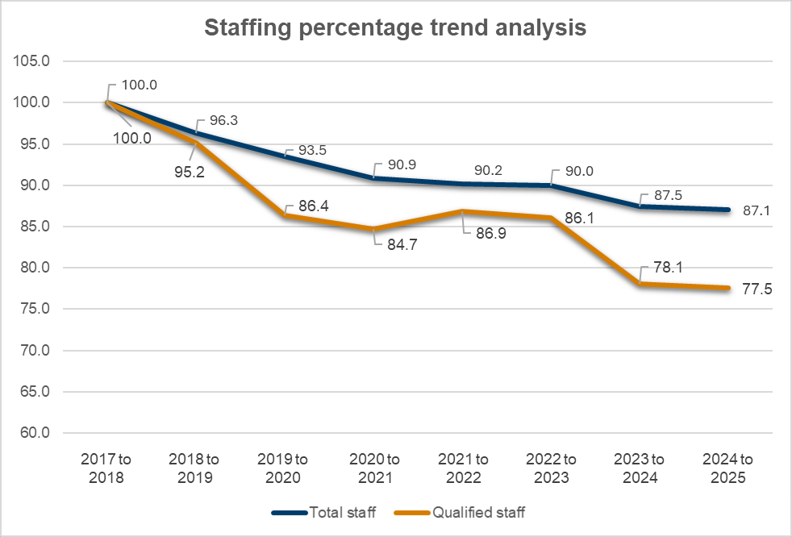

*Figure 4.1: Percentage trend analysis of staffing numbers*

Description of Figure 4.1: A line graph comprising of two coloured lines which show the
percentage trend analysis of staffing numbers. Line one displays the total staff percentage
from the reporting period 2017 to 2018 until 2024 to 2025. Line two displays the qualified
staff percentage from the reporting period 2017 to 2018 until 2024 to 2025.
Source: WPLSQI 13.

<!-- PAGE: 22 -->

The median number of staff per 10,000 population reported by individual library authorities
decreased gradually over the course of the Framework. In addition, across the nation as a
whole, the number of staff per 10,000 population decreased every year except in 2022 to
2023, which saw a small increase before declining again the following year (Table 4.1).
The range of staffing rates per 10,000 population figures reduced over the Sixth Framework.
There was also no evidence of a significant difference in staffing rates in rural and urban
authorities. As might be expected, there was a strong positive correlation between total staff
numbers and total opening hours (Pearson’s r ranged between 0.863 and 0.959, p<0.01). In
addition, there was evidence of a strong to very strong positive correlation between total
staff and event attendance (Pearson’s r ranged between 0.763 to 0.933, p<0.01). There
was also a moderate to strong positive correlation between total issues and total staff
numbers (Pearson’s r ranged between 0.611 to 0.811, p<0.01).
### Table 4.1: Per capita staffing

|  | 2017 to 2018 | 2018 to 2019 | 2019 to 2020 | 2020 to 2021 | 2021 to 2022 | 2022 to 2023 | 2023 to 2024 | 2024 to 2025 |
|:---|---:|---:|---:|---:|---:|---:|---:|---:|
| High | 4.37 | 4.36 | 4.34 | 4.28 | 4.28 | 4.39 | 3.60 | 3.29 |
| Median | 2.62 | 2.54 | 2.48 | 2.36 | 2.34 | 2.49 | 2.38 | 2.38 |
| Low | 1.66 | 1.64 | 1.54 | 1.53 | 1.44 | 1.39 | 1.26 | 1.31 |
| Range | 2.71 | 2.72 | 2.80 | 2.75 | 2.84 | 3.0 | 2.34 | 1.98 |
| Lower quartile | 2.26 | 2.22 | 2.26 | 2.02 | 2.03 | 2.38 | 2.08 | 1.97 |
| Upper quartile | 3.05 | 2.94 | 2.63 | 2.60 | 2.68 | 2.71 | 2.71 | 2.72 |
| Interquartile range | 0.79 | 0.72 | 0.37 | 0.58 | 0.65 | 0.33 | 0.63 | 0.75 |
| National per capita | 2.88 | 2.77 | 2.67 | 2.58 | 2.56 | 2.60 | 2.51 | 2.47 |

Source: WPLSQI 13
Staff training provision was maintained throughout the Framework. The median percentage
of staff hours devoted to training was fairly stable for most of the period at between 1.6%
and 2%, but it increased to 5% in 2024 to 2025 with the introduction of the LMS Cymru.
### 4.1.1. Qualified staff
Whilst total staff numbers will impact on an authority’s ability to deliver core services,
aspects of the Core Entitlements where a number of services struggle, namely strategic
direction and co-ordinating customer feedback, are areas where qualified staff are
particularly important.
Qualified staff numbers across Wales decreased throughout the Sixth Framework, although
the trend was not a linear one. Qualified staff numbers were declining pre-COVID-19 and
fell rapidly in 2019 to 2020, but then recovered slightly towards the end of the pandemic,
before declining once more during the Addendum period. Nevertheless, the overall pattern
is downward trend. Nationally, the number of qualified posts fell from 159.0 FTE to 123.3 <!-- PAGE: 23 --> FTE, a reduction of 35.7 posts or 22.5% There was no evidence of a statistically significant
difference in qualified staffing rates in rural and urban authorities.
The interquartile range for qualified staff reduced throughout the Sixth Framework as the
number of qualified staff per 10,000 population become more consistent across much of the
country, with the exception of a small number of outlier authorities with notably higher rates
of qualified staff (Table 4.2).
### Table 4.2: Per capita qualified staff

|  | 2017 to 2018 | 2018 to 2019 | 2019 to 2020 | 2020 to 2021 | 2021 to 2022 | 2022 to 2023 | 2023 to 2024 | 2024 to 2025 |
|:---|---:|---:|---:|---:|---:|---:|---:|---:|
| High | 0.90 | 0.86 | 0.76 | 0.75 | 1.02 | 0.75 | 0.88 | 1.1 |
| Median | 0.55 | 0.55 | 0.48 | 0.44 | 0.47 | 0.47 | 0.42 | 0.33 |
| Low | 0.26 | 0.14 | 0.14 | 0.14 | 0.14 | 0.10 | 0.09 | 0.04 |
| Range | 0.64 | 0.72 | 0.62 | 0.61 | 0.88 | 0.65 | 0.79 | 1.06 |
| Lower quartile | 0.35 | 0.35 | 0.30 | 0.31 | 0.28 | 0.31 | 0.30 | 0.27 |
| Upper quartile | 0.70 | 0.66 | 0.58 | 0.56 | 0.55 | 0.58 | 0.51 | 0.44 |
| Interquartile range | 0.35 | 0.31 | 0.28 | 0.25 | 0.27 | 0.27 | 0.21 | 0.17 |
| National per capita | 0.51 | 0.48 | 0.44 | 0.42 | 0.44 | 0.44 | 0.40 | 0.39 |

Source: WPLSQI 13
Considering qualified staff as a percentage of total library staff, the median percentage
stayed relatively stable at around 20% throughout most of the Sixth Framework period.
However, the percentage of qualified staff in the workforce declined during the Addendum
period to a median of between 16.3% and 18.0%.

<!-- PAGE: 24 -->

### Table 4.3: Qualified staff as a percentage of total staff

|  | 2017 to 2018 | 2018 to 2019 | 2019 to 2020 | 2020 to 2021 | 2021 to 2022 | 2022 to 2023 | 2023 to 2024 | 2024 to 2025 |
|:---|---:|---:|---:|---:|---:|---:|---:|---:|
| High | 40.0% | 36.3% | 33.6% | 33.6% | 44.8% | 37.6% | 36.1% | 41.0% |
| Median | 20.5% | 20.6% | 19.1% | 20.6% | 19.9% | 20.4% | 18.0% | 16.3% |
| Low | 7.0% | 3.8% | 3.8% | 3.5% | 3.5% | 2.2% | 2.6% | 2.8% |
| Range | 33.0% | 32.5% | 29.8% | 30.1% | 41.3% | 35.4% | 33.5% | 38.2% |
| Lower quartile | 16.1% | 14.4% | 14.4% | 15.6% | 16.5% | 15.5% | 12.8% | 13.0% |
| Upper quartile | 25.6% | 26.2% | 22.7% | 23.6% | 23.0% | 27.7% | 21.1% | 21.5% |
| Interquartile range | 9.5% | 11.8% | 8.3% | 8.0% | 6.5% | 12.2% | 8.3% | 8.5% |
| National per capita | 17.7% | 17.5% | 16.4% | 16.5% | 17.1% | 16.9% | 15.8% | 15.8% |

Source: WPLSQI 13
### 4.1.2. Volunteers
The number of volunteer hours reported varied considerably across the country. Some
authorities do not use any volunteers. However, in other services volunteer time accounts
for a not inconsiderable proportion of total hours worked. Volunteer hours accounted for
around 3% of hours worked nationally pre-pandemic. Volunteer numbers were not collected
during COVID-19 and took a little time to recover post-pandemic. However, by the end of
the Sixth Framework, volunteer hours accounted for 5.3% of hours worked nationally.
There is some evidence of a moderate negative correlation between volunteer hours and
staffing numbers across the Sixth Framework (Pearson’s r=-0.464, p<0.05). This suggests
that as staffing numbers fall, volunteer hours may rise. If services are relying more heavily
on volunteers to deliver services, in the absence of paid staff, this presents a barrier to the
successful delivery of statutory library provision. As CILIP’s policy statement on the use of
volunteers in public libraries states, if paid roles are directly replaced by volunteers,
“…services will suffer and will be unsustainable. What remains would be a library service
unable to serve the community comprehensively, support people’s information needs or
provide everyone with the opportunity for learning and development”.
## 4.2. Service points and opening hours
The provision of service points, and the opening hours of those service points, are key
factors in ensuring library services meet the Core Entitlements, in particular CE 5, which is
one of the more challenging Core Entitlements for some services. Data relating to service
point provision and opening hours are provided by QI 7 and QI 16 respectively.
Changes in service points are described in greater detail in Section 12. In summary, the
provision of service points has witnessed a downward trend nationally during the Sixth
Framework. Only 5 services did not report a reduction in static and/or mobile service points <!-- PAGE: 25 --> between 2018 to 2019 and 2024 to 2025. Across Wales, there were 8 fewer static service
points and 20 fewer mobiles in 2024 to 2025 compared to 2018 to 2019.
Changes in opening hours are described in greater detail in Section 11. To summarise,
opening hours have declined over the course of the Sixth Framework, falling steadily either
side of the pandemic period. On average, services saw opening hours reduced by around
10%. However, the pattern varied across the country and around one quarter of services
reported an increase in staffed opening hours per capita. Whilst unstaffed hours rose over
the course of the Sixth Framework, these still formed a small part of the total library opening
hours.
## 4.3. Financial resources
Library service financial resourcing is necessary for the provision of staffing, service points
and information resources. Changes in resourcing are described in greater detail in
Sections 7, 8 and 9. Information about resourcing is provided via QI 9, QI 10 and QI 14.
Figure 4.2 shows changes in revenue expenditure over the course of the Sixth Framework
as a percentage trend analysis. Revenue expenditure rose slightly nationally pre-COVID-19,
although at a rate below inflation. Revenue expenditure then decreased during COVID-19
before starting to rise again from 2022 to 2023 onwards. Total revenue spend increased by
14% over the Framework period. However, this is reduced to a 12% per capita increase
when changing population figures are taken into account. Furthermore, when inflation is
taken into account, total revenue spend is considerably lower in real terms than it was at the
start of the Framework. Only three Welsh library services saw revenue expenditure per
capita increase by more than the rate of inflation (i.e. increase in real terms) over the course
of the Sixth Framework.

<!-- PAGE: 26 -->

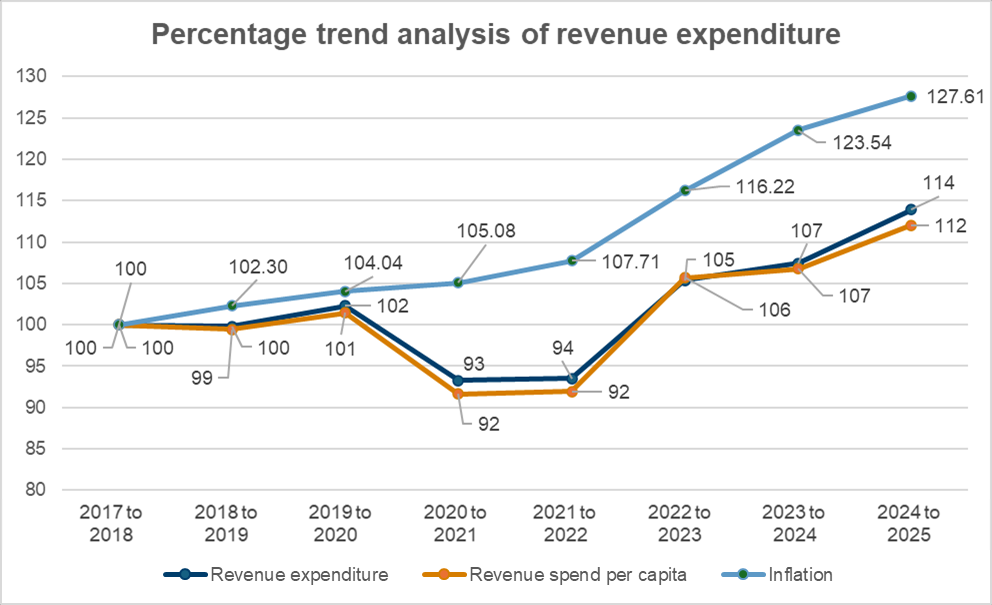

*Figure 4.2: Percentage trend analysis of revenue expenditure*

Description of Figure 4.2: A line graph comprising of three coloured lines which show the
percentage trend analysis of revenue expenditure. Line one displays the revenue
expenditure from the reporting period 2017 to 2018 until 2024 to 2025. Line two displays the
revenue spend per capita from the reporting period 2017 to 2018 until 2024 to 2025. Line
three displays inflation from the reporting period 2017 to 2018 until 2024 to 2025.
Source: WPLSQI 14
The median and mean national revenue expenditure per capita both fluctuated pre-COVID-
19, but fell in 2020 to 2021. There was a small increase from this low point in 2021 to 2022,
followed by larger increases during the remainder of the Framework. However, in all years,
the mean national revenue spend per capita was higher than the median local authority, and
this gap increased in the post-COVID-19 period. This pattern can be explained by the fact
that Cardiff is outlier compared to the remainder of Welsh library authorities in terms of
revenue spend and this results in a larger national mean figure.

<!-- PAGE: 27 -->

### Table 4.4: Per capita total revenue expenditure

|  | 2017 to 2018 | 2018 to 2019 | 2019 to 2020 | 2020 to 2021 | 2021 to 2022 | 2022 to 2023 | 2023 to 2024 | 2024 to 2025 |
|:---|---:|---:|---:|---:|---:|---:|---:|---:|
| High | £17,771 | £19,449 | £23,333 | £19,526 | £20,184 | £27,330 | £24,685 | £26,209 |
| Median | £11,915 | £12,146 | £11,470 | £10,064 | £10,323 | £11,476 | £12,023 | £12,646 |
| Low | £7,047 | £7,181 | £7,260 | £6,501 | £7,052 | £6,726 | £6,046 | £5,978 |
| Range | £10,724 | £12,268 | £16,073 | £13,025 | £13,132 | £20,604 | £18,640 | £20,232 |
| Lower quartile | £10,004 | £9,715 | £9,311 | £8,412 | £8,509 | £9,043 | £9,598 | £10,271 |
| Upper quartile | £15,068 | £14,440 | £14,811 | £12,494 | £13,419 | £15,237 | £15,419 | £15,448 |
| Interquartile range | £5,064 | £4,725 | £5,500 | £4,082 | £4,910 | £6,194 | £5,821 | £5,177 |
| National per capita | £12,932 | £12,862 | £13,123 | £11,851 | £11,889 | £13,663 | £13,810 | £14,492 |

Source: WPLSQI 14
## 4.4. Summary
The basic requirements of a statutory library service, namely, staff, service points and
financial resources are necessary for authorities to meet the WPLS Core Entitlements.
These requirements are interlinked, for example, more staff are required to offer longer
opening hours, and financial resources are necessary to provide staff, service points and
information resources. Pressure on each of these components makes it increasingly
challenging for Welsh library services to perform against some of the Core Entitlements.

<!-- PAGE: 28 -->

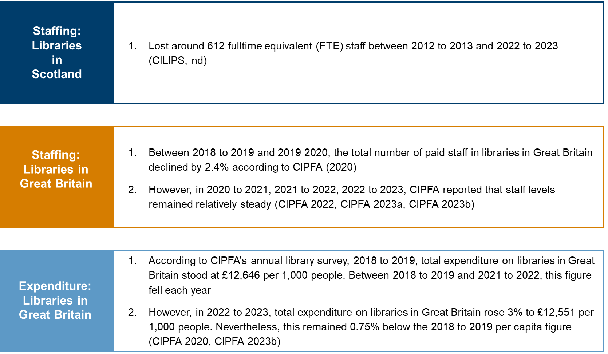

*Figure 4.3: Wider context for staffing and expenditure*

Description of Figure 4.3: A chart highlighting wider context with three coloured sections.
Section one explains that Scottish public libraries lost around 612 fulltime equivalent (FTE)
staff between 2012 to 2013 and 2022 to 2023 (CILIPS, nd). Section two explains that
between 2018 to 2019 and 2019 2020, the total number of paid staff in libraries in Great
Britain declined by 2.4% according to CIPFA (2020). However, in 2020 to 2021, 2021 to
2022, 2022 to 2023, CIPFA reported that staff levels remained relatively steady (CIPFA
2022, CIPFA 2023a, CIPFA 2023b). Section three explains that according to CIPFA’s
annual library survey, 2018 to 2019, total expenditure on libraries in Great Britain stood at
£12,646 per 1,000 people. Between 2018 to 2019 and 2021 to 2022, this figure fell each
year. However, in 2022 to 2023, total expenditure on libraries in Great Britain rose 3% to
£12,551 per 1,000 people. Nevertheless, this remained 0.75% below the 2018 to 2019 per
capita figure (CPIFA 2020, CIPFA 2023b).
Source: CILIPS, nd, CIPFA 2020, CIPFA 2022, CIPFA 2023a and CIPFA 2023b.

<!-- PAGE: 29 -->

# 5. Changes in the results of the WPLS Quality Indicators
The research sought to answer the question: ‘To what extent have the results of the WPLS
Quality Indicators changed over the Sixth Framework period?’
There are two types of Quality Indicators (QIs) within the Sixth Framework, those provided
for monitoring and benchmarking, and those with specific targets. Ten of the 16 QIs have
targets, although data were not collected for every target each year due to COVID-19
restrictions and changes to the Framework during the Addendum period (See Annex A).
This chapter reports on the results of QIs with targets only; other QIs are discussed in
elsewhere in this report.
## 5.1. QI 3: Support for individual development
QI 3 target data were collected in four years: 2017 to 2018, 2018 to 2019, 2019 to 2020 and
2022 to 2023. In the Addendum to the Sixth Framework, QI 3 was replaced by CE13.
### Table 5.1: Number of services meeting QI 3 targets (n=22)

|  | 2017 to 2018 | 2018 to 2019 | 2019 to 2020 | 2022 to 2023 |
|:---|---:|---:|---:|---:|
| a) Basic support for use of ICT | 21 | 21 | 21 | 21 |
| b) Digital literacy / skills training | 20 | 21 | 22 | 19 |
| c) Support to access e-govt resources | 22 | 22 | 22 | 21 |
| d) Reader development programmes | 22 | 22 | 22 | 20 |
| Meeting target in full | 19 | 20 | 21 | 19 |
| Meeting target in part | 3 | 2 | 1 | 3 |

Source: WPLSQI 3
Overall, Welsh library services performed well in relation to QI 3, with target measures being
met by between 19 and 22 services each year. There had been a gradual improvement in
the number of services meeting this target in full prior to the COVID-19 pandemic, but in
2022 to 2023, results returned to their 2017 to 2018 level. Basic IT support, reader
development and e-government support targets were met by at least 20 services in each
year for which these measures were collected. With the exception of basic IT support,
performance was slightly lower in 2022 to 2023 than it had been pre-COVID-19 likely due in
part to some services taking longer to recover from pandemic restrictions. The digital
literacy/skills training target was more challenging for some services to meet post-COVID-
19, but it is worth noting that this could involve partnership working with other organisations
which could take time to re-establish.

<!-- PAGE: 30 -->

Where services struggled to meet one or more target, it was usually due to issues in one
branch within the service. However, in a small number of cases, there were more
widespread challenges that affected a larger proportion of service points within an authority.
## 5.2. QI 4: Support for health and wellbeing
QI 4 target data were collected in all years except 2020 to 2021 and 2021 to 2022.
However, during the Addendum period, there was a minor change to reflect the move from
Books on Prescription Wales and Better with Books to the Reading Well scheme.
### Table 5.2: Number of services meeting QI 4 targets (n=22)

|  | 2017 to 2018 | 2018 to 2019 | 2019 to 2020 | 2022 to 2023 | 2023 to 2024 | 2024 to 2025 |
|:---|---:|---:|---:|---:|---:|---:|
| ai) Book Prescription Wales | 22 | 22 | 22 | 21 | [x] | [x] |
| aii) Better with Books | 22 | 22 | 22 | 19 | [x] | [x] |
| ai) Reading Well | [x] | [x] | [x] | [x] | 22 | 22 |
| aiii) Health / wellbeing collection | 22 | 22 | 22 | 21 | 22 | 22 |
| aiv) Healthy lifestyle info | 22 | 22 | 22 | 21 | 22 | 22 |
| av) Health / wellbeing services | 22 | 22 | 22 | 21 | 22 | 22 |
| Meeting target in full | 22 | 22 | 22 | 19 | 22 | 22 |
| Meeting target in part | [x] | [x] | [x] | 3 | [x] | [x] |

Source: WPLSQI 4
Welsh library services performed extremely well against QI 4 throughout the Framework.
Targets were met by all services every year except for 2022 to 2023. The dip in this year
could be related to the transition from Books on Prescription/Better with Books to Reading
Well, as well as local issues affecting a particular branch within a service meaning there
was not 100% coverage.
## 5.3. QI 6: User attendance at library events
QI 6 target data were collected in 2017 to 2018 and 2018 to 2019. As there were few library
events during the COVID-19 pandemic, data collection resumed from 2022 to 2023
onwards.

<!-- PAGE: 31 -->

### Table 5.3: Number of services meeting QI 6 target (n=22)
2017 to
2018
2018 to
2019
2022 to
2023
2023 to
2024
2024 to
2025
b) Events
special
requirements
19 19 17 21 22
Source: WPLSQI 6
The number of services meeting the QI 6 target rose during the Sixth Framework. Whilst the
majority of services met this target throughout the period, there was a notable improvement
during the Addendum period, and all services were meeting the target by the end of the
Sixth Framework.
## 5.4. QI 7: Location of service points
QI 7 data were collected throughout the Sixth Framework. However, not all services were
able to submit this information every year as some did not have access to software to
perform the calculation. In the final year of the Framework, the Welsh Government
performed the calculation centrally. It should therefore be noted that the methods used to
calculate this measure may vary between authorities and over time.
### Table 5.4: Number of services meeting QI 7 target (n=22)
2017
to
2018
2018
to
2019
2019
to
2020
2020
to
2021
2021
to
2022
2022
to
2023
2023
to
2024
2024
to
2025
Meeting target 22 22 21 21 20 17 18 19
Not meeting
target
0 0 1 1 1 1 1 3
Missing data 0 0 0 0 1 4 3 0
Source: WPLSQI 7
The number of library services meeting the QI 7 target declined during the Sixth Framework.
The data suggest that it became increasingly difficult for some services to meet this target,
especially those serving more rural areas, as 3 out of the 9 authorities falling within the
lowest population density category did not meet the target in 2024 to 2025.
## 5.5. QI 9: Up-to-date and appropriate reading material
QI 9 target data were collected every year except 2024 to 2025, when the introduction of the
LMS Cymru meant acquisitions figures were not available for the whole year. Under the
original Sixth Framework, services could meet this target based on either the number of
items acquired or resource spend per capita. These targets were based on the WPLS Fifth
Framework acquisitions targets, which drew on the median for Welsh library services for
2013 to 2014. During the Addendum period, only the acquisitions rate was collected and <!-- PAGE: 32 --> this target varied depending on population density. For the Addendum, acquisitions targets
were based on the IFLA Public Library Service Guidelines (2nd edition).
### Table 5.5: Number of services meeting QI 9 target (n=22)
Some shorthand is used in this table, [x] = not applicable.
2017
to
2018
2018
to
2019
2019
to
2020
2020
to
2021
2021
to
2022
2022
to
2023
2023
to
2024
Meeting item
target
9 5 5 4 6 12 10
Meeting £ target 3 1 1 1 2 3 [x]
Overall meeting
target
9 5 5 4 6 12 10
Source: WPLSQI 9
QI 9 was one of the more challenging targets for Welsh library services during the Sixth
Framework. The number of services meeting the target fluctuated over the course of the
Framework, but slightly more services met the target towards end of period (albeit with a
change to the target in 2023 to 2024). Numbers meeting QI 9 were lowest during the
pandemic. Around half of Welsh library services met this target in the post-COVID-19
period. In years when both item and spend measures were collected, more services met the
target based on number of items than based on spend.
## 5.6. QI 10: Welsh language resources
QI 10 target data were collected every year except 2024 to 2025, when the introduction of
the LMS Cymru meant acquisitions figures were not available for the whole year. Under the
original Sixth Framework, services could meet this target based on either percentage of the
material budget or resource spend per capita Welsh speaker. During the Addendum period,
only the percentage of the material budget was collected.
### Table 5.6: Number of services meeting QI 10 target (n=22)
Some shorthand is used in this table, [x] = not applicable.
2017
to
2018
2018
to
2019
2019
to
2020
2020
to
2021
2021
to
2022
2022
to
2023
2023
to
2024
Meeting budget
% target
14 17 18 16 16 19 19
Meeting £ target 6 6 5 2 5 7 [x]
Overall meeting
target
16 17 18 16 16 19 19
Source: WPLSQI 10
The number of authorities meeting the QI10 target was highest in the post-COVID-19
period. In years when both percentage and spend measures were collected, more services
met the target based on percentage of the budget than based on spend per capita.

|  | 2017 to 2018 | 2018 to 2019 | 2019 to 2020 | 2020 to 2021 | 2021 to 2022 | 2022 to 2023 | 2023 to 2024 |
|:---|---:|---:|---:|---:|---:|---:|---:|
| Meeting item target | 9 | 5 | 5 | 4 | 6 | 12 | 10 |
| Meeting £ target | 3 | 1 | 1 | 1 | 2 | 3 | [x] |
| Overall meeting target | 9 | 5 | 5 | 4 | 6 | 12 | 10 |

|  | 2017 to 2018 | 2018 to 2019 | 2019 to 2020 | 2020 to 2021 | 2021 to 2022 | 2022 to 2023 | 2023 to 2024 |
|:---|---:|---:|---:|---:|---:|---:|---:|
| Meeting budget % target | 14 | 17 | 18 | 16 | 16 | 19 | 19 |
| Meeting £ target | 6 | 6 | 5 | 2 | 5 | 7 | [x] |
| Overall meeting target | 16 | 17 | 18 | 16 | 16 | 19 | 19 |.

<!-- PAGE: 33 -->

## 5.7. QI 11: Online access
QI 11 target data were collected in four years: 2017 to 2018, 2018 to 2019, 2019 to 2020
and 2022 to 2023. In the Addendum to the Sixth Framework, QI 11 was included in CE 7 as
it was considered an essential element that all libraries should provide.
### Table 5.7: Number of services meeting QI 11 targets (n=22)
2017
to
2018
2018
to
2019
2019
to
2020
2022
to
2023
ai) Devices with public
access to internet
22 22 21 22
aii) WiFi access for
users
20 21 21 22
Meeting target in full 20 21 20 22
Meeting target in part 2 0 2 0
Missing data 0 1 0 0
Source: WPLSQI 11
Welsh library services performed well with regard to QI 11 targets. Performance improved
over the course of the Framework for WiFi access and at the end of the period for which
data were collected, all services were meeting QI 11 in full.
## 5.8. QI 12: Supply of requests
QI 12 target data were collected in four years: 2017 to 2018, 2018 to 2019, 2019 to 2020
and 2022 to 2023. QI 12 was not included in the Addendum to the Sixth Framework.
### Table 5.8: Number of services meeting QI 12 targets (n=22)
2017
to
2018
2018
to
2019
2019
to
2020
2022
to
2023
a) Min 64% requests
available within 7
calendar days
19 21 16 10
b) Min 79% requests
available within 15
calendar days
17 19 16 14
Meeting target in full 17 17 16 8
Meeting target in part 2 4 0 8
Source: WPLSQI 12
The number of library services meeting the QI 12 targets decreased dramatically when data
collection resumed post-COVID-19. There had been a small drop in 2019 to 2020, but in
2022 to 2023, only 8 services were meeting this target in full. This may have been impacted
to some extent by COVID-19-related changes to practice.

|  |  |  | 2017 to 2018 |  |  | 2018 to 2019 |  |  | 2019 to 2020 |  |  | 2022 to 2023 |  |  |
|:---|---:|---:|---:|---:|---:|---:|---:|---:|---:|---:|---:|---:|---:|---:|
| ai) Devices with public access to internet |  |  | 22 |  |  | 22 |  |  | 21 |  |  | 22 |  |  |
| aii) WiFi access for users |  |  | 20 |  |  | 21 |  |  | 21 |  |  | 22 |  |  |
| Meeting target in full |  |  | 20 |  |  | 21 |  |  | 20 |  |  | 22 |  |  |
| Meeting target in part |  |  | 2 |  |  | 0 |  |  | 2 |  |  | 0 |  |  |
|  | Missing data |  |  | 0 |  |  | 1 |  |  | 0 |  |  | 0 |  |

|  | 2017 to 2018 | 2018 to 2019 | 2019 to 2020 | 2022 to 2023 |
|:---|---:|---:|---:|---:|
| a) Min 64% requests available within 7 calendar days | 19 | 21 | 16 | 10 |
| b) Min 79% requests available within 15 calendar days | 17 | 19 | 16 | 14 |
| Meeting target in full | 17 | 17 | 16 | 8 |
| Meeting target in part | 2 | 4 | 0 | 8 |.

<!-- PAGE: 34 -->

## 5.9. QI 13: Staffing levels and qualifications
QI 13 data were collected throughout the Sixth Framework. However, data on training hours
were not collected between 2019 to 2020 and 2021 to 2022 due to COVID-19 restrictions. In
addition, the target for training hours was increased in the Addendum from 1% of aggregate
staff working hours to 2%.
### Table 5.9: Number of services meeting QI 13 targets (n=22)

|  |  |  | 2017 to 2018 | 2018 to 2019 | 2019 to 2020 | 2020 to 2021 | 2021 to 2022 | 2022 to 2023 | 2023 to 2024 | 2024 to 2025 |
|:---|---:|---:|---:|---:|---:|---:|---:|---:|---:|---:|
| i) Total staff |  |  | 2 | 1 | 1 | 1 | 1 | 1 | 1 | 0 |
| ii) Qualified staff |  |  | 7 | 6 | 4 | 4 | 4 | 3 | 2 | 3 |
| iii) Op manager qualified? |  |  | 21 | 21 | 21 | 21 | 20 | 20 | 20 | 20 |
| iv) Training hours |  |  | 22 | 22 | [x] | [x] | [x] | 15 | 11 | 20 |
| Meeting target in full |  |  | 0 | 0 | 0 | 0 | 0 | 0 | 0 | 0 |
| Meeting target in part |  |  | 22 | 22 | 21 | 21 | 20 | 21 | 21 | 22 |
|  | Missing |  | [x] | [x] | [x] | [x] | [x] | [x] | 2 | 2 |
|  | data |  |  |  |  |  |  |  |  |  |

Source: WPLSQI 13
This was the most challenging QI for Welsh library services. No service met QI 13 in full
during the Sixth Framework, although most services met the target in part throughout the
period. In 2017 to 2018, 2018 to 2019 and 2024 to 2025, all services met QI 13 in part. In
other years, a small number of services failed to meet the target (either in full or in part) or
did not provide data. Services performed best in relation to the operational manager
qualification measure. A number struggled to meet the training hours requirement in the
immediate post-COVID-19 period, but all those providing data did so in 2024 to 2025, partly
as a result of training necessary in relation to the introduction of the LMS Cymru. The
number of services meeting the qualified staffing target declined from 7 to 3 over the Sixth
Framework. The numbers meeting the total staffing target has been consistently very low
and by the end of the Framework, no services met it.

<!-- PAGE: 35 -->

## 5.10. QI 16: Opening hours
QI 16 target data were collected in all years except 2020 to 2021 and 2021 to 2022 when
library opening hours were affected by the COVID-19 pandemic.
### Table 5.10: Number of services meeting QI 16 target (n=22)

|  | 2017 to 2018 | 2018 to 2019 | 2019 to 2020 | 2022 to 2023 | 2023 to 2024 | 2024 to 2025 |
|:---|---:|---:|---:|---:|---:|---:|
| Meeting target | 16 | 15 | 15 | 13 | 13 | 11 |
| Not meeting target | 6 | 7 | 7 | 8 | 9 | 11 |
| Missing data | 0 | 0 | 0 | 1 | 0 | 0 |

Source: WPLSQI 16
Meeting QI 16 became increasingly challenging for Welsh library services over the course of
the Sixth Framework. The number of services meeting the opening hours target gradually
declined over the period. At the end of the Framework, only half of library services were
meeting the target.
## 5.11. Summary
Overall, the QI targets against which Welsh library services have performed best over the
Sixth Framework are QI 3, QI 4, QI 6 and QI 11. Conversely, targets that have proved most
challenging are QI 9 and QI 13. It is also worth noting some targets were increasingly
challenging for some services to meet towards the end of the Framework period, specifically
QI 7 and QI 16.

<!-- PAGE: 36 -->

# 6. Contribution of Welsh Public Libraries to the Wellbeing of
Future Generations (Wales) Act 2015
The research sought to answer the question ‘How have Welsh Public Libraries contributed
to goals of the Welsh Government’s Wellbeing of Future Generations Act?’ Whilst the Welsh
Public Library Standards are designed to be professional performance measures, it is
possible to use the data to show how public libraries contribute to various Welsh
Government policies and legislation. The key strategic framework that was operating during
the Sixth Framework period was The Wellbeing of Future Generations (Wales) Act 2015.
## 6.1. The Wellbeing of Future Generations Act overview
The Wellbeing of Future Generations (Wales) Act 2015 sets out the following seven national
goals for Wales: A Prosperous Wales; A Resilient Wales; A Healthier Wales; A More Equal
Wales; A Wales of Cohesive Communities; A Wales of Vibrant Culture and Thriving Welsh
Language; and A Globally Responsible Wales.
In exploring how libraries contribute to the Wellbeing of Future Generations (Wales) Act, the
following sources of evidence are used:
• Core Entitlement and Quality Indicator data as described below
• case studies between 2017 to 2018 and 2021 to 2022 and impact statements from
2022 to 2023 onwards submitted by library authorities as part of annual reporting
• strategic statements between 2017 to 2018 and 2019 to 2020 and between 2022 to
2023 and 2024 to 2025 fin which library services described how their work aligns with
national and local policy priorities.
It is worth noting that, across the eight-year data set, the case studies and impact
statements most frequently align with:
• a Healthier Wales
• a Wales of Cohesive Communities
• a More Equal Wales
• a Prosperous Wales
The strategic statements reinforce this pattern. Across multiple years, library services
explicitly describe their work as contributing particularly to:
• community wellbeing and mental health
• literacy, learning and skills development
• digital inclusion and access to services
• community cohesion and social connection.

<!-- PAGE: 37 -->

Some strategic statements also highlight contributions to environmental sustainability
initiatives and resource sharing, although these themes appear less frequently than the
social and wellbeing goals.
## 6.2. Contribution to the Seven National Goals
The following sections outline ways in which Welsh Public Libraries contributed to the seven
goals in the Wellbeing of Future Generations (Wales) Act 2015. The examples provided are
not exhaustive but illustrate some ways in which Welsh libraries have contributed to the Act
during the Sixth Framework.
### 6.2.1. A Prosperous Wales
Welsh libraries contribute to the goal of a prosperous Wales in a variety of ways, including
by supporting learning and skills development; the efficient use of resources; and via
employment opportunities.
Core Entitlements.  CE 3 (Range of Services & Activities) and CE 13 (Supporting Digital
Skills - 2023 to 2025 only) were met in full by all Welsh library services throughout the Sixth
Framework. CE 2 (Knowledgeable & Qualified Staff) and CE 5 (Safe, Accessible Spaces)
were met in full or part by all services in all years. CE 7 (Free Use of Internet & IT) was met
in full by at least 20 services throughout the Sixth Framework.
Quality Indicators.  Across the Sixth Framework, an average 1 in 20 of the population of
Wales attended formal training sessions organised or hosted by a library service annually.
The median proportion of attendees who said attendance had helped them to achieve their
purpose in attending ranged between 75% and 86% (QI 5).
Amongst adults responding to customer surveys, a median of between 70% (2022 to 2025)
and 82% (2017 to 2020) said that using the library had helped them to develop new skills
(QI 1). In all years in which data were collected, 21 services offered basic support in the use
of IT infrastructure in all static service points open 10 hours per week or more. Between 19
and 22 services offered training to support literacy, numeracy, information and digital skills
(QI 3).
Throughout the Framework, the majority of library services met the target for the percentage
of the population living within the specified distance of a service point, with between 17 and
22 services meeting this target annually (QI 7). This ensures that people can access
resources and training opportunities close to home.
Regarding employment opportunities, an average of 825.4 staff were employed in Welsh
library services during the Sixth Framework period. This included an average of 138.1
qualified staff (QI 13). The median proportion of revenue expenditure allocated to staffing
ranged between 10% and 14% (QI 15).
During the Sixth Framework, an average of 1 in 9 of the Welsh population were library
borrowers, thus accessing books and other resources in a more sustainable way (QI 8). The
median per capita book budget ranged between £1,086 and £1,549 (QI 9). Where library
services did not have materials immediately available, the median percentage of requests <!-- PAGE: 38 --> available within 7 days ranged between 61.5% and 72.5%, and the median percentage of
requests available within 15 days ranged between 81% and 86.5% (QI 12).
Qualitative data.  The case studies and impact statements provide a wide range of
examples of how Welsh libraries have contributed to this goal. This includes: provision of
training to contribute to skills development including numeracy, digital skills and literacy,
coding clubs and makerspaces; enhancing employability through providing assistance with
CV creation and job searches; and participating in partnerships to support adult learning.
Strategic statements similarly highlight the role of libraries in supporting lifelong learning,
employability and digital skills, often in partnership with adult learning providers,
employment services and community organisations.
### 6.2.2. A Resilient Wales
Welsh libraries contribute to the goal of a resilient Wales through support for health and
wellbeing; access to resources including the Internet; and consultation with users.
Core Entitlements.  CE 3 (Range of Services & Activities) was met in full by all services
throughout the Sixth Framework. CE 7 (Free Use of Internet & IT) was met in full by at least
20 services in all years. At least 17 services met CE 11 (User Consultation) throughout the
Framework period.
Quality Indicators.  At least 21 services had a designated health and wellbeing collection;
signposting to health and wellbeing services; and healthy lifestyles/behaviours information
in all static services points open for 10 hours a week or more throughout the Sixth
Framework period (QI 4).
To provide access to information to support resilience, an average of £1,458 per capita was
allocated to information resources across the Sixth Framework (QI 14). The median number
of devices providing access to the internet within a library service ranged between 88.5 and
114 annually. This equates to between 8.73 and 9.56 devices per 10,000 population (QI
11).
Qualitative data.  The case studies and impact statements provide some examples of how
Welsh libraries have contributed to this goal.  This includes initiatives to promote reuse of
materials and environmental responsibility such as repair café partnerships and recycling
initiatives. The provision of reading groups and support for groups advocating wellbeing and
early years support, such as children’s Rhyme Times, also contribute to the resilience goal.
Strategic statements occasionally reiterate these themes, describing participation in
environmental initiatives such as circular-economy projects, electric vehicle library services
and sustainability partnerships.
### 6.2.3. A Healthier Wales
Welsh libraries contribute to the goal of a healthier Wales by supporting a society in which
people’s physical and mental wellbeing is maximised and in which choices and behaviours
that benefit future health are understood.

<!-- PAGE: 39 -->

Core Entitlements.  CE 3 (Range of Services & Activities) was met in full by all services
throughout the Sixth Framework. CE 4 (Services for Special Needs) was met in full or part
by all services in all years.
Quality Indicators.  Amongst adults responding to customer surveys, a median of between
63% (2022 to 2025) and 70% (2017 to 2020) said that they had found helpful information for
health and wellbeing at the library (QI 1). Books on Prescription Wales, Better with Books
and/or Reading Well schemes were available in all static services points open for 10 hours
a week or more in between 20 and 22 library services throughout the Sixth Framework. The
median percentage of static service points open 10 hours a week or more offering
Storytimes/ Baby Rhyme Times was 100% (Addendum only). The median offering health
information partnerships ranged between 89.5% and 100% (QI 4).
Throughout the Framework period, between 17 and 22 services offered events and
activities for groups or individuals who have special requirements in all static service points
open for 10 hours a week or more (QI 6).
Qualitative data.  The case studies and impact statements provide many examples of how
Welsh libraries have contributed to this goal. This includes: activities to help reduce
loneliness and social isolation such as reading groups, reminiscence sessions, Knit and
Natter groups and delivering books to people who cannot make it to a library; supporting
mental and physical health through the provision of resources, events and activities such as
drop in sessions for people with dementia and their carers; and offering calm, trusted
spaces during times of stress or transition. Across all years, libraries are presented as
preventative and supportive environments contributing to both individual and community
health.
Strategic statements reinforce this picture by highlighting partnerships with health boards,
wellbeing initiatives and social prescribing programmes. Libraries describe providing health
information, hosting wellbeing groups and offering inclusive spaces where individuals can
access support services in non-clinical environments.
### 6.2.4. A More Equal Wales
Welsh libraries contribute to the goal of a more equal Wales by providing access to public
services; free access to information for all; supporting people who may need additional
support; and via staff training.
Core Entitlements.  CE 1 (Free & Open to All) and CE 13 (Supporting Digital Skills - 2023
to 2025 only) were met in full by all Welsh library services throughout the Sixth Framework.
CE 2 (Knowledgeable & Qualified Staff), CE 4 (Services for Special Needs) and CE 6 (Free
Lending & Access to Info) were met in full or part by all services in all years of the Sixth
Framework. CE 7 (Free Use of Internet & IT) was met in full by at least 20 services
throughout the Sixth Framework.
Quality Indicators.  Between 20 and 22 services provided at least one device giving public
access to the internet and WiFi access for users during each year these data were collected <!-- PAGE: 40 --> (QI 11). Between 21 and 22 services provided support for users to access local and national
e-government resources in all static service points open 10 per week or more (QI 3).
Whilst resources are loaned free of charge, the average ‘cost’ (i.e. investment in resources)
per loan was 53p. The cost per loan was highest during the pandemic but fell to 38p in 2023
to 2024 (QI 14).
The median percentage of static services points open for 10 hours a week or more which
offered dementia-friendly services and mental health awareness/support was 100%
throughout the Framework (QI 4).
Library services support their staff to achieve their potential through professional
development. The median percentage of staff working hours spent in training ranged
between 1.6% and 5% annually (QI13).
Qualitative data.  The case studies and impact statements provide many examples of how
Welsh libraries have contributed to this goal. There is a strong inclusion narrative as
libraries frequently describe removing barriers to participation and supporting those facing
disadvantage. The important role of libraries as free, accessible services that help
individuals navigate systems, maintain independence and participate more fully in society is
also highlighted. Examples include: specific support for autistic children and young people;
iPad and laptop lending schemes to reduce digital inequality; providing warm spaces for
those affected by the rise in the cost of living; outreach and home delivery services for those
with limited mobility; and organising and hosting events and resources for people with visual
impairment.
Strategic statements further emphasise the role of libraries in addressing digital exclusion,
poverty and inequality, including initiatives providing free internet access, digital devices and
connectivity for individuals experiencing digital poverty.
### 6.2.5. A Wales of Cohesive Communities
Welsh libraries contribute to the goal of a Wales of cohesive communities through providing
accessible spaces where people can come together and support each other.
Core Entitlements.  CE 1 (Free & Open to All) and CE 3 (Range of Services & Activities)
were met in full by all Welsh library services throughout the Sixth Framework. CE 5 (Safe,
Accessible Spaces) was met in full or part by all services in all years.
Quality Indicators.  Welsh libraries were open for an average of 394,974 hours per annum
during the Sixth Framework (QI 16). Amongst adults responding to customer surveys, a
median of 97% (2017 to 2020 and 2022 to 2025) said they experienced the library as an
enjoyable, safe and inclusive place (QI 1). During the Framework period, annual attendance
at library events and activities equated to an average of 1 in 4 of the population (QI 6).
Libraries support volunteering opportunities within local communities. During the Sixth
Framework, an average of 916 individuals supported library services as volunteers each
year (QI 13).

<!-- PAGE: 41 -->

Qualitative data.  The case studies and impact statements provide many examples of how
Welsh libraries have contributed to this goal. Libraries provide neutral, welcoming spaces
where people meet, share experiences and build relationships. Libraries frequently act as
trusted civic spaces, bringing together diverse groups in ways that strengthen local
cohesion.  Examples include: supporting groups of refugees, and others new to a local area,
to meet and build friendships and make connections; signposting to local services; the
provision of a wide range of activities and events that foster a sense of community such as
reading groups and intergenerational activities.
Strategic statements echo this role by describing libraries as community hubs that host local
organisations, advice services and community groups. Several services highlight their role
in providing Warm Spaces during the cost-of-living crisis, further reinforcing the function of
libraries as accessible community infrastructure.

*Figure 6.1: Wider context for event attendance*

Description of Figure 6.1: A chart highlighting wider context with one coloured section. This
section explains that according to library activity data for 2023 to 2024, attendance at
physical events in English libraries equated to more than 1 in 5 of the population (DCMS,
2025).
Source: DCMS 2025
### 6.2.6. A Wales of Vibrant Culture and Thriving Welsh Language
Welsh libraries contribute to the goal of a Wales of vibrant culture and thriving Welsh
language by events, activities and resources that support literature and other forms of art
and culture, including the Welsh language.
Core Entitlements.  CE 3 (Range of Services & Activities) and CE 8 (Welsh Language
Provision) were met in full by all Welsh library services throughout the Sixth Framework. CE
6 (Free Lending & Access to Info), CE 9 (Shared Catalogue & Resources) and CE 10
(Partnership to Deliver New Services) were met in full or part by all services in all years.
Quality Indicators.  Over the course of the Framework, an average of 1.85 adult books
were borrowed annually per adult living in Wales. An average of 4.5 books were issued per
child in Wales each year, and an average of 0.75 e-resources were issued per person living
in Wales (QI 8). Across the Sixth Framework period, an average of 0.73 Welsh language
resources were loaned per Welsh speaker in the population (QI 10). Amongst adults
responding to customer surveys, a median of 91% (2017 to 2020 and 2022 to 2025) rated
the choice of books in the library they use as good or very good (QI 2).

<!-- PAGE: 42 -->

Libraries continued to add new materials to update collections; the median acquisitions rate
ranged between 141.0 and 244.5 per capita across the Sixth Framework (QI 9). The median
per capita Welsh resources spend ranged between £520 and £625 (QI 10).
Qualitative data.  The case studies and impact statements provide a range of examples of
how Welsh libraries have contributed to this goal. This includes: leading and participating in
cultural events; the provision of Welsh language resources and activities such as adult
Welsh language reading groups and children’s Rhyme Time sessions; hosting author
events and participating in literary and arts festivals; and preserving community heritage
though local history archives.
Strategic statements reinforce this role by highlighting Welsh-language collections, bilingual
services and partnerships supporting Cymraeg 2050, alongside cultural events, exhibitions
and community heritage initiatives.
### 6.2.7. A Globally Responsible Wales
Welsh libraries contribute to the goal of a globally responsible Wales though strategic
planning and effective use of resources.
Core Entitlements.  CE 12 (Access to Library Strategy) was met in full by between 13 and
17 library services during the Sixth Framework.
Quality Indicators.  The average revenue expenditure per person living in Wales across
the Sixth Framework was £13.08 (QI 14). The median cost per visit ranged between £1.82
and £2.76 for years when this measure was collected (QI 15).
Qualitative data.  The case studies and impact statements provide some examples of how
Welsh libraries have contributed to this goal. This includes the provision of support for
people displaced due to global events and activities to support environmental causes.
Strategic statements occasionally refer explicitly to collaboration across the national Welsh
library network, shared procurement and resource-sharing arrangements including the LMS
Cymru, that support efficient use of public resources.
## 6.3. Welsh library examples
The following examples draws on the case studies and impact statements from the WPLS
reports over the Framework 6 period. These provide some illustrative examples of how
libraries met one or more of the goals of The Wellbeing of Future Generations (Wales) Act
2015.

<!-- PAGE: 43 -->

### 6.3.1. Strengthening family wellbeing through advice and community
connection
Library services can support families experiencing multiple challenges. One example
describes a mother and her three children who had moved to the area from another country
and faced language barriers, financial difficulties, poor housing conditions and issues with
bullying at school. Having developed a trusted relationship with library staff, the woman
approached the library for support.
Staff connected her with employability services, helping her secure work at a local hotel,
and signposted her to family support services. They also worked in partnership with the
local school and other agencies to address the bullying and improve the family’s situation,
including support to move from private rented accommodation to council housing.
As a result, the mother secured employment and the family were able to move to more
suitable accommodation. They reported feeling safer and more secure, with improved
wellbeing and a more positive outlook for the future. (Swansea annual report 2020 to 2021).
### 6.3.2. Supporting integration and community connection for Ukrainian
residents
Libraries can play a valuable role in supporting refugees to rebuild connections and
integrate into their communities. Caerphilly Library Service provided a safe, inclusive and
welcoming space for a Ukrainian community group, which developed from an initial English
conversation session into a regular weekly gathering.
Through these sessions, members developed language skills; gained confidence; and
accessed information on housing, employment and mental health support. The library also
hosted cultural events and creative activities, enabling participants to share their own
traditions while engaging with Welsh culture. As members shared, “Together we have
laughed, cried, shared stories, made friends, and found pieces of ourselves again.”
In addition to supporting adults, the library provided opportunities for children to play, learn
and express themselves through art, helping families feel more settled. One group member
expressed, “What began as a simple offer of space has become something far greater: a
place of healing, connection and hope.” Reflecting on their experience, another member
noted, “The library became a bridge between our past and our future… a world where we
belong again.” The example demonstrates how library services can foster connection,
confidence and a sense of belonging for people rebuilding their lives in a new community.
(Caerphilly annual report 2024 to 2025).
### 6.3.3. Supporting young people’s skills and aspirations through Makerspaces
Carmarthenshire highlights the value of two Makerspaces in increasing engagement among
pupils identified as non-engagers and at risk of becoming NEET (not in education,
employment or training). Working in partnership with Carmarthenshire Communities for
Work+ (C4W+), creative sessions such as retro gaming and mug pressing were delivered at
libraries in Carmarthen and Llanelli.

<!-- PAGE: 44 -->

The Makerspaces provide access to a range of digital tools and technologies, and are
supported by specialist staff who deliver innovative sessions. The activities helped build
participants’ confidence, with one attendee reporting an interest in pursuing a construction
apprenticeship with a focus on 3D design following their experience.
Feedback from the sessions was positive, including: “The sessions in the library went well.
The staff in both libraries were very helpful to the young people and were considerate of
their needs”. (Carmarthenshire annual report 2023 to 2024).
### 6.3.4. Supporting language learning, confidence and social connection through
Welsh conversation groups
Libraries can support language learning while also strengthening social connection and
community wellbeing. In Blaenau Gwent, a weekly Welsh conversation group at Abertillery
Library provides a welcoming space for learners and speakers of all ages to build
confidence and develop their language skills. Led by a Welsh speaking library assistant, the
sessions offer informal, supportive opportunities for participants to practise Welsh together.
The group has helped participants engage more fully in everyday life, including supporting
family learning. One grandparent described how attending the sessions enabled her to help
her grandchildren with Welsh medium schoolwork and enjoy reading with them. Others
highlighted the value of the sessions in building friendships, overcoming barriers to learning
and progressing their skills in a relaxed, face to face environment.
The impact of the group extends beyond language learning. Participants described
improvements in confidence, reduced isolation and a stronger sense of belonging. As one
carer noted, “Being a carer can be isolating… the club gives me a place to relax, learn, and
take my mind off my worries.” Another participant reflected, “It’s great to be able to speak
Welsh in Abertillery… it’s a powerful feeling, knowing I’m learning more every week.” The
example demonstrates how library services can promote cultural participation while
supporting wellbeing, inclusion and community connection. (Blaenau Gwent annual report
2024 to 2025).
### 6.3.5. Reducing digital poverty and inequality through device lending and
access to technology
Libraries can play an important role in addressing digital exclusion by providing access to
devices and supporting people to engage with online services. In Monmouthshire, a Lend-A-
Laptop scheme was developed in partnership between Community Education and the
Strategic Library Service, enabling library members to borrow laptops in the same way as
books.
Through the scheme, Chromebooks were made available across community hubs and
libraries, helping to meet increased demand for digital access, including remote learning
and everyday online tasks. By removing barriers to device access, the initiative supports
individuals who may otherwise be unable to get online.

<!-- PAGE: 45 -->

Early feedback indicated that the scheme has enabled users to carry out essential activities
such as updating CVs and searching for employment. The example demonstrates how
library services can help address digital poverty and inequality by providing practical access
to technology and supporting individuals to participate more fully in digital life.
(Monmouthshire annual report 2023 to 2024).

<!-- PAGE: 46 -->

# 7. Changes in stock expenditure
The research sought to answer the question ‘To what extent has the stock expenditure in
library services changed over the Framework period?’
Stock expenditure data are captured via QI 9 and QI 14. During the Addendum period, the
target for QI 9 was adjusted and was measured only as the number of items acquired.
Previously services reported both spend and items acquired per capita.
Over the Sixth Framework period, 16 authorities saw a reduction in total stock expenditure,
with the remaining 6 reporting an increase. The median percentage change was -21.9%.
The median and mean spend per capita both declined at the start of the COVID-19
pandemic, then rose again to close to pre-COVID-19 levels before reducing further towards
the end of the Framework period (Table 7.1).
### Table 7.1: Stock expenditure per capita

|  | 2017 to 2018 | 2018 to 2019 | 2019 to 2020 | 2020 to 2021 | 2021 to 2022 | 2022 to 2023 | 2023 to 2024 | 2024 to 2025 |
|:---|---:|---:|---:|---:|---:|---:|---:|---:|
| High | £2,520 | £2,497 | £2,274 | £2,345 | £2,405 | £2,386 | £2,876 | £2,370 |
| Median | £1,499 | £1,549 | £1,413 | £1,257 | £1,418 | £1,374 | £1,297 | £1,086 |
| Low | £312 | £701 | £741 | £796 | £753 | £902 | £487 | £450 |
| Range | £2,208 | £1,796 | £1,533 | £1,549 | £1,652 | £1,484 | £2,389 | £1,920 |
| Lower quartile | £1,283 | £1,385 | £1,306 | £995 | £1,206 | £1,189 | £1,097 | £919 |
| Upper quartile | £1,665 | £1,697 | £1,648 | £1,562 | £1,734 | £1,666 | £1,550 | £1,621 |
| Interquartile range | £382 | £311 | £342 | £567 | £528 | £477 | £453 | £702 |
| National per capita | £1,609 | £1,597 | £1,463 | £1,321 | £1,518 | £1,484 | £1,393 | £1,280 |

Source: WPLSQI 9 and WPLSQI 14
The range and interquartile range both fluctuated throughout the Framework period, but
there were no obvious trends over time. Furthermore, there was no evidence of a significant
difference in stock expenditure between urban and rural authorities.
Percentage trend analysis of materials spend across all Welsh library authorities (taking
2017 to 2018 as the base year) shows a fluctuating pattern of expenditure (Fig 7.1).
Expenditure decreased prior to, and during, the early stages of the COVID-19 pandemic. It
recovered slightly later in the pandemic and then remained relatively stable until towards the
end of the Framework period, when there was another decline. Total spend and spend per
capita both followed a similar pattern. At the end of the Framework, stock expenditure
nationally was around 80% of the 2017 to 2018 base, although this figure may have been
affected by the introduction of the LMS in late 2024. It is also worth noting that, taking
inflation into account, stock expenditure was around three-fifths of its 2017 to 2018 level in
real terms, and no services saw stock expenditure keep pace with inflation.

<!-- PAGE: 47 -->

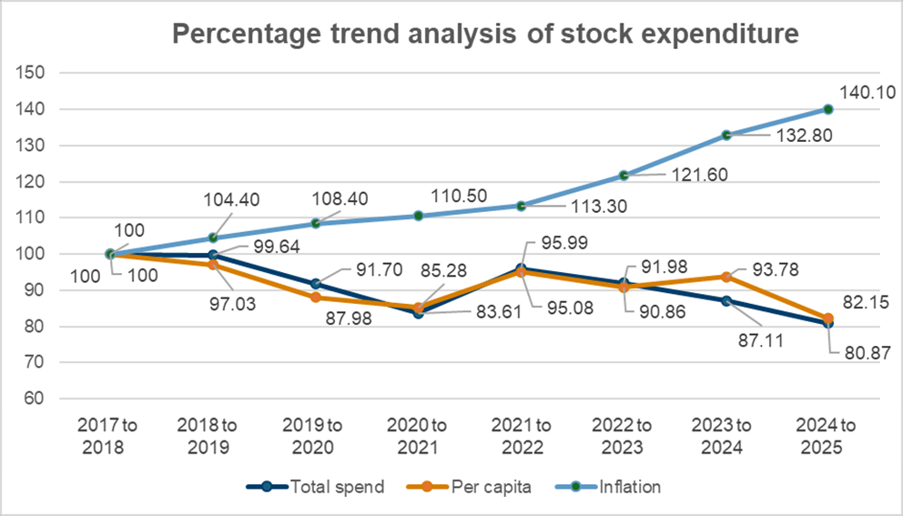

*Figure 7.1: Percentage trend analysis of stock expenditure*

Description of Figure 7.1: A line graph comprising of three coloured lines which show the
percentage trend analysis of stock expenditure. Line one displays the total spend from the
reporting period 2017 to 2018 until 2024 to 2025. Line two displays the per capita spend
from the reporting period 2017 to 2018 until 2024 to 2025. Line three displays inflation from
the reporting period 2017 to 2018 until 2024 to 2025.
Source: WPLSQI 9 and WPLSQI 14
In years for which data are available, the median spend per item figure fluctuated between
£7.92 and £9.12 per item (Fig 7.2). It is worth noting that the difference between the spend
per item at the start and end of the Framework was only 13p. If inflation were taken into
account, the cost of an equivalent item to that purchased for £8.04 in 2017 to 2018 (the
median in that year) would be expected to be £10.67 in 2023 to 2024 (a difference of
£2.63).

<!-- PAGE: 48 -->

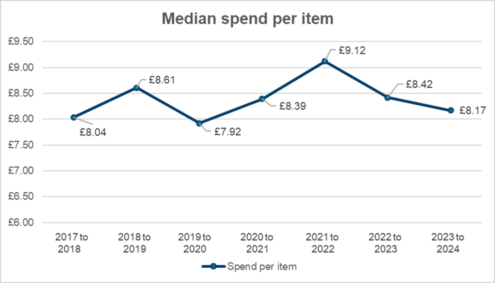

*Figure 7.2: Median spend per item*

Description of Figure 7.2: A line graph comprising of one coloured line which shows the
median spend per item. Line one displays the spend per item from the reporting period 2017
to 2018 until 2023 to 2024.
Source: WPLS 9 and WPLS 14
Percentage spend on children’s resources remained fairly stable at between 17% and 19%
of the total materials budget throughout the Sixth Framework (Table 7.2). The interquartile
range also altered little, ranging between 3% and 6%. Comparing 2017 to 2018 and 2023 to
2024 figures, 12 services reported a reduction in the percentage of their budget allocated to
children’s resources, but for most the change was small, and the median percentage
change was -1.5%.
### Table 7.2: Percentage of stock expenditure allocated to children’s resources

|  | 2017 to 2018 | 2018 to 2019 | 2019 to 2020 | 2020 to 2021 | 2021 to 2022 | 2022 to 2023 | 2023 to 2024 |
|:---|---:|---:|---:|---:|---:|---:|---:|
| High | 31% | 29% | 26% | 27% | 28% | 28% | 26% |
| Median | 17.5% | 18% | 17% | 19% | 18% | 19% | 17% |
| Low | 6% | 12% | 13% | 7% | 11% | 12% | 12% |
| Range | 25% | 17% | 13% | 20% | 17% | 16% | 14% |
| Lower quartile | 16% | 15% | 15% | 16% | 16.5% | 18% | 15% |
| Upper quartile | 21% | 21% | 21% | 21% | 22.5% | 21% | 21% |
| Interquartile range | 5% | 6% | 6% | 5% | 6% | 3% | 6% |

Source: WPLSQI 9.

<!-- PAGE: 49 -->

A percentage trend analysis was carried out based on estimated figures calculated using
the book budget and percentage allocated to children’s resources reported in returns (Fig
7.3). Whilst acknowledging that this is an estimate, it suggests that spending was lower in
2023 to 2024 (the last year for which data are available) than at the start of the Framework
period. A small pre-COVID-19 decline accelerated at the start of the pandemic period, but
then recovered again before dipping back at the end of the reporting period. Expenditure
per capita reduced by around 15%, from approximately £1.69 per child in 2017 to 2018 to
around £1.43 per child in 2023 to 2024. It is also worth noting that the gap between spend
and inflation in 2023 to 2024 was greater for children’s resources than for overall library
resources.

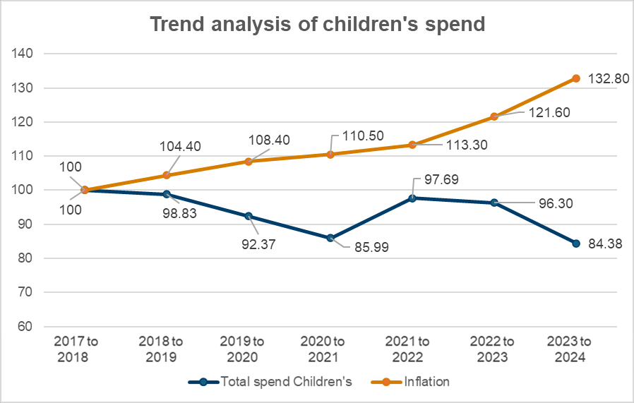

*Figure 7.3: Percentage trend analysis of spend on children’s resources*

Description of Figure 7.3: A line graph comprising of two coloured lines which show the
percentage trend analysis of spend on children’s resources. Line one displays the total
Children’s spend from the reporting period 2017 to 2018 until 2023 to 2024. Line two
displays inflation from the reporting period 2017 to 2018 until 2023 to 2024.
Source: WPLSQI 9 and WPLSQI 14
## 7.1. Summary
There is clear evidence that stock expenditure has decreased over the course of the Sixth
Framework period. Expenditure was declining gradually pre-COVID-19 and this trend was
accelerated during the pandemic period. Although there was a slight recovery in the post-
COVID-19 period, stock expenditure did not return to pre-COVID-19 levels. When inflation is
taken into account, the decline in expenditure over the course of the Framework is even
more pronounced.

<!-- PAGE: 50 -->

However, a reduction in materials budgets has not necessarily led to a reduction in the
number of items purchased as the spend per item follows a different trend to that expected
based on inflation data. There are a number of possible reasons for this: library services are
likely trying to make the best use of increasingly limited budgets and making purchasing
decisions with this in mind. However, it is beyond the scope of this research to identify
reasons for this.

*Figure 7.4: Wider context for library resources spend*

Description of Figure 7.4: A chart highlighting wider context with one coloured section. This
section explains that spend per person on library resources in Scotland varied between 50p
and £2.41 in 2024 to 2025. Ireland is reported to spend £3 per person on library resources
(SLIC, 2025).
Source: SLIC 2025.

<!-- PAGE: 51 -->

# 8. Welsh language resources spend
The research sought to answer the question ‘To what extent has the spend on Welsh
language resources changed over the Sixth Framework period?’
During the addendum period, the target for QI 10 was adjusted and was measured only as a
percentage of the materials budget. Previously, services reported both the percentage of
the materials budget and spend per capita Welsh speaker.
The median percentage spend on Welsh language materials remained between 4% and
5.5% throughout the Sixth Framework period. There was also relatively little change in the
median spend per Welsh speaker, although this was lowest during the COVID-19 pandemic
in 2020 to 2021 and highest towards the end of the Framework period. The mean per capita
figure nationally followed a similar pattern to the median, although this was slightly higher in
most years due a small number of authorities with higher spend figures. The authorities in
this higher spend group changed over the course of the Framework, indicating that the
purchase of Welsh language resources might be a priority in a particular year, or years,
rather than being a long-term feature of spending patterns within a given authority.
Table 8.1 sets out a summary of the data for spend per capita on Welsh language
resources.
### Table 8.1: Spend data per capita Welsh speaker

|  | 2017 to 2018 | 2018 to 2019 | 2019 to 2020 | 2020 to 2021 | 2021 to 2022 | 2022 to 2023 | 2023 to 2024[1] |
|:---|---:|---:|---:|---:|---:|---:|---:|
| High | £1,402 | £1,630 | £1,086 | £1,930 | £1,442 | £1,440 | £1,412 |
| Median | £496 | £523 | £497 | £390 | £555 | £550 | £572 |
| Low | £12 | £174 | £116 | £236 | £188 | £312 | £64 |
| Range | £1,390 | £1,456 | £970 | £1,694 | £1,254 | £1,128 | £1,348 |
| Lower quartile | £309 | £428 | £296 | £315 | £365 | £449 | £397 |
| Upper quartile | £750 | £808 | £734 | £527 | £748 | £881 | £769 |
| Interquartile range | £441 | £380 | £438 | £212 | £383 | £432 | £372 |
| National per capita | £523 | £570 | £542 | £520 | £550 | £625 | £586 |

Source: WPLSQI 10
[1] Estimated figures based on percentage of materials spend allocated to Welsh language
resources.
Fourteen services had a higher per capita spend on Welsh language materials at the end of
the Framework period than the start. Whilst the median change was a 21% increase, 3
services saw their per capita spend increase by fourfold or more. The spread of per capita
spend figures across Wales fluctuated, as demonstrated by the interquartile range and
range, which varied over the course of the Framework, with no clear trends evident over
time.

<!-- PAGE: 52 -->

Percentage trend analysis of total spend across Welsh library authorities (taking 2017 to
2018 as the base year) shows a fluctuating pattern of expenditure (Fig 8.1).

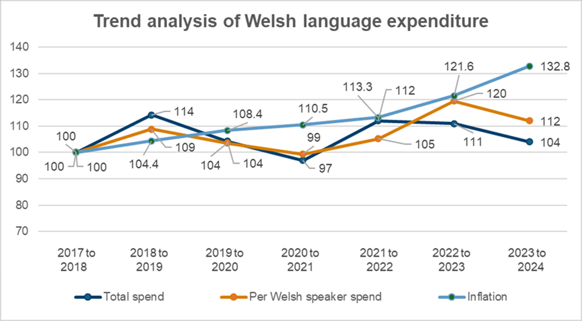

*Figure 8.1: Percentage trend analysis of spend on Welsh language materials*

Description of Figure 8.1: A line graph comprising of three coloured lines which show the
percentage trend analysis of spend on Welsh language materials. Line one displays the
total spend from the reporting period 2017 to 2018 until 2023 to 2024. Line two displays the
per Welsh speaker spend from the reporting period 2017 to 2018 until 2023 to 2024. Line
three displays inflation from the reporting period 2017 to 2018 until 2023 to 2024.
Source: WPLSQI 10
There was a notable dip in total spend and per capita spend during the COVID-19
pandemic, but spending rose in the immediate post-pandemic period. Spend figures appear
to have fallen away slightly at the end of the period for which data are available. However, it
should be noted that 2023 to 2024 figures are estimates based on the percentage of total
budget and thus, may not be completely accurate. In contrast to overall stock expenditure,
expenditure on Welsh language resources was slightly higher (4%) at the end of the Sixth
Framework compared to 2017 to 2018, with a more notable increase (12%) when the
number of Welsh speakers is taken into account.
However, when inflation is factored in, although the rate of increase in total and per capita
spend in 2018 to 2019 were above inflation, for the remainder of the Sixth Framework, both
total and per capita spend on Welsh language resources were lower than their equivalent
value in 2017 to 2018. Nevertheless, in 6 services expenditure on Welsh language materials
increased by more than the rate of inflation during the Sixth Framework. All the authorities
that increased spending by more than the rate of inflation had less than 15% of Welsh
speakers in the population.

<!-- PAGE: 53 -->

As expected, there is a strong positive relationship between total spend on Welsh language
materials and percentage of Welsh speakers in a local authority, though this relationship
was less strong during the COVID-19 pandemic period (Pearson’s r ranged between 0.687
to 0.862, p<0.01, excluding 2020-21). There was a significant difference between Welsh
language spend per capita in urban and rural authorities in some years, but this was not
consistent throughout the Sixth Framework. It is therefore difficult to draw firm conclusions
about the relationship between type of authority and Welsh language spend.
## 8.1. Summary
Welsh language spend has been less affected by decreasing stock budgets than is the case
for overall stock expenditure. Whilst spending was impacted by the COVID-19 pandemic, it
recovered post-pandemic and both total and per capita Welsh speaker expenditure have
risen over the course of the Framework. Nevertheless, spending has failed to keep pace
with inflation in the majority of authorities.

<!-- PAGE: 54 -->

# 9. Changes in the resource allocation of spend on e-
resources
The research sought to answer the question: ‘To what extent have there been changes in
the resource allocation being spent on e-resources?’
Data on the allocation of spend on e-resources were only reported via QI 9 during the
Addendum period when authorities reported the percentage of the materials budget
allocated to e-resources. The median percentage spend was fairly similar in both years,
rising slightly in 2024 to 2025 (see Table 9.1). However, the mean spend per capita
nationally was 16% lower in 2024 to 2025 compared to the previous year. This is partly due
to one of the highest spending authorities in 2023 to 2024 not providing data in 2024 to
2025 [footnote 1]. The range and interquartile range were smaller in 2024 to 2025, indicating
there was greater consistency in spend across the country.
### Table 9.1: E-resources spend

|  | 2023 to 2024 | 2024 to 2025 |
|:---|---:|---:|
| High | 49% | 28% |
| Median | 15.5% | 17% |
| Low | 4% | 5% |
| Range | 45% | 23% |
| Lower quartile | 8% | 10.5% |
| Upper quartile | 22% | 19.5% |
| Interquartile range | 14% | 9% |
| National spend per capita | £211.37 | £177.86 |

Source: WPLSQI 9
Given the limited data available, it is not possible to draw firm conclusions on changes over
time in e-resource allocation. However, there is no evidence of a difference in spend
depending on whether an authority is considered rural or urban. As might be expected,
authorities with larger resource allocations tended to spend more on e-resources. However,
changes in total resource allocation between 2023 to 2024 and 2024 to 2025 did not directly
correspond to changes in e-resource provision (i.e. an increase/decrease in total resource
allocation did not necessarily result in a corresponding increase/decrease in e-resource
allocation). This indicates that factors other than the total budget library services have
available affect decisions about e-purchasing. There is some evidence of a relationship
between e-resource allocation and e-issues, as described in Chapter 10.
Footnotes
[1] As there is only one year’s data from this authority, it is not possible to estimate a value
for the missing year.

<!-- PAGE: 55 -->

*Figure 9.1: Wider context for e-resources spend*

Description of Figure 9.1: A chart highlighting wider context with one coloured section. This
section explains that in 2019 to 2020, CIPFA noted a 7% increase in expenditure on digital
materials, including e-books (CIPFA, 2020).
Source: CIPFA 2020.

<!-- PAGE: 56 -->

# 10. Changes in library service loans
The research sought to answer the question ‘To what extent have there been changes in
library service issues during the WPLS Sixth Framework period?’
Issues (or loans) data are captured via QI 8 and QI 10. Taking all types of issues (print and
digital) into account, there was a slight decline in per capita issue figures pre-COVID-19,
followed by a significant drop at the start of the pandemic. However, issues quickly
recovered and by 2023 to 2024 were 6% higher than figures at the start of the Sixth
Framework, and trending upwards (Fig 10.1).

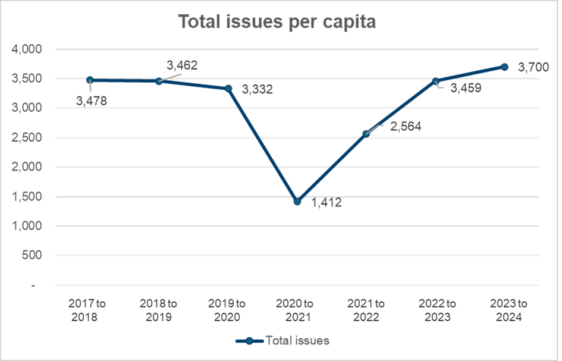

*Figure 10.1: Trends in total issues per capita*

Description of Figure 10.1: A line graph comprising of one coloured line which shows the
trends in total issues per capita. Line one displays the total issues from the reporting period
2017 to 2018 until 2023 to 2024.
Source: WPLSQI 8
However, despite this encouraging trend, it is important to note that the median, lower
quartile and upper quartile figures for per capita issues all remained lower than they had
been pre-COVID-19 (Table 10.1). The increase in mean per capita issues nationally was
driven by a small number of services at the upper end of the range. It is worth noting that
this group of authorities with higher issue figures included a mix of both urban and rural
areas, and there is no evidence of a significant difference in issue figures between rural and
urban authorities. Seven authorities saw per capita issues increase during the Framework
period, with the remaining 15 reporting a decrease.

<!-- PAGE: 57 -->

Total issues per person living in Wales ranged between 1.41 and 3.70 annually during the
Sixth Framework, with an average of 3.06.
### Table 10.1: Per capita issues

|  | 2017 to 2018 | 2018 to 2019 | 2019 to 2020 | 2020 to 2021 | 2021 to 2022 | 2022 to 2023 | 2023 to 2024 |
|:---|---:|---:|---:|---:|---:|---:|---:|
| High | 5,783 | 6,304 | 5,970 | 3,086 | 5,297 | 8,261 | 7,942 |
| Median | 3,300 | 3,202 | 3,313 | 1,166 | 1,919 | 2,612 | 2,818 |
| Low | 1,790 | 1,943 | 1,415 | 623 | 997 | 1,432 | 1,093 |
| Range | 3,993 | 4,361 | 4,555 | 2,463 | 4,301 | 6,830 | 6,849 |
| Lower quartile | 2,815 | 2,863 | 2,770 | 934 | 1,623 | 2,259 | 2,538 |
| Upper quartile | 3,863 | 3,891 | 3,731 | 1,610 | 2,536 | 3,578 | 3,459 |
| Interquartile range | 1,049 | 1,028 | 961 | 676 | 913 | 1,319 | 921 |
| National per capita | 3,478.5 | 3,461.9 | 3,332.1 | 1,412.2 | 2,564.0 | 3.459.2 | 3,699.9 |

Source: WPLSQI 8
There is evidence of a strong to very strong positive correlation between total issues and
total resource spend for every year between 2017 to 2018 and 2023 to 2024 (Pearson’s r
ranged between 0.768 and 0.921, p<0.01). There is also evidence of a strong positive
relationship between total opening hours and total issues for years in which data are
available (Pearson’s r ranged between 0.799 and 0.856, p<0.01). In addition, there is a
moderate to strong positive correlation between total issues and total staff (Pearson’s r
ranged between 0.611 and 0.811, p<0.01). Authorities with higher spending, more staff and
longer opening hours tend to have higher issue figures. There was also a weak to moderate
correlation between qualified staff and total issues in the first three years of the Framework
(pre-COVID-19) (Pearson’s r ranged between 0.431 and 0.574, p<0.05), but this was not
maintained post-COVID-19.
Underlying this pattern in overall issues, issues of various types of material changed over
the Sixth Framework period (Fig 10.2).

<!-- PAGE: 58 -->

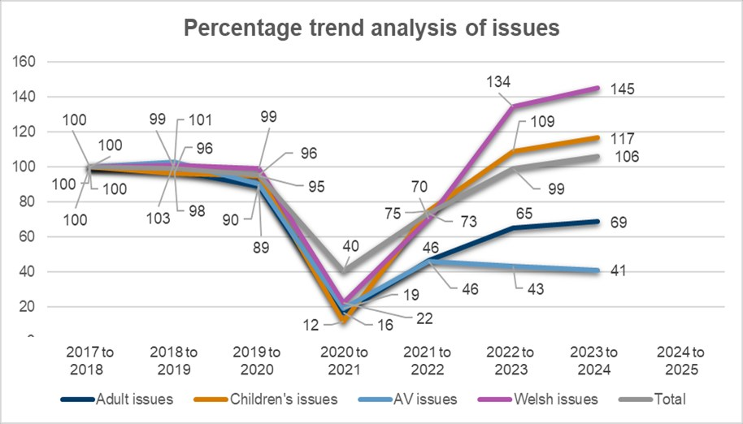

*Figure 10.2: Percentage trend analysis of issue categories*

Description of Figure 10.2: A line graph comprising of five coloured lines which show the
percentage trend analysis of issue categories. Line one displays adult issues from the
reporting period 2017 to 2018 until 2024 to 2025. Line two displays Children’s issues from
the reporting period 2017 to 2018 until 2024 to 2025. Line three displays AV issues from the
reporting period 2017 to 2018 until 2024 to 2025. Line four displays Welsh issues from the
reporting period 2017 to 2018 until 2024 to 2025. Line five displays the total from the
reporting period 2017 to 2018 until 2024 to 2025.
Source: WPLSQI 8 and WPLSQI 10
## 10.1. Adult book issues
Nationally, adult book issues per capita were falling gradually pre-pandemic. After dipping
sharply in 2020 to 2021, they recovered somewhat, but by 2023 to 2024 were still well
below pre-pandemic figures, although continuing to increase slowly. Nationally, issues
declined by 31.0% over the data collection period (Fig 10.2). All authorities reported lower
adult issues in 2023 to 2024 than they had in 2017 to 2018. The median, upper quartile and
lower quartile per capita issue figures were all below pre-pandemic levels at the end of the
data collection period (Table 10.2).
Adult issues per adult in Wales ranged between 0.44 and 2.69 annually during the Sixth
Framework, with an average of 1.85.

<!-- PAGE: 59 -->

### Table 10.2: Per capita adult issues

|  | 2017 to 2018 | 2018 to 2019 | 2019 to 2020 | 2020 to 2021 | 2021 to 2022 | 2022 to 2023 | 2023 to 2024 |
|:---|---:|---:|---:|---:|---:|---:|---:|
| High | 4,590 | 5,094 | 4,560 | 647 | 2,505 | 2,815 | 3,117 |
| Median | 2,005 | 1,969.5 | 1,806 | 365 | 915.5 | 1,349.5 | 1,270.5 |
| Low | 1,184 | 1,279 | 1,463 | 173 | 466 | 805 | 558 |
| Range | 3,406 | 3,815 | 3,097 | 474 | 2,039 | 2,010 | 2,559 |
| Lower quartile | 1,791 | 1,688 | 1,574 | 297 | 696 | 1,144 | 1,139 |
| Upper quartile | 2,429 | 2,313 | 2,311 | 525 | 1,013 | 1,400 | 1,617 |
| Interquartile range | 638 | 625 | 737 | 228 | 317 | 256 | 478 |
| National per capita | 2,692.1 | 2,638.4 | 2,384.5 | 439.4 | 1,242.3 | 1,746.2 | 1,840.9 |

Source: WPLSQI 8
There is evidence of a strong positive correlation between resource spend and adult issues
(Pearson’s r ranged between 0.708 and 0.902, p<0.01). Authorities with larger book
budgets tended to report higher adult issues.
Excluding the years most affected by the COVID-19 pandemic (2020 to 2021 and 2021 to
2022), there was some evidence of a statistically significant difference (p<0.05) between
urban and rural authorities, with per capita adult issues in rural authorities tending to be
higher.
## 10.2. Children’s book issues
Children’s book issues per capita increased notably during the Sixth Framework. Like adult
issues, national per capita issues were declining gradually pre-COVID-19 and fell sharply at
the start of the pandemic. However, post-COVID-19, figures recovered quickly, and
children’s issues nationally were above pre-pandemic levels from 2022 to 2023 onwards
(Fig 10.2). Children’s issues were 17% higher in 2023 to 2024 than they had been at the
start of the Framework period. However, whilst national per capita (mean) figures have
risen, the per capita median was slightly lower in 2023 to 2024 than it had been in 2017 to
2018, Upper quartile and lower quartile figures were also lower than at the start of the
Framework (Table 10.3). In fact, only 6 authorities reported increased children’s issues per
capita numbers between 2017 to 2018 and 2023 to 2024, and much of the national increase
was driven by a dramatic increase in children’s issues in Cardiff. The national capital was an
outlier for children’s issues compared to other authorities during the post-pandemic period.
However, overall, there was no statistically significant difference in children’s issues
between urban and rural authorities.
Children’s issues per child in Wales ranged between 0.61 and 6.09 annually during the
Sixth Framework, with an average of 4.5.

<!-- PAGE: 60 -->

### Table 10.3: Per capita children’s issues

|  | 2017 to 2018 | 2018 to 2019 | 2019 to 2020 | 2020 to 2021 | 2021 to 2022 | 2022 to 2023 | 2023 to 2024 |
|:---|---:|---:|---:|---:|---:|---:|---:|
| High | 1,817 | 1,449 | 1,213 | 277 | 2,073 | 2,964 | 2,005 |
| Median | 813.5 | 804.5 | 816 | 100.5 | 420.5 | 708 | 794.5 |
| Low | 322 | 270 | 260 | 23 | 94 | 212 | 277 |
| Range | 1,495 | 1,179 | 953 | 254 | 1,979 | 2,752 | 1,728 |
| Lower quartile | 669 | 718 | 714 | 72 | 364 | 547 | 609 |
| Upper quartile | 1,076 | 1,028 | 1,035 | 132 | 592 | 841 | 959 |
| Interquartile range | 407 | 310 | 321 | 60 | 228 | 294 | 350 |
| National per capita | 5,222.9 | 5,036.1 | 4,958.9 | 606.2 | 3,899.0 | 5,679.2 | 6,087.7 |

Source: WPLSQI 8
There is evidence of a strong positive correlation between children’s issue figures and
spending on children’s resources. As might be expected, this was slightly weaker in 2020 to
2021 at the height of the pandemic, but for the remainder of the Framework, Pearson’s r
ranged between 0.772 and 0.885, (p<0.01). This suggests that authorities with higher
spending on children’s resources tend to report higher children’s issue figures.
## 10.3. Audio Visual (AV) issues
Overall, there was a 59% decrease in the number of AV issues nationally. Only one
authority saw AV issues per capita increase during the Framework period. In common with
other resource types, AV issues fell dramatically at the start of the COVID-19 pandemic.
Although there was some recovery in the following years, the median, mean, upper quartile
and lower quartile figures in the post-pandemic period all remained lower than they had
been at the start of the Framework (Table 10.4). This is unsurprising as COVID-19
accelerated access to newer technologies for some customers, reducing the demand for
older AV formats.

<!-- PAGE: 61 -->

### Table 10.4: Per capita AV issues

|  | 2017 to 2018 | 2018 to 2019 | 2019 to 2020 | 2020 to 2021 | 2021 to 2022 | 2022 to 2023 | 2023 to 2024 |
|:---|---:|---:|---:|---:|---:|---:|---:|
| High | 244 | 324 | 235 | 95 | 147 | 189 | 155 |
| Median | 107.5 | 116.5 | 107 | 23 | 41.5 | 46 | 44 |
| Low | 56 | 50 | 46 | 6 | 14 | 10 | 15 |
| Range | 188 | 274 | 189 | 89 | 133 | 179 | 140 |
| Lower quartile | 88 | 91 | 60 | 16 | 37 | 35 | 35 |
| Upper quartile | 162 | 167 | 140 | 29 | 73 | 58 | 56 |
| Interquartile range | 74 | 76 | 80 | 13 | 36 | 23 | 21 |
| National per capita | 122.2 | 125.3 | 110.2 | 23.1 | 56.1 | 52.5 | 50.0 |

Source: WPLSQI 8
## 10.4. Welsh language issues
Welsh language issues per capita Welsh speaker were relatively steady pre-pandemic.
After a decline in 2020 to 2021, they started to increase and exceeded pre-pandemic figures
from 2022 to 2023 onwards. The total number of issues nationally increased by 45% over
the course of the Framework (Fig 10.2). However, the median figure for Welsh authorities
was similar in 2023 to 2024 to that in 2017 to 2018 (Table 10.5). Eleven authorities reported
an increase in Welsh issues per capita, whilst the other 11 reported a decrease. The
increase in national per capita (mean) figures appears to have been driven by two factors:
1) increased issues amongst local authorities at the lower end of the range as the lowest
and lower quartile figures rose; and 2) increases amongst the highest performing
authorities, evidenced by outliers at the upper end of the range in the final years of data
collection. There was no evidence of a significant difference in per capita Welsh issues in
rural compared to urban authorities.
Welsh language issues per Welsh speaker ranged between 0.17 and 1.11 annually during
the Sixth Framework, with an average of 0.73.

<!-- PAGE: 62 -->

### Table 10.5: Per capita Welsh issues

|  | 2017 to 2018 | 2018 to 2019 | 2019 to 2020 | 2020 to 2021 | 2021 to 2022 | 2022 to 2023 | 2023 to 2024 |
|:---|---:|---:|---:|---:|---:|---:|---:|
| High | 1,462 | 1,424 | 1,468 | 467 | 1,105 | 2,644 | 2,725 |
| Median | 630 | 601 | 641 | 63 | 340 | 570 | 632 |
| Low | 73 | 95 | 311 | 17 | 71 | 174 | 161 |
| Range | 1,389 | 1,329 | 1,157 | 450 | 1,034 | 2,470 | 2,564 |
| Lower quartile | 378 | 417 | 406 | 42 | 232 | 454 | 510 |
| Upper quartile | 847 | 903 | 853 | 111 | 573 | 741 | 853 |
| Interquartile range | 469 | 486 | 447 | 69 | 341 | 287 | 343 |
| National per capita | 765.9 | 771.5 | 756.9 | 171.0 | 538.6 | 1,030.2 | 1,110.8 |

Source: WPLSQI 10
There was evidence of a low to moderate correlation between Welsh language issues and
spend on Welsh language materials (Pearson’s r ranged between 0.340 to 0.768, p<0.05),
but this correlation is not as strong as for other resource types. Whilst spend on Welsh
materials may have some impact on issue figures, there are likely to be other factors that
are important. Factors impacting on Welsh loan figures may include the provision of Welsh
language activities and events, and the extent to which Welsh language collections match
the needs of local speakers (e.g. level of materials). However, it is not possible to comment
on the extent to which such factors may have an impact based on WPLS data alone.
## 10.5. E-issues
As can be seen from Figure 10.3, e-issues followed a different pattern to other types of
resource issues during the Sixth Framework. Nationally, e-issues per capita increased more
than six-fold during the Framework and were on an upward trend at the end of the period.
The median, upper quartile, lower quartile, and highest and lowest values all rose between
2017 to 2018 and 2024 to 2025 (Table 10.6). Following a sharp increase in 2020 to 2021 at
the start of the COVID-19 pandemic period, e-issues fell back slightly, but in the Addendum
period, they exceeded 2020 to 2021 levels and continued to trend upwards. All local
authorities reported an increase in e-issues over the Sixth Framework period. Nationally, e-
issues increased by 542% between 2017 to 2018 and 2024 to 2025.
E-issues per person ranged between 0.21 and 1.38 annually during the Sixth Framework,
with an average of 0.75.
It is important to note, however, that Cardiff was an outlier in the post-pandemic period.
Although the trend in this authority was similar to that in many others in Wales, the
magnitude of the increase differed as per capita e-issues in the capital city region rose
almost nine-fold. However, there was no evidence of a significant difference in e-issues
between urban and rural authorities.

<!-- PAGE: 63 -->

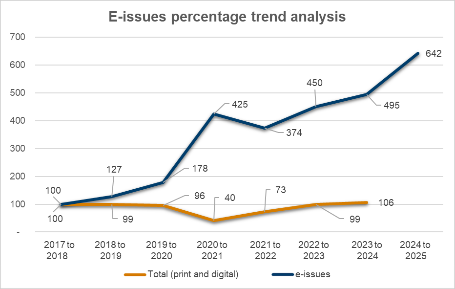

*Figure 10.3: E-issues percentage trend analysis*

Description of Figure 10.3: A line graph comprising of two coloured lines which show the
percentage trend analysis of e-issues. Line one displays the total print and digital issues
from the reporting period 2017 to 2018 until 2024 to 2025. Line two displays e-issues from
the reporting period 2017 to 2018 until 2024 to 2025.
Source: WPLSQI 8
### Table 10.6: Per capita e-issues

|  | 2017 to 2018 | 2018 to 2019 | 2019 to 2020 | 2020 to 2021 | 2021 to 2022 | 2022 to 2023 | 2023 to 2024 | 2024 to 2025 |
|:---|---:|---:|---:|---:|---:|---:|---:|---:|
| High | 568 | 609 | 597 | 2,766 | 2,788 | 3,464 | 2,898 | 3,300 |
| Median | 167.5 | 246 | 390 | 615 | 473 | 569 | 724 | 1,012 |
| Low | 83 | 62 | 144 | 255 | 172 | 197 | 198 | 368 |
| Range | 485 | 547 | 453 | 2,511 | 2,616 | 3,267 | 2,700 | 2,932 |
| Lower quartile | 135 | 170 | 272 | 457 | 404 | 419 | 564 | 750 |
| Upper quartile | 206 | 316 | 470 | 1,017 | 643 | 934 | 963 | 1,727 |
| Interquartile range | 71 | 146 | 198 | 560 | 239 | 515 | 399 | 977 |
| National per capita | 214.9 | 273.4 | 382.6 | 914.2 | 803.1 | 967.9 | 1,064.9 | 1,380.7 |

Source: WPLSQI 8
There is evidence of a moderate correlation between e-issues and spend on e-resources
(Pearson’s r ranged between 0.542 and 0.751, p<0.01). It is possible that the provision of e- <!-- PAGE: 64 --> resources by the Welsh Government may mean that the relationship between local authority
budgets and e-issues is not as strong as is the case for other resource types.
## 10.6. Summary
Overall, the number of issues across Wales rose over the Sixth Framework. Given the
pressure on stock budgets during this period (see Section 7), this is not an insignificant
achievement for the sector. There was a marked decline in physical issues over the COVID-
19 period, but this was balanced to some extent by a dramatic increase in e-resource
borrowing. Children’s issues and Welsh language issues recovered post-COVID-19 and
were higher at the end of the Framework than they had been at the start. However, adult
issues and AV issues did not recover to pre-COVID-19 levels and, based on current trends,
there is little indication that they will do so in the next few years.
However, underlying these national level trends, it is important to be aware that there are
marked differences around the country. The increase in total issues in Wales is, to a large
extent, driven by increases within a small number of higher performing authorities, rather
than a similar level of increase spread across the country. Whilst some of these increases
may be explained by geographical and demographic factors (e.g. capital city region or
changing population patterns), there are clearly marked differences that have no obvious
explanation based on the data available as some authorities have recovered from the
pandemic period more strongly than others.

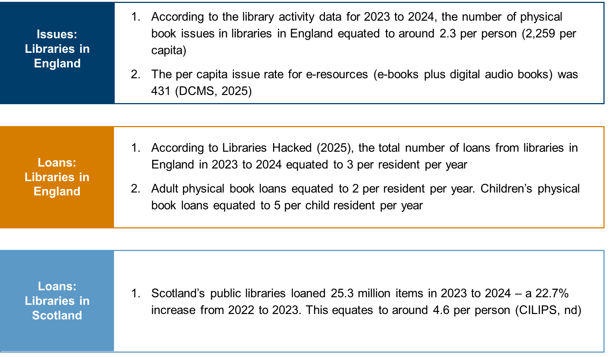

*Figure 10.4: Wider context for issues and loans*

Description of Figure 10.4: A chart highlighting wider context with three coloured sections.
Section one explains that according to the library activity data for 2023 to 2024, the number
of physical book issues in libraries in England equated to around 2.3 per person (2,259 per <!-- PAGE: 65 --> capita). The per capita issue rate for e-resources (e-books plus digital audio books) was 431
(DCMS, 2025). Section two explains that according to Libraries Hacked (2025), the total
number of loans from libraries in England in 2023 to 2024 equated to 3 per resident per
year. Adult physical book loans equated to 2 per resident per year. Children’s physical book
loans equated to 5 per child resident per year. Section three explains that Scotland’s public
libraries loaned 25.3 million items in 2023 to 2024 which is a 22.7% increase from 2022 to 2023. This equates to around 4.6 per person (CILIPS, nd).
Source: DCMS 2025 and CILIPS nd.

<!-- PAGE: 66 -->

# 11. Changes in opening hours
The research sought to answer the question ‘Have opening hours of library services
changed over the Sixth Framework period?’
Fig 11.1 shows changes in opening hours per capita nationally over the Sixth Framework
period as reported in QI 16. As opening hours data were not collected between 2020 and
2022 due to COVID-19 restrictions, a trend line (dotted) is added to show the moving
average for changes over the Framework period. This shows that whilst opening hours were
trending downwards before COVID-19, they had declined more dramatically when reporting
resumed in 2022 to 2023. Opening hours continued to decrease post-COVID-19, albeit at a
slower rate than they had over the pandemic.

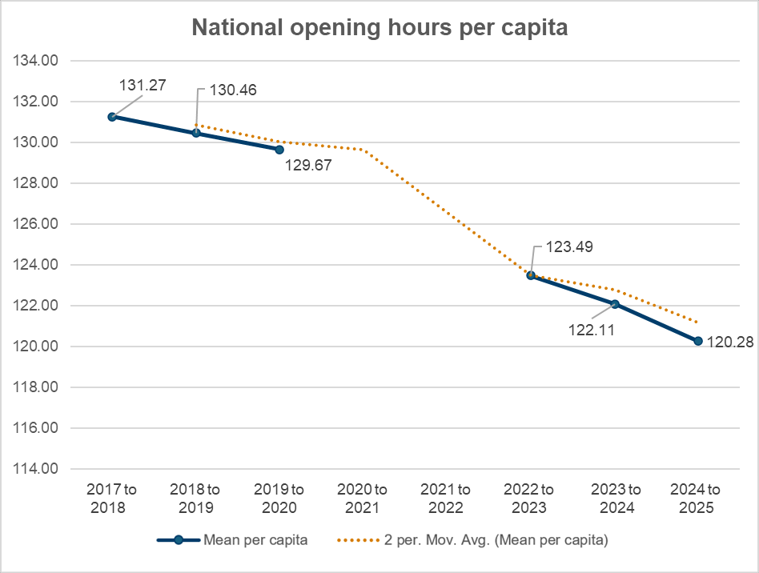

*Figure 11.1: Opening hours per capita across Welsh libraries*

Description of Figure 11.1: A line graph comprising of two coloured lines which show the
opening hours per capita across Welsh libraries. Line one displays the mean per capita from
the reporting period 2017 to 2018 until 2024 to 2025. Line two displays the two period
moving average for the mean per capita from the reporting period 2017 to 2018 until 2024 to
2025.
Source: WPLSQI 16
In 15 services, the total number of opening hours decreased between 2017 to 2018 and
2024 to 2025. However, 6 saw opening hours increase, with the remaining service <!-- PAGE: 67 --> experiencing no change. The median percentage change in opening hours across the
Framework was -10.5%.
As shown in Table 11.1, the median staffed opening hours per capita declined pre-COVID-
# 19. When data collection resumed, the median per capita staffed opening hours was close
to the pre-pandemic figure, but this began to decrease again and by 2024 to 2025, the
median was slightly below the target for this QI. The range and interquartile range for per
capita staffed opening hours both reduced towards the end of the Framework period,
indicating a more consistent level of staffed opening hours per capita across Wales.
### Table 11.1: Median staffed opening hours

|  | 2017 to 2018 | 2018 to 2019 | 2019 to 2020 | 2022 to 2023 | 2023 to 2024 | 2024 to 2025 |
|:---|---:|---:|---:|---:|---:|---:|
| High | 204 | 203 | 200 | 184 | 181 | 178 |
| Median | 132 | 129.5 | 124 | 127 | 124.5 | 119.5 |
| Low | 74 | 74 | 83 | 63 | 62 | 62 |
| Range | 130 | 129 | 117 | 121 | 119 | 116 |
| Lower quartile | 114 | 111 | 111 | 110 | 104 | 104 |
| Upper quartile | 150 | 152 | 152 | 148.5 | 135 | 136 |
| Interquartile range | 36 | 41 | 41 | 38.5 | 31 | 32 |

Source: WPLSQI 16
The number of services reporting unstaffed opening hours doubled from 3 to 6 during the
Sixth Framework. Whilst unstaffed hours increased during the Framework period, they
accounted for a relatively small proportion of total opening hours (between approximately
0.75% and 6.0%). Unstaffed hours were highest in the immediate post-COVID-19 period in
2022 to 2023. In 2024 to 2025, 4 services reported more unstaffed hours per capita than
they had in 2017 to 2018, and one service reported fewer.
During the first two years of the Sixth Framework, there was some evidence that total
opening hours per capita were higher in rural authorities (p<0.05). However, during the
reminder of the Framework period, although mean and median per capita opening hours
remained higher in rural authorities compared to urban services, this difference was not
statistically significant.
The number of services reporting unplanned or emergency closures of static service points
in the years for which these data were collected ranged between 3 and 12. The median
percentage was 0% for all years and the highest annual figures reported ranged from 0.3%
to 4%. There was no obvious pattern to unplanned or emergency closures which were
usually due to local factors such as weather or building issues.
The number of services reporting missed mobile stops in the years for which these data
were collected ranged between 6 and 12. The median percentage ranged between 0% and
4% and the highest annual figures reported ranged from 3.7% to 11.2%.

<!-- PAGE: 68 -->

As might be expected, there was evidence of a strong positive correlation between opening
hours and staffing numbers throughout the Sixth Framework period. However, it is worth
noting that this relationship was even stronger in the post-COVID-19 period (Pearson’s r
was between 0.863 and 0.868 pre-COVID-19, and between 0.943 and 0.959 post-COVID-
19, p<0.01)., meaning it is very likely that changes in staffing numbers will impact on
opening hours.
Nationally, opening hours per member of library staff were 7% higher in 2024 to 2025 than
they had been in 2017 to 2018, meaning that libraries had maintained a higher level of
opening hours in relation to the number of staff available than had been the case at the start
of the Sixth Framework. However, the situation varied across the country and in 9
authorities, opening hours per staff member were lower in 2024 to 2025 than they had been
in 2017 to 2018. There was no relationship between opening hours per staff member and
whether an authority is urban or rural. When volunteer hours are also taken into account,
opening hours per worker (staff or volunteer) increased by 4.5% during the course of the
Framework. This indicates that, even taking volunteers into account, there were fewer
personnel per opening hour. Whilst it is beyond the scope of this analysis to explore the
implications of this, a greater proportion of staff time devoted to immediate customer facing
activities may present challenges for other aspects of library service planning and provision.
## 11.1. Summary
Opening hours dropped noticeably over the COVID-19 pandemic and continued to decrease
over the reminder of the Sixth Framework, albeit more gradually. Unstaffed opening hours
increased, but still only accounted for a small proportion of total opening hours.

*Figure 11.2: Wider context for opening hours*

Description of Figure 11.2: A chart highlighting wider context with one coloured section. This
section explains that according to the public libraries location dataset, opening hours in
English libraries equated to approximately 91 per capita. For libraries considered part of
statutory provision, this was 85 hours per capita. Staffed opening hours equated to
approximately 81 per capita across all libraries and 76 per capita for statutory provision
(ACE, 2025).
Source: ACE 2025.

<!-- PAGE: 69 -->

# 12. Changes in service points
The research sought to answer the question ‘What changes in service points have
happened over the Sixth Framework period?’
Between 2018 to 2019 and 2024 to 2025, data reported as part of the WPLS contextual
background indicate that there was an overall loss nationally of 7 service points open for 10
hours a week or more. The number declined from 208 to 201. Six services saw a decrease
of 1 or 2 service points. Only 1 service reported an increase in service points open for 10
hours a week or more. The number of static service points open for less than 10 hours a
week remained fairly small throughout the Framework, declining from 7 to 6 between 2018
to 2019 and 2024 to 2025.
The Sixth Framework period saw a dramatic decline in mobile provision with the loss of
more than two-thirds of mobiles nationally. The number of mobiles reported decreased from
29 to 9. In 2018 to 2019, 17 services had at least one mobile service, but by 2024 to 2025,
only 8 did so.
The number of community libraries reported in the annual returns declined during COVID-
19, but returned to close to 2018 to 2019 numbers by 2024 to 2025 when 16 were included
in returns, compared to 17 in 2018 to 2019.
According to data provided in QI 7, only 2 services saw an increase in the percentage of the
population living within the stipulated travel time or distance from a service point. Sixteen
witnessed a decrease and 2 reported no change. It is not possible to comment on the
remaining 2 services as they changed location category (based on population density)
during the Framework, so the data are not comparable. Whilst the majority of changes were
fairly small, 5 services saw a change of more than 15%. It is important to note that the
methods of calculating this QI may have changed for some services over the course of the
Framework, so figures may not be completely comparable.

<!-- PAGE: 70 -->

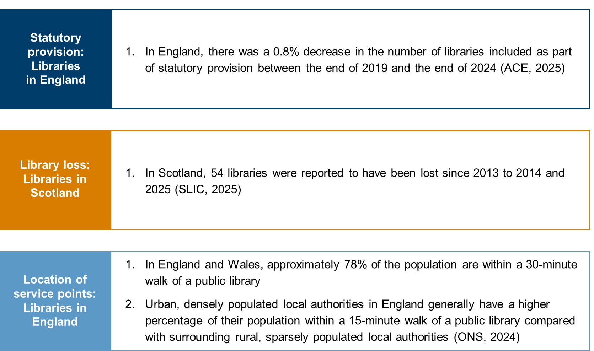

*Figure 12.1: Wider context for statutory provision, library loss and location of service points*

points

Description of Figure 12.1: A chart highlighting wider context with three coloured sections.
Section one explains that in England, there was a 0.8% decrease in the number of libraries
included as part of statutory provision between the end of 2019 and the end of 2024 (ACE,
2025). Section two explains that in Scotland, 54 libraries were reported to have been lost
since 2013 to 2014 and 2025 (SLIC, 2025). Section three explains that in England and
Wales, approximately 78% of the population are within a 30-minute walk of a public library.
Urban, densely populated local authorities in England generally have a higher percentage of
their population within a 15-minute walk of a public library compared with surrounding rural,
sparsely populated local authorities (ONS, 2024).
Source: ACE 2025, SLIC 2025 and ONS 2024.

<!-- PAGE: 71 -->

# 13. Changes in digital engagement
The research sought to answer the question ‘To what extent have there been changes in
digital engagement over the Sixth Framework period?’
The ways in which digital engagement has changed over the Sixth Framework period,
reflects wider changes in the ways in which people use technology, for example, greater
use of smartphones and other personal devices, but fewer fixed PCs. In the original
Framework, library services reported on online access via QI 11, but in the Addendum, this
became included within CE 7.
Customer satisfaction regarding library IT facilities is collected via QI 2. The median
percentage of customers rating IT facilities as good or very good was 88% in 2017 to 2020
and 85% in 2022 to 2025. Whilst these numbers indicate high levels of satisfaction it is
worth noting that they are lower than customer satisfaction for books, customer care or the
library overall. The range and interquartile range of responses is also wider for satisfaction
with IT facilities compared to other areas.
Trends in e-issues are reported in Section 10. This section therefore focuses on other areas
of digital engagement.
## 13.1. Online access
The number of devices giving public access to the Internet was collected in 2017 to 2018,
2018 to 2019, 2019 to 2020 and in 2022 to 2023. The median number of devices per capita
in static libraries fluctuated in the pre-COVID-19 period, but declined after. This is
unsurprising as, whilst PCs remain important to some customers, digital provision moved
away from fixed PC access and towards greater use of WiFi provision to support customers
using their own devices. This is demonstrated by figures for the percentage of time PCs
were in use. This figure was stable pre-COVID-19, but declined immediately after the
pandemic period when the median percentage more than halved from 27% to 11%.
The total number of devices giving public access to the internet decreased by 9% over the
data collection period. However, 6 services saw the number of devices increase. The
median and national per capita (mean) number of devices per 10,000 population available
in static libraries also declined over the data collection period (Table 13.1). The range for
per capita devices was larger post-COVID-19, but the interquartile range reduced slightly as
the pattern of changing online provision varied across the country. The was no significant
difference in number of devices providing internet access in urban and rural services.

<!-- PAGE: 72 -->

### Table 13.1: Devices per 10,000 resident population giving public internet access in

|  | 2017 to 2018 | 2018 to 2019 | 2019 to 2020 | 2022 to 2023 |
|:---|---:|---:|---:|---:|
| High | 13.85 | 13.83 | 13.81 | 16.99 |
| Median | 9.43 | 9.54 | 9.12 | 7.99 |
| Low | 5.02 | 4.95 | 4.46 | 3.32 |
| Range | 8.83 | 8.88 | 9.35 | 13.67 |
| Lower quartile | 7.89 | 7.76 | 7.25 | 6.38 |
| Upper quartile | 10.87 | 10.79 | 10.42 | 9.55 |
| Interquartile range | 2.98 | 3.03 | 3.17 | 3.17 |
| National per capita | 9.56 | 9.53 | 9.19 | 8.73 |

Source: WPLSQI 11
## 13.2. Website visits
Fig 13.1 shows the percentage trend in website visits nationally, taking 2017 to 2018 as the
base year as reported in QI 8.

<!-- PAGE: 73 -->

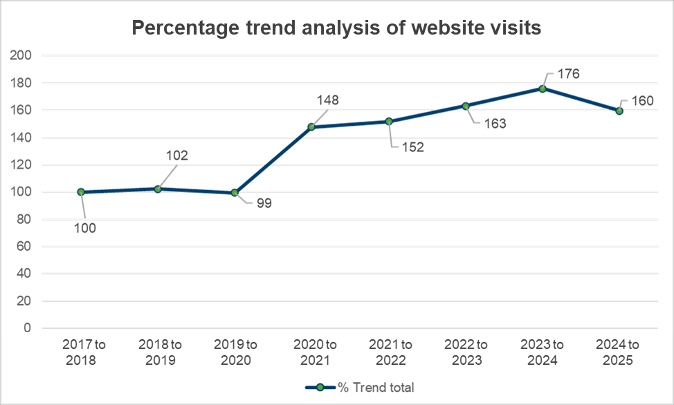

*Figure 13.1: Percentage trend analysis for website visits*

Description of Figure 13.1: A line graph comprising of one coloured line which shows the
percentage trend analysis for website visits. Line one displays the percentage trend total
from the reporting period 2017 to 2018 until 2024 to 2025.
Source: WPLSQI 8
There was a notable increase in virtual visits in 2020 to 2021 and the upward trend was
sustained in subsequent years, with the exception of the final year of the Framework.
However, it should be noted that much of the rise was the result of a more than 2.5-fold
increase in website visits in Cardiff. The national capital, which operates a fully integrated
hub model, was a notable outlier from other Welsh library services for the post-COVID-19
period. When this service is omitted, the pattern becomes one of relative stability during
much of the Framework, before increasing slightly during the Addendum period. Whilst
nationally, there was a 59.8% increase in total virtual visits during the Sixth Framework,
when Cardiff is excluded, this falls to 13.9%. However, there were also notable differences
across other areas of the country; ten authorities saw a decline in website visits during the
Sixth Framework, whilst the remainder reported an increase.
The median website visits per capita declined during COVID-19, but then recovered
somewhat, although it did not return to pre-COVID-19 levels by the end of the Framework
period. Whilst the range increased, the interquartile range was smaller in the second half of
the Framework, indicating that, disregarding outliers, there is greater consistency in the
number of website visits across much of the country (Table 13.2).

<!-- PAGE: 74 -->

### Table 13.2: Per capita website visits

|  | 2017 to 2018 | 2018 to 2019 | 2019 to 2020 | 2020 to 2021 | 2021 to 2022 | 2022 to 2023 | 2023 to 2024 | 2024 to 2025 |
|:---|---:|---:|---:|---:|---:|---:|---:|---:|
| High | 2,211 | 2,205 | 2,131 | 5,983 | 6,768 | 7,979 | 7,851 | 6,035 |
| Median | 866.5 | 885 | 834 | 623.9 | 581 | 537.5 | 743 | 766 |
| Low | 243 | 345 | 239 | 100 | 129 | 124 | 158 | 5 |
| Range | 1,968 | 1,860 | 1,892 | 5,883 | 6,639 | 7,855 | 7,693 | 6,033 |
| Lower quartile | 473 | 481 | 434 | 417 | 269.5 | 365 | 374.5 | 427 |
| Upper quartile | 1,255 | 1,318 | 1,233 | 1,289 | 942 | 956 | 984 | 1,136 |
| Interquartile range | 782 | 837 | 799 | 872 | 673 | 591 | 610 | 709 |
| National per capita | 983.6 | 1,003.6 | 970.7 | 1,428.7 | 1,468.4 | 1,609.1 | 1,719.6 | 1,545.9 |

Source: WPLSQI 8
It is clear that not all services use websites in the same way. Some will have more social
media traffic, for example. It is important to remember that, for some services, website traffic
may represent a relatively small proportion of total digital engagement. There was no
evidence of a significant difference between website visits per capita depending on whether
an authority is classified as rural or urban.
## 13.3. Summary
Patterns of digital engagement changed during the Sixth Framework as many customers
moved from using static PCs to bringing their own devices to log onto library WiFi. This
inevitably affected the ways in which digital engagement took place. Virtual visits rose
nationally, although the extent to which customers engaged with library service websites
varied around the country. The increase in e-issues (see Section 10) also indicates
increasing engagement with digital resources.

*Figure 13.2: Wider context for website visits*

Description of Figure 13.2: A chart highlighting wider context with one coloured section. This
section explains that CIPFA reported that web visits to libraries in Great Britain rose in 2019
to 2020 with a 25.8% increase compared to 2015 to 2016. There were a total of 131 million
online visits in 2019 to 2020, over 2 per person (CIPFA, 2020). Web visits continued to rise <!-- PAGE: 75 --> in 2020 to 2021 (CIPFA, 2022) but began to fall from 2021 to 2022 when an 8% decrease
was reported. Website visits fell further to 1,703 per 1,000 people (1.7 per person) in 2022
to 2023, a 26% decrease compared to the previous year (CIPFA, 2023b).
Source: CIPFA 2020, CIPFA 2022 and CIPFA 2023b.

<!-- PAGE: 76 -->

# 14. Changes in services targeted at disadvantaged or minority
groups and individuals
The research sought to answer the question ‘Have there been changes in services/activities
targeting disadvantaged or minority groups or individuals?’
Libraries provide support to a wide range of individuals and groups experiencing
disadvantage. These include:
• people experiencing poor mental health, anxiety, stress or low confidence
• people experiencing loneliness, social isolation or bereavement
• people with disabilities, sensory impairments or additional learning needs, including
autistic individuals
• people living with dementia and their carers
• refugees, asylum seekers and people new to the UK or local area
• people experiencing homelessness or housing insecurity
• people affected by digital exclusion or data poverty
• families facing poverty or cost of living pressures
• people seeking employment, skills support or help navigating online public services
• children and young people at risk of disengagement from education, employment or
training.
Information about services targeted towards disadvantaged or minority groups is provided
via:
• CE 4: appropriate services, facilities and information resources for individuals and
groups with special requirements
• QI 4: Support for health and wellbeing
• QI 6: Events and activities for those who have special requirements
• case studies/impact statements
• strategic statements and future direction statements that describe how services
prioritise support for particular groups within their communities
Whilst the majority of services provided activities for disadvantaged or minority groups and
individuals throughout the Sixth Framework, provision across the country became more
consistent in the Addendum period, with all services offering events or activities for
customers with special requirements in all branches open for 10 hours a week or more by
the end of the Sixth Framework (QI 6).

<!-- PAGE: 77 -->

## 14.1. Supporting wellbeing and reducing social isolation
A substantial strand of qualitative evidence relates to individuals experiencing loneliness,
poor mental health, anxiety, bereavement or other social isolation. Libraries support people
through activities such as shared reading groups, informal drop-in sessions, creative groups
and community activities that provide low pressure opportunities for connection. In several
examples drawn from case studies and impact statements, participation in library-based
groups is associated with improved confidence, a renewed sense of routine and belonging,
and reduced feelings of loneliness. Strategic and future direction statements reinforce this
theme by describing an ongoing emphasis on wellbeing, loneliness reduction and inclusive
community hubs. Several authorities describe plans to strengthen wellbeing support and
community connection for adults who feel socially isolated.
The QI 4 data also provide evidence that Welsh libraries perform well for mental health
awareness activities. Although a small number of services struggled to offer mental health
awareness in some or all branches, the lower quartile rose and interquartile range reduced
during the Sixth Framework, indicating an improved, and more consistent, offer across the
country.
Health partnerships were available in all libraries in the majority of services. These involve
library services working alongside public health bodies, social care teams and third sector
organisations to deliver wellbeing support. This includes partnerships with organisations
such as Public Health Wales, local health boards and mental health charities, as well as
involvement in schemes such as social prescribing initiatives. The median percentage of
service points offering health partnerships was 100%, with the exception of 2023 to 2024.
However, not all services offered health partnerships in all service points open 10 hours a
week or more. The lower quartile fell from 83% in 2019 to 2020 to between 44% and 57%
post-COVID-19 as authorities sometimes found it difficult to re-establish partnerships. This
resulted in a larger interquartile range, indicating more variation in the level of provision
across the country.
The median percentage of service points offering Book Clubs was 90% or higher in all years
for which data were collected. Whilst a number of services were unable to offer book clubs
in all service points, the interquartile range decreased over the course of the Framework,
providing evidence of a more consistent offer across Wales.
### 14.1.1. Illustrative example: the value of the Home Delivery Service
To support individuals experiencing loneliness, isolation and health related barriers to
accessing library services, Monmouthshire provides a Home Delivery Service. The service
provides books in a range of formats to people who are unable to visit libraries due to
mobility issues or ill health. The service offers valuable social interaction through contact
with library staff and for some is considered ‘a lifeline’. One customer remarked: “I was so
upset when I couldn’t read because of the loss of my sight. I felt that if I couldn’t read, I’d
want to die. But then the Home Delivery service came to my rescue”. (Monmouthshire
annual report 2022 to 2023).

<!-- PAGE: 78 -->

### 14.1.2. Illustrative example: supporting social inclusion amongst young adults
Bridgend illustrates how library services support young adults with Additional Learning
Needs (ALN), particularly through close links with local day care services. One example
describes a customer who visits the library regularly with his carer. These visits have
contributed to improved mental health, a sense of routine, and reduced feelings of
loneliness and social isolation. The library offers a calm and safe environment that supports
his emotional wellbeing. The individual has used library facilities such as public computers
and printers to create a book about his life, helping to develop his digital and literacy skills.
He comments “The library is my second home, I love coming here”. (Bridgend annual report
2023 to 2024).
### 14.1.3. Illustrative example: supporting wellbeing and social connection through
community hub activities
In Cardiff, one example describes a man facing increasing isolation following the death of
his wife and changes in his health. Through participation in activities organised through
Community Hubs, including group outings, walking activities and regular social gatherings,
he was able to remain active and connected. These opportunities provided a sense of
routine, companionship and engagement with others in his local area. As a result, the
activities contributed positively to his wellbeing, helping to reduce isolation and strengthen
his sense of belonging within the community. (Cardiff annual report 2022 to 2023).
## 14.2. Supporting people with disabilities, dementia and Additional
Learning Needs (ALN)
Libraries frequently describe working with disabled individuals or those with Additional
Learning Needs (ALN), including autistic individuals; people with learning disabilities; and
people with visual, or other sensory, impairments, as well as offering support for people
living with dementia. Examples of provision includes dementia cafés, dementia friendly
activities, reminiscence resources, autism friendly sessions, accessible reading formats and
sensory based activities.
Overall, Welsh libraries perform very well in regard to dementia-friendly provision, with the
exception of a small number of services that do not offer dementia-friendly provision across
some or all branches (QI 4). Regarding Shared Reading groups (reading aloud together),
the distribution was uneven across the country. The median percentage of service points
offering Shared Reading groups had been increasing prior to COVID-19, but following the
pandemic, the median returned to close to its 2017 to 2018 figure and stayed between 15%
and 18% for the remainder of the Framework. The lower quartile fell post-COVID-19 as
more services offered Shared Reading in few or no libraries. It should be noted that, whilst
the generic term “reading aloud together” is included in guidance, the use of the term
Shared Reading implies a particular scheme with its own training programme which some
services struggled to be able to afford to send staff on, or felt they were no longer able to
offer if a trained member of staff left the service.

<!-- PAGE: 79 -->

Several impact statements describe how accessible collections and staff support individuals
to continue to read and participate despite deteriorating sight or other health conditions.
Other examples describe structured or adapted sessions designed to be welcoming for
autistic children and young people, or people with learning disabilities. Strategic statements
also describe plans to improve accessibility through dementia-friendly resources, accessible
collections and inclusive environments.
### 14.2.1. Illustrative example: supporting independence and life transitions for
individuals with learning difficulties
Ceredigion library service illustrates how library services can support individuals with
learning difficulties to develop independence and navigate significant life changes. One
example describes a woman in her 60s who was adjusting to independent living following
the loss of her parents. With support from library staff, she was connected to key services
including Social Services and Citizens Advice, and received assistance completing online
processes such as applying for a passport and securing a bus pass. This support enabled
her to access essential services, manage day to day tasks and maintain mobility, including
travelling independently to visit friends. She now visits the library regularly, where the
welcoming environment and ongoing interaction with staff contribute to her confidence and
sense of belonging. Her experience illustrates how libraries can provide practical,
personalised support that promotes independence, inclusion and wellbeing. (Ceredigion
annual report 2024 to 2025).
### 14.2.2. Illustrative example: supporting independence and wellbeing for people
living with dementia
Denbighshire provides an example of how library services supported an individual living with
dementia to remain active, engaged and independent. A man, who had retired early, visited
the library with his wife to explore available resources. The couple found the environment to
be welcoming and inclusive, and valued the ability of staff to communicate effectively and
sensitively. The library provides a space where he feels comfortable and able to maintain
his independence, while also offering a wide range of physical and digital resources that
support ongoing learning and mental stimulation. These include materials that can be
accessed both in the library and at home. He comments “it’s such an incredibly helpful and
interesting resource – I feel privileged to have access to it”. (Denbighshire annual report
2022 to 2023).
## 14.3. Supporting refugees, migrants and new communities
Libraries are described as welcoming environments which can support refugees, asylum
seekers and people new to the UK to build social networks, develop language skills, access
information and regain confidence after displacement or migration. Strategic statements
reinforce this through references to language support, resettlement related activity and
inclusive programming designed to help new residents feel part of their communities.

<!-- PAGE: 80 -->

### 14.3.1. Illustrative example: supporting refugee integration and community
connection through partnership working
Neath Port Talbot illustrates how library services have supported Ukrainian refugees
resettled in the area through partnership working and community based activities. Working
alongside Local Area Coordinators, the library developed a programme of sessions and
workshops, including coffee mornings, that provided a welcoming space for refugees to
meet, access support from local authority services and connect with local residents. These
activities created opportunities for social interaction, cultural exchange and participation in
wider library groups. As a result, children were able to build friendships and gain
confidence, while families reported feeling more connected to their local community. The
library provided a safe and supportive environment where individuals could begin to rebuild
a sense of belonging. One refugee commented: “I find myself entirely happy being here.
That’s my escape from my own reality.” (Neath Port Talbot annual report 2022 to 2023).
### 14.3.2. Illustrative example: supporting refugee integration and access to
services
Rhondda Cynon Taf illustrates how libraries support refugee resettlement and community
integration. Pontypridd Library provides a safe and welcoming space for regular meetings
between the Resettlement Team and refugee families, enabling face to face support across
areas such as housing, education and health. Library staff also promote services,
encourage membership and connect families to activities including children’s sessions.
The library has developed collections in various languages, helping refugees maintain
connections to their first languages while settling into the community. Feedback indicates
that the library environment reduces anxiety, builds confidence and supports access to local
services and networks. The example highlights the role of libraries in supporting inclusion,
community cohesion and successful resettlement. (Rhondda Cynon Taf annual report 2024
to 2025).
## 14.4. Supporting people experiencing economic hardship,
homelessness and related vulnerability
The qualitative evidence includes examples of libraries supporting individuals and families
facing poverty, unemployment, homelessness and cost of living pressures. Libraries are
often described as entry points where individuals can access computers; receive support
completing forms and applications; and connect with wider advice and support services.
Strategic statements from later years of the Framework also highlight the role of libraries as
welcoming community spaces providing support during the cost of living crisis.
### 14.4.1. Illustrative example: supporting a homeless individual to rebuild
independence
Swansea libraries provides an example of support for a man who was homeless and without
social connections following release from prison. He had learned about library services
during his time in HMP Swansea, where Swansea Council Libraries provides a library
service. After release, he used the ‘warm-space’ provision in the library, alongside <!-- PAGE: 81 --> accessing other services. While seeking accommodation, library staff supported him with
research and signposted him to relevant services. He subsequently secured housing and
employment and reported being appreciative of the support he received, as well as the
kindness and respect shown by library staff. (Swansea annual report 2023 to 2024).
### 14.4.2. Illustrative example: supporting wellbeing during financial hardship
through warm spaces
Blaenau Gwent highlights the value of the Warm Spaces initiative and associated activities
introduced in October 2022. Customers experiencing financial pressures valued having
access to a warm, safe and welcoming environment that supported companionship and
wellbeing. Many also took part in activities such as Knit and Natter and Cuppa and
Company sessions, as well as benefitting from free access to WiFi and computers.
One customer who had lost his job reported that, alongside valuing the warm space, the
support received from the library contributed to him securing new employment and
accommodation, and reflected that “without the library I think I would have ended up on the
streets”. (Blaenau Gwent annual report 2022 to 2023).
## 14.5. Addressing digital exclusion and enabling access to services
Digital exclusion appears as one of the most consistently evidenced forms of disadvantage
across the Framework. Libraries support individuals who lack digital skills, internet access
or confidence using online services. Support includes one-to-one digital assistance, digital
skills training and device lending schemes. Strategic statements describe libraries as
important providers of digital inclusion infrastructure, helping people access public services
and employment resources.
### 14.5.1. Illustrative example: supporting digital inclusion and connection through
tablet lending
Vale of Glamorgan libraries delivered a digital partnership project which was a scheme to
lend WiFi enabled tablets to library members to reduce digital exclusion. This project
removed barriers for those individuals without access to the internet and those without
digital skills. For one retired woman, the loaned iPad was a lifeline, enabling her to keep in
contact with her family, alongside shopping online, finding information and entertainment.
(Vale of Glamorgan annual report 2019 to 2020).
### 14.5.2. Illustrative example: supporting older and vulnerable people through
home based digital support
In Gwynedd, the Home Digital Support Service, an extension to the Mobile Home Delivery
Service, provides digital support for older and vulnerable people who rely on technology as
a means of engaging with the outside world. The service helped one older man set up his
new internet box, and connect devices, while providing him with information on the range of
digital services provided by the library. This was critical for him in maintaining links with
family and accessing media and services. (Gwynedd annual report 2018 to 2019).

<!-- PAGE: 82 -->

### 14.5.3. Illustrative example: supporting wellbeing and connection through
digital access and learning
Powys provides an example of how library services support individuals through digital
assistance and access to online resources. One customer was supported to access Welsh
language classes online, enabling her to engage in cultural activities from home. This
helped keep her mentally active and reduced feelings of boredom and isolation. Access to
meditation resources also supported her mental health and helped her manage stress and
anxiety linked to a health condition. Through this support, she was able to use technology to
stay connected with friends and family, contributing to a sense of belonging and improved
wellbeing. Overall, the support had a positive impact on her health and quality of life.
(Powys annual report 2022 to 2023).
## 14.6. Supporting young people and reducing risk of disengagement
Libraries provide activities that support children and young people, particularly those who
may struggle to engage with traditional educational environments. Programmes such as
creative workshops, digital activities and makerspaces offer opportunities to develop
confidence, explore interests and build skills. Strategic and future direction statements also
emphasise the role of libraries in supporting learning and improving life chances for young
people.
Storytimes and Baby Rhyme Times are an area where most services performed well during
the Sixth Framework period. The median percentage of service points where these were
available was 100% in years when figures were collected. The interquartile range was
small, indicating a high level of coverage across the country for these activities.
### 14.6.1. Illustrative example: supporting young people’s skills, confidence and
employability through Makerspaces
Vale of Glamorgan highlights the role of Barry Library’s Makerspace in supporting young
people at risk of disengagement from education, employment or training. Opened in April
2023, the Makerspace provides access to innovative digital technology and forms part of the
library’s refreshed digital offer. For example, six young people enrolled on a Bridge
Programme at Cardiff and the Vale College, designed to build confidence, develop digital
skills and support progression into further learning. As part of the programme, participants
attended sessions in the library’s Makerspace, where they completed a digital design
project using specialist software and equipment, culminating in a final exhibition. Through
these sessions, the young people developed digital, creative and independent learning
skills. Their tutor reported increased confidence and engagement, commenting: “Seeing
learners’ step beyond their comfort zones, engaging with external organisations has been
truly inspiring.” This example demonstrates how library services can support skills
development, confidence and future employability while engaging new users. (Vale of
Glamorgan annual report 2023 to 2024).

<!-- PAGE: 83 -->

### 14.6.2. Illustrative example: engaging young people and supporting creativity
through arts based activities
Isle of Anglesey highlights the value of a library based graffiti workshop in engaging young
people and supporting creativity. Llangefni and Holyhead Libraries worked with young
people through a workshop led by artist Andy Birch, aimed at encouraging creativity and
attracting new users to the library. Participants designed graffiti-style name boards and
contributed ideas in both English and Welsh for a mural at Llangefni Library. These were
incorporated into a vibrant artwork celebrating reading and reflecting the creativity and
collaboration of local young people. The mural has been well received and has fostered a
sense of pride and ownership among participants. Feedback from participants and parents
was positive. One parent shared, “I struggle to find suitable activities for older children, so
this has been great,” while a teenager commented, “It’s been good to try something new
and be creative with people my own age.” The example demonstrates how libraries can
engage young people, support self-expression and strengthen community connections. (Isle
of Anglesey annual report 2024 to 2025).
### 14.6.3. Illustrative example: engaging children and strengthening school
partnerships through library visits
Pembrokeshire libraries highlights the value of school visits in engaging children and
strengthening links between libraries and local schools. Visits to Milford Haven Library
provided opportunities to promote library services, encourage new memberships and
engage children who had not visited for some time. They also enabled closer collaboration
with teaching staff, with library staff supporting classroom learning by preparing resources
on specific topics. The visits helped build stronger relationships with schools and created
opportunities to introduce children and their families to library services. Feedback from
children, parents and staff was highly positive. One parent commented that daughter, “said
her trip to the library was so much fun! She liked being read to and all the books there.” A
Learning Support Assistant commented “I would like to take this opportunity to say a huge
thank you for being so welcoming and giving our children such a lovely experience and
showing them what a wonderful, free resource that we have on our doorstep. I hope that the
children continue to come back year on year with their families and eventually on their own.”
(Pembrokeshire annual report 2023 to 2024).

<!-- PAGE: 84 -->

# 15. Impact of the coronavirus (COVID-19) pandemic
The research sought to answer the question ‘What can the WPLS Sixth Framework data tell
us about the impact of the COVID-19 pandemic on Welsh library services?’
The COVID-19 pandemic had a significant impact on the operation of Welsh public library
services. The closure of library buildings during lockdown periods meant that many
traditional services could not operate in their usual form. To deliver a service during the
pandemic, libraries had to adapt their offer rapidly. In 2020 to 2021, measures introduced
included:
• allowing automatic loan renewals across all library services in Wales
• going fine free, either permanently or temporarily
• expanding the availability of online resources, supported by an additional £500,000 of
Welsh Government funding to purchase resources
• offering online sessions including Welsh language; reminiscence sessions for care
home residents; and story time and rhyme time sessions.
• a total of 7,797 online sessions, attended by 618,349 individuals in 2020 to 2021 and
2021 to 2022
• staff making befriending phone calls to vulnerable customers who were shielding
• introducing self-service digital click & collect lockers in some services to enable
customers to reserve items and collect from the locker at a time convenient to them.
In 2020 to 2021 and 2021 to 2022, Welsh library services provided a total of 251,967
click and collect issues
• offering Bookstart Dechrau Da and Baby and Early Years packs to families of babies
and young children through the library service whilst health visitor face to face
services were suspended
• a number of library staff were redeployed and provided support to shielding families
through the delivery of food and prescriptions
It should be noted that it was, understandably, not possible to collect the entire WPLS
dataset during the years most affected by the pandemic. This means it is not possible to
comment fully on some trends over this time.
## 15.1. Usage patterns
Library usage was inevitably affected by COVID-19 as service points closed during
lockdowns and some services and activities were moved online. In terms of physical library
visits, national per capita figures were steady pre-COVID-19, but there was a notable
decline when data collection resumed in 2022 to 2023. Physical visitor figures were not
collected in the Addendum period.

<!-- PAGE: 85 -->

Active borrower numbers fell almost universally during the first year of the pandemic, but
from 2021 to 2022, they began to recover. However, borrower numbers remained below
pre-pandemic levels. It is worth noting though that active borrower figures were more
consistent across the country post-COVID-19 as the interquartile range reduced. The
proportion of library members who were active borrowers fluctuated considerably across the
Sixth Framework, both nationally and within particular services. This is likely due in part to
the timing of database purges.
Changing issue patterns are discussed in greater detail in Section 10. In summary, adult
issue numbers fell at the start of the pandemic, but then rose in all services in 2021 to 2022,
but only one service returned to pre-pandemic levels during the Sixth Framework. Children’s
issues also rebounded in all services as COVID-19 restrictions were lifted. By 2023 to 2024,
issue figures reported for children’s resources had recovered from the COVID-19-related
reductions and were above 2019 to 2020 levels.
The increasing use of digital services, which expanded significantly during the pandemic,
continued post-COVID-19. The upward trend in e-issues at the end of the Framework is
consistent across the majority of authorities and looks set to continue, although perhaps at a
slower rate than in the years immediately following the pandemic.
Comparing changes in issue figures across the country, it is apparent that some services
recovered relatively rapidly, whilst others continued to find it more difficult more to emerge
from the impact of the pandemic.
### 15.1.1. Illustrative example: the value of the home library service
Flintshire Libraries’ home library service continued throughout the pandemic and gained
additional customers, including those who were isolating and unable to visit their local or
mobile library. The regular deliveries ensured ongoing access to reading materials while
also providing a point of contact for individuals who were spending long periods at home. A
bereaved customer noted the following: “During the pandemic I joined the Home Library
service…I look forward to my bag of books and always receive a variety of choice….my
reading helps take me to another world, at a time when I need to find a happy place.”
(Flintshire annual report 2020 to 2021).
### 15.1.2. Illustrative example: reducing isolation through digital inclusion and
partnership working
In Wrexham, library staff worked in partnership with adult social care teams to deliver a
project aimed at supporting vulnerable residents. Through funding from a Community
Inclusion Grant, iPads with 4G connectivity were provided to individuals identified as being
at risk of isolation. This enabled participants to stay in contact with friends and family, as
well as access digital resources such as audiobooks through the library service. The
devices provided a vital means of connection, helping individuals remain engaged and
reducing feelings of isolation. (Wrexham annual report 2020 to 2021).

<!-- PAGE: 86 -->

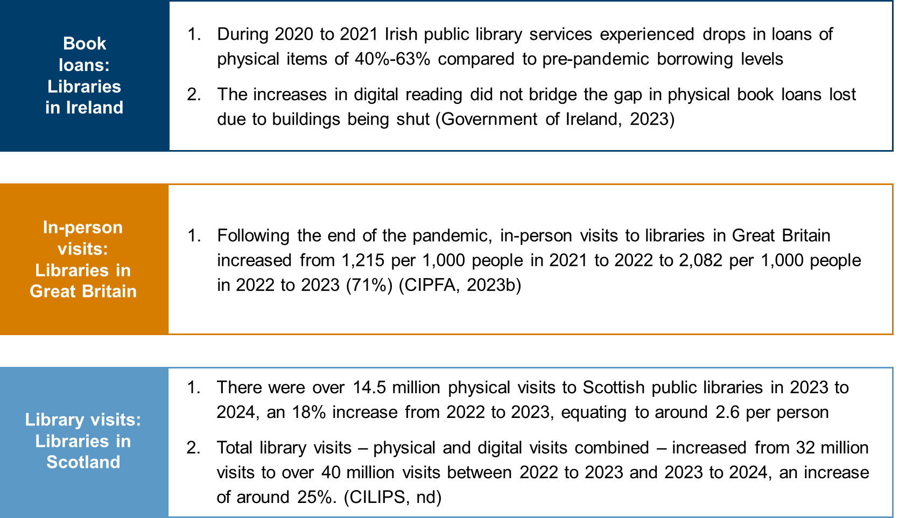

*Figure 15.1: Wider context for book loans, in-person visits and library visits*

Description of Figure 15.1: A chart highlighting wider context with three coloured sections.
Section one explains that during 2020 to 2021 Irish public library services experienced
drops in loans of physical items of 40%-63% compared to pre-pandemic borrowing levels.
The increases in digital reading did not bridge the gap in physical book loans lost due to
buildings being shut (Government of Ireland, 2023). Section two explains that following the
end of the pandemic, in-person visits to libraries in Great Britain increased from 1,215 per
1,000 people in 2021 to 2022 to 2,082 per 1,000 people in 2022 to 2023 (71%) (CIPFA,
2023b). Section three explains that there were over 14.5 million physical visits to Scottish
public libraries in 2023 to 2024, an 18% increase from 2022 to 2023, equating to around 2.6
per person. Total library visits, both physical and digital visits combined, increased from 32
million visits to over 40 million visits between 2022 to 2023 and 2023 to 2024, an increase of
around 25%. (CILIPS, nd).
Source: Government of Ireland 2023, CIPFA 2023b and CILIPS nd
## 15.2. Strategy and planning
Future direction statements frequently refer to the uncertainty created by the pandemic and
the need for services to reconsider their priorities and planning frameworks. Some services
reported delays in strategy development or changes to planned projects as attention shifted
to maintaining essential services and supporting communities.
Future direction statements from later years indicate that services were working to
encourage people to return to library buildings while continuing to develop digital services
that had proved valuable during the pandemic.

<!-- PAGE: 87 -->

## 15.3. Activity, event and customer training provision
Inevitably, it took some time for event provision to recover from the COVID-19 pandemic
period. However, by 2023 to 2024, there was evidence that customers were returning to
libraries in increasing numbers to take part in a wide range of events, activities and training
opportunities.
Formal training attendance figures showed signs of a slight decrease pre-COVID-19.
Attendance then dipped further during the pandemic before starting to gradually increase
again, although it did not return to pre-COVID-19 levels. It is therefore difficult to say
whether COVID-19 simply exacerbated an existing trend of declining provision in this area.
Whilst the majority of services broadly followed a similar trend, a number exhibited a
different pattern, for example, showing a notable increase in attendance in the post-COVID-
19 years, or alternatively a sustained decline post-COVID-19 with limited evidence of
recovery. It is important to note that figures collected for this measure are influenced by
partners who frequently deliver training in conjunction with the library, so some of the
fluctuation may be due to changes in local partnership arrangements.
Median informal support figures dipped after COVID-19 then started to increase again
gradually, although they did not return to pre-COVID-19 levels. However, there was a high
degree of variation between authorities. Some followed the pattern described, but others did
not, for example, maintaining pre-COVID-19 figures in 2022 to 2023, but then declining
drastically in the following years. Some figures appear anomalous and not realistic as an
annual change in a service. This suggests the way these data are collected is not
consistent. In 2024 to 2025, in particular, the range of values was notably wider than in
previous years.
Event attendance figures were rising pre-COVID-19. Figures fell during the pandemic, but
then started to increase again and exceeded pre-COVID-19 figures by 2024 to 2025.
However, figures varied widely across Wales and the range and interquartile range widened
during the Addendum period as some services appeared to struggle to recover.
### 15.3.1. Illustrative example: supporting wellbeing and reducing social isolation
through online reading groups
Newport library service provides an example of a services adapting to support wellbeing
and reduce social isolation during the pandemic by moving a shared reading group online.
The group continued to meet regularly, providing an important opportunity for social
interaction at a time when many participants had limited contact outside their immediate
households. Sessions combined informal conversation with shared reading, creating space
for participants to connect, share experiences and support one another. The group became
an important source of routine, connection and emotional support, particularly for those
living alone. Feedback from participants highlights the value of the sessions. One member
commented: “During the last year, the Shared Reading Group has been a little taste of
normality in a very strange world….This service has impacted on me greatly as I live alone,
and it is something to look forward to on a Wednesday. To feel a little more cultured and <!-- PAGE: 88 --> knowledgeable and less lonely by the end of our session.” (Newport annual report 2020 to
2021).
### 15.3.2. Illustrative example: supporting care home residents’ wellbeing through
digital outreach activities
Bridgend highlights how library services adapted outreach activity during the pandemic by
delivering storytelling and reminiscence sessions to care home residents via Zoom. With in
person visits paused, library staff worked with local care homes to provide interactive
sessions using stories, images and family history materials to stimulate conversation and
shared memories. These sessions offered residents a change to routine, opportunities for
social interaction and a chance to engage in new activities. They also supported relaxation
and wellbeing by creating a calm and engaging environment. A member of staff at the care
home said: “I have found that these sessions are beneficial for relaxation as they
concentrate on listening and it helps them feel calm…I just wanted to let you know the
positive impact the stories are having and that we appreciate you taking the time to do these
with us.” (Bridgend annual report 2020 to 2021).
### 15.3.3. Illustrative example: building digital confidence and social connection
through virtual book groups
Torfaen libraries highlight how a virtual book club established during the pandemic
supported both social connection and digital confidence. With libraries closed, the group
used the BorrowBox service to access shared reading materials suitable for online
discussion. Library staff supported members to participate and facilitated the transition to
Microsoft Teams. The first session was attended by 12 members, the majority of whom
were in their 70s and 80s, lived alone and had not previously used virtual meeting platforms.
Despite initial technical challenges, participants quickly adapted. The group helped reduce
social isolation and loneliness while also building confidence in using digital technology.
(Torfaen annual report 2020 to 2021).

*Figure 15.2: Wider context for activities and events*

Description of Figure 15.2: A chart highlighting wider context with one coloured section. This
section explains that activities and events in library services elsewhere also took time to <!-- PAGE: 89 --> recover from the pandemic. In libraries in Northern Ireland, 2022 to 2023 participation
statistics for library activities were generally lower than pre-pandemic figures. For example,
comparing 2022 to 2023 to 2017 to 2018 it showed the following; class visit sessions were
down 6%; participation in 1 to 1 IT sessions (basic skills) were down 70%; participation in
digital literacy sessions was down 33%; reading group participation was down 19% (adults
decreased by 4% and children down by 56%); Rhythm and Rhyme sessions were down
32%; and Storytime sessions were down 39% (Libraries Northern Ireland, 2023).
Source: Libraries Northern Ireland, 2023
## 15.4. Customer satisfaction and impact of library services
As Welsh library services are only required to carry out a customer survey once every three
years, results for the Sixth Framework period fall into pre-COVID-19 (2017 to 2020) and
post-COVID-19 (2022 to 2025) groupings. Whilst it is not possible to attribute any changes
in responses in these two timeframes directly to the pandemic, it is worth noting differences
between the two datasets.
The median percentage of adults who thought that using the library had helped them to
develop new skills was lower post-COVID-19. At the same time, the interquartile range
reduced, meaning there was greater consistency in the way that the majority of services
performed, but there were several outliers at the lower end of the scale. There was some
evidence of a statistically significant difference between pre- and post-COVID-19 figures for
this measure (Student’s t=2.32, p<0.05).
The median percentage of adults who found helpful information for health and wellbeing at
the library was also lower post-COVID-19. Again, whilst the interquartile range reduced,
there were several outliers at the lower end of the scale as the range increased. There was
some evidence of a statistically significant difference between pre- and post-COVID-19
figures (Student’s t=2.24, p<0.05).
The pattern of adults who experience the library as an enjoyable, safe and inclusive place
changed little between pre- and post-COVID-19 figures. The median remained the same
and the range of values was slightly smaller post-COVID-19. The median percentage of
adults who think the library had made a difference to their lives was slightly lower post-
COVID-19. The interquartile range was smaller, but there were more outliers at the lower
end of the scale. There was little difference between pre- and post-COVID-19 figures for the
percentage of young people who think the library helps them to learn; the median, range
and interquartile range all saw little change. For these three measures, there was no
evidence of a statistically significant difference between pre- and post-COVID-19 figures.
There was little difference between pre- and post-COVID-19 figures for any of the customer
service measures, namely the percentage of adults rating the choice of books, IT facilities,
customer care or library overall as ‘very good’ or ‘good’ and rating out of 10 by children and
young people. In all cases, there were only slight changes in the median, range and
interquartile range.

<!-- PAGE: 90 -->

## 15.5. Staffing and volunteers
During the COVID-19 pandemic, library staff in several Welsh authorities contributed to
wider community support initiatives organised by their local authorities. Staff were
redeployed or volunteered to assist with activities such as welfare calls to vulnerable
residents, helping coordinate community support networks, delivering essential supplies and
supporting services assisting people who were shielding or isolated. These activities
demonstrated the adaptability of library staff and the broader civic role that library services
can play during periods of crisis. The example highlights how library staff contributed to
local authority emergency responses while continuing to support library users in new ways.
Volunteer numbers fell during COVID-19 due to lockdowns and other restrictions. Although
numbers recovered in the years that followed, the median number of volunteers and
volunteer hours were below their pre-COVID-19 figures at end of the Sixth Framework.
Nevertheless, a small number of authorities were outliers, having considerably higher
volunteer numbers and/or volunteer hours than the majority of services. The gap between
these services and the remainder of Welsh library authorities increased in the post-COVID-
19 period.
### 15.5.1. Illustrative example: library staff redeployment to support vulnerable
residents
Conwy library service highlights how library staff supported vulnerable residents during
lockdown through redeployment to call handling, brokerage and shielding support teams. In
these roles, staff provided practical and emotional support to individuals who were
frightened, confused or in need of assistance. With high demand affecting access to food
and medicine, particularly in the early stages of the pandemic, library staff played a key role
in ensuring that vulnerable residents received essential supplies. They worked closely with
partners, including food banks and community groups, to coordinate support. One member
of staff noted: “The collaborative work we did with existing food banks, and those set up by
local community groups was heartening. Their support and immediate response to requests
for help were invaluable to us in resolving difficult situations”. (Conwy annual report 2020 to
2021).
### 15.5.2. Illustrative example: library staff supporting community wellbeing and
connection
Merthyr Tydfil libraries highlights how library staff responded quickly during the first
lockdown to support their communities. Staff established networks on digital platforms to
stay connected, share information and ensure that individuals were not left isolated during a
difficult period. The team also sought out volunteering opportunities, including delivering
free school meals to children, and maintained regular contact with Homelink customers to
support those at risk of isolation. In addition, some staff contributed to local NHS support
efforts by collecting food and toiletries for hospital staff under pressure. (Merthyr Tydfill
annual report 2020 to 2021).

<!-- PAGE: 91 -->

*Figure 15.3: Wider context for volunteer numbers*

Description of Figure 15.3: A chart highlighting wider context with one coloured section. This
section explains that in 2022 to 2023, CIPFA reported that, while staff levels in libraries in
Great Britain had remained steady, the number of volunteers showed significant recovery
since 2021 to 2022. Volunteer numbers rose from 0.34 per 1,000 people in 2021 to 2022 to
0.59 in 2022 to 2023, a 74% increase.
Source: CIPFA 2023b
## 15.6. Summary
During COVID-19, libraries experienced significant disruption to normal service delivery but
adapted rapidly by expanding digital services, introducing new service models and
maintaining access to resources wherever possible. At the same time, libraries played an
important role in supporting their communities. Through online activities, home delivery
services and wider community support initiatives, libraries helped reduce isolation, maintain
access to reading and information and provide practical assistance to residents. As services
moved into the recovery phase, attention shifted towards rebuilding engagement and
integrating the lessons learned during the pandemic into future service development.
However, it is clear that some services rebounded more quickly than others. It is difficult to
comment on patterns of post-COVID-19 recovery across Welsh library services based on
the WPLS data alone. For example, health inequalities and economic disparity, exacerbated
during the pandemic, may play a role in recovery in different localities.
Many of the changes initially brought about, or accelerated, by the pandemic appear to have
long lasting implications for Welsh libraries. For example, the decline in adult book issues
and corresponding rise in e-issues was undoubtedly boosted by the COVID-19 lockdowns.
National level improvements in some areas should not mask that fact that some services
continued to struggle to recover long after restrictions were lifted.

<!-- PAGE: 92 -->

# 16. Conclusions
This study examined trends in Welsh public library provision during the WPLS Sixth
Framework period (2017 to 2025). Drawing on both quantitative and qualitative evidence,
the analysis provides insight into how library services evolved during a period marked by
structural pressures, the disruption of the COVID-19 pandemic, and subsequent recovery.
Overall, the findings demonstrate that Welsh public libraries continued to deliver a broad
range of services and supported Welsh Government policy priorities associated with the
Wellbeing of Future Generations (Wales) Act 2015. However, the analysis also identifies a
number of pressures affecting the sector, particularly in relation to staffing, opening hours,
service points and financial resourcing.
Stability of the core library offer
The fundamental elements of the statutory public library service in Wales remained largely
stable across the Sixth Framework period. Most Core Entitlements were met, in full or in
part, by the majority of Welsh library services throughout the Framework. The core
foundations of the public library service therefore remain firmly embedded across the Welsh
library network.
However, a small number of Core Entitlements proved more challenging to meet
consistently. In particular, those relating to opening hours, user consultation and strategic
planning showed greater variation between authorities and across years. These challenges
appear to be associated with wider pressures on staffing capacity and operational
resources.
Performance against the WPLS Quality Indicators presents a mixed picture. Several
indicators relating to service delivery and community activity were consistently met by the
majority of authorities. For example, indicators associated with digital support, reader
development, health and wellbeing services, and internet access remained strong across
the framework period. Conversely, indicators associated with staffing levels, opening hours
and stock provision were more challenging. In particular, the staffing-related indicator was
not met in full by any service during the Sixth Framework. In addition, the proportion of
services meeting the opening hours target declined over time.
Overall, the evidence suggests that while the statutory framework continues to provide a
stable foundation for library provision, the capacity of services to consistently meet all
aspects of that framework is increasingly influenced by underlying resource constraints.
Challenges for Welsh libraries
One of the clearest trends identified in the analysis is the gradual reduction in staffing levels
across Welsh library services during the Sixth Framework period. Nationally, library staffing
declined by approximately 12.9%, with an even larger reduction in qualified professional
staff. These changes occurred gradually over the period rather than as a result of a single
event.

<!-- PAGE: 93 -->

The analysis also indicates a strong relationship between staffing levels and service
capacity. For example, staffing levels show a strong positive correlation with opening hours,
highlighting the operational link between workforce capacity and service availability.
Alongside staffing changes, the number of library service points and total opening hours
also declined across Wales. Although the scale of these changes varies between
authorities, the overall national trend suggests a gradual reduction in physical service
infrastructure during the framework period. Despite this, the majority of services have
continued to deliver the core functions expected within the WPLS framework.
Financial trends and resource allocation
Financial data suggest that, although total revenue expenditure increased slightly across the
framework period, this increase did not keep pace with inflation. When adjusted for inflation,
overall spending on library services is around 13.5% lower in real terms. Only a small
number of authorities experienced real-term increases in revenue expenditure.
These financial pressures are reflected in several operational indicators. In particular, stock
acquisition targets were among the most difficult for services to meet. The analysis
suggests that maintaining up-to-date collections and resource investment remains a
continuing challenge for many authorities.
At the same time, investment in digital resources and infrastructure has become
increasingly important. Libraries have continued to support access to digital services, online
resources and e-government.
Impact of the coronavirus (COVID-19) pandemic
The COVID-19 pandemic represents a major contextual factor affecting the Sixth
Framework period. The pandemic disrupted data collection, reduced physical access to
services and required library services to adapt rapidly to changing circumstances. The
pandemic also accelerated certain developments, including digital engagement and the
expansion of online services.
Recovery from the pandemic period was not consistent across the country. Whilst some
services recovered relatively quickly in terms of visitor numbers, issues, events and so forth,
the impact of the pandemic was more long-lasting in other services. Headline national
figures can mask a variety of experiences in library services across Wales.
Overall assessment
The evidence suggests that Welsh public libraries remained resilient throughout the Sixth
Framework period and continued to deliver a wide range of services that support national
policy priorities and community wellbeing. Libraries continue to provide significant social
value, supporting learning, wellbeing, inclusion and cultural participation across Wales.
However, the analysis also indicates that the sector is operating within increasingly
constrained resources. Declines in staffing levels, reductions in service points and
pressures on revenue expenditure put increasing pressure on library services and the <!-- PAGE: 94 --> impacts are evident in the growing challenges many library services face in meeting Core
Entitlements and Quality Indictor targets.

<!-- PAGE: 95 -->

# Annex A: Changes in Core Entitlement and Quality Indicator
data
Note: data reported for all CEs and QIs were affected to some extent by the COVID-19
pandemic in 2019 to 2020, 2020 to 2021 and 2021 to 2022.
Core Entitlements
Core Entitlement 1: Reported in all years.
Core Entitlement 2: Reported in all years.
Core Entitlement 3: Reported in all years.
Core Entitlement 4: Reported in all years.
Core Entitlement 5: Reported in all years.
Core Entitlement 6: Reported in all years. Minor amendment for 2023 to 2024 and 2024 to
2025 to address issues around administration fees.
Core Entitlement 7: Reported in all years. Minor amendments for 2023 to 2024 and 2024 to
2025 to note provision depends on nature of service point and substitute ‘digital equipment’
for ‘computers’. Incorporates QI 11 in 2023 to 2024 and 2024 to 2025.
Core Entitlement 8: Reported in all years.
Core Entitlement 9: Reported in all years.
Core Entitlement 10: Reported in all years.
Core Entitlement 11: Reported in all years. Minor amendment for 2023 to 2024 and 2024 to
2025 to include remote users in definition.
Core Entitlement 12: Reported in all years. Minor amendment for 2023 to 2024 and 2024 to
2025 to request links to documents included.
Core Entitlement 13 Reported in 2023 to 2024 and 2024 to 2025 only.
Quality indicators
Quality Indicator 1: Services were required to collect QI 1 once between 2017 to 2018 and
2019 to 2020 and once in 2022 to 2023 and 2024 to 2025 period. Minor amendment for
2023 to 2024 and 2024 to 2025 to clarify reporting period.
Quality Indicator 2: Services were required to collect QI 2 once in 2017 to 2018 and 2019 to
2020 period and once in 2022 to 2023 and 2024 to 2025 period. Minor amendment for 2023
to 2024 and 2024 to 2025 to clarify reporting period.
Quality Indicator 3: Collected in 2017 to 2018, 2018 to 2019, 2019 to 2020 and 2022 to
2023 only. Replaced by CE 13 in 2023 to 2024 and 2024 to 2025.

<!-- PAGE: 96 -->

Quality Indicator 4: This QI was not collected in 2020 to 2021 or 2021 to 2022. In 2023 to
2024 and 2024 to 2025, the guidance noted that library-led events delivered by or with
partner organisations could be included. From 2023 to 2024 onwards, Books on
Prescription/Better with Books were replaced by Reading Well; dementia-friendly and
mental health awareness were replaced by a wider category of ‘other services such as
mental health support, support for carers and other groups, dementia-friendly services’; data
on Story times/Baby Rhyme Time were added’. Reading Well issue figures were collected in
2023 to 2024 only.
Quality Indicator 5: Not collected in 2019 to 2020, 2020 to 2021 or 2021 to 2022. In 2023 to
2024 and 2024 to 2025, there was a minor change to the wording of part b to refer to
‘purpose in attending’, rather than ‘goals’.
Quality Indicator 6: Not collected in 2019 to 2020, 2020 to 2021 or 2021 to 2022. Minor
amendments for 2023 to 2024 and 2024 to 2025 to define special requirements and note
that events delivered in partnership with organisations should be included.
Quality Indicator 7: Collected in all years. Minor amendments for 2023 to 2024 and 2024 to
2025 to cover Library at Home Services.
Quality Indicator 8: Collected in all years. However, part a was not collected in 2020 to 2021
or 2021 to 2022. In 2023 to 2024 parts c, d, e and f were not collected. Part a was removed
in 2023 to 2024 and 2024 to 2025. In 2023 to 2024, acquisitions targets were adjusted to
reflect population density. In 2023 to 2024 and 2024 to 2025, part c, % spend on e-
resources was added.
Quality Indicator 9: Collected in all years. However, parts a and b were not collected in 2024
to 2025.
Quality Indicator 10: Not collected in 2024 to 2025. In 2023 to 2024, the acquisitions target
was collected as a percentage of material budget only (not per Welsh speaking population).
Quality Indicator 11: Not collected in 2020 to 2021 or 2021 to 2022. In 2023 to 2024 and
2024 to 2025, this was included in CE 7.
Quality Indicator 12: Collected in 2017 to 2018, 2018 to 2019, 2019 to 2020 and 2022 to
2023 only.
Quality Indicator 13: Collected in all years. However, part iv was not collected in 2019 to
2020, 2020 to 2021 or 2021 to 2022. In 2023 to 2024 and 2024 to 2025, the target for part iv
(training hours) was increased from 1% to 2%.
Quality Indicator 14: Collected in all years. Part c (capital expenditure) was removed in 2023
to 2024 and 2024 to 2025.
Quality Indicator 15: Collected in 2017 to 2018, 2018 to 2019 and 2022 to 2023 only.
Quality Indicator 16: Not collected in 2020 to 2021 or 2021 to 2022. In 2023 to 2024 and
2024 to 2025, parts a and b (emergency closure/missed mobile stops) were removed.

<!-- PAGE: 97 -->

# Annex B: Classification of local authorities
The 2021 Rural Urban Classification (RUC) is a standardised method for classifying
geographies as rural or urban developed in collaboration with ONS Geography, DEFRA and
Welsh Government. The following list indicates whether Welsh local authorities are
classified as urban or rural according to this method.
Rural
Carmarthenshire
Ceredigion
Denbighshire
Gwynedd
Isle of Anglesey
Pembrokeshire
Powys

Urban
Blaenau Gwent
Bridgend
Caerphilly
Cardiff
Conwy
Flintshire
Merthyr Tydfil
Neath Port Talbot
Newport
Rhondda Cynon Taf
Swansea
Torfaen
Vale of Glamorgan
Wrexham.

<!-- PAGE: 98 -->

# Annex C: Summary of statistical analysis
### Table C.1: Total staff and opening hours
2017
to
2018
2018
to
2019
2019
to
2020
2022
to
2023
2023
to
2024
2024
to
2025
Pearson’s
r
0.868 0.863 0.867 0.944 0.943 0.959
p <0.01 <0.01 <0.01 <0.01 <0.01 <0.01
Source: WPLSQI 13 and WPLSQI 16
### Table C.2: Opening hours and total issues
2017
to
2018
2018
to
2019
2019
to
2020
2022
to
2023
2023
to
2024
Pearson’s
r
0.827 0.825 0.799 0.856 0.847
p <0.01 <0.01 <0.01 <0.01 <0.01
Source WPLSQI 8 and WPLSQI 13
### Table C.3: Resource spend and total issues
2017
to
2018
2018
to
2019
2019
to
2020
2020
to
2021
2021
to
2022
2022
to
2023
2023
to
2024
Pearson’s
r
0.886 0.915 0.921 0.772 0.798 0.775 0.768
p <0.01 <0.01 <0.01 <0.01 <0.01 <0.01 <0.01
Source: WPLSQI 8, WPLSQI 9 and WPLSQI 14
### Table C.4: Total resource spend and adult issues
2017
to
2018
2018
to
2019
2019
to
2020
2020
to
2021
2021
to
2022
2022
to
2023
2023
to
2024
Pearson’s
r
0.859 0.868 0.832 0.708 0.711 0.902 0.824
p <0.01 <0.01 <0.01 <0.01 <0.01 <0.01 <0.01
Source: WPLSQI 8, WPLSQI 9 and WPLSQI 14

|  | 2017 to 2018 | 2018 to 2019 | 2019 to 2020 | 2022 to 2023 | 2023 to 2024 | 2024 to 2025 |
|:---|---:|---:|---:|---:|---:|---:|
| Pearson’s r | 0.868 | 0.863 | 0.867 | 0.944 | 0.943 | 0.959 |
| p | <0.01 | <0.01 | <0.01 | <0.01 | <0.01 | <0.01 |

|  | 2017 to 2018 | 2018 to 2019 | 2019 to 2020 | 2022 to 2023 | 2023 to 2024 |
|:---|---:|---:|---:|---:|---:|
| Pearson’s r | 0.827 | 0.825 | 0.799 | 0.856 | 0.847 |
| p | <0.01 | <0.01 | <0.01 | <0.01 | <0.01 |

|  | 2017 to 2018 | 2018 to 2019 | 2019 to 2020 | 2020 to 2021 | 2021 to 2022 | 2022 to 2023 | 2023 to 2024 |
|:---|---:|---:|---:|---:|---:|---:|---:|
| Pearson’s r | 0.886 | 0.915 | 0.921 | 0.772 | 0.798 | 0.775 | 0.768 |
| p | <0.01 | <0.01 | <0.01 | <0.01 | <0.01 | <0.01 | <0.01 |

|  | 2017 to 2018 | 2018 to 2019 | 2019 to 2020 | 2020 to 2021 | 2021 to 2022 | 2022 to 2023 | 2023 to 2024 |
|:---|---:|---:|---:|---:|---:|---:|---:|
| Pearson’s r | 0.859 | 0.868 | 0.832 | 0.708 | 0.711 | 0.902 | 0.824 |
| p | <0.01 | <0.01 | <0.01 | <0.01 | <0.01 | <0.01 | <0.01 |.

<!-- PAGE: 99 -->

### Table C.5: Children’s resource spend and children’s issues
2017
to
2018
2018
to
2019
2019
to
2020
2020
to
2021
2021
to
2022
2022
to
2023
2023
to
2024
Pearson’s
r
0.804 0.776 0.885 0.656 0.772 0.821 0.862
p <0.01 <0.01 <0.01 <0.01 <0.01 <0.01 <0.01
Source: WPLSQI 8, WPLSQI 9 and WPLSQI 14
### Table C.6: E-resource spend and e-resource issues
2023
to
2024
2024
to
2025
Pearson’s
r
0.542 0.751
p <0.01 <0.01
Source: WPLSQI 8, WPLSQI 9 and WPLSQI 14
### Table C.7: Total resource spend and e-resource spend
2023
to
2024
2024
to
2025
Pearson’s
r
0.749 0.867
p <0.01 <0.01
Source: WPLSQI 9 and WPLSQI 14
### Table C.8: Welsh language resources and Welsh spend
2017
to
2018
2018
to
2019
2019
to
2020
2020
to
2021
2021
to
2022
2022
to
2023
2023
to
2024
Pearson’s
r
0.340 0.768 0.737 0.449 0.634 0.638 0.621
p <0.01 <0.01 <0.01 <0.05 <0.01 <0.01 <0.01
Source: WPLSQI 10 and WPLSQI 14

|  | 2017 to 2018 | 2018 to 2019 | 2019 to 2020 | 2020 to 2021 | 2021 to 2022 | 2022 to 2023 | 2023 to 2024 |
|:---|---:|---:|---:|---:|---:|---:|---:|
| Pearson’s r | 0.804 | 0.776 | 0.885 | 0.656 | 0.772 | 0.821 | 0.862 |
| p | <0.01 | <0.01 | <0.01 | <0.01 | <0.01 | <0.01 | <0.01 |

|  | 2023 to 2024 | 2024 to 2025 |
|:---|---:|---:|
| Pearson’s r | 0.542 | 0.751 |
| p | <0.01 | <0.01 |

|  | 2023 to 2024 | 2024 to 2025 |
|:---|---:|---:|
| Pearson’s r | 0.749 | 0.867 |
| p | <0.01 | <0.01 |

|  | 2017 to 2018 | 2018 to 2019 | 2019 to 2020 | 2020 to 2021 | 2021 to 2022 | 2022 to 2023 | 2023 to 2024 |
|:---|---:|---:|---:|---:|---:|---:|---:|
| Pearson’s r | 0.340 | 0.768 | 0.737 | 0.449 | 0.634 | 0.638 | 0.621 |
| p | <0.01 | <0.01 | <0.01 | <0.05 | <0.01 | <0.01 | <0.01 |.

<!-- PAGE: 100 -->

### Table C.9: Per capita Welsh resource spend in urban/rural authorities
2017
to
2018
2018
to
2019
2019
to
2020
2020
to
2021
2021
to
2022
2022
to
2023
2023
to
20241
Mann-
Whitney
U
31.0 21.5 16.0 35.5 29.0 28.0 18.0
p 0.095 <0.05 <0.01 0.172 0.07 0.59 <0.05
Source: WPLSQI 10
[1] Data estimate based on percentage resource spend.
### Table C.10: Opening hours per capita in urban/rural authorities
2017
to
2018
2018
to
2019
2019
to
2020
2022
to
2023
2023
to
2024
2024
to
2025
Mann-
Whitney
U
26.0 24.0 31.0 34.5 31.5 36.0
p <0.05 <0.05 0.095 0.218 0.101 0.127
Source: WPLSQI 16
### Table C.11: Welsh spend and Welsh speakers
2017
to
2018
2018
to
2019
2019
to
2020
2020
to
2021
2021
to
2022
2022
to
2023
2023
to
2024
Pearson’s
r
0.785 0.774 0.687 0.492 0.862 0.851 0.827
p <0.01 <0.01 <0.01 <0.05 <0.01 <0.01 <0.01
Source: WPLSQI 10
### Table C.12: Per capita adult issues in urban and rural authorities
2017
to
2018
2018
to
2019
2019
to
2020
2020
to
2021
2021
to
2022
2022
to
2023
2023
to
2024
Mann
Whitney
U
22.0 25.0 22.0 31.0 28.0 25.0 21.0
p <0.05 <0.05 <0.05 0.095 0.059 <0.05 <0.05
Source: WPLSQI 8

|  | 2017 to 2018 | 2018 to 2019 | 2019 to 2020 | 2020 to 2021 | 2021 to 2022 | 2022 to 2023 | 2023 to 20241 |
|:---|---:|---:|---:|---:|---:|---:|---:|
| Mann- Whitney U | 31.0 | 21.5 | 16.0 | 35.5 | 29.0 | 28.0 | 18.0 |
| p | 0.095 | <0.05 | <0.01 | 0.172 | 0.07 | 0.59 | <0.05 |

|  | 2017 to 2018 | 2018 to 2019 | 2019 to 2020 | 2022 to 2023 | 2023 to 2024 | 2024 to 2025 |
|:---|---:|---:|---:|---:|---:|---:|
| Mann- Whitney U | 26.0 | 24.0 | 31.0 | 34.5 | 31.5 | 36.0 |
| p | <0.05 | <0.05 | 0.095 | 0.218 | 0.101 | 0.127 |

|  | 2017 to 2018 | 2018 to 2019 | 2019 to 2020 | 2020 to 2021 | 2021 to 2022 | 2022 to 2023 | 2023 to 2024 |
|:---|---:|---:|---:|---:|---:|---:|---:|
| Pearson’s r | 0.785 | 0.774 | 0.687 | 0.492 | 0.862 | 0.851 | 0.827 |
| p | <0.01 | <0.01 | <0.01 | <0.05 | <0.01 | <0.01 | <0.01 |

|  | 2017 to 2018 | 2018 to 2019 | 2019 to 2020 | 2020 to 2021 | 2021 to 2022 | 2022 to 2023 | 2023 to 2024 |
|:---|---:|---:|---:|---:|---:|---:|---:|
| Mann Whitney U | 22.0 | 25.0 | 22.0 | 31.0 | 28.0 | 25.0 | 21.0 |
| p | <0.05 | <0.05 | <0.05 | 0.095 | 0.059 | <0.05 | <0.05 |.

<!-- PAGE: 101 -->

### Table C.13: Total issues and qualified staff
2017
to
2018
2018
to
2019
2019
to
2020
2020
to
2021
2021
to
2022
2022
to
2023
2023
to
2024
Pearson’s
r
0.575 0.431 0.594 0.177 0.163 0.027 0.125
p <0.01 <0.05 <0.01 0.216 0.234 0.453 0.578
Source: WPLSQI 8 and WPLSQI 13
### Table C.14: Total issues and total staff
2017
to
2018
2018
to
2019
2019
to
2020
2020
to
2021
2021
to
2022
2022
to
2023
2023
to
2024
Pearson’s
r
0.667 0.722 0.766 0.811 0.738 0.693 0.611
p <0.01 <0.01 <0.01 <0.01 <0.01 <0.01 <0.01
Source: WPLSQI 8 and WPLSQI 13
### Table C.15: Change in mobile provision in urban/rural authorities
Change in
mobile numbers
Mann
Whitney U
47.0
p 0.538
Source: WPLS Contextual data
### Table C.16: Total staff and total event attendance
2017
to
2018
2018
to
2019
2022
to
2023
2023
to
2024
2024
to
2025
Pearson’s
r
0.933 0.856 0.763 0.896 0.856
p <0.01 <0.01 <0.01 <0.01 <0.01
Source: WPLSQI 13 and WPLSQI 16

|  | 2017 to 2018 | 2018 to 2019 | 2019 to 2020 | 2020 to 2021 | 2021 to 2022 | 2022 to 2023 | 2023 to 2024 |
|:---|---:|---:|---:|---:|---:|---:|---:|
| Pearson’s r | 0.575 | 0.431 | 0.594 | 0.177 | 0.163 | 0.027 | 0.125 |
| p | <0.01 | <0.05 | <0.01 | 0.216 | 0.234 | 0.453 | 0.578 |

|  | 2017 to 2018 | 2018 to 2019 | 2019 to 2020 | 2020 to 2021 | 2021 to 2022 | 2022 to 2023 | 2023 to 2024 |
|:---|---:|---:|---:|---:|---:|---:|---:|
| Pearson’s r | 0.667 | 0.722 | 0.766 | 0.811 | 0.738 | 0.693 | 0.611 |
| p | <0.01 | <0.01 | <0.01 | <0.01 | <0.01 | <0.01 | <0.01 |

|  | Change in mobile numbers |
|:---|---:|
| Mann Whitney U | 47.0 |
| p | 0.538 |

|  | 2017 to 2018 | 2018 to 2019 | 2022 to 2023 | 2023 to 2024 | 2024 to 2025 |
|:---|---:|---:|---:|---:|---:|
| Pearson’s r | 0.933 | 0.856 | 0.763 | 0.896 | 0.856 |
| p | <0.01 | <0.01 | <0.01 | <0.01 | <0.01 |.

<!-- PAGE: 102 -->

# Annex D: Sixth framework Core Entitlements
Core Entitlement 1: Free & Open to All
Sixth Framework: Libraries in Wales will be free to join, and open to all.
Addendum: No change
Core Entitlement 2: Knowledgeable & Qualified Staff
Sixth Framework: Libraries in Wales will ensure friendly, knowledgeable, and qualified staff
are on hand to help.
Addendum: No change
Core Entitlement 3: Range of Services & Activities
Sixth Framework: Libraries in Wales will provide access to a range of services, activities,
and high-quality resources in a range of formats to support lifelong learning, personal well-
being and development, community participation, and culture and recreation.
Addendum: Libraries in Wales provide access to a range of services, activities, and high-
quality resources in a range of formats to support lifelong learning, personal health and well-
being, community participation, cultural experiences, recreation, and reading for pleasure.
Core Entitlement 4: Services for Special Needs
Sixth Framework: Libraries in Wales will provide appropriate services, facilities and
information resources for individuals and groups with special requirements.
Addendum: No change
Core Entitlement 5: Safe, Accessible Spaces
Sixth Framework: Libraries in Wales will provide appropriate safe, attractive, and accessible
physical spaces with suitable staffed opening hours.
Addendum: No change
Core Entitlement 6: Free Lending & Access to Info
Sixth Framework: Libraries in Wales will lend books for free, and deliver free access to
information, including online information resources available 24 hours a day.
Addendum: No change
Core Entitlement 7: Free Use of Internet & IT
Sixth Framework: Libraries in Wales will provide free use of the Internet and computers,
including WiFi.
Addendum: Libraries in Wales provide free use of the Internet including WiFi, and access to
digital equipment, in all service points.

<!-- PAGE: 103 -->

Core Entitlement 8: Welsh Language Provision
Sixth Framework: Libraries in Wales will provide access to services, cultural activities, and
high quality resources in the Welsh language.
Addendum: No change
Core Entitlement 9: Shared Catalogue & Resources
Sixth Framework: Libraries in Wales will work in partnership to share catalogues and
facilitate access to the resources of all Welsh libraries.
Addendum: No change
Core Entitlement 10: Partnership to Deliver New Services
Sixth Framework: Libraries in Wales will work with a range of partners to promote and
deliver services to new and diverse audiences, enabling more people to benefit from those
services.
Addendum: No change
Core Entitlement 11: User Consultation
Sixth Framework: Libraries in Wales will regularly consult users to gather their views on the
service and information about their changing needs.
Addendum: No change
Core Entitlement 12: Access to Library Strategy
Sixth Framework: Libraries in Wales will provide access to the library’s service’s strategy,
policies, objectives and vision, in print and online, in a range of languages appropriate for
the community.
Addendum: No change
Core Entitlement 13: Supporting Digital Skills (2023 to 2025 only)
Sixth Framework: Not applicable
Addendum: Libraries in Wales provide support to help improve people’s digital skills and
confidence, including the use of e government services
